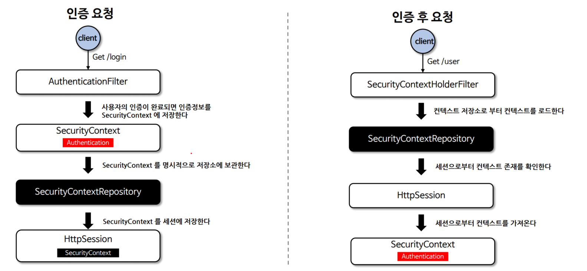
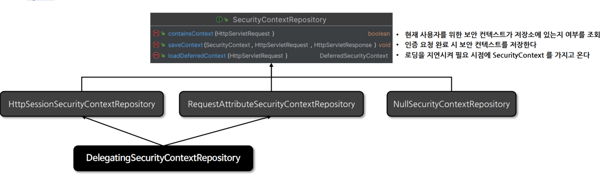
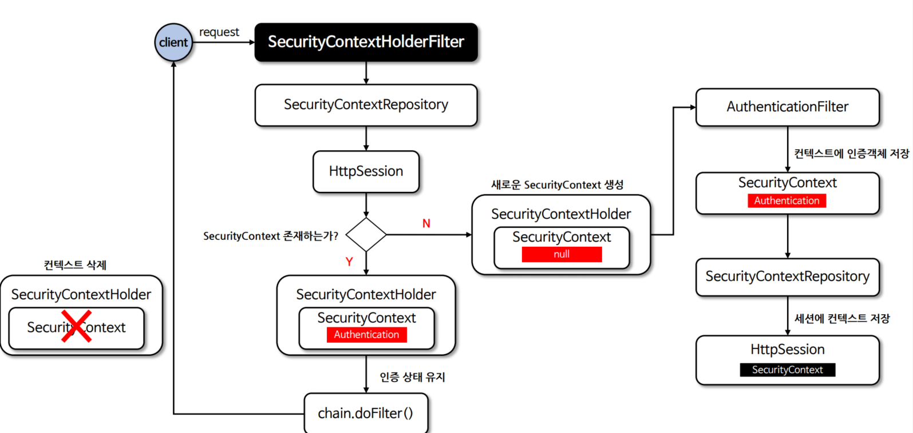
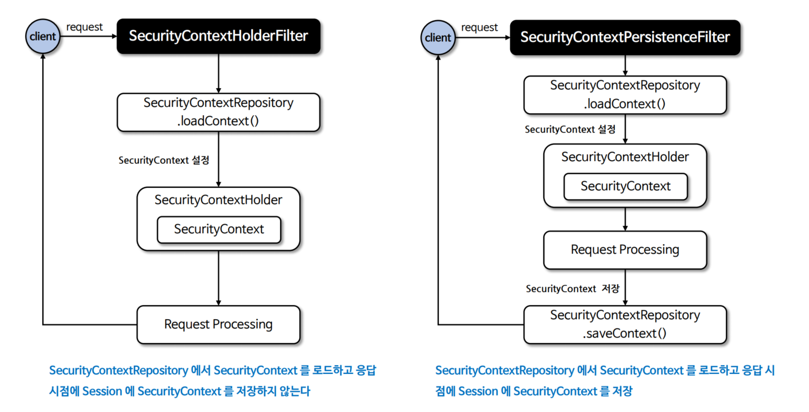

# **SecurityContextRepository**

  - 스프링 시큐리티에서 사용자가 인증을 한 이후 요청에 대해 사용자의 인증을 유지하기 위해 사용되는 클래스이다 
  - 인증 상태의 영속 메커니즘은 사용자가 인증을 하게되면 해당 사용자의 인증 정보와 권한이 `SecurityContext`에 저장되고 `HttpSession`을 통해 요청 간 영속이 이루어 지는 방식이다 



#  **구조**



  - **HttpSessionSecurityContextRepository**
- 요청 간에 `HttpSession`에 보안 컨텍스트를 저장한다
    - 후속 요청 시 컨텍스트 영속성을 유지한다
  - **RequestAttributeSecurityContextRepository**
- ServletRequest에 보안 컨텍스트를 저장한다
    - 후속 요청 시 컨텍스트 영속성을 유지할 수 없다
  - **NullSecurityContextRepository**
- 세션을 사용하지 않는 인증(JWT, OAuth2)일 경우 사용한다 
    - 컨텍스트 관련 아무런 처리를 하지 않는다
  - **DelegatingSecurityConextRepository**
- **RequestAttributeSecurityContextRepository**, **HttpSessionSecurityContextRepository**를 동시에 사용할 수 있도록 위임된 클래스로서 초기화 시 기본으로 설정된다

# **SecurityContextHolderFilter**

  - `SecurityContextRepository`를 사용하여 `SecurityContext`를 얻고 이를 `SecurityContextHolder`에 설정하는 필터 클래스이다
  - 이 필터 클래스는 사용자가 `SecurityContextRepository.saveContext()` 를 명시적으로 호출해야 `SecurityContext` 를 저장할 수 있는데 이는 `SecurityContextPersistenceFilter` 와 다른점이다
  - 인증이 지속되어야 하는지를 각 인증 메커니즘이 독립적으로 선택할 수 있게 하여 더 나은 유연성을 제공하고 `HttpSession` 에 필요할 때만 저장함으로써 성능을 향상시킨다 

# **SecurityContext 생성, 저장, 삭제**

**익명 사용자**

  - `SecurityContextRepository`를 사용하여 `SecurityContext` 객체를 생성하여 `SecurityContextHolder`에 저장 후 다음 필터로 전달 
  - `AnonymousAuthenticationFilter` 에서 `AnonymousAuthenticationToken` 객체를 `SecurityContext`에 저장 

**인증 요청** 

  - `SecurityContextRepository`를 사용하여 `SecurityContext` 객체를 생성하여 `SecurityContextHolder`에 저장 후 다음 필터로 전달 
  - `UsernamePasswordAuthenticationFilter` 에서 인증 성공 후 `SecurityContext`에 `UsernamePasswordAuthentication` 객체를 `SecurityContext`에 저장 
  - `SecurityContextRepository` 를 사용하여 `HttpSession` 에 `SecurityContext` 를 저장 

**인증 후 요청** 

  - `SecurityContextRepository` 를 사용하여 `HttpSession` 에서 `SecurityContext` 를 꺼내어 `SecurityContextHolder` 에 저장 후 다음 필터로 전달 
  - `SecurityContext` 안에 `Authentication` 객체가 존재하면 인증을 유지한다 

**클라이언트 응답 시 공통** 

  - `SecurityContextHolder.clearContext()`로 컨텍스트를 삭제한다 (스레드 풀의 스레드일 경우 반드시 필요)

# **SecurityContextHolderFilter 흐름도**



# **SecurityContextHolderFilter & SecurityContextPersistanceFilter**



스프링 시큐리티 6 버전은 `SecurityContextPersistenceFilter` 대신 `SecurityContextHolderFilter`를 사용한다. `SecurityContextPersistenceFilter`는 무조건 응답 시점에 `HttpSession`에 `SecurityContext`를 저장한다 

만약 내가 세션 기반이 아닌 토큰 기반(JWT) 인증 메커니즘을 사용한다면 세션이 필요하지 않는다 

세션을 사용하지 않고 토큰을 사용하는 이유 중에는 세션이 메모리를 잡아먹어 서버 부하의 원인이 되기 때문도 있는데 `SecurityContextPersistenceFilter`를 사용하면 토큰 기반을 사용하는데도 세션에 저장하는 의미 없는 행동을 하기 때문이다. (서버의 리소스를 잡아먹는 행위)

그래서 스프링 시큐리티 6 버전부터는  `SecurityContextHolderFilter`를 사용하여 유연성을 제공한다. 만약 세션 기반이고 커스텀 필터를 만든다면 세션에 컨텍스트를 저장하는 로직을 명시적으로 넣어야 한다 

# **securityContext() API**

```java
@Bean
public SecurityFilterChain securityFilterChain(HttpSecurity http) throws Exception {
	 http.securityContext(securityContext -> securityContext
													 .requireExplicitSave(true)); 
	 return http.build();
}
```

  - `SecurityContext`를 명시적으로 저장할 것인지 아닌지의 여부를 설정 
  - default value: true
  - true: `SecurityContextHolderFilter`
  - false: `SecurityContextPersistanceFilter` 
  - 현재 `SecurityContextPersistanceFilter`는 Deprecated 되었기 때문에 레거시 시스템 외에는 `SecurityContextHolderFilter`를 사용하면 된다

# **CustomAuthenticationFilter & SecurityContextRepository**

  - 세션 기반으로 시큐리티를 운영할 계획이고 커스텀한 인증 필터를 구현하는 경우 
  - 커스텀한 인증 필터를 구현할 경우 인증이 완료된 후 `SecurityContext` 를 `SecurityContextHolder` 에 설정한 후 `securityContextRepository`에 저장하기 위한 코드를 명시적으로 작성해 주어야 한다

```java
securityContextHolderStrategy.setContext(context);
securityContextRepository.saveContext(context, request, response);
```

  - `securityContextRepository` 는 `HttpSessionSecurityContextRepository`혹은 `DelegatingSecurityContextRepository` 를 사용하면 된다

