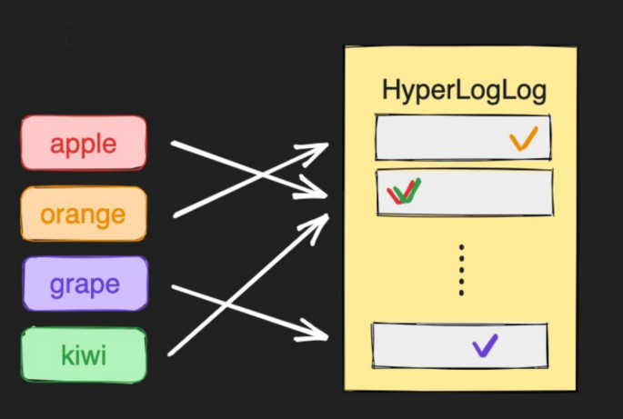
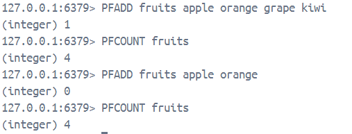

# ***Redis HyperLogLog?***

- *집합의 cardinality를 추정할 수 있는 확률형 자료구조*
- *정확성을 일부 포기하는 대신 저장공간을 효율적으로 사용(평균 에러 0.81%)*
- *VS Set: HyperLogLog는 실제 값을 저장하지 않기 때문에 매우 적은 메모리 사용* 



- *가정) 이렇게 kiwi, apple 처럼 해시 충돌이 발생하면 오차가 발생한다.*

***정리***
*HyperLogLog는 해시값의 통계적 특성을 활용해 Cardinality를 추정하며, 실제 데이터를 저장하지 않고도 효율적으로 작동한다. 
이로 인해 메모리를 극도로 절약하면서도 매우 큰 데이터셋에서 Cardinality를 빠르게 계산할 수 있다. 
HyperLogLog는 정확도가 약간 떨어질 수 있지만,* ***통계적 추정****이 필요한 대부분의 대규모 데이터 분석 작업에서 유용하다.*

# ***Redis HyperLogLog 명령어***

***PFADD***

```shell
PFADD fruits apple orange grape kiwi
```

- *HyperLogLog 자료구조에 값을 추가하기 위한 명령어*
- *Cardinality 값이 변동되면 1을 반환, 반대의 경우 0을 반환*

***PFCOUNT***

```shell
PFCOUNT fruits
```

- *HyperLogLog에 저장된 Cardinality 추정값을 반환*



