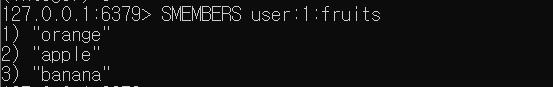
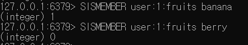
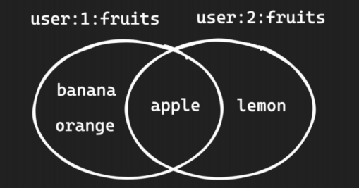
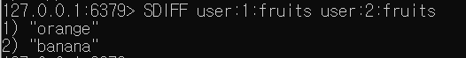
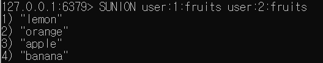

# ***Redis Sets?***

*Unique String을 저장하는 정렬되지 않은 집합* 

*Set Operation 사용 가능(intersection(교집합), union(합집합), difference(차집합))*

# *Redis Sets 명령어*

***[SADD] Sets 추가 명령어***

```shell
 SADD user:1:fruits apple banana orange orange
```


- *Unique String을 저장하기 때문에 중복인 orange는 저장하지 않는다.*

***[SMEMBERS] Sets 전체 조회 명령어***

```shell
SMEMBERS user:1:fruits
```



***[SCARD] Sets*** ***원소 개수를 조회하는 명령어***

```shell
SCARD user:1:fruits
```


***[SISMEMBER] Sets에 특정 원소 포함 여부 확인 명령어***

```shell
SISMEMBER user:1:fruits
```



### ***Set Operation (집합 연산)***

- ***SINTER: 교집합***
- ***SDIFF: 차집합***
- ***SUNION:  합집합***



***user:2:fruits 추가*** 

```shell
SADD user:2:fruits apple lemon
```

- *apple, lemon 추가* 

***[SINTER] 2개의 Sets 교집합 명령어***

```shell
SINTER user:1:fruits user:2:fruits
```


***[SDIFF] 2개의 Sets 차집합 명령어***

```shell
SDIFF user:1:fruits user:2:fruits
```



- ***차집합: user:1:fruits - (user:1:fruits 교집합 user:2:fruits)***

***[SUNION] 2개의 Sets 합집합 명령어***

```shell
 SUNION user:1:fruits user:2:fruits
```



