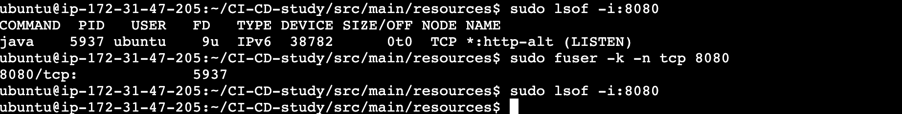

[https://github.com/marketplace/actions/scp-files](https://github.com/marketplace/actions/scp-files)

### 이전 실습 서버 종료, 삭제

```shell
sudo lsof -i:8080
sudo fuser -k -n tcp 8080
sudo lsof -i:8080
```



- `sudo lsof -i:8080`
- `lsof` **: (list open files)** 열린 파일과 관련된 프로세스를 나열하는 명령어 
  - `-i:8080` 8080 포트를 사용하는 프로세스를 찾음
  - `sudo`**:** 관리자 권한이 필요
- `sudo fuser -k -n tcp 8080` 
- `fuser` → 특정 파일, 포트, 또는 소켓을 사용 중인 프로세스를 찾는 명령어
  - `k` → 해당 프로세스를 **강제 종료 (kill)**
  - `-n tcp` → **TCP 프로토콜**에서 실행 중인 8080 포트를 찾음

```shell
rm -rf 프로젝트_이름 
```

- `rm` → **파일 또는 디렉터리를 삭제**하는 기본 명령어
- `r` → **재귀적으로 삭제** (디렉터리 내부의 모든 파일과 하위 폴더까지 삭제)
- `f` → **강제 삭제** (삭제 확인 메시지를 띄우지 않고 바로 삭제

### **Github Actions 작성** 

```yaml
name: Deploy to EC2

on:
  push:
    branches:
      - main


jobs:
  deploy:
    runs-on: ubuntu-latest
    steps:
      - name: Github Repository 올린 파일들 불러오기
        uses: actions/checkout@v4

      - name: JDK 17버전 설치
        uses: actions/setup-java@v4
        with:
          distribution: temurin
          java-version: 17

      - name: application.yml 파일 만들기
        run: echo "$APPLICATION_PROPERTIES" > ./src/main/resources/application.yml

      - name: 테스트 및 빌드하기
        run: ./gradlew clean build

      - name: 빌드된 파일 이름 변경하기
        run: mv ./build/libs/*SNAPSHOT.jar ./project.jar

      - name: SCP 사용 EC2에 빌드된 파일 전송
        uses: appleboy/scp-action@v0.1.7
        with:
          host: ${{ secrets.EC2_HOST }}
          username: ${{ secrets.EC2_USERNAME }}
          key: ${{ secrets.EC2_PRIVATE_KEY }}
          source: project.jar
          target: /home/ubuntu/backend-server/tobe

      - name: SSH 사용하여 EC2 접속 및 배포
        uses: appleboy/ssh-action@v1.0.3
        with:
          # EC2의 주소
          host: ${{ secrets.EC2_HOST }}
          # EC2 접속 username
          username: ${{ secrets.EC2_USERNAME }}
          # EC2의 Key 파일
          key: ${{ secrets.EC2_PRIVATE_KEY }}
          script_stop: true # 실패하면 전체 실패 처리
          script: |
            # 이전 폴더 삭제
            rm -rf /home/ubuntu/backend-server/current
            
            # 폴더 다시 생성 
            mkdir /home/ubuntu/backend-server/current
            
            # tobe -> current 빌드파일 이동 
            mv /home/ubuntu/backend-server/tobe/project.jar /home/ubuntu/backend-server/current/project.jar
            
            cd /home/ubuntu/backend-server/current
            
            # 실행 중인 애플리케이션 종료 (서버가 실행 중이 아니어도 에러 없이 통과)
            sudo fuser -k -n tcp 8080 || true
            
            # 종료 대기 (3초)
            sleep 3
            
            # 애플리케이션 실행 output.log 로그 기록 
            nohup java -jar project.jar > ./output.log 2>&1 &
            
            # 폴더 삭제 
            rm -rf /home/ubuntu/backend-server/tobe
            
            # 배포 완료

```

