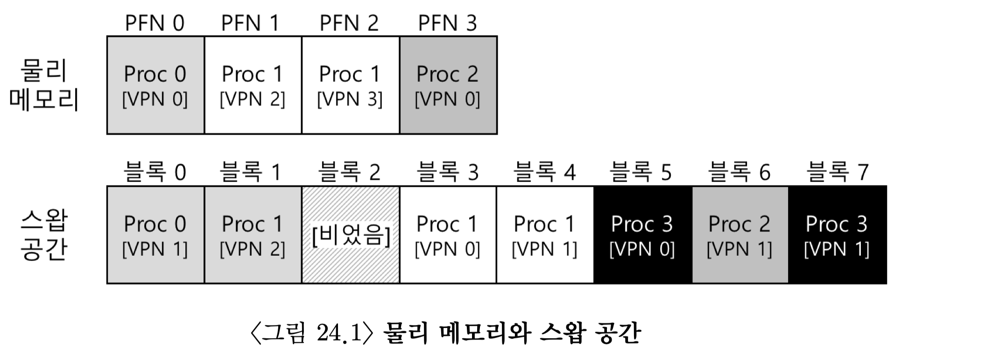
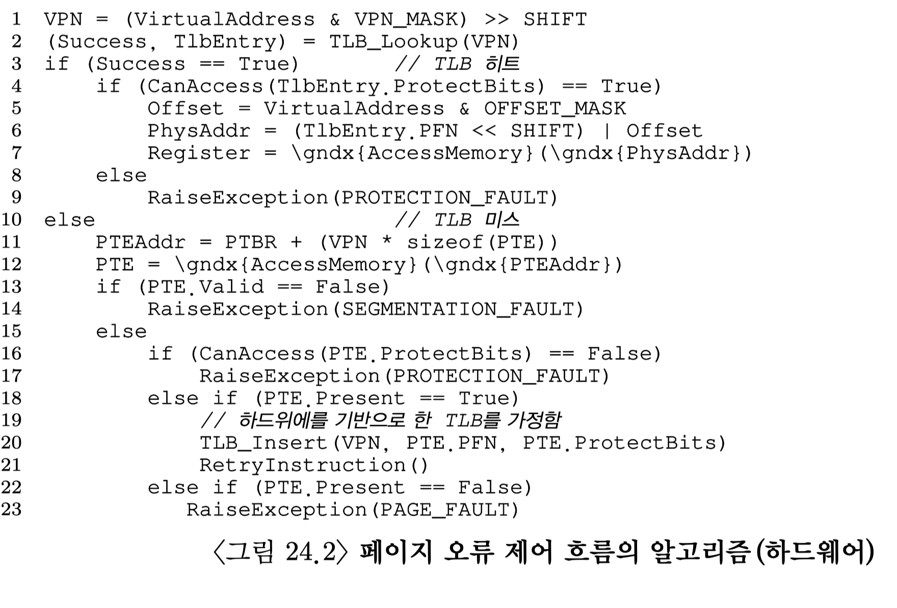
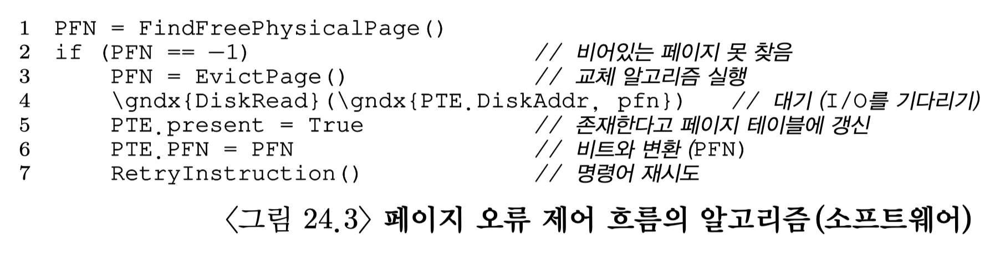

# 24장 개요

지금까지는 모든 페이지들이 물리 메모리에 존재한다는 것을 가정하였다.

하지만 큰 주소 공간을 지원하기 위해서는 운영체제는 주소 공간 중에 현재는 크게 필요하지 않은 일부를 

보관해 둘 공간이 필요하다.

현대 시스템에서는 보통 하드 디스크 드라이브 또는 SSD가 그 역할을 담당한다.

운영체제는 어떻게 그 크고 느린 장치를 사용하면서 마치 커다란 가상 주소 공간이 있는 것처럼 할 수 있을까?

멀티프로그래밍 시스템이 개발되면서 많은 프로세스들의 페이지를 물리 메모리에 전부 저장하는 것이 불가능하게 되었다. 그래서 일부 페이지들을 스왑 아웃/스왑 인하는 기능이 필요하게 되었다. 

이것까지가 현재 가상 메모리의 역할이다. 

---

# 24.1 스왑 공간

디스크에 페이지들을 저장할 수 있는 공간을 **스왑 공간(swap space)**이라고 한다.

메모리 페이지를 읽어서 디스크에 쓰면 swap out, 페이지를 읽어서 메모리에 탑재하면 swap in

운영체제는 스왑 공간에 있는 모든 페이지들의 디스크 주소를 기억해야 한다.



그림 24.1을 보면 물리 메모리에는 4개의 페이지, 스왑 공간에는 8개의 페이지를 위한 공간이 존재한다.

이 에에서는 3개의 프로세스(Proc0, Proc1, Proc2)가 물리 메모리를 공유한다.

몇 개의 유효한 페이지들만 메모리에 올려 놓았으며 나머지 페이지들은 디스크에 스왑 아웃되어 있다.

네 번째 프로세스(Proc 3) 의 모든 페이지들은 디스크로 스왑 아웃되어 있기 때문에 현재 실행 중이 아니다.

```
예제를 통해서, 스왑 공간을 이용하면, 시스템에 실제 물리적으로 존재하는 메모리 공간보다 
더 많은 공간이 존재하는 것처럼 가장할 수 있다는 것을 알 수 있다. 
```

**스왑은 꼭 스왑 공간(swap space)에만 하는 것이 아니다.**

```
운영체제는 메모리가 부족할 때, 물리 메모리(RAM)에서 사용하지 않는 페이지를 내보내는데,
이때 꼭 swap space(디스크의 전용 스왑 파티션 또는 파일)만 사용하는 것이 아니다.

프로그램의 코드 영역 (text segment) 은 실행 파일에 그대로 저장돼 있다.
따라서 이 코드 페이지들이 메모리에 올라왔다가 메모리 부족 시 제거돼도,
디스크에 원본이 있으므로 다시 로드 가능하다.
이런 경우 굳이 swap 공간에 저장할 필요 없이 원본 파일이 있는 파일 시스템이 스왑처럼 작동한다.
```

---

# 24.2 Present Bit

페이지가 디스크로 스왑되는 것을 가능케 하려면, 많은 기법들이 추가되어야 한다.

특히, PTE 에서 해당 페이지가 물리 메모리에 존재하지 않는다는 것을 표현 해야 한다.

Present bit를 사용하여 각 페이지 테이블 항목에 어떤 페이지가 존재하는지를 표현 한다. 
Present 비트가 1 로 설정되어 있다면, 물리 메모리에 해당 페이지가 존재한다는 것. 

만약 그 비트가 0 으로 설정되어 있다면, 메모리에 해당 페이지가 존재하지 않고 디스크 어딘가에 존재한다는 것을 나타낸다.

물리 메모리에 존재하지 않는 페이지를 접근하는 행위를 **페이지 폴트(page fault)**라 한다.

페이지 폴트가 발생하면, 운영체제로 제어권이 넘어가고 **페이지 폴트 핸들러(page-fault handler)**가 실행된다.

### ✅ 페이지 폴트는 인터럽트의 한 종류 (정확히는 **예외 Exception**)

- CPU가 **존재하지 않는 물리 메모리 주소**에 접근하면 → **페이지 폴트(Page Fault)** 발생
- 이건 소프트웨어 인터럽트(예외, Exception)로 분류됨
- 이때 OS는 인터럽트 서비스 루틴(ISR)의 일종인 **페이지 폴트 핸들러**를 호출하여 처리함

### ✅ 인터럽트 서비스 루틴과 디스크립터

- 인터럽트/예외가 발생하면, CPU는 **인터럽트 벡터(Interrupt Vector)** 혹은
인터럽트 디스크립터 테이블(IDT)를 참조해서,

→ **어떤 루틴(ISR)을 호출할지 결정한다.**

### 예를 들어

| 상황 | IDT 엔트리 | 처리 루틴 |
| --- | --- | --- |
| 페이지 폴트 (예외) | 14번 벡터 | page-fault handler |
| 타이머 인터럽트 | 32번 벡터 | timer ISR |
| 키보드 인터럽트 | 33번 벡터 | keyboard ISR |

- 이 테이블은 커널이 **부팅 시 설정**하며, 각 번호는 특정 상황에 대응되도록 고정되어 있음
- x86 아키텍처 기준, 페이지 폴트는 **예외 번호 14번**

### ✅ 구분해 부를 수 있지만, 결국 ISR의 한 종류

- 엄밀히는 페이지 폴트 핸들러, 타이머 핸들러, 키보드 핸들러 등으로 세부적으로 부르지만
- 이 모두가 결국 **인터럽트/예외에 반응하는 ISR(Interrupt Service Routine)** 이라고 통칭할 수 있음

---

# 24.3 페이지 폴트

페이지 폴트가 발생하면, 운영체제가 그 처리를 담당한다.

만약 요청된 페이지가 메모리에 없고, 디스크로 스왑되었다면, 운영체제는 해당 페이 지를 메모리로 스왑해 온다.

그렇다면 운영체제는 어떻게 원하는 페이지의 디스크 상 위치를 파악할까?

운영체제는 PFN 과 같은 PTE 비트들을 페이지의 디스크 주소를 나타내는 데 사용할 수 있다. 페이지 폴트 발생 시, 운영체제는 페이지 테이블 항목에서 해당 페이지의 디스크 상 위치를 파악하여, 메모리로 탑재한다.

디스크 I/O 가 완료가 되면 운영체제는 해당 페이지 테이블 항목(PTE)의 PFN 값을 탑재된 페이지의 메모리 위치로 갱신한다. 

이 작업이 완료되면 페이지 폴트를 발생시킨 명령어가 재실행된다. 

재실행으로 인해 TLB 미스가 발생될 수 있다. 이때 TLB 미스 처리 과정에서 TLB 값이 갱신된다.

최종적으로, 마지막 재실행 시에 TLB 에서 주소 변환 정보를 찾게 되고, 이를 이용하여 물리 주소에서 원하는 데이터나 명령어를 가져온다.

I/O 전송 중에는 해당 프로세스가 차단된(blocked) 상태가 된다는 것을 유의해야 한다.

페이지 폴트 처리 시 운영체제는 다른 프로세스들을 실행할 수 있다. I/O 실행은 매우 시간이 많이 소요되기 때문에 한 프로세스의 I/O 작업(페이지 폴트)과 다른 프 로세스의 실행을 중첩(overlap)시키는 것은 멀티 프로그램된 시스템에서 하드웨어를 최대한 효율적으로 사용하는 방법 중 하나다.

---

# 24.4 메모리에 빈 공간이 없다면?

스왑 공간으로부터 페이지를 가져오기 위한 **(page-in)** 여유 메모리가 없다면?

탑재하고자 하는 새로운 페이지(들)를 위해 먼저 페이지 아웃**(page-out)**을 하려고 할 수도 있다.

교체 페이지를 선택하는 것을 **페이지 교체 정책(page-replacement policy)**이라고 한다.

잘못된 선택은 프로그램의 성능에 큰 악영향을 미친다. 

프로그램이 메모리 속도가 아닌 디스크와 비슷한 속도로 동작할 수도 있기 때문이다. 

다음 장에서 각종 정책에 대해서 자세하게 다룬다. 

### **왜 디스크 접근 수준으로 느려질까?**

- 메모리는 (RAM) 접근 속도가 **수십~수백 나노초(ns)** 단위인 반면,
디스크(I/O)는 **수천 마이크로초(μs) ~ 수 밀리초(ms)** 단위로 엄청 느리다.
- 그런데 여유 메모리가 없으면, 프로그램이 필요한 페이지를 가져오기 위해 매번 디스크(스왑 공간) 에 접근
이걸 **페이지 폴트(page fault)** 라고 부르는데, 페이지 폴트가 발생할 때마다

  1. 디스크에서 필요한 페이지를 읽어오고 (**page-in)**
  1. 경우에 따라 기존 페이지를 디스크에 쓰고 **(page-out)**

→ 이 두 가지 디스크 I/O 작업이 매우 느리게 발생합니다.
- 메모리만 사용할 때는 "메모리 읽기"로 충분했지만, 이제는 "디스크 읽기 + 디스크 쓰기"라는 비싼 비용이 계속 발생한다.
- 그래서 프로그램 전체 수행 속도가 메모리 속도가 아니라, 디스크 속도에 의해 지배당한다.
즉, 수십만 배 느려질 수도 있다.

이 현상을 **"스래싱(thrashing)"**이라고 부르기도 한다.

(메모리 부족 + 과도한 페이지 교체 → CPU가 일은 못하고 디스크 I/O만 열심히 하게 되는 현상)

---

# 24.5 페이지 폴트의 처리





그림 24.2은 하드웨어를 통한 주소 변환을 나타낸다.

그림 24.3은 페이지 폴트 발생 시 운영체제의 동작을 나타낸다.

### **그림 24.2에서 TLB miss 발생 시 여러가지 경우의 수 정리** 

1. **PTE.Valid == False** → Segmentation fault → 프로세스 종료
1. **PTE.Valid == True / PTE.ProtecBits == False** → Protection_fault → 프로세스 종료
1. **PTE.Valid == True / PTE.ProtecBits == True / PTE.Present == False** 
→ PageFault → 디스크 스왑(page-in) → TLB 갱신 → 재실행 → TLB hit
1. P**TE.Valid == True / PTE.ProtecBits == True / PTE.Present == True**
→ TLB 갱신 → 재실행 → TLB hit

---

# 24.6 교체는 실제 언제 일어나는가

다양한 이유로 인해, **운영체제는 항상 어느 정도의 여유 메모리 공간을 확보하고 있어야 한다.** 

대부분의 운영체제들은 여유 공간에 관련된 **최댓값(high watermark, HW),** **최솟값(low watermark, LW)**

을 설정하여 교체 알고리즘 작동에 활용한다. 

운영체제의 여유 공간 크기가 LW보다 작아지면, 여유 공간 확보를 담당하는 백그라운드 쓰레드가 실행된다.

이 쓰레드는 여유 공간의 크기가 HW에 이를 때까지 페이지를 제거한다.

이 백그라운드 쓰레드는 **스왑 데몬(swap daemon)** 또는 **페이지 데몬(page daemon)**이라고 불린다.

충분한 여유 메모리가 확보되면 이 백그라운드 쓰레드는 슬립 모드로 들어간다.

일시에 여러 개를 교체하면 성능 개선이 가능하다.

많은 시스템들은 다수의 페이지들을 **클러스터(cluster)**나 **그룹(grup)**으로 묶어서 한 번에 스왑 파티션에 저장함으로써 디스크의 효율을 높인다. 

즉, 클러스터링은 디스크의 **탐색(seek)**과 **회전 지연(rotational delay)**에 대한 오버헤드를 경감시켜 성능을 상당히 높일 수 있다.

### **팁: 백그라운드에서 작업을 하자**

```
할 일이 있을 때, 그 작업을 백그라운드로 처리하고,
여러 가지 작업을 묶어 한 번에 처리하는 것이 더 효율적일 수 있다.

운영체제는 실제로 백그라운드에서 많은 작업을 수행한다.
예를 들어, 현대 시스템들은 파일을 쓸 때 데이터를 디스크에 바로 쓰지 않고,
메모리의 버퍼에 먼저 저장한다.

이러한 방식은 여러 가지 이점을 가져온다
- 디스크가 여러 번의 작은 쓰기 요청 대신,
  큰 단위로 한 번에 처리할 수 있어 디스크 스케줄링 효율이 향상된다.    
- 응용 프로그램은 파일 쓰기가 즉시 완료된 것처럼 느끼게 되어,
  사용자 입장에서 지연 시간이 짧아진다.  
- 어떤 경우에는 디스크에 쓰지 않아도 된다.
  (예: 파일이 버퍼에 있는 동안 삭제되는 경우 → 실제 디스크 쓰기 불필요 → 작업량 감소)

또한, 백그라운드 작업은 주로 시스템이 유휴(idle)상태일 때 진행된다.
즉, 놀고 있는 시간을 활용하여 하드웨어 자원을 더 효율적으로 사용할 수 있다.
```

---

