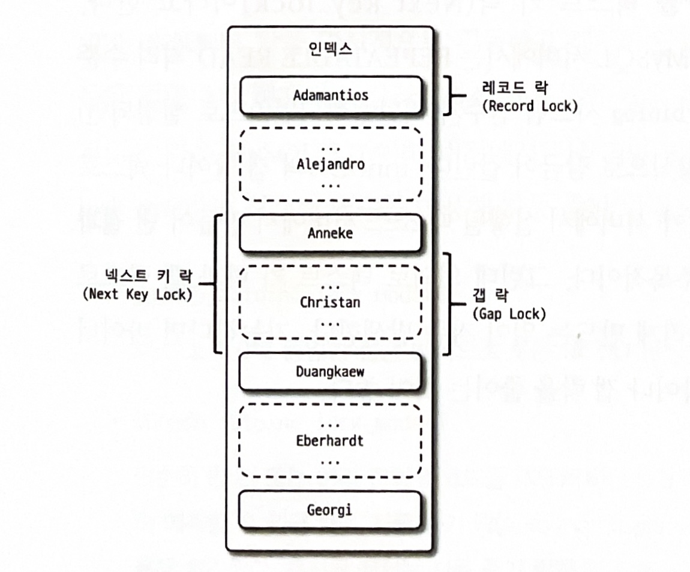
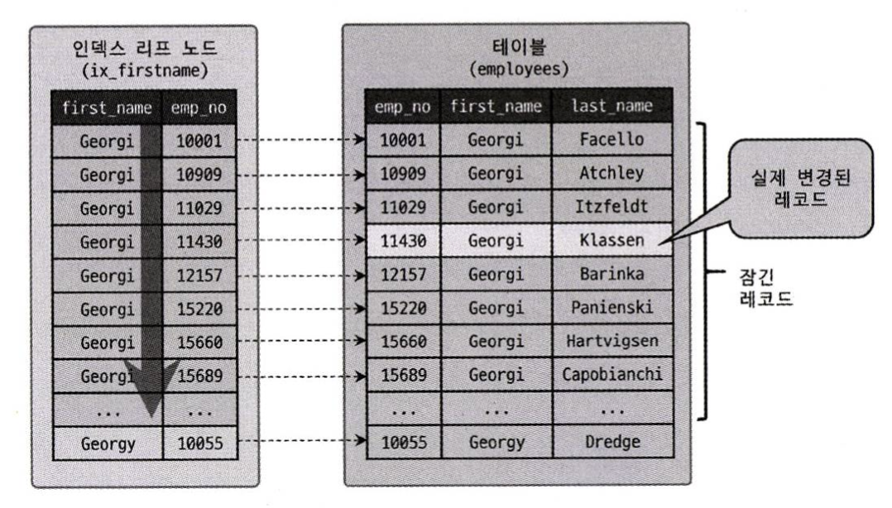

InnoDB 스토리지 엔진은 MySQL에서 제공하는 잠금과는 별개로 스토리지 엔진 내부에서 레코드 기반의 잠금 방식을 탑재하고 있다.

예전 버전의 MySQL에서는 InnoDB 잠금 정보를 진단할 수 있는 방법이 존재하긴 했지만 부족했다.

최근 버전의 MySQL에서는 InnoDB의 트랜잭션과 잠금, 담금 대기 중인 트랜잭션의 목록을 조회할 수 있는 방법이 도입됐다.

MySQL 서버의 `information_schema` 데이터베이스에 존재하는 `INNODB_TRX`, `INNODB_LOCKS`, `INNODB_LOCK_WAITS` 테이블을 조인해서 조회하면 어떤 트랜잭션이 어떤 잠금을 대기하고 있고, 해당 잠금을 어느 트랜잭션이 가지고 있는지 확인할 수 있다. 또한 장시간 잠금을 가지는 클라이언트를 찾아서 종료시킬 수도 있다.

---

# 5.3.1 InnoDB 스토리지 엔진의 잠금

InnoDB 스토리지 엔진은 **레코드 기반의 잠금**을 제공하며, 레코드 락뿐 아니라 레코드와 레코드 사이의 간격을 잠그는 **갭(GAP)락**도 존재한다.



---

## 5.3.1.1 레코드 락

레코드 자체만을 잠그는 것을 **레코드 락(Record lock)**이라고 한다.

InnoDB 스토리지 엔진은 **레코드 자체가 아니라 인덱스의 레코드를 잠근다.**

인덱스의 레코드를 잠근다 의미

**→ B+트리 인덱스의 리프 노드에 있는 엔트리(레코드)를 잠근다**는 의미

인덱스가 하나도 없는 테이블이더라도 내부적으로 자동 생성된 클러스터 인덱스를 이용해 잠금을 설정한다.

인덱스를 잠그느냐, 레코드를 잠그느냐는 상당히 크고 중요한 차이를 나타낸다.

InnoDB에서는 보조 인덱스를 이용한 변경 작업은 넥스트 키 락 또는 갭 락을 사용하지만

프라이머리 키 또는 유니크 인덱스에 의한 변경 작업은 갭(Gap, 간격)에 대해서는 잠그지 않고 레코드 락만 사용한다.

---

## 5.3.1.2 갭 락

갭 락(Gap lock)은 레코드 자체가 아니라 **레코드와 바로 인접한 레코드 사이의 간격만을 잠그는 것**을 의미한다.

갭 락의 역할은 레코드와 레코드 사이의 간격에 새로운 레코드가 생성(INSERT)되는 것을 제어하는 것이다.

갭 락은 그 자체보다는 넥스트 키 락의 일부로 자주 사용된다.

### **갭 락(Gap Lock)이 필요한 이유?**

**→ 팬텀 리드(Phantom Read)를 방지하기 위해**

---

### 팬텀 리드(Phantom Read)란?

**트랜잭션 A**가 어떤 조건에 맞는 **여러 개의 row를 읽었는데**,

그 사이에 **트랜잭션 B**가 그 조건에 해당하는 새로운 row를 **삽입**하고 커밋했을 경우,

**트랜잭션 A가 다시 동일한 조건으로 조회하면 데이터가 달라진 것처럼 보이는 현상**이다.

즉, **유령 레코드(phantom)가 생겼다**고 해서 팬텀 리드라 부른다.

---

### 갭 락이 어떻게 이를 막을까?

갭 락은 "존재하지 않는 레코드 사이의 간격(Gap)"도 잠금으로 처리함으로써

**다른 트랜잭션이 그 사이에 레코드를 새로 삽입하지 못하도록 막는다.**

---

### 예제로 이해

| id | age |
| --- | --- |
| 1 | 20 |
| 2 | 30 |
| 3 | 40 |

**트랜잭션 A**

```sql
BEGIN;
SELECT * FROM users WHERE age BETWEEN 20 AND 40 FOR UPDATE;
```

  - InnoDB는 age 인덱스를 기준으로 20 ~ 40에 해당하는 레코드 + 그 사이 간격(gap)을 Next Key lock 사용하여 잠금
  - Next-key lock = 갭 락 + 레코드 락

**트랜잭션 B 실패** (트랜잭션 A의 갭 락에 걸림)

```sql
INSERT INTO users (id, age) VALUES (4, 25);
```

---

### 참고

  - **REPEATABLE READ** (MySQL 기본) 격리 수준에서 팬텀 리드를 막기 위해 갭 락이 필요
  - **READ COMMITTED**에서는 갭 락을 사용하지 않고 팬텀 리드를 허용

---

### 정리: REPEATABLE READ에서도 **갭 락은 언제 걸리나?**

| 쿼리 유형 | 갭 락 발생 여부 | 설명 |
| --- | --- | --- |
| `SELECT` | ❌ **안 걸림** | 단순 조회는 아무 락도 걸지 않음 (MVCC로 처리) |
| `SELECT ... FOR UPDATE` 또는 `LOCK IN SHARE MODE` | ✅ **걸림** | 갭 락 또는 넥스트 키 락이 걸릴 수 있음 |
| `UPDATE`, `DELETE`, `INSERT` | ✅ **걸림** | 변경이므로 락이 필요함 (갭 락 포함) |

---

### REPEATABLE READ VS READ_COMMITED

| 격리 수준 | 트랜잭션 번호 & 커밋 처리 | 팬텀 리드 | 설명 |
| --- | --- | --- | --- |
| **`READ COMMITTED`** | 커밋된 최신 데이터만 읽음<br>트랜잭션 번호 상관 X | 발생 가능 | 커밋된 데이터를 최신 상태로 읽지만, 트랜잭션 실행 중 데이터 변경 시 팬텀 리드가 발생할 수 있음 |
| **`REPEATABLE READ`** | 트랜잭션 시작 시점의 스냅샷을 고정<br>트랜잭션 번호를 기준으로 이전 트랜잭션 커밋만 참조 | 방지됨 | 트랜잭션이 시작될 때의 데이터를 읽으며, 그 이후 커밋된 데이터는 읽지 않음. 팬텀 리드가 방지됨 |

---

---

## 5.3.1.3 넥스트 키 락

레코드 락 + 갭 락을 합쳐 놓은 형태의 잠금을 **넥스트 키 락(Next key lock)**이라고 한다.

MySQL에서는 데이터를 복제하기 위해 **바이너리 로그(binlog)**를 남긴다.

- **소스 서버 (Primary)** 에서 데이터 변경
- 변경 내용을 포맷 설정에 맞게 바이너리 로그(binlog)에 기록
- **레플리카 서버(Secondary)**가 binlog를 읽어서 **실행**

대표적으로 3가지 포맷이 있다.

| 포맷 | 특징 |
| --- | --- |
| **STATEMENT** | 어떤 SQL을 실행했는지 기록 (예: `UPDATE users SET ... WHERE age > 20`) |
| **ROW** | 어떤 데이터를 변경했는지 직접 기록 (예: `id=3인 행의 age를 30 → 31로 변경`) |
| **MIXED** | 위 둘을 혼합해서 MySQL이 판단 |

**STATEMENT 문제점**

```
소스에서 WHERE age > 20 조건에 해당하는 건 id=3뿐이었다고 가정
하지만 레플리카는 INSERT로 인해 age=25인 id=4가 이미 존재하고 있는 상태였다면?
STATEMENT 포맷이니까 UPDATE ... WHERE age > 20 이라는 같은 SQL이 레플리카에서 실행됨
그러면 id=3뿐 아니라 id=4도 같이 업데이트됨 
데이터 불일치 발생
즉, STATEMENT 포맷의 특성상 "당시의 상태"가 중요하지만 보존되지 않아서 문제가 생긴다. 
```

그래서 STATEMENT 포맷의 바이너리 로그를 사용하는 MySQL 서버에서는 REPEATABLE READ 격리 수준을 사용해야 한다. 

`innodb_locks_unsafe_for_binlog` 시스템 변수가 비활성화(0으로 설정)되면 변경을 위해 검색하는 레코드에는 넥스트 키 락 방식으로 잠금이 걸린다. 1이면 넥스트 키 락 생략

의외로 넥스트 키 락과 갭 락으로 인한 데드락이 발생하거나 다른 트랜잭션을 기다리게 만드는 일이 자주 발생한다.

가능하다면 바이너리 로그 포맷을 ROW 형태로 바꿔서 데이터 자체를 반영되도록 하여 넥스트 키 락이나 갭 락을 줄이는 것이 좋다.

---

## 5.3.1.4 자동 증가 락

MySQL에서는 자동 증가하는 숫자 값을 추출하기 위해 `AUTO_INCREMENT` 칼럼 속성을 제공한다.

`AUTO_INCREMENT` 칼럼이 사용된 테이블에 동시에 여러 레코드가 INSERT되는 경우, 저장되는 각 레코드는 중복되지 않고 저장된 순서대로 증가하는 일련번호 값을 가져야 한다.

InnoDB 스토리지 엔진에서는 이를 위해 내부적으로 `AUTO_INCREMENT` 락 이라고 하는 테이블 수준의 잠금을 사용한다.

`AUTO_INCREMENT` 락은 INSERT, REPLACE 쿼리 문장 같은 새로운 레코드를 저장하는 쿼리에서만 필요하며, UPDATE, DELETE 등의 쿼리에서는 걸리지 않는다.

###  **REPLACE INTO 의 동작 방식**

```sql
REPLACE INTO users (id, name) VALUES (1, 'Alice');
```

이 쿼리의 동작 순서를 보면

  1. **해당 키(id=1)** 가 있는지 확인
  1. 있으면: **DELETE**
  1. 그리고 나서: **INSERT**

즉, 겉보기에는 한 문장처럼 보이지만 내부에서는 사실상

```sql
DELETE FROM users WHERE id = 1;
INSERT INTO users (id, name) VALUES (1, 'Alice');
```

---

### 그래서 AUTO_INCREMENT 락이 필요한 이유

  - `REPLACE`가 결국 **INSERT 동작을 포함**하므로
  - `AUTO_INCREMENT` 컬럼이 있다면, 새 값을 넣을 때 락이 필요하다.
  - 따라서 `REPLACE`도 `INSERT`처럼 **AUTO_INCREMENT 락을 획득한다.**

---

### 예시

```sql
CREATE TABLE test (
  id INT AUTO_INCREMENT PRIMARY KEY,
  name VARCHAR(50)
);

REPLACE INTO test (id, name) VALUES (1, 'Bob');
```

  - `id=1`이 이미 있으면 삭제되고,
  - `AUTO_INCREMENT`는 기존 값과 무관하게 증가함 (구멍이 생긴다.)

---

### 주의사항

  - `REPLACE`는 **DELETE + INSERT**이기 때문에 **트리거, 외래 키, AUTO_INCREMENT** 등에서 주의가 필요
  - `UPDATE`와는 완전히 다른 동작

---

`AUTO_INCREMENT` 락은 트랜잭션과 관계없이 INSERT, REPLACE 문장에서 `AUTO_INCREMENT`  값을 가져오는 순간만 락이 걸렸다가 즉시 해제된다. 

`AUTO_INCREMENT` 락은 테이블 테이블에 단 하나만 존재하고 같은 테이블에 두 개의 INSERT 쿼리가 동시에 실행되는 경우 하나의 쿼리가 `AUTO_INCREMENT` 락을 걸면 나머지 쿼리는 대기한다.

`AUTO_INCREMENT` 칼럼에 명시적으로 값을 설정하더라도 자동 증가 락을 걸게된다.

`AUTO_INCREMENT` 락을 명시적으로 획득하고 해제하는 방법은 없다.

지금까지 자동 증가 락에 대한 설명은 MySQL 5.0 이하 버전에서 사용되던 방식이다.

MySQL 5.1 이상부터는 `innodb_autonic_lock_mode` 시스템 변수를 이용해 자동 증가 락의 작동 방식을 변경할 수 있다. 

### innodb_autonic_lock_mode

`innodb_autonic_lock_mode=0`  

MySQL 5.0과 동일한 잠금 방식으로 모든 INSERT 문장은 자동 증가 락을 사용한다.

`innodb_autonic_lock_mode=1` 

단순히 한 건 또는 여러 건의 레코드를 INSERT하는 SQL 중에서 MySQL 서버가 INSERT되는 레코드의 건수를 정확히 예측할 수 있을 때는 자동 증가 락을 사용하지 않고, 훨씬 가볍고 빠른 래치(뮤텍스)를 이용해 처리한다.

개선된 뮤텍스는 자동 증가 락과 달리 아주 짧은 시간 동안만 잠금을 걸고 필요한 자동 증가 값을 가져오면 즉시 잠금이 해제된다. 하지만 MySQL 서버가 건수를 예측할 수 없을 때는 MySQL 5.0과 동일한 자동 증가 락을 사용한다.  이때는 INSERT 문장이 완료되기 전까지는 자동 증가 락이 해제되지 않기 때문에 다른 커넥션에서는 INSERT를 실행하지 못하고 대기한다. 이렇게 대량 INSERT가 수행될 때는 InnoDB 스토리지 엔진은 여러 개의 자동 증가 값을 한 번에 할당받아서 INSERT되는 레코드에 사용한다.

그래서 대량 INSERT되는 레코드는 자동 값이 누락되지 않고 연속되게 INSERT 된다. 할당 받은 자동 증가 값이 남는경우 폐기된다. 그래서 대량 INSERT 이후에 실행되는 INSERT는 연속되지 않고 누락된 값이 발생할 수 있다.

이 설정은 최소한 하나의 INSERT 문장으로 레코드들은 연속적으로 저장된다. 

그래서 이 설정을 **연속 모드(Consecutive mode)**라고도 한다.

`innodb_autonic_lock_mode=2`  **MySQL 8.0 default** 

절대 자동 증가 락을 사용하지 않고 경량화된 뮤텍스를 사용한다. 

하지만 이 설정에서는 하나의 INSERT 문장으로 INSERT되는 레코드라고 하더라도 연속된 자동 증가 값을 보장하지는 않는다. 그래서 이 설정을 **인터리빙 모드(Interleaved mode)**라고도 한다. 

이 설정에서는 INSERT … SELECT 같은 대량 INSERT 문장이 실행되어도 다른 커넥션에서 INSERT를 실행할 수 있다. 이 설정에서 작동하는 자동 증가 기능은 유니크 한 값이 생성되는 것을 보장한다.

### (건수) 예측 가능한 INSERT VS 예측 불가능한 INSERT 

| 구분 | 예측 가능 |
| --- | --- |
| INSERT ... VALUES (?, ?) | ✅ 예측 가능 (값 명확히 있음) |
| INSERT ... VALUES (?, ?), (?, ?) | ✅ 예측 가능 (몇 건인지 명확) |
| INSERT ... SELECT ... | ❌ 예측 불가 (SELECT 결과가 몇 건일지 알 수 없음) |
| REPLACE INTO ... | ❌ 예측 불가 (기존 레코드 존재 여부에 따라 INSERT 또는 DELETE+INSERT) |
| INSERT IGNORE, ON DUPLICATE KEY UPDATE | ❌ 예측 불가 (충돌 여부에 따라 동작 달라짐) |

### 자동 증가 락 VS 경량화 된 래치(뮤텍스)

| 항목 | 자동 증가 락  | 경량 뮤텍스 |
| --- | --- | --- |
| 락 범위 | 전체 테이블 | 숫자 증가 연산만 |
| 락 지속 시간 | 쿼리 완료 시까지(1개의 커넥션만 사용가능) | 수 μs 수준 |
| 동시 INSERT | ❌ 불가 | ✅ 가능 |
| ID 연속성 | ✅ 보장 | ⚠️ 안 될 수도 있음  |
| 성능 | 느림 | 빠름 |

```
기존 방식 
트랜잭션: insert 100개 전체 작업에 대한 락

최신 방식
트랜잭션: insert 100개 각 insert에 대해서 아주 짧게 락
```

---

# 5.3.2 인덱스와 잠금 

InnoDB 잠금은 레코드를 잠그는 것이 아니라 인덱스를 잠그는 방식으로 처리된다.

즉, 변경해야 할 레코드를 찾기 위해 검색한 인덱스의 레코드를 모두 락을 걸어야 한다.

### 이해를 위한 예제 

employees 테이블에는 first_name 칼럼만 있는 ix_firstname 이라는 인덱스가 준비돼 있다.

```sql
SHOW INDEX from employees;
```


 

```sql
SELECT COUNT(*) FROM employees WHERE first_name='Georgi';
-> 253
```

```sql
SELECT COUNT(*) FROM employees
WHERE first_name='Georgi' AND last_name='Klassen';
-> 1
```

first_name=’Georgi’ 인 사원은 전체 253명이 존재하고 

first_name=’Georgi’, last_name=’Klassen’인 사원은 1명만 존재한다.

그럼 이제 first_name=’Georgi’, last_name=’Klassen’인 사원의 입사 일자를 오늘로 변경하는 쿼리를 실행해보자.

```sql
UPDATE employees SET hire_date=NOW()
WHERE first_name='Georgi' AND last_name='Klassen';
```

UPDATE 문장이 실행되면 1건의 레코드가 업데이트된다.

하지만 이 1건의 업데이트를 위해 몇 개의 레코드에 락을 걸어야 할까?

**해당 업데이트 조건에서 인덱스를 이용할 수 있는 조건은 first_name=’Georgi’이며, last_name 칼럼은 인덱스에 없기 때문에 first_name=’Georgi’인 레코드 253건의 레코드가 모두 잠긴다.**



해당 그림은 UPDATE 문장이 어떻게 변경 대상 레코드를 검색하고, 실제 변경이 수행되는지를 보여준다.

이 예제에서는 몇 건 안 되는 레코드만 잠그지만 **UPDATE 문장을 위해 적절히 인덱스가 준비돼 있지 않다면** 

각 클라이언트 간의 동시성이 상당히 떨어져서 한 세션에서 UPDATE 작업을 하는 중에는 다른 클라이언트는 그 테이블을 업데이트하지 못하고 기다리는 상황이 발생할 것이다.

이 테이블에 인덱스가 하나도 없다면 어떻게 될까?

이러한 경우에는 테이블을 풀 스캔하면서 UPDATE 작업을 하는데, 이 과정에서 테이블에 있는 30여만 건의 모든 레코드를 잠그게 된다.

**이 방식이 MySQL 방식이며, InnoDB에서 인덱스 설계가 중요한 이유이다.**

```
[PK 기반 탐색]

PK 인덱스 (Clustered Index)
루트
 └── 브랜치
      └── 리프 → [실제 row 데이터]
      
---------------------------------------------------------------     
[인덱스 = 보조 인덱스 기반 탐색]    
   
Secondary Index
루트
 └── 브랜치
      └── 리프 → [인덱스 컬럼 값, PK]

→ 이 PK를 통해 Clustered Index(PK) B+Tree로 다시 접근

---------------------------------------------------------------
[FULL SCAN]

PK B+Tree
루트
 └── 브랜치
      └── 리프 → 리프 → 리프 → 리프 ... (순차적으로 모두 탐색)
```

예제에서 진행한 UPDATE는 Secondary Index 기반 잠금이니 Secondary Index 253개 리프 노드가 잠긴다.

---

# 5.3.3 레코드 수준의 잠금 확인 및 해제

MySQL 5.1부터 레코드 잠금과 잠금 대기에 대한 조회가 가능하다.

버전별로 레코드 잠금과 잠금을 대기하는 클라이언트의 정보를 확인하는 방법을 알아보자.

강제로 잠금을 해제하려면 KILL 명령을 이용해 MySQL 서버의 프로세스를 강제로 종료하면 된다.

다음과 같은 잠금 시나리오를 가정하자.

| **커넥션1** | **커넥션2** | **커넥션3** |
| --- | --- | --- |
| BEGIN; |  |  |
| UPDATE employees<br>SET birth_date=NOW()<br>WHERE emp_no=100001; |  |  |
|  | UPDATE employees<br>SET hire_date=NOW()<br>WHERE emp_no=100001; | <br> |
|  |  | UPDATE employees<br>SET hire_date=NOW(),<br>birth_date=NOW()<br>WHERE emp_no=100001; |

**MySQL 5.1 ~** 

information_schema 데이터베이스의 INNODB_TRX 테이블과 INNODB_LOCKS, INNODB_LOCK_WAITS 테이블을 통해 확인 가능하다.

**MySQL 8.0 ~** 

inofrmation_schema 정보들은 조금씩 Deprecated

peformace_schema 데이터베이스의 DATA_LOCKS, DATA_LOCK_WAITS 테이블 사용

**커넥션 1 ~ 3** → 터미널 Docker MySQL 컨테이너 접속 (트랜잭션 용도)

DataGrip → Docker MySQL 컨테이너 접속 (모니터링 용도)

```sql
SHOW PROCESSLIST;
```


커넥션1 스레드(Time = 61)는 현재 아무것도 하지 않고 있지만 트랜잭션을 시작하고 UPDATE 명령이 실행 완료

커넥션1 스레드가 아직 COMMIT 명령을 실행하지 않았기 때문에 업데이트한 레코드의 잠금을 그대로 가지고 있는 상태이다.

커넥션2(Time = 43), 커넥션3(Time = 18) 스레드는 잠금 대기로 인해 아직 UPDATE 명령을 실행 중인 것으로 표시된다.

performance_schema  DATA_LOCKS, DATA_LOCK_WAITS 테이블 조인해서 잠금 대기 순서 살펴보기

```sql
SELECT 
   r.trx_id waiting_trx_id,
   r.trx_mysql_thread_id waiting_thread,
   r.trx_query waiting_query,
   b.trx_id blocking_trx_id,
   b.trx_mysql_thread_id blocking_thread,
   b.trx_query blocking_query
FROM performance_schema.data_lock_waits w
INNER JOIN information_schema.innodb_trx b
	ON b.trx_id = w.blocking_engine_transaction_id
INNER JOIN information_schema.innodb_trx r
  ON r.trx_id = w.requesting_engine_transaction_id;
```


쿼리의 결과를 보면 현대 대기 중인 스레드는 14, 13이다. 

13번 스레드는 11번 스레드를 기다리고 14번 스레드는 11번, 13번 스레드를 기다린다.

이는 잠금 대기 큐의 내용을 그대로 보여주기 때문에 이렇게 표시되는 것이다.

11번 스레드의 잠금을 해제하고, 13번 스레드가 잠금 획득, 해제를 하면 14번 스레드가 잠금 획득이 가능하다.

11번 스레드가 어떤 잠금을 가지고 있는지 더 상세히 확인하고 싶으면 performance_schema DATA_LOCKS 테이블이 가진 컬럼을 모두 살펴보면 된다. 

---

