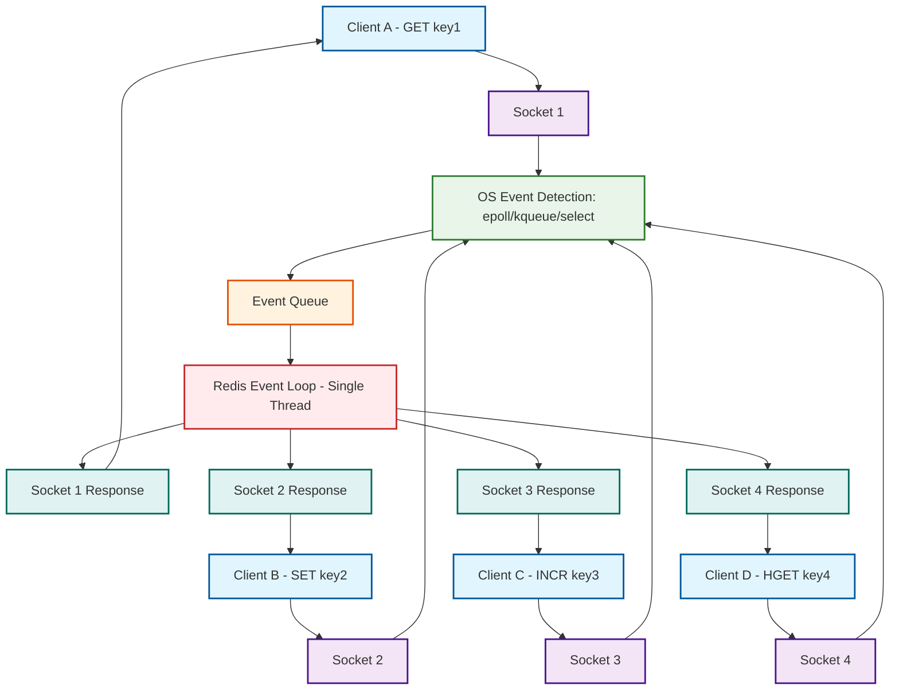

# In-Memory Storage 핵심 특징

### 메모리 중심 아키텍처 

- 모든 데이터를 메모리(RAM)에 저장
- 디스크가 아닌 메모리 기반으로 초고속 처리 가능
- 읽기/쓰기 속도는 마이크로초(us)단위 수준

### 디스크 I/O 불필요

- 전통적인 DBMS와 달리 디스크 접근이 없다
- Latency: Disk I/O (ms 단위) >> RAM Access (us 단위)

### 메모리 용량이 데이터 저장 한계

- 전체 데이터 크기는 할당된 메모리 내에 한정
- 수십~수백 GB 메모리로 운영되는 경우가 많다
- 메모리 부족 시 정책에 따라 데이터 제거 또는 쓰기 실패 발생

---

# 단일 스레드 기반 처리 모델

### 순차적 명령 처리

- Redis는 **단일 스레드에서 명령을 순차적으로 실행**
- 이벤트 큐에 도착한 순서대로 빠르게 처리
- 명령 간 락(lock) 불필요, 순차 실행 자체로 동시성 해결

### 명령 단위 원자성

- 하나의 명령이 실행되는 동안 다른 명령은 대기
- 단일 명령은 중단 없이 완전히 실행
- 결과적으로 Redis 명령은 기본적으로 **원자적(atomic)**

### 주의: CPU 바운드 작업

- 무거운 계산, **대용량 Lua 스크립트** 등은 처리 지연 발생
- 하나의 명령이 오래 걸리면 모든 명령 큐가 대기 상태가 된다
- Redis는 빠른 처리를 전제로 설계됨 → **복잡한 로직은 외부 워커로 분리 필요**

---

# 이벤트 루프의 동작 방식

### OS 수준 이벤트 감지 시스템

- epoll(Linux), kqueue(BSD/macOS) 등 고성능 이벤트 처리 기반
- 수천 개 클라이언트 연결 상태를 비동기적으로 감지

### IO Multiplexing 방식

- **Multiplexing:** 하나의 자원(채널, 장치, 스레드 등)을 통해 여러 개의 데이터 흐름(또는 작업)을 동시에 처리하는 기술적 개념
- 클라이언트 I/O 이벤트를 감지해 이벤트 큐에 등록
- Redis는 이 큐에서 순서대로 명령을 꺼내 실행
- **여러 클라이언트 요청을 한 개의 스레드가 관리**

---

