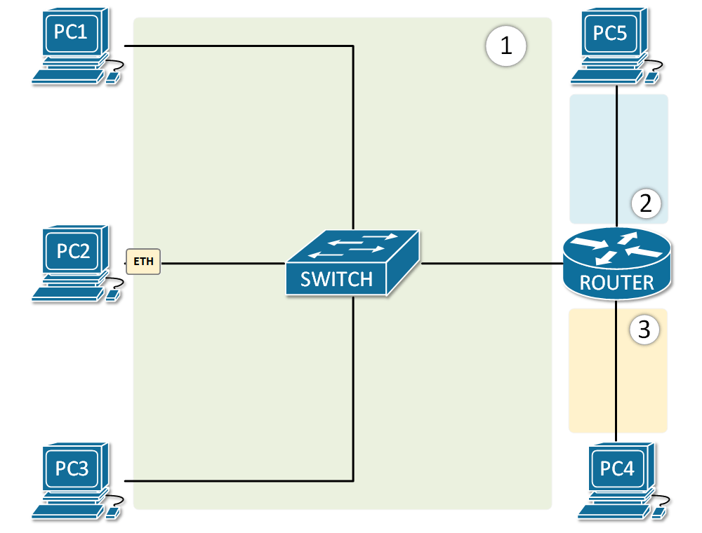
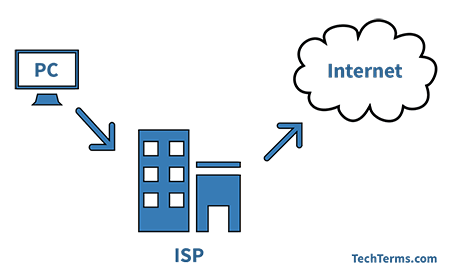
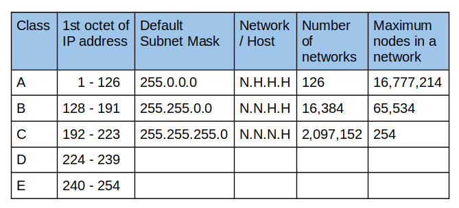
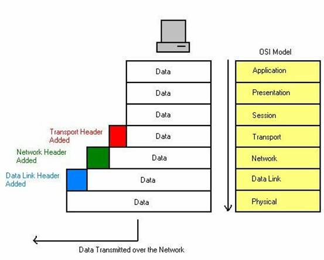
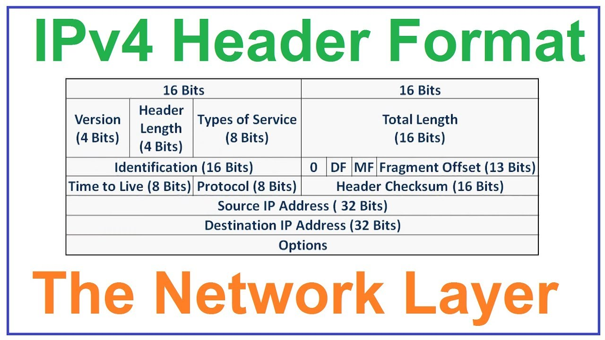
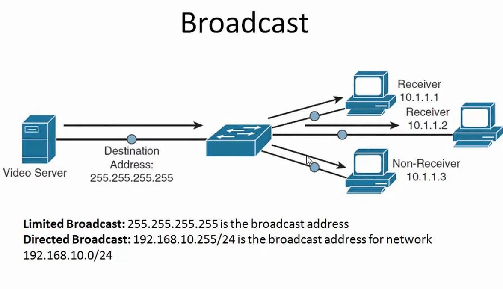
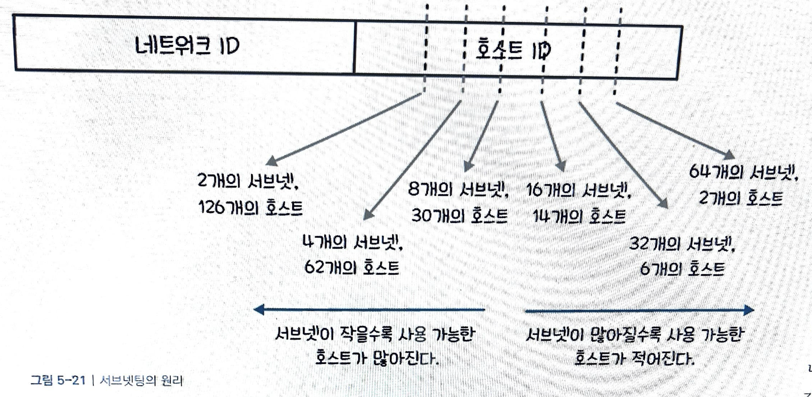
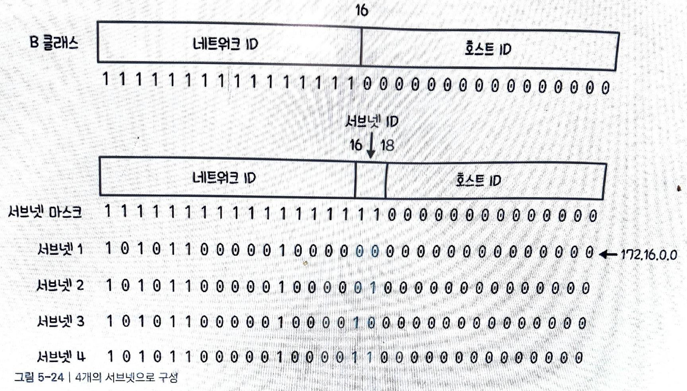
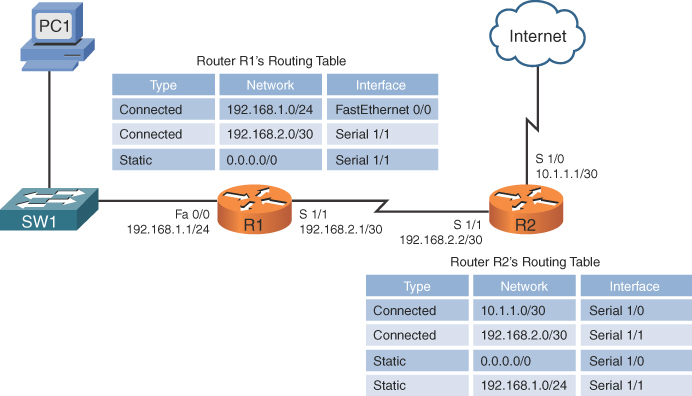

## 개요 

네트워크 계층 송신자의 데이터를 수신자에게 전달하기 위한 경로를 찾아주는 역할을 한다.

라우터를 이용해서 경로를 어떻게 찾는지에 대해 알아본다. 

**키워드**

- 네트워크 계층 
- IP 주소 구조
- IP 주소 클래스
- 브로드 캐스트
- 서브넷 
- 서브넷 마스크

**목표** 

- 네트워크 계층의 역할을 이해
- IP 주소와 IP 주소 클래스에 대해 이해
- 서브넷과 서브넷 마스크 이해
- 라우터의 동작 방식을 이해

---

## 내용정리 

A 학교에 미영이라는 학생이 있다. B 학교에는 도준이라는 학생이 있다.

미영이는 도준이에게 이메일을 보내야 하는 상황이다.

미영이는 자신이 속해 있는 A 학교의 스위치에게 도준이가 사용하는 컴퓨터의 MAC 주소를 질의한다.

하지만 스위치는 도준이가 사용하는 컴퓨터의 MAC 주소를 알 수 없다. 도준이는 B 학교의 스위치에 연결되어 있기 때문이다.

즉, 스위치만으로는 미영이와 도준이가 통신할 수 있는 방법이 없다. 이때 필요한 장비가 라우터라는 장비이다.

**라우터(Router)는 데이터가 어떤 경로로 전달되어야 하는지를 알려주는 내비게이션과 같은 역할**을 한다.

어떤 길이 가장 빠른지 결정하는 것이다. **어떤 길이 가장 빠른 길인지 찾는 과정을 라우팅(Routing)**이라고 한다.

라우터는 스위치와는 다르게 IP 주소를 이용해서 통신을 한다.




**LAN: PC1, PC2, PC3 ↔ SWITCH: MAC 주소로 통신**

**WAN: ROUTER ↔ ROUTER: IP 주소로 통신**

---

### IP & ISP

랜 환경에서는 스위치를 이용해 MAC 주소로 통신한다.

왠 환경에서는 라우터를 이용해 IP 주소로 통신한다.

**IP(Internet Protocol) 주소는 인터넷상에 있는 컴퓨터의 고유한 주소이다.**

따라서 IP를 통해서 한 컴퓨터에서 다른 컴퓨터로 데이터를 주고받을 수 있다. IP 주소는 어떻게 할당받는 것일까?

분명 컴퓨터를 구매할 때 자동으로 부여된 번호는 랜 카드 주소(MAC 주소)뿐이었다.

우리가 인터넷을 하기 위해서는 **인터넷 서비스 제공자(ISP, Internet Service Provider)**라고 하는 SKT, KT, LG U+ 등과 같은 회사에 인터넷 설치를 신청한다. 그럼 인터넷 서비스 제공자와 내 컴퓨터가 연결되며, 더불어 공인 IP가 하나 부여된다. 공엔 IP가 인터넷을 할 수 있는 IP 주소이다.



---

### 공인 IP & 사설 IP

네트워크에서 사용 목적과 방법에 따라 공인 IP와 사설 IP가 있다.

**공인 IP(Public IP)**

공인 IP는 인터넷 서비스 제공자에 의해 전 세계적으로 고유하게 할당되는 IP 주소이다.

이 주소를 이용해서 전 세계의 컴퓨터와 통신을 할 수 있다. 대부분의 인터넷 서비스 제공자들은 유동적으로 공인 IP 주소를 할당한다. 한마디로 한번 제공받은 공인 IP는 영구적으로 사용할 수 있는 것이 아니라 주기적으로 변경된다는 의미이다.

**사설 IP(Private IP)**

사설 IP는 주로 기업 내부에서만 사용되는 IP 주소로, 기업 밖에 위치한 컴퓨터와는 통신이 되지 않는다. 

---

### IP 형식

부여된 IP 형식은 다음과 같은 형식을 갖는다.

11000000 10101000 00000010 01111100 (32비트)

하지만 명령 프롬프트 창에서 ipconfig라고 입력하면 다른 형식이 나온다.

  1. 11000000 10101000 00000010 01111100 
  1. 192.168.2.124

이 둘은 동일한 의미를 다르게 표현했을 뿐이다. 1번은 2진수로 표현한 것이고, 2번은 10진수로 표현한 것뿐이다.

IP 주소 길이는 4바이트, 즉 32비트로 되어있다. IP 주소를 표기할 때는 2진수가 아닌 10진수로 표기하기 때문에

IP 주소의 범위는 0.0.0.0~255.255.255.255 이다.

**보통 1바이트의 가장 작은 수인 0과 가장 큰 수인 255는 용도가 정해져 있기 때문에 컴퓨터 IP 주소로 사용하지 않는다.** 아래와 같이 **마지막 1바이트가 0인 주소를 네트워크 주소라고 한다. 네트워크 주소는 일반적으로 하나의 네트워크를 통칭하기 위해 사용되는 주소이다.**

```
# 네트워크 주소
192.168.2.0
```

예를 들어 하나의 라우터에 묶여 있는 컴퓨터들의 IP가 192.168.2.11 ~ 192.168.2.14 라고 가정해 보자.

그러면 네트워크 주소는 192.168.2.0이 된다. IP 192.168.2.11 ~ 192.168.2.14는 같은 IP 대역을 사용한다.

또한, 다음과 같이 **마지막 1바이트가 255인 경우를 브로드캐스트 주소라고 한다. 브로드캐스트 주소는 네트워크에 연결된 컴퓨터에 데이터를 한 번에 일괄적으로 전송할 때 사용하는 주소**이다.

```
# 브로드캐스트 주소 
192.168.2.255
```

예를 들어 192.168.2.0이라는 네트워크 주소를 갖는 네트워크가 있다고 가정해 보자. 192.168.2.10이라는 IP를 갖는 컴퓨터가 자신이 속해 있는 모든 컴퓨터에 데이터를 보내고자 할 때 사용되는 IP 주소는 192.168.2.255가 된다.

---

### IP 주소의 구조

IP 주소는 아래와 같은 형태이다.

→ 192.168.2.124

IP 주소에는 많은 정보가 포함되어 있다. IP 주소에는 다음과 같이 네트워크 ID와 호스트 ID로 구분할 수 있다.

호스트 ID는 라우터에 연결된 개별 컴퓨터들을 관리하기 위해 사용된다. 즉, 호스트 ID는 개발 컴퓨터들이 사용하는 것이고, 네트워크 ID는 컴퓨터가 많을 경우 관리의 어려움이 있기 때문에 네트워크의 범위를 지정해 관리를 쉽게 하기 위해 사용한다.

**192.168.2.****124**

  - 파란색: 네트워크 ID
  - 주황색: 호스트 ID

예를 들어 네트워크 A에 포함된 컴퓨터 A, 컴퓨터 B, 컴퓨터 C의 IP 주소가 다음과 같다.

  - 컴퓨터 A: 192.168.1.2
  - 컴퓨터 A: 192.168.1.3
  - 컴퓨터 C: 192.168.1.4

이때 컴퓨터 A의 네트워크 ID와 호스트 ID는 아래와 같다.

컴퓨터 A: **192.168.1****.2**

  - 파란색: 네트워크 ID
  - 주황색: 호스트 ID

---

### IP 주소의 클래스

공인 IP 주소에는 A부터 E까지 5개의 클래스가 있다. 하지만 D, E는 일반인을 위한 것이 아니기 때문에 A, B, C 클래스만 유효하다.

A 클래스는 하나의 네트워크가 가질 수 있는 호스트 ID가 가장 많은 클래스이다. A 클래스에 속한 컴퓨터에 할당해줄 수 있는 IP의 개수는 16,777,214개이다. (2^24 - 2(브로드 캐스트, 네트워크 주소))

첫 8비트는 네트워크 ID를 의미하고 나머지 24비트는 호스트 ID를 의미한다.

B 클래스는 처음 16비트가 네트워크 ID, 나머지 16비트는 호스트 ID

C 클래스는 마지막 8비트만 호스트 ID, 나머지 24비트는 네트워크 ID이다.



**전 세계의 IP 주소를 관리하는 기관은 IANA(Internet Assigned Numbers Authority)**이다.

우리나라의 경우 **KISA(Korea Internet & Security Agency, 한국인터넷진흥원)**에서 IANA으로부터 IP 대역을 할당받아온다. 이후 KISA는 IP 주소를 인터넷 서비스 제공업체(ISP, ex: KT, SKT)에게 다시 할당해주면 인터넷 서비스 제공업체가 개인이나 학교/기업에 다시 할당해주는 구조이다.

IANS → KISA → ISP(SKT, LG U+, KT) → 개인/학교/회사

---



네트워크 계층에서 추가되는 헤더 정보는 IP 정보이다. 물론 IP 정보만 필요한 것은 아니고 다양한 정보들이 추가된다. 하지만 가장 중요한 부분은 송신자와 수신자의 IP 정보이다.



내 IP 정보는 알고 있지만 수신자의 IP 정보는 어떻게 확인할 수 있을까? 

이 정보를 알고있거나 확인해줄 수 있는 장비가 바로 라우터이다.

---

### 브로드캐스트

라디오나 TV는 일방적으로 신호를 보내기 때문에 시청자와 상호작용하지 않는다.

일방적으로 신호를 보낸다고 해서 브로드캐스트라고 하는데, 이러한 개념이 컴퓨터에도 있다.

**브로드캐스트(Broadcast)는 같은 네트워크에 속한 모든 컴퓨터에게 데이터를 전달한다.**



수신자 입장에서는 내가 원하지 않더라도 일방적으로 보내는 정보를 받아야 한다.

그래서 데이터를 수신하는 컴퓨터는 그 정보가 필요한지 판단해야 하는 번거로움이 있다.

---

### 유니캐스트 

**유니캐스트(Unicast)는 1:1 통신이다.**

같은 네트워크에 여러 대의 컴퓨터가 있을 때 특정한 1대의 컴퓨터에만 데이터를 보내고자 한다면 상대방의 MAC 주소를 통해 보내면된다. 그래서 상대방의 MAC 주소를 알아야 유니캐스트로 통신이 가능하다.

---

### 멀티캐스트

**멀티캐스트는 브로드캐스트 + 유니캐스트 방식이다.**

같은 네트워크에서 데이터를 보내고 싶은 컴퓨터가 1대라면 상대방의 MAC 주소를 확인하는 것은 어렵지 않을 것이다. 하지만 그 대상이 2대 이상이면 상당히 번거롭다. 이때 사용하는 방식이 멀티캐스트이다.

**멀티캐스트(Multicast)는 특정 그룹을 지정해서 그 그룹에 해당하는 컴퓨터에게만 데이터를 보내는 방식이다.**

---

### 서브넷의 개념

서브넷과 서브넷 마스크는 네트워크 ID와 호스트 ID를 이용한다.

네트워크를 A 클래스, B 클래스, C 클래스 처럼 클래스 단위로 하나의 네트워크를 사용하는 것은 비효율적인 방법이다. 하나의 네트워크에 속한 모든 컴퓨터는 브로드캐스트 주소로 오는 데이터를 모두 수신해야 하고, 그것이 내가 필요한 정보인지 필터링해야 한다. 

그래서 하나의 네트워크를 좀 더 효율적으로 즉, 더 작은 단위로 사용해보고자 등장한 개념이 서브넷이다.

**서브넷(subnet)은 하나의 네트워크가 분할된 작은 네트워크이다. 이때 작은 네트워크로 나누는 작업을 서브넷팅(subnetting)이라고 한다.**

---

### 서브넷팅의 원리

**서브넷팅이란 IP 주소에는 네트워크 ID와 호스트 ID가 있는데, 네트워크 ID는 그대로 두고 호스트 ID를 쪼개는 방식이다.** 

이때 쪼개는 개수가 적을수록 사용 가능한 호스트 수가 많아진다.



**정리하면 서브넷팅은 호스트 ID를 서브넷 ID와 호스트 ID로 나누는 작업이다.**

---

### 서브넷 마스크

IP 주소를 서브넷팅하면 네트워크 ID와 호스트 ID의 경계를 판별하기가 어려울 때가 많은데 이때 서브넷 마스크를 사용한다. 즉, **서브넷 마스크(Subnet Mask)란 IP 주소에서 네트워크 ID와 호스트 ID를 구분하기 위한 구분자다.**

서브넷 마스크를 구하기 위해서는 네트워크 ID를 모두 1로 채우고 호스트 ID를 0으로 채운다.

**서브넷 마스크 표기법**

  - **CIDR 표기법: 192.168.1.1/24**
- /24는 네트워크 ID의 비트 수이다.
  - **255.255.255.0**

---

### 서브넷팅 해보기 

네트워크 주소: 172.16.0.0

서브넷 마스크: 255.255.0.0

이를 4개의 서브넷으로 나눠보자.

4개의 조합이 나오기 위해서는 호스트 ID의 2개의 값만 이용하면 된다.



| **서브넷 번호** | **네트워크 주소** | **첫 번째 호스트** | **마지막 호스트** | **브로드캐스트 주소** |
| --- | --- | --- | --- | --- |
| 서브넷1 | 172.16.0.0 | 172.16.0.1 | 172.16.63.254 | 172.16.63.255 |
| 서브넷2 | 172.16.64.0 | 172.16.64.1 | 172.16.127.254 | 172.16.127.255 |
| 서브넷3 | 172.16.128.0 | 172.16.128.1 | 172.16.191.254 | 172.16.191.255 |
| 서브넷4 | 172.16.192.0 | 172.16.192.1 | 172.16.255.254 | 172.16.255.255 |

---

**라우터(Router)는 데이터의 전송을 위해 가장 빠른 길을 찾아 네트워크 간의 경로(Route)를 설정하는 장비**

**스위치의 한계 되짚어보기**

스위치는 같은 네트워크의 컴퓨터끼리만 통신이 가능한 장비. 즉, 서로 다른 네트워크 간의 통신은 불가능한 단점이 있다. 정확히 말하면 네트워크 주소가 다른 네트워크에서는 통신이 불가능하다.

**그래서 서로 다른 네트워크 간의 통신을 위해서는 라우터를 사용해야 한다.**

예를 들어 172.16.1.0/24 네트워크는 172.16.2.0/24 네트워크는 서로 다른 네트워크이다.

이 둘 간에 통신이 가능하려면 라우터가 필요하다.

**그런데 서로 다른 네트워크 간에는 중간에 1개 이상의 라우터가 있을 수 있다.** 

이러한 경우, 어떤 경로로 이용해야 빠른 통신이 가능한지 확인해야 한다. **즉 네트워크와 네트워크 간의 경로(Route)를 설정해야 하는데, 이것을 라우팅(Routing)이라고 한다.** 다시 말해 라우팅은 한 네트워크에서 다른 네트워크로 데이터를 전달하는 과정이다.

**그런데 경로는 어떻게 설정할까?** 

스위치에서 MAC 테이블을 이용했던 것과 같이 라우터에서는 라우팅 테이블이라는 것을 이용한다.

**라우팅 테이블은(Routing Table)은 데이터를 목적지까지 보내기 위한 거리와 방법등을 명시한 테이블이다.**

라우팅 테이블에는 데이터를 목적지까지 전달하기 위해 어떤 방향으로 가야 하는지에 대한 정보를 가지고 있다.

따라서 라우터가 데이터를 목적지로 보내려고 하면 먼저 라우팅 테이블을 찾아보게 된다.

예를 들어 컴퓨터A(172.16.1.3)가 컴퓨터B(172.16.2.12)에게 데이터를 보내려고 하는 상황을 가정해 보자.

먼저 라우터 A는 컴퓨터 B의 네트워크 주소 172.16.2.0을 확인한다. 그리고 172.16.2.0으로 가는 길이 정의되어 있는지 라우팅 테이블을 검색한다.

그랬더니 라우팅 테이블에 172.16.2.0 네트워크로 가려면 E1으로 가라는 내용이 검색되었다.

그럼 이제 라우터 A는 라우터 B에게 컴퓨터 B의 IP 주소가 무엇인지 물어보기만 하면 된다.



라우팅 테이블은 주기적으로 업데이트해야 한다.

네트워크 상황이 계속 변경되기 때문이다. 업데이트는 수동으로 할 수도 있고 자동으로 할 수도 있다.

보통은 라우팅 프로토콜을 이용하여 자동으로 업데이트를 진행한다.

---

---

## 복습하기 

1. 라우팅
1. IP
1. 브로드캐스트 주소? 
1. 네트워크 ID, 호스트 ID
1. A ~ E
1. 유니캐스트
1. 서브넷팅
1. 네트워크 ID, 서브넷 ID, 호스트 ID
1. pass

**IP(Internet Protocol):** IP 주소는 인터넷상에 있는 컴퓨터의 고유한 주소이다.

**호스트 ID:** 호스트 ID는 라우터에 연결된 개별 컴퓨터들을 관리하기 위해 사용된다.

**네트워크 ID:** 네트워크 ID는 개별 컴퓨터가 많을 경우 관리의 어려움이 있기 때문에 네트워크의 범위를 지정해 관리를 쉽게 하기 위한 용도로 사용한다.

**브로드캐스트(Broadcast):** 브로드캐스트는 같은 네트워크에 속한 모든 컴퓨터에게 전달한다.

**공인 IP(Public IP):** 인터넷 서비스 제공자에 의해 전 세계적으로 고유하게 할당되는 IP 주소이다.

**사설 IP(Private IP):** 주로 기업 내부에서만 사용되는 IP 주소로, 기업 밖에 위치한 컴퓨터와는 통신이 되지 않는다.

**서브넷(Subnet)**: 서브넷은 하나의 네트워크가 분할되어 나눠진 작은 네트워크이다.

**서브넷 마스크(Subnet Mask):** 서브넷 마스크는 IP 주소에서 네트워크 ID와 호스트 ID를 구분하기 위한 구분자이다.

**라우팅(Routing):** 라우팅은 네트워크와 네트워크 간의 경로(Route)를 설정하는 과정이다.

---

