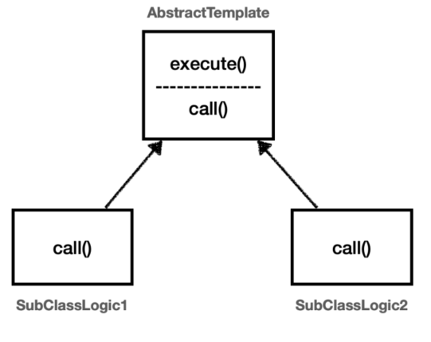
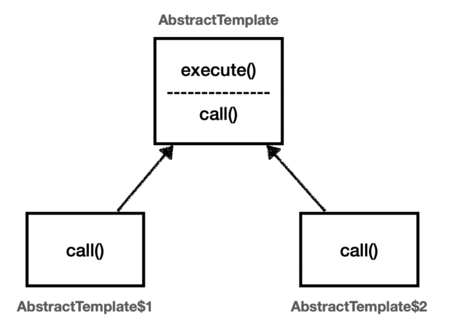
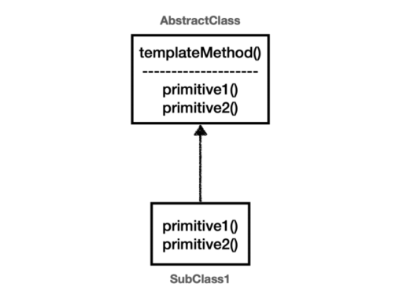
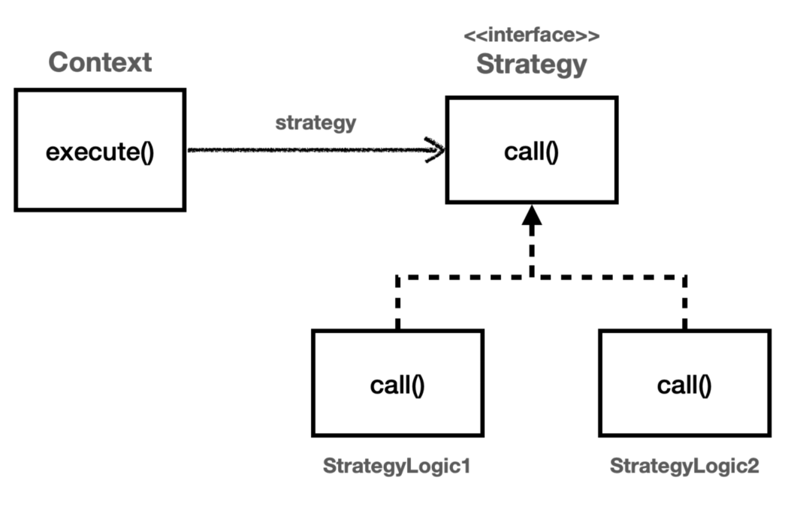

***변하는 것과 변하지 않는 것을 분리*** 

*좋은 설계는 변하는 것과 변하지 않는 것을 분리하는 것* 

*강의에서 나오는 현재 예시는 핵심 기능(비즈니스 로직) 부분은 변하고, 부가 기능(로그 추적기)부분은 변하지 않는 부분이다.*

***템플릿 메소드 패턴(Template Method Pattern)****은 이런 문제를 해결하는 디자인 패턴*

# ***템플릿 메소드 패턴 - 예제1***

*템플릿 메소드 패턴을 쉽게 이해하기 위해 단순한 예제 코드를 만들어보자*

```java
@Slf4j
public class TemplateMethodTest {
    @Test
    void templateMethodV0(){
        logic1();
        logic2();
    }
    private void logic1(){
        long startTime = System.currentTimeMillis();
        log.info("비즈니스 로직1 실행");
        long endTime = System.currentTimeMillis();
        long resultTime = endTime - startTime;
        log.info("resultTime={}", resultTime);
    }
    private void logic2(){
        long startTime = System.currentTimeMillis();
        log.info("비즈니스 로직2 실행");
        long endTime = System.currentTimeMillis();
        long resultTime = endTime - startTime;
        log.info("resultTime={}", resultTime);
    }
```

***result***

```java
비즈니스 로직1 실행
resultTime=17
비즈니스 로직2 실행
resultTime=0
```

***변하는 부분:*** *비즈니스 로직* 

***변하지 않는 부분:*** *시간 측정* 

*→ 템플릿 메소드 패턴을 적용해서 변하는 부분과 변하지 않는 부분을 분리해보자*

# ***템플릿 메소드 패턴 - 예제2***

***템플릿 메서드 패턴 구조***



*템플릿 메소드 패턴의 템플릿은 기준이 되는 거대한 틀이다.*

*템플릿(Abstract Class)에 변하지 않는 부분을 몰아둔다.*

*그리고 일부 변하는 부분을 상속을 통해 구현(오버라이딩)하게 하고 별도로 호출해서 해결한다.*

***AbstractTemplate - abstract class***

```java
@Slf4j
public abstract class AbstractTemplate {
    public void execute(){
        long startTime = System.currentTimeMillis();
        call(); 
        long endTime = System.currentTimeMillis();
        long resultTime = endTime - startTime;
        log.info("resultTime={}", resultTime);
    }
    protected abstract void call();
}
```

***SubClassLogic1, SubClassLogic2 - extends AbstractTemplate***

```java
@Slf4j
public class SubClassLogic1 extends AbstractTemplate{
    @Override
    protected void call() {
        log.info("비즈니스 로직1 실행");
    }
}

@Slf4j
public class SubClassLogic2 extends AbstractTemplate{
    @Override
    protected void call() {
        log.info("비즈니스 로직2 실행");
    }
}
```

***템플릿 메소드 패턴 실행***

```java
@Test
void templateMethodV1(){
    AbstractTemplate template1 = new SubClassLogic1();
    template1.execute();
    AbstractTemplate template2 = new SubClassLogic2();
    template2.execute();
}
```

- *템플릿 메소드 패턴 적용 before와 동일하다.*

*템플릿 메소드 패턴은 이렇게 다형성을 사용해서 변하는 부분과 변하지 않는 부분을 분리하는 방법이다.*

# ***템플릿 메소드 패턴 - 예제3***

*템플릿 메소드 패턴은 클래스를 계속 만들어야 하는 단점이 있다.*

*익명 내부 클래스를 사용하면 이런 단점을 보완할 수 있다.*

***익명 내부 클래스 사용하기*** 

```java
@Test
void templateMethodV2(){
     AbstractTemplate template1 = new AbstractTemplate() {
         @Override
         protected void call() {
             log.info("비즈니스 로직1 실행");
         }
     };
     template1.execute();

     AbstractTemplate template2 = new AbstractTemplate() {
         @Override
         protected void call() {
             log.info("비즈니스 로직2 실행");
         }
     };
     template2.execute();
}
```

***익명 클래스 적용 구조***



- *익명 클래스는 이름이 없기 때문에 이름을 알아서 만들어주는데 이때 추상클래스이름 + $ +숫자를 붙인다.*

***좋은 설계란?***

*진정한 좋은 설계는 바로 변경이 일어날 때 자연스럽게 드러난다.*

*예제에서는 로그를 남기는 부분을 모아서 하나로 모아서 모듈화하고, 비즈니스 로직 부분을 분리했다.*

*만약 로그를 남기는 로직이 변경해야 한다고 생각해보자.*

*그럼 AbstractTemplate 코드만 변경하면 된다. (변경 지점을 하나로 모았다.)*

*만약 템플릿이 없다고 하면 모든 클래스를 다 찾아서 고쳐져야 한다.* 

*Template Method Pattern를 적용해서 SRP 또한 지켜지게 되었다.* 

# ***템플릿 메서드 패턴 - 정의***

***GOF 디자인 패턴에서 템플릿 메소드 패턴 정의*** 

- *작업에서 알고리즘의 골격을 정의하고 일부 단계를 하위 클래스로 연기합니다.*
- *템플릿 메서드를 사용하면 하위클래스가 알고리즘의 구조를 변경하지 않고도 알고리즘의 특정 단계를 재정의할 수 있습니다*



*부모 클래스에 알고리즘의 골격인 템플릿을 정의하고, 일부 변경되는 로직은 자식 클래스에 정의하는 방식*

*이렇게 하면 자식 클래스가 알고리즘 전체 구조를 변경하지 않고, 특정 부분만 재정의할 수 있다.*

*상속과 오버라이딩을 통한 다형성으로 문제를 해결하는 것* 

***템플릿 메소드 패턴 단점?***

*템플릿 메서드 패턴은 상속을 사용한다. 따라서 상속에서 오는 단점들을 그대로 안고간다.*

*자식 클래스가 부모 클래스와 컴파일 시점에 강하게 결합되는 문제가 발생한다.*

*상속을 받는다는 것은 특정 부모 클래스를 의존하고 있다는 것* 

*자식 클래스 입장에서는 부모 클래스의 기능을 전혀 사용하지 않는데, 부모 클래스를 알아야한다.*

*또한 부모 클래스를 수정하면, 자식 클래스에도 영향을 줄 수 있다.*

*추가로 상속 구조를 사용하기 때문에 별도의 클래스나 익명 내부 클래스를 만들어야 하는 부분도 복잡하다.*

*템플릿 메소드 패턴과 비슷한 역할을 하면서 상속의 단점을 제거할 수 있는* ***전략 패턴(Strategy Pattern)****에 대해서 알아보자*

# *전략 패턴 - 예제1*

*동일한 문제를 전략 패턴을 사용해서 해결해보자.*

*전략 패턴은 변하지 않는 부분을* ***Context****라는 곳에 두고, 변하는 부분을* ***Strategy****라는 인터페이스를 만들고 해당 인터페이스를 구현하도록 해서 문제를 해결한다.*

*즉, 상속이 아닌 위임으로 문제를 해결하는 방식이다.*

*전략 패턴에서* ***Context****는 변하지 않는 템플릿 역할을 하고,* ***Strategy****는 변하는 알고리즘 역할을 한다*

***GOF 디자인 패턴에서 정의한 전략 패턴의 의도***

- *알고리즘 제품군을 정의하고 각각을 캡슐화하여 상호 교환 가능하게 만들자.*
- *전략을 사용하면 알고리즘을 사용하는 클라이언트와 독립적으로 알고리즘을 변경할 수 있다.*



***Strategy - inteface***

```java
public interface Strategy {
    void call();
}
```

- *변하는 알고리즘 역할*

***StrategyLogic1, StrategyLogic2 implements Strategy***

```java
@Slf4j
public class StrategyLogic1 implements Strategy {
    @Override
    public void call() {
        log.info("비즈니스 로직 실행1");
    }
}

@Slf4j
public class StrategyLogic2 implements Strategy {
    @Override
    public void call() {
        log.info("비즈니스 로직 실행2");
    }
}
```

***ContextV1***

```java
@Slf4j
public class ContextV1 {
    private Strategy strategy;
    public ContextV1(Strategy strategy) {
        this.strategy = strategy;
    }
    public void execute(){
        long startTime = System.currentTimeMillis();
        strategy.call();
        log.info("resultTime={}", System.currentTimeMillis() - startTime);
    }
}
```

*ContextV1은 변하지 않는 로직을 가지는 템플릿 역할을 하는 코드*

*전략 패턴에서는 이것을 컨텍스트(문맥)이라고 한다.*

*즉, 문맥은 크게 변하지 않지만 그 문맥 속에서 일부 전략이 변경된다 생각하면 된다.*

*전략 패턴의 핵심은 Context는 Strategy 인터페이스에만 의존한다는 점이다.*

*즉, 덕분에 Strategy 구현체를 변경하거나 새로 만들어도 Context 코드에는 영향을 주지 않는다.*

*→ OCP가 지켜진다.*

*→ 스프링에서 의존관계 주입(DI)에서 사용하는 방식이 전략 패턴이다.*

***ContextV1Test - 전략 패턴 적용*** 

```java
@Test
void strategyV1(){
    StrategyLogic1 strategyLogic1 = new StrategyLogic1();
    ContextV1 contextV1 = new ContextV1(strategyLogic1);
    contextV1.execute();

    StrategyLogic2 strategyLogic2 = new StrategyLogic2();
    ContextV1 contextV2 = new ContextV1(strategyLogic2);
    contextV2.execute();
}
```

***실행결과***

```java
StrategyLogic1 - 비즈니스 로직1 실행
ContextV1 - resultTime=3
StrategyLogic2 - 비즈니스 로직2 실행
ContextV1 - resultTime=0
```

# *전략 패턴 - 예제2*

*전략 패턴도 익명 내부 클래스를 사용할 수 있다.*

*또한 전략이 함수형 인터페이스이기 때문에 람다식으로 더욱 간편하게 주입이 가능하다.* 

***익명 내부 클래스 적용***

```java
@Test
void strategyV2(){
    Strategy strategy1 = new Strategy() {
        @Override
        public void call() {
            log.info("비즈니스 로직1 실행");
        }
    };
    Strategy strategy2 = new Strategy() {
       @Override
       public void call() {
           log.info("비즈니스 로직2 실행");
       }
    };

    ContextV1 contextV1 = new ContextV1(strategy1);
    contextV1.execute();

    ContextV1 contextV2 = new ContextV1(strategy2);
    contextV2.execute();
}
```

***람다식 적용***

```java
@Test
void strategyV4(){
   ContextV1 contextV1 = new ContextV1(()->{
       log.info("비즈니스 로직1 실행");
   });
   ContextV1 contextV2 = new ContextV1(()->{
       log.info("비즈니스 로직2 실행");
   });

   contextV1.execute();
   contextV2.execute();
}
```

***정리***

*현재 방식은 Context가 Strategy를 선 조립, 후 실행한다.*

*한번 조립하고 나면 이후로는 Context를 실행하기만 하면 된다.*

*우리가 스프링으로 애플리케이션을 개발할 때 애플리케이션 로딩 시점에 의존관계 주입을 통해 필요한 의존관계를 모두 맺어두고 난 다음에 실제 요청을 처리하는 것과 같은 원리이다.*

*문제는 한번 조립한 이후에는 전략을 변경하기 번거롭다는점이다.*

*Context에 setter를 제공해서 Strategy를 넘겨 받아 변경하면 되지만, Context를 싱글톤으로 사용할 때는 동시성 이슈 등 고려할점이 많다.*

*이렇게 먼저 조립하고 사용하는 방식보다 더 유연하게 전략 패턴을 사용하는 방법은 없을까?*

# ***전략 패턴 - 예제3 - Template Callback Pattern***

*이전에는 Context 필드에 Strategy를 주입해서 사용했다.*

*이번에는 전략을 실행할 때 직접 파라미터로 전달해서 사용해보자.*

***ContextV2***

```java
@Slf4j
public class ContextV2 {
    public void execute(Strategy strategy){
        long startTime = System.currentTimeMillis();
        strategy.call();
        long endTime = System.currentTimeMillis();
        log.info("resultTime={}", System.currentTimeMillis() - startTime);
    }
}
```

***ContextV2 test***

```java
@Test
void strategyV1(){
  ContextV2 context = new ContextV2();
  context.execute(()->{
      log.info("비즈니스 로직1 실행");
  });

  context.execute(()->{
      log.info("비즈니스 로직2 실행");
  });
}
```

*이제 Context와 Strategy를 선 조립 후 실행하는 방식이 아니라 Context를 실행할 때 마다 전략을 매개변수로 전달한다.*

*클라이언트는 Context를 실행하는 시점에 원하는 Strategy를 전달할 수 있다.*

*따라서 이전 방식과 비교해서 원하는 Strategy를 동시성 이슈 없이 유연하게 변경할 수 있다.*

# ***템플릿 콜백 패턴*** 

*ContextV2는 변하지 않는 템플릿 역할을 한다.*

*그리고 변하는 부분은 파라미터로 넘어온 Strategy의 코드를 실행해서 처리한다.*

*이렇게 다른 코드의 인수로서 넘겨주는 실행 가능한 코드를* ***콜백(CallBack)****이라 한다.*

*CallBack은 코드가 호출(call)이 되는데 코드를 넘겨준 곳의 뒤(back)에서 실행된다는 뜻이다.*

***템플릿 콜백 패턴***

*스프링에서는 ContextV2 같은 방식의 전략 패턴을 템플릿 콜백 패턴이라 한다.*

*템플릿 콜백 패턴은 GOF 패턴은 아니고 스프링에서만 이렇게 부른다.*

*전략 패턴에서 템플릿과 콜백 부분이 강조된 패턴이라 생각하면 된다.*

*Spring에서는 JdbcTemplate , RestTemplate , TransactionTemplate , RedisTemplate처럼 다양한 템플릿 콜백 패턴이 사용된다.*

