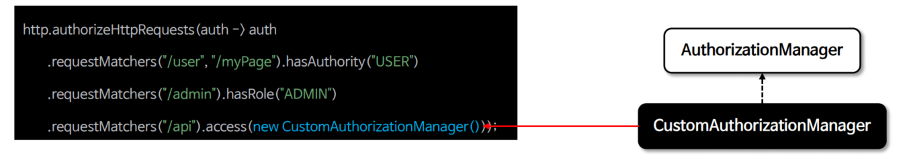
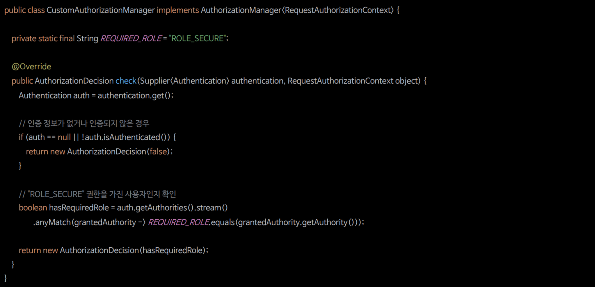

# **개요**

- 스프링 시큐리티 인가 설정 시 선언적 방식이 아닌 프로그래밍 방식으로 구현할 수 있으며 **access(AuthorizationManager) API** 를 사용한다
- **access()**에는 `AuthorizationManager<RequestAuthorizationContext>`타입의 객체를 전달할 수 있으며 사용자의 요청에 대한 권한 검사를 **access()**에 지정한 `AuthorizationManager`가 처리하게 된다
- **access()**에 지정한 `AuthorizationManager`객체는 `RequestMatcherDelegatingAuthorizationManager` 의 매핑 속성에 저장된다 

```java
http.authorizeHttpRequests(auth -> 
auth.requestMatcher().access(AuthorizationManager)
```

# **적용**

- 특정한 엔드포인트에 대한 권한 검사를 수행하기 위해 `AuthorizationManager`를 구현하여 설정한다



- `/user`, `/myPage`, `/admin` 요청 패턴의 권한 검사는 `AuthorityAuthorizationManager`가 처리한다
- `/api`요청 패턴의 권한 검사는 `CustomAuthorizationManager`가 처리한다

# **CustomAuthorizationManager.java**



# **실습**

**CustomAuthorizationManager**

```java
public class CustomAuthorizationManager implements AuthorizationManager<RequestAuthorizationContext> {
    private final String REQUIRED_ROLE = "ROLE_SECURE";
    @Override
    public AuthorizationDecision check(Supplier<Authentication> authentication, RequestAuthorizationContext object) {
        Authentication auth = authentication.get();
        // null || 인증 X || 익명 사용자
        if(auth == null || !auth.isAuthenticated() || auth instanceof AnonymousAuthenticationToken){
            return new AuthorizationDecision(false);
        }
        // 권한 심사
        boolean hasRequiredRole = auth.getAuthorities().stream()
                .anyMatch(grantedAuthority -> REQUIRED_ROLE.equals(grantedAuthority.getAuthority()));

        return new AuthorizationDecision(hasRequiredRole);
    }
}
```

- **stream API anyMatch(): 하나라도 일치하면 return true** 
- 내부 predicate 인터페이스 사용

**SecurityConfig**

```java
@EnableWebSecurity
@Configuration
public class SecurityConfig {
    @Bean
    public SecurityFilterChain securityFilterChain(HttpSecurity http) throws Exception{
        http.authorizeHttpRequests(authorize -> authorize
                .requestMatchers("/user").hasRole("USER")
                .requestMatchers("/db").access(new WebExpressionAuthorizationManager("hasRole('DB')"))
                .requestMatchers("/admin").hasAuthority("ROLE_ADMIN")
                .requestMatchers("/secure").access(new CustomAuthorizationManager())
                .anyRequest().authenticated())
                .formLogin(Customizer.withDefaults())
                .csrf(AbstractHttpConfigurer::disable);
        return http.build();
    }
    @Bean
    public UserDetailsService userDetailsService(){
        UserDetails user = User.withUsername("user").password("{noop}1111").roles("USER").build();
        UserDetails db = User.withUsername("db").password("{noop}1111").authorities("ROLE_DB").build();
        UserDetails admin = User.withUsername("admin").password("{noop}1111").roles("ADMIN","SECURE").build();
        return  new InMemoryUserDetailsManager(user, db, admin);
    }
}
```

- `.requestMatchers("/secure").access(new CustomAuthorizationManager())`
- admin 사용자만 `ROLE_SECURE` 
- → admin 사용자만 `/secure` 엔드포인트에 접근이 가능하다

