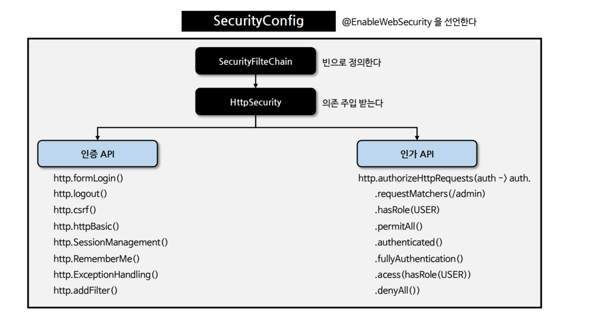

한 개 이상의 SecurityFilterChain 타입의 빈을 정의한 후 인증 API / 인가 API를 설정한다 

빈을 정의하지 않으면 자동으로 SecurityFilterChain 빈 생성해서 등록 



# **기본 구현 코드** 

```java
@EnableWebSecurity(debug = false) // default: false
@Configuration
public class SecurityConfig {
    @Bean
    public SecurityFilterChain securityFilterChain(HttpSecurity http) throws Exception {
        http
                .authorizeHttpRequests(auth -> auth.anyRequest().authenticated())
                .formLogin(Customizer.withDefaults());

        return http.build();
    }
}   
```

모든 설정 코드는 람다 형식으로 작성해야 한다 (스프링 시큐리티 7 버전부터는 람다 형식만 지원 할 예정)

SecurityFilterChain 을 빈으로 정의하게 되면 자동설정에 의한 SecurityFilterChain 빈은 생성되지 않는다

# 사용자 추가 설정 

**application.yaml** 

```yaml
spring:
  security:
    user:
      name: user
      password: [REDACTED]
      roles: USER
```

**자바 설정 클래스에 직접 정의**

```java
@Bean
public InMemoryUserDetailsManager inMemoryUserDetailsManager(){
		UserDetails user = User.withUsername("user")
			.password("{noop}1111")
			.authorities("ROLE_USER")
			.build();
		return new InMemoryUserDetailsManager(user);
}
```

설정 파일이랑 설정 클래스에 직접 정의 모두 하면 설정 클래스에 직접 정의하는 게 우선권을 가진다.

**InMemoryUserDetailsManager (UserDetailsService)**

유저 정보를 DB가 아닌 메모리에 저장하는 방식 

애플리케이션이 종료되면 날라간다. 

즉, 토이 프로젝트/ 테스트 환경에만 사용 가능

