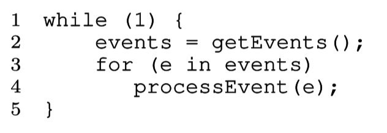
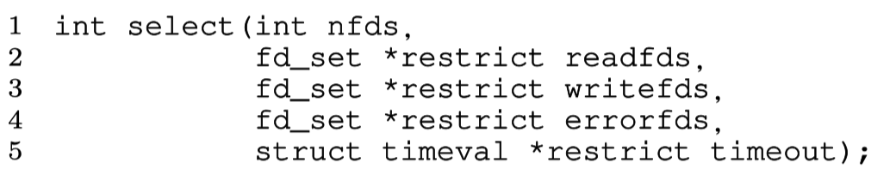
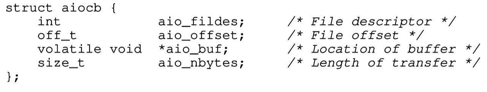
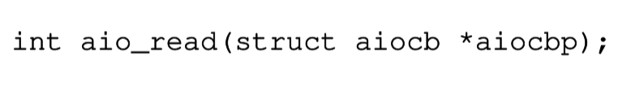
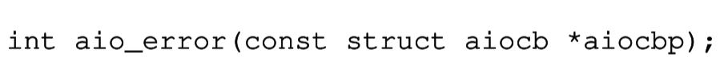
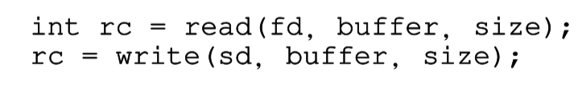

# 36장 개요 

병행 프로그램을 제작하는 도구는 다양하다. 쓰레드만 있는 건 아니다.

GUI 기반 프로그램이나 인터넷 서버에서는 다른 스타일의 병행 프로그래밍이 사용된다.

이런 스타일을 **이벤트 기반의 병행성(event-based concurrency)**이라 한다.

**node.js** 같은 서버 프레임워크에서 사용되지만, 시작점은 C와 유닉스 시스템이다.

**멀티 쓰레드 프로그램 문제점 2가지 복습**

멀티 쓰레드 프로그램에서 이벤트 기반의 병행성을 올바르게 즉, 결정적으로 동작하게 만드는 건 어렵다.

락을 누락(상호 배제 누락)시키거나, 교착 상태 같은 문제들이 발생할 수 있다.

또한 개발자는 쓰레드 스케줄링에 대한 제어권을 갖고 있지 않다.

운영체제가 생성된 쓰레드를 CPU들 간에 합리적으로 스케줄링하기만을 기대할 수밖에 없다.

하지만 모든 종류의 워크로드에 대해서 잘 동작하는 범용 스케줄러는 어렵기 때문에 운영체제는 원치않는 순서로 워크로드를 스케줄링할 수 있다. 

**Q: 멀티 쓰레드 없이 병행 서버를 개발할까?**

---

# 36.1 기본 개념: 이벤트 루프

이벤트 기반의 병행성은 간단하다. 특정 사건(”이벤트”)의 발생을 대기한다. 이벤트가 발생하면 이벤트의 종류를 파악하고, I/O를 요청하거나 추후 처리를 위해 다른 이벤트를 발생시키거나 하는 등의 작업을 한다.

### 고전적인 이벤트 기반의 서버

해당 응용 프로그램은 **이벤트 루프(event loop)**라는 단순한 구조를 기반으로 짜여 있다.



루프내에서 사건 발생을 대기한다. 이벤트가 발생하면 하나씩 처리한다.

이때 각 이벤트를 처리하는 코드를 **이벤트 핸들러(event handler)**라 부른다.

중요한 것은 이벤트의 처리가 시스템의 유일한 작업이기 때문에, 다음에 처리할 이벤트를 결정하는 것이 스케줄링과 동일한 효과를 갖는다. **즉, 스케줄링을 제어할 수 있는 기능이 이벤트 기반의 방법의 큰 장점 중 하나이다.**

---

# 36.2 중요 API: select(), poll()

이벤트를 어떻게 받을까?

대부분의 시스템은 select() 또는 poll() 시스템 콜을 기본 API로서 제공한다.

인터페이스 기능은 간단하다. 도착한 I/O 중 주목할 만한 것이 있는지를 검사한다.

ex) 웹 서버 같은 네트워크 응용 프로그램이 자신이 처리할 패킷의 도착 여부를 검사한다.



**select() 시스템 콜 분석** 

```
**# nfd**
감시할 디스크립터의 최대값 + 1
예: 0번부터 9번까지 감시하려면 nfds는 10
성능에 영향을 줄 수 있으므로 최대값을 넘지 않도록 해야 함

**# readfds**
읽기 가능 상태인지 감시할 FD(File Descriptor)집합
예: 소켓에 읽을 데이터가 있으면 감지됨

**# writefds**
쓰기 가능 상태인지 감시할 FD 집합
예: 소켓 버퍼가 비어 있어 데이터를 보낼 수 있으면 감지됨.

**# errorfds**
예외 상태인지 감시할 FD 집합
예: out-of-band 데이터 등 특수한 예외 감지

**# timeout**
select()가 대기할 시간
NULL: 무한 대기 (blocking)
{0, 0}: 즉시 반환 (non-blocking)
{sec, usec}: 최대 대기 시간

**# 동작 과정**
select()는 각 fd 집합에 있는 FD들을 확인함
각 FD가 감시 중인 조건(읽기/쓰기/예외)에 해당하는지 검사
해당 조건(읽거나 쓰기가 가능하면)을 만족하면 해당 fd를 다시 집합에 남겨두고, 만족하지 않으면 제거
준비된 FD의 총 개수를 반환
예: 읽을 수 있는 FD가 2개라면 2 반환
오류 시 -1 반환, errno 설정
```

**select() 중요 포인트1**

select()는 디스크립터에 대한 **읽기 가능 여부(Read)**, **쓰기 가능 여부(Write)**, **예외(Exception)** 등을 검사할 수 있다.

읽기 가능 (readfds)

→ 수신 버퍼에 데이터가 도착해 있어 read() 호출 시 블로킹되지 않고 바로 읽을 수 있는 상태.

→ 예: TCP 소켓에 수신 패킷이 도착했는지 감시.

쓰기 가능 (writefds)

→ 송신 버퍼(outbound queue)에 여유 공간이 있어 write()가 바로 가능한 상태.

→ 예: 서비스가 응답을 전송할 수 있는 시점.

**select() 중요 포인트2**

| timeout 설정 값 | 의미 | 동작 방식 |
| --- | --- | --- |
| NULL | 무한정 대기 | **Blocking I/O** |
| 0초, 0마이크로초 | 즉시 반환 | **Non-blocking I/O** |
| 특정 시간 | 설정된 시간만큼 대기 후 종료 | **Timed wait** |

---

# 36.3 select()의 사용

select()를 이용해 어떤 네트워크 디스크립터에 메시지가 도착했는지를 파악하자.

**그림 36.1 → 코드로 변경**

```c
#include <stdio.h> 
#include <stdlib.h> 
#include <sys/time.h> 
#include <sys/types.h> 
#include <unistd.h>

int main(void) {
		// 여러 개의 소켓을 열고 설정
		while (1) {
				// fd_set은 select()에서 감시할 파일 디스크립터 집합을 표현하는 구조체
				fd_set readFDs;    
				
				// FD_ZERO는 해당 집합을 초기화 (모든 비트를 0으로 설정)
				FD_ZERO(&readFDs);
				
				// FD_SET을 통해 해당 디스크립터를 감시 대상에 추가
				int fd;
				for (fd = minFD; fd < maxFD; fd++)
						FD_SET(fd, &readFDs);
				
				// select() 호출, 읽기 가능 여부만 확인, blocking
		    int rc = select(maxFD + 1, &readFDs , NULL , NULL , NULL);
		
				int fd; 
				for (fd = minFD; fd < maxFD; fd++)
			  // FD_ISSET(fd, &readFDs)를 통해 해당 파일 디스크립터가 읽을 준비가 되어 있는지 확인
						if (FD_ISSET(fd , &readFDs)) 
				// 준비된 디스크립터는 processFD(fd) 함수를 통해 처리		
								processFD(fd);
		}
}

/*
rc > 0: 감시 대상 중 하나 이상이 준비됨
rc == 0: 타임아웃 발생 (여기선 NULL이라 무한 대기 → 발생하지 않음)
rc == -1: 에러 (예: 잘못된 fd)

즉, 읽기 파일 디스크립터 중에 하나라도 읽기 가능 상태가되면 반환된다. 

readFDs에 파일 디스크립터 3개: fd1, fd2, fd3가 있다고 가정
이 중 fd2만 읽기 가능 상태가 되면

FD_ISSET(fd2, &readFDs) → true
FD_ISSET(fd1, &readFDs) → false
FD_ISSET(fd3, &readFDs) → false
*/
```

---

# 36.4 왜 간단한가? 락이 필요 없음

단일 CPU를 사용하는 싱글 스레드 이벤트 기반의 응용 프로그램에서는 멀티 쓰레드 병행 프로그램을 다룰 때 나타났던 문제가 더 이상 보이지 않는다.

매순간에 단 하나의 이벤트만을 다루기 때문에 락을 획득하거나 해제해야 할 필요가 없다. 그렇기 때문에 멀티 쓰레드 프로그램에서 흔한 병행성 버그는 기본적인 이벤트 기반 접근법에서는 나타나지 않는다.

---

# 36.5 문제: 블로킹 시스템 콜(Blocking System Call)

차단될 수도 있는 시스템 콜을 불러야 하는 이벤트가 있다면 어떻게할까?

예를 들어 디스크에서 데이터를 읽어서 그 내용을 사용자에게 전달하는 요청.

이러한 요청을 처리하려면 이벤트 핸들러가 open() 시스템 콜을 사용하여 파일을 열어서 read() 명령어를 사용하여 파일을 읽어야 한다. 파일을 읽어서 메모리에 탑재한 후에야 서버는 그 결과를 사용자에게 전달할 수 있다.

open(), read() 모두 저장 장치에 I/O 요청을 보내야 하는 상황(메타데이터나 데이터가 메모리에 없는 경우)이라면 이 요청을 처리하기 위해서는 오랜 시간이 필요하다.

멀티 쓰레드 기반의 서버는 한 쓰레드가 I/O를 대기하면 다른 쓰레드가 실행이 되며 서버는 계속 동작할 수 있다.

I/O 처리와 다른 연산이 자연스럽게 **겹쳐지는 현상(overlap)**이 멀티 쓰레드 기반 프로그래밍의 장점이다.

반면에 이벤트 기반의 접근법에서는 이벤트 핸들러가 블로킹 콜을 호출을 하면 서버 전체가 오직 그 일을 처리하기 위해, 명령어가 끝날 때까지 유휴 상태가 된다. 이는 심각한 자원 낭비이다. 

→ **이벤트 기반 시스템의 기본 원칙은 블로킹 호출을 허용하면 안 된다.**

---

# 36.6 해법: 비동기 I/O

**비동기 I/O (asynchronous I/O)** 이 인터페이스는 프로그램이 I/O 요청을 하면 I/O 요청이 끝나기 전에 제어권을 즉시 다시 호출자에게 돌려주는 것을 가능하게 했으며 추가적으로 여러 종류의 I/O들이 완료가 되었는지도 판단할 수 있도록 하였다.

### Mac OS X 제공 비동기 I/O API

해당 비동기 I/O API는 **struct aiocb 즉, AIO 제어 블럭(AIO control block)**이라고 불리는 구조를 사용한다.



파일에 대한 비동기 읽기 요청을 하려면 응용 프로그램은 먼저 이 자료 구조에 읽고자 하는 파일의 파일 디스크립터(aio_fildes), 파일 내에서 위치(aio_offset), 데이터를 저장할 메모리의 위치(aio_buf), 요청의 길이  (aio_nbytes) 같은 관련 정보를 채워 넣어야 한다.

이 자료 구조에 정보가 다 채워지면 응용 프로그램은 읽으려는 파일에 비동기 호출을 보낸다.

MAX OS X에서는 **비동기 읽기(asynchronus read) API**를 사용한다.



이 명령어를 통해 I/O 호출을 성공하면 즉시 리턴을 하며 응용 프로그램은 하던 일을 계속 진행할 수 있다.

그렇다면 I/O 종료는 어떻게 알 수 있을까? 또한 aio_buf가 가리키는 버퍼에 요청했던 데이터가 있다는 것을 어떻게 알 수 있을까?



aio_error() API(시스템 콜)를 통해서 aiocb에 의해 참조된 요청이 완료되었는지를 검사한다.

완료되었다면 성공을 리턴을 하고(0) 실패했다면 EINPROGRESS을 반환한다.

모든 대기 중인 **비동기 I/O는 주기적으로 aio_error() 시스템 콜로 시스템에 폴링(poll)하여 해당 I/O가 완료되었는지 확인**할 수 있다.

만약 어떤 시점에 수백 개의 I/O를 요청하는 프로그램이 있다면, 그 많은 요청을 일일이 다 검사해야 할까?

이 문제를 해결하기 위해서 **어떤 시스템들은 인터럽트 기반의 접근법을 제공한다.**

**시그널(signal)을 사용하여 비동기 I/O가 완료되었다는 것을 응용 프로그램에게 알려주기** 때문에 시스템에 반복적으로 완료 여부를 확인할 필요가 없다.

---

# 36.7 또 다른 문제점: 상태 관리

이벤트 기반 접근법은 전통적인 쓰레드 기반 코드보다 더 작성하기 복잡하다.

이벤트 핸들러가 비동기 I/O를 발생시킬 때, I/O 완료 시 사용할 프로그램 상태를 정리해 놓아야 한다.

이 작업은 쓰레드 기반 프로그램에서는 불필요하다. 이미 쓰레드 스택에 그 정보들이 들어 있기 때문이다.

이것을 **수동 스택 관리(manual stack management)**라고 부르며 이벤트 기반 프로그래밍의 기본이다.

**쓰레드 기반 서버 동작**



해당 예제는 파일 디스크립터(fd)로 명시된 파일에서 데이터를 읽어들여, 해당 데이터들을 네트워크 소켓 디스크립터(sd)로 전송한다.

read()가 리턴되면 전송할 네트워크 소켓에 관한 정보가 같은 스택에 존재하기 때문에 매우 간단한 작업이다.

**이벤트 기반 시스템** 

같은 일을 하려면 AIO 호출들을 사용하여 read()를 비동기로 요청해야 한다. aio_error()를 사용하여 주기적으로 읽기가 종료되었는지를 확인한다고 가정해 보자.

이 호출이 읽기가 종료되었다고 알려주면 이벤트 기반 서버는 다음으로 무슨 일을 해야 할 지 어떻게 알 것인가?

그 해법은 **continuation**을 사용하는 것이다.

이벤트를 종료하는 데에 필요한 자료들을 한곳에 저장해 둔다. 이벤트가 발생하면(디스크 I/O 종료), 저장해 놓은 정보들을 활용하여 이벤트를 처리한다.

```
**# 요청 초기화 시**
클라이언트가 전송 요청 → 서버는 read(fd, ...)를 비동기로 시작 
(aio_read() 혹은 non-blocking + select()/epoll() 사용)

이때 파일 디스크립터(fd)에 관련된 상태 정보
(예: 이 fd가 완료되면 어떤 소켓(sd)에 write할 건지)를 별도의 자료구조(예: 해시 테이블)에 저장

**# I/O 완료 이벤트 발생 시**
I/O 완료 시 해당 fd에 대한 이벤트가 select()/epoll()/aio_callback 등으로 감지됨.
이 fd로부터, 등록된 자료구조를 통해 다음 동작을 파악 (예: write할 대상 소켓 디스크립터(sd))

**# 다음 동작 수행**
이벤트 핸들러가 해당 fd에 등록된 상태를 가져와, 소켓 sd로 데이터를 전송 (write(sd, ...))
이후 필요한 경우 context를 해제하거나 다음 상태로 전이
```

---

# 36.8 이벤트 사용의 어려움

**1. 멀티코어 환경에서의 복잡성 증가**

이벤트 기반 방식은 단일 CPU 환경에서는 단순하고 효율적인 구조를 가질 수 있지만, 멀티코어 환경에서는 그렇지 않다. 다수의 이벤트 핸들러를 병렬로 실행해야 하며, 이로 인해 동기화 문제(경쟁 조건)가 발생한다. 이러한 문제를 해결하기 위해 결국 락(lock)을 사용해야 하며, 이는 이벤트 기반 시스템의 단순성과 효율성을 저하시킨다.

즉, 현대의 멀티코어 시스템에서는 락 없는 이벤트 처리 방식이 사실상 불가능해지고 있다.

**2. 페이징(Paging) 시스템과의 부조화**

이벤트 기반 서버는 일반적으로 non-blocking 설계를 추구하지만, 페이지 폴트와 같은 시스템 내부 요인에 의한 차단(blocking)은 피할 수 없다. 이벤트 핸들러가 동작 중 페이지 폴트가 발생하면 해당 핸들러의 실행이 중단되고, 결과적으로 서버 전체의 진행에도 영향을 줄 수 있다.

**3. 관리의 어려움**

이벤트 기반 시스템은 루틴이 비동기 → 동기 방식으로 변경되는 등 루틴의 동작 방식이 자주 바뀌기 때문에 관리가 어렵다. 루틴이 blocking 방식으로 바뀌면 이를 호출하는 모든 이벤트 핸들러도 함께 수정해야 하며, 이는 다음과 같은 문제로 이어진다

- 루틴을 non-blocking 버전과 blocking 버전으로 이중 관리해야 한다.
- 이벤트 기반 서버에서는 blocking 동작이 치명적이기 때문에, 개발자는 사용 API의 비동기/동기 여부에 항상 주의해야 한다.

**4. 비동기 처리의 일관성 문제**

이상적으로는 모든 I/O 작업을 일관된 방식으로 처리하는 것이 좋다. 예를 들어, 모든 입출력에 select()를 사용한다면 일관성이 유지된다. 하지만 실제로는 다음과 같은 비일관적인 처리 방식이 혼용되고 있다:

- 네트워크 I/O: select() 사용
- 디스크 I/O: AIO(Asynchronous I/O) 사용

이로 인해 비동기 처리에 대한 코드 복잡성 및 관리 부담이 증가하게 된다.

---

