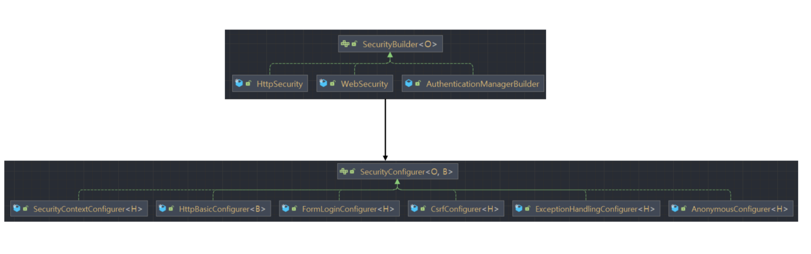
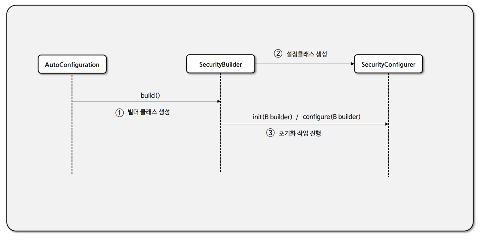
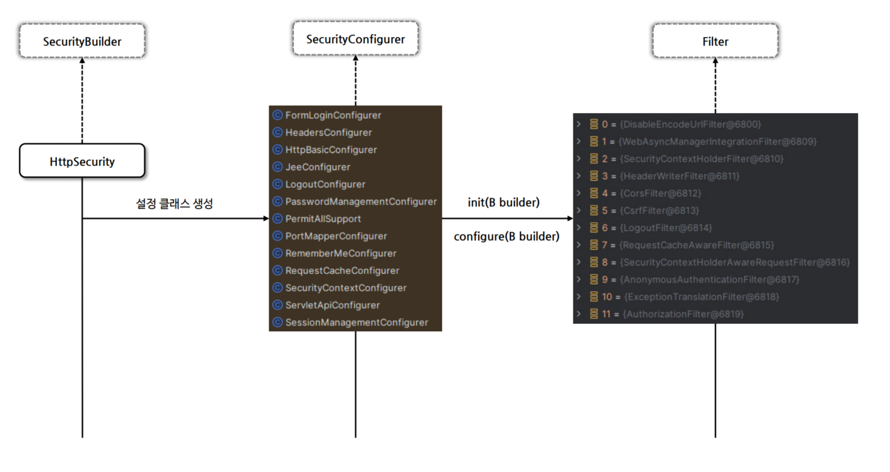

**SecurityBuilder** 

- 빌더 클래스로서 웹 보안을 구성하는 빈 객체와 설정클래스들을 생성하는 역할을 한다 
- WebSecurity, HttpSecurity 
- SecurityBuilder는 SecurityConfigurer를 참조하고 있으며 인증 및 인가 초기화 작업은 SecurityConfigurer에 의해 진행된다 

**SecurityConfigurer**

- Http 요청과 관련된 보안처리를 담당하는 필터들을 생성하고 여러 초기화 설정에 관여 



**초기화 작업 순서** 



AutoConfiguration SpringBoot 자동 구성 SecurityBuilder 클래스 생성 

SecurityBuilder(ex: HttpSecurity)를 통해서 여러가지 필터를 생성하는 SecurityConfigurer 생성 

SecurityBuilder build() 메소드가 호출되면 init(), configure()를 통해 초기화 작업이 진행 



```java
@Configuration(proxyBeanMethods = false)
class HttpSecurityConfiguration {

		@Bean(HTTPSECURITY_BEAN_NAME)
		@Scope("prototype")
		HttpSecurity httpSecurity() throws Exception {
			// 생략 ... 
			http
				.csrf(withDefaults())
				.addFilter(webAsyncManagerIntegrationFilter)
				.exceptionHandling(withDefaults())
				.headers(withDefaults())
				.sessionManagement(withDefaults())
				.securityContext(withDefaults())
				.requestCache(withDefaults())
				.anonymous(withDefaults())
				.servletApi(withDefaults())
				.apply(new DefaultLoginPageConfigurer<>());
			http.logout(withDefaults());
		
			applyCorsIfAvailable(http);
			applyDefaultConfigurers(http);
			return http;
		}

}
```

**http.csrf() 메소드** 

```java
public HttpSecurity csrf(Customizer<CsrfConfigurer<HttpSecurity>> csrfCustomizer) throws Exception {
		ApplicationContext context = getContext();
		csrfCustomizer.customize(getOrApply(new CsrfConfigurer<>(context)));
		return HttpSecurity.this;
	}
```

CsrfConfigurer 즉, SecurityConfigurer 인터페이스를 구현한 클래스가 설정된다. 

[자동 설정 기본 보안 작동](/26b7d6692ca881d58171ea4e3ca046c6)

SecurityBootWebSecurityConfiguration 클래스에서는 여기서 생성하는 

HttpSecurity 빈을 주입받게 된다. 

defaultSecurityFilterChain 메소드에서 

3개의 Configurer를 추가하고 

http.build()가 호출된다. 

SecurityBuilder(인터페이스) 

AbstractConfiguredSecurityBuilder(추상클래스)

HttpSecurity(클래스)

AbstractConfiguredSecurityBuilder에 정의된 doBuild() 호출

```java
@Override
protected final O doBuild() throws Exception {
	synchronized (this.configurers) {
		this.buildState = BuildState.INITIALIZING;
		beforeInit();
		init();
		this.buildState = BuildState.CONFIGURING;
		beforeConfigure();
		configure();
		this.buildState = BuildState.BUILDING;
		O result = performBuild();
		this.buildState = BuildState.BUILT;
		return result;
	}
}
```

configurers(설정 클래스들) for문을 돌면서 init(), configure() 호출

