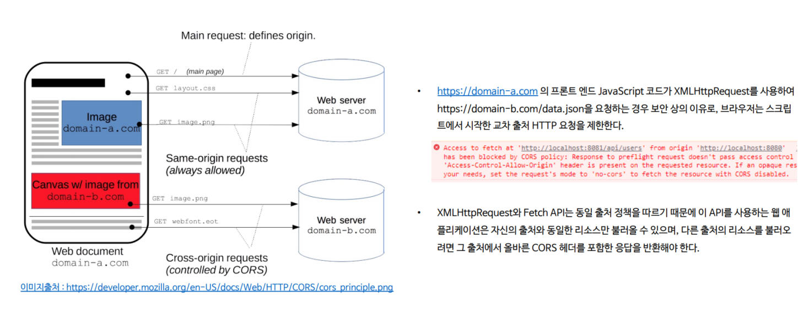
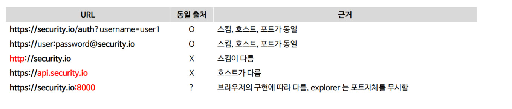
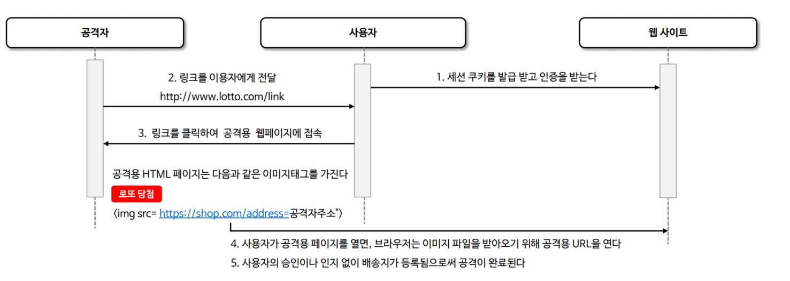
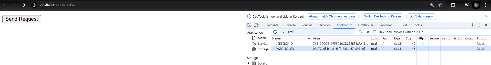
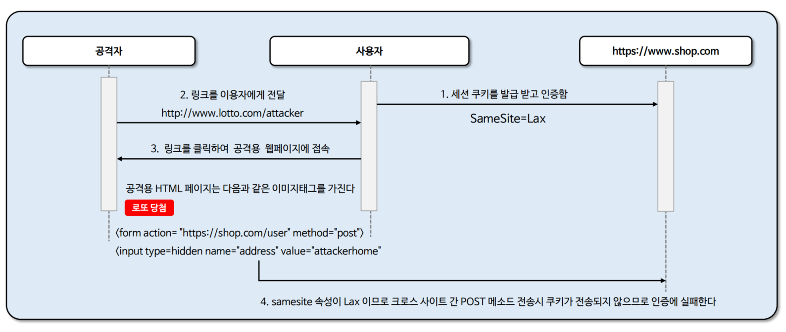
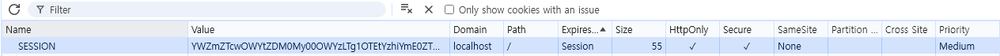

**CORS(교차 출처 리소스 공유)**

  - 웹에서는 보안을 위해 기본적으로 한 웹페이지 (출처 A)에서 다른 웹 페이지(출처 B)의 데이터를 직접 불러오는 것을 제한하는데 이를 `동일 출처 정책(Same-Origin-Policy)` 이라고 한다 
  - 만약 다른 출처의 리소스를 안전하게 사용하고자 할 경우 `CORS`가 등장하며 `CORS` 는 특별한 HTTP 헤더를 통한 한 웹페이지가 다른 출처의 리소스에 접근할 수 있도록 허가를 구하는 방법이라 할 수 있다 
  - 웹 애플리케이션이 다른 출처의 데이터를 사용하고자 할 때, 브라우저가 그 요청을 대신해서 해당 데이터를 사용해도 되는지 다른 출처에게 물어보는 것이라 할 수 있다 
  - 출처를 비교하는 로직은 서버에 구현된 스펙이 아닌 브라우저에 구현된 스펙 기준으로 처리되며 브라우저는 클라이언트의 요청 헤더와 서버의 응답 헤더를 비교해서 최종 응답을 결정한다 
  - 두개의 출처를 비교하는 방법은 URL 구성요소 중 `Protocol`, `Host`, `Port` 이 세가지가 동일한지 확인하면 되고 나머지는 틀려도 상관없다



# **CORS 종류**

## 1. Simple Request

**Simple Request?**

`Simple Request`는 예비 요청(Preflight) 과정 없이 자동으로 `CORS` 가 작동하여 서버에 본 요청을 한 후, 서버가 응답 헤더에 `Access-Control-Allow-Origin` 과 같은 값을 전송하면 브라우저는 서로 비교 후 CORS 정책 위반여부를 검사하는 방식이다 

**제약 사항** 

  - GET, POST, HEAD 중의 한가지 Method를 사용해야 한다 
  - 헤더는 Accept, Accept-Language, Content-Language, Content-Type, DPR, Downlink, Save-Data, Viewport-Width Width 만 가능하고 Custom Header 는 허용되지 않는다
  - Content-type 은 application/x-www-form-urlencoded, multipart/form-data, text/plain 만 가능하다


## 2. Preflight Request (예비요청)

**Preflight Request?**

  - 브라우저는 요청을 한번에 보내지 않고, 예비 요청과 본 요청으로 나누어 서버에 전달하는데 브라우저가 예비요청을 보내는 것을 `Preflight` 라고 하며 이 예비요청의 메소드에는 `OPTIONS`가 사용된다 
  - 예비 요청의 역할은 본 요청을 보내기 전에 브라우저 스스로 안전한 요청인지 확인하는 것으로 요청 사양이 `Simple Request` 에 해당하지 않을 경우 브라우저가 `Preflight Request`을 실행한다 


# **Preflight Request (예비요청)**


# **동일 출처 기준**



# **CORS 해결 - 서버에서 Access-Control-Allow-* 세팅**

  - **Access-Control-Allow-Origin**
- 헤더에 작성된 출처만 브라우저가 리소스를 접근할 수 있도록 허용한다 
    - `*`, `https://security.io`
  - **Access-Control-Allow-Methods**
- **preflight request**에 대한 응답으로 실제 요청중에 사용할 수 있는 메소드를 나타낸다 
    - `기본값: GET, POST, HEAD, OPTIONS` , `*`
  - **Access-Control-Allow-Headers**
- **preflight request**에 대한 응답으로 실제 요청중에 사용할 수 있는 헤더 필드 이름을 나타낸다 
    - `기본값:Origin, Accept, X-Requested-With, Content-Type, Access-Control-Request-Method, Access-Control-Request-Headers` , `CustomHeader`, `*`
  - **Access-Control-Allow-Credentials**
- 실제 요청에 쿠키나 인증 등의 사용자 자격 증명이 포함될 수 있음을 나타낸다
  - A**ccess-Control-Max-Age**
- preflight 요청 결과를 캐시 할 수 있는 시간을 나타내는 것으로 해당 시간동안은 preflight 요청을 다시 하지 않게 된다

# **cors() & CorsFilter**

  - CORS의 사전 요청(pre-flight request)에는 쿠키(JSESSIONID)가 포함되어 있지 않기 때문에 SpringSecurity 이전에 처리되어야 한다 
  - 사전 요청에 쿠키가 없고 Spring Security가 가장 먼저 처리되면 요청은 사용자가 인증되지 않았다고 판단하고 거부할 수 있다
  - CORS가 먼저 처리되도록 하기 위해서 `CorsFilter`를 사용할 수 있으며 `CorsFilter`에 `CorsConfigurationSource`를 제공함으로써 Spring Security와 통합 할 수 있다 

```java
@Bean
SecurityFilterChain defaultSecurityFilterChain(HttpSecurity http) throws Exception {
	 http.cors(cors -> cors.configurationSource(corsConfigurationSource()));
	 return http.build();
}

@Bean
public CorsConfigurationSource corsConfigurationSource() {
	 CorsConfiguration configuration = new CorsConfiguration();
	 configuration.addAllowedOrigin("https://example.com"));
	 configuration.addAllowedMethod("GET","POST"));
	 configuration.setAllowCredentials(true);
	 UrlBasedCorsConfigurationSource source = new UrlBasedCorsConfigurationSource();
	 source.registerCorsConfiguration("/**", configuration);
	 return source;
}
```

  - 커스텀하게 사용할 `CorsConfigurationSource`를 설정한다.
  - `CorsConfigurationSource`를 설정하지 않으면 Spring MVC 의 CORS 구성을 사용한다

[https://imbf.github.io/spring/2020/10/01/CORS-with-Spring.html](https://imbf.github.io/spring/2020/10/01/CORS-with-Spring.html)

# **CSRF(Cross Site Request Forgery, 사이트 간 요청 위조)**

  - 웹 애플리케이션의 보안 취약점으로 공격자가 사용자로 하여금 이미 인증된 다른 사이트에 대해 원치 않는 작업을 수행하게 만드는 기법을 말한다 
  - 이 공격은 사용자의 브라우저가 자동으로 보낼 수 있는 인증 정보, 예를 들어 쿠키나 기본 인증 세션을 이용하여 사용자가 의도하지 않은 요청을 서버로 전송하게 만든다 
  - 이는 사용자가 로그인한 상태에서 악의적인 웹사이트를 방문하거나 이메일 등을 통해 악의적인 링크를 클릭할 때 발생할 수 있다 

# **CSRF 진행 순서**



# **CSRF 기능 활성화**

```java
@Bean
SecurityFilterChain defaultSecurityFilterChain(HttpSecurity http) throws Exception {
	 http.csrf(Customizer.withDefaults()); 
	 return http.build();
}
```

  - `csrf` 기능을 활성화 한다. 별도 설정하지 않아도 활성화 상태로 초기화 된다 
  - 토큰은 서버에 의해 생성되어 클라이언트 세션에 저장되고 폼을 통해 서버로 전송되는 모든 변경 요청에 포함되어야 하며 서버는 이 토큰을 검증하여 요청의 유효성을 확인한다 
  - 기본 설정은 `GET, HEAD, TRACE, OPTIONS` 같은 안전한 메소드를 무시하고 `POST, PUT, DELETE` 와 같은 변경 요청 메소드에 대해서만 `CSRF 토큰` 검사를 수행한다 
  - 중요한 점은 실제 `CSRF 토큰`이 브라우저에 의해 자동으로 포함되지 않는 요청 부분에 위치해야 한다는 것으로서 `HTTP 매개변수`나 `헤더`에 `CSRF 토큰`을 요구하는 것이 `CSRF 공격`을 방지하는데 효과적이라 할 수 있다 
  - 반면에 쿠키에 토큰을 요구하는 것은 브라우저가 쿠키를 자동으로 요청에 포함시키기 때문에 효과적이지 않다고 볼 수 있다 

# **CSRF 기능 비활성화**

**csrf 의 기능 전체 비활성화**

```java
@Bean
SecurityFilterChain defaultSecurityFilterChain(HttpSecurity http) throws Exception {
		http.csrf(csrf -> csrf.disabled()
		return http.build();
}
```

**csrf 보호가 필요하지 않은 특정 엔드포인트만 비활성화**

```java
@Bean
SecurityFilterChain defaultSecurityFilterChain(HttpSecurity http) throws Exception {
		http.csrf(csrf -> csrf.ignoringRequestMatchers("/api/*")); 
		return http.build();
}
```

# **CSRF 기능 테스트**

```java
@EnableWebSecurity
@Configuration
@Slf4j
public class SecurityConfig {
    @Bean
    public SecurityFilterChain securityFilterChain(HttpSecurity http, AuthenticationConfiguration configuration) throws Exception{
        http
                .authorizeHttpRequests(auth -> auth
				                .requestMatchers("/csrf").permitAll()
                        .anyRequest().authenticated());
        http
                .formLogin(Customizer.withDefaults());

        return  http.build();
    }
    @Bean
    public UserDetailsService userDetailsService(){
        UserDetails user = User
                .withUsername("user")
                .password("{noop}1111")
                .roles("USER")
                .build();
        return new InMemoryUserDetailsManager(user);
    }
}

@Slf4j
@RestController
@RequiredArgsConstructor
public class IndexController {
    // 생략 ..
    @PostMapping("/csrf")
    public String csrf(){
        return "csrf 적용";
    }
}
```

  - 현재 SecurityConfig 코드를 보면 CSRF 관련 설정을 하지 않았다. 
- → Spring Security는 자동으로 CSRF 검증을 활성화 한다.
  -  `/csrf` 경로는 인증이 필요하지 않는다. 

**테스트1**

```java
### Send POST request
POST http://localhost:8080/csrf
Content-Type: application/json
```

**테스트1 결과**

```java
POST http://localhost:8080/csrf

Redirections:
-> http://localhost:8080/login

<input name="_csrf" type="hidden"
       value="8Oq2OU71Z5nmfhngyebVjH916WMIIsD9nJSTOxOTvRGA7_67lt-CC3uXAa3LR3qD_8vh6UcXxAI5FqHQrqGqWnL1jCi51s2L"/>
<button class="btn btn-lg btn-primary btn-block" type="submit">Sign in</button>
```

결과를 보면 로그인 페이지(`/login`)로 리다이렉트 하였다. 

그리고 로그인 페이지에 `hidden` 타입으로 `input` 태그가 생겼다. 

그리고 `CSRF 토큰`이 보인다.

 

**테스트2**

```java
### Send POST request with csrf token
POST http://localhost:8080/csrf
Content-Type: application/x-www-form-urlencoded

_csrf=8Oq2OU71Z5nmfhngyebVjH916WMIIsD9nJSTOxOTvRGA7_67lt-CC3uXAa3LR3qD_8vh6UcXxAI5FqHQrqGqWnL1jCi51s2L
```

  -  CSRF 토큰을 넣어서 다시 요청 

**테스트2 결과** 

```java
POST http://localhost:8080/csrf

csrf 적용
```

**SecurityConfig - SecurityFilterChain 수정** 

```java
@Bean
public SecurityFilterChain securityFilterChain(HttpSecurity http) throws Exception{
    http
            .csrf(csrf -> csrf.disable());
    http
            .authorizeHttpRequests(auth -> auth
                    .requestMatchers("/csrf").permitAll()
                    .anyRequest().authenticated());
    http
            .formLogin(Customizer.withDefaults());

    return  http.build();
}
```

  - CSRF 비활성화 

**테스트**

```java
### Send POST request
POST http://localhost:8080/csrf
Content-Type: application/x-www-form-urlencoded
```

**테스트 결과**

```java
POST http://localhost:8080/csrf

csrf 적용
```

CSRF를 비활성화 하니까 이제 CSRF 토큰 없이도 POST 요청이 가능하다.

**SecurityConfig - SecurityFilterChain 수정** 

```java
@Bean
public SecurityFilterChain securityFilterChain(HttpSecurity http) throws Exception{
    http
            .csrf(csrf -> csrf.ignoringRequestMatchers("/csrf"));
    http
            .authorizeHttpRequests(auth -> auth
                    .requestMatchers("/csrf").permitAll()
                    .anyRequest().authenticated());
    http
            .formLogin(Customizer.withDefaults());

    return  http.build();
}
```

  - `/csrf` 경로만 CSRF 검증을 하지 않도록 설정 
  - 테스트 결과는 동일하다 CSRF 토큰 없이 요청이 정상 응답

# **CSRF 토큰 유지 - ­CsrfTokenRepository**

  - `CsrfToken`은 `CsrfTokenRepository` 를 사용하여 영속화하며 `HttpSessionCsrfTokenRepository` 와 `CookieCsrfTokenRepository` 를 지원한다 
  - 두 군데 중 원하는 위치에 토큰을 저장하도록 설정을 통해 지원할 수 있다 

# **세션에 토큰 저장 - HttpSessionCsrfTokenRepository**

```java
@Bean
SecurityFilterChain defaultSecurityFilterChain(HttpSecurity http) throws Exception {
		 HttpSessionCsrfTokenRepository repository = new HttpSessionCsrfTokenRepository();
		 http.csrf(csrf -> csrf.csrfTokenRepository(repository));
		 return http.build();
}
```

  - 기본적으로 토큰을 세션에 저장하기 위해 `HttpSessionCsrfTokenRepository` 를 사용한다 
  - `HttpSessionCsrfTokenRepository` 는 기본적으로 HTTP 요청 헤더인 `X-CSRF-TOKEN` 또는 요청 매개변수인 `_csrf`에서 토큰을 읽는다 
- `_csrf`: `Query String`, `Content-Type: application/x-www-form-urlencoded`


# **쿠키에 토큰 저장 - CookieCsrfTokenRepository**

```java
@Bean
SecurityFilterChain defaultSecurityFilterChain(HttpSecurity http) throws Exception {
		CookieCsrfTokenRepository repository = new CookieCsrfTokenRepository();
		// 1번 방식 
		http.csrf(csrf -> csrf.csrfTokenRepository(repository));
		// 2번 방식 
		http.csrf(csrf -> csrf.csrfTokenRepository(CookieCsrfTokenRepository.withHttpOnlyFalse()));
		return http.build();
}
```

  - JavaScript 기반 애플리케이션을 지원하기 위해 `CsrfToken`을 쿠키에 유지할 수 있으며 구현체로 `CookieCsrfTokenRepository`를 사용할 수 있다
  - `CookieCsrfTokenRepository`는 기본적으로 `XSRF-TOKEN`명을 가진 쿠키에 작성하고 HTTP 요청 헤더인 `X-XSRF-TOKEN` 또는 요청 매개변수인 `_csrf`에서 읽는다


  - JavaScript 에서 쿠키를 읽을 수 있도록 `HttpOnly`를 명시적으로 false로 설정할 수 있다
  - JavaScript로 직접 쿠키를 읽을 필요가 없는 경우 보안을 개선하기 위해 `HttpOnly`를 생략하는 것이 좋다

# **CSRF 토큰 처리­ CsrfTokenRequestHandler**

  - `CsrfToken` 은 `CsrfTokenRequestHandler` 를 사용하여 토큰을 생성 및 응답하고 HTTP 헤더 또는 요청 매개변수로부터 토큰의 유효성을 검증하도록 한다 
  - `XorCsrfTokenRequestAttributeHandler`와 `CsrfTokenRequestAttributeHandler`를 제공하며 사용자 정의 핸들러를 구현할 수 있다 

```java
@Bean
SecurityFilterChain defaultSecurityFilterChain(HttpSecurity http) throws Exception {
		 XorCsrfTokenRequestAttributeHandler csrfTokenHandler = new XorCsrfTokenRequestAttributeHandler();
		 http.csrf(csrf -> csrf.csrfTokenRequestHandler(csrfTokenHandler));
		 return http.build();
}

```

  - `_csrf` 및 `CsrfToken.class.getName()` 명으로 `HttpServletRequest` 속성에 `CsrfToken`을 저장하며 `HttpServletRequest` 으로부터 `CsrfToken`을 꺼내어 참조할 수 있다
  - 토큰 값을 요청 헤더 `기본적으로 X-CSRF-TOKEN 또는 X-XSRF-TOKEN 중 하나` 또는 요청 매개변수 `_csrf` 중 하나로부터 토큰의 유효성 비교 및 검증을 해결한다
  - 클라이언트의 매 요청마다 `CSRF 토큰 값(UUID)`에 난수를 인코딩하여 변경한 `CsrfToken` 이 반환 되도록 보장한다. 세션에 저장된 원본 토큰 값은 그대로 유지한다
  - 헤더 값 또는 요청 매개변수로 전달된 인코딩 된 토큰은 원본 토큰을 얻기 위해 디코딩되며, 그런 다음 세션 혹은 쿠키에 저장된 영구적인 `CsrfToken`과 비교된다

# **CSRF 토큰 지연 로딩**

  - 기본적으로 Spring Security 는 `CsrfToken`을 필요할 때까지 로딩을 지연시키는 전략을 사용한다. 그러므로 `CsrfToken`은 `HttpSession`에 저장되어 있기 때문에 매 요청마다
세션으로부터 `CsrfToken` 을 로드할 필요가 없어져 성능을 향상시킬 수 있다
  - `CsrfToken` 은 POST 와 같은 안전하지 않은 HTTP 메서드를 사용하여 요청이 발생할 때와 CSRF 토큰을 응답에 렌더링하는 모든 요청에서 필요하기 때문에 그 외 요청에는 지연로딩
하는 것이 권장된다

```java
@Bean
SecurityFilterChain defaultSecurityFilterChain(HttpSecurity http) throws Exception {
	 XorCsrfTokenRequestAttributeHandler handler = new XorCsrfTokenRequestAttributeHandler();
	 handler.setCsrfRequestAttributeName(null); // 지연된 토큰을 사용하지 않고 CsrfToken 을 모든 요청마다 로드한다
	 http.csrf(csrf -> csrf
			 .csrfTokenRequestHandler(handler));
	 return http.build();
}
```

# **CorsFilter 분석하기** 

```java
@Override
protected void doFilterInternal(HttpServletRequest request, HttpServletResponse response, FilterChain filterChain)
		throws ServletException, IOException {
		DeferredCsrfToken deferredCsrfToken = [REDACTED], response);
		request.setAttribute(DeferredCsrfToken.class.getName(), deferredCsrfToken);
		this.requestHandler.handle(request, response, deferredCsrfToken:[REDACTED];
		if (!this.requireCsrfProtectionMatcher.matches(request)) {
			if (this.logger.isTraceEnabled()) {
				this.logger.trace("Did not protect against CSRF since request did not match "
						+ this.requireCsrfProtectionMatcher);
			}
			filterChain.doFilter(request, response);
			return;
		}
		CsrfToken csrfToken = [REDACTED];
		String actualToken = [REDACTED], csrfToken);
		if (!equalsConstantTime(csrfToken.getToken(), actualToken)) {
			boolean missingToken = [REDACTED];
			this.logger
				.debug(LogMessage.of(() -> "Invalid CSRF token found for " + UrlUtils.buildFullRequestUrl(request)));
			AccessDeniedException exception = (!missingToken) ? new InvalidCsrfTokenException(csrfToken, actualToken)
					: new MissingCsrfTokenException(actualToken);
			this.accessDeniedHandler.handle(request, response, exception);
			return;
		}
		filterChain.doFilter(request, response);
}
```

**1.** 

```java
DeferredCsrfToken deferredCsrfToken = [REDACTED], response);
request.setAttribute(DeferredCsrfToken.class.getName(), deferredCsrfToken);
this.requestHandler.handle(request, response, deferredCsrfToken:[REDACTED];
```

  - 성능 향상을 위해서 세션으로부터 CSRF 토큰을 가져오는 행위를 초기화 지연과 여러 `Supplier`를 통해서 감싼다. 

**2.**

```java
if(!this.requireCsrfProtectionMatcher.matches(request)) {
		if (this.logger.isTraceEnabled()) {
			this.logger.trace("Did not protect against CSRF since request did not match "
					+ this.requireCsrfProtectionMatcher);
		}
		filterChain.doFilter(request, response);
		return;
}
```

  - `!this.requireCsrfProtectionMatcher.matches(request)` 
- 해당 조건은 요청 HTTP 메소드를 파악하고 `GET, OPTIONS, HEAD, TRACE` 에 해당하면 true가 되어서 CSRF 토큰 검증 작업 없이 바로 다음 필터로 넘어간다.
    - `requireCsrfProtectionMatcher` : `CsrfFilter` 내부 클래스로 존재한다. `DefaultRequiresCsrfMatcher` implements `RequestMatcher`

**3.**

```java
CsrfToken csrfToken = [REDACTED];
String actualToken = [REDACTED], csrfToken);
if (!equalsConstantTime(csrfToken.getToken(), actualToken)) {
	boolean missingToken = [REDACTED];
	this.logger
		.debug(LogMessage.of(() -> "Invalid CSRF token found for " + UrlUtils.buildFullRequestUrl(request)));
	AccessDeniedException exception = (!missingToken) ? new InvalidCsrfTokenException(csrfToken, actualToken)
			: new MissingCsrfTokenException(actualToken);
	this.accessDeniedHandler.handle(request, response, exception);
	return;
}
filterChain.doFilter(request, response);
```

  - CSRF 토큰 검증 로직을 시작한다 
  - `CsrfToken csrfToken = [REDACTED];` 
- `Supplier`를 통해서 초기화가 지연되고 있던 CSRF 토큰 로딩 작업이 `Supplier.get()`을 통해서 실행된다
  - `String actualToken = [REDACTED], csrfToken);` 
- 요청 헤더 또는 HTTP 매개변수에서 CSRF 토큰을 가져온다
  - `if (!equalsConstantTime(csrfToken.getToken(), actualToken))`
- 세션 OR 쿠키에 저장된 CSRF 토큰과 클라이언트가 보낸 CSRF 토큰을 비교한다 
    - 이때 인코딩 작업이 필요하면 인코딩 작업을 한다 
    - 만약 해당 조건의 결과 true면 다음 필터로 넘어가지 않고 `accessDeniedHandler`가 처리를 한다 
    - 만약 해당 조건의 결과가 false면 CSRF 토큰 검증을 통과한 것이고 다음 필터로 넘어간다

# **CsrfFilter 흐름도** 


# **개요** 

  - CSRF 공격을 방지하기 위한 토큰 패턴을 사용하려면 실제 CSRF 토큰을 HTTP 요청에 포함해야 한다 
  - 그래서 브라우저에 의한 HTTP 요청에 자동으로 포함되지 않는 부분 (폼 매개변수, HTTP 헤더)중 하나에 포함되어야 한다 
  - 클라이언트 애플리케이션이 CSRF로 보호된 백엔드 애플리케이션과 통합하는 여러 가지 방법을 살펴보자 

# **HTML Forms**

  - HTML 폼을 서버에 제출하려면 CSRF 토큰을 hidden 값으로 Form 에 포함해야 한다

```html
<form action="/memberJoin" method="post">
<input type="hidden" name="${_csrf.parameterName}" value="${_csrf.token}"/>
</form>
<input type="hidden" name="_csrf" value="4bfd1575-3ad1-4d21-96c7-4ef2d9f86721"/>
```

  - 폼에 실제 CSRF 토큰을 자동으로 포함하는 뷰는 다음과 같다 
- Thymeleaf
    - Spring 의 폼 태그 라이브러리 
- `<%@ taglib prefix="form"uri="`[`http://www.springframework.org/tags/form`](http://www.springframework.org/tags/form)`" %>`

# **JavaScript Applications**

**Single Page Application**

  1. `CookieCsrfTokenRepository.withHttpOnlyFalse`를 사용해서 클라이언트가 서버가 발행한 쿠키로 부터 CSRF 토큰을 읽을 수 있도록 한다
  1. 사용자 정의 `CsrfTokenRequestHandler`을 만들어 클라이언트가 요청 헤더나 요청 파라미터로 CSRF 토큰을 제출할 경우 이를 검증하도록 구현한다
  1. 클라이언트의 요청에 대해 CSRF 토큰을 쿠키에 렌더링해서 응답할 수 있도록 필터를 구현한다


# **Multi Page Application**

  - JavaScript 가 각 페이지에서 로드되는 멀티 페이지 애플리케이션의 경우 CSRF 토큰을 쿠키에 노출시키는 대신 HTML 메타 태그 내에 CSRF 토큰을 포함시킬 수 있다

**HTML 메타 태그에 CSRF 토큰 포함한다**

```html
<!DOCTYPE html>
<html xmlns:th="http://www.thymeleaf.org">
<meta name="_csrf" th:content="${_csrf.token}"/>
<meta name="_csrf_header" th:content="${_csrf.headerName}"/>
</html>
```

**AJAX 요청에서 CSRF 토큰 포함**

```javascript
function login() {
		const csrfHeader = $('meta[name="_csrf_header"]').attr('content');
		const csrfToken = [REDACTED]
		fetch('/api/login', {
		method: 'POST',
		headers: {[csrfHeader]: csrfToken }
})
```

# Thymeleaf 적용 

**form.html**

```html
<!DOCTYPE html>
<html xmlns:th="http://www.thymeleaf.org">
<head>
    <title>Dashboard</title>
    <link rel="stylesheet" href="https://stackpath.bootstrapcdn.com/bootstrap/4.3.1/css/bootstrap.min.css">
    <link href="https://fonts.googleapis.com/css2?family=Roboto:wght@300;400;500&display=swap" rel="stylesheet">
    <style>
        body {
            font-family: 'Roboto', sans-serif;
            background-color: #ffffff; /* 밝은 배경색 변경 */
            color: #000000; /* 어두운 글자색 변경 */
        }
        .navbar-custom {
            background-color: #ffffff; /* 밝은 네이비 변경 */
            color: #000000;
            margin-bottom: 0;
        }
        .container-fluid {
            padding: 0; /* container의 패딩 제거 */
        }
        .navbar-custom .navbar-brand, .navbar-custom .nav-link {
            color: #000000;
        }
        .sidebar {
            background-color: #ffffff; /* 밝은 네이비 변경 */
            min-height: 100vh;
            color: #000000;
        }
        .sidebar a {
            color: #000000;
            transition: background-color 0.3s ease, color 0.3s ease;
        }
        .sidebar a:hover {
            background-color: #cccccc; /* 마우스 오버시 밝은 회색 */
            color: #000000;
        }
        .content {
            padding: 20px;
            background-color: #ffffff; /* 밝은 그레이 변경 */
            border-radius: 10px;
            box-shadow: 0 0 10px rgba(0, 0, 0, 0.1); /* 박스 그림자 색상 변경 */
            margin-top: 0;
        }
        .footer {
            background-color: #ffffff; /* 밝은 네이비 변경 */
            color: #000000;
            padding: 10px 0;
            border-top: 1px solid #cccccc; /* 경계선 색상 변경 */
        }
        .sidebar .list-group-item {
            color: #000000; /* 글자색 변경 */
            background-color: #ffffff; /* 배경색 변경 */
            transition: background-color 0.3s ease, color 0.3s ease;
        }

        .sidebar .list-group-item:hover {
            background-color: #cccccc; /* 마우스 오버시 밝은 회색 */
            color: #000000;
        }
        /* 중앙 로그인 폼 스타일 변경 */
        .login-form {
            max-width: 400px;
            margin: 30px auto;
            padding: 20px;
            background-color: #ffffff; /* 밝은 폼 배경색 변경 */
            border-radius: 5px;
            border: 1px solid #000000; /* 검은색 테두리 추가 */
            box-shadow: 0 0 15px rgba(0, 0, 0, 0.1); /* 박스 그림자 색상 변경 */
        }
        .login-form h2 {
            color: #000000; /* 어두운 글자색 변경 */
            margin-bottom: 20px;
        }
        .login-form .form-control {
            background-color: #ffffff; /* 밝은 입력 필드 배경색 변경 */
            color: #000000; /* 어두운 입력 필드 글자색 변경 */
            border: 1px solid #cccccc; /* 입력 필드 경계선 색상 변경 */
        }
        .login-form .btn-primary {
            background-color: #4e73df; /* 밝은 버튼 색상 유지 */
            border: none;
        }
    </style>
    <script src="https://code.jquery.com/jquery-3.3.1.slim.min.js"></script>
    <script src="https://cdnjs.cloudflare.com/ajax/libs/popper.js/1.14.7/umd/popper.min.js"></script>
    <script src="https://stackpath.bootstrapcdn.com/bootstrap/4.3.1/js/bootstrap.min.js"></script>
</head>
<body>
<div class="container-fluid">
    <div class="row">
        <div class="col-md-10 content">
            <div class="login-form">
                <form th:action="@{/formCsrf}" method="post">
                    <div class="form-group">
                        <label for="username">Username</label>
                        <input type="text" class="form-control" id="username" name="username" required>
                    </div>
                    <div class="form-group">
                        <label for="password">Password</label>
                        <input type="password" class="form-control" id="password" name="password" required>
                    </div>
                    <button type="submit" class="btn btn-primary">Login</button>
                </form>
            </div>
        </div>
    </div>
</div>
</body>
</html>
```

  - `<form th:action="@{/formCsrf}" method="post">` 
- <form> 태그 안에 타임리프 문법을 사용 
    - 현재는 <input> 태그, hidden 으로 CSRF 토큰을 넣는 코드가 없지만 나중에 브라우저에서 보면 보일 것 이다.

**ViewController**

```java
@Controller
public class ViewController {
    @GetMapping("/form")
    public String form(){
        return "form";
    }
}
```

```java
@Slf4j
@RestController
@RequiredArgsConstructor
public class IndexController {
    /**
     * CsrfFiler: HTTP 메소드 상관없이 토큰을 지연 초기화를 적용해서 가져옴 by (세션/쿠키)
     * 현재 메소드는 GET 그래서 아직 초기화 과정이 진행되지 않고 넘어온 상태
     * getToken() 하는 순간 여러 Supplier 감싸진 CsrfToken 초기화 과정 진행
     */
    @GetMapping("/supplier")
    public String tokenSupplier(HttpServletRequest request){
        CsrfToken csrfToken1 = (CsrfToken) request.getAttribute("_csrf");
        CsrfToken csrfToken2 = (CsrfToken) request.getAttribute(CsrfToken.class.getName());
        log.info("{}", csrfToken1 == csrfToken2);
        return csrfToken1.getToken();
    }
    /**
     * CsrfFilter: Post 요청이어서 세션에 저장된 토큰과 클라이언트가 보낸 토큰을 이미 비교했음
     * 즉, CsrfToken 초기화 완료된 상태
     */
    @PostMapping("/formCsrf")
    public CsrfToken formCsrf(CsrfToken csrfToken){
        return csrfToken;
    }
}
```

**SecurityConfig**

```java
@EnableWebSecurity
@Configuration
@Slf4j
public class SecurityConfig {
    @Bean
    public SecurityFilterChain securityFilterChain(HttpSecurity http) throws Exception{
        http
                .csrf(Customizer.withDefaults());

        http
                .authorizeHttpRequests(auth -> auth
                        .requestMatchers("/csrf", "/form", "/formCsrf", "/supplier").permitAll()
                        .anyRequest().authenticated());
        http
                .formLogin(Customizer.withDefaults());

        return  http.build();
    }
    @Bean
    public UserDetailsService userDetailsService(){
        UserDetails user = User.withUsername("user").password("{noop}1111").roles("USER").build();
        return new InMemoryUserDetailsManager(user);
    }
}
```

  - CSRF 설정은 default 사용 
  - handler:  default 설정은 `XorCsrfTokenRequestAttributeHandler` 사용한다 
- 스프링 시큐리티가 제공하는 Handler는 2개이다 `CsrfTokenRequestAttributeHandler`
`XorCsrfTokenRequestAttributeHandler`
    - `XorCsrfTokenRequestAttributeHandler` 해당 Handler 는 인코딩해서 토큰을 응답하고 요청 객체 있는 토큰을 디코딩하는 기능이 있다.
  - `CsrfTokenRepository` : default 설정은 `HttpSessionCsrfTokenRepository` 
- `CookieCsrfTokenRepository` : 쿠키에 저장 
    - `HttpSessionCsrfTokenRepository` : 세션에 저장

[**localhost:8080/form**](http://localhost:8080/form) **경로 테스트** 


  - 타임리프가 자동으로 CSRF 삽입 부분을 만들어 줬다. 

로그인 버튼을 누른 결과 **localhost:8080/formCsrf**


# **쿠키에 저장 & Javascript**

**SpaCsrfTokenRequestHandler - CustomCsrfTokenHandler**

```java
public class SpaCsrfTokenRequestHandler extends CsrfTokenRequestAttributeHandler {
    /**
     * 헤더에서 온 값은 인코딩되지 않고 그대로 온다
     * 하지만 쿠키처럼 다른 값들은 인코딩되어서 오기 때문에 인코딩된 CsrfToken 디코딩할 수 있는 XorCsrfTokenRequestAttributeHandler 위임
     */
    private final CsrfTokenRequestHandler delegate = new XorCsrfTokenRequestAttributeHandler();
    @Override
    public String resolveCsrfTokenValue(HttpServletRequest request, CsrfToken csrfToken) {
        if(StringUtils.hasText(request.getHeader(csrfToken.getHeaderName()))){
            return super.resolveCsrfTokenValue(request, csrfToken);
        }
        return delegate.resolveCsrfTokenValue(request, csrfToken);
    }
    @Override
    public void handle(HttpServletRequest request, HttpServletResponse response, Supplier<CsrfToken> csrfToken) {
        delegate.handle(request, response, csrfToken);
    }
}
```

  - `CsrfTokenRequestHandler` 인터페이스 구현체 
- `CsrfTokenRequestAttributeHandler` 
- 클라이언트가 보내주는 토큰을 원본 토큰 그대로 비교
    - `XorCsrfTokenRequestAttributeHandler` 
- 클라이언트가 보내주는 인코딩된 토큰을 디코딩하여 원본 토큰과 비교
  - `SpaCsrfTokenRequestHandler` 
- 커스텀하게 만든 Handler
    - 인코딩 된 토큰 비교는 `XorCsrfTokenRequestAttributeHandler` 에게 위임
    - 인코딩 되지 않은 토큰은 부모 클래스인  `CsrfTokenRequestAttributeHandler` 에서 한다
  - 인코딩 된 토큰 / 그냥 토큰 
- 쿠키에 있는 CSRF 토큰을 Javascript에서 가져와서 그냥 헤더에 넣으면 인코딩 되어있지 않다 그래서 헤더에 CSRF 토큰이 있으면 `XorCsrfTokenRequestAttributeHandler`  처리 
    - 헤더에 있지 않고 HTTP 매개변수를 통해서 전달되었다면 디코딩된 값이기 때문에 
`CsrfTokenRequestAttributeHandler` 처리 
- `application/x-www-form-urlencoded`

**Cookie.html**

```java
<!DOCTYPE html>
<html xmlns:th="http://www.thymeleaf.org">
<head>
    <meta charset="UTF-8">
    <title>Fetch Example</title>
    <script>
        // fetch 요청을 실행하는 함수
        function sendRequest() {
            fetch('/cookieCsrf', {
                method: 'POST', // 요청 메소드
                headers: {
                    'Content-Type': 'application/json', // 컨텐츠 타입 지정
                    'X-XSRF-TOKEN': getCookie('XSRF-TOKEN') // CSRF 토큰 헤더에 추가
                },
                body: JSON.stringify({/* 데이터 객체 */}), // 서버로 보낼 데이터
                credentials: 'include' // 쿠키를 포함시키기 위해 필요
            })
                .then(response => {
                    if (!response.ok) {
                        throw new Error('Network response was not ok');
                    }
                    return response.json(); // 여기에서 서버 응답을 처리
                })
                .then(data => {
                    console.log('Success:', data); // 성공 처리 로직
                })
                .catch(error => {
                    console.error('Error:', error); // 에러 처리 로직
                });
        }

        // 쿠키 값을 가져오는 함수
        function getCookie(name) {
            let cookieValue = null;
            if (document.cookie && document.cookie !== '') {
                const cookies = document.cookie.split(';');
                for (let i = 0; i < cookies.length; i++) {
                    const cookie = cookies[i].trim();
                    if (cookie.substring(0, name.length + 1) === (name + '=')) {
                        cookieValue = decodeURIComponent(cookie.substring(name.length + 1));
                        break;
                    }
                }
            }
            return cookieValue;
        }
    </script>
</head>
<body>
<!-- 버튼 요소 -->
<button onclick="sendRequest()">Send Request</button>
</body>
</html>
```

**Controller** 

```java
@Slf4j
@RestController
@RequiredArgsConstructor
public class IndexController {
    @PostMapping("/cookieCsrf")
    public CsrfToken cookieCsrf(CsrfToken csrfToken){
        return csrfToken;
    }
}

@Controller
public class ViewController {
    @GetMapping("/cookie")
    public String cookie(){
        return "cookie";
    }
}
	
```

**CsrfCookieFilter**

```javascript
public class CsrfCookieFilter extends OncePerRequestFilter {
  @Override
  protected void doFilterInternal(HttpServletRequest request, HttpServletResponse response, FilterChain filterChain) throws ServletException, IOException {
      CsrfToken csrfToken = [REDACTED] request.getAttribute("_csrf");
      if(csrfToken != null){
          csrfToken.getToken();
      }
      filterChain.doFilter(request, response);
  }
}

```

  - 단순하게 `getToken()`을 통해서 초기화 작업을 진행한다 

**SecurityConfig**

```java
@EnableWebSecurity
@Configuration
@Slf4j
public class SecurityConfig {
    @Bean
    public SecurityFilterChain securityFilterChain(HttpSecurity http) throws Exception{
        http
                .csrf(csrf -> csrf
                        .csrfTokenRepository(CookieCsrfTokenRepository.withHttpOnlyFalse())
                        .csrfTokenRequestHandler(new SpaCsrfTokenRequestHandler())
                );
        http
                .authorizeHttpRequests(auth -> auth
                        .requestMatchers("/cookie", "/cookieCsrf").permitAll()
                        .anyRequest().authenticated());

        http.addFilterBefore(new CsrfCookieFilter(), BasicAuthenticationFilter.class);

        http
                .formLogin(Customizer.withDefaults());
        return  http.build();
    }

    @Bean
    public UserDetailsService userDetailsService(){
        UserDetails user = User.withUsername("user").password("{noop}1111").roles("USER").build();
        return new InMemoryUserDetailsManager(user);
    }
}
```

  - `.csrfTokenRepository(CookieCsrfTokenRepository.withHttpOnlyFalse())` 
- `CookieCsrfTokenRepository`는 쿠키에 CSRF Token을 저장한다. 
    - HttpOnly false 설정으로 쿠키에 CSRF Token을 저장한다 
    - 그래서 javascript를 통해 쿠키에 있는 값을 읽을 수 있다.
  - `.csrfTokenRequestHandler(new SpaCsrfTokenRequestHandler())` 
- custom 하게 만든 `csrfTokenRequestHandler` 를 추가한다. 
    - CsrfFilter는 이제 해당 Handler를 사용

[localhost:8080/cookie](http://localhost:8080/cookie) 요청



Cookie에 `XSRF-TOKEN` 이름으로 CSRF 토큰이 존재한다.

Send Request 버튼 (JS Function)

```javascript
function sendRequest() {
      fetch('/cookieCsrf', {
          method: 'POST', // 요청 메소드
          headers: {
              'Content-Type': 'application/json', // 컨텐츠 타입 지정
              'X-XSRF-TOKEN': getCookie('XSRF-TOKEN') // CSRF 토큰 헤더에 추가
          },
          body: JSON.stringify({/* 데이터 객체 */}), // 서버로 보낼 데이터
          credentials: 'include' // 쿠키를 포함시키기 위해 필요
      })
          .then(response => {
              if (!response.ok) {
                  throw new Error('Network response was not ok');
              }
              return response.json(); // 여기에서 서버 응답을 처리
          })
          .then(data => {
              console.log('Success:', data); // 성공 처리 로직
          })
          .catch(error => {
              console.error('Error:', error); // 에러 처리 로직
          });
  }
```

Send Request 요청 결과(console)


# **개요**

  - `SameSite`는 최신 방식의 CSRF 공격 방어 방법 중 하나로서 서버가 쿠키를 설정할 때 `SameSite`속성을 지정하여 크로스 사이트 간 쿠키 전송에 대한 제어를 핸들링 할 수 있다 
  - `Spring Security`는 세션 쿠키의 생성을 직접 제어하지 않기 때문에 `SameSite` 속성에 대한 지원을 제공하지 않지만 `Spring Session` 은 `SameSite` 속성을 지원한다 

# **Samesite 속성**


# **SameSite 예시**



  - 대부분의 현대 브라우저는 `SameSite` 속성을 지원하지만, 여전히 사용 중인 오래된 브라우저는 지원하지 않을 수 있다 
  - `SameSite`를 CSRF 공격에 대한 유일한 방어 수단으로서가 아니라 심층적으로 강화된 방어의 일환으로 사용하는 것을 권장하고 있다

# **Spring Session 으로 SameSite 적용하기**

**build.gragle 추가** 

```java
dependencies {
		implementation 'org.springframework.session:spring-session-core'
}	
```

**HttpSessionConfig** 

```java
@Configuration
@EnableSpringHttpSession
public class HttpSessionConfig {
    @Bean
    public CookieSerializer cookieSerializer(){
        DefaultCookieSerializer serializer = new DefaultCookieSerializer();
        serializer.setUseHttpOnlyCookie(true); // default: true
        serializer.setUseSecureCookie(true);   // default: true
        serializer.setSameSite("None");        // default: Lax
        return serializer;
    }
    @Bean
    public SessionRepository<MapSession> sessionRepository(){
        return new MapSessionRepository(new ConcurrentHashMap<>());
    }
}
```

  - 이제 세션 관리를 `HttpSession`을 통해서 한다 



  - 이제 세션 쿠키 이름이 `JSESSIONID`가 아니라 `SESSION`이다 
  - `CookieSerializer` 를 통해서 설정했던 값들이 정상적으로 설정되었다.
- `HttpOnly`: true
    - `Secure`: true
    - `SameSite`: None

