## 개요

OSI 7 계층에서 최하위에 위치한 물리 계층은 컴퓨터들을 물리적으로 연결하거나 데이터를 전기 신호로 변환하고 제어하는 역할을 담당한다.  데이터가 케이블을 통해 전달되는 방법에 대해 알아본다.

**키워드** 

- 물리 계층 
- 전기 신호 
- 디지털 신호
- 케이블
- 리피터
- 허브

**목표**

- 물리 계층의 역할을 이해
- 케이블 종류와 구조에 대해 이해
- 리피터와 허브를 이해

---

## 내용 정리 

OSI 7 계층에서 최하위에 위치한 물리 계층은 컴퓨터들을 물리적으로 연결하거나 데이터를 전기 신호로 변환하고 제어하는 역할을 담당한다.

**전기 신호란?** 

전압이 일정한 패턴으로 변하여 생기는 일련의 흐름이다. 즉, 전압의 변화에 의한 신호이다. 2대의 컴퓨터는 전기 신호들을 주고받음으로써 사진이나 문서 등을 주고받을 수 있다.

### **전기 신호의 종류**

**아날로그 신호**

  - 빛, 소리 등과 같이 연속적으로 변하는 물결 모양의 신호
  - 유선 전화나 라디오 방송에서 사용

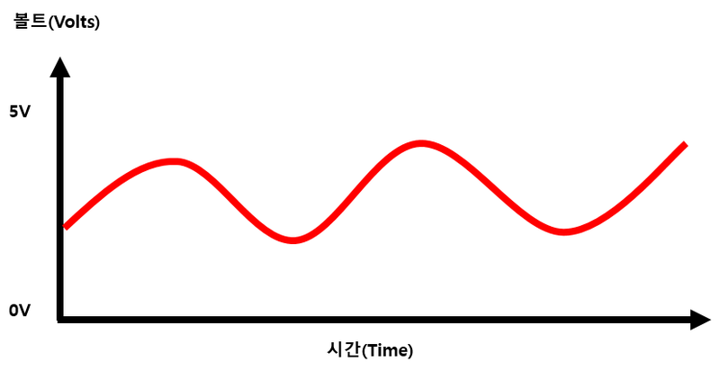

**디지털 신호**

  - 특정한 값을 기준으로 불연속적으로 변하는 막대 모양의 신호
  - 컴퓨터나 스마트폰에서 사용

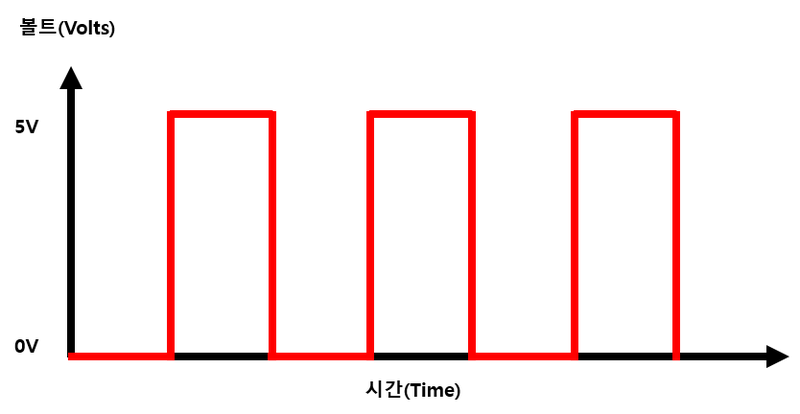

우리는 주로 디지털 신호를 사용한다. 디지털 신호를 이용해서 어떻게 데이터를 전달할까? 

물리 계층의 데이터는 비트이다. 비트란 컴퓨터가 데이터를 처리하는 최소 단위로서 0과 1로 구성된다.

올라가는 막대를 1로 표현하고 평면인 곳을 0으로 표현한다.

### 예시

송신자가 수신자에게 “network.docx 파일을 보내줘” 메시지를 보내고 싶으면 해당 문장을 0과 1의 비트로 변환하고 해당 비트를 전기 신호로 변환한 후 수신자에게 디지털 신호로 전달한다. 마지막으로 수신자 측에서는 전기 신호가 다시 0과 1의 비트로 변환된다.

**그렇다면 해당 메시지는 어떻게 그리고 어디서 전기 신호로 변환되는 것일까?** 

이 역할을 하는 것이 **랜 카드(LAN Card, NIC Network Interface Card)**라는 장치다. 

2대 이상의 컴퓨터가 통신하기 위해서는 LAN 네트워크 환경이 필요하고, 랜 카드는 내 컴퓨터와 인터넷을 연결하는 필수 장치다. 그리고 랜 카드에는 랜 케이블을 연결할 수 있는 구멍(랜 포트)가 있다.

따라서 랜 카드는 데이터가 물리적 전기 신호로 내 컴퓨터 밖으로 나가는 출발점이라고 할 수 있다.

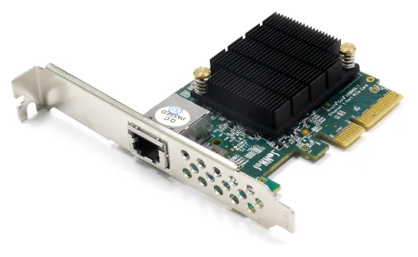

**랜 카드**가 0과 1의 비트를 전기 신호로 변환하여 밖으로 내보내는 출발점이라면, **케이블**은 그 신호를 전달하는 역할을 한다. **즉, 케이블은 컴퓨터, 서버, 라우터 및 다른 네트워크 장치 간에 데이터 신호를 전달하는 역을 한다.**

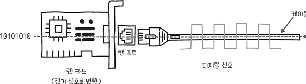

### 케이블 

케이블은 일반적으로 구리선(copper cable)이나 광섬유로 구성되며 내부 전선의 종류 및 구성에 따라 다양한 종류가 있다.

**TV 케이블로 많이 사용되는 동축 케이블은 중앙의 구리선에 흐르는 전기 신호로 데이터를 주고받는다.**

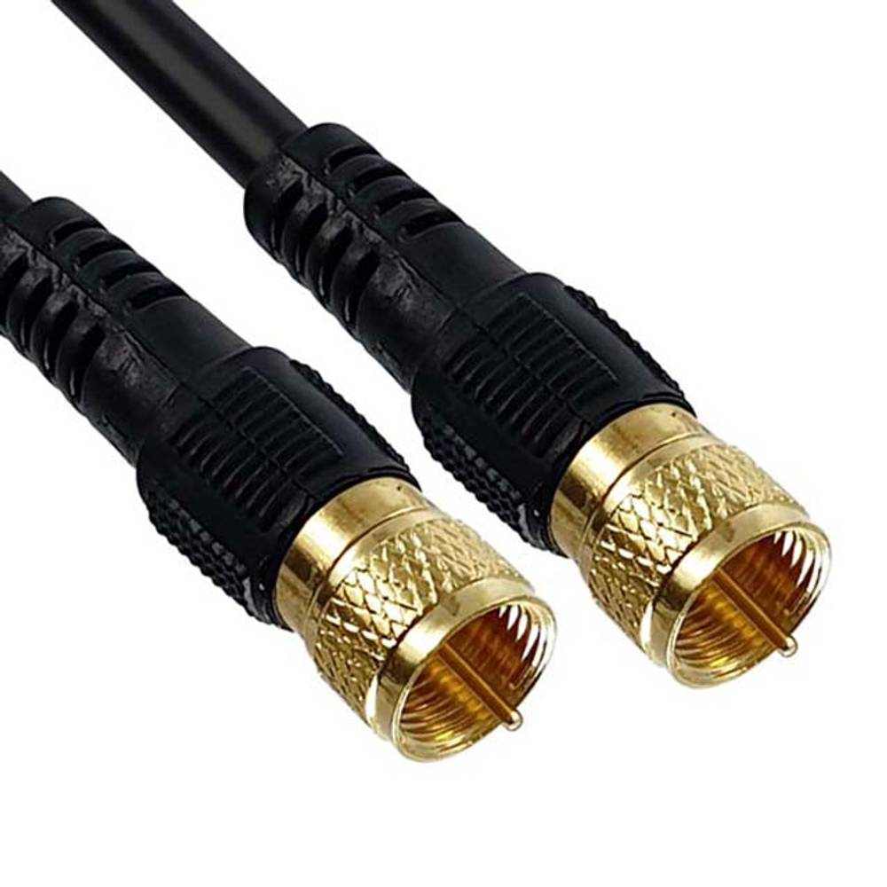

**컴퓨터에서는 꼬임선 또는 이중나선 케이블(Twisted Pair Cable)을 사용**한다.

꼬임선이란 말 그대로 몇 개의 전선을 꼬아서 만든 것이다.

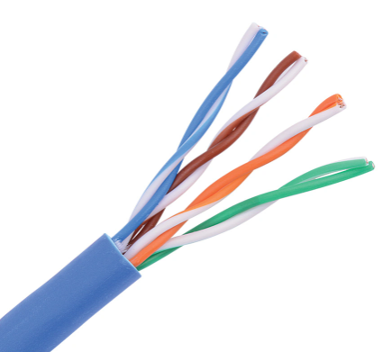

꼬임선 방식을 사용하는 케이블로는 UTP, FTP, STP가 존재한다.

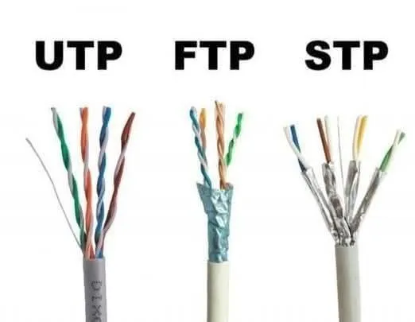

**UTP(Unshielded Twisted Pair) 케이블**

  - 감싸지 않은(Unshielded) 쌍으로 꼬인 선(Twisted Pair)

**왜? 전선을 꼬아서 사용할까?**

일반적으로 전선에 전류가 흐를 때 전파 간섭이 생기게 되는데 이 간섭을 줄이기 위해 전선을 꼬아서 사용한다.

**FTP(Foiled Twisted Pair) 케이블**

  - 알루미늄 은박이 네 가닥의 전선을 감싸고 있는 케이블
  - UTP 케이블에 비해 절연 기능이 좋기 때문에 공장의 배선 용도로 많이 사용된다.

**STP(Shielded Twisted Pair) 케이블**

  - 케이블 겉면에 외부 피복이 추가
  - 외부 피복을 실드라고 하는데, 실드는 외부의 잡음을 차단하거나 신호의 간섭을 줄이는 용도로 사용된다.
  - 가격이 UTP 케이블에 비해 비싸다.

UTP, STP 케이블은 컴퓨터끼리 통신하는 데 주로 사용되는 랜 케이블이다.

또한 STP는 잡음을 차단하기 때문에 데이터를 더 정확히 전달할 수 있다. 

잡음이 섞이면 아래와 같이 신호가 왜곡되게 된다.

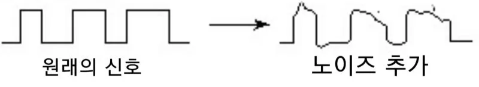

### 리피터

**리피터(Repeater)는 전기 신호를 증폭하는 기능을 가진 네트워크 장치**

전기 신호를 전송할 때 거리가 멀어지면 신호가 감쇠되는 성질이 있는데 이때 감쇠된 신호를 재생하여 전달하는 장치가 리피터이다.

요즘에는 리피터를 사용하지 않는다. 이 기능을 허브에서 대신해주기 때문이다.

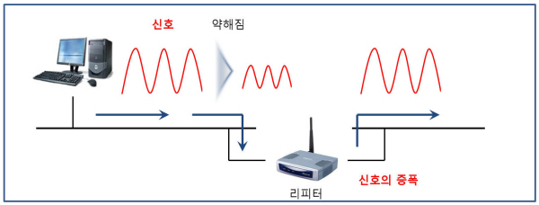

### 허브

허브는 리피터의 확장 버전이다. **허브(Hub)는 전송되는 데이터 신호를 정형하고 증폭하여 데이터 왜곡을 보정하며, 하나의 입력 신호를 여러 디바이스로 복제하여 데이터 분배 및 네트워크 확장을 지원한다.**

**또한, 데이터 충돌을 처리하여 데이터를 정상적으로 전달하도록 돕는다.**

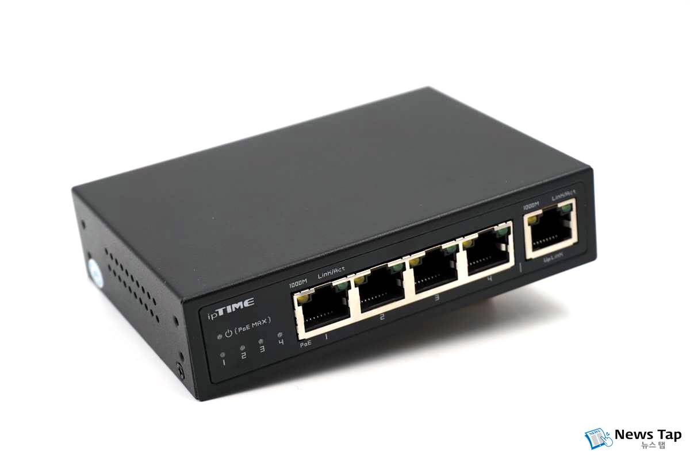

리피터가 일대일 통신만 가능하다면 허브는 포트를 여러 개 가지고 있기 때문에 여러 대의 컴퓨터와 연결할 수 있다. 그래서 요즘에는 리피터 대신 허브를 사용하고 있다.

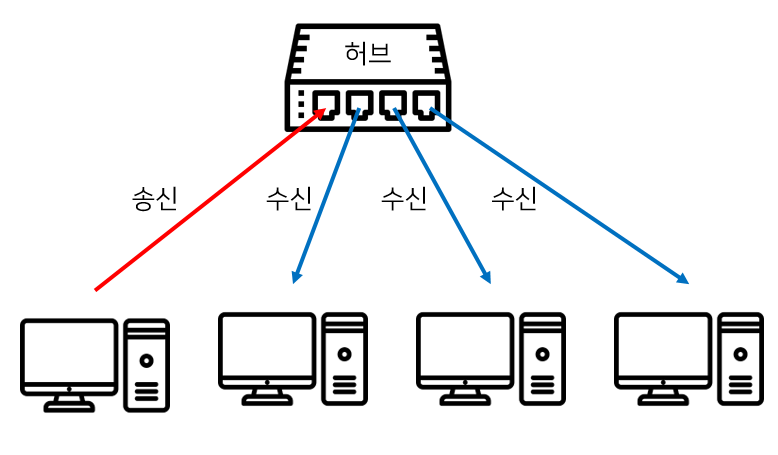

컴퓨터와 허브는 UTP(Unshielded Twisted Pair) 또는 STP(Shielded Twisted Pair) 케이블을 사용하여 연결한다.

각각의 컴퓨터가 허브로 데이터를 보낼 수 있다. 

그러면 **허브에 연결된 모든 컴퓨터가 데이터를 받는다. 이와 같이 허브는 특정 컴퓨터를 지정하여 데이터를 보낼 수 없다고 하여 “더미 허브(Dummy Hub)”라고도 부른다.**

| **구분** | **리피터(Repeater)** | **허브(Hub)** |
| --- | --- | --- |
| 기능 | 신호 증폭/재생 | 신호 증폭/재생 + 분배 |
| 연결 | 1:1(일대일) | 1:N(여러 대 동시 연결) |
| 데이터 분배 | 불가 | 가능(모두에게 전송) |
| 사용 용도 | 신호 연장 | 네트워크 확장 |
| 현대 사용 | 드묾 | 스위치로 대체됨 |

---

## 복습하기 

1. 전기 신호
1. 디지털 신호
1. 랜 카드
1. 케이블
1. UTP, FTP, STP
1. 허브 

**용어 정리** 

전기 신호: 전기 신호는 전압이 일정한 패턴으로 변하여 생기는 일련의 흐름

랜 카드: 랜 카드는 네트워크 환경에 내 컴퓨터와 인터넷을 연결하는 필수 장치 비트 데이터를 전기 신호로 변환

케이블: 보호 외피나 외장 안에 2개 이상의 전선이나, 광섬유로 묶여 있는 선

리피터: 전기 신호를 정형하고 증폭하는 기능을 가진 네트워크 장비

허브: 전기 신호를 정형하고 증폭, 하나의 입력 신호를 여러 디바이스에 복제하여 데이터를 전달

---

