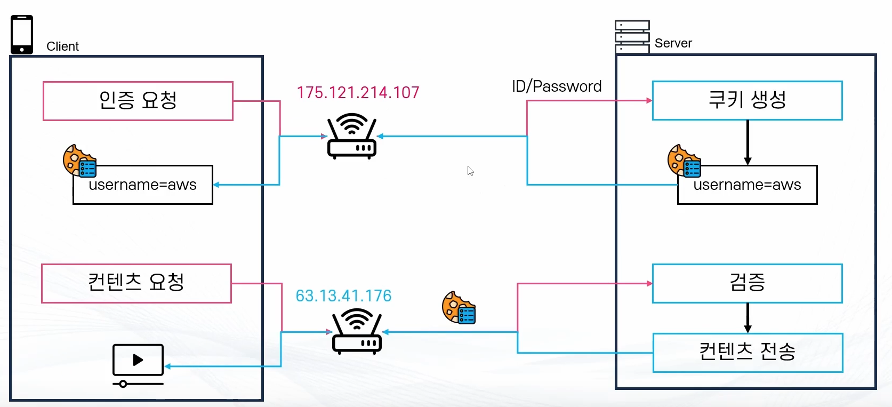
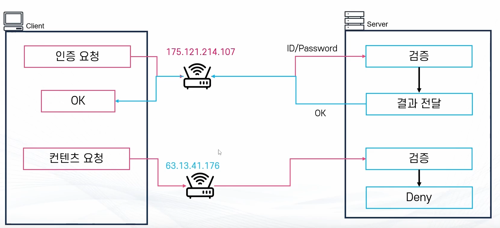

### Session Layer 

- 통신 주체끼리 연결이 유지할 수 있는 방법을 정의
- Layer 4 이상의 추가적인 차원에서 지속적인 연결(세션)이 수립할 수 있는 방법을 포함
- 예: HTTP Cookie
- 몇 몇 프로토콜의 경우 Session Layer 자체를 구현하지 않는다.
- 예: FTP

**HTTP**

**FTP**

### Presentation Layer 

- 받은 데이터를 해석하는 방법을 정의
- 파싱, 압축 해제, 복호화 등 Application Layer에서 사용할 수 있는 방식으로 변환을 담당

### Application Layer 

- 실제 받은 데이터를 처리하는 방법을 정의
- 말 그대로 데이터를 가지고 무엇을 어떻게 처리할지에 관한 레이어

