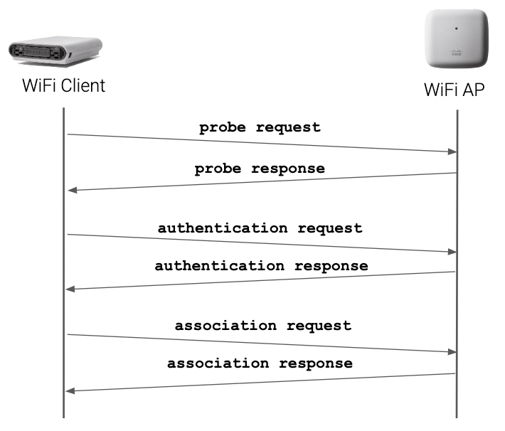

무선 엑세스 포인트와 클라이언트 통신에는 SSID를 이용합니다. **SSID(Service Set Identifier, 서비스 세트 식별자)는 하나의 무선 랜을 다른 무선 랜과 구분해주는 식별자로,** 특정 무선 랜에 접속하려는 무선 엑세스 포인트나 클라이언트는 반드시 동일한 SSID를 사용해야 한다.

무선 엑세스 포인트는 일반적으로 미리 정해진 SSID를 가지고 있다. 클라이언트는 이 SSID를 검색하여 해당 네트워크에 연결할 수 있다. 

1. 무선 엑세스 포인트는 **주기적으로 클라이언트에게 브로드캐스트로 비콘 메시지를 보낸다. 비콘(Beacon)이란 가까운 범위 안에 있는 주변 기기에 정보를 전달하는 무선 통신**이다. 이 메시지 때문에 클라이언트는 주변에 있는 무선 랜 네트워크의 SSID를 검색할 수 있다.
1. 이 신호를 받은 클라이언트는 자신의 SSID와 같은지 무선 엑세스 포인트에 문의한다.
1. 같은 SSID의 무선 엑세스 포인트가 응답을 한다.
1. 설정된 인증 방식이 올바른지 확인한 후에 
1. 클라이언트는 무선 엑세스 포인트에 연결을 요청하고
1. 무선 엑세스 포인트로부터 승인을 받는다. 그럼 통신이 가능한 생태가 된다.

**SSID = 와이파이 이름**

wifi client는 먼저 무선 엑세스 포인트의 브로드 캐스트(비콘 메시지)를 받는다. 해당 메시지에는 SSID 정보 및 무선 랜 규격이 들어있다.

probe request/response: 같은 SSID인지 문의/응답 

authentication request/response: 인증 요청/응답

association request/response: 연결 요청/승인

무선 엑세스 포인트를 여러 대 두면 채널 간섭이 발생할 수 있다.

무선 랜은 여러 기기가 동시에 접속할 수 있도록 주파수 대역을 분리하는데, 분리된 주파수 대역을 채널이라고 부른다. 같은 규격이면 채널 간섭이 발생한다. 하지만 서로 다른 규격의 경우 주파수가 달라서 간섭이 발생하지 않는다.

