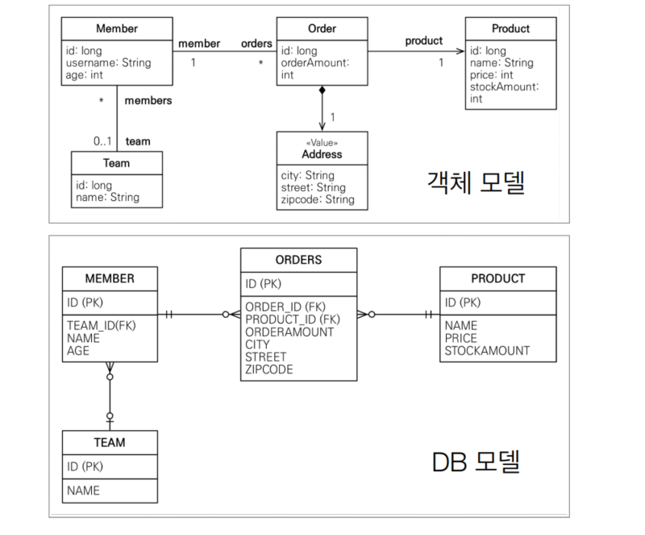

# ***JPQL 소개***

***JPQL 필요성***

  - *JPA를 사용하면 엔티티 객체를 중심으로 개발*
  - *검색을 할 때도 테이블이 아닌 엔티티 객체를 대상으로 검색*
  - *모든 DB 데이터를 객체로 변환해서 검색하는 것은 불가능*
  - *애플리케이션이 필요한 데이터만 DB에서 불러오려면 결국 검색 조건이 포함된 SQL이 필요*

***JPQL?***

  - *JPA는 SQL을 추상화한 JPQL이라는 객체 지향 쿼리 언어 제공*
  - *SQL과 문법 유사, SELECT, FROM, WHERE, GROUP BY, HAVING, JOIN 지원*
  - *JPQL은 엔티티 객체를 대상으로 쿼리*
- *SQL을 추상화해서 특정 데이터베이스 SQL에 의존 X*
    - *특정 데이터베이스에 의존하는 SQL은 네이티브 쿼리, JDBC Template, MyBatis 사용*
  - *SQL은 데이터베이스 테이블을 대상으로 쿼리*

***JPQL example***

```java
 List<Member> members = 
		 em.createQuery("select m from Member m where m.name like '%kim%'", Member.class)
                    .getResultList();

  for (Member member : members) {
      System.out.println("member = " + member);
  }
  -------------------------------------------------------------------------------
  Hibernate: 
    /* select
        m 
    from
        Member m 
    where
        m.name like '%kim%' */ select
            m1_0.id,
            m1_0.city,
            m1_0.street,
            m1_0.zipcode,
            m1_0.USERNAME 
        from
            Member m1_0 
        where
            m1_0.USERNAME like '%kim%' escape ''
```

***JPQL 문제점 동적 쿼리 작성이 어렵다.***

*개발자가 작성하는 JPQL은 단순 String 이다.*

*만약 동적으로 날라가는 JPQL이 필요하다면?*

*조건이 있으면 WHERE 절 추가 AND 추가 등등..* 

*복잡하기도 하고 실수할 가능성이 너무 많다.*

# ***Criteria 소개***

  - *문자가 아닌 자바코드로 JPQL을 작성할 수 있다*
  - *JPQL 빌더 역할*
  - *JPA 공식 기능 - JPA 표준 스펙* 
  - *너무 복잡하고 실용성이 없다. →* ***Criteria 대신에 QueryDSL 사용을 권장한다***

***Criteria example***

```java
// Criteria 사용 준비
CriteriaBuilder cb = em.getCriteriaBuilder();
CriteriaQuery<Member> query = cb.createQuery(Member.class);

// 루트 클래스 (조회를 시작할 클래스)
Root<Member> m = query.from(Member.class);

// 쿼리 생성
CriteriaQuery<Member> cq = query.select(m).where(cb.equal(m.get("name"), "kim"));
List<Member> members = em.createQuery(cq).getResultList();

tx.commit();

------------------------------------------------------------------------------------
Hibernate: 
    /* <criteria> */ select
        m1_0.id,
        m1_0.city,
        m1_0.street,
        m1_0.zipcode,
        m1_0.USERNAME 
    from
        Member m1_0 
    where
        m1_0.USERNAME=?
```

# *QueryDSL 소개*

  - *문자가 아닌 자바코드로 JPQL을 작성할 수 있다*
  - *JPQL 빌더 역할*
  - *컴파일 시점에 문법 오류를 찾을 수 있다*
  - *동적쿼리 작성 편리하다*
  - *단순하고 쉽다, 순수 JPQL 거의 동일하다*
  - ***실무 사용 권장***

# ***네이티브 SQL 소개***

  - *JPA가 제공하는 SQL을 직접 사용하는 기능*
  - *JPQL로 해결할 수 없는 특정 데이터베이스에 의존적인 기능*
- *특정 DB만 제공하는 SQL 힌트*

- ***JPQL, Criteria, QueryDSL, 네이티브 SQL 소개***

# ***기본 문법과 쿼리 API***



***JPQL 문법***

- *엔티티 속성은 대소문자 구분 O*
- *JPQL 키워드는 대소문자 구분 X (SELECT, from, WHERE)*
- *엔티티 이름 사용, 테이블 이름이 아니다*
- *별칭은 필수 당연히 as 생략 가능*
- ***집계함수(SUM, MAX, MIN, …), GROUP BY HAVING, ORDER BY 모두 지원*** 

### ***TypeQuery, Query***

- *TypeQuery: 반환 타입이 명확할 때 사용*
```java
TypedQuery<Member> query =
			 em.createQuery("SELECT m FROM Member m", Member.class); 
```
- *Query: 반환 타입이 명확하지 않을 때 사용*
```java
Query query = 
		 em.createQuery("SELECT m.username, m.age from Member m"); 
```

### ***결과 조회 API***

- *getResultList(): 결과가 하나 이상일 때, 리스트 반환*
- *결과가 없으면 빈 리스트 반환*
- *getSingleResult(): 결과가 정확히 하나, 단일 객체 반환*
- *결과가 없으면 → NoResultException*
  - *둘 이상이면 → NonUniqueResultException*
  - ***해당 예외들은 스프링 부트를 사용하면 예외 변환기 어드바이스(AOP)를 통해서 스프링 예외로 바뀐다.***
  - *Spring Data JPA를 사용하면 예외를 try-catch로 잡아서 null 또는 Optional.empty()로 반환한다.*

### ***파라미터 바인딩 - 이름 기준, 위치 기준***

***이름 기준 파라미터 바인딩***

```java
Member findMember = 
		em.createQuery("select m from Member m where m.username = :username", Member.class)
                .setParameter("username", member.getUsername())
                .getSingleResult();
```

- *메소드 체이닝을 지원한다.*

***위치 기준 파라미터 바인딩***

```java
Member findMember2 = 
		em.createQuery("select m from Member m where m.username =?1", Member.class)
                    .setParameter(1, member.getUsername())
                    .getSingleResult();
```

- *이름 기준 파라미터 바인딩을 사용하자* 
- *JdbcTemplate 사용할 때 이름 기반 Template를 사용하는 이유랑 동일하다.*

# *프로젝션(SELECT)*

***프로젝션?***

- *SELECT 절에 조회할 대상을 지정하는 것*
- ***프로젝션 대상***
- *엔티티* 
  - *임베디드 타입(값 타입)*
  - *스칼라 타입(숫자, 문자등 기본 값 타입)*
- *`SELECT m FROM Member m`* *→ 엔티티 프로젝션*
- *`SELECT m.team FROM Member m`* *→ 엔티티 프로젝션*
- *`SELECT m.address FROM Member m`* *→ 임베디드 타입 프로젝션*
- *`SELECT m.username, m.age FROM Member m`*  *→ 스칼라 타입 프로젝션*
- ***DISTINCT로 중복 제거***

***엔티티 프로젝션 Example - 영속성 컨텍스트*** 

```java
Member member = new Member();
member.setUsername("MEMBER1");
member.setAge(10);
em.persist(member);

em.clear();

List<Member> result = em.createQuery("select m from Member m", Member.class)
        .getResultList();

Member findMember = result.get(0);
findMember.setAge(20);
----------------------------------------------------------------------------------
Hibernate: 
    /* update
        for hellojpa.domain.Member */update Member 
    set
        age=?,
        TEAM_ID=?,
        username=? 
    where
        MEMBER_ID=?
```

- *엔티티 프로젝션의 결과를 가져와서 값을 바꾸니까 update 쿼리가 날아간다 → 엔티티 프로젝션의 결과는 1차 캐시(영속성 컨텍스트에 영속화)저장 된다.* 
- ***Dirty Checking 변경 감지 동작***

***연관관계가 있는 필드 엔티티 프로젝션*** 

```java
Team team = new Team();
team.setName("TEAM1");
em.persist(team);

Member member = new Member();
member.setUsername("MEMBER1");
member.setAge(10);
member.setTeam(team);

em.persist(member);

em.clear();

List<Team> result = em.createQuery("select m.team from Member m", Team.class)
        .getResultList();

Team findTeam = result.get(0);
System.out.println(findTeam.getName());

----------------------------------------------------------------------------------
Hibernate: 
    /* select
        m.team 
    from
        Member m */ select
            t1_0.TEAM_ID,
            t1_0.name 
        from
            Member m1_0 
        join
            Team t1_0 
                on t1_0.TEAM_ID=m1_0.TEAM_ID
TEAM1
```

- `em.createQuery("select m.team from Member m", Team.class)` 
- *날아가는 쿼리를 보면 Team, Member와 조인을 해서 날아간다.*
  - *묵시적 조인 방식*
- ***JPA를 잘 아는 사람은 물론 조인 쿼리가 날아간다는 것을 인지하겠지만 JPQL만 봐서는 조인 쿼리를 예상하기 힘들다.***
- *직접 조인을 하는 방식을 사용하자*

***연관관계가 있는 필드 엔티티 프로젝션 - 직접 조인***

```java
List<Team> result = 
			em.createQuery("select t from Member m join m.team t", Team.class)
            .getResultList();
            
----------------------------------------------------------------------------
Hibernate: 
    /* select
        t 
    from
        Member m 
    join
        m.team t */ select
            t1_0.TEAM_ID,
            t1_0.name 
        from
            Member m1_0 
        join
            Team t1_0 
                on t1_0.TEAM_ID=m1_0.TEAM_ID
TEAM1            
```

- *명시적 조인 방식을 사용 → 쿼리가 예상이 된다.*

***임베디드 타입 프로젝션 example***

```java
Order order = new Order();
order.setAddress(new Address("city", "street", "12121"));
em.persist(order);
em.clear();

List<Address> resultList = em.createQuery("select o.address from Order o", Address.class)
        .getResultList();
System.out.println(resultList.get(0).getCity());

------------------------------------------------------------------------------
Hibernate: 
    /* select
        o.address 
    from
        
    Order o */ select
        o1_0.city,
        o1_0.street,
        o1_0.zipcode from
            ORDERS o1_0
city

```

- *특징: 임베디드 타입은 특정 엔티티에 종속적이어서 해당 엔티티로 조회를 해야 한다.*

***스칼라 타입 프로젝션 example***

```java
Member member = new Member();
member.setUsername("MEMBER1");
member.setAge(10);
em.persist(member);
em.clear();

List resultList = em.createQuery("select m.username, m.age from Member m")
        .getResultList();

tx.commit();
------------------------------------------------------------------------------
Hibernate: 
    /* select
        m.username,
        m.age 
    from
        Member m */ select
            m1_0.username,
            m1_0.age 
        from
            Member m1_0
```

- *스칼라 타입은 정확한 타입 지정이 불가능하다. → TypeQuery가 아닌 Query를 사용한다.*

### *프로젝션 - 여러 값 조회*

```java
"select m.username, m.age from Member m"
```

- ***이렇게 여러 값 조회는 어떻게 결과를 받아야 할까?***
1. ***Query 타입으로 조회***

```java
List resultList = em.createQuery("select m.username, m.age from Member m")
        .getResultList();

Object o = resultList.get(0);
Object [] result = (Object[]) o;
System.out.println("username = " + result[0]);
System.out.println("age = " + result[1]);
--------------------------------------------------------------------------------
username = MEMBER1
age = 10
```

1. ***Object [] 타입으로 조회 → TypeQuery<Object []>*** 

```java
List<Object[]> resultList = 
		em.createQuery("select m.username, m.age from Member m", Object[].class)
        .getResultList();

Object[] objects = resultList.get(0);
System.out.println("username= " + objects[0]);
System.out.println("age= " + objects[1]);
--------------------------------------------------------------------------------
username = MEMBER1
age = 10
```

1. ***new 명령어로 조회***

```java
@Getter @Setter
@AllArgsConstructor
public class MemberDTO {
    private String username;
    private int age;
}

List<MemberDTO> resultList = 
em.createQuery("select new hellojpa.domain.MemberDTO(m.username, m.age) from Member m", MemberDTO.class)
        .getResultList();

MemberDTO memberDTO = resultList.get(0);
System.out.println("username= " + memberDTO.getUsername());
System.out.println("age= " + memberDTO.getAge());
--------------------------------------------------------------------------------
username = MEMBER1
age = 10

```

- *값을 DTO로 바로 조회한다.*
- `"select new hellojpa.domain.MemberDTO(m.username, m.age) from Member m"`
- *패키지 명을 포함한 전체 클래스 명(****FQCN:*** *Fully Qualified Class Name) 필요*
- ***순서와 타입이 일치하는 생성자가 필요하다 (생성자에 값을 넣는 방식)***

# *페이징*

- *JPA는 페이징을 다음 두 API로 추상화*
- ***setFirstResult(int startPosition): 조회 위치 시작 위치***
- *0부터 시작*
- ***setMaxResult(int maxResult): 조회할 데이터 수*** 

***페이징 example***

```java
for (int i = 0; i < 100; i++) {
    Member member = new Member();
    member.setUsername("MEMBER" + i);
    member.setAge(i);
    em.persist(member);
}
em.clear();
List<Member> result = 
			em.createQuery("select m from Member m order by m.age asc", Member.class)
        .setFirstResult(0)
        .setMaxResults(10)
        .getResultList();

for (Member m : result) {
    System.out.println("member = " + m);
}
```

- *데이터베이스마다 다른 복잡한 페이징 쿼리에 대해서 직접 작성하지 않아도된다.* 
- *JPA에서 제공하는 2개의 추상화된 API만으로도 데이터베이스에 존속되지 않게 페이징을 할 수 있다.* 

***MySQL 페이징 쿼리*** 

```sql
SELECT
	 M.ID AS ID,
	 M.AGE AS AGE,
	 M.TEAM_ID AS TEAM_ID,
	 M.NAME AS NAME 
FROM
		 MEMBER M 
ORDER BY
	 M.NAME DESC LIMIT ?, ?
```

# *조인*

### ***JPQL 조인 문법*** 

- ***내부 조인***
- SELECT m FROM Member m [INNER] JOIN m.team t
- ***외부 조인***
- SELECT m FROM Member m LEFT [OUTER] m.team t
  - *참고로 JPQL에서 (RIGHT, FULL) OUTER 조인은 지원하지 않는다.*
- ***세타 조인***
- SELECT count(m) FROM Member m, Team t where m.username = t.name

***inner join***

```java
List<Member> members = 
			em.createQuery("select m from Member m inner join m.team t", Member.class)
                .getResultList();
----------------------------------------------------------------------------------
Hibernate: 
    /* select
        m 
    from
        Member m 
    inner join
        m.team t */ select
            m1_0.MEMBER_ID,
            m1_0.age,
            m1_0.TEAM_ID,
            m1_0.username 
        from
            Member m1_0 
        join
            Team t1_0 
                on t1_0.TEAM_ID=m1_0.TEAM_ID
```

***left outer join example1***

```java
List<Member> members =
		 em.createQuery("select m from Member m left outer join m.team t", Member.class)
     .getResultList();
---------------------------------------------------------------------------------- 

Hibernate: 
    /* select
        m 
    from
        Member m 
    left join
        m.team t */ select
            m1_0.MEMBER_ID,
            m1_0.age,
            m1_0.TEAM_ID,
            m1_0.username 
        from
            Member m1_0
```

- *left outer join → outer는 생략이 가능하다.*
- *현재 데이터베이스에 날아간 쿼리를 보면 조인 쿼리가 아니다.
하이버네이트가 버전업이 되면서 자동으로 최적화를 해버려서 그렇다. 
즉, 어차피 Member만 조회하는데 조인할 필요가 없어서 불필요한 left 조인을 제거*

***left outer join example2***

```java
List<Member> members =
    em.createQuery("select m from Member m left outer join m.team t where t.name = :teamname", Member.class)
    .setParameter("teamname", "teamA")
    .getResultList();
    
---------------------------------------------------------------------------------- 
Hibernate: 
    /* select
        m 
    from
        Member m 
    left outer join
        m.team t 
    where
        t.name = :teamname */ select
            m1_0.MEMBER_ID,
            m1_0.age,
            m1_0.TEAM_ID,
            m1_0.username 
        from
            Member m1_0 
        left join
            Team t1_0 
                on t1_0.TEAM_ID=m1_0.TEAM_ID 
        where
            t1_0.name=?

```

### ***조인 - ON 절 (JPA 2.1부터 지원)***

- *조인 대상 필터링*
- *연관관계 없는 엔티티 외부 조인 (하이버네이트 5.1부터 지원)*

***조인 대상 필터링*** 

- *회원과 팀을 조인하면서, 팀 이름이 A인 팀만 조인*

```java
em.createQuery("select m, t from Member m left join m.team t on t.name = :teamName")
              .setParameter("teamName", "teamA")
              .getResultList();
------------------------------------------------------------------------------
 select
        m1_0.MEMBER_ID,
        m1_0.age,
        m1_0.TEAM_ID,
        m1_0.username,
        t1_0.TEAM_ID,
        t1_0.name 
from
    Member m1_0 
left join
    Team t1_0 
        on t1_0.TEAM_ID=m1_0.TEAM_ID 
        and t1_0.name=?         
```

***연관관계 없는 엔티티 외부 조인***

```java
JPQL
SELECT m, t FROM
Member m LEFT JOIN Team t on m.username = t.name

SQL
SELECT m.*, t.* FROM 
Member m LEFT JOIN Team t ON m.username = t.name
```

# *서브 쿼리* 

***example***

- *나이가 평균보다 많은 회원*
```java
select m from Member m
where m.age > (select avg(m2.age) from Member m2)
```
- *한 건이라도 주문한 고객* 
```java
select m from Member m
where (select count(o) from Order o where m = o.member) > 0
```

### ***서브 쿼리 지원 함수***

- *[NOT] EXISTS (subquery): 서브쿼리에 결과가 존재하면 참*
- *{ALL | ANY | SOME} (subquery)*
  - *ALL: 모두 만족하면 참*
  - *ANY, SOME: 조건을 하나라도 만족하면 참*
- *[NOT] IN (subquery): 서브쿼리의 결과 중 하나라도 같은 것이 존재하면 참*

***example***

- *팀 A 소속인 회원*
```java
select m from Member m 
where EXISTS(select t from m.team t where t.name = '팀A')
```
- *전체 상품 각각의 재고보다 주문량이 많은 주문들*
```java
select o from Order o
where o.orderAmount > ALL(select p.stockAmount from Product p)
```
- *어떤 팀이든 팀에 소속된 회원*
```java
select m from Member m 
where m.team = ANY(select t from Team t)
```

# *JPQL 타입 표현*

- *문자: ‘HELLO’*
- *숫자: 10L(Long), 10D(Double)*
- *Boolean: TRUE, FALSE, true, false*
- *ENUM: FQCN 필요*
- *setParmeter 방식으로도 가능*
- *엔티티 타입: TYPE(m) = Member (상속 관계에서 사용)*
- *WHERE DTYPE = ‘???’ 쿼리가 날아간다.*

# ***조건식 - CASE 식***

***기본 CASE 식***

```java
select
	 case 
		 when m.age <= 10 then '학생요금'
		 when m.age >= 60 then '경로요금'
		 else '일반요금'
	 end
from Member m
```

***단순 CASE 식***

```java
select
	 case t.name 
			 when '팀A' then '인센티브110%'
			 when '팀B' then '인센티브120%'
			 else '인센티브105%'
	 end
from Team t
```

### ***조건식 - CASE 식***

- *COALESCE: 인자를 하나씩 조회해서 NULL이 아니면 반환*
```java
SELECT COALESCE(m.username,'이름 없는 회원') FROM Member m
```

  - *여기서는 m.username이 NULL이면 ‘이름 없는 회원’을 반환한다*
- *NULLIF: 두 값이 같으면 NULL 반환, 다르면 첫번째 값 반환*
```java
SELECT NULLIF(m.username, '관리자') FROM Member m
```

  - *여기서는 관리자면 m.username = NULL 반환, 아니면 m.username 반환*

# *JPQL 함수*

***기본 함수***

- *CONCAT*
- *SUBSTRING*
- *TRIM*
- *LOWER, UPPER*
- *LENGTH*
- *LOCATE*
- *ABS, SQRT, MOD*
- *SIZE*
- *1: N 관계에서 1 입장에서 N(컬렉션 개수)를 반환*

***사용자 정의 함수 호출***

- *하이버네이트는 사용전 방언에 추가해야 한다.*
- *사용하는 DB 방언을 상속받고, 사용자 정의 함수를 등록한다.*

