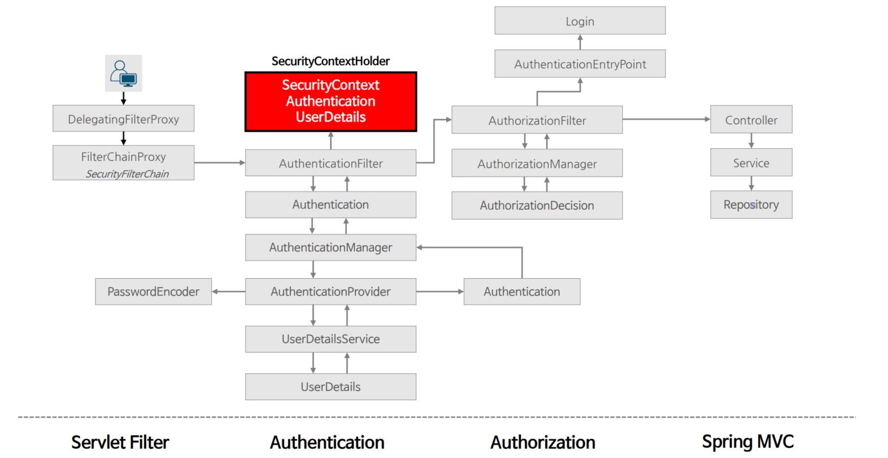
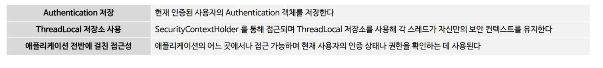
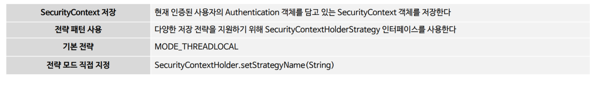
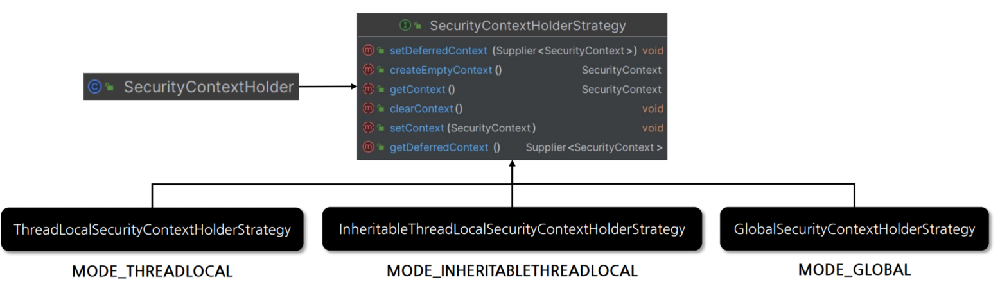
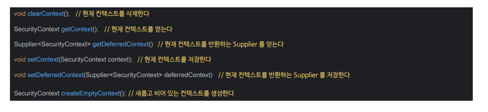
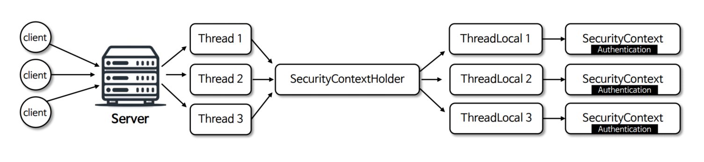

# **시큐리티 인증 / 인가 흐름도**



# **SecurityContext**



# SecurityContextHolder



# **SecurityContextHolder 저장 모드**


# **구조**



**SecurityContextHolderStrategy - 인터페이스** 



[디자인 패턴 - 전략 패턴 정리 ](https://20240228.tistory.com/425)

# **SecurityContext 참조 및 삭제**

- **SecurityContext 참조 - SecurityContextHolder.getContextHolderStrategy().getContext()**
- **SecurityContext 삭제 - SecurityContextHolder.getContextHolderStrategy().clearContext()**

# SecurityContextHolder & SecurityContext 구조



- 스레드마다 할당되는 전용 저장소(ThreadLocal)에 SecurityContext를 저장하기 때문에 동시성 문제가 없다 
- 스레드 풀에서 운용되는 스레드일 경우 새로운 요청이더라도 기존의 ThreadLocal이 재사용될 수 있기 때문에 클라이언트 응답 직전에 항상 SecurityContext를 삭제해 주고 있다 

# **SecurityContextHolderStrategy 사용하기**

**기존 방식**

```java
SecurityContext context = SecurityContextHolder.createEmptyContext(); 
context.setAuthentication(authentication); 
SecurityContextHolder.setContext(context);
```

위 코드는 SecurityContextHolder를 통해 SecurityContext에 접근할 때 여러 애플리케이션 컨텍스트가 SecurityContextHolderStrategy를 지정하려고 할 때 경쟁 조건(race condition)을 만들 수 있다 

**변경 방식**

```java
SecurityContextHolderStrategy securityContextHolderStrategy = SecurityContextHolder.getContextHolderStrategy();
SecurityContext context = securityContextHolderStrategy.createEmptyContext(); 
context.setAuthentication(authentication); 
securityContextHolderStrategy.setContext(context); 
```

애플리케이션이 SecurityContext를 정적으로 접근하는 대신 SecurityContextHolderStrategy를 자동 주입이 될 수 있도록 한다 각 애플리케이션 컨텍스트는 자신에게 가장 적합한 보안 전략을 사용할 수 있게 된다

# **메모**

- **SecurityContextHolder**
- **SecurityContextHolderStrategy - 전략 인터페이스** 
- **ThreadLocalSecurityContextHolderStrategy** 
- ThreadLocal 기반 
    - Supplier<SecurityContext> 사용
  - **InheritableThreadLocalSecurityContextHolderStrategy**

