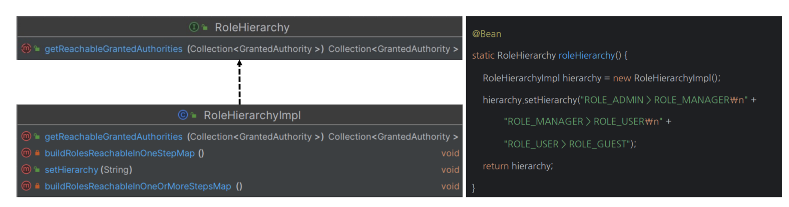

# **개요**

- 기본적으로 스프링 시큐리티에서 권한과 역할은 계층적이거나 상하 관계로 구분하지 않는다. 그래서 인증 주체가 다양한 역할과 권한을 부여 받아야 한다. 
- `RoleHirerachy` 는 역할 간의 계층 구조를 정의하고 관리하는 데 사용되며 보다 간편하게 역할 간의 계층 구조를 설정하고 이를 기반으로 사용자에 대한 엑세스 규칙을 정의할 수 있다 

```java
ROLE_A>ROLE_B
ROLE_B>ROLE_C
ROLE_C>ROLE_D
```

- `ROLE_A`를 가진 모든 사용자는 `ROLE_B, ROLE_C 및 ROLE_D`도 가지게 된다
- `ROLE_B`를 가진 모든 사용자는 `ROLE_C 및 ROLE_D`도 가지게 된다
- 계층적 역할을 사용하면 액세스 규칙이 크게 줄어들 뿐만 아니라 더 간결하고 우아한 형태로 규칙을 표현할 수 있다

# **구조**



- `setHirerachy`
- 역할 계층을 설정하고 각 역할에 대해 해당 역할의 하위 계층에 속하는 모든 역할 집합을 미리 정해 놓는다
  - 역할 계층 :ROLE_A>ROLE_B>ROLE_C
- `getReachableGrantedAuthorities` 
- 모든 도달 가능한 권한의 배열을 반환한다
  - 도달 가능한 권한은 직접 할당된 권한에 더해 역할 계층에서 이들로부터 도달 가능한 모든 권한을 의미한다
- 직접 할당된 권한 : ROLE_B
    - 도달 가능한 권한 : ROLE_B, ROLE_C

**RoleHierarchyImpl() - setHierarchy: @deprecated**

```java
@Bean
public RoleHierarchy roleHierarchy(){
    RoleHierarchyImpl hierarchy = new RoleHierarchyImpl();
    hierarchy.setHierarchy(
            "ROLE_ADMIN > ROLE_MANAGER\n"+
            "ROLE_MANAGER > ROLE_USER \n"+
            "ROLE_USER > ROLE_GUEST");
    return hierarchy;
}
```

- `new RoleHierarchyImpl()` - `@Deprecated`
- `RoleHierarchyImpl` 기본 생성자가 `@Deprecated` 되었다.
- `setHierarchy` - `@Deprecated`
- `RoleHierarchyImpl` `setHierarchy` 메소드 또한 `@Deprecated` 되었다.

**RoleHierarchyImpl.fromHierarchy() static 메소드** 

```java
@Bean
public RoleHierarchy roleHierarchy() {
    return RoleHierarchyImpl.fromHierarchy(
            "ROLE_ADMIN > ROLE_DB\n" +
            "ROLE_DB > ROLE_USER\n" +
            "ROLE_USER > ROLE_ANONYMOUS");
}
```

# **테스트** 

**SecurityConfig**

```java
@EnableWebSecurity
@Configuration
public class SecurityConfig {
    @Bean
    public SecurityFilterChain securityFilterChain(HttpSecurity http) throws Exception{
        
        http.authorizeHttpRequests(authorize -> authorize
                .requestMatchers("/user").hasRole("USER")
                .requestMatchers("/db").hasRole("DB")
                .requestMatchers("/admin").hasRole("ADMIN")
                .anyRequest().authenticated())
                .formLogin(Customizer.withDefaults())
                .csrf(AbstractHttpConfigurer::disable);

        return http.build();
    }
    @Bean
    public RoleHierarchy roleHierarchy() {
        return RoleHierarchyImpl.fromHierarchy(
                "ROLE_ADMIN > ROLE_DB\n" +
                "ROLE_DB > ROLE_USER\n" +
                "ROLE_USER > ROLE_ANONYMOUS");
    }
    
    @Bean
    public UserDetailsService userDetailsService(){
        UserDetails user = User.withUsername("user").password("{noop}1111").roles("USER").build();
        UserDetails db = User.withUsername("db").password("{noop}1111").authorities("ROLE_DB").build();
        UserDetails admin = User.withUsername("admin").password("{noop}1111").roles("ADMIN","SECURE").build();
        return  new InMemoryUserDetailsManager(user, db, admin);
    }
}
```

- `/user` 경로에는 ROLE_USER, ROLE_DB, ROLE_ADMIN 권한을 가진 사용자가 접근이 가능하다 
- `/db` 경로에는 ROLE_DB, ROLE_ADMIN 권한을 가진 사용자가 접근이 가능하다 
- `/admin` 경로에는  ROLE_ADMIN 권한을 가진 사용자만 접근이 가능하다 

**IndexController**

```java
@RestController
public class IndexController {
    @GetMapping("/")
    public String index(){
        return "index";
    }
    @GetMapping("/user")
    public String user(){
        return "user";
    }
    @GetMapping("/db")
    public String db(){
        return "db";
    }
    @GetMapping("/admin")
    public String admin(){
        return "admin";
    }
}
```

