# *Strings*

*문자열, 숫자, serialized object(JSON string) 등 저장*

## ***Strings명령어***

***[SET] Strings 저장***

```shell
SET lecture inflearn-redis
```

  - ***key: lecture, value: inflearn-redis***

***[GET] Strings 조회***

```shell
GET lecture
```

  - ***return: inflearn-redis***

***[MSET] n개의 Strings 저장***

```shell
MSET price 100 language ko
```

  - ***key: price, value: 100***
  - ***key: language, value: ko***

***[MGET] n개의 Strings 조회***

```shell
MGET lecture price language
```

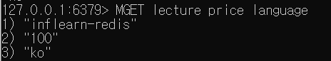

***[INCR] 주어진 키의 값을 1 증가*** 

```shell
INCR price
```

  - ***키가 존재하지 않으면***  *Redis는 해당 키를 0으로 초기화한 후 증가*
  - ***키가 존재하고 정수값인 경우:*** *값을 1 증가*
  - ***키가 숫자가 아닌 경우:*** *오류를 반환*

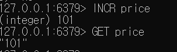

***[INCRBY]*** *특정 키의 값을* ***주어진 정수만큼 증가****시키는 명령어*

```shell
INCRBY price 9
```

  - ***키가 존재하고 정수값인 경우****: 지정된* *`increment`* *값만큼 증가*
  - ***키가 존재하지 않는 경우****: 키를 0으로 초기화한 후* *`increment`* *값만큼 증가*
  - ***키가 숫자가 아닌 경우****: 오류가 반환*

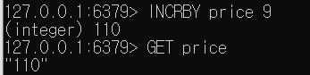

***[SET] JSON Strings 형태 저장***

```shell
SET inflearn-redis '{"price": 100, "language": "ko"}'
```

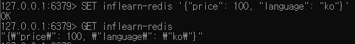

***Redis naming Convention***

```shell
 SET inflearn-redis:ko:price 200
```

# ***Redis Lists?***

  - *String을 Linked List로 저장 → PUSH / POP 최적화 (O(1)*
  - *Linked List → Double Linked List 해당 노드의 앞 노드와 뒤 노드의 포인터를 가진다.*
  - *Queue(FIFO) / Stack(FILO) 구현에 사용한다*

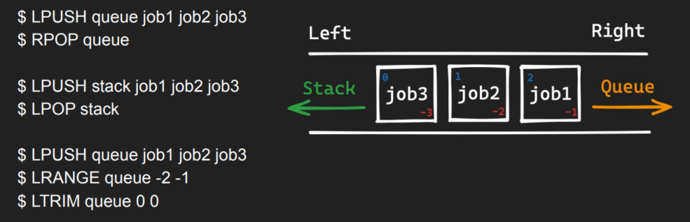

# ***Queue, Stack 구현***

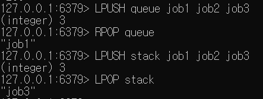

  - *RPOP → 가장 오른쪽 즉, 먼저 들어간 데이터를 빼기 때문에 FIFO(큐)로 동작*
  - *LPOP → 가장 왼쪽 즉, 가장 늦게 들어간 데이터를 빼기 떄문에 FILO(스택)으로 동작*

```shell
RPOP queue
LPOP queue
```

# ***RANGE 범위 검색*** 

***먼저 LPUSH 통해서 데이터 2개 더 넣기*** 

```shell
LPUSH queue job4 job5
```

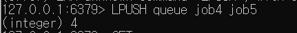

***현재 queue에 있는 데이터*** 

*→ job5, job4, job3, job2*

***전체 조회*** 

```shell
LRANGE queue 0 -1
```

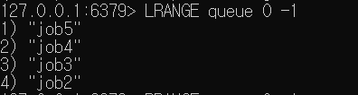

  - *LRANGE: 0(제일 왼쪽) -1(가장 오른쪽)*

***job2, job3 조회***

```shell
LRANGE queue 2 3
```

```shell
LRANGE queue -2 -1
```

```shell
LRANGE queue -2 3
```

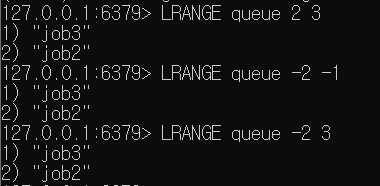

***[LTRIM] 지정한 범위에 해당하는 데이터만 남기기*** 

  - *현재 queue 데이터 job5 ~ job4*
  - *job5, job4 제외 데이터 삭제* 

```shell
LTRIM queue 0, 1
```

  - *다시 전체 조회*

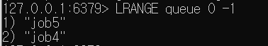

# *표로 정리*

| 명령어 | 설명 |
| --- | --- |
| **LPUSH** | 리스트의 왼쪽(앞)에 하나 이상의 값을 추가 |
| **RPUSH** | 리스트의 오른쪽(뒤)에 하나 이상의 값을 추가 |
| **LPOP** | 리스트의 왼쪽(앞)에서 값을 제거하고 반환 |
| **RPOP** | 리스트의 오른쪽(뒤)에서 값을 제거하고 반환 |
| **LRANGE** | 리스트에서 지정된 범위의 값을 반환 |
| **LTRIM** | 리스트에서 지정된 범위 외의 값들을 잘라낸다. |
| **LINDEX** | 리스트의 특정 인덱스 위치에 있는 값을 반환 |
| **LLEN** | 리스트의 길이를 반환 |
| **LREM** | 리스트에서 지정된 값을 제거 |
| **LSET** | 리스트의 특정 인덱스에 값을 설정 |

# ***Redis Sets?***

*Unique String을 저장하는 정렬되지 않은 집합* 

*Set Operation 사용 가능(intersection(교집합), union(합집합), difference(차집합))*

# *Redis Sets 명령어*

***[SADD] Sets 추가 명령어***

```shell
 SADD user:1:fruits apple banana orange orange
```

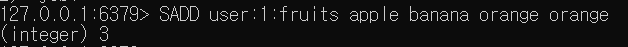

  - *Unique String을 저장하기 때문에 중복인 orange는 저장하지 않는다.*

***[SMEMBERS] Sets 전체 조회 명령어***

```shell
SMEMBERS user:1:fruits
```

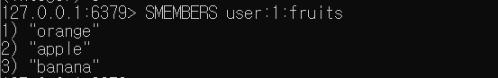

***[SCARD] Sets*** ***원소 개수를 조회하는 명령어***

```shell
SCARD user:1:fruits
```

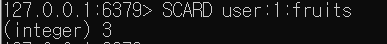

***[SISMEMBER] Sets에 특정 원소 포함 여부 확인 명령어***

```shell
SISMEMBER user:1:fruits
```

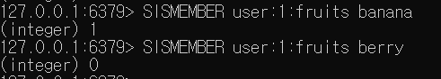

### ***Set Operation (집합 연산)***

  - ***SINTER: 교집합***
  - ***SDIFF: 차집합***
  - ***SUNION:  합집합***

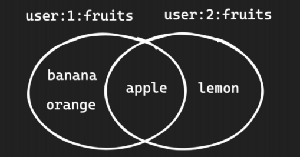

***user:2:fruits 추가*** 

```shell
SADD user:2:fruits apple lemon
```

  - *apple, lemon 추가* 

***[SINTER] 2개의 Sets 교집합 명령어***

```shell
SINTER user:1:fruits user:2:fruits
```

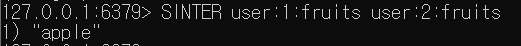

***[SDIFF] 2개의 Sets 차집합 명령어***

```shell
SDIFF user:1:fruits user:2:fruits
```

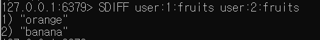

  - ***차집합: user:1:fruits - (user:1:fruits 교집합 user:2:fruits)***

***[SUNION] 2개의 Sets 합집합 명령어***

```shell
 SUNION user:1:fruits user:2:fruits
```

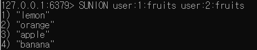

# ***Redis Hashes?*** 

 *field-value 구조를 갖는 데이터 타입*

*다양한 속성을 갖는 객체의 데이터를 저장할 때 유용*

# ***Redis Hashes 명령어***

 ***[HSET] Hash*** ***자료구조에 필드와 값을 설정하는 명령어***

```shell
 HSET lecture name inflearn-redis price 100 language ko
```

  - *KEY: lecture*
  - *Field1: name       Value1: inflearn-redis*
  - *Field2: price        Value2: 100*
  - *Field3: language Value3: ko*

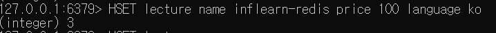

 ***[HGET] Hash*** ***자료구조 조회 명령어***

```shell
HGET lecture name 
HGET lecture price
HGET lecture language
```

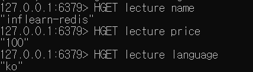

***[HMGET] Hash 자료구조에서 하나 이상의 필드의 값을 조회 명령어***

```shell
HGET lecture name price language
```

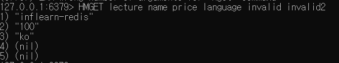

  - *존재하지 않는 field인 invalid, invalid2는 결과로 nil이 나온다.*

***[HINCRBY] Hash 자료구조의 특정 필드에 대해 정수 값을 증가시키는 명령어***

```shell
HINCRBY lecture price 5
```

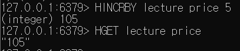

  - *숫자 타입이 아니면 에러가 난다.*
  - *존재하지 않는 필드면 0으로 초기화하고 5를 추가한다.*

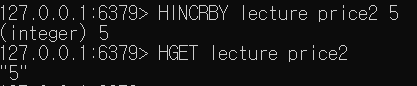

# ***Redis Sorted Sets?***

*ZSets라고도 부른다.*

*Unique string을 연관된 score를 통해 정렬된 집합(Set의 기능 + 추가로 score 속성 저장)*

*내부적으로 Skip List + Hash Table로 이루어져 있고, score 값에 따라 정렬 유지
score가 동일하면 lexicographically(사전 편찬 순) 정렬*

# ***Redis Sorted Sets 명령어***

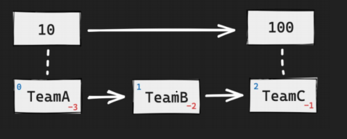

***[ZADD] Sorted Sets 데이터 추가*** 

```shell
ZADD points 10 TeamA 10 TeamB 50 TeamC
```

  - *Key: points*
  - *Score1: 10 Value1: TeamA*
  - *Score2: 10 Value2: TeamB*
  - *Score3: 50 Value3: TeamC*

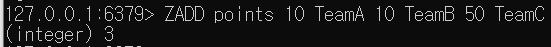

***[ZRANGE] Sorted Set 자료구조의 원소들을 점수(score) 기준으로 범위에 맞게 조회하는 명령어*** 

```shell
ZRANGE points 0 -1 
```

  - *오름차순으로 조회*

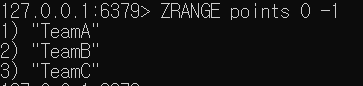

***[ZRANGE + WITHSCORES] Score도 함께 조회***

```shell
ZRANGE points 0 -1 WITHSCORES
```

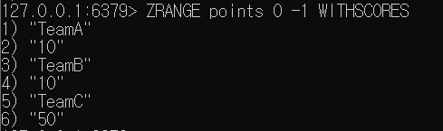

***[ZRANGE + REV] 내림차순(역순) 조회***

```shell
ZRANGE points 0 -1 REV
```

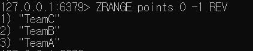

***[ZRANK] 등수 조회***

```shell
ZRANK points TeamA
```

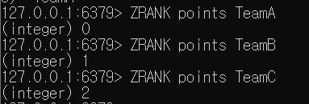

# ***What is Streams?***

*append-only log에 Consumer groups과 같은 기능을 더한 자료 구조* 

*unique id를 통해 하나의 entry를 읽을 때, O(1) 시간 복잡도 
Consumer Group을 통해 분산 시스템에서 다수의 consumer가 event 처리*

# ***Redis Streams 명령어***

***[XADD] Redis Streams에 새로운 데이터를 추가할 때 사용***

```shell
 XADD events * action like user_id 1 product_id 1
 XADD events * action like user_id 2 product_id 1
```

  - *데이터를 시간순으로 추가하며, 각 항목은 고유한 ID와 함께 저장*
  - *timestamp-sequence 형식의 고유 ID 생성* 
  - *Streams는 Append-only Log 기반이기 때문에 항상 Streams 끝에 추가된다.* 
  - *ID 자동 생성 →* *`*`* 
- *사용자가 ID를 지정할 수 있지만 보통* *`*`**를 사용하는 게 일반적이다.*

| **ID** | **Fields** | **Values** |
| --- | --- | --- |
| `1674567890123-0` | `action`, `user_id`, `product_id` | `like`, `1`, `1` |
| `1674567890456-0` | `action`, `user_id`, `product_id` | `like`, `2`, `1` |

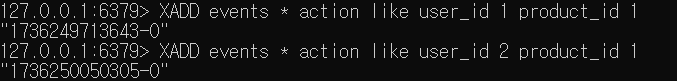

***[XRANGE] Stream에서 특정 범위에 해당하는 항목들을 조회할 때 사용하는 명령어***

```shell
XRANGE events - + 
```

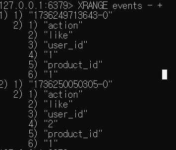

  - *ID를 통해서 범위 지정이 가능하다.*

```shell
XRANGE mystream 1674567890123-0 1674567890456-0
```

***[XDEL] 이벤트 삭제***

```shell
XDEL events 1736249713643-0
```

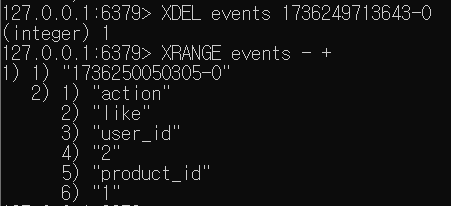

# ***Geospatial Indexes*** 

*좌표를 저장하고, 검색하는 데이터 타입*

*거리 계산, 범위 탐색 등 지원*

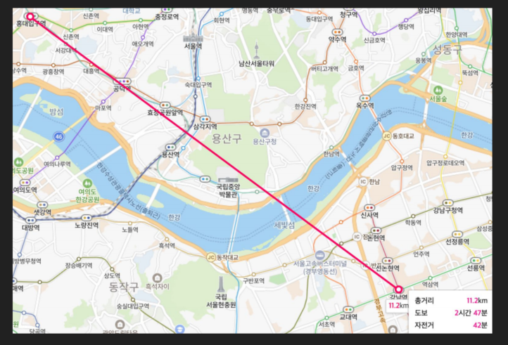

# ***Redis Geospatial  명령어***

***GEOADD***

```shell
GEOADD seoul:station 126.923917 37.556944 hong-dae 127.027583 37.497928 gang-nam
```

  - *지오스페이셜 데이터를 Redis에 추가*
  - *KEY: seoul:station*
  - *Value(Member): hong-dae, gang-nam*
- *hong-dae: (126.923917, 37.556944)*
    - *gang-nam: (127.027583, 37.497928)*
  - *경도, 위도 순서대로 넣는다.*

***GEODIST***

```shell
GEODIST seoul:station hong-dae gang-nam KM
```

  - *두 지점 간 거리 계산*

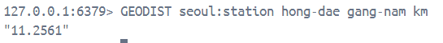

  - *두 역 사이의 거리가 11.2561KM* 

| **명령어** | **설명** | **형식 및 예제** |
| --- | --- | --- |
| **GEOADD** | 지정된 key에 경도(longitude), 위도(latitude), 멤버(member) 추가 | GEOADD key longitude latitude member |
|  |  | **예:** GEOADD seoul:station 126.923917 37.556944 hong-dae 127.027583 37.497928 gang-nam |
| **GEOPOS** | 지정된 멤버의 경도 및 위도를 반환 | GEOPOS key member  |
|  |  | **예:** GEOPOS seoul:station hong-dae gang-nam |
| **GEODIST** | 두 멤버 간의 거리 반환 | GEODIST key member1 member2 [unit] |
|  |  | **예:** GEODIST seoul:station hong-dae gang-nam km |
| **GEORADIUS** (Deprecated) | 특정 좌표를 기준으로 지정된 반경 내의 멤버 검색 (Redis 6.2 이후 GEOSEARCH 사용 권장) | GEORADIUS key longitude latitude radius unit [WITHDIST] [WITHCOORD] [WITHHASH] [COUNT count] [ASC |
|  |  | **예:** GEORADIUS seoul:station 126.923917 37.556944 10 km WITHDIST |
| **GEORADIUSBYMEMBER** (Deprecated) | 특정 멤버를 기준으로 지정된 반경 내의 멤버 검색 (Redis 6.2 이후 GEOSEARCH 사용 권장) | GEORADIUSBYMEMBER key member radius unit [WITHDIST] [WITHCOORD] [WITHHASH] [COUNT count] [ASC |
|  |  | **예:** GEORADIUSBYMEMBER seoul:station hong-dae 10 km WITHDIST |
| **GEOSEARCH** | 반경 또는 사각형 영역 내 멤버 검색 | GEOSEARCH key BYRADIUS center radius unit [WITHDIST] [WITHCOORD] [ASC] |
|  |  | **예:** GEOSEARCH seoul:station BYRADIUS 126.923917 37.556944 10 km WITHDIST |
|  |  | GEOSEARCH key BYBOX center width height unit [WITHDIST] [WITHCOORD] [ASC] |
|  |  | **예:** GEOSEARCH seoul:station BYBOX 126.923917 37.556944 10 5 km |
| **GEOSEARCHSTORE** | GEOSEARCH 결과를 지정된 Redis key에 저장 | GEOSEARCHSTORE destination source BYRADIUS center radius unit [WITHDIST] [ASC |
|  |  | **예:** GEOSEARCHSTORE seoul:nearby seoul:station BYRADIUS 126.923917 37.556944 10 km |

### ***주요 옵션***

| **옵션** | **설명** |
| --- | --- |
| `WITHDIST` | 거리와 함께 반환 (기준점에서 각 멤버까지의 거리 포함) |
| `WITHCOORD` | 경도, 위도 좌표와 함께 반환 |
| `WITHHASH` | Redis 내부에서 사용하는 Geohash 값을 반환 |
| `COUNT count` | 반환 결과를 제한 |
| `ASC` / `DESC` | 거리 기준으로 오름차순(`ASC`) 또는 내림차순(`DESC`) 정렬 |
| `STORE key` | 결과 멤버를 지정된 key에 저장 (위치 정보 제외) |
| `STOREDIST key` | 결과 멤버와 거리를 지정된 key에 저장 |

# ***Redis Bitmaps?*** 

  - *실제 데이터 타입은 아니고, String에 binary operation을 적용한 것*
  - *최대 42억개 binary 데이터 표현 = 2^32(4,294,967,296)*

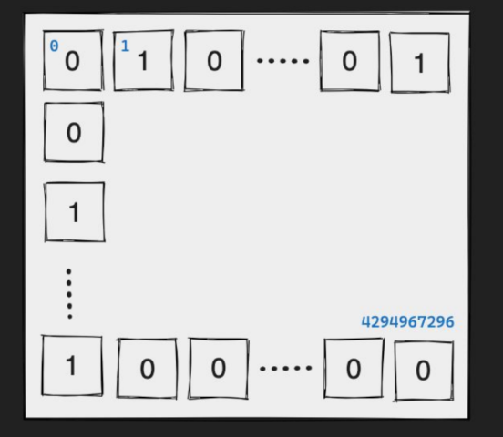

# ***Redis Bitmaps 명령어***

***SETBIT***

```shell
 SETBIT key offset value
 
 SETBIT user:log-in:23-01-01 123 1
 SETBIT user:log-in:23-01-01 456 1
 SETBIT user:log-in:23-01-02 123 1
```

  - *특정 키에 저장된 문자열 값을 비트 단위로 조작하는 명령어*
  - *문자열의 특정 위치에 있는 비트를 설정(0 또는 1로)할 수 있다.*
  - ***key****: 조작할 문자열이 저장된 키. 키가 없으면 Redis가 새 문자열을 생성*
  - ***offset****: 문자열 내에서 조작할 비트의 위치(0부터 시작하는 인덱스)*
  - ***value****: 설정할 비트 값(0 또는 1)*


***GETBIT***

```shell
GETBIT user:log-in:23-01-01 123
```

  - *특정 위치의 비트 값을 확인*
  - *return 1이면 23년 01월 01일에 123번 user가 로그인을 했다는 의미*
  - *GETBIT user:log-in:23-01-01 → 23년 01월 01일에 로그인한 전체 사용자* 

***BITCOUNT***

```shell
BITCOUNT user:log-in:23-01-01
```

  - *저장된 문자열 값에서 1로 설정된 비트의 개수를 계산하는 데 사용*

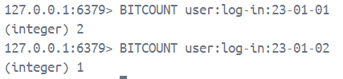

  - *23년 01월 01일은 로그인 사용자 2명*
  - *23년 01월 02일은 로그인 사용자 1명*

***BITOP AND***

```shell
BITOP AND result user:log-in:23-01-01 user:log-in:23-01-02
```

  - *지정된 키들 간의 비트 AND 연산을 수행하고, 결과를 새로운 키에 저장*
  - *결과를 result에 저장한다.*
  - *23년 01월 01일 로그인 사용자와 23년 01월 02일 로그인 사용자의 교집합을 구한다.*

***BITOP AND - 동작 설명***

```shell
user:log-in:23-01-01: 사용자 123과 456이 로그인 (123=1, 456=1)
user:log-in:23-01-02: 사용자 123만 로그인 (123=1, 456=0)

AND 연산 
123: 1 AND 1 = 1
456: 1 AND 0 = 0

result:
123 = 1
456 = 0

GETBIT result 123  # 1
GETBIT result 456  # 0
```

  - *여러 조건을 결합하여 특정 상태를 가진 사용자 필터링*

# ***Redis HyperLogLog?***

  - *집합의 cardinality를 추정할 수 있는 확률형 자료구조*
  - *정확성을 일부 포기하는 대신 저장공간을 효율적으로 사용(평균 에러 0.81%)*
  - *VS Set: HyperLogLog는 실제 값을 저장하지 않기 때문에 매우 적은 메모리 사용* 

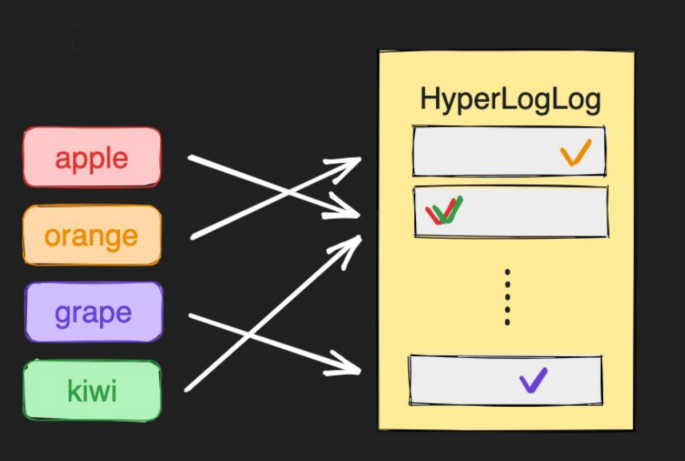

  - *가정) 이렇게 kiwi, apple 처럼 해시 충돌이 발생하면 오차가 발생한다.*

***정리***
*HyperLogLog는 해시값의 통계적 특성을 활용해 Cardinality를 추정하며, 실제 데이터를 저장하지 않고도 효율적으로 작동한다. 
이로 인해 메모리를 극도로 절약하면서도 매우 큰 데이터셋에서 Cardinality를 빠르게 계산할 수 있다. 
HyperLogLog는 정확도가 약간 떨어질 수 있지만,* ***통계적 추정****이 필요한 대부분의 대규모 데이터 분석 작업에서 유용하다.*

# ***Redis HyperLogLog 명령어***

***PFADD***

```shell
PFADD fruits apple orange grape kiwi
```

  - *HyperLogLog 자료구조에 값을 추가하기 위한 명령어*
  - *Cardinality 값이 변동되면 1을 반환, 반대의 경우 0을 반환*

***PFCOUNT***

```shell
PFCOUNT fruits
```

  - *HyperLogLog에 저장된 Cardinality 추정값을 반환*

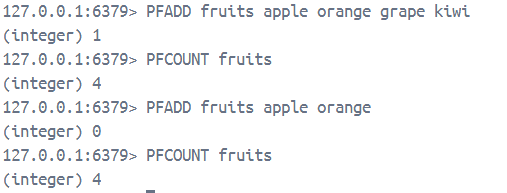

# ***Redis BloomFilter?***

  - *element가 집합 안에 포함되었는지 확인할 수 있는 확률형 자료 구조*
  - *정확성을 일부 포기하는 대신 저장공간을 효율적으로 사용*
  - *저장 방식: element를 해싱해서 여러 key(비트)로 나눠서 저장*
  - ***false positive:*** *element가 집합에 실제로 포함되지 않은데 포함되었다고 잘못 예측하는 경우*
- *가정) kiwi, apple 해싱하고 key(비트)로 나눴는데 같은 key값의 결과가 나온다면 2과일 중 하나는 포함되지 않았어도 포함되었다고 결과가 나온다.*
  - *이런 동작 방식 때문에* ***"포함되지 않음"*** *→ 100% 정확*
- *False negative는 발생하지 않는다.*

***특징*** 

*BloomFilter를 사용하려면 RedisBloom 모듈이 필요한데 이는, redis-stack-server에서 제공한다.* 

# 
***Redis BloomFilter 명령어*** 

***BF.MADD***

```shell
 BF.MADD fruits apple orange
```

  - *BloomFilter fruits(key)에 여러 요소를 한 번에 추가하는 명령*


***BF.EXISTS***

```shell
BF.EXISTS fruits apple
BF.EXISTS fruits grape
```

  - *BloomFilter fruits(key)에 apple(element)이 포함되어 있는지 확인*

