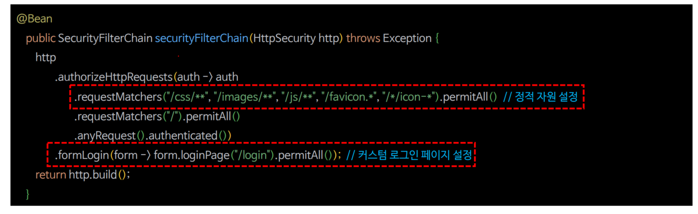
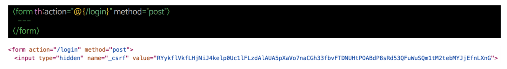
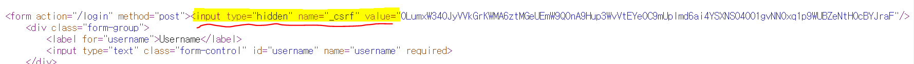
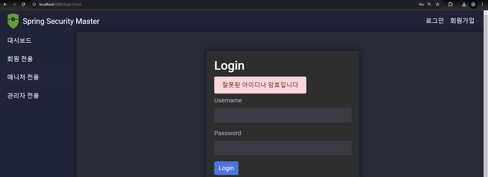

# ***커스텀 로그인 페이지 설정***



# ***CSRF 코드 자동 생성 ­Thymeleaf 폼 태크***



# ***코드***

***SecurityConfig***

```java
@EnableWebSecurity
@Configuration
public class SecurityConfig {
    @Bean
    public SecurityFilterChain securityFilterChain(HttpSecurity http) throws Exception{
        http
                .authorizeHttpRequests(authorize -> authorize
                        .requestMatchers("/css/**", "/images/**",
                                "/js/**", "/favicon.*", "/*/icon/-*").permitAll()
                        .requestMatchers("/").permitAll()
                        .anyRequest().authenticated())
                .formLogin(form -> form.loginPage("/login").permitAll());

        return http.build();
    }
    @Bean
    public UserDetailsService userDetailsService(){
        UserDetails user = User.withUsername("user").password("{noop}1111").roles("USER").build();
        return new InMemoryUserDetailsManager(user);
    }
}
```

```java
.requestMatchers("/css/**", "/images/**", "/js/**", "/favicon.*", "/*/icon/-*").permitAll()
```

- *정적 자원 permitAll*

```java
.formLogin(form -> form.loginPage("/login").permitAll());
```

- *Custom 로그인 페이지* 
- *loginPrcessingUrl 관련 설정은 하지 않았다 → default* *`POST "/login"`* 

***LoginController***

```java
@Controller
public class LoginController {
    @GetMapping("/login")
    public String login(){
        return "/login/login";
    }
}
```

***현재 CSRF 필터 설정은 on 이다. → SpringSecurity default***

→ *따라서 POST 요청이면 CSRF 토큰을 넣어줘야 한다.* 

***login.html 일부***

```html
<form th:action="@{/login}" method="post">
    <div class="form-group">
        <label for="username">Username</label>
        <input type="text" class="form-control" id="username" name="username" required>
    </div>
    <div class="form-group">
        <label for="password">Password</label>
        <input type="password" class="form-control" id="password" name="password" required>
    </div>
    <button type="submit" class="btn btn-primary">Login</button>
</form>
```

- *Spring Security가 활성화된 상태에서* *`thymeleaf-spring`**을 사용하면,* *`th:action`**을 통해* *`POST`* *요청을 보낼 때 Spring Security가 자동으로 CSRF 토큰을 추가한다.* 
- *이 동작은 Thymeleaf 템플릿 엔진이 Spring Security의 CSRF 설정을 인식하기 때문이다.*



***login.html 일부***

```html
<div th:if="${param.error}" class="form-group">
    <span th:text="${exception}?: '잘못된 아이디나 암호입니다'" class="alert alert-danger"></span>
</div>
```

- *잘못된 회원 username or password 입력을 하면* *`/login?error`* 



