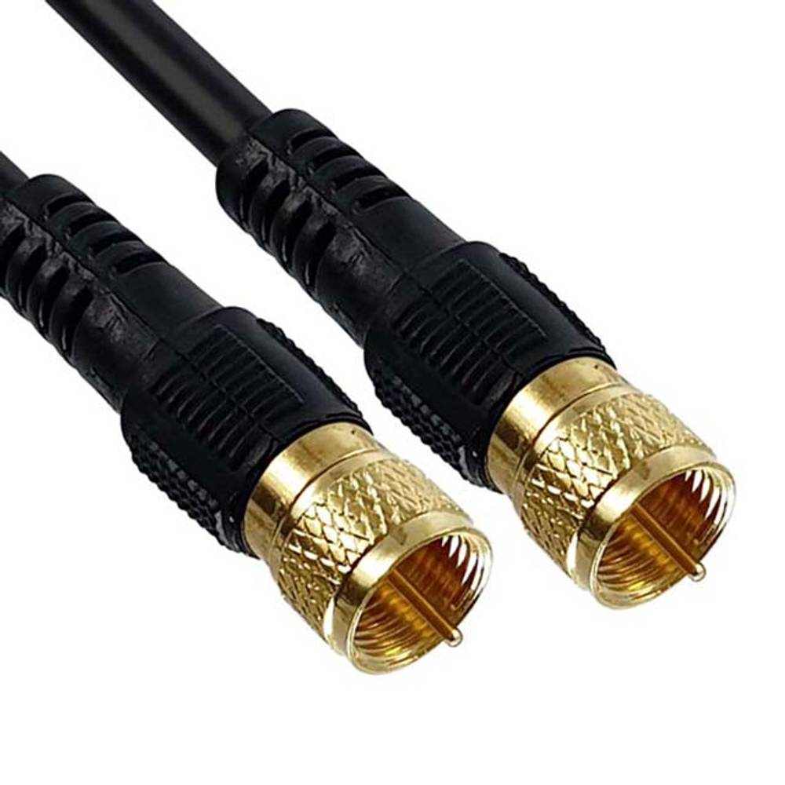
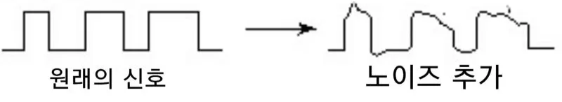

**랜 카드**가 0과 1의 비트를 전기 신호로 변환하여 밖으로 내보내는 출발점이라면, **케이블**은 그 신호를 전달하는 역할을 한다. **즉, 케이블은 컴퓨터, 서버, 라우터 및 다른 네트워크 장치 간에 데이터 신호를 전달하는 역을 한다.**

### 케이블 

케이블은 일반적으로 구리선(copper cable)이나 광섬유로 구성되며 내부 전선의 종류 및 구성에 따라 다양한 종류가 있다.

**TV 케이블로 많이 사용되는 동축 케이블은 중앙의 구리선에 흐르는 전기 신호로 데이터를 주고받는다.**

**컴퓨터에서는 꼬임선 또는 이중나선 케이블(Twisted Pair Cable)을 사용**한다.

꼬임선이란 말 그대로 몇 개의 전선을 꼬아서 만든 것이다.

꼬임선 방식을 사용하는 케이블로는 UTP, FTP, STP가 존재한다.

**UTP(Unshielded Twisted Pair) 케이블**

- 감싸지 않은(Unshielded) 쌍으로 꼬인 선(Twisted Pair)

**왜? 전선을 꼬아서 사용할까?**

일반적으로 전선에 전류가 흐를 때 전파 간섭이 생기게 되는데 이 간섭을 줄이기 위해 전선을 꼬아서 사용한다.

**FTP(Foiled Twisted Pair) 케이블**

- 알루미늄 은박이 네 가닥의 전선을 감싸고 있는 케이블
- UTP 케이블에 비해 절연 기능이 좋기 때문에 공장의 배선 용도로 많이 사용된다.

**STP(Shielded Twisted Pair) 케이블**

- 케이블 겉면에 외부 피복이 추가
- 외부 피복을 실드라고 하는데, 실드는 외부의 잡음을 차단하거나 신호의 간섭을 줄이는 용도로 사용된다.
- 가격이 UTP 케이블에 비해 비싸다.

UTP, STP 케이블은 컴퓨터끼리 통신하는 데 주로 사용되는 랜 케이블이다.

또한 STP는 잡음을 차단하기 때문에 데이터를 더 정확히 전달할 수 있다. 

잡음이 섞이면 아래와 같이 신호가 왜곡되게 된다.


