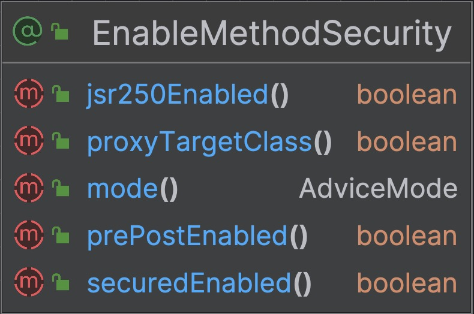

# **개요**

- Spring Security는 요청 수준의 권한 부여뿐만 아니라 메소드 수준에서의 권한 부여를 지원한다 
- 메서드 수준 권한 부여를 활성화 하기 위해서는 설정 클래스에 `@EnableMethodSecurity` 애노테이션을 추가해야 한다
- `SpEL(Spring Expression Language)` 표현식을 사용하여 다양한 보안 조건을 정의할 수 있다

# **@EnableMethodSecurity**

```java
@EnableMethodSecurity
@Configuration
public class SecurityConfig {}
```



- `jsr250Enabled()` 
- true 설정이면 JSR-250 관련 어노테이션들(`@RolesAllowed`, `@PermitAll`, `@DenyAll`)을 활성화 한다
  - default: false
- `prePostEnabled()` 
- true 설정이면 `@PreAuthorize, @PostAuthorize, @PreFilter, @PostFilter`를 활성화 한다. 
  - default: true
- `securedEnabled()` 
- true 설정이면 `@Secured` 를 활성화 한다
  - default: false

# **@PreAuthorize**

`@PreAuthorize` 애노테이션은 메소드가 실행되기 전에 특정한 보안 조건이 충족되는지 확인하는  데 사용되며 보통 서비스 혹은 컨트롤러 레이어의 메소드에 적용되어 메소드가 호출되기 전에 사용자의 인증 정보와 권한을 검사한다 

```java
@PreAuthorize("hasAuthority('ROLE_ADMIN')")
public void adminOnlyMethod() {
/* 관리자 역할을 가진 사용자만 실행할 수 있는 메소드 */
}

@PreAuthorize("hasAnyAuthority('ROLE_ADMIN', 'ROLE_USER')")
public void adminOrUserMethod() {
/* 관리자 또는 일반 사용자 역할을 가진 사용자가 실행할 수 있는 메소드 */
}

@PreAuthorize("isAuthenticated()")
public void authenticatedUserOnlyMethod() {
/* 인증된 사용자만 실행할 수 있는 메소드 */
}

@PreAuthorize("#id == authentication.name")
public void userSpecificMethod(String id) {
/* 인증된 사용자가 자신의 ID에 해당하는 작업을 수행할 수 있는 메소드 */
}
```

# **@PostAuthorize**

- `@PostAuthorize` 애노테이션은 메소드가 실행된 후에 보안 검사를 수행하는 데 사용된다 
- `@PreAuthorize` 와 다르게, `@PostAuthorize` 는 메소드 실행 후 결과에 대한 보안 조건을 검사하여 특정 조건을 만족하는 경우에만 사용자가 결과를 받을 수 있도록 한다 

```java
@PostAuthorize("returnObject.owner == authentication.name")
public BankAccount getAccount(Long id) {
	 // 계정를 반환하지만 계정의 소유자만 결과를 볼 수 있음
	 return new BankAccount();
}

@PostAuthorize("hasAuthority('ROLE_ADMIN') and returnObject.isSecure")
public BankAccount getSecureAndAdminAccount(Long id) {
		// 계정을 반환하지만 계정이 기밀이고 사용자가 관리자일 경우에만 결과를 볼 수 있음
		return new BankAccount();
}

@PostAuthorize("returnObject != null and (returnObject.status == 'APPROVED' or hasAuthority('ROLE_ADMIN'))")
public BankAccount updateRequestStatus() {
		return new BankAccount();
}
```

# **실습 -** @PreAuthorize

**SeucirtyConfig**

```java
@EnableWebSecurity
@EnableMethodSecurity
@Configuration
public class SecurityConfig {
    @Bean
    public SecurityFilterChain securityFilterChain1(HttpSecurity http) throws Exception{
        http
                .authorizeHttpRequests(authorize -> authorize
                        .anyRequest().authenticated())
                .formLogin(Customizer.withDefaults());
        return http.build();
    }
    @Bean
    public UserDetailsService userDetailsService(){
        UserDetails user = User.withUsername("user").password("{noop}1111").roles("USER").build();
        UserDetails manager = User.withUsername("manager").password("{noop}1111").authorities("ROLE_DB").build();
        UserDetails admin = User.withUsername("admin").password("{noop}1111").roles("ADMIN","WRITE").build();
        return  new InMemoryUserDetailsManager(user, manager, admin);
    }
}

```

- `@EnableMethodSecurity` 

```java
@RestController
public class MethodController {
    @GetMapping("/")
    public String index(){
        return "index";
    }
    @GetMapping("/admin")
    @PreAuthorize("hasAuthority('ROLE_ADMIN')")
    public String admin(){
        return "admin";
    }
    @GetMapping("/user")
    @PreAuthorize("hasAnyAuthority('ROLE_ADMIN', 'ROLE_USER')")
    public String user(){
        return "user";
    }
    @GetMapping("/isAuthenticated")
    @PreAuthorize("isAuthenticated()")
    public String isAuthenticated(){
        return "isAuthenticated";
    }
    @GetMapping("/user/{id}")
    @PreAuthorize("#id == authentication.name")
    public String authentication(@PathVariable String id){
        return "id";
    }
}
```

# **실습 -** @PostAuthorize

- Security Config 동일 

**MethodController**

```java
@RestController
public class MethodController {
    @GetMapping("/owner")
    @PostAuthorize("returnObject.owner == authentication.name and hasAnyAuthority('ROLE_USER', 'ROLE_ADMIN')")
    public Account owner(String name){
        return new Account(name, false);
    }
    @GetMapping("/isSecure")
    @PostAuthorize("returnObject.owner == authentication.name and returnObject.isSecure")
    public Account isSecure(String name, String isSecure){
        return new Account(name, "Y".equals(isSecure));
    }
}
```

