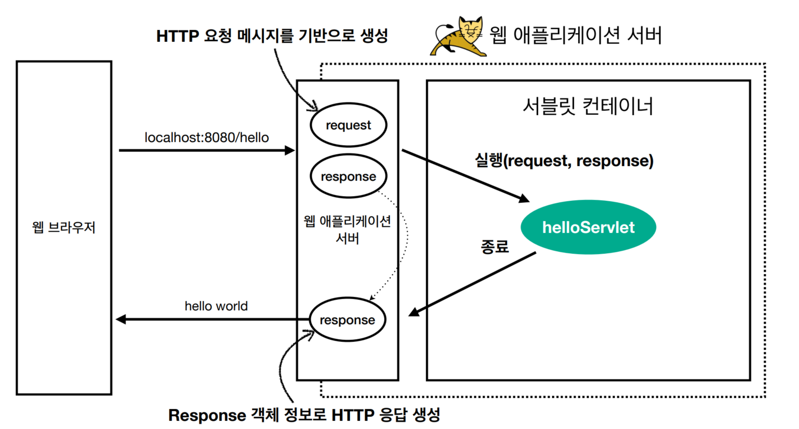

# *웹 서버 vs 웹 애플리케이션 서버*

*웹 서버(Web Server) & 웹 애플리케이션 서버(Web Application Server) 모두* 

*HTTP 기반으로 동작* 

- *웹 서버: NGINX, APACHE*
- *웹 애플리케이션 서버: Tomcat, Undertow*

*웹 서버와 웹 애플리케이션 서버의 큰 차이점은 웹 서버는 단순히 존재하는 View 파일을 서빙하는 역할만 하지만 웹 애플리케이션 서버 웹서버의 기능을 포함하고 클라이언트의 요청에 대해 동적으로 판단하여 특정 로직을 수행하거나 View 또한 동적으로 랜더링 할 수 있다.* 

*현대의 웹 애플리케이션 서버(WAS)는 조합해서 사용한다.* 

*→ Nginx + 스프링 부트(내장 Tomcat)*

*→ 효율적인 리소스 관리(정적 리소스 서빙이 많이 필요하면 Web 서버 스케일 아웃, 애플리케이션 부하가 심해지면 WAS 스케일 아웃)*

# *서블릿* 

```java
@WebServlet(name = "helloServlet", urlPatterns = "/hello") 
public class HelloServlet extends HttpServlet { 
		 @Override 
		 protected void service(HttpServletRequest request, HttpServletResponse response){ 
		 //애플리케이션 로직
		 } 
}
```

- *HTTP 요청 정보를 편리하게 사용할 수 있는 HttpServletRequest*
- *HTTP 응답 정보를 편리하게 제공할 수 있는 HttpServletResponse*
- *개발자는 HTTP 스펙을 매우 편리하게 사용*



***요청 흐름*** 

*Client HTTP Request →* *WAS(Tomcat) → Servlet Filter* *→* *DispatcherServlet →  HandlerMapping → Spring Interceptor(preHandle) → HandlerAdapter → Controller(Spring MVC)* 

- *빨간색: 서블릿 컨테이너(톰캣) 영역* 
- *파란색: 스프링 컨테이너 관여 영역*

