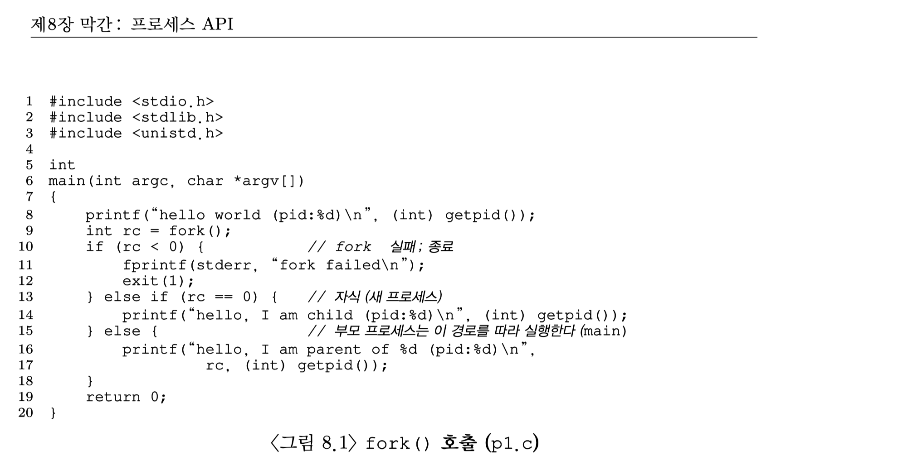
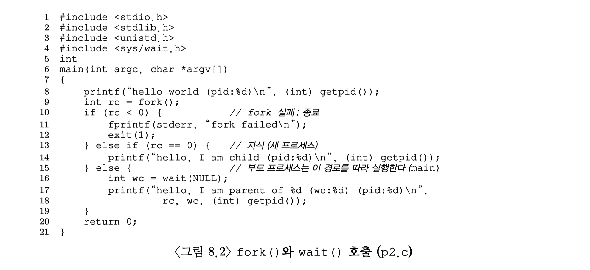
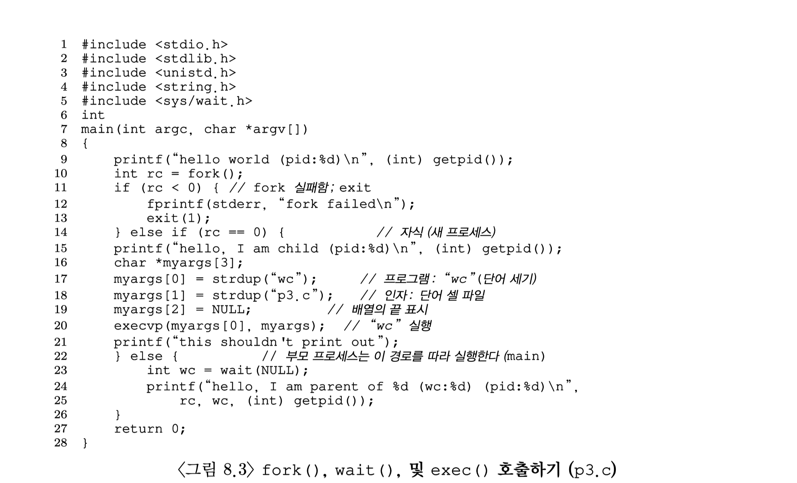
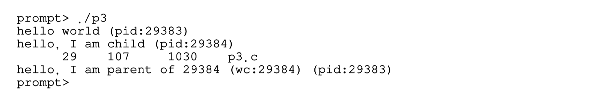

## ✅  fork() 시스템 콜



getpid() → 현재 프로세스의 PID 반환

생성된 자식 프로세스는 fork() 부분부터 실행됨

→ hello world 한번만 출력 

부모 프로세스 rc : 자식 프로세스 PID

자식 프로세스 rc: 0 

→ 이를 통해 분기 처리 가능

---

## ✅  wait() 시스템 콜 



해당 코드에서는 항상 자식 프로세스가 먼저 출력

- 자식 프로세스 → 부모 프로세스 
- 부모 프로세스 → 자식 프로세스
- 부모 프로세스 wait() → block 상태 
  - 자식 프로세스 종료 
  - 부모 프로세스 block → ready → running

---

## ✅ exec() 시스템 콜 

```
exec() 시스템 콜은 자기 자신이 아닌 다른 프로그램을 실행할 때 사용한다. 
```





**wc 프로그램** 

- 소스 코드의 행 개수, 단어의 개수, 바이트 개수를 출력한다.

exec() 시스템 콜은 실행 파일의 이름(ex: wc), 약간의 인자가 주어지면 해당 실행 파일의 코드와 정적 데이터를 읽어 들여 현재 실행 중인 프로세스의 코드 세그먼트와 정적 데이터 부분을 덮어 쓴다.

힙과 스택 및 공간들도 새로운 프로그램의 실행을 위해 초기화 된다. 

그런 다음 운영체제는 프로세스의 argv 같은 인자를 전달하여 실행중인 프로그램 (p3)를 다른 다른 실행 중인 프로그램으로 (wc)로 대체한다.

자식 프로세스가 exec()을 호출한 후에는 절대로 리턴되지 않는다.

→ printf(”this shouldn’t print out”); 출력 X

