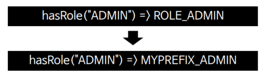

# **Authorization**

- 인가 즉 권한 부여는 특정 자원에 접근할 수 있는 사람을 결정하는 것을 의미한다 
- Spring Security는 `GrandAuthority` 클래스를 통해 권한 목록을 관리하고 있으며 사용자의 `Authentication` 객체와 연결한다 


# **GrantedAuthority**

- 스프링 시큐리티는 `Authentication`에 `GrantedAuthority` 권한 목록을 컬렉션 타입으로 저장하며 이를 통해 인증 주체에게 부여된 권한을 사용하도록 한다 
- `GrantedAuthority` 객체는 `AuthenticationManager` 에 의해 `Authentication` 객체에 삽입되며 스프링 시큐리티는 인가 결정을 내릴 때 `AuthorizationManager` 를 사용하여 `Authentication` 즉, 인증 주체로부터 `GrantedAuthority` 객체를 읽어들여 처리하게 된다 

# **구조**


# **사용자 정의 역할 접두사**

- 기본적으로 역할 기반의 인가 규칙은 역할 앞에 `ROLE_`를 접두사로 사용한다.
- 즉, `USER` 역할을 가진 보안 컨텍스트가 필요한 인가 규칙이 있다면 Spring Security는 기본적으로 `ROLE_USER`를 반환하는 `GrantedAuthority#getAuthority`를 찾는다
- `GrantedAuthorityDefaults`로 사용자 지정할 수 있으며 `GrantedAuthorityDefaults`는 역할 기반 인가 규칙에 사용할 접두사를 사용자 정의하는 데 사용된다

```java
@Bean
static GrantedAuthorityDefaults grantedAuthorityDefaults() {
	 return new GrantedAuthorityDefaults("MYPREFIX_");
}
```



# **실습** 

```java
@EnableWebSecurity
@Configuration
public class SecurityConfig {
    @Bean
    public SecurityFilterChain securityFilterChain(HttpSecurity http) throws Exception{

        http.authorizeHttpRequests(authorize -> authorize
                .requestMatchers("/user").hasRole("USER")
                .requestMatchers("/db").hasRole("DB")
                .requestMatchers("/admin").hasRole("ADMIN")
                .anyRequest().authenticated())
                .formLogin(Customizer.withDefaults())
                .csrf(AbstractHttpConfigurer::disable);
        return http.build();
    }
    @Bean
    public UserDetailsService userDetailsService(){
        UserDetails user = User.withUsername("user").password("{noop}1111").roles("USER").build();
        UserDetails db = User.withUsername("db").password("{noop}1111").authorities("ROLE_DB").build();
        UserDetails admin = User.withUsername("admin").password("{noop}1111").roles("ADMIN","SECURE").build();
        return  new InMemoryUserDetailsManager(user, db, admin);
    }
}
```

- roles → 접두사로 `ROLE_`가 붙는다.
- `roles("USER")` → `ROLE_USER`
- authorities → 그대로 사용 
- `authorities("ROLE_DB")` → `ROLE_DB`

# **사용자 정의 역할 접두사** 

```java
@EnableWebSecurity
@Configuration
public class SecurityConfig {
    @Bean
    public SecurityFilterChain securityFilterChain(HttpSecurity http) throws Exception{

        http.authorizeHttpRequests(authorize -> authorize
                .requestMatchers("/user").hasRole("USER")
                .requestMatchers("/db").hasRole("DB")
                .requestMatchers("/admin").hasRole("ADMIN")
                .anyRequest().authenticated())
                .formLogin(Customizer.withDefaults())
                .csrf(AbstractHttpConfigurer::disable);
        return http.build();
    }
    @Bean
    public GrantedAuthorityDefaults grantedAuthorityDefaults(){
        return new GrantedAuthorityDefaults("PREFIX_");
    }
    @Bean
    public UserDetailsService userDetailsService(){
        UserDetails user = User.withUsername("user").password("{noop}1111").roles("USER").build();
        UserDetails db = User.withUsername("db").password("{noop}1111").authorities("ROLE_DB").build();
        UserDetails admin = User.withUsername("admin").password("{noop}1111").roles("ADMIN","SECURE").build();
        return  new InMemoryUserDetailsManager(user, db, admin);
    }
}
```

- `GrantedAuthorityDefaults` 객체를 빈으로 만들었다. 
- 접두사를 `PREFIX_` 로 바꿨다. 
- **UserDetails** 
- `roles("USER")` → `ROLE_USER`
  - `authorities("ROLE_DB")` → `ROLE_DB` 
  - `roles("ADMIN","SECURE")` → `ROLE_ADMIN, ROLE_SECURE`
- **authorizeHttpRequests**
- `.requestMatchers("/user").hasRole("USER")` → `PREFIX_USER`
  - `.requestMatchers("/db").hasRole("DB")` → `PREFIX_DB` 
  - `.requestMatchers("/admin").hasRole("ADMIN")` → `PREFIX_ADMIN`

즉, `GrantedAuthorityDefaults` 는 인가쪽 접두사를 바꾸지 `UserDetails`에서 사용하는 roles() 메소드의 접두사는 고정이다

