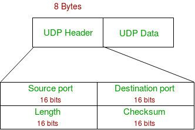

TCP는 데이터를 세그먼트 단위로 쪼갠 후 순서를 부여하여 전송한다.

또한 수신자 입장에서는 세그먼트의 순서가 뒤바뀌는 일이 없도록 오류를 제어하는 것도 중요하다.

즉, 신뢰성 있는 통신을 기반으로 하는 것이 TCP라면 **UDP(User Datagram Protocol)**는 데이터를 수신자 측에서 오류 없이 받던, 그렇지 않던 상관하지 않고 데이터를 보내기만 한다.

UDP가 신뢰성을 보장하지 않는다고 해서 쓸모가 없는 것은 아니다. 그만큼 데이터 전송 속도가 빠른 장점이 있다.

따라서 UDP 프로토콜은 주로 실시간 방송 등에 사용한다.

**UDP Header** 

| **항목 이름** | **설명** | **크기** |
| --- | --- | --- |
| Source Port | 송신자(출발지) 포트 번호 | 16비트 (2바이트) |
| Destination Port | 수신자(목적지) 포트 번호 | 16비트 (2바이트) |
| Length | UDP 헤더 + 데이터 전체 길이(바이트 단위) | 16비트 (2바이트) |
| Checksum | 오류 검출을 위한 체크섬 값 | 16비트 (2바이트) |

