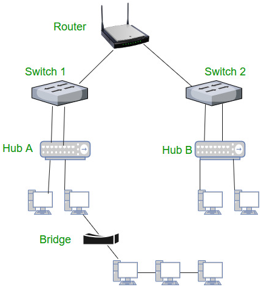
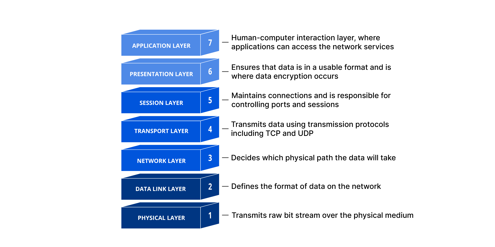
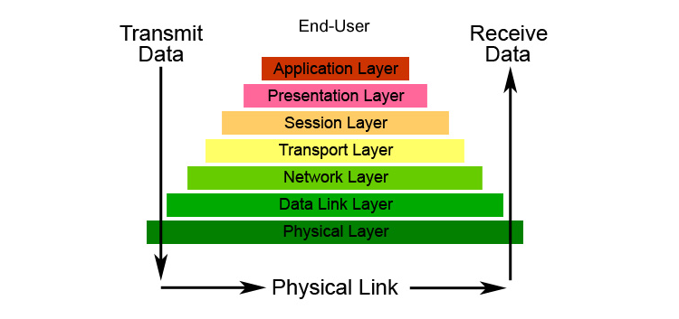
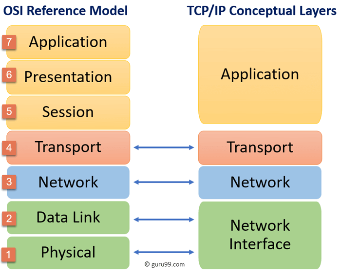
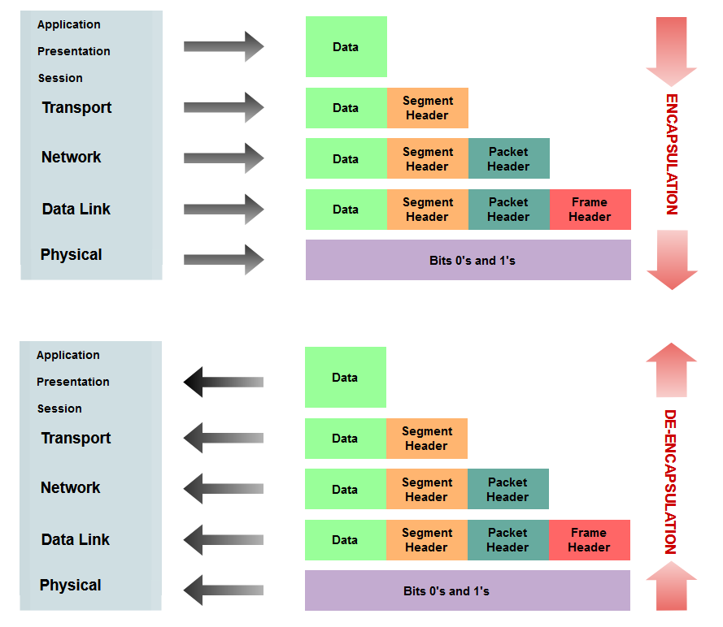

## 1장 개요 

네트워크를 처음 배우는 초급자가 꼭 알아야 할 네트워크 기초 지식을 다룬다.

**키워드**

  - 네트워크
  - 랜(LAN)
  - 왠(WAN)
  - 허브
  - 스위치
  - 비트

**목표**

  - 네트워크 이해
  - 네트워크 필요성 이해
  - LAN, WAN 의미와 종류에 대해 이해

---

## 내용 정리 

**네트워크란?** 

각종 통신 장비들이 서로 그물망처럼 연결되어 데이터를 교환하거나 협력하여 일할 수 있게 해주는 통신망

주변 장치, 데이터 공유, 공동 작업

### LAN(Local Area Network)

건물 안이나 특정 지역을 범위로 하는 네트워크, 주로 짧은 거리 내에 컴퓨터나 주변 장치(프린터)를 연결해 사용한다. 

### LAN 연결 방식, 랜의 구성 방법, 네트워크 접속 형태

    1. 스타(star)형: 하나의 허브에 여러 대의 컴퓨터를 연결하는 방식
    1. 링(ring)형: 개별 컴퓨터가 서로 원처럼 연결되어 있는 구성
    1. 버스(bus)형: 하나의 긴 선(케이블)에 컴퓨터를 포함한 모든 주변 장치를 연결하는 방식

| 구분 | 스타형 | 링형 | 버스형 |
| --- | --- | --- | --- |
| 장점 | 확장하기 쉽다 | 초기 구성이 쉽다. | 비용이 저렴하고 설치가 쉽다. |
| 단점 | 허브에 문제가 발생하면 전체 통신이 안된다.  | 컴퓨터를 한 대 추가할 경우 기존의 링을 절단하고 다시 연결해야 한다. | 케이블에 문제가 생기면 전체 통신이 불가능하다. |

일반적으로 버스형을 많이 사용한다.

---

### WAN(Wide Area Network) 

2개 이상의 LAN은 연결 즉, 넓은 지역에서 광범위하게 통신하고자 할 때 사용하는 네트워크

랜과는 다르게 별도의 ‘네트워크 접속 형태’는 없다. 단지, 랜 사이에 통신이 잘 이루어지도록 연결만 해주면 된다.

## 네트워크 구성 장치 정리

**허브(Hub)**

    - **정의:** 여러 대의 컴퓨터를 물리적으로 연결할 때 사용하는 장치
    - **역할:** 들어온 데이터를 연결된 모든 포트(컴퓨터)에 그대로 전송 브로드캐스트
    - **특징**
- 저렴하고 설치가 간단
      - 보안성이 낮다 모든 노드가 모든 데이터를 받는다
      - 데이터 충돌이 많고, 네트워크가 커질수록 속도 저하가 심하다

**스위치(Switch)**

    - **정의**: 허브와 비슷하게 여러 컴퓨터를 연결하지만, 더 똑똑하게 동작하는 장치
    - **역할**: 데이터가 목적지 컴퓨터로만 전달되도록 하여 대역폭을 효율적으로 사용
    - **특징**
- 각 포트별로 데이터를 분리해 충돌을 최소화
      - 네트워크 속도와 효율이 허브보다 훨씬 높음
      - 대규모 네트워크에 적합

**라우터** 

    - **정의**: 서로 다른 네트워크(LAN)를 연결해주는 장치
    - **역할**: 데이터가 목적지 네트워크로 갈 수 있도록 최적의 경로(길)를 찾아주는 역할
    - **특징**
- IP 주소를 기반으로 데이터 패킷을 라우팅(길 안내)
      - 인터넷 연결의 필수 장비
      - 방화벽, DHCP 등 다양한 부가 기능 제공

**브리지** 

    - **정의**: 두 개 이상의 네트워크 구간(세그먼트)을 연결하는 장치
    - **역할**: 네트워크를 분할하거나 확장할 때, 데이터를 필요한 곳으로만 전달
    - **특징**
- 네트워크 트래픽을 줄이고, 충돌 도메인을 분리
      - 계층 2(데이터 링크 계층)에서 동작
      - 예시: 1층과 2층의 네트워크를 연결할 때 사용

---

## **대역폭(bandwidth), 기본 단위**

1초당 처리할 수 있는 데이터의 양, 아래 그림에서 원통이 대역폭

대역폭과 시간당 데이터의 처리량은 비례한다.

**대역폭을 구하는 수식**

**대역폭(bps, bit per second) = (용량 * 8) / 처리 시간**

수식에서 8을 곱하는 이유는 바이트(용량) → 비트(대역폭) 변환 

대역폭을 의미하는 단위가 bps 그중 b가 비트(bit)를 의미한다.

비트는 컴퓨터가 의사 소통하는 언어이다.

비트는 0과 1로 구성되어 있고 이것은 전기 신호로 변환되어 전송된다.

‘a’, ‘b’, ‘c’ 같은 로마자는 문자 하나가 1바이트 ‘가’, ‘나’ 같은 한글, 일본어의 문자는 하나가 2바이트

**바이트(byte) → 킬로바이트(Kilobyte) → 메가바이트(Megabyte) → 기가바이트(Gigabyte) → 테라바이트(Terabyte)**  각 단계는 1024배(2^10)를 곱한다.

| 단위 | 예시 |
| --- | --- |
| 비트 | 예/아니오 |
| 바이트 | 알파벳 1개 |
| 킬로바이트 | 몇 개의 텍스트 문단 |
| 메가바이트 | 1분 정도의 음원 |
| 기가바이트 | 30분 정도의 영화 |
| 테라바이트 | 영화 100~200편 |

---

---

## 연습 문제 

  - LAN
  - 버스형
- 하나의 허브를 두고 연결된 형태 → 스타형
    - 컴퓨터 ↔ 컴퓨터 원형 → 링형
    - 하나의 케이블로 연결 → 버스형
  - WAN
  - bps(bit per second) → 대역폭
  - 0, 1
  - 비트
  - 바이트

---

## 용어 정리 

**네트워크**

→ 각종 통신 장비들이 서로 그물망처럼 연결되어 데이터를 교환하거나 협력하여 일할 수 있게 해주는 통신망

**LAN**

→ 짧은 거리의 컴퓨터 혹은 주변 장치를 연결할 때 사용하는 네트워크

**WAN**

→ 2개 이상의 LAN 연결한 네트워크. 넓은 지역에서 광범위하게 통신 하고자 할 때 사용

**Hub**

→ 컴퓨터와 컴퓨터 사이, 네트워크 장비와 장비를 연결해주는 장치 

**대역폭(Babdwidth)**

→ 네트워크가 1초당 처리할 수 있는 데이터의 양

**스위치(Switch)**

→ 대역폭을 확대해주는 장치? 

**비트(Bit)**

→ 네트워크 통신에 있어서 가장 기본적인 단위

---

## 개요

네트워크를 이용하는 데 가장 기본이 되는 약속인 통신 규약에 대해서 알아본다.

**키워드** 

  - 프로토콜
  - OSI 7계층
  - TCP/IP 4계층
  - 캡슐화/역캡슐화
  - VPN

---

## 내용 정리

## 프로토콜이란? 

사용자 → 요청(request)         [www.google.com](http://www.google.com/) 사이트 

사용자 ← 응답(response)      [www.google.com](http://www.google.com/) 사이트 

사용자 → 접속                         [www.google.com](http://www.google.com/) 사이트 

사용자 ← 파일(페이지) 전송     [www.google.com](http://www.google.com/) 사이트 

컴퓨터 세계에서 형식적으로 나누는 인사 과정을 **프로토콜(protocol)**이라고 한다. 

**컴퓨터나 원거리 통신 장비 사이에서 메시지를 주고받는 양식과 규칙의 체계**

네트워크의 대표적인 프로토콜 OSI 7 계층,  TCP/IP 4 계층 

---

## OSI 7계층 등장 배경

**OSI 7계층(Open Systems Interconnection 7 Layer) 모델**은 국제 표준화 기구(ISO)가 1970년대 후반~1980년대 초에 발표한 네트워크 통신 표준 모델이다.

    - **다양한 네트워크 시스템의 난립**
1980년대 초, 통신 기술이 발달하고 개인용 컴퓨터가 보급되면서, 서로 다른 제조사와 시스템 간에 네트워크 통신이 필요해졌다. 하지만 각 업체가 독자적으로 네트워크 장비와 프로토콜을 개발해, 시스템 간 호환성 문제가 심각했다.
    - **표준화의 필요성 대두**
네트워크 장비와 컴퓨터 간의 충돌과 비호환 문제를 해결하고, 다양한 시스템이 원활하게 통신할 수 있도록 하는 표준화된 모델의 필요성이 커졌다.
    - **ISO의 표준 모델 제안**
이에 따라 ISO는 네트워크 구조의 호환성을 높이고, 네트워크 간 통신 시스템을 통합하기 위한 표준 모델로 OSI 7계층을 제정했다. 이 모델은 네트워크 통신 과정을 7개의 계층으로 분리해 각 계층이 특정 기능을 담당하도록 설계되었다.

---

## OSI 7계층 

**OSI 7계층은 컴퓨터와 컴퓨터가 통신하는 구조를 7개의 계층으로 정의해둔 약속, 즉 프로토콜이다.**

| 계층  | 설명 |
| --- | --- |
| **7계층 / 응용 계층 (Application Layer)** | 사용자와 애플리케이션 간의 소통(이메일 보내기, 웹 사이트 방문) |
| **6계층 / 표현 계층 (Presentation Layer)** | 데이터를 어떻게 표현할지 정의(데이터의 압축, 데이터 암호화) |
| **5계층 / 세션 계층 (Session Layer)** | 통신을 설정, 관리, 종료(일반적으로 통신을 위한 세션을 체결) |
| **4계층 / 전송 계층 (Transport Layer)** | 신뢰성 있는 정확한 데이터 전달 |
| **3계층 / 네트워크 계층(Network Layer)** | 네트워크 장치 간의 경로 선택과 데이터 전송 |
| **2계층 / 데이터 링크 계층(Data Link Layer)** | 물리적인 연결을 통해 오류 없는 데이터 전달 |
| **1계층 / 물리 계층(Physical Layer)** | 전기 신호를 이용해서 통신 케이블로 데이터를 전송  |

송신자 관점에서 보면 7계층인 응용 계층에서 시작된 통신은 1계층인 물리 계층에서 끝난다.

반대로 수신자 관점에서는 물리 계층에서 시작하여 응용 계층에서 끝나는 흐름을 갖는다.

OSI 7 계층은 이론적인 표준안이다. 현실에 적용하기에는 계층이 너무 많다.

그래서 OSI 7 게층을 효율적으로 사용하기 위해 등장한 것이 TCP/IP 4 계층이다. 

따라서 **TCP/IP 4 계층을 사실상의 표준(De Facto Standard)이라고도 한다.**

---

## TCP/IP 4 계층

| **계층** | **설명** |
| --- | --- |
| 4계층 / 응용 계층  | 사용자와 애플리케이션 간의 소통 |
| 3계층 / 전송 계층  | 데이터의 전송 및 흐름에 있어 신뢰성 보장 |
| 2계층 / 인터넷 계층  | 물리적으로 데이터가 네트워크를 통해 어떻게 전송되는지를 정의 |
| 1계층 / 네트워크 인터페이스 계층 | 데이터를 전기 신호로 변환한 뒤 데이터 전송 |

---

**응용 계층 ~ 세션 계층:** ‘데이터’ 또는 ‘메시지’

**전송 계층:** ‘세그먼트’

**네트워크 계층:** ‘패킷’

**데이터 링크 계층:** ‘프레임’

**물리 계층:** ‘비트’

응용 계층(응용 계층 ~ 세션 계층)의 데이터는 말 그대로 데이터가 담겨 있다. 

예를 들어 이메일을 보낸다고 하면 이메일의 본문이 데이터가 될 것이다.

**이후 한 단계씩 아래로 내려가면서 통신을 위한 정보가 하나씩 추가로 붙게 된다.**

전송 계층, 세그먼트에서는 포트 번호 추가

네트워크 계층, 패킷에서는 송.수신자의 IP 주소 추가 

데이터 링크 계층, 프레임에서는 송.수신자의 MAC 주소 추가

**포트(port) 번호란 무엇인가?**

포트 번호란, 네트워크에서 한 컴퓨터(호스트) 내에서 실행 중인 여러 프로그램(프로세스) 중에서 어떤 프로그램과 통신할 것인지를 구분해 주는 논리적인 번호이다.

→ 포트 번호는 애플리케이션을 구분하기 위한 번호이다.

**IP 주소 (Internet Protocol Address) ?**

인터넷에 연결되어 있는 모든 장치(사용자 컴퓨터, 서버, 스마트폰)를 식별할 수 있도록 각각의 장치에 부여된 고유 주소이다. 

→ 다른 장치와 중복될 수 없다.

→ ex) 192.168.121.63

**MAC 주소** 

하드웨어 장치에 할당된 주소

→ 다른 장치와 중복되면 안 된다.

→ ex) 1C-1B-B5-08-A4-2A

**엥? IP 주소와 MAC 주소는 모두 고유 번호인데, 왜 2개나 필요할까?** 

사용하는 용도가 다르다. IP 주소는 KT, SKT, LG 등 인터넷 서비스에 가입하면 할당받는 주소이고 네트워크 계층에서 사용된다. 반면에 MAC 주소는 컴퓨터를 구매할 때부터 할당되어 있는 기기의 고유 번호이며 데이터 링크 계층에서 사용된다.

**IP 주소**는 논리적(소프트웨어적) 주소로, 네트워크 간 데이터 이동(라우팅)에 사용

**MAC 주소**는 물리적(하드웨어적) 주소로, 같은 네트워크 내에서 장치 식별에 사용

---

OSI 7 계층을 내려가면서 데이터에 정보가 하나씩 덧붙여진다.

이와 같이 **각 계층을 지나면서 덧붙여지는 정보를 헤더(header)라고 한다.**

**헤더가 추가되는 과정을 캡슐화라고 하며, 헤더가 분리되는 과정을 역캡슐화라고 한다.**

---

## 캡슐화 

미영이 컴퓨터 → 제우 컴퓨터 

미영이가 제우에게 이메일을 보내기 위해 필요한 것은 무엇일까?

2대의 컴퓨터가 통신을 하기 위해서는 **포트 번호, IP 주소, MAC 주소 정보**가 필요하다.

그리고 **캡슐화(Encapsulation)는 계층에 따라 이러한 정보를 담은 헤더를 데이터에 붙여나가는 과정을 의미한다.**

상대방에게 보내려는 데이터(이메일 본문)에 그 데이터를 보내기 위해 필요한 정보들을 헤더라는 이름으로 붙여나가는 것이다.

**헤더 정보** 

| 계층 | 헤더 정보 |
| --- | --- |
| 전송 계층 | 포트 정보 |
| 네트워크 계층 | 송수신자의 IP 정보 |
| 데이터 링크 계층 | 송수신자의 MAC 주소, 트레일러 |

데이터 링크 계층에서 추가되는 **트레일러(Trailer)** 정보는 전달한 데이터에 오류가 없는지 검출하기 위한 용도로 사용한다.

---

## 역캡슐화 

캡슐화가 계층을 지나면서 헤더 정보가 추가되는 것이라면, 반대로 **역캡슐화(Decapsulation)는 헤더 정보가 하나씩 벗겨지는 것을 말한다.**

데이터 링크 계층에서의 역캡슐화는 트레일러 분리도 발생한다.

데이터 링크 계층에서 MAC 주소를 획득

네트워크 계층에서 IP 주소를 획득

전송 계층에서 포트 번호 획득

---

학교 네트워크에는 다양한 시스템이 존재한다. 학사 관리 시스템, 교직원 관리 시스템 등 수십 대의 시스템이 운영된다. 이 중에서는 학교의 기밀 정보인 중요한 정보가 담긴 시스템이 있고, 이러한 시스템은 외부에서 접근하지 못하도록 보안에 각별히 신경을 쓴다.

다음과 같은 상황을 가정해 보자.

    - 본교(서울) 제2 캠퍼스(대구)
    - 모든 시스템은 본교에 위치
    - 학사 관리 시스템에 개인정보 데이터(ex: 주민번호)가 있는 경우

이와 같은 상황에서 시스템이 본교에 위치하기 때문에 본교에 근무하는 교직원들은 바로 학사 관리 시스템에 접근할 수 있다. 하지만 제 2 캠퍼스에 근무하는 교직원들이 학사 관리 시스템에 접속하려면 VPN을 이용해서 학사 관리 시스템에 접속해야만 중요한 정보를 보호할 수 있다?

**VPN(Virtual Private Network)은 외부 네트워크(인터넷)와 내부 네트워크(본교)를 암호화된 터널로 연결**한다. 이를 통해 제2 캠퍼스에서 접속하는 교직원의 트래픽이 암호화되어 전송되므로, 중간에서 데이터가 유출되거나 도청당할 위험을 크게 줄일 수 있다.

**VPN을 사용하면 원격지(제2 캠퍼스)에서도 마치 본교 내부 네트워크에 직접 연결된 것처럼 시스템에 접근**할 수 있다. 이 방식은 원격 근무, 출장 등 다양한 상황에서 기업·기관의 민감한 시스템에 안전하게 접근하기 위해 표준적으로 사용된다.

**중요 정보 보호**

학사 관리 시스템에 주민등록번호 등 개인정보가 포함되어 있다면, 외부에서 일반 인터넷을 통해 직접 접속하게 할 경우 보안 위협이 매우 크다. VPN은 네트워크 구간 자체를 암호화하기 때문에, 외부 공격자나 해커가 데이터를 가로채더라도 내용을 해독할 수 없다.

**VPN?** 

**VPN(Virtual Private Network, 가상사설망)은 인터넷을 통해 데이터를 안전하게 전송하기 위한 기술**이다.

일반적으로 아래와 같은 방식으로 동작한다.

    1. **VPN 클라이언트 소프트웨어 설치:** 컴퓨터에 VPN 클라이언트 소프트웨어를 설치한다.
    1. **VPN 서버 연결 및 인증:** VPN 클라이언트 소프트웨어를 사용하여 VPN 서버에 연결한다. 이때 사용자 이름과 암호를 사용하여 인증을 한다.
    1. **데이터 암호화:** VPN 연결이 설정되면 모든 데이터는 암호화되어 전송된다. 이는 데이터가 인터넷을 통해 전송될 때 누구나 볼 수 없게 만들어준다.
    1. **터널링:** VPN은 암호화된 데이터를 전송하기 위해 터널링 기술을 사용한다. 터널링(Tunneling)이란 본교와 제2 캠퍼스 간에 마치 터널이 뚫린 것처럼 네트워크 사이에 통로를 생성하는 것을 말한다.
    1. **종료:** 이후 통신이 종료되면 VPN 터널은 해제되고 VPN 연결도 종료된다.

**VPN 종류** 

**IPSec(Internet Protocol Security) VPN**, **SSL(Secure Socket Layer)** **VPN** 2가지 종류

| 구분 | IPSec VPN | SSL VPN |
| --- | --- | --- |
| OSI 7 계층 | 3계층 | 4 ~ 7 계층 |
| 암호화 | IP 패킷 암호화  | 데이터 암호화 |
| 접속 방법 | 소프트웨어 설치하여 접속  | 웹 브라우저에서 접속 |

---

## 연습 문제

 1. 프로토콜

  1. OSI 7 계층
  1. TCP/IP 4 계층 → 인터넷 표준
  1. 세그먼트 
  1. 패킷, 프레임
  1. 트레일러 → 데이터 링크 계층
  1. 캡슐화
  1. IP, MAC
  1. 3계층 / 네트워크 계층
  1. 터널링 

---

## 용어 정리

**프로토콜(Protocol):** 컴퓨터나 원거리 통신 장비 사이에서 메시지를 주고받는 양식과 규칙의 체계

**OSI 7 계층:** OSI 7 계층은 컴퓨터와 컴퓨터가 통신하는 구조를 7개의 계층으로 정의해둔 약속, 프로토콜 

**TCP/IP 4 계층:** OSI 7 계층 이론을 기반으로 만들어진 사실상 인터넷 표준이다. 

**캡슐화:** 매 계층마다 데이터에 헤더 정보를 하나씩 추가하는 과정 (데이터 → 포트 정보 → IP 정보 → MAC 주소)

**트레일러(Trailer):** 데이터를 전달할 때 데이터의 마지막에 추가하는 정보로서 데이터의 오류를 검출하기 위한 용도로 사용된다.

**역캡슐화:** 데이터에서 헤더 정보를 하나씩 분리시키는 과정

**VPN:** VPN은 인터넷을 통해 데이터를 안전하게 전송하기 위한 기술

---

