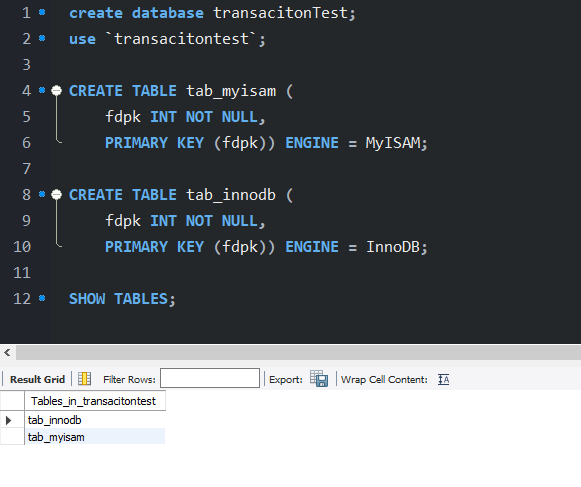
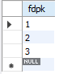
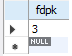

# *5.1 트랜잭션*

*트랜잭션을 지원하지 않는 MyISAM 스토리지 엔진과 지원하는 InnoDB 스토리지 엔진의 처리 방식 차이를 살펴보자.*

*또한 트랜잭션을 사용할 경우 주의할 사항도 함께 알아보자* 

## *5.1.1 MySQL 트랜잭션*

*트랜잭션은 꼭 여러 개의 변경 작업을 수행하는 쿼리가 조합됐을 때만 의미 있는 개념이 아니다.*

*트랜잭션은 하나의 논리적인 작업에 쿼리의 개수와 상관없이 전체 작업이 100% 적용되거나 아무것도 적용되지 않아야 함을 보장해 주는 것이다.  →* ***ALL or NOTHING***

*간단한 예제로 트랜잭션 관점에서 InnoDB 테이블과 MyISAM 테이블 차이를 살펴보자* 

## ***간단한 예제*** 

***테스트용 DATABASE, 테이블 생성 Query***



```sql
INSERT INTO tab_myisam VALUES(3);
INSERT INTO tab_innodb VALUES(3);
```

- *테스트용 테이블에 각각 레코드 1건씩 저장*

***AUTO-COMMIT 활성화 & 쿼리 실행하기*** 

```sql
SET autocommit = on;

INSERT INTO tab_myisam (fdpk) VALUES (1), (2), (3);

INSERT INTO tab_innodb (fdpk) VALUES (1), (2), (3);
```

***result***

*Error Code: 1062. Duplicate entry '3' for key 'tab_myisam.PRIMARY'*

*Error Code: 1062. Duplicate entry '3' for key 'tab_innodb.PRIMARY'*

```sql
SELECT * FROM tab_myisam;
SELECT * FROM tab_innodb;
```

***tab_myisam*** 



***tab_innodb***



***결과 분석*** 

*두 INSERT 문장 모두 프라이머리 키 중복 오류로 쿼리가 실패했다.* 

*그런데 두 테이블 레코드를 조회해 보면 MyISAM 테이블에는 오류가 발생했음에도 ‘1’, ‘2’는 INSERT 된 상태로 남아 있는 것을 확인할 수 있다.* 

*즉, MyISAM 테이블에 INSERT 문장이 실행되면서 차례대로 ‘1’, ‘2’를 저장하고 그다음 ‘3’을 저장하려는 순간 중복 키 오류(Duplicate Key Error)가 발생한 것이다.*

*하지만 MyISAM 테이블에서 실행된 쿼리는 이미 INSERT된 ‘1’, ‘2’를 그대로 두고 쿼리 실행을 종료해 버린다.*

*MEMORY 스토리지 엔진 또한 동일하게 작동한다.*

*InnoDB는 쿼리 중 일부라도 오류가 발생하면 전체를 원 상태로 만든다는 트랜잭션의 원칙대로 실행하기 전 상태로 복구했다.*

*MyISAM 테이블에서 발생하는 이런 현상을* ***부분 업데이트(Partial Update)****로 표현한다.* 

*이러한 부분 업데이트 현상은 테이블 데이터 정합성을 맞추는데 상당히 어려운 문제를 만들어 낸다.*

## *5.1.2  주의사항*

*트랜잭션 또한 DBMS 커넥션과 동일하게 꼭 필요한 최소의 코드에만 적용하는 것이 좋다.*

***예시***

*사용자가 게시판에 게시물을 작성한 후 저장 버튼 클릭했을 때 서버에서 처리하는 내용* 

```sql
1) 처리 시작
-> 데이터베이스 커넥션 생성 
-> 트랜잭션 시작
2) 사용자의 로그인 여부 확인 
3) 사용자의 글쓰기 내용의 오류 여부 확인
4) 첨부로 업로드된 파일 확인 및 저장 
5) 사용자의 입력 내용을 DBMS에 저장 
6) 첨부 파일 정보를 DBMS에 저장
7) 저장된 내용 또는 기타 정보를 DBMS에서 조회
8) 게시물 등록에 대한 알림 메밀 전송 
9) 알림 메일 발송 이력을 DBMS에 저장 
-> 트랜잭션 종료(COMMIT)
-> 데이터베이스 커넥션 반납
10) 처리 완료 
```

*해당 처리 절차에서 DBMS 트랜잭션 처리에 좋지 않은 영향을 미치는 부분을 나눠서 살펴보자* 

***실제로 DBMS에 데이터를 저장하는 작업(트랜잭션)은 5번부터 시작된다는 것을 알 수 있다.***

*2번,3번,4번 절차가 아무리 빨리 처리된다고 하더라도 DBMS의 트랜잭션에 포함시킬 필요는 없다.*

*데이터베이스 커넥션 개수는 제한적이어서 각 단위 프로그램이 커넥션을 소유하는 시간이 길어질수록 사용 가능한 여유 커넥션의 개수는 줄어들 것이다.* 

***8번 작업 같이 메일 전송이나 FTP 파일 전송 작업 또는 네트워크를 통해 원격 서버와 통신하는 작업은 어떻게 해서든 DBMS 트랜잭션 내에서 제거하는 것이 좋다.*** 
*프로그램 실행되는 동안 메일 서버와 통신할 수 없는 상황이면 웹 서버뿐 아니라 DBMS 서버까지 위험해지는 상황이 발생할 것이다.*

***DBMS 작업이 4개가 있다.  5번, 6번, 7번, 9번***

*사용자가 입력한 정보를 저장하는 5번, 6번 작업은 하나의 트랜잭션으로 묶어야 한다.* 

*7번은 저장된 데이터의 단순 확인 및 조회이므로 트랜잭션에 포함될 필요는 없다.*

*알림 전송 저장 같은 9번은 비즈니스 목적이 아예 다른 성격의 작업이다. 
별도의 트랜잭션으로 분리하는 것이 좋다.*

***재설계***

```sql
1) 처리 시작
2) 사용자의 로그인 여부 확인
3) 사용자의 글쓰기 내용의 오류 발생 여부 확인
4) 첨부된 업로드된 파일 확인 및 저장
-> DB 커넥션 생성(커넥션 풀에서 가져오기)
-> 트랜잭션 시작
5) 사용자의 입력 DBMS에 저장 
6) 첨부 파일 정보 DBMS에 저장 
-> 트랜잭션 종료(COMMIT/ROLLBACK)
7) 저장된 내용 / 기타 정보 DBMS에서 조회
8) 게시글 등록에 대한 알림 메일 전송 
-> 트랜잭션 시작
9) 알림 메일 발송 이력을 DBMS에 저장 
-> 트랜잭션 종료(COMMIT/ROLLBACK)
-> DB 커넥션 종료(커넥션 풀에 반납)
10) 처리 완료 
```

***프로그램 내에서 실행되는 데이터베이스 커넥션의 범위와 트랜잭션 범위를 최소화하자!***
