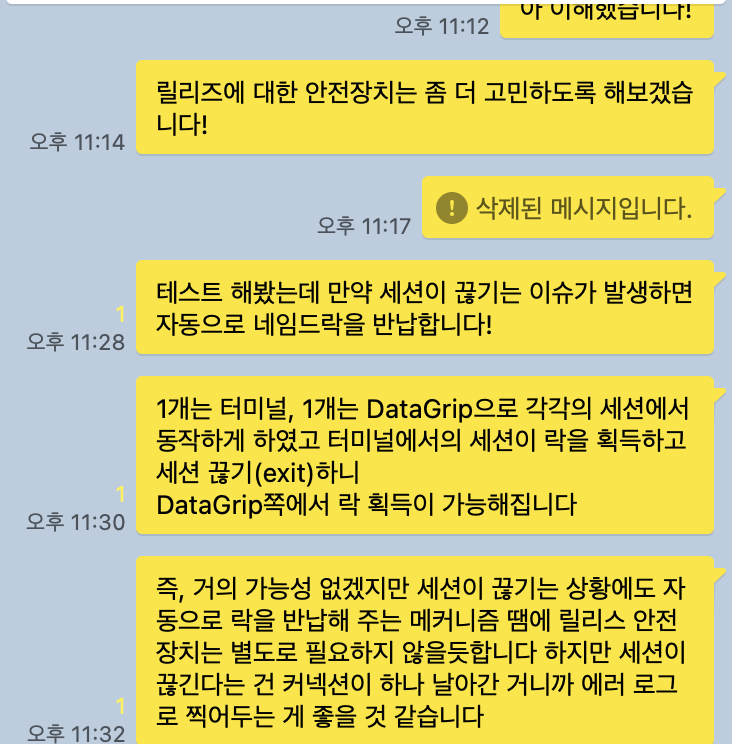

MySQL 서버의 잠금은 스토리지 엔진 레벨과 MySQL 엔진 레벨로 나눌 수 있다.

MySQL 엔진 레벨의 잠금은 모든 스토리지 엔진에 영향을 미치지만, 스토리지 엔진 레벨의 잠금은 스토리지 엔진 간 상호 영향을 미치지 않는다.

MySQL 엔진에서는 테이블 데이터 동기화를 위한 테이블 락 이외에도 테이블 구조를 잠그는 메타데이터 락 그리고 사용자의 필요에 맞게 사용할 수 있는 네임드 락 기능을 제공한다.

---

# 5.2.1 글로벌 락 

**글로벌 락(GLOBAL LOCK)**은 `FLUSH TABLES WITH READ LOCK` 명령으로 획득할 수 있으며, 제공하는 잠금 가운데 가장 범위가 크다. (데이터 베이스, 테이블 상관 X → 전체)

한 세션에서 글로벌 락을 획득하면 다른 세션은 SELECT를 제외한 모든 DDL, DML은 글로벌 락이 해제될 때까지 대기 상태로 남는다.

**글로벌 락 동작 방식** 

```
글로벌 락 획득 시도보다 먼저 활성화된 모든 트랜잭션을 기다린다. 
즉, 커밋/롤백까지 기다린다.
버퍼링된 데이터 페이지를 디스크로 플러시한다.
이 모든 조건을 만족하면 글로벌 락 획득

장시간 실행되는 쿼리와 FLUSH TABLES WITH READ LOCK 명령이 최악의 케이스로 실행되면 
MySQL 서버 모든 테이블에 대한 DML 쿼리가 오랜 시간 동안 기다릴 수도 있다.

글로벌 락은 웹 서비스용 MySQL 서버에서 사용금지 

mysqldump 같은 백업 프로그램
-> 옵션에 따라서 어떤 잠금을 사용하는지 확인하자
```

### 백업 락 

InnoDB 스토리지 엔진은 트랜잭션을 지원하기 때문에 일관된 데이터 상태를 위해 모든 데이터 변경 작업을 

멈출 필요는 없다.

MySQL 8.0 부터는 InnoDB 스토리지 엔진이 기본 스토리지 엔진으로 채택되면서 조금 더 가벼운 글로벌 락 필요성이 생겼다. → 백업 락

```sql
LOCK INSTANCE FOR BACKUP;
// 백업 실행 
UNLOCK INSTANCE;
```

**백업 락 잠금 범위** 

- 데이터베이스 및 테이블 등 모든 객체 생성 및 변경 삭제
- 사용자 관리 및 비밀번호 변경
- REPAIR TABLE, OPTIMIZE TABLE 명령

**백업 락 동작 방식** 

백업 락은 일반적인 데이블의 데이터 변경 DML은 허용된다. 

별도의 조건없이 바로 획득이 가능하다. 

**MySQL 서버 구성**
소스 서버(source server) 레플리카 서버(replica server)로 구성
주로 백업은 보통 레플리카 서버에서 실행된다.

source → (binary log) → replica

**레플리카 서버에서 백업을 글로벌 락 VS 백업 락** 

글로벌 락을 백업으로 사용하면 글로벌 락 획득도 복제 작업이 있으면 지연되고
글로벌 락 도중에 소스 서버 데이터 변경이 있어도 실시간 복제 작업을 못하기 때문에 좋지 않다.

하지만 백업 락은 락 획득 조건이 없어 바로 가능하고 DML은 허용되기 때문에 실시간 복제 작업도 문제없이 가능하다. 즉, 백업과 복제가 동시에 가능하다.

또한 DDL 명령으로 백업이 실패하는 상황을 방지하기 위해서 DDL 명령이 실행되면 복제를 일시 중지하는 역할을 한다. 

**MySQL 8.0 이상 + InnoDB 환경**에서는 `LOCK INSTANCE FOR BACKUP` 기반 백업 전략이 권장

---

# 5.2.2 테이블 락

**테이블 락(Table Lock)**은 개별 테이블 단위로 설정되는 잠금이며, **명시적 또는 묵시적**으로 특정 테이블의 락을 획득할 수 있다.

**명시적 테이블 락 획득, 반납** 

```sql
LOCK TABLES table_name [READ | WRITE]

UNLOCK TABLES
```

명시적인 테이블 락은 애플리케이션에서 사용할 필요가 거의 없다.

글로벌 락과 동일하게 온리인 작업에 상당한 영향을 미치기 때문이다.

### 묵시적 테이블 락 

InnoDB 테이블은 DML 쿼리에서는 사용되지 않고, DDL 쿼리에서는 자동으로 사용된다.

왜냐하면 스토리지 엔진 차원에서 레코드 기반의 잠금을 제공하기 때문에 단순 데이터 변경 쿼리인 DML은 테이블 락이 설정되지는 않는다.

하지만 MyISAM, MEMORY 테이블은 데이터 변경 또한 묵시적으로 자동으로 테이블 락이 걸린다.

### 참고 자료 

[https://steady-coding.tistory.com/545](https://steady-coding.tistory.com/545)

---

# 5.2.3 네임드 락

네임드 락(Named Lock)은 `GET_LOCK()` 함수를 이용해 임의의 문자열에 대해 잠금을 설정할 수 있다.

이 잠금의 특징은 **대상이 테이블이나 레코드 또는 AUTO_INCREMENT 같은 데이터베이스 객체가 아니라는 것**이다. 

단순히 사용자가 지정한 문자열에 대해 획득하고 반납하는 잠금이다.

여러 클라이언트가 상호 동기화를 처리해야 할 때 네임드 락을 이용하면 쉽게 해결할 수 있다.

### 네임드 락 사용법

```sql
// 이미 잠금 사용 중이면 2초 대기
SELECT GET_LOCK('mylock', 2);

// 잠금 설정 확인
SELECT IS_FREE_LOCK('mylock');

// 잠금 반납 해제 
SELECT RELEASE_LOCK('mylock');
```

- 3개 함수 모두 정상적으로 동작하면 1을 반환
- 3개 함수 모두 실패하면 0 또는 NULL 반환 

### 네임드 락 중첩

MySQL 8.0 부터는 다음과 같이 네임드 락을 중첩해서 사용할 수 있다.

```sql
SELECT GET_LOCK('mylock_1', 10);
SELECT GET_LOCK('mylock_2', 10);

// 작업 수행 

SELECT RELEASE_LOCK('mylock_2');
SELECT RELEASE_LOCK('mylock_1');

// 동시에 해제 방법
SELECT RELEASE_ALL_LOCKS();
```

### 올바른 네임드 락 가이드

```
내가 생각하는 네임드 락 올바른 패턴

락 트랜잭션 시작
네임드 락 획득

비즈니스 트랜잭션 시작
비즈니스 트랜잭션 커밋 / 롤백

네임드 락 반납

---------------------------------------------------------------------------
왜 이렇게 트랜잭션을 분리해서 락을 획득?

네임드 락 획득 트랜잭션과 비즈니스 트랜잭션이 같은 트랜잭션으로 동작하면
동시성 이슈가 발생한다.

락 반납 <-> 트랜잭션 커밋 사이에 다른 트랜잭션이 락을 획득하고 업데이트 시도가 가능하기 때문이다.
---------------------------------------------------------------------------
그렇다면 꼭 락을 획득하는 트랜잭션과 반납하는 트랜잭션을 분리할 필요가 있는가?

트랜잭션1
네임드 락 획득

트랜잭션2
비즈니스 로직 

트랜잭션3
네임드 락 반납

트랜잭션1과 트랜잭션3은 서로 다른 커넥션이다 무슨 문제점이 있을까?
"네임드 락은 현재 세션에서 설정한 락만 해제할 수 있다" 즉, 커넥션이 다르면 반납이 불가능하다.
즉, 트랜잭션1에서 락을 획득한 커넥션(세션)과 트랜잭션3에서 락을 반납하는 커넥션이 다르면 
락 반납이 불가능하다.
만약 반납이 가능하다면 그건 우연의 일치로 같은 히카리풀이 트랜잭션을 제공할 때 트랜잭션1과 
트랜잭션3이 같은 커넥션을 제공하였기 떄문이다. 
```



만약 세션(커넥션)이 끊긴다면 자동으로 락은 릴리즈

---

# 5.2.5 메타데이터 락

**메타데이터 락(Metadata Lock)**은 데이터베이스 객체(테이블이나 뷰)의 이름이나 구조를 변경하는 경우에 획득하는 잠금이다.

**메타데이터 락은 명시적으로 획득이 불가능하다.**

`RENAME TABLE tab_a To tab_b` 같이 테이블의 이름을 변경하는 경우 자동으로 획득하는 잠금이다.

RENAME TABLE 같은 경우 원본 이름과 변경될 이름 두 개 모두 한꺼번에 잠금을 설정한다.

**예제1**

```sql
// 배치 프로그램에서 별도의 임시 테이블(rank_new)에 서비스용 랭킹 데이터를 생성

// 랭킹 배치가 완료되면 현재 서비스용 랭킹 테이블(rank)에 rank_backup으로 백업 
// 새로 만들어진 랭킹 테이블(rank_new)을 서비스용으로 대체 
RENAME TABLE rank TO rank_backup, rank_new TO rank;
```

예제1 같이 하나의 RENAME TABLE 명령문에 두 개의 RENAME 작업을 한꺼번에 실행하면 실제 애플리케이션 서버에서는 “Table not found rank” 같은 상황을 발생시키지 않고 적용하는 것이 가능하다.

**예제2**

```sql
RENAME TABLE rank TO rank_backup;
RENAME TABLE rank_new TO rank;
```

예제2 같이 2개로 나눠서 실행하면 아주 짧은 시간이지만 rank 테이블이 존재하지 않는 순간이 생기며, 그 순간에 실행되는 쿼리는 “Table not found rank” 오류를 발생시킨다.

---

