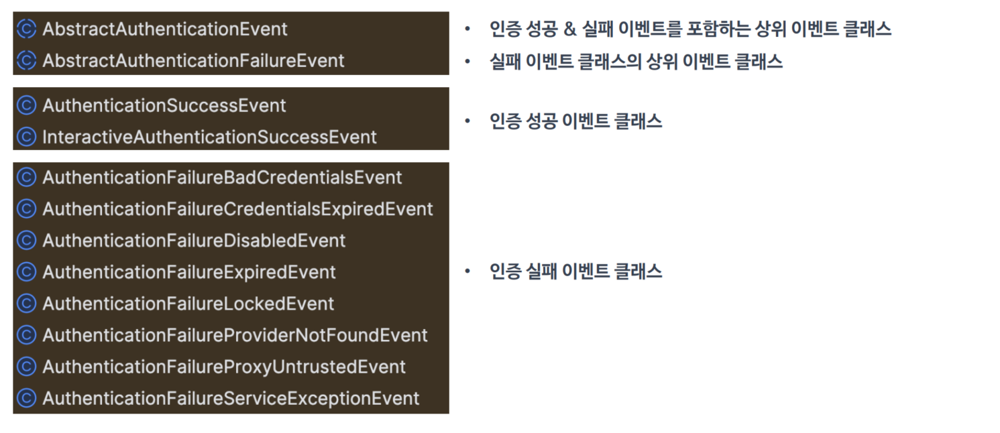
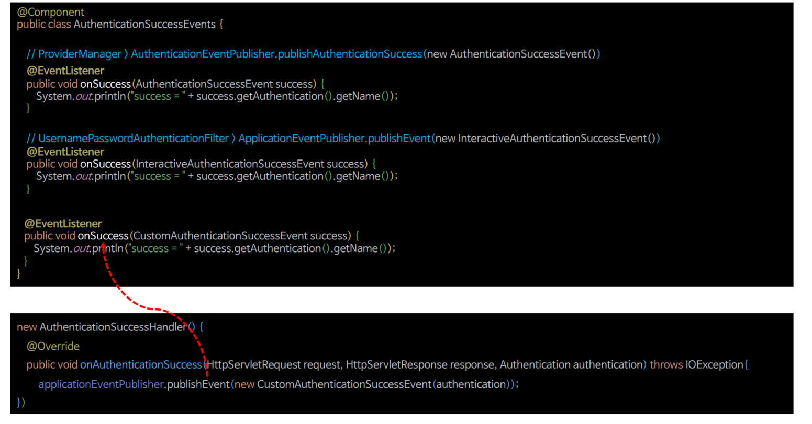
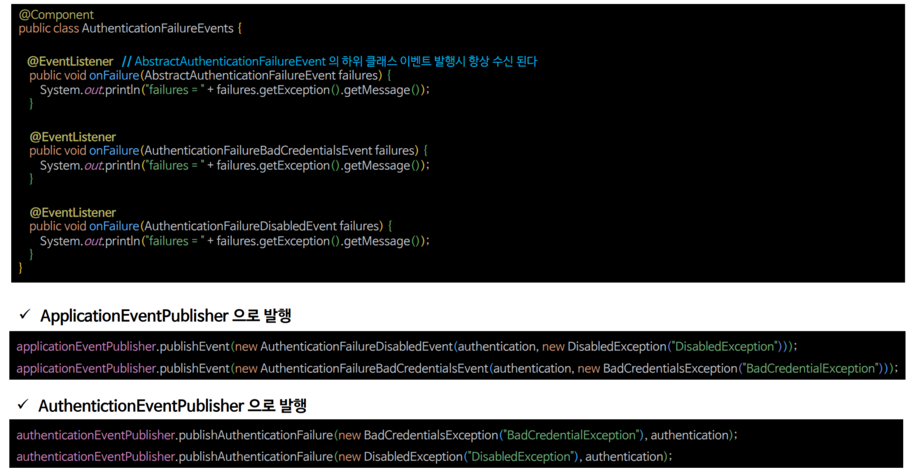

# **개요**

- *스프링 시큐리티는 인증이 성공하거나 실패하게 되면* ***AuthenticationSuccessEvent*** *또는* ***AuthenticationFailureEvent*** *를 발생시킨다*
- *이벤트를 수신하려면* ***ApplicationEventPublisher****를 사용하거나 시큐리티에서 제공하는* ***AuthenticationEventPublisher****를 사용해서 발행해야 한다*
- ***AuthenticationEventPublisher****의 구현체로* ***DefaultAuthenticationEventPublisher****가 제공된다*

# ***이벤트 발행 방법***

- *ApplicationEventPublisher.publishEvent(ApplicationEvent)*
- *AuthenticationEventPublisher.publishAuthenticationSuccess(Authentication)*
- *AuthenticationEventPublisher.publishAuthenticationFailure(AuthenticationException, Authentication)*

# ***이벤트 수신 방법***

```java
@Component
public class AuthenticationEvents {
		@EventListener
		public void onSuccess(AuthenticationSuccessEvent success) {…}
		
		@EventListener
		public void onFailure(AbstractAuthenticationFailureEvent failures) {…}
}
```

# ***인증 이벤트 종류***



- *스프링의 이벤트 리스닝 메커니즘은 자바의 클래스 상속 구조를 따르기 때문에 특정 이벤트의 리스너는 해당 이벤트 뿐만 아니라 그 이벤트의 부모 클래스(또는 인터페이스)들로부터 발생하는 이벤트도 처리 할 수 있다*

# ***인증 성공 이벤트 발행 & 수신***



# ***인증 실패 이벤트 발행 & 수신***



