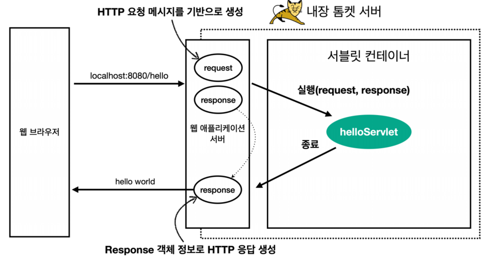
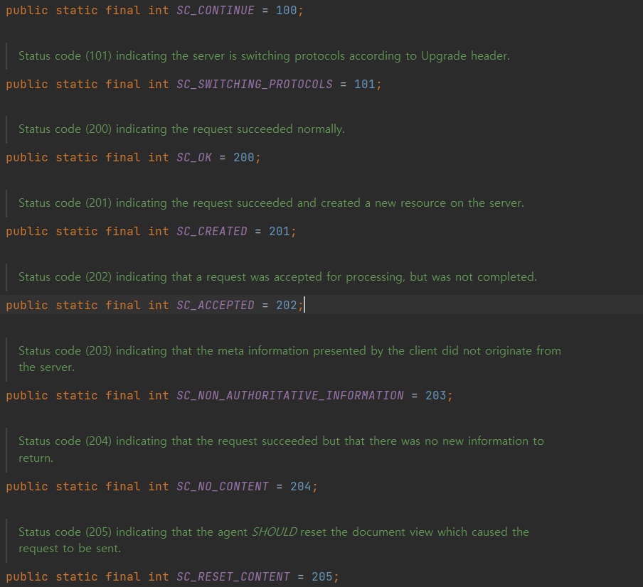

# ***스프링 부트 서블릿 환경 구성*** 

***@ServletComponentScan***

- *스프링 부트가 지원하는 서블릿을 직접 등록해서 사용할 수 있도록 하는 애노테이션* 

```java
@ServletComponentScan 
@SpringBootApplication
public class ServletApplication {
		public static void main(String[] args) {
				SpringApplication.run(ServletApplication.class, args);
		}
}
```

***@WebServlet*** 

```java
@WebServlet(name = "helloServlet", urlPatterns = "/hello")
public class HelloServlet extends HttpServlet {
    @Override
    protected void service(HttpServletRequest request, HttpServletResponse response) throws ServletException, IOException {
        System.out.println("HelloServlet.service");
        System.out.println("request = " + request);
        System.out.println("response = " + response);

        String username = request.getParameter("username");
        System.out.println("username = " + username);

        response.setContentType("text/plain");
        response.setCharacterEncoding("utf-8");
        response.getWriter().write("hello " + username);

    }
}
```

- ***@WebServlet(name = "helloServlet", urlPatterns = "/hello")***
- *서블릿 애노테이션*
  - *name: 서블릿 이름* 
  - *urlPatterns: URL 매핑*
- ***HttpServletResponse***
- *WAS가 Content-Length 자동으로 생성*

***HTTP 메시지 로그로 확인하기 - application.properties*** 

```java
logging.level.org.apache.coyote.http11=trace
```

***스프링 부트가 내장 톰켓 서버를 올린다.***



# ***HttpServletRequest*** 

*서블릿: 클라이언트의 HTTP 요청 메시지 개발자 대신 파싱 → HttpServletRequest 제공* 

### ***HttpServeltRequest 기능*** 

- ***START LINE***
- *HTTP 메소드:* *`request.getMethod()`* 
  - *URL*
- *`request.getRequestURL()`* *→* *`http://localhost:8080/request-header`*
    - *`request.getRequestURI()`* *→* *`/request-header`*
  - *쿼리 스트링* 
- *`request.getQueryString()`*
  - *스키마, 프로토콜 (HTTP / HTTPS)*
- *`request.isSecure()`* *: HTTP → false / HTTPS → true*
- ***헤더 조회  & 편의 조회*** 
- *`request.getHeaderNames()`* *: 전체 헤더 이름 조회* 
  - *`request.getHeader(String name)`* *: 헤더 이름으로 내용 조회* 

```java
request.getHeaderNames().asIterator().forEachRemaining(
      headerName -> System.out.println( headerName + "= " + request.getHeader(headerName)));  
```

  - *`request.getServerName()`* *: 서버 도메인 이름 → localhost, google.com*
  - *`request.getServerPort()`* *: 서버 포트* 
  - *`request.getLocales()`* *: Accept Languages* 
  - *`request.getLocale()`* *: 우선순위가 가장 높은 언어(Locales)*
  - *`reqeust.getCookies()`* *: 쿠키 조회* 
  - *`request.getContentType()`* *: 요청 본문(body)의 콘텐트 타입 → appication/json*
  - *`request.getContentLength()`* *: 요청 본문(body)의 길이*
  - *`request.getCharacterEncoding()`* *: 요청 본문(body)의 문자 인코딩 → UTF-8*
- ***바디***
- *form 파라미터* 
  - *message body 직접 조회*
- ***임시 저장소 Attribute***
- *HTTP 요청이 시작부터 끝날 때 까지 유지되는 임시 저장소* 
  - *`request.setAttribute(name, value)`* 
  - *`request.getAttribute(name)`*
  - *HttpServletRequest는 클라이언트의 요청 마다 생성되기 때문에 동시성 이슈 없이 사용이 가능하다.*
- ***세션 관리 기능***
- *`request.getSession(create: true)`*

# ***HTTP 요청 데이터 - GET 쿼리 파라미터***

*ex) http://localhost:8080/request-param****?****username=hello&age=20*

- *username = hello*
- *age = 20*

***쿼리 파라미터 조회 메서드***

- *단일 파라미터 조회*
- *`String username = request.getParameter("username");`* 
- *중복이면 getParameterValues() 첫 번째 값 반환*
- *파라미터 이름 전체 조회*
- *`Enumeration<String> parameterNames = request.getParameterNames();`*
- *파라미터 Map 조회*
- *`Map<String, String[]> parameterMap = request.getParameterMap();`*
- *복수 파라미터 조회*
- *`String[] usernames = request.getParameterValues("username");`*

# ***HTTP 요청 데이터 - POST HTML Form***

***특징***

- *content-type:* ***application/x-www-form-urlencoded***
- *쿼리 파라미터 형식과 같다 → 쿼리 파라미터 조회 메소드를 그대로 사용*
- *메시지 바디에 쿼리 파리미터 형식으로 데이터를 전달.* 
- *username=hello&age=20*

# ***HTTP 요청 데이터 - API 메시지 바디 - 단순 텍스트***

*HTTP message body에 데이터를 직접 담아서 요청*

- *HTTP API에서 주로 사용,* ***JSON****, XML, TEXT*
- *POST, PUT, PATCH*
- *HTTP 메시지 바디의 데이터를 InputStream을 사용해서 직접 읽을 수 있다*
- *`ServletInputStream inputStream = request.getInputStream();`*

```java
@WebServlet(name = "requestBodyStringServlet", urlPatterns = "/request-body-string")
public class RequestBodyStringServlet extends HttpServlet {
    @Override
    protected void service(HttpServletRequest request, HttpServletResponse response) throws ServletException, IOException {
        ServletInputStream inputStream = request.getInputStream();
        String messageBody = StreamUtils.copyToString(inputStream, StandardCharsets.UTF_8);
        System.out.println("messageBody = " + messageBody);
        response.getWriter().write("ok");
    }
}
```

- *inputStream은 byte code 즉, 인코딩된 코드를 반환한다.* 
- *byte 코드 → 디코딩(UTF_8 Charset) → 문자(String)*
- `String messageBody = StreamUtils.copyToString(inputStream, StandardCharsets.UTF_8);`

**문자 전송**

- *content-type:* ***text/plain***

# ***HTTP 요청 데이터 - API 메시지 바디 - JSON***

***JSON 형식 전송***

- *content-type:* ***application/json***
- *message body: {"username": "hello", "age": 20}*

***JSON 형식 파싱***

```java
@Setter @Getter
public class HelloData {
    private String username;
    private int age;
}
```

***byte code → 디코딩 작업(StreamUtils)***

```java
 ServletInputStream inputStream = request.getInputStream();
 String messageBody = StreamUtils.copyToString(inputStream, StandardCharsets.UTF_8);
```

***String → 파싱(ObjectMapper)***

```java
private ObjectMapper objectMapper = new ObjectMapper();

HelloData helloData = objectMapper.readValue(messageBody, HelloData.class);
```

- ***Jackson 라이브러리(Object Mapper)****: 스프링 부트 기본 제공 라이브러리*

***JSON 결과 파싱*** 

- *JSON 결과를 파싱해서 사용할 수 있는 자바 객체로 변환하려면* ***Jackson, Gson*** *같은 JSON 변환 라이브러리를 추가해서 사용*

# ***HttpServletResponse***

***헤더 직접 설정*** 

```java
response.setHeader("Content-Type", "text/plain;charset=utf-8");
```

***Status - 상태 코드*** 

```java
response.setStatus(HttpServletResponse.SC_OK); //200
```

- *HttpServletResponse 인터페이스에 - 상수로 존재* 



***Content 편의 메서드***

```java
response.setContentType("text/plain");
response.setCharacterEncoding("utf-8");
```

***쿠키 편의 메소드*** 

```java
Cookie cookie = new Cookie("myCookie", "good");
cookie.setMaxAge(600); 
response.addCookie(cookie);
```

***redirect 편의 메서드***

```java
response.sendRedirect("/basic/hello-form.html");
```

# ***HTTP 응답 데이터 - 단순 텍스트, HTML***

***HTTP 응답 메시지 종류***

- 단순 텍스트 응답
- `writer.println("ok");`
- HTML 응답
- **content-type: text/html**
- HTTP API - MessageBody JSON 응답
```java
response.setContentType("application/json");
response.setCharacterEncoding("utf-8");

HelloData helloData = new HelloData();
helloData.setUsername("김영한");
helloData.setAge(30);

String result = objectMapper.writeValueAsString(helloData);

response.getWriter().write(result);
```

  - **content-type: application/json**
  - `String result = objectMapper.writeValueAsString(helloData);` 
- 객체 → JSON

