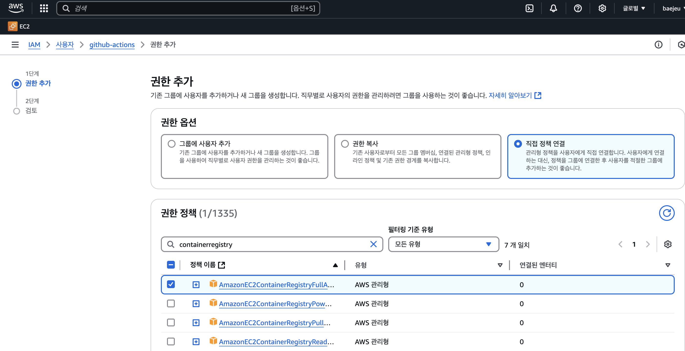
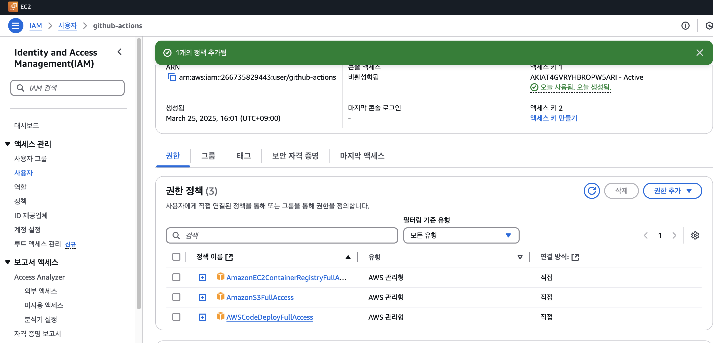
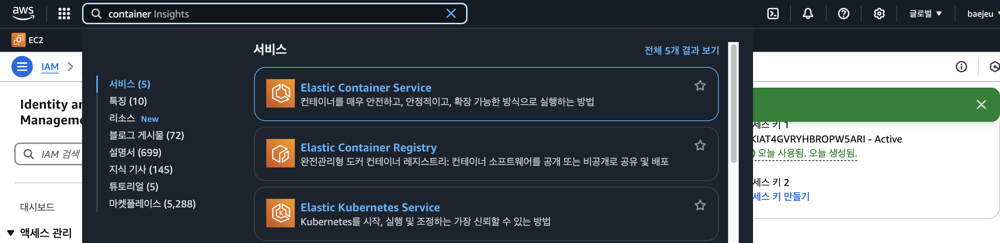
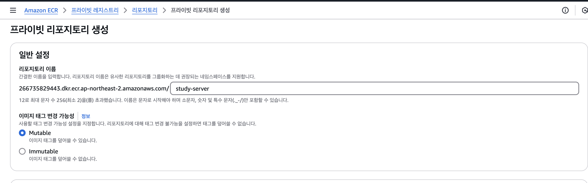

### Ubuntu에서 Docker, Docker Compose 설치하기

```shell
$ sudo apt-get update && \
sudo apt-get install -y apt-transport-https ca-certificates curl software-properties-common && \
curl -fsSL https://download.docker.com/linux/ubuntu/gpg | sudo apt-key add - && \
sudo apt-key fingerprint 0EBFCD88 && \
sudo add-apt-repository "deb [arch=amd64] https://download.docker.com/linux/ubuntu $(lsb_release -cs) stable" && \
sudo apt-get update && \
sudo apt-get install -y docker-ce && \
sudo usermod -aG docker ubuntu && \
sudo curl -L "https://github.com/docker/compose/releases/download/1.23.2/docker-compose-$(uname -s)-$(uname -m)" -o /usr/local/bin/docker-compose && \
sudo chmod +x /usr/local/bin/docker-compose && \
sudo ln -s /usr/local/bin/docker-compose /usr/bin/docker-compose

# 설치 확인
$ docker -v # Docker 버전 확인
$ docker compose version # Docker Compose 버전 확인
```

### **Github Actions의 IAM에 권한 추가**





# ECR 셋팅하기  

### ECR: Elastic Container Registry 검색 



- Elastic Container Service X


