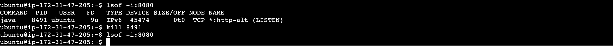
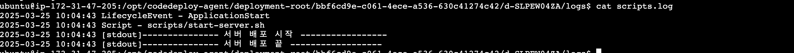

### 돌아가고 있는 서버 종료 

```shell
lsof -i:8080
kill PID
```



### Code Deploy 설치 파일, 기존 프로젝트 폴더 삭제 

```shell
rm -rf 파일
```

### appspec.yml, 스크립트 파일 작성하기

- appspec.yml은 CodeDeploy가 실행될 때 필수적으로 존재해야 하는 파일
- CodeDeploy는 이 설정 파일을 기반으로 실행
- 프로젝트 최상위 경로에 appspec.yml 생성

**appspec.yml**

```yaml
version: 0.0
os: linux

files:
    # S3에 저장한 파일들 중 destination(AWS EC2)으로 이동시킬 대상을 지정
    # /: S3 저장한 전체 파일
  - source: /
    # EC2의 어떤 경로에 저장할 지 지정
    destination: /home/ubuntu/backend-server

permissions:
  - object: /
    owner: ubuntu
    group: ubuntu

hooks:
  ApplicationStart:
    - location: scripts/start-server.sh
      timeout: 60
      runas: ubuntu 
```

- ec2에 설치된 Code Deploy Agent가 실행 
- S3에 저장된 빌드 파일 다운 
- shell 파일 run 통해서 배포 

**scripts/start-server.sh**

```shell
#!/bin/bash

echo "--------------- 서버 배포 시작 -----------------"
cd /home/ubuntu/instagram-server
sudo fuser -k -n tcp 8080 || true
nohup java -jar project.jar > ./output.log 2>&1 &
echo "--------------- 서버 배포 끝 ------------------"
```

### Github Actions 코드 작성하기

```yaml
name: Deploy to EC2

on:
  push:
    branches:
      - main

jobs:
  deploy:
    runs-on: ubuntu-latest
    steps:
      - name: Github Repository 올린 파일들 불러오기
        uses: actions/checkout@v4

      - name: JDK 17버전 설치
        uses: actions/setup-java@v4
        with:
          distribution: temurin
          java-version: 17

      - name: application.yml 파일 만들기
        run: echo "$APPLICATION_PROPERTIES" > ./src/main/resources/application.yml

      - name: 테스트 및 빌드하기
        run: ./gradlew clean build

      - name: 빌드된 파일 이름 변경하기
        run: mv ./build/libs/*SNAPSHOT.jar ./project.jar

      - name: 압축하기
        run: tar -czvf $GITHUB_SHA.tar.gz project.jar appspec.yml scripts

      - name: AWS Resource 접근할 수 있게 AWS credentials 설정
        uses: aws-actions/configure-aws-credentials@v4
        with:
           aws-region: ap-northeast-2
           aws-access-key-id: ${{ secrets.AWS_ACCESS_KEY_ID }}
           aws-secret-access-key: [REDACTED] secrets.AWS_SECRET_ACCESS_KEY }}

      - name: S3에 프로젝트 폴더 업로드
        # study-server s3 버켓으로 복사(cp)
        run: aws s3 cp --region ap-northeast-2 ./$GITHUB_SHA.tar.gz s3://study-server/$GITHUB_SHA.tar.gz

      - name: Code Deploy 활용하여 EC2에 프로젝트 코드 배포
        run: aws deploy create-deployment
          --application-name study-server
          --deployment-config-name CodeDeployDefault.AllAtOnce
          --deployment-group-name Production
          --s3-location bucket=study-server,bundleType=tgz,key=$GITHUB_SHA.tar.gz
```

```yaml
- name: 압축하기
  run: tar -czvf $GITHUB_SHA.tar.gz project.jar appspec.yml scripts
```

- `tar`: 유닉스/리눅스에서 파일 및 디렉토리를 아카이빙(묶기)하는 명령어
- `c` (**create**) : 새로운 tar 아카이브 파일을 생성
- `z` (**gzip**) : 아카이브 파일을 gzip 압축하여 `.tar.gz` 형태로 만듦
- `v` (**verbose**) : 압축 과정에서 어떤 파일이 추가되는지 출력 (옵션이므로 생략 가능)
- `f $GITHUB_SHA.tar.gz` (**file**) : 생성할 압축 파일 이름 (`$GITHUB_SHA`는 GitHub Actions에서 현재 커밋 SHA(commit ID 값이 들어감) 
- `project.jar` : 배포할 애플리케이션 실행 파일 (Spring Boot 애플리케이션 등)
- `appspec.yml` : AWS CodeDeploy 배포를 위한 설정 파일
- `scripts` : 배포 및 실행을 위한 스크립트 디렉터리 (start-server.sh 포함)

```yaml
- name: Code Deploy 활용하여 EC2에 프로젝트 코드 배포
  run: aws deploy create-deployment
    --application-name study-server
    --deployment-config-name CodeDeployDefault.AllAtOnce
    --deployment-group-name Production
    --s3-location bucket=study-server,bundleType=tgz,key=$GITHUB_SHA.tar.gz
```

- `--application-name study-server`
- CodeDeploy 애플리케이션 이름
- `--deployment-config-name CodeDeployDefault.AllAtOnce`
- CodeDeploy 배포 구성
- `--deployment-group-name Production`
- CodeDeploy 배포 그룹 이름
- `--s3-location bucket=study-server,bundleType=tgz,key=$GITHUB_SHA.tar.gz`
- S3 버켓 이름,파일 이름

### CodeDeploy가 잘 실행됐는 지 확인하기

- 아래 경로로 들어가면 CodeDeploy가 실행시킨 스크립트 로그 파일을 열 수 있다. 
- **/opt/codedeploy-agent/deployment-root/{deployment-group-ID}/{deployment-ID}/logs/scripts.log**



