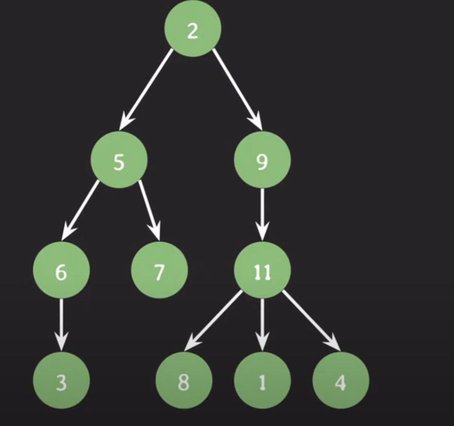
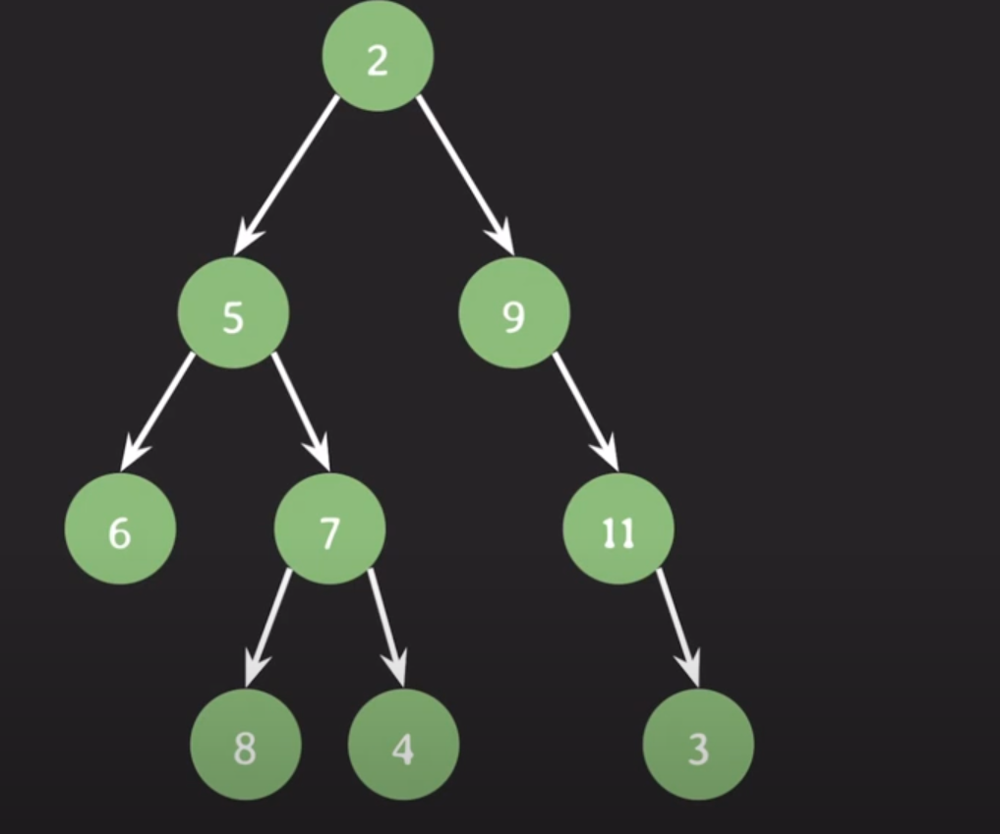
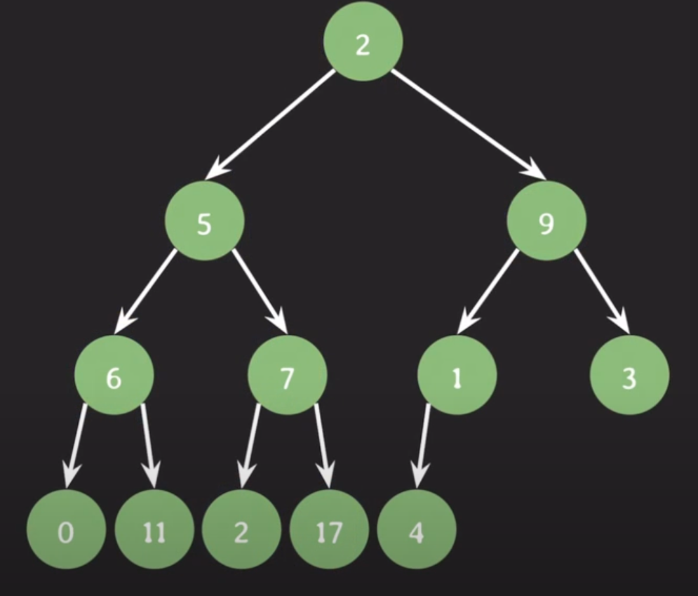
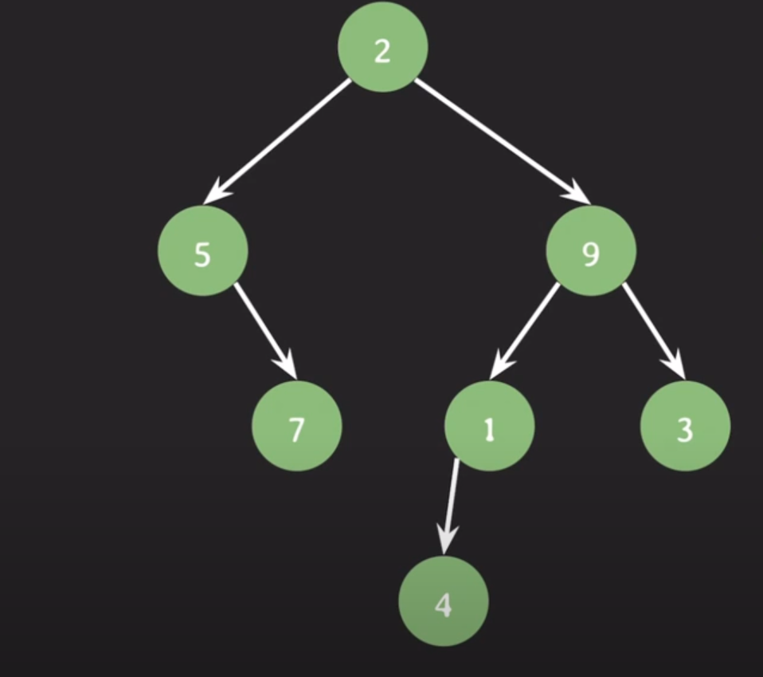
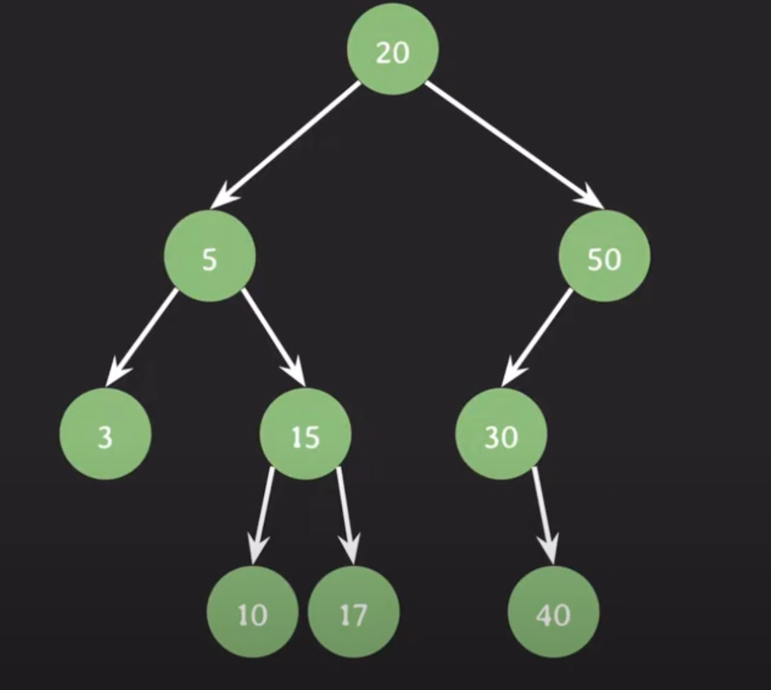

# 트리(tree)

노드(node)들의 집합

각 노드는 값(value)과 다른 노드들을 가리키는 래퍼런스들로 구성

# 트리 관련 주요 용어

### 간선(edge)

노드와 노드를 연결하는 선

구현 관점에서는 래퍼런스를 의미

보통 간선(edge), 링크(link), 브랜치(branch)라고 부른다.

### 루트(root) 노드

트리의 최상단에 있는 노드

트리의 시작점

해당 노드: 2

### 자녀(child) 노드

모든 노드는 0개 이상의 자녀 노드를 가진다

### 부모(parent) 노드

자녀 노드를 가지는 노드

해당 노드: 2, 5, 9, 6, 11

### 형제(sibling) 노드

같은 부모를 가지는 노드

{8, 1, 4}, {6, 7}, {5, 9}

### 조상(ancestor) 노드

부모 노드를 따라 루트 노드까지 올라가면 만나는 모든 노드

8의 조상 노드: 11, 9, 2

### 자손(descendant) 노드

자녀 노드를 따라 내려가며 만날 수 있는 모든 노드

9의 자손 노드: 11, 8, 1, 4

### 내부(internal) 노드

자녀 노드를 가지는 노드

보통 branch node, inner node 라고 부른다.

해당 노드: 2, 5, 9, 6, 11 

### 외부(external) 노드

자녀 노드가 없는 노드

보통 leaf node, outer node, terminal node 라고 부른다.

해당 노드: 3, 7, 8, 1, 4

### 경로(path)

한 노드에서 다른 노드 사이의 노드들의 시퀀스

2에서 7로의 경로: 2 - 5 - 7 

### 트리의 높이(height)

루트 노드의 높이

루트 노드를 포함하면: 4

루트 노드를 포함하지 않으면: 3

### 노드의 깊이(depth)

루트 노드에서 해당 노드까지

경로의 간선(edge) 수

루트 노드의 깊이: 0

11의 깊이: 2

### 노드의 차수(degree)

노드의 자녀 노드 수

11 노드의 차수: 3

3 노드의 차수: 0

### 트리의 차수(degree)

트리에 있는 노드들의 차수 중 가장 큰 차수

현재 트리 차수: 3 

# 이진 트리(binary tree)

각 노드의 자녀 노드 수가 최대 두 개인 트리

# 완전 이진 트리(complete binary tree)

마지막 레벨을 제외한 모든 레벨에서 노드가 빠짐없이 채워져 있고 

마지막 레벨은 왼쪽부터 빠짐없이 노드가 채워져있는 트리

# 균형 이진 트리(balanced binary tree)

모든 노드에서 왼쪽 서브 트리와 오른쪽 서브 트리의 높이 차이가 최대1인 트리

# 이진 탐색 트리(binary search tree)

모든 노드의 **왼쪽 서브 트리는 해당 노드의 값보다 작은 값들**만 가지고

모든 노드의 **오른쪽 서브 트리는 해당 노드의 값보다 큰 값들**만 가진다

### 이진 탐색 트리의 최소값

트리의 가장 왼쪽에 존재: 3

### 이진 탐색 트리의 최대값

트리의 가장 오른쪽에 존재: 50

### 중위 순회(inorder traversal)

1. 재귀적으로 왼쪽 서브 트리 순회
1. 현재 노드 방문(값 출력)
1. 재귀적으로 오른쪽 서브 트리 순회

출력 순서: 3 → 5 → 10 → 15 → 17 → 20 → 30 → 40 → 50 

### 전위 순회(preorder traversal)

1. 현재 노드 방문(값 출력)
1. 재귀적으로 왼쪽 서브 트리 순회
1. 재귀적으로 오른쪽 서브 트리 순회

출력 순서: 20 → 5 → 3 → 15 → 10 → 17 → 50 → 30 → 40

### 후위 순회(postorder traversal)

1. 재귀적으로 왼쪽 서브 트리 순회
1. 재귀적으로 오른쪽 서브 트리 순회
1. 현재 노드 방문(값 출력)

출력 순서: 3 → 10 → 17 → 15 → 5 → 40 → 30 → 50 → 20

### 이진 탐색 트리 시간 복잡도

|  | best | avg | worst |
| --- | --- | --- | --- |
| insert | O(1) | O(logN) | O(N) |
| delete | O(1) | O(logN) | O(N) |
| search | O(1) | O(logN) | O(N) |

**best:** 연산 대상이 루트 노드인 경우

**avg:** 트리 상태가 균형을 이루는 경우 → balanced binary tree

**worst:** 한쪽으로 편향된 트리 → skewed binary tree

### skewed binary tree 문제를 해결하기 위해 등장한 자료 구조

스스로 구현을 잡는 이진 탐색 트리

AVL 트리, Red-Black 트리

# 참고 자료

[https://www.youtube.com/watch?v=ohrwGtqeW-I&list=PLcXyemr8ZeoR82N8uZuG9xVrFIfdnLd72&index=7](https://www.youtube.com/watch?v=ohrwGtqeW-I&list=PLcXyemr8ZeoR82N8uZuG9xVrFIfdnLd72&index=7)

[https://www.youtube.com/watch?v=i57ZGhOVPcI&list=PLcXyemr8ZeoR82N8uZuG9xVrFIfdnLd72&index=8](https://www.youtube.com/watch?v=i57ZGhOVPcI&list=PLcXyemr8ZeoR82N8uZuG9xVrFIfdnLd72&index=8)

