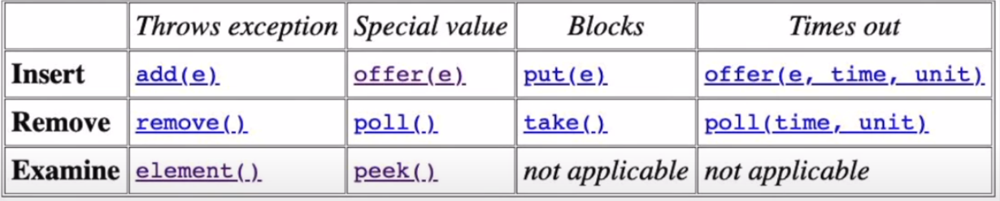

# 스택(stack)

**LIFO(Last In First Out)** 형태로 데이터를 저장하는 구조

주요 명령어: push, pop, peek

사용 사례: stack memory, stack frame

# 큐(queue)

**FIFO(First In First Out)** 형태로 데이터를 저장하는 구조

주요 명령어: enqueue, dequeue, peek

사용 사례: producer/consumer architecture

# 에러 상황 

### **StackOverfowError**

이유: 스택 메모리 공간을 다 썼을 때 발생하는 에러, 보통 재귀함수에서 탈출 못해서 발생

해결 방법: 적절한 종료 조건

### **OutOfMemoryError** 

이유: 큐에 데이터가 계속 쌓이기만 한다면 발생

해결 방법: 고정된 사이즈의 큐

큐 삽입 시점에 용량이 최대라면?

- 예외 던지기
- 특별한 값 반환(null or false)
- 성공할 때까지 영원히 삽입 스레드(producer) 블록(block)
- 제한된 시간만 블록되고 그래도 안되면 포기

**Java: LinkedBlockingQueue**

# 참고 자료

[https://www.youtube.com/watch?v=-2YpvLCT5F8&list=PLcXyemr8ZeoR82N8uZuG9xVrFIfdnLd72](https://www.youtube.com/watch?v=-2YpvLCT5F8&list=PLcXyemr8ZeoR82N8uZuG9xVrFIfdnLd72)

