# GitHub ksundong/backend 면접 준비

```sql
사용자
 │
 │ https://example.com 입력
 ▼
┌─────────────────────────────────────┐
│ 7. Application                      │
│ URL 파싱 → DNS 조회 → HTTP 요청 생성    │
└─────────────────┬───────────────────┘
                  │
        HTTPS라면 TLS 처리
                  │
┌─────────────────▼───────────────────┐
│ 4. Transport                        │
│ TCP 연결 → Port 결정 → Segment 생성    │
└─────────────────┬───────────────────┘
                  │
┌─────────────────▼───────────────────┐
│ 3. Network                          │
│ 목적지 IP 설정 → Packet 생성 → Routing  │
└─────────────────┬───────────────────┘
                  │
┌─────────────────▼───────────────────┐
│ 2. Data Link                        │
│ MAC 주소 확인 → Ethernet Frame 생성    │
└─────────────────┬───────────────────┘
                  │
┌─────────────────▼───────────────────┐
│ 1. Physical                         │
│ 전기/광/무선 신호로 실제 전송              │
└─────────────────┬───────────────────┘
                  │
            Router / ISP
                  │
             Internet
                  │
                  ▼
             Web Server
                  │
          1 → 2 → 3 → 4 → 7
             역캡슐화
                  │
                  ▼
           HTTP Request
                  │
          Application 처리
                  │
                  ▼
           HTTP Response
                  │
           다시 클라이언트로
                  ▼
              Browser
```

### **1. URL 파싱 — 7계층 Application**

```
https://www.example.com/products?id=10
```

브라우저는 URL을 분석해서

```
Protocol : HTTPS
Host     : www.example.com
Port     : 443 (기본값)
Path     : /products
Query    : id=10
```

그리고 최종적으로 서버에 보낼 HTTP Request를 준비한다.

```
GET /products?id=10 HTTP/1.1
Host: www.example.com
...
```

여기까지는 크게 보면 **OSI 7계층 Application Layer** 영역이라고 설명하면 된다.

### 2. DNS Lookup — Application Layer

그런데 네트워크 통신에서는

```
www.example.com
```

이라는 문자열 자체를 목적지로 사용할 수 없다.

실제로 통신하려면 서버의 **IP 주소**가 필요하다.

그래서 DNS Lookup을 수행한다.

```
브라우저/OS의 DNS 캐시 등을 확인
        ↓
필요하면 DNS Resolver에 질의
        ↓
Root DNS
        ↓
TLD DNS (.com)
        ↓
Authoritative DNS
        ↓
IP 주소 획득
```

```
www.example.com
        ↓ DNS
93.184.216.34
```

**Domain → IP** 변환이 이루어진다.

### 3. 같은 네트워크인지 판단 — Network Layer

이제 목적지 IP를 알았다.

OS의 네트워크 스택은 목적지 IP를 보고 **어디로 패킷을 보내야 하는지** 판단한다.

여기서 중요한 개념이 **Routing Table**이다.

목적지가 같은 네트워크에 있다면 직접 보내고, 외부 네트워크라면 일반적으로 **Default Gateway**로 전달한다.

인터넷 웹 서버는 보통 다른 네트워크에 있으므로

```
내 PC
 ↓
Default Gateway
 ↓
ISP Router
 ↓
Internet
 ↓
목적지 Network
```

이 부분이 OSI **3계층 Network Layer**와 연결된다.

대표적인 프로토콜이 **IP**이고 라우터가 핵심 장비다.

---

### 4. MAC 주소 확인 — Data Link Layer

그런데 여기서 하나 더 알아야 한다.

IP 주소를 알고 있다고 해서 LAN에서 바로 데이터를 보낼 수 있는 것은 아니다.

Ethernet/Wi-Fi 같은 로컬 링크에서는 다음 홉의 **MAC 주소**가 필요하다.

IPv4 환경에서는 ARP 등을 이용해 다음 홉의 IP에 대응하는 MAC 주소를 알아낸다.

인터넷 서버가 다른 네트워크에 있다면 보통 서버의 MAC 주소를 알아내는 게 아니라 **Default Gateway의 MAC 주소**를 알아낸다는 것이 중요하다.

```
목적지 IP
192.x.x.x 외부 서버

목적지 MAC
내 Gateway의 MAC
```

여기서 IP와 MAC의 역할을 구분할 수 있어야 한다.

```
IP
→ 최종 목적지가 누구인가?

MAC
→ 현재 링크에서 다음에 누구에게 전달할 것인가?
```

라우터를 하나 지날 때마다 프레임의 MAC 주소는 바뀔 수 있지만, 일반적인 종단 간 통신에서는 IP 패킷의 출발지/목적지 주소는 그대로 유지된다. 단, NAT가 있다면 IP 주소가 변환될 수도 있다.

### 5. TCP 연결 — Transport Layer

HTTP/1.1이나 HTTP/2를 사용하는 일반적인 HTTPS 통신이라면 TCP 연결이 필요하다.

TCP는 OSI **4계층 Transport Layer**에 해당한다.

대표적으로 **3-Way Handshake**를 수행한다.

```
Client                         Server

   -------- SYN ------------->

   <----- SYN + ACK -----------

   -------- ACK ------------->

       TCP Connection
         Established
```

여기서 포트 번호도 사용된다.

```
Client
IP   : 192.168.0.10
Port : 52134

Server
IP   : 93.184.216.34
Port : 443
```

```
IP   → 어떤 컴퓨터인가
Port → 그 컴퓨터의 어떤 프로세스/서비스인가
```

참고로 **HTTP/3은 TCP가 아니라 QUIC(UDP 기반)**을 사용하므로, 면접에서 “HTTPS는 무조건 TCP”라고 단정하면 안 된다.

---

### 6. HTTPS라면 TLS

HTTPS라면 TCP 연결 이후 HTTP 데이터를 그대로 보내는 것이 아니라 TLS를 통해 보안 연결을 수립한다.

```
TCP Connection
      ↓
TLS Handshake
      ↓
서버 인증서 확인
      ↓
암호화에 사용할 키 합의
      ↓
암호화된 HTTP 통신
```

이 과정에서 서버 인증서를 통해 접속하려는 서버가 신뢰할 수 있는 대상인지 검증하고, 이후 데이터를 암호화해서 통신한다.

OSI 모델에 억지로 대응시키면 TLS를 5~6계층과 연관 지어 설명하기도 하지만, **현대 TCP/IP 구현을 OSI에 정확히 1:1 대응시키기는 어렵다**고 알고 있는 게 좋다.

> HTTPS인 경우 TCP 연결 이후 TLS 핸드셰이크를 수행합니다.

---

### 7. Encapsulation — 7 → 4 → 3 → 2 → 1

HTTP Request가 실제 네트워크로 내려가면서 각 계층의 헤더가 붙는다.

이걸 **캡슐화(Encapsulation)**라고 한다.

```
Application

[ HTTP Request ]
        ↓

Transport

[ TCP Header | HTTP Request ]
        ↓

Network

[ IP Header | TCP Header | HTTP Request ]
        ↓

Data Link

[ Ethernet Header | IP | TCP | HTTP | Trailer ]
        ↓

Physical

010101010101...
```

| 계층 | 핵심 정보 |
| --- | --- |
| Application | HTTP Request |
| Transport | TCP/UDP, Port |
| Network | IP Address |
| Data Link | MAC Address |
| Physical | Bit / Signal |

### 8. Physical Layer에서 실제 전송

최종적으로 LAN 어댑터/NIC가 데이터를 실제 매체에 맞는 신호로 전송한다.

OSI **1계층 Physical Layer**다.

```
Ethernet → 전기/광 신호
Wi-Fi   → 무선 신호
```

```
PC
 ↓
Switch / AP
 ↓
Router
 ↓
ISP
 ↓
Internet Router
 ↓
목적지 Router
 ↓
Server
```

### 9. 서버에서는 역캡슐화

서버에 데이터가 도착하면 반대 과정이 진행된다.

```
Physical
    ↓
Data Link
    ↓
Network
    ↓
Transport
    ↓
Application
```

```
Ethernet Frame
      ↓
IP Packet 추출
      ↓
TCP Segment 처리
      ↓
HTTP Message 복원
      ↓
Web Server/Application
```

이를 **역캡슐화(Decapsulation)**라고 한다.

결국 서버 애플리케이션은

```
GET /products?id=10 HTTP/1.1
Host: www.example.com
...
```

같은 요청을 전달받는다.

---

### 10. 서버 처리 → HTTP Response

이후 웹 서버 또는 애플리케이션 서버가 요청을 처리한다.

Spring으로 생각하면 이해하기 쉽다.

```
HTTP Request
     ↓
Web Server
     ↓
Spring DispatcherServlet
     ↓
Controller
     ↓
Service
     ↓
Repository
     ↓
DB
```

처리가 끝나면 HTTP Response를 만든다.

```
HTTP/1.1 200 OK
Content-Type: text/html

<html>
...
</html>
```

그리고 다시

```
Application
 ↓
Transport
 ↓
Network
 ↓
Data Link
 ↓
Physical
```

순으로 캡슐화되어 클라이언트에게 전달된다.

클라이언트에서는 역캡슐화를 수행하고 브라우저가 HTTP Response를 받아 HTML/CSS/JavaScript 등을 처리하여 화면을 렌더링한다.

# 답변정리

```sql
브라우저에 URL을 입력하면 먼저 브라우저가 URL을 파싱하여 프로토콜, 도메인, 포트, 경로 등의 정보를 
확인합니다.

이후 도메인만으로는 네트워크 통신을 할 수 없기 때문에 DNS 조회를 통해 목적지 서버의 IP 주소를 얻습니다. 
캐시된 정보가 없다면 DNS Resolver를 통해 Root, TLD, Authoritative DNS 등의 과정을 거쳐 
IP 주소를 확인할 수 있습니다.

목적지 IP를 확인한 후에는 OS의 네트워크 스택에서 라우팅 테이블을 기반으로 패킷을 어디로 전달할지 
결정합니다. 
외부 네트워크라면 일반적으로 Default Gateway로 전달하며, 
IPv4 환경에서는 ARP 등을 통해 다음 홉의 MAC 주소도 확인합니다.

HTTP/1.1이나 HTTP/2 기반 HTTPS 통신이라면 전송 계층에서 TCP 3-Way Handshake를 통해 
서버와 연결을 수립하고, 이후 TLS Handshake를 수행하여 암호화된 통신 환경을 구성합니다.

그다음 HTTP 요청 데이터가 네트워크 스택을 내려가면서 TCP 헤더, IP 헤더, Ethernet 헤더 등이 
순차적으로 붙는 캡슐화 과정을 거칩니다. 

이를 OSI 7계층과 연결하면 HTTP는 Application Layer, TCP는 Transport Layer, 
IP와 Routing은 Network Layer, Ethernet과 MAC 주소는 Data Link Layer, 
실제 전기·광·무선 신호 전송은 Physical Layer와 연관됩니다.

이렇게 만들어진 데이터가 스위치와 라우터, ISP 등을 거쳐 인터넷을 통해 목적지 서버까지 전달됩니다. 
서버에서는 반대로 역캡슐화 과정을 거쳐 HTTP 요청을 웹 서버와 애플리케이션에 전달합니다.

애플리케이션이 요청을 처리한 뒤 HTTP Response를 생성하면 동일하게 네트워크 계층을 거쳐 클라이언트로 전달되고, 
브라우저가 응답을 받아 HTML, CSS, JavaScript 등을 처리하여 최종적으로 화면을 렌더링합니다.

다만 OSI 7계층은 개념적인 참조 모델이기 때문에 실제 인터넷의 TCP/IP 프로토콜 스택과 
모든 계층이 정확히 1:1로 대응하는 것은 아닙니다.
```

TCP에서 **3-Way Handshake는 연결을 수립하는 과정**, **4-Way Handshake는 연결을 종료하는 과정**

### 1. TCP 3-Way Handshake — 연결 수립

TCP는 연결 지향 프로토콜이기 때문에 실제 데이터를 보내기 전에 클라이언트와 서버가 **서로 통신 가능한 상태인지 확인하고 초기 Sequence Number를 동기화**한다.

```
Client                              Server
  |                                   |
  | -------- SYN (seq=100) ---------> |
  |                                   |
  | <--- SYN + ACK ------------------ |
  |      (seq=300, ack=101)           |
  |                                   |
  | -------- ACK (ack=301) ---------> |
  |                                   |
  |       Connection Established      |
```

**① Client → Server: SYN**

클라이언트가 서버에게 연결을 요청한다.

```
SYN = 1
SEQ = 100
```

의미는 쉽게 말하면 **"나 너랑 연결하고 싶어. 내 Sequence Number는 100부터 시작할게."**다.

**② Server → Client: SYN + ACK**

서버는 요청을 받았다는 ACK와 서버 자신의 연결 요청인 SYN을 함께 보낸다.

```
SYN = 1
ACK = 1

SEQ = 300
ACK Number = 101
```

ACK가 101이라는 것은

```
클라이언트 SEQ 100
        ↓
ACK = 100 + 1
        ↓
101
```

즉, **"네 SYN 잘 받았고 다음에는 101번부터 보내줘. 나는 300번부터 시작할게."**라는 의미다.

**③ Client → Server: ACK**

클라이언트도 서버의 SYN을 정상적으로 받았다고 응답한다.

```
ACK = 1
ACK Number = 301
```

이제 양쪽 모두 상대방이 데이터를 송수신할 수 있다는 것을 확인했다.

```
Client ←──── TCP Connection ────→ Server
```

이후 HTTP 같은 실제 애플리케이션 데이터를 주고받을 수 있다.

### 왜 굳이 3번 필요한가?

TCP는 **양방향 통신**이기 때문이다.

```
1. Client → Server

"내가 너한테 보낼 수 있어?"
            ↓

2. Server → Client

"응, 받았어.
 그리고 나도 너한테 보낼 수 있어?"
            ↓

3. Client → Server

"응, 나도 받았어."
```

결국 서로의 **송신 능력과 수신 능력**을 확인하고 Sequence Number를 동기화하기 위해 3번의 통신이 필요하다.

---

# 2. TCP 4-Way Handshake — 연결 종료

TCP 연결을 종료할 때는 일반적으로 **FIN → ACK → FIN → ACK** 네 단계를 거친다.

```
Client                              Server
  |                                   |
  | -------- FIN -------------------> |
  |                                   |
  | <------- ACK -------------------- |
  |                                   |
  | <------- FIN -------------------- |
  |                                   |
  | -------- ACK -------------------> |
  |                                   |
  |             종료                  |
```

**① Client → Server: FIN**

클라이언트가 연결 종료를 요청한다.

```
FIN = 1
```

의미는 **"나는 이제 보낼 데이터가 없어."**에 가깝다.

여기서 중요한 점은 FIN을 보냈다고 즉시 양쪽 연결이 모두 끊기는 게 아니라는 것이다.

**② Server → Client: ACK**

서버가 FIN을 정상적으로 받았다고 응답한다.

```
ACK = 1
```

하지만 서버에게 아직 전송해야 할 데이터가 남아 있을 수 있다.

그래서 서버는 바로 FIN을 보내지 않을 수도 있다.

```
Client                    Server

  FIN -------------------->
       나 이제 다 보냈어

       <---------------- ACK
            알겠어

       <---- 남은 데이터 ----
       <---- 남은 데이터 ----
```

**③ Server → Client: FIN**

서버도 남은 데이터 전송을 모두 완료하면 FIN을 보낸다.

```
FIN = 1
```

**"나도 이제 보낼 데이터가 없어. 연결을 종료하자."**라는 의미다.

**④ Client → Server: ACK**

클라이언트가 마지막 FIN을 받았다는 ACK를 서버에게 전달한다.

```
ACK = 1
```

이후 연결이 종료된다.

---

### 그런데 왜 연결할 때는 3번이고 종료할 때는 4번일까?

연결할 때는 서버가

```
SYN + ACK
```

를 **하나의 세그먼트로 동시에 보낼 수 있다.**

```
SYN
 ↓
SYN + ACK
 ↓
ACK

= 3번
```

반면 연결을 종료할 때 상대방이 FIN을 받았더라도 **아직 보내야 할 데이터가 남아 있을 수 있다.**

```
FIN
 ↓
ACK

[남은 데이터 처리]

FIN
 ↓
ACK

= 일반적으로 4번
```

즉 **ACK와 FIN의 시점이 반드시 같지 않기 때문에** 일반적으로 4-Way Handshake가 된다.

---

### TIME_WAIT도 같이 알아두자

4-Way Handshake에서 클라이언트가 마지막 ACK를 보냈다고 바로 연결 정보를 삭제하지 않고 일정 시간 **TIME_WAIT** 상태로 대기할 수 있다.

```
Client                         Server

FIN -------------------------->
     <-------------------- ACK

     <-------------------- FIN

ACK -------------------------->

 ↓
TIME_WAIT
 ↓
일정 시간 대기
 ↓
CLOSED
```

대표적인 이유는 두 가지다.

첫째, **마지막 ACK가 유실될 수 있기 때문**이다. 마지막 ACK가 사라지면 서버는 FIN을 다시 보낼 수 있어야 하고 클라이언트가 다시 ACK로 응답할 수 있어야 한다.

둘째, **이전 연결의 지연된 패킷이 새로운 연결에 영향을 주는 것을 방지**하기 위해서다.

---

### 면접 답변으로 정리

TCP의 3-Way Handshake는 연결을 수립하는 과정입니다.

먼저 클라이언트가 SYN을 보내 연결을 요청하고 자신의 초기 Sequence Number를 전달합니다. 서버는 이를 받으면 SYN과 ACK를 함께 보내 클라이언트의 요청을 확인하는 동시에 서버의 초기 Sequence Number를 전달합니다. 마지막으로 클라이언트가 ACK를 보내면서 양쪽이 서로 송수신 가능한 상태임을 확인하고 TCP 연결이 수립됩니다.

반면 4-Way Handshake는 TCP 연결을 종료하는 과정입니다.

한쪽에서 FIN을 보내 더 이상 보낼 데이터가 없음을 알리면 상대방이 먼저 ACK로 응답합니다. 이때 상대방에게 아직 전송할 데이터가 남아 있을 수 있기 때문에 바로 FIN을 보내지 않을 수 있습니다. 남은 데이터 처리가 끝나면 상대방도 FIN을 보내고, 마지막으로 ACK를 받으면서 연결이 종료됩니다.

연결 수립은 SYN과 ACK를 하나의 세그먼트로 함께 보낼 수 있어 3단계가 되지만, 연결 종료에서는 FIN을 받은 이후에도 남은 데이터를 처리해야 할 수 있어 ACK와 FIN이 별도로 전송되므로 일반적으로 4단계가 됩니다.

또한 마지막 ACK를 보낸 측은 일정 시간 TIME_WAIT 상태를 유지할 수 있는데, 이는 마지막 ACK가 유실됐을 때 상대방의 FIN 재전송에 대응하고 이전 연결에서 지연된 패킷이 새로운 연결에 영향을 주는 것을 방지하기 위함입니다.

면접에서는 특히 **`SYN → SYN/ACK → ACK`**, **`FIN → ACK → FIN → ACK`**, **왜 3번/4번인지**, **TIME_WAIT이 왜 필요한지**까지 말할 수 있으면 충분히 깊이 있는 답변

TCP와 UDP는 모두 **OSI 4계층인 전송 계층(Transport Layer)**의 대표적인 프로토콜

| 구분 | TCP | UDP |
| --- | --- | --- |
| 연결 방식 | 연결 지향 | 비연결형 |
| 연결 과정 | 3-Way Handshake | 없음 |
| 신뢰성 | 높음 | 상대적으로 낮음 |
| 데이터 순서 | 보장 | 보장하지 않음 |
| 재전송 | 지원 | 기본적으로 지원하지 않음 |
| 흐름 제어 | 지원 | 없음 |
| 혼잡 제어 | 지원 | 없음 |
| 데이터 단위 | Byte Stream | Datagram |
| 오버헤드 | 상대적으로 큼 | 작음 |
| 대표 사용 | HTTP/1.1, HTTP/2, SSH 등 | DNS, 실시간 스트리밍/게임 등 |

### TCP

TCP는 **연결 지향적이고 신뢰성 있는 데이터 전송**을 제공한다.

통신하기 전에 3-Way Handshake를 통해 연결을 수립한다.

```
Client                 Server

   ----- SYN -------->
   <--- SYN + ACK ----
   ----- ACK -------->

     연결 수립
```

연결 후에는 Sequence Number와 ACK 등을 이용해 데이터가 정상적으로 전달되었는지 확인한다.

예를 들어 서버가 다음 데이터를 보냈다고 해보자.

```
1 → 2 → 3 → 4 → 5
```

중간에 `3`에 해당하는 데이터가 정상적으로 전달되지 않았다면 TCP는 이를 감지하고 필요한 데이터를 재전송할 수 있다.

또한 수신 측이 처리할 수 있는 양에 맞춰 데이터를 보내는 **흐름 제어(Flow Control)**와 네트워크 상황에 맞춰 전송량을 조절하는 **혼잡 제어(Congestion Control)**를 제공한다.

```
연결 수립
+ 순서 보장
+ 오류/손실 감지 및 재전송
+ 흐름 제어
+ 혼잡 제어
= 신뢰성 있는 전송
```

대신 이러한 처리가 필요하기 때문에 UDP보다 상대적으로 오버헤드가 크다.

### UDP

UDP는 **비연결형 프로토콜**이다.

TCP처럼 통신 전에 3-Way Handshake를 하지 않고 바로 데이터를 전송할 수 있다.

```
Client                 Server

   ----- Data -------->
   ----- Data -------->
   ----- Data -------->
```

기본적인 UDP 자체에는 TCP와 같은 ACK 기반 재전송, 순서 보장, 흐름 제어, 혼잡 제어가 없다.

```
1 → 2 → 3 → 4 → 5
```

를 보냈더라도 수신 측에서는 상황에 따라 일부 데이터가 손실되거나 순서가 달라질 수 있다.

```
1 → 2 → 4 → 5
```

그렇다고 **“UDP는 신뢰성이 없는 나쁜 프로토콜”**이라는 의미는 아니다.

UDP는 전송 계층에서 이런 기능을 강제하지 않기 때문에 애플리케이션이 필요한 기능만 직접 구현할 수 있다는 장점이 있다.

대표적인 예가 **QUIC**이다.

HTTP/3에서 사용하는 QUIC은 UDP 위에서 동작하지만, QUIC 자체적으로 신뢰성, 혼잡 제어, 보안 등의 기능을 구현한다.

```
UDP = 무조건 신뢰성 없는 통신
```

보다는

```
UDP 자체는
TCP와 같은 신뢰성 보장 기능을 제공하지 않는다.
```

라고 표현하는 것이 더 정확하다.

### 언제 TCP와 UDP를 사용할까?

TCP는 **데이터가 정확하게 도착하는 것이 중요한 경우**에 적합하다.

예를 들어 파일을 다운로드했는데 중간 데이터가 하나 빠지면 파일이 손상될 수 있다. 

반면 실시간 음성이나 게임 같은 환경에서는 경우에 따라 **오래된 데이터를 재전송하는 것보다 최신 데이터를 빠르게 전달하는 것이 더 중요**할 수 있다.

예를 들어 실시간 음성 통신에서 1초 전 음성 패킷이 유실됐다고 해서 뒤늦게 다시 전달하는 것이 항상 유용한 것은 아니다.

```
TCP
정확성과 신뢰성 중요
        ↓
웹 통신, 파일 전송, SSH 등


UDP
낮은 지연과 단순한 전송 중요
        ↓
DNS, 실시간 음성/영상, 게임 등
```

단, 실제 서비스는 애플리케이션 프로토콜과 구현에 따라 TCP/UDP 선택이 달라질 수 있으므로 **“스트리밍은 무조건 UDP”처럼 단정하면 안 된다.**

### 면접에서는 이렇게 답하면 좋다

TCP와 UDP는 모두 전송 계층에서 사용되는 프로토콜입니다.

TCP는 연결 지향형 프로토콜로, 통신 전에 3-Way Handshake를 통해 연결을 수립합니다. Sequence Number와 ACK를 이용하여 데이터의 전달 여부와 순서를 관리하고, 데이터가 손실된 경우 재전송할 수 있습니다. 또한 흐름 제어와 혼잡 제어를 제공하기 때문에 신뢰성 있는 데이터 전송이 가능하지만, 그만큼 상대적으로 오버헤드가 큽니다.

반면 UDP는 비연결형 프로토콜이기 때문에 별도의 연결 수립 과정 없이 데이터를 전송합니다. TCP와 같은 순서 보장, 재전송, 흐름 제어, 혼잡 제어를 기본적으로 제공하지 않아 구조가 단순하고 오버헤드가 작습니다.

따라서 데이터의 정확성과 신뢰성이 중요한 경우에는 TCP가 적합하고, 일부 데이터 손실을 감수하더라도 낮은 지연이나 단순한 전송이 중요한 경우에는 UDP가 적합할 수 있습니다.

대표적으로 TCP는 HTTP/1.1, HTTP/2, SSH 등에 사용되고, UDP는 DNS나 일부 실시간 통신 등에 사용됩니다. 또한 HTTP/3의 QUIC처럼 UDP를 기반으로 하면서 애플리케이션 계층에서 신뢰성과 혼잡 제어 등의 기능을 추가하는 방식도 사용됩니다.

```
TCP vs UDP
    │
    ├── TCP는 왜 신뢰성이 높은가?
    │       ↓
    │   Sequence Number
    │   ACK
    │   재전송
    │
    ├── Flow Control(흐름 제어) 
    │       ↓
    │   수신자 보호
    │
    ├── Congestion Control(혼잡 제어)
    │       ↓
    │   네트워크 보호
    │
    ├── TCP 연결
    │       ↓
    │   3-Way Handshake
    │
    ├── TCP 종료
    │       ↓
    │   4-Way Handshake
    │       ↓
    │   TIME_WAIT
    │
    └── UDP
            ↓
        QUIC
            ↓
        HTTP/3
```

| 구분 | HTTP | HTTPS |
| --- | --- | --- |
| 의미 | HyperText Transfer Protocol | HTTP Secure |
| 기본 포트 | 80 | 443 |
| 암호화 | X | O |
| 서버 인증 | 기본 제공 X | 인증서로 제공 |
| 데이터 무결성 보호 | 제한적 | TLS로 제공 |
| 도청 방지 | X | O |
| 기반 | HTTP | HTTP + TLS |
| URL | `http://` | `https://` |

HTTP는 데이터를 기본적으로 평문으로 전송하기 때문에 네트워크 중간에서 트래픽을 가로챌 수 있다면 내용을 읽거나 변조할 위험이 있다.

```
Client ───── HTTP ─────→ Server

ID: baejewoo
Password: [REDACTED]
```

HTTPS에서는 HTTP 데이터를 **TLS를 통해 암호화하여 전송**한다.

```
Client
   │
 HTTP
   ↓
 TLS  ← 암호화
   ↓
 TCP
   ↓
  IP
   │
   └────────────→ Server
```

**기밀성(Confidentiality)**

통신 내용을 암호화해서 제3자가 내용을 읽기 어렵게 한다.

**무결성(Integrity)**

전송 과정에서 데이터가 변조되었는지 확인할 수 있다.

**인증(Authentication)**

인증서를 통해 클라이언트가 접속한 서버가 신뢰할 수 있는 서버인지 검증한다.

---

## HTTPS 연결 방식

면접에서 가장 중요한 부분이야.

HTTP/1.1 또는 HTTP/2를 사용하는 일반적인 HTTPS 연결을 기준으로 보면

```
DNS Lookup
    ↓
서버 IP 확인
    ↓
TCP 3-Way Handshake
    ↓
TLS Handshake
    ↓
암호화된 HTTP 통신
    ↓
HTTP Response
```

### ① TCP 연결

먼저 서버와 TCP 연결을 수립한다.

```
Client                         Server

   -------- SYN ------------>

   <----- SYN + ACK ----------

   -------- ACK ------------>

       TCP 연결 완료
```

여기까지는 HTTPS가 아니라 **TCP 연결을 만든 것**이다.

---

# ② TLS Handshake

이제 HTTPS에서 핵심인 TLS Handshake를 진행한다.

현대 웹에서는 일반적으로 **TLS 1.3**을 사용한다고 생각하면 된다.

```
Client                              Server

ClientHello
------------------------------------>

                              ServerHello
                              Certificate
                              ...
<------------------------------------

서버 인증서 검증
키 합의
     ↓
양쪽이 동일한 세션 키 생성

Finished
<----------------------------------->

       TLS 연결 완료

HTTP Request
============ 암호화 ===============>

HTTP Response
<=========== 암호화 ================
```

### ③ ClientHello

클라이언트가 서버에게 TLS 연결을 요청하면서 지원하는 TLS 버전, 암호화 관련 정보, 난수 및 키 교환에 필요한 정보 등을 전달한다.

> "나는 이런 TLS 방식들을 지원하고, 키 교환을 위해 이런 정보를 보낼게."

---

### ④ ServerHello + 인증서

서버는 사용할 TLS 설정을 결정하고 필요한 키 교환 정보를 반환한다.

그리고 중요한 것이 **서버 인증서(Certificate)**다.

인증서에는 서버의 공개키와 도메인 등의 정보가 포함되며 CA가 인증서에 디지털 서명을 한다.

```
Certificate

Domain
   example.com

Public Key
   서버 공개키

Issuer
   CA

Digital Signature
   CA 서명
```

---

## ⑤ 브라우저가 인증서를 검증

클라이언트는 서버가 보낸 인증서를 검증한다.

대표적으로 다음을 확인한다.

```
인증서의 도메인이
접속하려는 도메인과 일치하는가?

인증서의 유효기간이 정상인가?

신뢰할 수 있는 CA에 의해
서명된 인증서인가?

인증서 체인이 정상적인가?
```

브라우저/OS에는 신뢰할 수 있는 **Root CA 인증서**들이 저장되어 있다.

```
Root CA
   │
   │ 서명
   ↓
Intermediate CA
   │
   │ 서명
   ↓
Server Certificate
   │
   ↓
example.com
```

이러한 인증서 체인을 검증해 서버를 신뢰할 수 있는지 판단한다.

---

# ⑥ 세션 키 생성

여기서 면접에서 자주 나오는 중요한 개념이 **대칭키와 공개키 암호화**다.

HTTPS는 실제 HTTP 데이터를 전부 공개키 방식으로 암호화하지 않는다.

공개키 암호화는 상대적으로 연산 비용이 크기 때문이다.

그래서 TLS에서는 키 교환 과정 등을 통해 클라이언트와 서버가 공유할 **대칭키(세션 키)**를 안전하게 만들어낸다.

```
TLS Handshake

공개키 기반 기술
+
키 교환
        ↓
공유 Secret 생성
        ↓
Session Key 생성
        ↓

실제 HTTP 데이터

대칭키 암호화
```

```
GET /users/1
Authorization: ...
```

같은 HTTP 데이터는 세션 키를 이용해 암호화되어 전달된다.

---

# ⑦ 암호화된 HTTP 통신

TLS 연결이 완료되면 이제 실제 HTTP Request/Response를 암호화해서 주고받는다.

```
Browser

GET /api/users
Authorization: Bearer ...
        │
        ↓
      TLS
        │
        ↓
암호화된 데이터
        │
        ↓
Internet
        │
        ↓
      Server
        │
     TLS 복호화
        ↓
HTTP Request
        ↓
Application
```

중간에서 패킷을 가로채더라도 TLS가 정상적으로 사용되고 보안이 깨지지 않은 상황에서는 HTTP 본문의 내용을 그대로 읽을 수 없다.

---

### 면접 답변

HTTP는 클라이언트와 서버가 데이터를 주고받기 위한 애플리케이션 계층 프로토콜이며, 기본적으로 통신 내용을 암호화하지 않습니다.

HTTPS는 HTTP 통신에 TLS를 적용한 것으로, 데이터의 기밀성(암호화), 무결성(변조 유무) 그리고 서버 인증을 제공합니다.

HTTP/1.1이나 HTTP/2 기반 HTTPS 연결에서는 먼저 DNS를 통해 서버의 IP를 확인하고 TCP 3-Way Handshake를 통해 TCP 연결을 수립합니다. 이후 TLS Handshake를 수행합니다.

TLS Handshake 과정에서 클라이언트와 서버는 사용할 TLS 설정과 키 교환 정보를 주고받고, 서버는 자신의 인증서를 클라이언트에게 전달합니다. 클라이언트는 인증서의 도메인, 유효기간, CA 서명 및 인증서 체인 등을 검증하여 서버를 신뢰할 수 있는지 확인합니다.

서버 인증이 완료되면 현대 TLS에서는 ECDHE와 같은 키 교환 방식을 이용하여 클라이언트와 서버가 공유 비밀을 생성하고, 이를 기반으로 실제 통신에 사용할 대칭키를 생성합니다.

이후 HTTP Request와 Response는 해당 대칭키를 이용하여 암호화되어 전송됩니다.

따라서 HTTPS는 HTTP에 TLS를 적용하여 도청을 방지하기 위한 기밀성, 데이터 변조를 탐지하기 위한 무결성, 그리고 인증서를 통한 서버 인증을 제공한다는 것이 HTTP와의 가장 큰 차이입니다.

[암호화 & SSL/TLS](https://app.notion.com/p/26b7d6692ca88151afb2c1b18773e066)

| Method | 역할 | 예시 | 멱등성 | 안전성 |
| --- | --- | --- | --- | --- |
| GET | 리소스 조회 | 회원 조회 | O | O |
| POST | 리소스 생성/처리 | 회원 생성 | X | X |
| PUT | 리소스 전체 교체 | 회원 정보 전체 수정 | O | X |
| PATCH | 리소스 부분 수정 | 닉네임만 수정 | 보장 X | X |
| DELETE | 리소스 삭제 | 회원 삭제 | O | X |
| HEAD | GET과 동일하나 Body 제외 | 리소스 확인 | O | O |
| OPTIONS | 지원 메서드 등 통신 옵션 조회 | CORS Preflight | O | O |

### 1. GET — 리소스 조회

서버에 존재하는 리소스를 조회할 때 사용한다.

```
GET /users/10
```

> ID가 10인 사용자를 조회해주세요.

GET 요청은 서버의 리소스 상태를 변경하려는 메서드가 아니므로 **Safe**하며 **멱등성**도 가진다.

```
GET /users/10
GET /users/10
GET /users/10

→ 같은 요청을 여러 번 해도
  서버 리소스에 의도된 변경 없음
```

검색 조건은 일반적으로 Query Parameter를 사용한다.

```
GET /users?name=kim&page=1
```

---

### 2. POST — 리소스 생성 / 처리

서버에 데이터를 전달해서 새로운 리소스를 생성하거나 특정 처리를 요청할 때 사용한다.

```
POST /users

{
  "name": "Kim",
  "age": 25
}
```

서버에서

```
/users/100
```

같은 새로운 리소스를 생성할 수 있다.

POST는 일반적으로 **멱등하지 않다.**

```
POST /orders
POST /orders
POST /orders
```

동일한 요청을 세 번 보내면 주문이 3개 생성될 수도 있다.

그래서 결제 API 같은 곳에서는 **Idempotency Key** 등을 별도로 사용해 중복 처리를 방지하기도 한다.

---

### 3. PUT — 리소스 전체 교체

PUT은 지정한 리소스를 요청 데이터로 **전체 교체**하는 의미로 사용하는 것이 일반적이다.

기존 데이터가

```
{
  "name":"Kim",
  "age":25,
  "email":"kim@test.com"
}
```

```
PUT /users/10

{
  "name": "Lee",
  "age": 30
}
```

를 보냈다면 개념적으로 기존 리소스를 요청 데이터로 교체하는 것이다.

```
{
  "name":"Lee",
  "age":30
}
```

따라서 포함되지 않은 `email` 같은 필드가 기존 값 그대로 유지된다고 당연히 가정하면 안 된다.

PUT은 **멱등성**을 가진다.

```
PUT /users/10
PUT /users/10
PUT /users/10

→ 최종 리소스 상태는 동일
```

---

### 4. PATCH — 리소스 부분 수정

PATCH는 리소스의 **일부분만 수정**할 때 사용한다.

```
PATCH /users/10

{
  "name": "Lee"
}
```

```
Before

{
  "name":"Kim",
  "age":25
}

↓

After

{
  "name":"Lee",
  "age":25
}
```

처럼 특정 필드만 변경할 수 있다.

```
PUT   → 전체 수정/교체
PATCH → 부분 수정
```

주의할 점은 **PATCH 자체가 멱등성을 보장하는 것은 아니다.** 구현에 따라 멱등하게 만들 수도 있다.

---

### 5. DELETE — 리소스 삭제

리소스를 삭제한다.

```
DELETE /users/10
```

DELETE는 **멱등성**을 가진다.

여기서 많이 헷갈리는 게:

```
첫 번째 DELETE → 204 No Content
두 번째 DELETE → 404 Not Found
```

처럼 응답이 달라질 수도 있다는 점이야. 그런데도 멱등하다고 한다.

왜냐하면 멱등성은 **응답이 똑같아야 한다는 의미가 아니라, 동일한 요청을 여러 번 수행했을 때 서버의 의도된 최종 상태가 같다는 의미**이기 때문이다.

```
DELETE 1번
→ 사용자 없음

DELETE 100번
→ 사용자 없음

최종 리소스 상태 동일
```

---

### 6. HEAD

GET과 비슷하지만 **Response Body를 반환하지 않는다.**

```
HEAD /users/10
```

리소스 자체를 다운로드하지 않고 헤더 정보 등을 확인할 때 사용할 수 있다.

---

### 7. OPTIONS

서버가 해당 리소스에 대해 어떤 HTTP 메서드나 통신 옵션을 지원하는지 확인할 때 사용한다.

특히 웹 개발에서는 **CORS Preflight Request**에서 자주 볼 수 있다.

```
OPTIONS /users
```

브라우저가 실제 요청을 보내기 전에:

> 이 Origin에서 이 HTTP Method와 Header를 사용해도 되나요?

라고 서버에 확인하는 용도로 사용될 수 있다.

---

## 면접에서 중요한 안전성과 멱등성

이건 HTTP Method 질문 다음에 자주 따라와.

**안전성(Safe)**은 해당 요청이 서버의 상태를 변경하려는 목적을 가지지 않는다는 의미다.

```
GET
HEAD
OPTIONS

→ Safe
```

**멱등성(Idempotent)**은 동일한 요청을 한 번 수행하든 여러 번 수행하든 **의도된 서버 상태에 미치는 효과가 동일**하다는 의미다.

```
GET       O
PUT       O
DELETE    O

POST      X
PATCH     보장 X
```

```
Safe
        ↓
서버 상태를 변경하는 요청인가?


Idempotent
        ↓
같은 요청을 여러 번 보내도
의도된 최종 상태가 같은가?
```

### 면접 답변

HTTP 메서드는 클라이언트가 서버의 리소스에 어떤 동작을 수행하고 싶은지를 나타냅니다.

대표적으로 GET은 리소스 조회, POST는 리소스 생성이나 처리, PUT은 리소스 전체 교체, PATCH는 리소스의 부분 수정, DELETE는 리소스 삭제에 사용합니다.

GET은 서버의 리소스 상태를 변경하려는 목적이 없기 때문에 안전한 메서드이며 멱등성을 가집니다.

POST는 동일한 요청을 여러 번 수행했을 때 여러 리소스가 생성될 수 있기 때문에 일반적으로 멱등하지 않습니다.

PUT은 동일한 요청을 여러 번 수행하더라도 최종 리소스 상태가 동일하기 때문에 멱등성을 가집니다. PATCH는 부분 수정에 사용하며 메서드 자체적으로 멱등성을 보장하지 않습니다.

DELETE 역시 동일한 리소스를 여러 번 삭제하더라도 최종적으로 리소스가 존재하지 않는 상태가 동일하기 때문에 멱등성을 가집니다.

이외에도 GET과 동일하지만 Response Body를 반환하지 않는 HEAD와, 서버가 지원하는 메서드 등의 통신 옵션을 확인하며 CORS Preflight에도 사용되는 OPTIONS 등이 있습니다.

## Rest

```
/users
/users/10
```

처럼 **URI는 리소스를 표현**하고, 어떤 행동을 할지는 HTTP Method로 표현한다.

```
GET    /users/10
POST   /users
PUT    /users/10
PATCH  /users/10
DELETE /users/10
```

```
URI         → 무엇(Resource)
HTTP Method → 어떻게(Action)

GET    /users/10 → 회원 조회
DELETE /users/10 → 회원 삭제
```

그래서 다음처럼 동사를 URI에 넣는 방식은 REST스럽지 않은 설계로 보는 경우가 많아.

```
GET /getUser?id=10
POST /deleteUser/10
```

보통 다음처럼 리소스 중심으로 표현하는 게 더 RESTful해.

```
GET    /users/10
DELETE /users/10
```

---

### REST API란?

REST 원칙을 기반으로 클라이언트와 서버가 HTTP를 통해 리소스를 주고받도록 설계한 API를 일반적으로 **REST API**라고 한다.

예를 들어 쇼핑몰 주문 API라면

```
GET    /orders
GET    /orders/100
POST   /orders
PATCH  /orders/100
DELETE /orders/100
```

그리고 서버는 리소스의 **표현(Representation)**을 전달한다.

```
GET /users/10
```

요청에:

```
{
  "id":10,
  "name":"Kim",
  "age":25
}
```

같은 JSON 표현을 반환할 수 있다.

REST가 `Representational State Transfer`라고 불리는 것도 이러한 **리소스의 표현을 주고받으며 상태를 전달한다**는 개념과 관련되어 있어.

---

### RESTful이란?

RESTful은 별도의 프로토콜이나 기술 이름이라기보다

> **REST의 설계 원칙을 잘 준수하고 있다**

는 의미의 형용사라고 보면 돼.

```
REST
→ 아키텍처 스타일

REST API
→ REST 원칙을 기반으로 설계한 API

RESTful
→ REST 원칙을 잘 준수한 상태
```

그래서 **RESTful API**라고 표현하기도 한다.

---

### REST의 핵심 제약조건

면접에서는 여기까지 물어볼 수 있어.

REST를 처음 정의한 Roy Fielding의 REST에는 대표적으로 다음과 같은 제약조건이 있다.

```
Client - Server
Stateless
Cacheable
Uniform Interface
Layered System
Code on Demand (선택)
```

이 중 백엔드 면접에서는 특히 **Stateless와 Uniform Interface**를 알아두는 게 좋아.

**Client-Server**

클라이언트와 서버의 역할을 분리한다.

```
Client
→ UI / 사용자 상호작용

Server
→ 데이터 / 비즈니스 로직
```

서로 독립적으로 발전할 수 있다는 장점이 있다.

**Stateless**

서버가 클라이언트의 요청 상태를 세션에 의존해서 기억하지 않고, **각 요청 자체에 처리에 필요한 정보를 포함**해야 한다는 원칙이다.

```
GET /users/me
Authorization: Bearer eyJ...
```

서버는 이전 요청을 기억해야만 현재 요청을 처리할 수 있는 구조가 아니라, 현재 요청에 포함된 인증 정보 등을 기반으로 처리할 수 있어야 한다.

단, Stateless가 **“서버가 DB나 Redis에 아무것도 저장하면 안 된다”**는 뜻은 아니야. 요청 간 클라이언트 세션 상태에 의존하지 않는다는 의미에 가깝다.

**Cacheable**

응답이 캐시 가능한지 명확하게 표현하고, 가능한 경우 캐시를 활용할 수 있어야 한다.

```
Cache-Control
ETag
Last-Modified
```

**Layered System**

클라이언트가 반드시 최종 서버와 직접 통신할 필요는 없다.

```
Client
   ↓
CDN
   ↓
Load Balancer
   ↓
API Gateway
   ↓
Application Server
```

중간 계층을 둘 수 있다.

**Uniform Interface**

REST에서 특히 중요한 제약조건으로, 클라이언트와 서버 사이의 인터페이스를 일관되게 만드는 것이다.

우리가 실무에서 흔히 이야기하는:

```
GET    /users/10
POST   /users
DELETE /users/10
```

같은 **리소스 중심 URI + HTTP Method 활용**도 이 개념과 관련되어 있다.

다만 REST의 Uniform Interface는 이것보다 더 넓은 개념이고, 리소스 식별, 표현을 통한 리소스 조작, 자기서술적 메시지, HATEOAS 등의 제약을 포함한다.

---

### REST API를 설계한다면

예를 들어 게시글 API가 있다고 해보자.

```
GET    /posts
GET    /posts/10
POST   /posts
PATCH  /posts/10
DELETE /posts/10
```

URI는 **명사 형태의 리소스**를 표현하고 행위는 HTTP Method로 표현한다.

또 HTTP Status Code도 의미에 맞게 사용한다.

```
200 OK
201 Created
204 No Content

400 Bad Request
401 Unauthorized
403 Forbidden
404 Not Found

500 Internal Server Error
```

그래서 실무적으로 REST API를 설명할 때는:

**`Resource + URI + HTTP Method + Status Code`**

를 일관성 있게 사용하는 API라고 생각하면 이해하기 쉽다.

### 면접 답변

REST는 Representational State Transfer의 약자로, 웹의 리소스를 URI로 식별하고 HTTP의 특성을 활용하여 리소스의 상태를 주고받는 아키텍처 스타일입니다.

REST API는 이러한 REST 원칙을 기반으로 설계한 API를 의미하며, 일반적으로 URI는 리소스를 표현하고 해당 리소스에 대한 행위는 GET, POST, PUT, PATCH, DELETE 등의 HTTP Method를 이용하여 표현합니다.

예를 들어 특정 회원을 조회한다면 GET /users/10, 삭제한다면 DELETE /users/10과 같이 동일한 리소스에 대해 HTTP Method를 통해 행위를 구분할 수 있습니다.

RESTful이라는 표현은 별도의 프로토콜을 의미하는 것이 아니라 REST의 설계 원칙을 잘 준수하고 있다는 의미입니다.

REST의 대표적인 제약조건에는 Client-Server 구조, Stateless, Cacheable, Uniform Interface, Layered System 등이 있습니다.

따라서 RESTful API를 설계할 때는 리소스 중심의 URI 설계, 적절한 HTTP Method와 Status Code 사용뿐만 아니라 Stateless와 Cache 등의 REST 제약조건도 함께 고려해야 합니다.

## CORS란?

CORS는 **Cross-Origin Resource Sharing**, 즉 **교차 출처 리소스 공유**야.

먼저 CORS를 이해하려면 브라우저의 **SOP(Same-Origin Policy)**를 알아야 한다.

브라우저는 보안을 위해 기본적으로 다른 Origin의 리소스 접근을 제한한다.

Origin은 다음 3가지 조합으로 판단한다.

```
Protocol + Host + Port
```

```
http://localhost:3000
http://localhost:8080
```

Host는 같지만 Port가 다르기 때문에 **다른 Origin**이다.

```
React / Vue
localhost:3000
      │
      │ API 요청
      ▼
Spring Boot
localhost:8080
```

이렇게 프론트와 백엔드 서버가 분리되어 있으면 Cross-Origin 요청이 발생할 수 있다.

### 그런데 왜 막는 걸까?

악성 사이트가 사용자의 브라우저를 이용해서 다른 사이트의 데이터를 마음대로 읽는 것을 방지하기 위한 **브라우저의 보안 정책** 때문이다.

> **CORS는 서버끼리의 통신을 막는 기술이 아니라 브라우저가 적용하는 보안 정책이다.**

그래서 Postman이나 서버 간 API 호출에서는 브라우저와 동일한 방식의 CORS 제한이 적용되지 않는다.

---

## 그러면 CORS는 무엇을 하는가?

서버가 브라우저에게

> "이 Origin에서 오는 요청은 허용해도 돼."

라고 알려주는 HTTP 헤더 기반 메커니즘이다.

```
Access-Control-Allow-Origin: https://frontend.example.com
```

서버가 이런 응답을 보내면 브라우저가 해당 Origin의 접근을 허용할 수 있다.

---

## Simple Request와 Preflight

CORS에서 면접에 가장 많이 나오는 게 **Preflight Request**야.

일부 Cross-Origin 요청은 실제 요청 전에 브라우저가 `OPTIONS` 요청을 먼저 보낸다.

```
Browser                         Server

        OPTIONS /users
------------------------------------>

     이 Origin에서
     POST 보내도 됨?
     Authorization 헤더 써도 됨?


        허용 정보 응답
<------------------------------------

         POST /users
------------------------------------>

          201 Created
<------------------------------------
```

이 OPTIONS 요청을 **Preflight Request**라고 한다.

```
Access-Control-Allow-Origin: https://example.com
Access-Control-Allow-Methods: GET, POST, DELETE
Access-Control-Allow-Headers: Authorization, Content-Type
```

브라우저가 이를 확인하고 조건이 맞으면 실제 요청을 보낸다.

---

### 면접 답변

CORS는 Cross-Origin Resource Sharing의 약자로, 서로 다른 Origin 간의 리소스 접근을 제어하기 위한 HTTP 헤더 기반 메커니즘입니다.

브라우저에는 Same-Origin Policy(SOP)가 존재하기 때문에 기본적으로 다른 Origin의 리소스 접근이 제한됩니다. 여기서 Origin은 Protocol, Host, Port의 조합으로 판단합니다.

서버는 Access-Control-Allow-Origin 등의 CORS 관련 응답 헤더를 통해 특정 Origin의 접근을 허용할 수 있습니다.

또한 일부 Cross-Origin 요청의 경우 브라우저가 실제 요청을 보내기 전에 OPTIONS 메서드를 이용한 Preflight Request를 전송하여 해당 Origin, HTTP Method, Header 등이 허용되는지 먼저 확인합니다.

**CORS 요청을 브라우저가 처리하는 대표적인 방식**을 크게 나누면 **Simple Request**와 **Preflight Request** 두 가지

**Cross-Origin 요청을 브라우저가 처리하는 방식**이라고 보는 게 좋아.

### Simple Request

Simple Request는 브라우저가 **사전 OPTIONS 요청 없이 실제 요청을 바로 보내는 방식**이야.

```
Browser                              Server

   -------- GET /users ------------>
   Origin: https://frontend.com

   <--------- 200 OK ---------------
   Access-Control-Allow-Origin:
   https://frontend.com

   ↓
브라우저가 CORS 허용 여부 확인
```

> **Simple Request라고 CORS 검사를 안 하는 게 아니다.**

실제 요청을 먼저 보내고, 서버의 응답에 있는 `Access-Control-Allow-Origin` 등을 확인해서 **브라우저가 JavaScript에게 응답을 공개할지 결정**한다.

```
Simple Request

실제 요청
   ↓
서버 처리
   ↓
응답
   ↓
브라우저가 CORS 검사
   ↓
허용 → JS가 응답 사용
거부 → JS가 응답 읽지 못함
```

### 어떤 요청이 Simple Request인가?

조건이 꽤 엄격해.

대표적으로 HTTP Method가

```
GET
HEAD
POST
```

중 하나여야 하고, 임의의 헤더를 마음대로 사용할 수 없다.

또 `Content-Type`을 사용하는 경우 허용되는 값도 제한된다.

```
application/x-www-form-urlencoded
multipart/form-data
text/plain
```

그래서 예를 들어

```
POST /users
Content-Type: application/json
```

은 우리가 보기에는 단순한 POST지만 **CORS의 Simple Request가 아니다.**

`application/json`이 Simple Request의 허용 Content-Type에 포함되지 않기 때문이다.

---

## Preflight Request

조건을 만족하지 않는 Cross-Origin 요청이라면 브라우저가 실제 요청을 보내기 전에 **OPTIONS 요청을 먼저 전송**한다.

예를 들어 Vue에서

```
POST /users
Content-Type: application/json
Authorization: Bearer eyJ...
```

를 보낸다고 해보자.

`application/json`과 `Authorization` 같은 요소 때문에 Preflight가 필요할 수 있다.

```
Browser                             Server

   -------- OPTIONS /users -------->
   Origin: https://frontend.com
   Access-Control-Request-Method: POST
   Access-Control-Request-Headers:
       Authorization, Content-Type

                 ↓

   <------------ 200/204 ------------
   Access-Control-Allow-Origin:
       https://frontend.com

   Access-Control-Allow-Methods:
       GET, POST

   Access-Control-Allow-Headers:
       Authorization, Content-Type

                 ↓

          브라우저 확인

                 ↓

   ---------- POST /users ---------->
   Authorization: Bearer ...
   Content-Type: application/json

   <------------- 201 ---------------
```

쉽게 말하면 브라우저가 서버에게

> "frontend.com에서 POST 요청을 보내려고 하는데 Authorization과 Content-Type 헤더를 사용해도 돼?"

라고 먼저 물어보는 거야.

서버가 허용하면 실제 요청을 보낸다.

---

## 둘의 가장 중요한 차이

|  | Simple Request | Preflight Request |
| --- | --- | --- |
| OPTIONS 사전 요청 | ❌ | ⭕ |
| 실제 요청 | 바로 전송 | 허가 확인 후 전송 |
| CORS 검사 | ⭕ | ⭕ |
| 대표 상황 | 단순 GET 등 | JSON, Authorization, PUT/DELETE 등 |

```
            Cross-Origin Request
                     │
                     ▼
         Simple Request 조건인가?
              /             \
            YES              NO
             │                │
             ▼                ▼
        실제 요청          OPTIONS
             │                │
             │            서버 허용?
             │             /     \
             │           YES      NO
             │            │        │
             │            ▼        X
             │         실제 요청
             │            │
             └──────┬─────┘
                    ▼
                  응답
                    │
                    ▼
              브라우저 CORS 검사
```

### Spring Security와 연결하면

이제 아까 질문했던 내용과 연결돼.

브라우저가:

```
OPTIONS /api/users
```

를 먼저 보냈는데 Spring Security가

```
"인증 토큰 없네?"
        ↓
      401/403
```

으로 막아버리면 실제 요청은 보내지지 않는다.

```
Browser
   │
OPTIONS
   ↓
Spring Security
   │
   ❌
   │
401 / 403

POST 요청은 아예 안 감
```

그래서 Spring Security를 사용할 때 **CORS 처리가 Security 인증/인가보다 적절한 시점에 이루어지도록 설정하는 것**이 중요해.

### 면접 답변

브라우저가 Cross-Origin 요청을 처리하는 대표적인 방식에는 Simple Request와 Preflight Request가 있습니다.

Simple Request는 GET, HEAD, POST와 같은 일부 메서드와 허용된 Header, Content-Type 등의 조건을 만족할 경우 브라우저가 별도의 사전 요청 없이 실제 요청을 바로 전송하는 방식입니다. 다만 Simple Request 역시 CORS 검사를 하지 않는 것은 아니며, 서버의 응답에 포함된 CORS 헤더를 확인한 후 브라우저가 응답을 JavaScript에 공개할지 결정합니다.

반면 Simple Request 조건을 만족하지 않는 경우에는 브라우저가 실제 요청 전에 OPTIONS 메서드를 이용한 Preflight Request를 전송합니다.

이를 통해 실제 요청에서 사용할 Origin, HTTP Method, Header 등이 서버에서 허용되는지 먼저 확인하고, 서버가 허용한 경우에만 실제 요청을 전송합니다.

예를 들어 application/json을 사용하거나 Authorization 헤더를 포함하는 Cross-Origin 요청은 일반적으로 Preflight가 발생할 수 있습니다.

그리고 **`POST = Simple Request`****가 아니라는 것**은 꼭 기억해둬. `POST + application/json + Authorization`처럼 실무에서 흔한 API 호출은 오히려 **Preflight가 발생하는 대표적인 경우**

### 리버스 프록시란?

일반적으로 클라이언트가 실제 애플리케이션 서버에 직접 접근하지 않고 **중간 서버가 요청을 받아 대신 전달하는 구조**야.

```
Client
   │
   │ https://api.example.com
   ▼
┌───────────────┐
│ Nginx         │
│ Reverse Proxy │
└───────┬───────┘
        │
        ▼
┌───────────────┐
│ Spring Boot   │
│ :8080         │
└───────────────┘
```

클라이언트 입장에서는 Spring Boot 서버의 실제 IP나 포트를 알 필요가 없다.

```
Client가 아는 것

api.example.com
        ↓
      Nginx

Client가 몰라도 되는 것

10.0.1.15:8080
```

리버스 프록시가 서버를 대신해서 앞에 서 있는 거야.

리버스 프록시를 두면 **SSL/TLS 종료, 보안, 캐싱, 압축, 라우팅, 로드 밸런싱, 실제 서버 은닉** 등의 기능을 제공할 수 있다.

---

### Forward Proxy와 Reverse Proxy 차이

**Forward Proxy는 클라이언트를 대신하고, Reverse Proxy는 서버를 대신한다.**

```
Forward Proxy

Client
Client ───→ Proxy ───→ Internet
Client

클라이언트를 숨김
```

```
Reverse Proxy

                    ┌→ Server A
Client ───→ Proxy ──┼→ Server B
                    └→ Server C

서버들을 숨김
```

```
Forward Proxy
→ 클라이언트 앞

Reverse Proxy
→ 서버 앞
```

---

## 로드 밸런서란?

서비스 사용자가 증가했다고 해보자.

Spring 서버 한 대만 있으면

```
10,000 Requests
      │
      ▼
┌──────────┐
│ Server A │ 💀
└──────────┘
```

서버 하나가 모든 트래픽을 처리해야 한다.

그래서 서버를 여러 대로 확장한다.

```
              ┌──→ Server A
Client ───────┼──→ Server B
              └──→ Server C
```

그런데 이제 새로운 문제가 생긴다.

> "각 요청을 A, B, C 중 누구에게 보내지?"

이 역할을 하는 것이 **Load Balancer**다.

```
                 Load Balancer
                       │
              ┌────────┼────────┐
              ▼        ▼        ▼
           Server A Server B Server C
```

즉 **트래픽을 여러 서버에 적절하게 분산하는 역할**을 한다.

---

## 어떻게 분산하는가?

대표적인 로드 밸런싱 알고리즘이 있다.

**Round Robin**

```
Request 1 → A
Request 2 → B
Request 3 → C
Request 4 → A
Request 5 → B
```

**Weighted Round Robin**

서버 성능에 따라 가중치를 준다.

```
Server A
CPU 16 Core
→ 요청 많이

Server B
CPU 4 Core
→ 요청 적게
```

**Least Connections**

현재 연결이 가장 적은 서버로 요청을 전달한다.

```
Server A → 100 Connections
Server B → 20 Connections  ← 선택
Server C → 80 Connections
```

이외에도 IP Hash 같은 방식이 있다.

---

## 리버스 프록시와 로드 밸런서의 관계

여기서 제일 중요해.

둘은 완전히 동일한 개념은 아니다.

```
Reverse Proxy

Client
   ↓
Proxy
   ↓
Server

"서버 대신 요청을 받는다."


Load Balancer

Client
   ↓
Load Balancer
   ↓
┌───┼───┐
A   B   C

"요청을 여러 서버로 분산한다."
```

그런데 실제로는 리버스 프록시가 여러 서버 앞에 위치하면서 **로드 밸런싱 기능까지 수행하는 경우가 많다.**

예를 들어 Nginx

```
                    Nginx
             Reverse Proxy
             Load Balancer
                    │
        ┌───────────┼───────────┐
        ▼           ▼           ▼
Spring Boot     Spring Boot    Spring Boot
   :8080           :8080         :8080
```

그래서 Nginx를

> "리버스 프록시이면서 로드 밸런서로 사용할 수 있다."

라고 설명할 수 있어.

---

## L4 vs L7 Load Balancer

여기까지 나오면 네트워크 면접에서 꽤 중요한 부분이야.

**L4 Load Balancer**는 OSI 4계층 정보를 기준으로 분산한다.

대표적으로

```
IP
Port
TCP
UDP
```

정보를 사용한다.

```
Client
   ↓
L4 Load Balancer
   │
   ├── TCP → Server A
   ├── TCP → Server B
   └── TCP → Server C
```

반면 **L7 Load Balancer**는 애플리케이션 계층 정보를 볼 수 있어서 HTTP 요청의 URL, Header, Host 등의 정보를 기반으로 라우팅할 수 있다.

```
GET /users
        ↓
     User Server


GET /orders
        ↓
     Order Server


GET /payments
        ↓
    Payment Server
```

```
L4
→ IP / Port 기반
→ 전송 계층


L7
→ HTTP URL / Header / Host 등
→ 애플리케이션 계층
```

---

## AWS를 예로 들면

AWS에서 자주 보는 ALB는 이름 그대로 **Application Load Balancer**라 L7 로드 밸런싱을 제공한다.

```
Internet
    │
    ▼
   ALB
    │
    ├── /users/*
    │       ↓
    │   User Server
    │
    └── /orders/*
            ↓
        Order Server
```

같은 HTTP 기반 라우팅이 가능하다.

NLB(Network Load Balancer)는 L4 수준의 로드 밸런싱에 해당한다고 이해하면 된다.

---

## Health Check도 중요하다

로드 밸런서는 단순히 요청만 나눠주는 게 아니라 서버 상태를 확인할 수도 있다.

```
Load Balancer

Server A → 정상 🟢
Server B → 장애 🔴
Server C → 정상 🟢
```

그러면:

```
Request
   ↓
Load Balancer
   ├──→ A
   │
   X──→ B
   └──→ C
```

장애가 발생한 인스턴스를 대상에서 제외하여 가용성을 높일 수 있다.

Spring Boot에서는 `/actuator/health` 같은 엔드포인트를 Health Check에 활용하는 구성도 흔하다.

---

### 면접 답변

리버스 프록시는 클라이언트와 실제 서버 사이에 위치하여 클라이언트의 요청을 대신 받은 후 내부 서버로 전달하는 서버입니다.

이를 통해 실제 애플리케이션 서버를 외부에 직접 노출하지 않을 수 있으며 SSL/TLS 처리, 캐싱, 압축, 라우팅, 로드 밸런싱 등의 기능을 제공할 수 있습니다.

로드 밸런서는 클라이언트의 요청을 여러 서버에 적절하게 분산하여 특정 서버에 트래픽이 집중되는 것을 방지하고 서비스의 확장성과 가용성을 높이는 역할을 합니다.

로드 밸런싱 방식에는 Round Robin, Weighted Round Robin, Least Connections 등이 있으며, 서버의 Health Check를 통해 장애가 발생한 서버를 트래픽 대상에서 제외할 수도 있습니다.

리버스 프록시와 로드 밸런서는 동일한 개념은 아니지만 리버스 프록시 서버가 로드 밸런싱 기능을 함께 수행할 수 있습니다. 대표적으로 Nginx를 리버스 프록시이면서 로드 밸런서로 구성할 수 있습니다.

또한 로드 밸런서는 동작 계층에 따라 L4와 L7으로 구분할 수 있습니다. L4 로드 밸런서는 주로 IP와 Port 같은 전송 계층 정보를 기반으로 요청을 분산하고, L7 로드 밸런서는 HTTP의 URL, Host, Header 같은 애플리케이션 계층 정보를 기반으로 보다 세밀하게 요청을 라우팅할 수 있습니다.

| 구분 | 대칭키 암호화 | 비대칭키 암호화 |
| --- | --- | --- |
| 사용하는 키 | 하나의 동일한 키 | 공개키 + 개인키 |
| 암호화/복호화 | 같은 키 | 서로 다른 키 |
| 속도 | 빠름 | 상대적으로 느림 |
| 키 공유 | 어려움 | 상대적으로 안전하게 활용 가능 |
| 대표 알고리즘 | AES | RSA, ECC 계열 |
| HTTPS에서 역할 | 실제 데이터 암호화 | 인증·서명·키 합의 등에 활용 |

### 대칭키 암호화

**하나의 동일한 비밀키**를 암호화와 복호화에 사용하는 방식

```
Client                          Server

원본 데이터
   ↓
대칭키 🔑
   ↓
암호화
   ↓
============================>
                         암호문
                           ↓
                       같은 대칭키 🔑
                           ↓
                         복호화
                           ↓
                        원본 데이터
```

```
대칭키 = ABC123

"Hello"
   ↓
ABC123으로 암호화
   ↓
"X8#K92..."
   ↓
ABC123으로 복호화
   ↓
"Hello"
```

**장점:** 암호화/복호화가 빠르고 대량 데이터 처리에 유리하다.

**단점:** 통신을 시작하기 전에 **“서로 같은 비밀키를 어떻게 안전하게 공유할 것인가?”**라는 문제가 있다.

HTTPS에서는 실제 HTTP 데이터를 암호화할 때 AES 같은 대칭키 암호화 방식이 사용될 수 있어.

---

### 비대칭키 암호화

서로 다른 두 개의 키를 사용하는 방식이야.

```
Public Key  🔓 공개 가능
Private Key 🔑 소유자만 보관
```

대표적으로 RSA 암호화를 단순화해서 설명

```
Client                         Server

서버 Public Key 🔓

데이터
  ↓
Public Key로 암호화
  ↓
===========================>
                       암호문
                         ↓
                    Private Key 🔑
                         ↓
                       복호화
```

**공개키로 암호화한 데이터는 대응하는 개인키를 가진 주체가 복호화**할 수 있다.

반대로 디지털 서명에서는 서버가 **개인키로 서명**하고 클라이언트가 **공개키로 서명을 검증**하는 방식으로 사용된다.

비대칭키 방식은 키 관리와 인증 등에 유용하지만 대칭키 암호화보다 연산 비용이 크기 때문에 대량 데이터 전체를 처리하는 데는 일반적으로 비효율적이다.

### 면접에서는 이렇게

대칭키 암호화는 암호화와 복호화에 동일한 하나의 비밀키를 사용하는 방식입니다. 암호화와 복호화 속도가 빠르기 때문에 대량의 데이터를 처리하는 데 유리하지만, 통신 상대방과 비밀키를 어떻게 안전하게 공유할 것인지가 문제가 됩니다.

비대칭키 암호화는 공개키와 개인키라는 서로 다른 키를 사용하는 방식입니다. 공개키는 외부에 공개할 수 있지만 개인키는 소유자만 보관합니다. 이를 통해 암호화뿐만 아니라 인증과 디지털 서명 등에 활용할 수 있지만, 대칭키 방식보다 연산 비용이 상대적으로 큽니다.

따라서 HTTPS에서는 공개키 기반 기술을 이용해 서버를 인증하고 안전하게 키를 합의하며, 실제 대량의 HTTP 데이터는 효율적인 대칭키 방식으로 암호화합니다.

# 1. 비대칭키 암호화와 대칭키 암호화

## 대칭키 암호화

> 대칭키 암호화는 암호화와 복호화에 같은 키를 사용하는 방식입니다.

연산 속도가 빠르기 때문에 대용량 데이터 암호화에 적합하지만, 송신자와 수신자가 같은 비밀키를 안전하게 공유해야 한다는 문제가 있습니다.

구조는

```
평문
 ↓
비밀키로 암호화
 ↓
암호문
 ↓
같은 비밀키로 복호화
 ↓
평문
```

대표적인 알고리즘은

```
AES
```

### 장점

    - 암복호화 속도가 빠름
    - 대용량 데이터 처리에 적합
    - 비대칭키보다 연산 비용이 낮음

### 단점

가장 큰 문제는 **키 배송 문제**다.

```
Client ← 같은 비밀키 → Server
```

둘이 같은 키를 사용해야 하는데 이 키를 네트워크로 전달하다 탈취당하면 암호화 자체가 의미가 없어질 수 있다.

---

# 2. 비대칭키 암호화

### 면접 답변

> 비대칭키 암호화는 공개키와 개인키라는 서로 다른 두 개의 키를 사용하는 방식입니다.

일반적으로 공개키는 외부에 공개하고 개인키는 소유자만 보관합니다.

공개키로 암호화한 데이터는 대응되는 개인키로 복호화할 수 있으며, 키 교환이나 전자서명 등에 활용할 수 있습니다. 다만 대칭키보다 연산 비용이 높고 느립니다.

구조

```
Public Key
Private Key
```

예를 들어 서버가

```
Public Key  → 공개
Private Key → 서버만 보관
```

Client가

```
평문
 ↓
Server Public Key
 ↓
암호문
```

으로 보낸다면 Server의 Private Key를 가진 쪽에서 처리할 수 있다.

대표 알고리즘

```
RSA
ECC
```

---

# 3. 대칭키 vs 비대칭키

|  | 대칭키 | 비대칭키 |
| --- | --- | --- |
| 키 | 하나 | 공개키 + 개인키 |
| 속도 | 빠름 | 상대적으로 느림 |
| 키 공유 | 어려움 | 비교적 용이 |
| 주요 용도 | 데이터 암호화 | 키 교환, 인증, 서명 |
| 대표 | AES | RSA, ECC |

실제로는 둘 중 하나만 사용하는 것보다 **함께 사용하는 경우가 많다.**

대표적인 것이 TLS다.

```
TLS Handshake

비대칭키 / 키 교환
 ↓
안전하게 세션키 확보
 ↓
대칭키 생성
 ↓
실제 HTTP 데이터
대칭키로 암호화
```

```
비대칭키
→ 안전하지만 느림

대칭키
→ 빠르지만 키 공유가 어려움
```

---

# 4. 단방향 암호화

여기서는 용어를 하나 조심하면 좋다.

보통 면접에서 **단방향 암호화**라고 부르지만, 정확하게는 **Hashing**이라고 표현하는 것이 좋다.

> 단방향 암호화는 입력값을 Hash Function을 이용해 일정한 형태의 값으로 변환하며, 결과값을 이용해 원본 데이터를 다시 복원하는 것을 목적으로 하지 않는 방식입니다.

주로 비밀번호 저장이나 데이터 무결성 검증 등에 사용합니다.

```
password123
    ↓
Hash Function
    ↓
ef92b778...
```

다시

```
ef92b778...
 ↓
password123
```

처럼 복호화하는 방식이 아니다.

---

# 5. Hash의 특징

대표적으로

### 같은 입력 → 같은 결과

```
hello
 ↓
Hash
 ↓
ABC123
```

다시 `hello`를 넣으면 동일한 결과가 나온다.

### 입력이 조금만 바뀌어도 결과가 크게 달라짐

```
hello
hellO
```

는 전혀 다른 Hash 값을 만들 수 있다.

### 역연산을 목적으로 하지 않음

Hash 값에서 원본을 직접 복호화하지 않는다.

---

# 6. 비밀번호는 SHA-256으로 저장하면 되나요?

좋은 꼬리질문이다.

단순 SHA-256만 사용하는 것은 권장되지 않는다.

공격자가 미리 계산해둔 Hash Table이나 빠른 Brute Force 공격을 수행할 수 있기 때문이다.

그래서 Password에는

```
bcrypt
scrypt
PBKDF2
Argon2
```

같은 **Password Hashing Algorithm**을 사용하는 것이 좋다.

그리고 Salt를 추가한다.

```
password
+
random salt
 ↓
Password Hash
```

그러면 같은 Password라도

```
user A password123
→ ABC

user B password123
→ XYZ
```

처럼 다른 결과를 만들 수 있다.

---

# 7. JWT란?

JWT는 **JSON Web Token** 이다.

### 면접 답변

> JWT는 사용자나 권한과 관련된 Claim 정보를 JSON 형태로 표현하고 Signature를 포함해 전달할 수 있는 Token Format입니다.

Header, Payload, Signature 세 부분으로 구성되며 Signature를 통해 Token이 변조되었는지 확인할 수 있습니다.

인증 시스템에서는 로그인 후 발급된 Token을 Client가 보관했다가 API 요청 시 전달하는 방식으로 활용할 수 있습니다.

구조

```
Header.Payload.Signature
```

예

```
eyJhbGci...
.
eyJzdWIi...
.
abc123...
```

---

# 8. JWT Header

Header에는 Token Type과 Signature Algorithm 등이 들어간다.

```
{
  "alg":"HS256",
  "typ":"JWT"
}
```

---

# 9. JWT Payload

실제 Claim이 들어간다.

```
{
  "sub":"user123",
  "role":"USER",
  "exp":1780000000
}
```

대표 Claim

```
sub → Subject
exp → Expiration Time
iat → Issued At
iss → Issuer
```

---

# 10. JWT Signature

Header와 Payload가 변조되지 않았는지 확인하는 데 사용한다.

```
Header
 +
Payload
 +
Secret / Private Key
      ↓
   Signature
```

공격자가 Payload를

```
role = USER
```

에서

```
role = ADMIN
```

으로 바꿔도 올바른 Signature를 다시 만들 수 없다면 서버에서 검증에 실패한다.

---

# 11. JWT에서 가장 많이 착각하는 부분

### JWT는 기본적으로 암호화가 아니다.

Payload는 일반적으로

```
Base64URL Encoding
```

되어 있을 뿐이다. 따라서

```
password
주민번호
카드번호
```

같은 민감정보를 넣으면 안 된다.

### JWT Signature의 역할

```
내용을 숨긴다 ❌

내용이 변조되었는지 검증한다 ⭕
```

---

# 12. JWT를 이용한 인증 흐름

```
Client
  │
  │ ID / Password
  ▼
Server
  │
  │ 인증 성공
  ▼
JWT 발급
  │
  ▼
Client
```

이후

```
Client
  │
  │ Authorization: Bearer JWT
  ▼
Server
  │
  │ Signature 검증
  │ 만료시간 검증
  ▼
API 처리
```

---

# 13. JWT 장단점

### 장점

Token 자체에 Claim을 담을 수 있으므로 Server가 매번 Session 정보를 조회하지 않고 인증 정보를 확인할 수 있는 구조를 만들 수 있다.

분산 시스템이나 여러 Server 환경에서도 활용하기 좋다.

### 단점

Token 발급 후 만료되기 전까지 **강제로 무효화하기 까다롭다.**

예

```
Access Token
유효시간 30분

사용자 Logout

하지만 Token 자체는
30분간 아직 유효
```

그래서 실무에서는

```
Access Token
+
Refresh Token
+
Redis Blacklist 등
```

을 조합하기도 한다.

---

# 14. OAuth란?

OAuth는 JWT와 개념 자체가 다르다.

### 면접 답변

> OAuth는 사용자의 ID와 Password를 제3자 Application에 직접 제공하지 않고도 특정 Resource에 대한 접근 권한을 위임하기 위한 Authorization Framework입니다.

예를 들어 사용자가 우리 서비스에 Google 계정의 특정 정보에 접근할 권한을 허용하면, 우리 서비스는 사용자의 Google 비밀번호를 알지 못한 상태에서도 Access Token을 이용해 허용된 Resource에 접근할 수 있습니다.

> **권한 위임**

---

# 15. OAuth 예시

예를 들어 어떤 앱에서

```
"Google Calendar를 연동하시겠습니까?"
```

라고 한다.

사용자가 승인하면

```
사용자
 ↓
Google 로그인
 ↓
"이 앱이 Calendar를 읽도록 허용하시겠습니까?"
 ↓
승인
 ↓
Application에 Access Token 발급
```

Application은

```
Access Token
 ↓
Google Calendar API
```

에 접근한다.

하지만 Application은 사용자의 Google Password를 알 필요가 없다.

---

# 16. OAuth 주요 주체

OAuth 2.0을 이해한다면 네 가지 정도를 알고 있으면 좋다.

```
Resource Owner
Client
Authorization Server
Resource Server
```

### Resource Owner

사용자.

### Client

권한을 요청하는 Application.

### Authorization Server

사용자를 인증하고 Token을 발급하는 Server.

### Resource Server

실제 Resource를 가지고 있는 API Server.

---

# 17. OAuth 기본 흐름

단순화하면:

```
사용자
 ↓
Client

Google 접근 권한 요청

 ↓

Authorization Server
Google Login

 ↓

Authorization Code

 ↓

Client

 ↓

Access Token 요청

 ↓

Authorization Server

 ↓

Access Token

 ↓

Resource Server API 호출
```

일반적인 Web Application에서는 **Authorization Code Flow**를 많이 사용한다.

---

# 18. OAuth는 로그인 기술인가?

여기서도 중요한 포인트.

엄밀히 말하면:

> OAuth는 Authentication이 아니라 **Authorization**, 즉 권한 위임을 위한 Framework다.

그런데 흔히

```
Google 로그인
Kakao 로그인
Naver 로그인
```

이라고 부르다 보니 OAuth 자체를 로그인 Protocol로 착각하기 쉽다.

사용자 인증 정보를 표준적으로 전달하기 위해서는 OAuth 2.0 위에

```
OpenID Connect
OIDC
```

를 사용할 수 있다.

즉

```
OAuth
→ Authorization

OIDC
→ Authentication 기능 추가
```

라고 기억하면 된다.

---

# 19. JWT와 OAuth의 차이

### 면접 답변

> JWT와 OAuth는 직접 비교되는 동일한 종류의 기술은 아닙니다.

JWT는 정보를 표현하고 전달하기 위한 Token Format이고, OAuth는 Resource 접근 권한을 위임하기 위한 Authorization Framework입니다.

OAuth 과정에서 발급되는 Access Token을 JWT 형식으로 구현할 수도 있기 때문에 둘은 함께 사용될 수 있습니다.

이 답변이 핵심이다.

```
JWT
= Token Format

OAuth
= Authorization Framework
```

관계

```
OAuth

Access Token
     ↓
JWT 형식일 수도 있음
```

### 틀린 표현

> OAuth Token과 JWT 중 무엇을 쓸까요?

둘은 같은 Layer의 개념이 아니기 때문에 정확한 비교가 아니다.

---

# 20. SQL Injection

### 면접 답변

> SQL Injection은 사용자 입력값이 SQL Query의 일부로 직접 해석되는 취약점을 이용해 공격자가 의도하지 않은 SQL을 실행시키는 공격입니다.

Parameter Binding이나 PreparedStatement를 사용하고 사용자 입력을 SQL 문자열에 직접 연결하지 않는 방식으로 방어할 수 있습니다.

취약한 코드

```
Stringsql="SELECT * FROM users WHERE username = '"+username+"'";
```

공격자가

```
' OR '1'='1
```

을 넣으면 Query가 의도와 다르게 변형될 수 있다.

---

# 21. SQL Injection 방어

가장 중요한 것은 **Parameter Binding**.

```
SELECT*FROM users WHERE username = ?
```

사용자 입력은 SQL 문법으로 실행되지 않고 **값**으로 처리된다.

대표적인 대응

```
PreparedStatement
Parameter Binding
ORM Parameter Binding
입력값 검증
DB 계정 최소 권한
```

### 중요한 점

단순히

```
특수문자 제거
```

만으로 방어하려고 하면 안 된다.

근본적인 해결책은 사용자 입력과 SQL 문법을 분리하는 것이다.

---

# 22. XSS

XSS는 **Cross-Site Scripting**

### 면접 답변

> XSS는 공격자가 Web Page에 악성 JavaScript 등의 Script를 삽입하여 다른 사용자의 Browser에서 실행되도록 만드는 공격입니다.

사용자 입력을 그대로 HTML에 출력하지 않고 적절한 Output Encoding이나 Sanitizing을 적용하며 CSP 같은 보안 정책을 통해 방어할 수 있습니다.

게시판에 공격자가

```
<script>alert('attack');</script>
```

를 저장했다고 하자.

사이트가 이를 그대로 HTML에 출력하면 다른 사용자의 Browser에서 Script가 실행될 수 있다.

---

# 23. XSS로 무엇을 할 수 있나요?

공격자는 상황에 따라

```
사용자 입력 탈취
페이지 변조
악성 사이트 이동
사용자를 대신한 동작 수행
```

등을 시도할 수 있다.

Cookie에 `HttpOnly`를 사용하면 JavaScript에서 해당 Cookie에 직접 접근하지 못하게 할 수 있어 피해 범위를 줄이는 데 도움이 된다.

---

# 24. XSS 종류

면접에서 깊게 물으면 세 가지 정도가 있다.

### Stored XSS

악성 Script가 DB 등에 저장된다.

```
공격자 게시글 작성
 ↓
DB 저장
 ↓
다른 사용자 게시글 조회
 ↓
Script 실행
```

---

### Reflected XSS

Request Parameter 등을 Server가 그대로 Response에 반영할 때 발생한다.

```
URL Parameter
 ↓
Response HTML
 ↓
Script 실행
```

---

### DOM-based XSS

Server Response가 아니라 Client-side JavaScript가 DOM을 잘못 처리하면서 발생한다.

---

# 25. XSS 방어

핵심

```
Output Encoding
HTML Sanitization
CSP
HttpOnly Cookie
입력 검증
```

> 사용자 데이터를 출력할 때 HTML/JavaScript 문법으로 해석되지 않도록 Encoding하는 것.

---

# 26. CSRF

CSRF는 **Cross-Site Request Forgery**

### 면접 답변

> CSRF는 로그인된 사용자의 인증 정보를 Browser가 자동으로 포함한다는 점을 이용해, 공격자가 사용자의 의도와 상관없이 특정 요청을 보내도록 만드는 공격입니다.

CSRF Token이나 SameSite Cookie, Origin 또는 Referer 검증 등을 이용해 방어할 수 있습니다.

예를 들어 사용자가

```
bank.com
```

에 로그인되어 있고 Cookie가 존재한다고 하자.

그 상태에서 공격 사이트를 방문한다.

공격 사이트가:

```
POST bank.com/transfer
```

에 송금 요청을 보내도록 만들 수 있다.

Browser가 Bank Cookie를 자동으로 넣어준다면:

```
공격자 사이트
 ↓
Bank 요청

Cookie는 Browser가 자동 첨부
 ↓
은행은 로그인 사용자 요청이라고 판단
```

할 수 있다.

이것이 CSRF의 핵심이다.

---

# 27. CSRF Token

Server가 예측하기 어려운 Token을 사용자에게 발급한다.

```
Server
 ↓
CSRF Token = [REDACTED]
 ↓
Client
```

정상 요청

```
Cookie
+
CSRF Token
 ↓
Server
```

공격 사이트는 일반적으로 정상 사이트의 CSRF Token 값을 알 수 없으므로 요청 검증에서 실패한다.

---

# 28. SameSite Cookie

Cookie 설정

```
SameSite=Strict
SameSite=Lax
SameSite=None
```

을 통해 Cross-Site 요청에 Cookie를 어느 범위까지 보낼지를 제한할 수 있다.

CSRF 방어에서 매우 중요한 Cookie 옵션이다.

---

# 29. XSS vs CSRF

면접에서 정말 자주 같이 물어본다.

### XSS

```
공격자의 Script를

우리 사이트에서
실행시킴
```

핵심:

> **사이트가 공격자의 코드를 신뢰하게 만드는 공격**

### CSRF

```
사용자의 인증 상태를 이용해서

사용자가 원하지 않는 요청을
보내게 함
```

핵심:

> **사이트가 사용자의 위조된 요청을 신뢰하게 만드는 공격**

정리:

|  | XSS | CSRF |
| --- | --- | --- |
| 공격 대상 | Browser에서 실행되는 Script | 인증된 사용자의 요청 |
| 핵심 | 악성 Script 실행 | 요청 위조 |
| 이용 | 사이트의 입력/출력 취약점 | Cookie 자동 전송 특성 |
| 대표 방어 | Encoding, Sanitizing, CSP | CSRF Token, SameSite |

---

# 30. SQL Injection vs XSS vs CSRF

이 세 개는 반드시 구분해서 말할 수 있어야 한다.

```
SQL Injection
 ↓
DB Query 공격

' OR 1=1


XSS
 ↓
Browser에 악성 Script 삽입

<script>...</script>


CSRF
 ↓
로그인 사용자의 인증 상태 악용

사용자가 원하지 않는 요청 전송
```

한 줄씩 외우면:

> **SQL Injection은 DB를 공격하고, XSS는 Browser에서 공격자의 Script를 실행시키며, CSRF는 로그인된 사용자의 권한을 이용해서 요청을 위조합니다.**

---

# 면접 직전 압축본

이 파트는 아래 정도를 바로 말할 수 있으면 된다.

```
대칭키
→ 같은 Key
→ 빠름
→ AES
→ Key 공유 문제

비대칭키
→ Public / Private Key
→ 상대적으로 느림
→ RSA, ECC
→ Key Exchange / Signature

TLS
→ 비대칭키/키 교환
→ Session Key 확보
→ 대칭키로 실제 통신


단방향
→ Hash
→ 복호화 목적 X
→ Password
→ Salt + bcrypt/Argon2 등


JWT
→ Token Format
→ Header.Payload.Signature
→ Signature는 위변조 검증
→ Payload는 기본적으로 암호화 X


OAuth
→ Authorization Framework
→ 권한 위임

JWT != OAuth

JWT
→ Token Format

OAuth
→ 권한 위임 Framework

OAuth의 Access Token이
JWT일 수도 있음


SQL Injection
→ SQL Query 조작
→ Parameter Binding


XSS
→ 악성 JavaScript 실행
→ Encoding / Sanitization / CSP


CSRF
→ 로그인 사용자 요청 위조
→ CSRF Token / SameSite Cookie
```

# 1. 프로세스와 스레드의 차이

> 프로세스는 실행 중인 프로그램의 인스턴스로, 독립적인 메모리 공간과 자원을 가집니다.

반면 스레드는 하나의 프로세스 내부에서 실행되는 작업 단위로, 같은 프로세스의 Code, Data, Heap 영역을 공유하지만 각 스레드는 Stack과 Register를 독립적으로 가집니다.

따라서 프로세스 간 통신은 IPC가 필요하지만, 스레드 간에는 메모리를 공유하기 때문에 통신이 빠른 대신 동시성 문제가 발생할 수 있습니다.

### 구조

```
Process A
├ Code
├ Data
├ Heap
│
├ Thread 1
│  └ Stack
│
├ Thread 2
│  └ Stack
│
└ Thread 3
   └ Stack
```

스레드가 공유하는 것

```
Code
Data
Heap
파일/소켓 등 프로세스 자원
```

스레드별로 독립적인 것

```
Stack
PC Register
CPU Register 상태
```

### 프로세스

```
Chrome
IntelliJ
MySQL
Java Application
```

처럼 실행 중인 프로그램 하나를 하나의 프로세스로 볼 수 있다.

각 프로세스는 일반적으로 독립적인 가상 주소 공간을 갖는다.

### 차이 정리

|  | Process | Thread |
| --- | --- | --- |
| 메모리 | 독립적 | 일부 공유 |
| 생성 비용 | 큼 | 상대적으로 작음 |
| Context Switching | 상대적으로 비용 큼 | 상대적으로 작음 |
| 통신 | IPC 필요 | 공유 Memory 사용 가능 |
| 장애 영향 | 다른 Process와 격리 | 같은 Process 전체에 영향 가능 |
| 동기화 | 상대적으로 적음 | 공유자원 동기화 중요 |

### 꼬리질문

**왜 Thread가 Process보다 가볍나요?**

스레드는 프로세스의 Heap, Code, 파일 등의 자원을 공유하므로 새로운 주소 공간과 많은 자원을 별도로 만들 필요가 없기 때문이다.

---

# 2. Context Switching이란?

> Context Switching은 CPU가 현재 실행 중인 프로세스나 스레드의 실행 상태를 저장하고 다른 프로세스나 스레드의 상태를 복원하여 실행 대상을 전환하는 과정입니다.

CPU Register, Program Counter, Stack Pointer 등의 상태를 저장하고 복원해야 하기 때문에 비용이 발생합니다.

CPU Core 하나에서는 기본적으로 한 순간에 하나의 Thread가 실행된다.

```
시간 →

Thread A █████
              ↓ Context Switch
Thread B      █████
                   ↓
Thread A           █████
```

전환할 때 OS가 기존 Thread의 상태를 저장한다.

```
PC
Register
Stack Pointer
Scheduling 정보
```

그리고 새로운 Thread의 상태를 복원한다.

### 왜 오버헤드인가?

Context Switching 자체는 비즈니스 작업을 수행하는 것이 아니다.

```
상태 저장
+
상태 복원
+
Scheduler 동작
+
Cache/TLB 영향
```

등의 부가 비용만 발생한다.

특히 프로세스 전환에서는 주소 공간이 변경될 수 있기 때문에 CPU Cache나 TLB 효율이 떨어질 가능성도 있다.

### 그래서 Thread를 많이 만들면?

```
Thread 10개
→ 괜찮음

Thread 10000개
→ Context Switching 증가
→ Scheduling 비용 증가
→ Memory 사용 증가
```

Thread가 많다고 무조건 성능이 좋아지는 것은 아니다.

---

# 3. 동기와 비동기

**Blocking/Non-Blocking과 반드시 구분**해야 한다.

## 동기(Synchronous)

> 동기는 호출한 작업의 완료 여부를 호출한 쪽이 직접 신경 쓰면서 다음 흐름을 진행하는 방식입니다.

```
A → B 호출

A: B 끝났어?
   기다리거나 확인

B 완료

A 다음 작업
```

> 작업 완료 시점에 관심이 있다.

---

## 비동기(Asynchronous)

> 작업을 요청한 후 완료 여부를 호출자가 즉시 기다리지 않고, Callback, Future, Event 등의 방법으로 결과를 나중에 전달받는 방식입니다.

```
A → B 작업 요청

A → 자기 작업 계속

B 작업 완료
↓
Callback/Event

A 결과 처리
```

```
CompletableFuture.supplyAsync(() ->work()).thenApply(result ->process(result));
```

---

# 4. Blocking과 Non-Blocking

동기/비동기와 별개의 관점이다.

## Blocking

> 호출한 작업이 끝날 때까지 현재 Thread의 실행이 멈춰 있는 방식입니다.

```
Thread A

DB Query
   ↓
기다림...
기다림...
기다림...
   ↓
결과
```

```
String result= inputStream.read();
```

데이터가 준비될 때까지 Thread가 대기할 수 있다.

---

## Non-Blocking

> 호출한 작업이 바로 완료되지 않더라도 Thread의 제어권을 즉시 반환하는 방식입니다.

```
Thread A
   ↓
I/O 요청
   ↓
"아직 결과 없음"
   ↓
Thread 다른 작업 수행
```

```
Blocking
→ 제어권을 돌려주지 않음

Non-Blocking
→ 바로 제어권 반환
```

---

# 5. 동기/비동기 vs Blocking/Non-Blocking

```
Sync / Async
→ 결과 완료를 누가 어떻게 신경 쓰느냐

Blocking / Non-Blocking
→ 호출 후 제어권을 언제 돌려주느냐
```

### 대표 조합

```
Sync + Blocking

요청
↓
기다림
↓
결과
↓
다음 작업
```

일반적인 JDBC 호출이 대표적으로 이해하기 쉽다.

```
User user = repository.findUser();
```

DB 결과가 올 때까지 Thread가 대기하고 결과를 받은 후 다음 코드로 진행한다.

---

### Async + Non-Blocking

```
I/O 요청
↓
즉시 반환
↓
다른 작업
↓
I/O 완료 Event
↓
Callback 처리
```

Node.js나 Reactive Programming에서 자주 볼 수 있는 형태다.

---

# 6. 동기/비동기의 장단점

## 동기 방식

장점

```
코드 흐름 이해 쉬움
디버깅 쉬움
순차적인 처리에 적합
```

단점

```
느린 I/O를 기다리는 동안
Thread가 놀 수 있음
```

---

## 비동기 방식

장점

```
I/O 대기시간 활용
높은 동시성 처리 가능
응답성이 좋아질 수 있음
```

단점

```
코드 복잡도 증가
예외 처리 복잡
디버깅 어려움
실행 순서 추적 어려움
```

---

# 7. 멀티스레드 프로그래밍

> 멀티스레드 프로그래밍은 하나의 프로세스 안에서 여러 스레드가 동시에 또는 병렬적으로 작업을 수행하도록 설계하는 방식입니다.

여러 CPU Core를 활용하거나 I/O 대기시간 동안 다른 작업을 수행하여 처리량을 높일 수 있다는 장점이 있지만, 여러 스레드가 같은 공유 자원에 접근하면 Race Condition, Deadlock 등의 동시성 문제가 발생할 수 있습니다.

```
Process

Thread 1 → Request A
Thread 2 → Request B
Thread 3 → Request C
Thread 4 → Request D
```

---

# 8. 동시성 vs 병렬성

## Concurrency — 동시성

여러 작업이 일정 시간 동안 번갈아 진행되는 것.

CPU Core 하나에서도 가능하다.

```
CPU

A A
    B B
        A
          B
```

빠르게 Switching하기 때문에 동시에 진행되는 것처럼 보인다.

---

## Parallelism — 병렬성

실제로 여러 CPU Core에서 동시에 실행된다.

```
Core 1 → Thread A

Core 2 → Thread B
```

따라서

```
Concurrency
→ 여러 작업을 함께 다루는 구조

Parallelism
→ 여러 작업을 실제 동시에 실행
```

---

# 9. 멀티스레드의 장점

### CPU 활용

Multi-Core CPU를 활용할 수 있다.

### 응답성

하나의 작업이 I/O를 기다리는 동안 다른 Thread가 작업할 수 있다.

### 자원 공유

Process보다 Thread 간 데이터 공유가 쉽다.

### 생성 비용

Process 생성보다 일반적으로 비용이 작다.

# 10. 멀티스레드의 단점

가장 큰 문제는 **공유 상태**다.

```
int count=0;
```

Thread A와 B가 동시에

```
count++;
```

한다고 해보자.

`count++`은 실제로 하나의 원자적인 연산이 아니다.

개념적으로

```
1. count 읽기
2. count + 1
3. count 저장
```

Thread A

```
count = 10 읽음
```

Thread B

```
count = 10 읽음
```

A

```
11 저장
```

B

```
11 저장
```

기대값

```
12
```

실제

```
11
```

이것이 **Race Condition**이다.

---

# 11. Thread-safe란?

> Thread-safe하다는 것은 여러 스레드가 동시에 같은 코드나 객체에 접근하더라도 데이터의 정합성이 깨지거나 예상하지 못한 결과가 발생하지 않는 것을 의미합니다.

```
class Counter {
		private int count;
		public void increase() {
			count++;
    }
}
```

여러 Thread가 동시에 접근하면 Thread-safe하지 않다.

---

# 12. Thread-safe하게 설계하는 방법

핵심적으로 네 가지 방향을 생각하면 좋다.

## ① 공유하지 않는다

가장 좋은 방법 중 하나다.

```
Shared Mutable State // 하지 않을것.
```

Spring Controller가 대표적이다.

Controller를 Singleton으로 사용하더라도

```
@GetMapping
public User getUser(Longid) {
	 User user = service.find(id);
	 return user;
}
```

처럼 지역 변수만 사용하면 각 Thread의 Stack에 존재하므로 안전하다.

---

## ② Immutable 객체 사용

객체가 변경되지 않으면 동시에 읽어도 상태가 변하지 않는다.

```
String
LocalDate
Integer
```

Immutable Object는 공유하기 비교적 안전하다.

---

## ③ Lock / synchronized

```
synchronized void increase() {
	count++;
}
```

한 번에 하나의 Thread만 Critical Section에 들어가게 한다.

---

## ④ Atomic / Concurrent 자료구조

```
AtomicInteger count=new AtomicInteger();
count.incrementAndGet();
```

```
ConcurrentHashMap
BlockingQueue
CopyOnWriteArrayList
```

같은 동시성 자료구조를 사용할 수 있다.

---

# 13. Thread-safe 설계 원칙

> 가장 먼저 공유되는 Mutable State를 최소화하고 Immutable하게 설계하려고 합니다. 공유 상태가 반드시 필요하다면 Atomic 연산이나 Concurrent Collection을 고려하고, 여러 연산을 하나의 Critical Section으로 보호해야 한다면 Lock이나 synchronized를 사용합니다.

> synchronized 붙입니다.

---

# 14. 프로세스 동기화란?

> 프로세스 또는 스레드 동기화는 여러 실행 흐름이 공유 자원에 동시에 접근할 때 데이터 정합성을 유지하고 실행 순서를 제어하기 위한 방법입니다.

```
Thread A ─┐
          ├→ 공유 계좌 잔액
Thread B ─┘
```

동시에 수정하면 문제가 생길 수 있다. 그래서

```
Critical Section
```

에 한 번에 하나만 접근하도록 제한한다.

---

# 15. Critical Section

### **임계영역**

> 여러 프로세스나 스레드가 동시에 접근하면 문제가 발생할 수 있는 공유 자원 접근 영역.

```
balance -= 10000;
```

같은 공유 상태 변경 코드.

이 영역에 동시에 들어가지 못하게

```
Lock 획득
 ↓
Critical Section
 ↓
Lock 반환
```

구조로 처리한다.

---

# 16. 동기화의 조건

고전적인 Critical Section 문제에서는 대표적으로 세 가지를 이야기한다.

### Mutual Exclusion

한 번에 하나의 Process만 Critical Section에 들어갈 수 있어야 한다.

### Progress

Critical Section이 비어 있다면 진입할 Process를 결정할 수 있어야 한다.

### Bounded Waiting

어떤 Process가 무한히 기다리지 않아야 한다.

이 마지막 조건이 **Starvation**과 연관된다.

---

# 17. Deadlock — 교착상태

### 면접 답변

> Deadlock은 둘 이상의 프로세스나 스레드가 서로가 가진 자원을 기다리면서 어느 쪽도 진행하지 못하는 상태입니다.

```
Thread A

Lock A 획득
↓
Lock B 기다림


Thread B

Lock B 획득
↓
Lock A 기다림
```

결과

```
A → B Lock 기다림

B → A Lock 기다림

영원히 대기
```

---

# 18. Deadlock 발생 조건

아주 중요한 네 가지.

```
Mutual Exclusion
Hold and Wait
No Preemption
Circular Wait
```

### 상호 배제

자원을 한 번에 하나만 사용할 수 있다.

### 점유 대기

자원을 가지고 있으면서 다른 자원을 기다린다.

### 비선점

다른 Thread가 가지고 있는 자원을 강제로 빼앗지 못한다.

### 순환 대기

```
A waits B
B waits C
C waits A
```

순환 구조가 발생한다.

이 네 조건이 모두 만족되어야 Deadlock이 가능하다.

---

# 19. Deadlock 해결 방법

크게 네 종류로 볼 수 있다.

## 예방 Prevention

Deadlock 4조건 중 하나를 깨버린다.

가장 실용적인 방법 중 하나가

```
Lock 획득 순서를 통일
```

하는 것이다.

안 좋은 경우

```
Thread A
Lock1 → Lock2

Thread B
Lock2 → Lock1
```

좋은 경우

```
Thread A
Lock1 → Lock2

Thread B
Lock1 → Lock2
```

Circular Wait를 방지할 수 있다.

## 회피 Avoidance

자원을 할당하기 전에 Deadlock이 발생하지 않는 Safe State인지 판단한다.

대표

```
Banker's Algorithm
```

---

## 탐지 Detection

일단 실행하다가 Deadlock을 탐지한다.

```
Wait-for Graph
```

등을 사용할 수 있다.

---

## 복구 Recovery

Deadlock이 발견되면

```
Process 종료
Thread 중단
Resource 회수
Rollback
```

---

# 20. Starvation — 기아상태

### 면접 답변

> Starvation은 특정 프로세스나 스레드가 자원을 얻지 못하고 지나치게 오랜 시간 대기하는 상태입니다.

Deadlock과 달리 시스템의 다른 작업들은 계속 진행되고 있다는 차이가 있습니다.

Priority Scheduler.

```
Priority 높은 작업
계속 들어옴
 ↓
High
High
High
High

Low Priority Process
→ 계속 실행 못 함
```

---

# 21. Deadlock vs Starvation

```
Deadlock

전체 관련 Thread가
서로 기다리면서 진행 X


Starvation

시스템은 계속 진행
하지만 특정 Thread만 계속 기회를 못 얻음
```

---

# 22. Starvation 해결

대표적인 방법

### Aging

오래 기다린 Process의 Priority를 점점 높인다.

```
처음

Task A priority = 1

오래 대기

priority = 2
priority = 3
priority = 4
...
```

결국 실행될 기회를 얻는다.

### Fair Lock/Scheduling

대기 순서 등을 보장하도록 설계할 수 있다.

Java에서는 예를 들어

```
new ReentrantLock(true);
```

처럼 Fair Lock을 사용할 수 있다.

다만 공정성 보장은 성능 비용이 있을 수 있다.

---

# 23. Semaphore

> Semaphore는 동시에 특정 자원에 접근할 수 있는 실행 흐름의 개수를 제어하는 동기화 기법입니다. 내부적으로 Permit의 개수를 가지고 acquire와 release를 통해 접근을 제어합니다.

예를 들어 DB Connection이 3개밖에 없다고 하자.

```
Semaphore = 3

Thread A → 접근
Thread B → 접근
Thread C → 접근

Thread D → 대기
```

A가 끝나면

```
A release

Thread D → 접근
```

---

# 24. Mutex

Mutex = Mutual Exclusion.

> 하나의 공유 자원에 한 번에 하나의 Thread만 접근하도록 하는 Lock입니다.

```
Mutex

Thread A
 ↓
Lock 획득
 ↓
Critical Section

Thread B
 ↓
대기
```

A가

```
unlock
```

하면 B가 진입한다.

---

# 25. Semaphore와 Mutex 차이

면접에서 핵심 질문.

|  | Mutex | Semaphore |
| --- | --- | --- |
| 접근 가능 수 | 1 | N개 가능 |
| 목적 | 상호배제 | 동시 접근 수 제어 |
| 상태 | Locked/Unlocked | Counter |
| 대표 | 공유 변수 보호 | Connection Pool 제한 |

쉽게 외우면

```
Mutex
→ 열쇠가 하나

Semaphore
→ 입장권이 N장
```

### Binary Semaphore는 Mutex와 같나요?

겉보기에는

```
Semaphore Permit = 1
```

이면 비슷해 보인다.

하지만 개념적으로 Mutex는 일반적으로 **Lock의 소유권**이 중요하다.

```
Lock한 Thread가 Unlock
```

하는 것이 일반적인 Mutex의 성격이다.

Semaphore는 Permit 기반 Signaling 도구이기 때문에 동일한 개념이라고 볼 수는 없다.

---

# 26. 가상 메모리란?

> 가상 메모리는 프로세스가 실제 물리 메모리보다 큰 독립적인 주소 공간을 사용하는 것처럼 보이게 하는 메모리 관리 기법입니다.

운영체제와 MMU가 Virtual Address를 Physical Address로 변환하고, 필요한 Page만 Memory에 올리는 Demand Paging 등을 통해 메모리를 효율적으로 사용할 수 있습니다.

프로세스는

```
Virtual Address
```

를 사용한다.

```
Process
Virtual Address
     ↓
Page Table
     ↓
Physical Address
     ↓
RAM
```

---

# 27. 왜 Virtual Memory를 사용하나요?

대표적으로

### Process 격리

```
Process A
0x1000

Process B
0x1000
```

둘 다 같은 Virtual Address를 사용하더라도 실제 Physical Memory는 다른 곳일 수 있다.

따라서 다른 Process의 Memory를 함부로 접근하기 어렵다.

### 큰 주소 공간 제공

RAM보다 큰 프로그램도 일부 Page만 메모리에 올려 실행할 수 있다.

### Memory 관리 단순화

각 Process 입장에서는 연속된 Memory 공간을 가진 것처럼 사용할 수 있다.

---

# 28. Paging

Virtual Memory를 일정 크기의

```
Page
```

단위로 나눈다.

Physical Memory는

```
Frame
```

단위로 관리한다.

```
Virtual Memory

Page 0 → Frame 7
Page 1 → Frame 3
Page 2 → Disk
Page 3 → Frame 9
```

이 Mapping 정보를

```
Page Table
```

이 관리한다.

---

# 29. Page Fault

프로세스가 접근한 Page가 현재 Physical Memory에 없을 때 발생한다.

```
CPU
 ↓
Page 접근
 ↓
RAM에 없음
 ↓
Page Fault
 ↓
Disk에서 Page 읽음
 ↓
RAM에 적재
 ↓
다시 실행
```

Disk I/O가 발생하기 때문에 매우 비싸다.

---

# 30. TLB

꼬리질문으로 나올 수 있다.

매번

```
Virtual Address
↓
Page Table
↓
Physical Address
```

를 찾으면 비용이 발생한다.

그래서 CPU에는

```
TLB
Translation Lookaside Buffer
```

라는 Cache를 둔다.

```
Virtual Page
→ Physical Frame
```

Mapping 일부를 빠르게 저장한다.

TLB Hit

```
빠르게 주소 변환
```

TLB Miss

```
Page Table 탐색 필요
```

---

# 31. 캐시의 지역성

> 캐시 지역성이란 프로그램이 메모리에 접근할 때 특정 데이터나 그 주변 데이터를 반복해서 접근하는 경향을 의미합니다.

크게 시간적 지역성과 공간적 지역성이 있으며 CPU Cache는 이러한 특성을 이용해 메모리 접근 비용을 줄입니다.

---

# 32. Temporal Locality

시간적 지역성.

> 최근 사용한 데이터는 가까운 시간 안에 다시 사용할 가능성이 높다.

```
for (int i=0; i<10000; i++) {
		sum+=value;
}
```

`value`와 `sum`을 계속 사용한다.

```
방금 사용
↓
곧 다시 사용
```

따라서 Cache에 유지하면 성능이 좋아진다.

---

# 33. Spatial Locality

공간적 지역성.

> 어떤 Memory 주소에 접근했다면 그 주변 Memory에도 곧 접근할 가능성이 높다.

```
int[] arr = new int[1000];
for (inti=0; i<arr.length; i++) {
		sum+=arr[i];
}
```

Array는 연속적인 Memory에 있기 때문에

```
arr[0]
arr[1]
arr[2]
arr[3]
...
```

순차 접근에서 Cache 효율이 좋다.

---

# 34. 그래서 Array가 LinkedList보다 Cache에 유리한 이유

Array

```
[1][2][3][4][5][6]
```

Memory가 연속적이다.

CPU가 Cache Line을 가져오면서 주변 데이터까지 함께 가져온다.

```
Cache Line

[1][2][3][4]
```

다음 `arr[1]`, `arr[2]` 등이 Cache에 있을 가능성이 높다.

반면 LinkedList

```
Node A
      ↓
         Node B
                  ↓
             Node C
```

Node들이 Heap의 여러 위치에 흩어질 수 있다.

따라서 Cache Miss가 더 많이 발생할 가능성이 있다.

그래서 Big-O가 같다고 실제 성능까지 같은 것은 아니다.

---

# 35. Cache 계층 구조

개념 정도는 알고 있으면 좋다.

```
CPU

Register
  ↓
L1 Cache
  ↓
L2 Cache
  ↓
L3 Cache
  ↓
RAM
  ↓
SSD
```

위쪽으로 갈수록

```
빠름
용량 작음
비쌈
```

아래쪽으로 갈수록

```
느림
용량 큼
저렴
```

Cache가 필요한 이유는

> CPU와 Memory 사이의 속도 차이를 줄이기 위해서다.

---

# 36. 프로세스 관련 용어

## PCB

Process Control Block.

운영체제가 Process를 관리하기 위한 정보를 저장하는 자료구조.

대표적으로

```
PID
Process State
Program Counter
CPU Register
Scheduling 정보
Memory 정보
```

Context Switching 시 PCB에 현재 Process 상태를 저장할 수 있다.

---

# 37. PID

Process ID.

> 운영체제가 각 Process를 구별하기 위해 부여하는 식별자.

```
ps
```

를 보면 각 Process마다 PID가 있다.

---

# 38. Process State

대표적인 상태

```
New
 ↓
Ready
 ↓
Running
 ↓
Waiting
 ↓
Ready
 ↓
Running
 ↓
Terminated
```

### Ready

CPU를 받을 준비가 된 상태.

### Running

CPU에서 실행 중.

### Waiting / Blocked

I/O 등의 Event를 기다리는 상태.

### Terminated

실행 종료.

---

# 39. Scheduler

CPU에서 어떤 Process/Thread를 실행할지 결정한다.

대표 Scheduling Algorithm

```
FCFS
SJF
Priority Scheduling
Round Robin
```

### Round Robin

각 Process에게

```
Time Quantum
```

을 정해 일정 시간씩 CPU를 사용하게 한다

```
A 10ms
B 10ms
C 10ms
A 10ms
...
```

Time Quantum이 너무 작으면

```
Context Switching 증가
```

너무 크면

```
FCFS와 비슷
응답성 감소
```

---

# 40. IPC

Inter-Process Communication.

프로세스끼리는 Memory 공간이 독립되어 있기 때문에 통신 방법이 필요하다.

```
Pipe
Named Pipe
Message Queue
Shared Memory
Socket
Signal
```

---

# 41. Shared Memory

여러 Process가 특정 Memory 영역을 공유한다.

```
Process A ─┐
           ├→ Shared Memory
Process B ─┘
```

장점

```
복사 비용이 적어 빠름
```

단점

```
Synchronization 필요
```

---

# 42. Zombie Process

Child Process가 종료됐지만 Parent가 종료 상태를 회수하지 않은 Process.

```
Child 종료
 ↓
Exit Status 남아 있음

Parent
wait() 호출 안 함
```

Process 자체는 실행되지 않지만 Process Table에 정보가 남아 있다.

---

# 43. Orphan Process

Parent Process가 Child보다 먼저 종료된 상태.

```
Parent 종료

Child는 아직 실행 중
```

Unix/Linux 계열에서는 보통 다른 System Process가 해당 Child를 인계해서 관리한다.

---

# 면접 직전 압축 정리

```
Process
→ 독립된 주소 공간
→ 상대적으로 무거움
→ IPC 필요

Thread
→ Process 자원 공유
→ Stack은 독립
→ 가벼움
→ 공유 상태 때문에 동시성 문제


Context Switching
→ 실행 상태 Save / Restore
→ Overhead
→ Thread 많다고 무조건 좋은 것 X


Sync / Async
→ 작업 완료를 처리하는 방식

Blocking / Non-Blocking
→ 제어권 반환 여부


Multi Thread
→ 동시성 / 병렬성
→ 처리량 증가 가능

하지만

Shared Mutable State
→ Race Condition

해결

공유 최소화
→ Immutable
→ Atomic
→ Concurrent Collection
→ Lock


Critical Section
→ Synchronization

Mutex
→ 1개

Semaphore
→ N개


Deadlock
→ 서로 Resource 기다림

조건

Mutual Exclusion
Hold and Wait
No Preemption
Circular Wait

해결
→ Lock 순서 통일 등


Starvation
→ 특정 Thread만 계속 실행 기회 없음

해결
→ Aging / Fairness


Virtual Memory
→ Virtual Address
→ Page Table
→ Physical Memory

Page 없음
→ Page Fault

주소 변환 Cache
→ TLB

Cache Locality

Temporal
→ 최근 사용한 것을 다시 사용

Spatial
→ 주변 데이터를 함께 사용


Process

PCB
PID
Ready
Running
Waiting
Scheduler
IPC
Zombie
Orphan
```

# 1. 데이터베이스에서 인덱스를 사용하는 이유와 장단점

### 면접 답변

> 인덱스는 테이블의 데이터를 빠르게 검색하기 위한 별도의 자료구조입니다.

일반적으로 B-Tree 계열의 구조를 사용하여 전체 테이블을 처음부터 탐색하지 않고 원하는 데이터의 위치를 빠르게 찾을 수 있게 합니다.

장점은 조회 성능을 향상시킬 수 있다는 점이고, 단점은 별도의 저장 공간이 필요하고 INSERT, UPDATE, DELETE가 발생할 때 인덱스도 함께 갱신해야 하기 때문에 쓰기 성능이 떨어질 수 있다는 점입니다.

따라서 모든 컬럼에 인덱스를 만드는 것이 아니라 실제 조회 패턴, 선택도, 카디널리티 등을 고려해서 생성해야 합니다.

```
100만 건 데이터
↓
조건을 만족하는 행을 찾기 위해
1 → 2 → 3 → ... → 1,000,000
```

즉 **Full Table Scan**이 발생할 수 있다.

```
Index
   ↓
B-Tree 탐색
   ↓
해당 데이터 위치
   ↓
Table Row
```

따라서 읽어야 하는 데이터 블록 수를 줄일 수 있다.

### 꼬리질문: 인덱스가 있는데도 안 타는 경우는?

    - 인덱스 칼럼에 함수 사용
    - `LIKE '%keyword'`
    - 조건의 선택도가 너무 높은 경우(Full Table Scan)
    - 묵시적 형변환(ex: String → Number)
    - 테이블 대부분을 읽어야 하는 쿼리(Full Table Scan)

---

# 2. 카디널리티와 선택도

### Cardinality

칼럼이 가지는 **서로 다른 값의 개수**이다.

예를 들어 회원 100만 명이 있는데

```
성별
남 / 여
```

이면 Cardinality가 낮다.

```
user_id
1
2
3
...
1,000,000
```

이면 Cardinality가 높다.

### Selectivity

조건을 걸었을 때 **전체 데이터 중 얼마나 적은 데이터가 선택되는지**를 나타내는 개념이다.

보통 특정 값을 조회했을 때 적은 행만 반환할수록 인덱스 사용 효율이 좋아진다.

```
WHERE gender='M'
```

100만 명 중 50만 명이 조회된다면 인덱스 효율이 낮을 수 있다.

```
WHERE user_id=182739
```

한 건만 찾는다면 인덱스 효율이 매우 높다.

| 컬럼 | 카디널리티 | 조건 예상 건수 | 선택도 | 인덱스 효율 |
| --- | --- | --- | --- | --- |
| 성별 | 2 | 약 50만 건 | 50% | 낮음 |
| 지역 | 100 | 약 1만 건 | 1% | 비교적 높음 |
| 회원번호 | 100만 | 1건 | 0.0001% | 매우 높음 |

*카디널리티가 높으면 무조건 인덱스 효율이 높아지는것은 아니다. 데이터 분포가 한쪽으로 치우친 경우, 조회 조건,  테이블 크기에 따라 달라질 수 있다.*

*하지만 일반적으로 카디널리티가 높으면 선택도가 낮아지며 인덱스 효율이 올라갑니다.*

---

# 3. 트랜잭션이란?

원본은 트랜잭션을 **DB 상태를 변화시키는 하나의 논리적인 작업 단위**로 정의한다.

### 면접 답변

> 트랜잭션은 데이터베이스에서 하나의 논리적인 작업 단위입니다.

하나의 트랜잭션에 여러 SQL이 포함될 수 있으며, 전체 작업이 성공하면 Commit하고 중간에 문제가 발생하면 Rollback하여 이전 상태로 되돌립니다.

대표적인 예가 **계좌이체**다.

```
A 계좌 -10,000원
        ↓
B 계좌 +10,000원
```

두 작업은 반드시 함께 성공해야 한다.

```
A 계좌 -10,000 성공

서버 장애 발생

B 계좌 +10,000 실패
```

가 되면 데이터 정합성이 깨진다.

그래서 하나의 Transaction으로 묶는다.

```
BEGIN

A - 10,000
B + 10,000

COMMIT
```

실패하면

```
ROLLBACK
```

---

# 4. ACID

ACID를 트랜잭션의 안정적인 수행을 보장하기 위한 네 가지 성질로 설명한다.

## Atomicity — 원자성

> 트랜잭션의 작업은 전부 성공하거나 전부 실패해야 합니다.

```
A 계좌 차감 성공
B 계좌 증가 실패

→ 전체 Rollback
```

즉 **All or Nothing**.

---

## Consistency — 일관성

> Transaction 실행 전후에도 데이터베이스의 제약조건과 규칙이 만족되어야 합니다.

```
계좌 잔액은 음수가 될 수 없다.
```

라는 규칙이 있다면 트랜잭션 이후에도 이를 만족해야 한다.

---

## Isolation — 격리성

> 동시에 실행되는 Transaction들이 서로의 작업에 부적절하게 영향을 주지 않도록 보장하는 성질입니다.

```
Transaction A
Transaction B
```

동시에 같은 데이터를 수정하면 문제가 생길 수 있기 때문에 DB가 Lock 또는 MVCC 등의 방식으로 동시성을 제어한다.

### Lock & MVCC

Lock은 말 그대로 데이터에 **잠금을 거는 방식**

```
현재 잔액 = 100만원

TX A                              TX B
----------------------------------------
UPDATE 잔액 = 90만원
→ 해당 Row에 X Lock 획득

                                  UPDATE 잔액 = 80만원
                                  → Lock 획득 시도
                                  → 대기

COMMIT
→ Lock 해제

                                  → Lock 획득
                                  → UPDATE 수행
```

A가 데이터를 변경하는 동안 B가 동일 데이터를 동시에 변경하지 못하도록 막습니다.

따라서 Lock은 주로 **동시 변경 충돌을 제어**하는 역할을 합니다.

다만 모든 읽기까지 Lock으로 막아버리면 동시성이 크게 떨어집니다.

```
A : UPDATE 중
        ↓
B : SELECT → A 끝날 때까지 대기
C : SELECT → A 끝날 때까지 대기
D : SELECT → A 끝날 때까지 대기
```

이 문제를 완화하기 위해 사용하는 대표적인 방식이 **MVCC**입니다.

### 2. MVCC — Multi-Version Concurrency Control

MVCC는 **하나의 데이터에 여러 버전이 존재하도록 관리해서 읽기와 쓰기의 충돌을 줄이는 방식**입니다.

```
balance = 100
```

인데 A가 다음 작업을 수행한다고 해보겠습니다.

```
UPDATE account SET balance=80 WHERE id=1;
```

아직 A가 COMMIT하지 않은 상황에서 B가 조회합니다.

```
TX A                        TX B
-------------------------------
100 → 80으로 변경
아직 COMMIT X

                            SELECT balance
                                   ↓
                            적절한 과거 버전 조회
                                   ↓
                                  100
```

B가 A의 작업이 끝날 때까지 무조건 기다리는 것이 아니라 **자신에게 보여야 하는 적절한 버전의 데이터를 읽을 수 있습니다.**

따라서 MVCC의 핵심은

> **데이터의 여러 버전을 관리하여 읽기와 쓰기가 서로를 불필요하게 차단하지 않도록 하는 것**

다만 MVCC가 있다고 해서 **Lock이 필요 없는 것은 아닙니다.**

```
SELECT ↔ UPDATE
→ MVCC를 통해 충돌 감소 가능

UPDATE ↔ UPDATE
→ 같은 데이터를 동시에 변경
→ Lock 필요
```

즉 **MVCC는 읽기-쓰기 동시성을 높이고, Lock은 쓰기-쓰기 등의 실제 충돌을 제어한다**고 이해하자.

### MVCC ↔ Undo Log

현재 데이터가

```
balance = 100
```

인데 트랜잭션 A가 변경합니다

```
UPDATE account SET balance=80 WHERE id=1;
```

이때 DB는 단순히 `100`을 없애고 `80`만 남기는 것이 아닙니다.

**이전 버전을 복원할 수 있도록 Undo Log에 정보를 기록합니다.**

```
현재 Record
balance = 80
     │
     │ 이전 버전
     ↓
Undo Log
balance = 100
```

여기서 트랜잭션 B가 있다고 해보겠습니다.

```
TX A                       TX B
-------------------------------
balance 100 → 80

아직 COMMIT X

                           SELECT balance
```

B가 어떤 데이터를 볼 수 있는지는 **격리 수준에 의해 결정**됩니다.

만약 B에게 A의 변경 사항이 아직 보여서는 안 된다면 현재 값 `80`을 그대로 보여주면 안 됩니다.

그래서 Undo Log를 따라가 이전 버전을 찾아갑니다.

```
현재 Record
balance = 80
    ↓
Undo
balance = 100

TX B의 Read View
"80은 내가 볼 수 없는 버전이네"
        ↓
Undo Log를 통해 이전 버전 확인
        ↓
      100 반환
```

이것이 InnoDB MVCC의 핵심적인 동작입니다.

데이터가 여러 트랜잭션에 의해 변경됐다고 생각해보겠습니다.

```
현재
balance = 70
   ↓
Undo
balance = 80
   ↓
Undo
balance = 90
   ↓
Undo
balance = 100
```

이렇게 **이전 버전으로 이어지는 Version Chain**을 구성할 수 있습니다.

각 레코드에는 트랜잭션 정보와 이전 버전을 찾아가기 위한 정보 등이 존재하고, InnoDB는 **Read View를 이용해 현재 트랜잭션이 어떤 버전을 볼 수 있는지 판단**합니다.

그래서 오래 실행되는 트랜잭션이 있으면 오래된 Undo 정보를 바로 제거하지 못하는 문제도 생길 수 있습니다.

---

## Durability — 지속성

> Commit이 완료된 데이터는 시스템 장애가 발생하더라도 보존되어야 합니다.

DB에서는 보통 Redo Log 등의 메커니즘을 이용한다.

```
UPDATE account SET balance=80 WHERE id=1;COMMIT;
```

DB가 COMMIT할 때마다 실제 데이터 파일의 해당 페이지를 디스크에 즉시 기록한다면 비용이 큽니다.

그래서 DBMS는 일반적으로 변경된 데이터 페이지 자체를 즉시 디스크에 기록하기보다 **변경 내용을 Redo Log에 먼저 기록**하는 **WAL(Write-Ahead Logging)** 방식을 사용합니다.

```
UPDATE
  ↓
Buffer Pool의 Page 변경
  ↓
Redo Log 생성
  ↓
COMMIT
  ↓
Redo Log를 안정적인 저장장치에 기록
  ↓
COMMIT 성공
```

이후 데이터 페이지 자체는 나중에 디스크의 데이터 파일에 반영될 수 있습니다.

### 그러면 갑자기 서버가 죽으면?

```
메모리(Buffer Pool)

balance
100 → 80

하지만 데이터 파일에는 아직
balance = 100
```

인 상황에서 서버가 죽었다고 해보겠습니다.

데이터 파일에는 아직 최신 변경 사항이 없지만 **Redo Log에는 COMMIT된 변경 기록이 남아있습니다.**

DB가 재시작되면

```
DB 재시작
   ↓
Redo Log 확인
   ↓
COMMIT된 변경사항 복구
   ↓
100 → 80 재적용
```

이렇게 장애 이전의 변경 사항을 **다시 실행(REDO)**하여 복구할 수 있습니다.

그래서 Redo Log가 **Durability를 보장하는 핵심 메커니즘** 중 하나입니다.

*Redo Log는 변경된 데이터 페이지를 매번 즉시 데이터 파일에 반영하지 않고, 복구에 필요한 로그를 WAL 방식으로 먼저 기록한다. 로그는 순차적으로 기록할 수 있고 여러 변경을 효율적으로 flush할 수 있기 때문에 COMMIT 시점의 디스크 I/O 비용을 줄일 수 있다.*

```sql
UPDATE
  ↓
Buffer Pool Page 변경
  ↓
Dirty Page
  ↓
Redo Log 생성
  ↓
COMMIT
  ↓
Redo Log flush
  ↓
COMMIT 성공

        시간이 지난 후

Dirty Page
  ↓
Data File에 flush
```

---

# 5. Transaction Isolation Level

Isolation Level을 **동시성과 데이터 정합성 사이의 Trade-of**

```
READ UNCOMMITTED
        ↓
READ COMMITTED
        ↓
REPEATABLE READ
        ↓
SERIALIZABLE
```

---

## READ UNCOMMITTED

다른 Transaction에서 아직 Commit하지 않은 데이터도 읽을 수 있다.

### Dirty Read

```
TX1: salary 300 → 500

TX2: salary = 500 조회

TX1: Rollback
```

TX2는 실제로 존재하지 않게 된 값을 읽었다.

---

# 6. READ COMMITTED

다른 Transaction에서 **Commit된 데이터만 읽는다.**  Dirty Read는 해결된다.

하지만 **Non-Repeatable Read**가 발생할 수 있다.

```
TX1
SELECT salary → 300

        TX2
        UPDATE salary = 500
        COMMIT

TX1
SELECT salary → 500
```

같은 Transaction 안에서 같은 데이터를 두 번 읽었는데 결과가 달라졌다.

---

# 7. REPEATABLE READ

하나의 Transaction에서 같은 데이터를 여러 번 조회해도 동일한 결과를 볼 수 있도록 한다.

```
TX1 시작

salary = 300

TX2에서 salary = 500 변경 및 Commit

TX1에서 다시 조회
→ 여전히 300
```

MySQL InnoDB의 기본 Isolation Level이다.

MVCC를 이용하여 Transaction이 바라보는 데이터 버전을 관리한다.

Repeatable Read는 MVCC의 Read View를 통해 가시성을 판단하고, 필요하면 Undo Log에서 해당 Read View에 맞는 과거 버전을 찾아 읽기 때문에 반복 조회 시 일관된 결과를 제공할 수 있습니다.

```sql
TX A (RR)                         TX B

BEGIN;

SELECT balance
→ 100
→ Read View 생성
                                  UPDATE balance = 200;
                                  COMMIT;

SELECT balance
→ 현재 버전 200 확인
→ Read View에서 가시성 판단
→ 200은 볼 수 없는 버전
→ Undo Log 탐색
→ 이전 버전 100 발견
→ 100 반환
```

---

# 8. SERIALIZABLE

가장 강한 Isolation Level.

Transaction을 사실상 순차적으로 실행한 것처럼 동작하도록 만든다.

장점

```
정합성 ↑
```

단점

```
동시성 ↓
Lock 경쟁 ↑
성능 ↓
```

따라서 모든 곳에서 사용하지는 않는다.

---

# 9. Isolation Level에서 발생하는 문제

면접에서 같이 외워두는 게 좋다.

| 문제 | 설명 |
| --- | --- |
| Dirty Read | Commit 안 된 데이터를 읽음 |
| Non-Repeatable Read | 같은 행을 다시 읽었는데 값이 바뀜 |
| Phantom Read | 같은 조건 조회에서 행 개수가 달라짐 |

Phantom Read 

```
SELECT * FROM users WHERE age>=20;
```

첫 조회

```
100명
```

다른 Transaction에서 새로운 User INSERT 후 Commit.

다시 조회

```
101명
```

값이 변경된 게 아니라 **새로운 행이 나타났다.**

***MySQL Repeatable Read 레벨에서는 Phantom Read를 방지***

*InnoDB의 Repeatable Read에서는 일반 Consistent Read의 경우 MVCC와 Read View를 통해 동일한 스냅샷을 제공하여 Phantom Read를 방지합니다. 반면* *`SELECT FOR UPDATE`**와 같은 Locking Read에서는 현재 데이터를 읽어야 하기 때문에 Next-Key Lock을 사용하여 레코드뿐 아니라 인덱스 레코드 사이의 Gap까지 잠금으로써 다른 트랜잭션이 해당 범위에 새로운 레코드를 삽입하는 것을 방지합니다.*

---

# 10. 정규화란?

정규화를 **데이터 중복을 방지하고 무결성을 확보하기 위한 DB 설계 과정**

### 면접 답변

> 정규화는 데이터의 중복을 최소화하고 삽입, 수정, 삭제 이상 현상을 방지하기 위해 테이블을 적절하게 분리하는 과정입니다.

대표적으로 1NF, 2NF, 3NF가 있으며 실무에서는 보통 3NF 정도까지 고려합니다.

---

# 11. 1NF / 2NF / 3NF

### 1NF

컬럼 하나에는 하나의 값만 존재해야 한다.

잘못된 구조

| user | phone |
| --- | --- |
| A | 0101, 0102 |

하나의 컬럼에 여러 값이 있다.

---

### 2NF

부분 함수 종속을 제거한다.

복합 PK가 있을 때 PK 일부에만 종속된 컬럼을 분리한다.

---

### 3NF

이행적 함수 종속을 제거한다.

```
학생ID → 학과ID
학과ID → 학과명
```

그러면

```
학생ID → 학과명
```

이라는 간접적인 종속관계가 존재한다.

학과 정보를 별도 테이블로 분리한다.

---

# 12. JOIN이란?

> 서로 다른 테이블의 데이터를 특정 조건을 기준으로 결합하는 연산입니다.

대표적으로

```
INNER JOIN
LEFT JOIN
RIGHT JOIN
FULL OUTER JOIN
```

---

## INNER JOIN

두 테이블에 모두 존재하는 데이터만 반환.

```
A      B

1      2
2      3

INNER JOIN

2
```

---

## LEFT JOIN

왼쪽 테이블은 모두 유지한다.

```
A      B

1      2
2      3

LEFT JOIN

1 NULL
2 2
```

---

# 13. JOIN은 실제로 어떻게 실행되나요?

DB에서는 대표적으로 사용되는 알고리즘

```
Nested Loop Join
Hash Join
Sort Merge Join
```

### Nested Loop Join

```
Outer Table
    ↓
각 Row마다
    ↓
Inner Table 탐색
```

Inner 쪽 Join Key에 좋은 인덱스가 있으면 효과적이다.

---

### Hash Join

작은 Table을 기준으로 Hash Table을 만든 뒤 큰 Table과 매칭한다.

대용량 Equality Join에서 많이 사용한다.

---

### Sort Merge Join

양쪽 데이터를 Join Key 기준으로 정렬한 후 Merge한다.

---

# 14. RDBMS와 NoSQL 차이

RDBMS가 구조화된 관계형 데이터를 다루고, NoSQL이 상대적으로 자유로운 형태의 데이터와 수평 확장에 강점

### RDBMS

```
MySQL
PostgreSQL
Oracle
DB2
```

특징

```
Table
Relation
Schema
SQL
Transaction
```

장점은 데이터 구조와 관계가 명확하며 복잡한 JOIN 및 Transaction 처리에 강하다.

---

### NoSQL

대표

```
Redis
MongoDB
Cassandra
DynamoDB
```

종류

```
Key-Value
Document
Column
Graph
```

대량 분산 환경이나 Schema 변화가 잦은 데이터에 유리할 수 있다.

### 면접에서 중요한 점

> RDBMS와 NoSQL은 서로 대체 관계라기보다 목적에 따라 함께 사용할 수 있는 기술입니다.

원본 역시 둘을 상호보완적인 관계로 설명한다.

---

# 15. Redis란?

원본은 Redis를 Key-Value 기반 NoSQL로 소개하고, 다양한 자료구조 및 Snapshot/AOF 기반 복구 기능을 설명한다.

### 면접 답변

> Redis는 메모리를 중심으로 동작하는 Key-Value 기반 NoSQL 데이터 저장소입니다.

String뿐 아니라 List, Set, Sorted Set, Hash 같은 다양한 자료구조를 제공하고, 매우 빠른 접근 성능 때문에 Cache, Session, 분산 Lock, Ranking, Rate Limiting 등에 많이 사용됩니다.

대표 자료구조

```
String
Hash
List
Set
Sorted Set
Stream
```

---

# 16. Redis는 정말 싱글스레드인가?

> Redis는 전통적으로 **명령 실행의 핵심 경로를 단일 Thread에서 처리하는 구조**로 알려져 있습니다.

그래서 여러 Client가 동시에 요청해도 기본 명령 실행 자체는 직렬화되므로 일반적인 명령의 Atomicity를 제공하기 쉽다.

다만 최신 Redis에서는 Network I/O 등 일부 작업에 여러 Thread를 활용할 수 있기 때문에 단순히

> Redis 전체가 무조건 Single Thread입니다. (X)

> Redis의 핵심 Command Execution은 주로 Single Thread Event Loop 기반으로 처리합니다. (O)

---

# 17. Redis가 빠른 이유

### ① Memory 기반

Disk보다 Memory 접근이 훨씬 빠르다.

### ② 단순한 자료구조

Key-Value 접근에 최적화되어 있다.

### ③ Event Loop 구조

일반적인 명령 처리에서는 Thread 간 Context Switching 및 Lock 경합이 상대적으로 적다.

---

# 18. Redis Persistence

원본에서도 Snapshot과 AOF가 언급된다.

## RDB

특정 시점의 Memory Data를 Snapshot 형태로 저장.

```
Memory
 ↓
Snapshot
 ↓
dump.rdb
```

장점

    - 파일 크기가 상대적으로 작음
    - 복구가 빠름

단점

    - Snapshot 사이 데이터가 유실될 수 있음

---

## AOF

명령을 Log 형태로 기록.

```
SET user 1
INCR stock
DEL cache
```

장점

    - RDB보다 Data Loss를 줄일 수 있음

단점

    - File 크기가 커질 수 있음
    - 추가 Write 비용

---

# 19. Redis vs Memcached

원본에서도 Redis의 자료구조와 Persistence 기능을 주요 차이로 설명한다.

| Redis | Memcached |
| --- | --- |
| 다양한 자료구조 | 단순 Key-Value 중심 |
| Persistence 가능 | 기본적으로 Cache 목적 |
| Replication 등 다양한 기능 | 상대적으로 단순 |
| 다양한 응용 가능 | 단순 Cache에 적합 |

> 단순 Cache만 필요하면 Memcached도 충분하지만, Ranking, Queue, Session, 분산 Lock 등 다양한 기능이 필요하면 Redis가 더 유연합니다.

---

# 20. Elasticsearch란?

 Elasticsearch를 **Inverted Index 기반의 검색 엔진**

> Elasticsearch는 Lucene 기반의 분산 검색 및 분석 엔진입니다.

일반적인 RDBMS의 B-Tree Index와 달리 전문 검색에 적합한 Inverted Index를 사용하기 때문에 대량의 Text 검색을 빠르게 처리할 수 있습니다.

```
검색
로그 분석
Monitoring
보안 분석
상품 검색
```

---

# 21. Inverted Index

예를 들어 Document가 있다.

```
Document 1
"I like java"

Document 2
"I like spring"
```

일반적인 저장

```
Doc1 → I like java
Doc2 → I like spring
```

Inverted Index

```
I      → Doc1, Doc2
like   → Doc1, Doc2
java   → Doc1
spring → Doc2
```

> 단어 → 해당 단어가 존재하는 Document

형태의 Index다.

원본에서도 책의 색인에 비유해서 이 구조를 설명한다.

---

# 22. Elasticsearch vs RDB LIKE

원본에서는 Elasticsearch가 Text를 분석한 뒤 관련도를 계산하여 검색하고, RDB의 LIKE는 조건에 따라 Full Scan이 발생할 수 있다는 차이를 설명한다.

RDB

```
WHERE contentLIKE'%spring%'
```

앞에 `%`가 존재하면 일반적인 B-Tree Index 활용이 어렵다.

Elasticsearch

```
Document 저장
 ↓
Analyzer
 ↓
Tokenize
 ↓
Inverted Index
 ↓
Keyword 검색
```

따라서 전문검색에 훨씬 적합하다.

---

# 23. MongoDB

MongoDB를 **Document 지향 NoSQL DB**

### 면접 답변

> MongoDB는 Document 기반 NoSQL Database입니다.

데이터를 BSON 형태의 Document로 저장하고, 관계형 DB보다 유연한 Schema를 가질 수 있기 때문에 구조가 자주 변경되거나 비정형 데이터를 다루는 경우 유리할 수 있습니다.

구조 비교

```
RDBMS

Database
 └ Table
     └ Row
```

```
MongoDB

Database
 └ Collection
     └ Document
```

---

# 24. CAP 이론

분산 시스템이 동시에 보장하기 어려운 세 가지 특성을 의미한다.

```
C = Consistency
A = Availability
P = Partition Tolerance
```

### Consistency

모든 Node에서 같은 데이터를 볼 수 있어야 한다.

### Availability

모든 요청에 정상적인 응답을 해야 한다.

### Partition Tolerance

Network가 분리되어 Node 간 통신이 깨져도 System이 동작해야 한다.

분산 시스템에서는 Network Partition을 완전히 피할 수 없기 때문에 일반적으로 **P를 전제로 C와 A 중 무엇을 우선할 것인지**가 중요한 문제가 된다.

---

# 25. Eventual Consistency

> 분산 시스템에서 즉시 모든 Node가 같은 데이터를 가지지는 않더라도 일정 시간이 지나면 최종적으로 같은 상태가 되는 일관성 모델입니다.

```
Node A
user = hello

Replication

Node B
아직 old value

시간 경과

Node B
user = hello
```

즉

```
Strong Consistency
즉시 동일

vs

Eventual Consistency
최종적으로 동일
```

# 1. 시간 복잡도를 계산해주세요

### 면접 답변

> 시간 복잡도는 입력 크기 `N`이 증가할 때 알고리즘의 실행 시간이 얼마나 증가하는지를 나타내는 지표

일반적으로 Big-O 표기법을 사용해서 최악의 경우를 표현하며, 상수나 낮은 차수의 항은 제거하고 가장 큰 차수만 봅니다.

대표적인 시간복잡도는

| 복잡도 | 예 |
| --- | --- |
| O(1) | 배열 인덱스 접근 |
| O(log N) | 이진 탐색 |
| O(N) | 선형 탐색 |
| O(N log N) | Merge Sort, Heap Sort |
| O(N²) | 이중 반복문 |
| O(2^N) | 단순 재귀 Fibonacci |
| O(N!) | 모든 순열 탐색 |

```
for (int i=0; i<n; i++) {
		System.out.println(i);
}
```

```
O(N)
```

반면

```
for (int i=0; i<n; i++) {
		for (intj=0; j<n; j++) {
				System.out.println(i+", "+j);
    }
}
```

`N × N`번 실행되므로

```
O(N²)
```

# 2. 배열과 Linked List의 차이

### 면접 답변

> 배열은 메모리상 연속된 공간에 데이터를 저장하기 때문에 인덱스를 이용한 임의 접근이 O(1)입니다.

반면 Linked List는 각 노드가 다음 노드의 참조를 가지고 연결되어 있기 때문에 특정 위치에 접근하려면 처음부터 순차적으로 탐색해야 해서 O(N)이 필요합니다.

대신 중간 삽입이나 삭제에서는 위치를 이미 알고 있다면 Linked List가 연결 정보만 변경하면 되기 때문에 효율적일 수 있습니다.

## Array

```
주소
100 104 108 112

     ↓
[10][20][30][40]
 0   1   2   3
```

연속된 메모리에 저장된다.

```
array[2]
```

는 시작 주소에서 위치를 계산해서 바로 접근할 수 있다.

```
O(1)
```

---

## Linked List

```
[10|next] → [20|next] → [30|next] → [40|null]
```

`30`에 접근하려면

```
10
 ↓
20
 ↓
30
```

순서대로 따라가야 한다.

```
O(N)
```

### 시간복잡도

| 연산 | Array | Linked List |
| --- | --- | --- |
| Index 접근 | O(1) | O(N) |
| 검색 | O(N) | O(N) |
| 마지막 삽입 | 상황에 따라 O(1) | Tail 보유 시 O(1) |
| 중간 삽입 | O(N) | 위치 탐색 포함 O(N) |
| 위치를 이미 알고 있을 때 삽입 | O(N) 이동 | O(1) 연결 변경 |
| 삭제 | O(N) | 위치를 알고 있다면 O(1) |

## GC란?

GC(Garbage Collection)는 **Heap 영역에서 더 이상 사용되지 않는 객체를 찾아 메모리에서 제거하는 JVM의 메모리 관리 기능**

Java에서는 개발자가 C/C++처럼 직접 메모리를 해제하지 않아도 JVM의 GC가 자동으로 처리한다.

```
User user = new User();
user=null;
```

```
Stack                         Heap

user ────────────────────→ User 객체
```

```
user = null;
```

```
Stack                         Heap

user → null                  User 객체
                                ↑
                            참조할 수 없음
```

`User` 객체에 더 이상 도달할 수 없다면 GC 대상이 될 수 있다.

---

# GC는 어떻게 Garbage를 판단할까?

Java GC의 핵심은 **Reachability(도달 가능성)**이야.

JVM은 **GC Root**라는 시작점에서 객체를 따라가면서 도달할 수 있는지를 판단한다.

```
             GC Roots
                │
          ┌─────┴─────┐
          ▼           ▼
       Object A     Object D
          │
          ▼
       Object B
          │
          ▼
       Object C


       Object X
          │
          ▼
       Object Y

          ↑
   GC Root에서 접근 불가능
   → Garbage
```

GC Root에서 참조를 따라가서 접근 가능한 객체는 살아있는 객체이고, 접근할 수 없는 객체는 GC 대상으로 판단한다.

대표적인 GC Root에는 실행 중인 스레드의 스택에서 참조하는 객체, static 필드 등을 통해 참조되는 객체, JNI 참조 등이 있다.

> `reference == null`이면 GC X

> **GC Root에서 해당 객체까지 도달할 수 있는가?**

---

# Java Heap은 왜 세대별로 나눌까?

전통적인 JVM GC를 이해할 때 **Generational Hypothesis(세대 가설)**가 중요해.

대부분의 객체는 생성된 후 **금방 사용되지 않게 된다**는 관찰을 이용하는 거야.

그래서 Heap을 개념적으로

```
Heap

┌───────────────────────────────┐
│ Young Generation              │
│                               │
│ Eden │ Survivor 0 │ Survivor 1│
├───────────────────────────────┤
│                               │
│ Old Generation                │
│                               │
└───────────────────────────────┘
```

다만 **모든 최신 GC가 물리적으로 이 구조를 동일하게 사용하는 것은 아니야.** 예를 들어 G1은 Heap을 Region 단위로 관리한다.

---

# 객체가 생성되면

일반적인 세대형 GC 개념으로 보면 새 객체는 먼저 **Young Generation의 Eden 영역**에 생성된다.

```
new User()
new Order()
new Product()
       ↓

Young Generation

┌──────────────────────┐
│ Eden                 │
│                      │
│ User Order Product   │
└──────────────────────┘
```

계속 객체를 생성하다 보면 Eden이 부족해진다.

그러면 Young 영역의 객체를 정리하는 GC가 발생할 수 있다.

이를 흔히 **Minor GC**라고 부른다.

---

# Minor GC

Eden에 있는 객체 중 살아있는 객체와 죽은 객체를 구분한다.

```
Eden

A 🟢
B 🔴
C 🔴
D 🟢
E 🔴
```

GC Root에서 도달할 수 없는 B, C, E는 제거 대상이 된다.

살아남은 A, D 같은 객체는 Survivor 영역으로 이동할 수 있다.

```
Eden

 A D
 ↓ ↓

Survivor

A D
```

다음 GC에서도 살아남으면 Survivor 영역 사이를 이동하면서 객체의 **Age**가 증가할 수 있다.

```
Eden
 ↓

Survivor 0
Age 1
 ↓

Survivor 1
Age 2
 ↓

Survivor 0
Age 3
 ↓
...
```

오랫동안 살아남은 객체는 결국 **Old Generation으로 Promotion**될 수 있다.

```
Young
  │
  │ 오래 살아남음
  ▼
Old Generation
```

---

# Old Generation

Old 영역에는 상대적으로 오래 살아남은 객체들이 존재한다.

```
Heap

Young
┌────────────────────┐
│ 금방 생성/소멸되는 객체  │
└────────────────────┘

Old
┌────────────────────┐
│ 오래 살아있는 객체      │
└────────────────────┘
```

Old 영역에 대한 GC가 발생하는 것을 전통적으로 **Major GC**라고 부르기도 한다.

다만 `Major GC`, `Full GC` 같은 용어는 GC 구현체나 문맥에 따라 의미가 조금씩 다르기 때문에 **“Old 영역을 포함하는 수집”**, **“전체 Heap을 대상으로 하는 Full GC”** 정도로 구분해서 말하는 게 좋다.

---

# GC 내부의 기본 알고리즘

대표적인 개념이 **Mark → Sweep → Compact**야.

### Mark

GC Root를 기준으로 살아있는 객체를 찾아 표시한다.

```
A 🟢
B 🔴
C 🟢
D 🔴
E 🟢
```

### Sweep

Mark되지 않은 객체를 메모리에서 제거한다.

```
Before

[A][B][C][D][E]

       ↓ Sweep

[A][ ][C][ ][E]
```

문제는 빈 공간이 여기저기 생길 수 있다는 거야.

이를 **메모리 단편화(Fragmentation)**라고 한다.

### Compact

살아있는 객체를 한쪽으로 모아 연속적인 공간을 확보할 수 있다.

```
Before

[A][ ][C][ ][E]


Compact
   ↓

[A][C][E][       ]
```

이를 **Mark-Sweep-Compact** 방식이라고 부른다.

다만 모든 GC가 항상 정확히 이 세 단계를 동일하게 수행하는 것은 아니고 GC 알고리즘마다 방식이 다르다.

---

# Stop-The-World

GC에서 매우 중요한 개념이 하나 더 있어.

**STW(Stop-The-World)**는 GC 수행을 위해 JVM이 애플리케이션 스레드의 실행을 일시적으로 멈추는 것을 의미해.

```
Application

요청 처리
요청 처리
요청 처리
    │
    ▼

====== STW ======

      GC

=================

    │
    ▼
요청 처리
요청 처리
```

GC 종류에 따라 일부 작업을 애플리케이션과 동시에 수행할 수 있지만, GC 과정에서 STW가 필요한 구간은 존재할 수 있다.

그래서 GC 튜닝에서 중요한 목표 중 하나가 **Pause Time을 적절하게 관리하는 것**이야.

서버에서 GC Pause가 너무 길어지면

```
API Response
100ms
100ms
100ms

GC 발생
↓
2초 정지

2000ms 💥
```

처럼 응답 지연으로 나타날 수 있다.

---

# 전체 흐름

면접에서는 머릿속에 이 그림을 가지고 있으면 된다.

```
             new Object()
                  │
                  ▼
              Young
               Eden
                  │
             Minor GC
                  │
        ┌─────────┴─────────┐
        │                   │
     Garbage             Survivor
      제거                  │
                            │
                      여러 번 생존
                            │
                            ▼
                       Promotion
                            │
                            ▼
                      Old Generation
                            │
                      Old 영역 수집
                            │
                            ▼
                       메모리 회수
```

그리고 객체가 살아있는지 판단하는 가장 근본적인 기준은

```
GC Roots
   │
   ├──→ A → B → C   🟢
   │
   └──→ D           🟢


       X → Y         🔴

GC Root에서 도달 불가능
        ↓
     GC 대상
```

### 면접 답변

GC는 Garbage Collection의 약자로, JVM의 Heap 영역에서 더 이상 사용되지 않는 객체를 찾아 자동으로 메모리를 회수하는 기능입니다.

GC는 GC Root를 기준으로 객체의 참조 관계를 탐색하여 도달 가능한 객체는 살아있는 객체로 판단하고, 도달할 수 없는 객체는 Garbage로 판단하여 메모리 회수 대상으로 처리합니다.

전통적인 세대형 GC에서는 객체가 주로 Young Generation의 Eden 영역에 생성됩니다. Young 영역에서 GC가 발생하면 살아남은 객체들은 Survivor 영역으로 이동하고, 여러 번의 GC에서도 계속 살아남은 객체는 Old Generation으로 승격될 수 있습니다.

객체를 정리하는 대표적인 개념으로 Mark-Sweep-Compact가 있습니다. 먼저 GC Root에서 도달 가능한 객체를 Mark하고, 사용되지 않는 객체를 Sweep하여 제거한 뒤, 필요한 경우 살아있는 객체를 한쪽으로 이동시켜 메모리 단편화를 줄이는 Compact 과정을 수행합니다.

또한 GC 과정에서는 애플리케이션 스레드가 일시적으로 중단되는 Stop-The-World가 발생할 수 있기 때문에, 서버 애플리케이션에서는 GC의 처리량뿐만 아니라 Pause Time도 중요한 성능 지표가 됩니다.

---

# 반대로 Old → Young이 문제

```
 Old A
   │
   ▼
Young B
```

Young GC가 발생했다.

만약 GC가 Young Generation만 본다면

```
Young

B
↑

어디서 참조하는지 안 보임
```

B가 Old A에 의해 참조되고 있다는 사실을 놓칠 수 있어.

잘못 판단하면

```
 Old A
   │
   ▼
Young B  ← Garbage라고 잘못 판단 💥
```

실제로 사용 중인 객체를 제거할 수도 있겠지.

그러면 가장 단순한 해결책은 뭐냐면

> Young GC 때 Old Generation 전체를 스캔한다.

```
Young GC

Young 전체 검사
+
Old 전체 검사

Old
████████████████████████████████
████████████████████████████████
████████████████████████████████

→ 여기서 Young을 참조하는 객체를 전부 찾기
```

그런데 Old Generation이 수 GB, 수십 GB라면 Young GC가 발생할 때마다 Old 전체를 검사해야 한다.

이게 엄청난 오버헤드가 된다.

---

# 그래서 Card Table이 등장한다

JVM은 Old 영역의 특정 부분에서 Young 객체를 참조하고 있다는 정보를 별도로 기록할 수 있다.

대표적인 개념이 **Card Table**이다.

Old 영역을 작은 Card 단위로 나누어 관리한다고 생각하면 된다.

```
Old Generation

┌────┬────┬────┬────┬────┬────┐
│ C1 │ C2 │ C3 │ C4 │ C5 │ C6 │
└────┴────┴────┴────┴────┴────┘

           │
           │ Young 참조 발생
           ▼

Card Table

C1  clean
C2  clean
C3  dirty ★
C4  clean
C5  clean
C6  clean
```

```
oldObject.child= new YoungObject();
```

같은 참조 변경이 발생하면 JVM의 **Write Barrier**가 이를 감지해 관련 Card를 dirty 상태로 표시할 수 있다.

그리고 Young GC가 발생하면:

```
Old 전체 검사 ❌

대신

Dirty Card 검사
      ↓
Old → Young Reference 발견
      ↓
Young 객체를 GC Root처럼 취급하여 추적
```

하는 식으로 처리할 수 있다.

```
Card Table 없음

Young GC
   ↓
Old 전체 Scan
   ↓
비용 💥💥💥


Card Table 사용

Young GC
   ↓
관련 Card 중심 Scan
   ↓
비용 감소
```

# 1. Spring DI / IoC는 어떻게 동작하나요?

**면접 답변**

> IoC는 객체 생성과 의존관계 관리에 대한 제어권을 개발자가 아니라 Spring Container가 가지는 것을 의미합니다.

DI는 IoC를 구현하는 방법 중 하나로, 객체가 필요로 하는 의존 객체를 직접 생성하지 않고 외부에서 주입받는 방식입니다.

Spring이 시작되면 `ApplicationContext`가 설정 정보와 Component Scan 등을 통해 Bean을 등록하고 생성합니다. 이후 Bean 사이의 의존관계를 분석하여 생성자나 Setter 등을 통해 필요한 객체를 주입합니다.

파일에서도 IoC를 **제어 흐름을 외부에서 관리하는 것**, DI를 **컨테이너가 빈 설정을 기반으로 의존관계를 연결하는 것**으로 설명하고 있다.

`Application 실행 → Component Scan → BeanDefinition 등록 → Bean 생성 → 의존성 주입 → 초기화 → 사용`

---

# 2. Spring Bean이란?

> Spring Bean은 **Spring IoC Container가 생성하고 관리하는 객체**입니다.

```
@Component
@Service
@Repository
@Controller
```

등으로 Component Scan을 통해 등록하거나,

```
@Configuration
public class Config {
    @BeanpublicMemberServicememberService() {
		    return new MemberService();
    }
}
```

기본 Bean Scope는 **Singleton**입니다. 

---

# 3. Spring Bean 생성 과정

**객체 생성 → 의존관계 주입 → 초기화 → 사용 → 소멸**

```
BeanDefinition 등록
        ↓
Bean 인스턴스 생성
        ↓
의존성 주입
        ↓
Aware 관련 처리
        ↓
BeanPostProcessor Before
        ↓
@PostConstruct
        ↓
BeanPostProcessor After
        ↓
Bean 사용
        ↓
@PreDestroy
```

> Spring Container가 BeanDefinition을 기반으로 Bean을 생성하고 의존성을 주입합니다. 이후 BeanPostProcessor와 `@PostConstruct` 같은 초기화 과정을 거친 후 Bean을 사용합니다. 컨테이너가 종료될 때는 `@PreDestroy` 등을 통해 소멸 콜백을 수행합니다.

---

# 4. Spring Bean Scope

Bean Scope는 **Bean이 존재하고 관리되는 범위**입니다.

| Scope | 생명주기 |
| --- | --- |
| singleton | Spring Container당 하나 |
| prototype | 요청할 때마다 생성 |
| request | HTTP 요청 하나 |
| session | HTTP Session 하나 |
| application | ServletContext 하나 |

가장 중요한 건 **Singleton과 Prototype**입니다.

### Singleton: Spring 기본값

```
ApplicationContext
 └── MemberService Bean 1개
```

여러 요청과 여러 Thread가 **동일한 객체를 공유**합니다.

따라서 Singleton Bean에는 가능하면 **요청별 상태를 mutable 필드로 저장하면 안 됩니다.**

### Prototype

Bean을 요청할 때마다 새로운 객체를 생성합니다.

주의할 점은 Spring이

**생성 → DI → 초기화**

까지만 관리하고 이후 생명주기는 관리하지 않는다는 것입니다.

---

# 5. IoC Container 역할

> **객체를 생성하고, 객체 사이의 의존관계를 연결하고, 객체의 생명주기를 관리하는 역할을 합니다.**

대표적인 Spring Container

```
BeanFactory
     ↑
ApplicationContext
```

`ApplicationContext`는 BeanFactory 기능에 더해 이벤트, 국제화, 리소스 관리 등의 기능도 제공합니다.

---

# 6. DI 종류와 차이

### 생성자 주입

```
@Service
public class OrderService {

	private final OrderRepository repository;
	
	public OrderService(OrderRepositoryrepository) {
			this.repository=repository;
  }
}
```

장점

    - 의존관계 불변
    - `final` 사용 가능
    - 의존성 누락 방지
    - 테스트 용이
    - 순환참조를 비교적 빠르게 발견 가능

### Setter 주입

```
@Autowired
public void setRepository(OrderRepository repository) {
		this.repository=repository;
}
```

선택적이거나 변경 가능한 의존성에 적합합니다.

### Field 주입

```
@Autowired private OrderRepository repository;
```

코드는 간단하지만 외부에서 의존성을 주입하기 어렵고 테스트하기 불편해서 일반적인 애플리케이션 코드에서는 권장되지 않습니다.

**면접 답변**

> 생성자 주입을 주로 사용합니다. 객체 생성 시점에 의존관계가 확정되기 때문에 불변성을 확보할 수 있고, 테스트가 쉽고, 필수 의존성을 누락하는 것도 방지할 수 있기 때문입니다.

---

# 7. Autowiring 과정

**Spring Container에서 주입 가능한 Bean을 찾아 연결하는 과정**

입니다.

예를 들어

```
public OrderService(OrderRepository repository)
```

가 있다면 Spring은

```
OrderService 생성 필요
        ↓
OrderRepository 필요
        ↓
ApplicationContext에서
OrderRepository 타입 Bean 검색
        ↓
Bean 발견
        ↓
OrderService 생성자에 주입
```

합니다.

같은 타입 Bean이 여러 개라면

```
@Primary
@Qualifier
```

등으로 대상을 지정할 수 있습니다.

---

# 8. DispatcherServlet 동작 원리

DispatcherServlet은 Spring MVC의 **Front Controller**입니다.

```
Client
   ↓
DispatcherServlet
   ↓
HandlerMapping
   ↓
HandlerAdapter
   ↓
Controller
   ↓
Service
   ↓
Controller 반환
   ↓
HttpMessageConverter / ViewResolver
   ↓
Response
```

REST API 기준으로 보면

```
HTTP Request
     ↓
DispatcherServlet
     ↓
HandlerMapping
"어떤 Controller?"
     ↓
HandlerAdapter
"이 Controller 어떻게 호출?"
     ↓
Controller
     ↓
Service
     ↓
@ResponseBody
     ↓
HttpMessageConverter
     ↓
JSON
     ↓
HTTP Response
```

---

# 9. Front Controller Pattern

> 모든 요청을 하나의 중앙 Controller가 먼저 받은 다음 적절한 Controller로 위임하는 패턴입니다.

Spring MVC에서는

**DispatcherServlet = Front Controller**

입니다.

파일에서도 모든 요청에 대해 보안, 국제화, 라우팅, 로그 같은 공통 기능을 한 곳에서 처리할 수 있다는 장점을 설명한다.

예전 방식

```
/login → LoginServlet
/order → OrderServlet
/user  → UserServlet
```

Front Controller

```
              → LoginController
Request → DispatcherServlet → OrderController
              → UserController
```

---

# 10. Filter vs Interceptor

|  | Filter | Interceptor |
| --- | --- | --- |
| 영역 | Servlet | Spring MVC |
| 위치 | DispatcherServlet 앞/뒤 | Controller 앞/뒤 |
| 관리 | Servlet Container / Spring Boot에선 Bean 등록 가능 | Spring |
| 대표 용도 | 보안, CORS, 인코딩, 로깅 | 인증/인가, Controller 공통 처리 |

흐름

```
Request
   ↓
Filter
   ↓
DispatcherServlet
   ↓
Interceptor
   ↓
Controller
   ↓
Interceptor
   ↓
DispatcherServlet
   ↓
Filter
   ↓
Response
```

---

# 11. Spring에서 CORS 해결 방법

CORS는 브라우저의 **Same Origin Policy** 때문에 다른 Origin으로 요청할 때 발생하는 제약입니다.

Spring에서는 대표적으로

```
@CrossOrigin
```

또는

```
@Configuration
public class WebConfig implements WebMvcConfigurer {
    @Override
    public void addCorsMappings(CorsRegistryregistry) {
		    registry.addMapping("/**").allowedOrigins("https://example.com");
    }
}
```

Spring Security를 사용한다면 Security Filter Chain에서도 CORS 처리가 필요할 수 있습니다.

파일에서도 `Filter`, `WebMvcConfigurer`, `CorsConfigurationSource`, `@CrossOrigin` 등의 방법을 제시하고 있다.

---

# 12. @Bean vs @Component

둘 다 결과적으로 **Spring Bean을 등록하는 방법**입니다.

### @Component

클래스 자체를 자동 탐색합니다.

```
@Component
public class MemberService {
}
```

Spring이 Component Scan으로 발견합니다.

```
@Controller
@Service
@Repository
```

모두 `@Component` 계열입니다.

### @Bean

개발자가 직접 객체 생성 방법을 정의합니다.

```
@Bean
public ObjectMapper objectMapper() {
	return newObjectMapper();
}
```

특히 **외부 라이브러리 객체를 Bean으로 등록할 때** 유용합니다.

> `@Component`는 Component Scan을 통한 자동 등록에 사용하고, `@Bean`은 개발자가 객체 생성 과정을 직접 제어하면서 Bean을 등록할 때 사용합니다.

---

# 13. POJO란?

POJO = **Plain Old Java Object**

특정 프레임워크에 강하게 종속되지 않은 일반적인 Java 객체입니다.

```
public class Member {
		private String name;
		public String getName() {
			return name;
    }
}
```

Spring의 중요한 철학 중 하나가 **비즈니스 로직을 POJO 형태로 작성할 수 있게 해주는 것**입니다.

특정 프레임워크 인터페이스나 클래스를 구현·상속하지 않아 테스트와 유지보수에 유리하다는 점을 강조한다.

---

# 14. Controller는 Singleton인데 여러 요청을 어떻게 처리하나요?

Spring Controller는 기본적으로 **Singleton Bean**입니다.

하지만 요청마다 별도의 Thread가 동일한 Controller의 메서드를 실행할 수 있습니다.

```
Thread-1 ─┐
Thread-2 ─┼→ Controller Bean 1개
Thread-3 ─┘
```

그래서 Controller는 일반적으로 **Stateless하게 설계해야 합니다.**

안 좋은 예

```
@Controller
public class UserController {
		private String username; // 요청 간 공유 위험
}
```

```
@GetMapping
public String getUser(String username) { 
		// 지역 변수
}
```

지역 변수는 Thread별 Stack에 존재하므로 요청끼리 공유되지 않습니다.

---

# 15. Servlet과 Spring MVC 관계

Spring MVC도 결국 **Servlet 기반 웹 프레임워크**입니다.

핵심 Servlet이 **DispatcherServlet** 입니다.

```
Tomcat
  ↓
Filter
  ↓
DispatcherServlet
  ↓
Spring MVC
  ↓
Controller
```

Spring MVC의 핵심 차이는 **DispatcherServlet 하나를 중심으로 요청을 적절한 Handler로 라우팅하는 Front Controller 구조**라고 이해하는 것이 정확합니다.

---

# 16. Filter / Interceptor에서 발생한 예외

구조부터 이해하면 쉽습니다.

```
Filter
   ↓
DispatcherServlet
   ↓
Interceptor
   ↓
Controller
```

`@ControllerAdvice`는 기본적으로 **Spring MVC 영역에서 발생한 예외 처리**를 담당합니다.

따라서 DispatcherServlet에 도달하기 전에 Filter에서 예외가 발생하면 일반적인 `@ControllerAdvice` 흐름으로 바로 처리되지 않습니다.

Interceptor/Controller 쪽 예외는 Spring MVC 예외 처리 메커니즘을 활용하기 쉽습니다.

파일도 이 차이를 DispatcherServlet 내부/외부 관점에서 설명하고 있다.

---

# 17. Spring 시작 시 메서드를 실행하는 방법

```
@PostConstruct
CommandLineRunner
ApplicationRunner
ApplicationReadyEvent
InitializingBean
@Bean(initMethod = ...)
```

> 애플리케이션 시작 후 실행해야 하는 작업이라면 `CommandLineRunner`, `ApplicationRunner` 또는 Application Event를 사용할 수 있습니다. Bean 자체의 초기화 작업이라면 `@PostConstruct` 등을 사용할 수 있습니다.

---

# 18. 왜 생성자 주입을 사용하나요?

**핵심 4개**

```
불변성
필수 의존성 보장
테스트 용이성
순환 의존성 발견
```

> 생성자 주입은 객체가 생성될 때 필요한 의존관계를 모두 보장할 수 있고 `final`을 사용하여 불변성을 확보할 수 있습니다. 또한 테스트에서 직접 의존 객체를 전달할 수 있기 때문에 테스트하기 쉽습니다.

# JPA 영속성 Context의 장점 5가지

### ① 1차 Cache

```
em.find(Member.class,1L);
em.find(Member.class,1L);
```

같은 Transaction/영속성 Context 안에서 이미 조회했다면 1차 Cache에서 가져올 수 있습니다.

---

### ② 동일성 보장

```
Membera=em.find(Member.class,1L);
Memberb=em.find(Member.class,1L);
a==b // true
```

같은 영속성 Context에서는 동일 PK Entity의 객체 동일성을 보장합니다.

---

### ③ Transactional Write-Behind

```
em.persist(member1);
em.persist(member2);
```

바로 INSERT하지 않고 SQL을 모아두었다가 `flush` 시점에 DB로 전달할 수 있습니다.

---

### ④ Dirty Checking

```
Membermember=em.find(Member.class,1L);
member.setName("재우");
```

```
repository.update(member);
```

가 없어도 변경을 감지해서 UPDATE SQL을 실행할 수 있습니다.

---

### ⑤ Lazy Loading

연관 Entity를 실제로 사용하는 시점까지 조회를 지연할 수 있습니다.

```
member.getTeam().getName();
```

필요한 시점에 SQL을 실행합니다.

**암기**

> 1차 캐시 / 동일성 / 쓰기 지연 / 변경 감지 / 지연 로딩

---

# JPA Transaction Propagation

정확히는 JPA 자체보다는 **Spring Transaction의 Propagation**이라고 보는 게 좋습니다.

### REQUIRED

기본값.

```
Transaction 존재 → 참여
Transaction 없음 → 생성
```

### REQUIRES_NEW

무조건 새로운 Transaction을 생성합니다.

```
TX1
 ↓
 suspend

TX2 실행
 ↓
commit

TX1 다시 실행
```

### SUPPORTS

Transaction이 있으면 참여하고 없으면 Transaction 없이 실행합니다.

### NOT_SUPPORTED

Transaction이 존재하면 잠시 중단하고 Transaction 없이 실행합니다.

### MANDATORY

Transaction이 반드시 존재해야 합니다.

없으면 예외입니다.

### NEVER

Transaction이 없어야 합니다.

있으면 예외입니다.

### NESTED

기존 Transaction 내부에서 Savepoint를 이용한 중첩 Transaction을 구성합니다.

면접에서는 우선

**REQUIRED vs REQUIRES_NEW**

차이를 확실히 알고 있는 게 중요합니다.

---

# JPA를 사용하는 이유

> JPA를 사용하는 가장 큰 이유는 객체지향적인 Domain Model과 관계형 Database 사이의 패러다임 차이를 줄여주기 때문입니다. 반복적인 CRUD SQL을 줄일 수 있고 변경 감지, 연관관계 Mapping, 지연 로딩 등의 기능을 활용하여 비즈니스 로직 중심으로 개발할 수 있습니다.

```
생산성
+
객체 중심 설계
+
패러다임 불일치 해결
+
유지보수성
```

다만 복잡한 Query와 성능 최적화에서는 결국 SQL과 DB에 대한 이해가 필요합니다.

---

# N+1 문제

**엄청 중요합니다.**

예를 들어 Team 100개를 조회합니다

```
SELECT*FROM team;
```

1번 Query.

그런데 각각의 Team에 속한 Member를 조회하면

```
Team 1 → Member SELECT
Team 2 → Member SELECT
Team 3 → Member SELECT
...
Team 100 → Member SELECT
```

추가로 100번 Query.

```
1 + N 개의 Query가 발생합니다.
```

### 왜 발생하나요?

Entity 연관관계를 조회하는 과정에서 연관 Entity가 한 번의 SQL로 함께 조회되지 않고 **각 Entity별 추가 조회가 발생하기 때문**입니다.

특히 LAZY라고 해서 N+1이 해결되는 것은 아닙니다.

### 해결 방법

대표적으로 **Fetch Join**

```
SELECT t
FROM Team t
JOIN FETCH t.members
```

```
Team + Member
        ↓
       JOIN
        ↓
Query 1번
```

```
@EntityGraph
BatchSize
default_batch_fetch_size
```

### 1. 컴파일 언어

소스 코드를 **실행 전에 컴파일러가 기계어 또는 중간 코드로 변환**한 뒤 실행하는 방식

대표적으로 C, C++, Rust, Go 등이 있습니다.

```
C 소스코드
   ↓
Compiler
   ↓
기계어
   ↓
실행 파일
   ↓
CPU 실행
```

예를 들어

```
intmain() {
	printf("Hello");
}
```

컴파일하면 실행 가능한 바이너리가 만들어집니다.

**특징**

    - 실행 전에 컴파일 과정이 필요
    - 컴파일 단계에서 문법 오류, 타입 오류 등을 발견 가능
    - 실행 시 이미 변환된 코드를 사용하므로 일반적으로 실행 성능이 좋음
    - CPU/OS에 따라 다시 컴파일해야 하는 경우가 있음
    - 수정하면 일반적으로 다시 컴파일해야 함

---

### 2. 스크립트/인터프리터 언어

대표적으로 JavaScript, Python 등이 있습니다.

```
Python / JavaScript 소스
        ↓
    Interpreter
        ↓
   실행하면서 해석
        ↓
       실행
```

즉 컴파일 언어처럼 미리 독립적인 네이티브 실행 파일을 만들어 놓는 방식과 달리 **런타임 환경에서 프로그램을 해석하고 실행**합니다.

    - 별도의 명시적인 빌드 과정 없이 실행하기 쉬움
    - 코드를 수정하고 바로 실행하기 편리
    - 동적 타입 언어가 많음
    - 런타임에서 발견되는 오류가 상대적으로 많을 수 있음
    - 인터프리터/런타임이 필요

다만 **"스크립트 언어 = 한 줄씩 읽어서 바로 실행"**이라고 외우면 현대 환경에서는 부정확합니다.

예를 들어 JavaScript의 V8 엔진은 JIT 컴파일을 적극적으로 사용하고, Python도 소스 코드를 바이트코드 형태로 변환한 후 실행합니다.

---

### 3. 컴파일 언어 vs 스크립트 언어

면접에서는 이 정도로 비교하면 됩니다.

|  | 컴파일 언어 | 스크립트/인터프리터 언어 |
| --- | --- | --- |
| 대표 | C, C++, Rust, Go | Python, JavaScript |
| 변환 | 실행 전 컴파일 | 런타임에서 해석/변환 |
| 실행 속도 | 일반적으로 빠름 | 상대적으로 느릴 수 있음 |
| 개발 편의성 | 컴파일 과정 필요 | 빠르게 실행/수정 가능 |
| 오류 발견 | 컴파일 시점에 많이 발견 | 런타임에 발견되는 경우도 많음 |
| 실행 환경 | 네이티브 바이너리 가능 | 보통 런타임 필요 |

하지만 이 구분은 **현대 언어에서는 경계가 명확하지 않습니다.**

대표적인 예가 Java입니다.

---

## 4. 그러면 Java는?

Java가 중요합니다.

Java는 소스 코드를 바로 기계어로 만드는 것도 아니고, 단순히 소스 코드를 한 줄씩 해석하는 것도 아닙니다.

```
Hello.java
    ↓
javac (Compiler)
    ↓
Hello.class
Java Bytecode
    ↓
   JVM
    ↓
Interpreter + JIT Compiler
    ↓
Native Machine Code
    ↓
CPU
```

먼저 `javac`가

```
.java → .class
```

로 **Bytecode를 생성**합니다.

그리고 JVM이 Bytecode를 실행합니다.

초기에는 해석해서 실행할 수도 있고, 자주 실행되는 코드(Hot Code)는 **JIT(Just-In-Time) Compiler**가 네이티브 기계어로 컴파일합니다.

```
Bytecode

처음 실행
   ↓
Interpreter

자주 실행되는 코드 발견
   ↓
"This code is Hot"
   ↓
JIT Compile
   ↓
Native Code
   ↓
이후 빠르게 실행
```

그래서 Java를 단순히 **컴파일 언어다 / 인터프리터 언어다** 둘 중 하나로만 구분하기보다는

> **Java는 소스 코드를 Bytecode로 컴파일하고 JVM에서 Interpreter와 JIT Compiler를 이용해 실행하는 하이브리드 방식이다.**

---

### 5. JavaScript도 이름 때문에 헷갈릴 수 있음

JavaScript는 대표적인 **스크립트 언어**지만 현대 JavaScript 엔진은 단순 인터프리터만 사용하는 것이 아닙니다.

예를 들어 Chrome의 V8 엔진에서는 내부적으로 컴파일 및 JIT 최적화 과정이 존재합니다.

따라서 요즘은

```
컴파일 언어 = 무조건 컴파일만 함
인터프리터 언어 = 무조건 한 줄씩 해석함
```

처럼 이분법적으로 이해하면 안 됩니다.

핵심은 **소스 코드가 언제, 어떤 형태로 변환되고 어떤 런타임 환경에서 실행되는가**입니다.

> **컴파일 언어는 일반적으로 실행 전에 소스 코드를 기계어 등으로 변환하여 실행하기 때문에 실행 성능이 좋고 컴파일 시점에 오류를 발견할 수 있다는 특징이 있습니다. 반면 스크립트 언어는 런타임 환경에서 코드를 해석하거나 변환하여 실행하기 때문에 수정과 실행이 간편합니다. 다만 현대 언어는 두 방식이 혼합되어 있으며, Java의 경우 Bytecode로 컴파일한 후 JVM에서 Interpreter와 JIT Compiler를 이용해 실행하는 하이브리드 방식을 사용합니다.**

# 운영체제(OS), 컴퓨터 구조

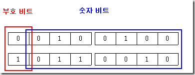

부호 비트: 0 → 양수를 의미

부호 비트: 1 → 음수를 의미

**8비트(1바이트)****:** **1비트(부호비트)** **/** **7비트(숫자 비트)**

**2(이진법)** 

| 부호비트 | 숫자비트 | 숫자비트 | 숫자비트 | 숫자비트 | 숫자비트 | 숫자비트 | 숫자비트 |
| --- | --- | --- | --- | --- | --- | --- | --- |
| 0 | 0 | 0 | 0 | 0 | 0 | 1 | 0 |

**2 → 1의 보수(0, 1 바꾸기)**

| 부호비트 | 숫자비트 | 숫자비트 | 숫자비트 | 숫자비트 | 숫자비트 | 숫자비트 | 숫자비트 |
| --- | --- | --- | --- | --- | --- | --- | --- |
| 1 | 1 | 1 | 1 | 1 | 1 | 0 | 1 |

**2 → 2의 보수(1의 보수 + 1): -2**

| 부호비트 | 숫자비트 | 숫자비트 | 숫자비트 | 숫자비트 | 숫자비트 | 숫자비트 | 숫자비트 |
| --- | --- | --- | --- | --- | --- | --- | --- |
| 1 | 1 | 1 | 1 | 1 | 1 | 1 | 0 |

**2 + (-2) = 0**

| 부호비트 | 숫자비트 | 숫자비트 | 숫자비트 | 숫자비트 | 숫자비트 | 숫자비트 | 숫자비트 | 10진법 |
| --- | --- | --- | --- | --- | --- | --- | --- | --- |
| 1 | 1 | 1 | 1 | 1 | 1 | 1 | 0 | -2 |
| 0 | 0 | 0 | 0 | 0 | 0 | 1 | 0 | 2 |
| 0 | 0 | 0 | 0 | 0 | 0 | 0 | 0 | 0 |

***즉, 음수를 표현하려면 양수의 2의 보수를 취한다***

### 참고 자료

[https://www.youtube.com/watch?v=oMX8305gTmQ&list=PLcXyemr8ZeoT_csxnRmQCXvW_ddVfYi2v&index=2](https://www.youtube.com/watch?v=oMX8305gTmQ&list=PLcXyemr8ZeoT_csxnRmQCXvW_ddVfYi2v&index=2)

### Q: 1000 0000(2) 10진수로 바꾸면?

  1. 1000 0000 
  1. 0111 1111 (1의 보수)
  1. 1000 0000 (1의 보수 + 1) 

***이런 경우 마지막 비트를 부호 비트로 보는 게 아닌 숫자 비트로 보기 때문에 정답: -128***

# 데이터 구조(Data Structure)

```
int nums [5] = {1, 2, 3, 4, 5}

memory
[   ]
[ 1 ] array 시작 주소: 1000
[ 2 ]
[ 3 ]
[ 4 ]
[ 5 ]
[   ]

**각 item 크기: 4byte**
**특정 item에 접근하려면 컴퓨터는 어떻게 메모리에 접근할까?**
-> **시작 주소 + ([item 크기] * index)**

즉, 첫번째 아이템의 주소는 1000 + 4 * 0 = 1000 이다.

1000 + 4 * 0 = 1000 
1000 + 4 * 1 = 1004
...
1000 + 4 * 4 = 1016

메모리 주소 계산 = 시작 주소 + (데이터 타입 크기 × 인덱스)
이런 계산 방식 때문에 인덱스가 0부터 시작한다.

**Array의 장점!**
Array의 size가 아무리커도 똑같은 속도로 각 위치의 item을 가져올 수 있다
**즉, 배열은 배열의 크기와 상관없이 O(1) 시간 복잡도로 접근이 가능하다.**

**해시 테이블**
해시 테이블은 배열의 O(1) 접근 시간을 활용한다. 즉, 배열을 활용한다.
**해시 함수를 통해 특정 키의 배열 인덱스로 변환**
해당 배열 인덱스를 통해 데이터를 접근 -> O(1)
```

### 참고 자료

[https://www.youtube.com/watch?v=_5McFoJ3VsQ&list=PLcXyemr8ZeoT_csxnRmQCXvW_ddVfYi2v&index=3](https://www.youtube.com/watch?v=_5McFoJ3VsQ&list=PLcXyemr8ZeoT_csxnRmQCXvW_ddVfYi2v&index=3)

### ADT(Abstract Data Type)

  - 추상자료형
  - 개념적으로 어떤 동작이 있는지만 정의
  - 구현에 대해서는 다루지 않는다

### DS(Data Structure)

  - 자료구조
  - ADT에서 정의된 동작을 실제로 구현한 것

### 참고 자료

[https://www.youtube.com/watch?v=-2YpvLCT5F8&list=PLcXyemr8ZeoR82N8uZuG9xVrFIfdnLd72](https://www.youtube.com/watch?v=-2YpvLCT5F8&list=PLcXyemr8ZeoR82N8uZuG9xVrFIfdnLd72)

# 스택(stack)

**LIFO(Last In First Out)** 형태로 데이터를 저장하는 구조

주요 명령어: push, pop, peek

사용 사례: stack memory, stack frame

# 큐(queue)

**FIFO(First In First Out)** 형태로 데이터를 저장하는 구조

주요 명령어: enqueue, dequeue, peek

사용 사례: producer/consumer architecture

# 에러 상황 

### **StackOverfowError**

이유: 스택 메모리 공간을 다 썼을 때 발생하는 에러, 보통 재귀함수에서 탈출 못해서 발생

해결 방법: 적절한 종료 조건

### **OutOfMemoryError** 

이유: 큐에 데이터가 계속 쌓이기만 한다면 발생

해결 방법: 고정된 사이즈의 큐

큐 삽입 시점에 용량이 최대라면?

  - 예외 던지기
  - 특별한 값 반환(null or false)
  - 성공할 때까지 영원히 삽입 스레드(producer) 블록(block)
  - 제한된 시간만 블록되고 그래도 안되면 포기

**Java: LinkedBlockingQueue**

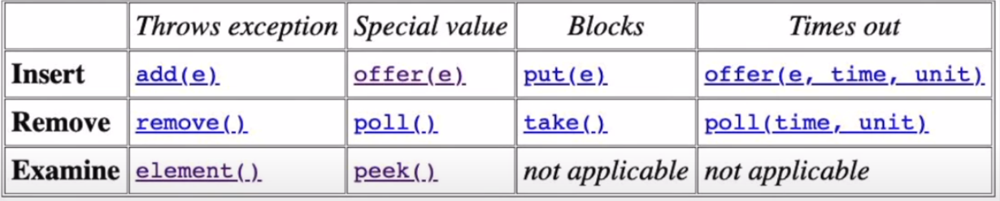

# 참고 자료

[https://www.youtube.com/watch?v=-2YpvLCT5F8&list=PLcXyemr8ZeoR82N8uZuG9xVrFIfdnLd72](https://www.youtube.com/watch?v=-2YpvLCT5F8&list=PLcXyemr8ZeoR82N8uZuG9xVrFIfdnLd72)

# PriorityQueue(우선순위 큐)

큐와 유사하지만 우선순위가 높은 아이템이 먼저 처리됨

주요 명령어: insert, delete, peek

# Heap(힙)

힙은 주로 이진 트리(binary tree) 기반으로 구현

주요 명령어: insert, delete, peek

### max heap

부모 노드의 키(key)가 자식 노드(들)의 키(key)보다 크거나 같은 트리

### min heap 

부모 노드의 키(key)가 자식 노드(들)의 키(key)보다 작거나 같은 트리

# PriorityQueue, Heap 관계

힙(heap)의 키(key)를 우선순위(priority)로 사용한다면 **힙은 우선순위 큐(priority queue)의 구현체가 된다**

즉, **우선순위 큐는 ADT(Abstract Data Type), 힙은 DS(Data Structure)**

# 사용 사례

프로세스 스케줄링(process scheduling) 

```
**Ready Queue: Multi-Level Feedback Queue(MLFQ)**

High Priority   [Q0] → → → (짧은 time quantum)
     ↓          [Q1] → → → (중간 time quantum)  
Low Priority    [Q2] → → → (긴 time quantum)

**MLFQ 핵심 동작 
-** 우선순위 강등(Priority Demotion): time quantum 소진 시 강등
- 기아 방지(Starvation Prevention, FeedBack): Q2에서 너무 오래 대기 -> Q0으로 상승

**Ready Queue 구조**
- 여러 개의 큐가 우선순위별로 계층적으로 구성
- 각 큐는 보통 FIFO 또는 Round-Robin 방식
- 전체 시스템은 우선순위 기반이지만, 각 큐 내부는 단순한 구조이다.

**Blocking Queue(I/O Wait Queue)**
case1: FIFO
case2: PriorityQueue -> 실시간 시스템이나 중요도가 다른 I/O 작업들
case3: Device 별도 큐 -> 각 장치마다 자체 큐 운영
```

# 참고 자료

자세한 heap 동작(insert, delete)방식 설명

[https://www.youtube.com/watch?v=P-FTb1faxlo&list=PLcXyemr8ZeoR82N8uZuG9xVrFIfdnLd72&index=2](https://www.youtube.com/watch?v=P-FTb1faxlo&list=PLcXyemr8ZeoR82N8uZuG9xVrFIfdnLd72&index=2)

# Array 특징1

같은 타입의 데이터들을 저장하는 자료 구조

연속된 메모리 공간에 데이터들을 저장

데이터들 각각은 이름이 없지만 인덱스로 접근 가능

### 1차원 배열

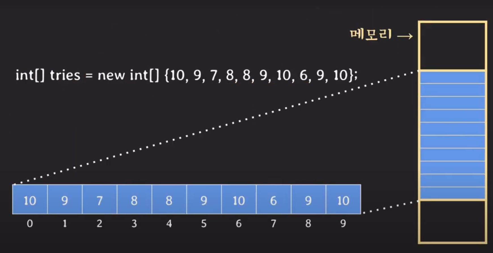

### 2차원 배열

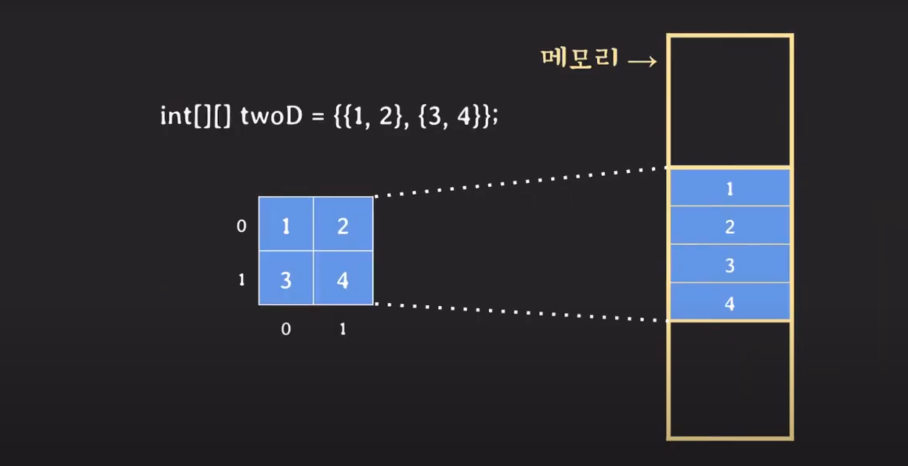

### 객체를 담는 배열

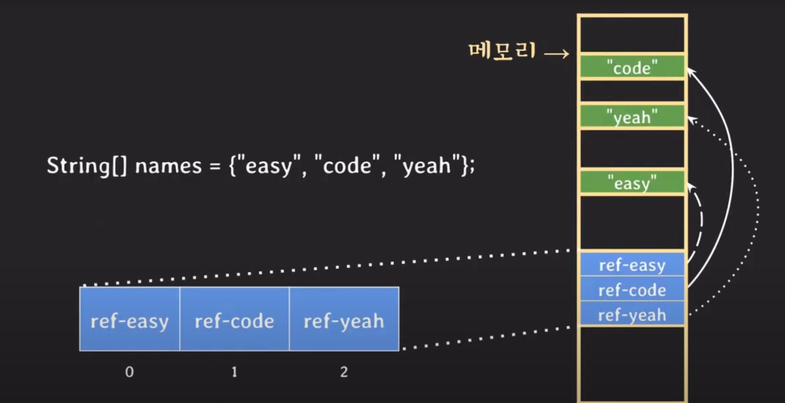

객체를 배열에 저장하면 객체의 메모리가 연속적으로 저장 실제 객체는 메모리에 랜덤하게

# Array 특징2

연속된 메모리 공간에 데이터를 저장하기 때문에 cpu cache(**캐시 지역성**)를 통해 같은 배열에 있는 다른 데이터에 접근하는 시간을 단축할 수 있다(**공간 지역성**, **시간 지역성**)

# Dynamic array(동적 배열)

크기가 변할 수 있는 배열

데이터를 더하거나 빼는 것이 가능한 자료 구조

보통 resizable array, array list 등등으로 불린다

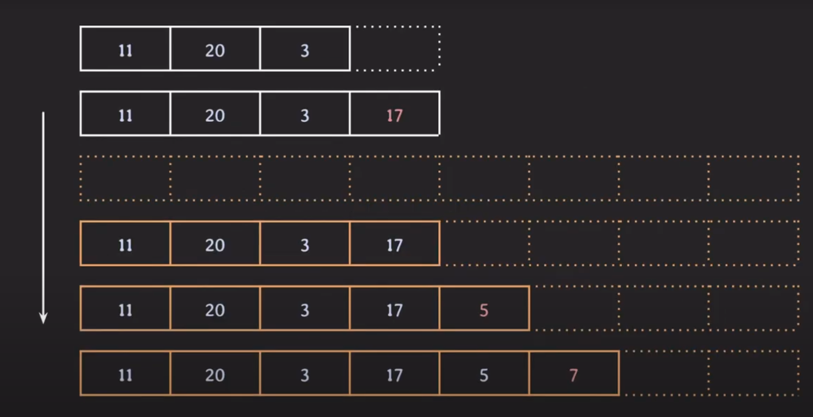

```
**Dynamic array 동작 방식**
초기 배열 크기: 4
초기 데이터: 3개 

1. 17 추가 -> 배열의 크기 변화 없이 데이터 추가
2. 5 추가 
- "**기존 배열의 크기로는 부족하여 현재 사이즈의 2배에 해당하는 빈 배열을 생성"**
- 기존 데이터를 빈 배열에 복사하고 새로운 데이터인 5도 추가
3. 7 추가 -> 배열의 크기 변화 없이 데이터 추가

**ArrayList 설계의 핵심**
실제 데이터보다 더 많은 공간 예약 -> 메모리 오버헤드
데이터 추가 시 발생하는 재할당으로 인한 성능 오버헤드 방지를 위한 설계
즉, 메모리 오버헤드와 성능 오버헤드의 트레이드 오프

**ArrayList 동작 방식**
빈 ArrayList 생성 시 -> initial capacity: 0
이후 첫 요소 추가 -> 10
이후 1.5배 크기로 증가

**만약 데이터를 10000개 추가할 예정이라면?(초기 용량 설정을 고려하자)**
new ArrayList<>(10000); initial capacity -> 10000
```

# Associative array(연관 배열)

key-value pair들을 저장하는 ADT

같은 key를 가지는 pair는 최대 1개만 존재

보통 map, dictionary라고 부른다

# 참고자료

[https://www.youtube.com/watch?v=Hpg6zS0Nq28&list=PLcXyemr8ZeoR82N8uZuG9xVrFIfdnLd72&index=3](https://www.youtube.com/watch?v=Hpg6zS0Nq28&list=PLcXyemr8ZeoR82N8uZuG9xVrFIfdnLd72&index=3)

# ADT 관점에서의 List

값(value)들을 저장하는 추상자료형

순서가 있음, 중복을 허용

# ArrayList 

**배열(array)을 사용하여 list 구현**

### **데이터 삽입:add(E e)**

  - O(1)
  - 삽입 시 사이즈가 부족하면 데이터 복사로 인한 오버헤드 발생 주의 O(N)

### **데이터 조회: get(int index)**

  - O(1)

### **데이터 존재 여부 확인: contains(Object o)**

  - 최악의 경우 O(N) 전체 배열 순회

### **특정 데이터 삭제: remove(Object o)**

  - 최악의 경우 O(N) 
  - 데이터 위치 index:0의 경우 N-1개의 데이터 왼쪽으로 이동(shift)
  - 데이터 위치 index:size - 1의 경우: 탐색에 O(N) 데이터 이동(shift)은 X

### **특정 위치의 데이터 삭제: remove(int index)**

  - 최악의 경우 O(N)
  - 데이터 위치 index:0의 경우 N-1개의 데이터 왼쪽으로 이동(shift) 즉, O(n-index)

### **특정 위치의 데이터 추가:add(int index, E element)**

  - 최악의 경우 O(N)
  - 데이터 위치 index:0의 경우 N개의 데이터 오른쪽으로 이동(shift) 즉, O(N-index)
  - 마찬가지로 사이즈가 부족하면 먼저 데이터 복사가 발생

# LinkedList 

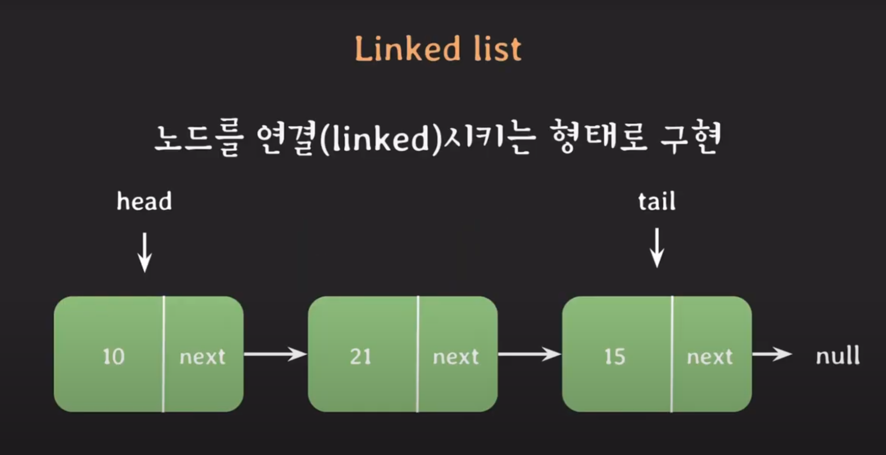

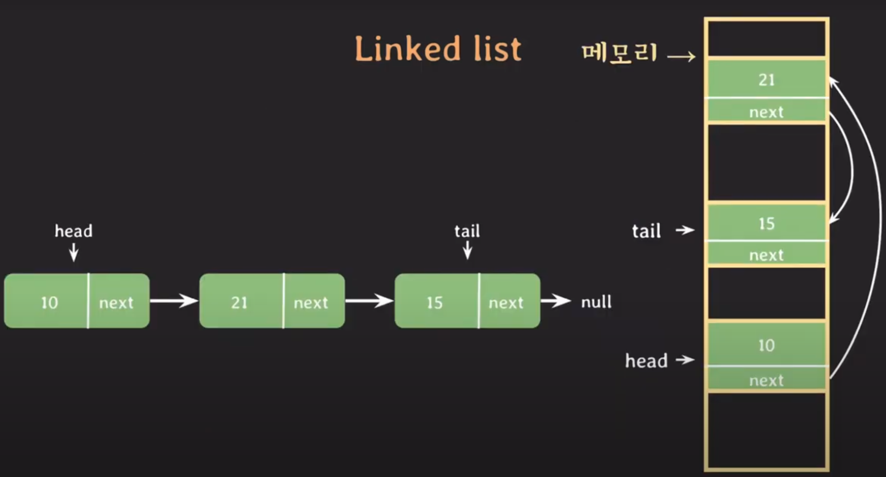

### **데이터 삽입: add(E e)**

  - O(1)
  - 새 노드 생성 후, 이전 노드의 포인터를 새 노드 주소로 변경, tail 포인터를 새 노드 주소로 변경
  - **ArrayList와 달리 재할당/복사 없음**

### **데이터 조회: get(int index)**

  - 최악의 경우 O(N)
  - index까지 순차 탐색 필요
  - index가 0인 경우: O(1) - head 직접 접근
  - index가 size-1인 경우: O(N) - tail까지 순회
  - 중간 위치: O(N/2) ≈ O(N)

### **데이터 존재 여부 확인: contains(Object o)**

  - 최악의 경우 O(N)
  - head부터 tail까지 순차 탐색
  - 찾는 데이터가 맨 앞: O(1)
  - 찾는 데이터가 맨 뒤 또는 없음: O(N)

### **특정 데이터 삭제: remove(Object o)**

  - 최악의 경우 O(N)
  - 데이터 탐색: O(N) - 순차 탐색 필요
  - 노드 연결 변경: O(1) - 포인터만 변경
  - **ArrayList와 달리 데이터 shift 불필요**

### **특정 위치의 데이터 삭제: remove(int index)**

  - 최악의 경우 O(N)
  - index까지 탐색: O(index)
  - index가 0인 경우: O(1) - head 변경만
  - index가 size-1인 경우: O(N) - tail까지 순회
  - 노드 제거 자체는 O(1) - 포인터 변경만

### **특정 위치의 데이터 추가: add(int index, E element)**

  - 최악의 경우 O(N)
  - index까지 탐색: O(index)
  - index가 0인 경우: O(1) - addFirst()와 동일
  - index가 size인 경우: O(1) - addLast()와 동일
  - 중간 삽입: O(N) - index까지 순회 필요
  - 노드 삽입 자체는 O(1) - 포인터 변경만

## **LinkedList 특화 연산**

### **맨 앞 추가: addFirst(E e)**

  - O(1)
  - head 포인터만 변경

### **맨 앞 삭제: removeFirst()**

  - O(1)
  - head 포인터만 변경

### **맨 뒤 추가: addLast(E e)**

  - O(1)
  - tail 포인터만 변경 (Doubly Linked List, Singly Linked List)

### **맨 뒤 삭제: removeLast()**

  - O(1) - Doubly Linked List
  - O(N) - Singly Linked List (tail 이전 노드 찾기 필요)

# Circular Linked List

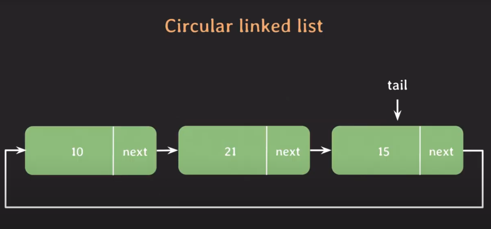

# Doubly Linked List

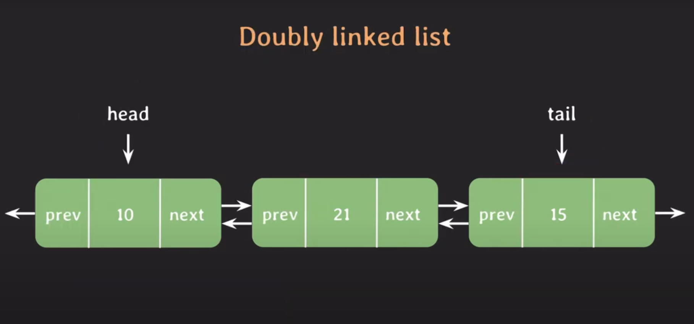

# Circular Doubly Linked List

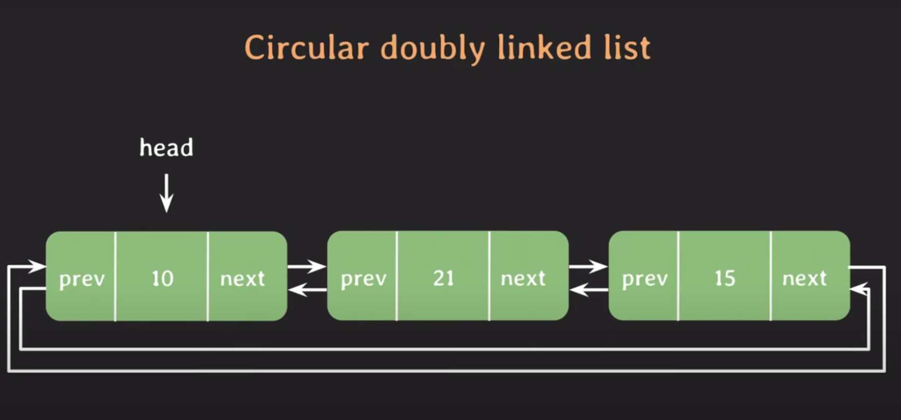

# ArrayList VS Linked List

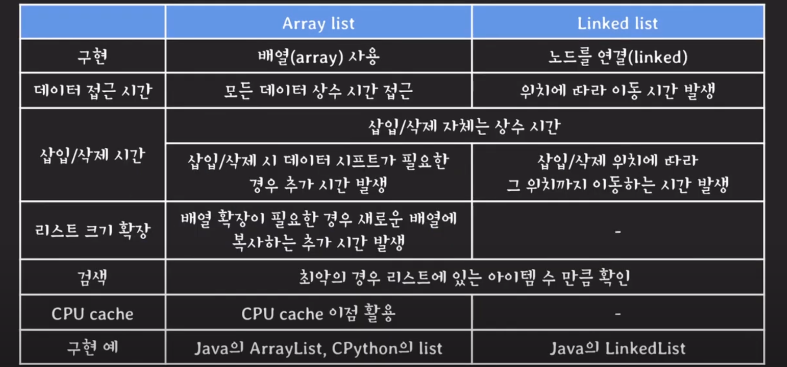

데이터 접근 시간

  - singly linked list: O(N): 항상 head 시작
  - doubly linked list: O(N/2) tail 시작 가능

# ETC(Joshua Bloch)

**LinkedList 만든 사람도 LinkedList 사용 X ㅋㅋ**

FIFO 자료구조로 사용한다면 ArrayDeque를 활용 추천

# ETC(B-tree)

B-tree vs B+tree 핵심 차이

```
**B-tree**
    [15]        <- 실제 데이터도 저장
   /    \
 [7]     [23]   <- 실제 데이터도 저장
/  \    /  \

**B+tree**
    [15]        <- 인덱스만 (데이터 X)
   /    \
 [7]     [23]   <- 인덱스만 (데이터 X)
/  \    /  \
[리프][리프][리프][리프]  <- 모든 데이터는 여기에만!
  ↔     ↔     ↔         <- 링크드 리스트로 연결
```

**B+tree의 리프 노드는 링크드 리스트로 연결**

**페이지 레벨(물리적 저장)**

```
Page ←→ Page ←→ Page ←→ Page
     Doubly Linked List
     (양방향 순회 가능)
```

**노드 레벨(논리적 구조)**

```
Node → Node → Node → Node
    Singly Linked List
```

**DESC 조회가 느린 이유**

```
Node -> Node 이동이 Singly Linked List
정순 조회(index asc, order by asc)는 Linked List 노드 방향 그대로 읽기
역순 조회(index asc, order by desc)는 Linked List 모든 노드를 스택에 저장하고
역순으로 pop하기 때문에 정순 조회에 비해 상대적으로 느리다
```

# 참고자료

ArrayList, LinkedList 자세한 동작 방식 설명

[https://www.youtube.com/watch?v=xvi-n11kym0&list=PLcXyemr8ZeoR82N8uZuG9xVrFIfdnLd72&index=4](https://www.youtube.com/watch?v=xvi-n11kym0&list=PLcXyemr8ZeoR82N8uZuG9xVrFIfdnLd72&index=4)

# Map

key-value pair들을 저장하는 ADT(Abstract Data Type)

**같은 key를 가지는 pair는 최대 1개만 존재**

보통 associative array, dictionary 라고 부른다

# Hash table(hash map)

배열과 해시 함수(hash function)를 사용하여 map을 구현한 자료 구조

(일반적으로) **상수 시간으로 데이터에 접근**하기 때문에 빠르다

# Hash function

임의의 크기를 가지는 type의 데이터를 고정된 크기를 가지는 type의 데이터로 변환하는 함수

(hash table에서) 임의의 데이터를 정수로 변환하는 함수

**동작 방식:** data → hash function → hash(Integer)

# Hash Table 동작 방식

### 1. put(”010-2222-2222”, “홍진호”)

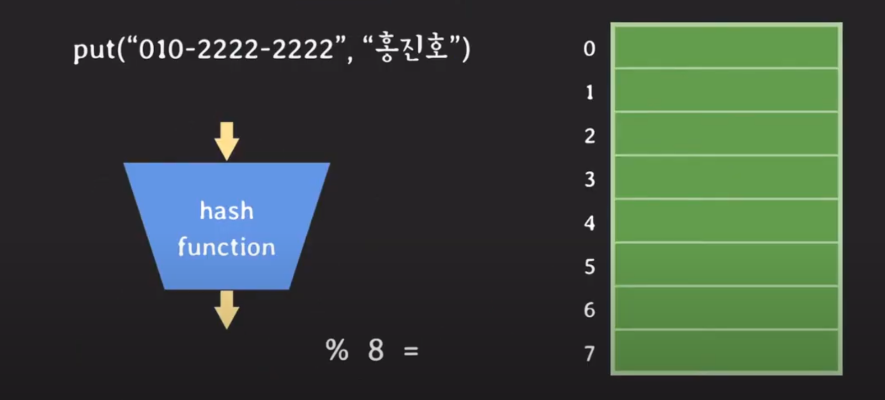

  - key(“010-2222-2222”) → hash function → hash(202)
  - hash(202) % capacity(8) = 2
  - 2번 인덱스에 value(”홍진호”) 추가

### 2. get(”010-1010-1001”)

  - key(”010-1010-1001”) → hash function → hash(834)
  - hash(834) % capacity(8) = 2
  - 2번 인덱스에서 조회 → “홍진호” ??? wrong key

“010-2222-2222”, “010-1010-1001” 두 해시값에 대한 모듈러 연산값이 동일하기 때문에 잘못된 값을 가져온다, 이런 경우를 방지하기 위해 **key, value를 배열에 같이 저장한다.**

즉, get(”010-1010-1001”)은 해시값에 대한 모듈러 연산값으로 2번 인덱스에 접근하지만 해당 인덱스에 저장된 key가 다르기 때문에 배열의 다른 공간(인덱스)를 조회하고 최종적으로 없다고 반환(null)한다.

# Hash Collision(해시 충돌)

key는 다른데 **hash**가 같은 경우

key도 hash도 다른데 **hash % map_capacity** 결과가 같은 경우

# Hash Collision 해결 방법1 - Separate Chaining

LinkedList로 해결

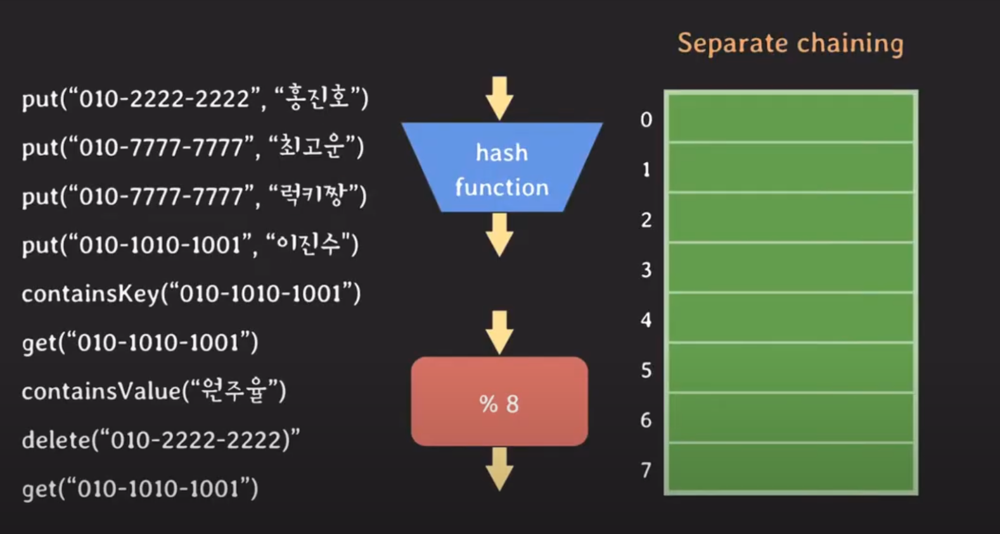

### **1. put(”010-2222-2222”, “홍진호”)**

“010-2222-2222” → **hash function** → 834 → **202 % 8** → 2

2번 인덱스에 추가

### **2. put(”010-7777-7777”, “최고운”)**

“010-7777-7777” → **hash function** → 37 → **37 % 8** → 5

5번 인덱스에 추가

### **3. put(”010-7777-7777”, “럭키짱”)**

“010-7777-7777” → **hash function** → 37 → **37 % 8** → 5

5번 인덱스를 보니 key도 동일(equal)

value만 “최고운” → “럭키짱”으로 변경

### **4. put(”010-1010-1001”, “이진수”)**

“010-1010-1001” → **hash function** → 834 → **834 % 8** → 2

2번 인덱스 key 비교(not equal) 즉, hash collision 발생

**Separate Chaining → 해당 인덱스에 해당하는 값들(key-value)을 LinkedList로 관리**

인덱스 2: [010-2222-2222, 홍진호] → [010-1010-1001, 이진수]

### **5. containsKey(”010-1010-1001”)**

“010-1010-1001” → **hash function** → 834 → **834 % 8** → 2

인덱스 2: [010-2222-2222, 홍진호] → **[010-1010-1001, 이진수]**

return: true

### **6. get(”010-1010-1001”)**

“010-1010-1001” → **hash function** → 834 → **834 % 8** → 2

인덱스 2: [010-2222-2222, 홍진호] → **[010-1010-1001, 이진수]**

return: ”이진수”

### 7. containsValue(”원주율")

배열의 모든 인덱스, 해당 인덱스의 링크드 리스트 조회

return fasle

### 8. delete(”010-2222-2222")

“010-2222-2222” → **hash function** → 834 → **202 % 8** → 2

인덱스 2: **[010-2222-2222, 홍진호](삭제)** → [010-1010-1001, 이진수]

인덱스 2: [010-1010-1001, 이진수]

### **9. get(”010-1010-1001”)**

“010-1010-1001” → **hash function** → 834 → **834 % 8** → 2

인덱스 2: **[010-1010-1001, 이진수]**

return “이진수”

# Hash Collision 해결 방법2 - Open Addressing

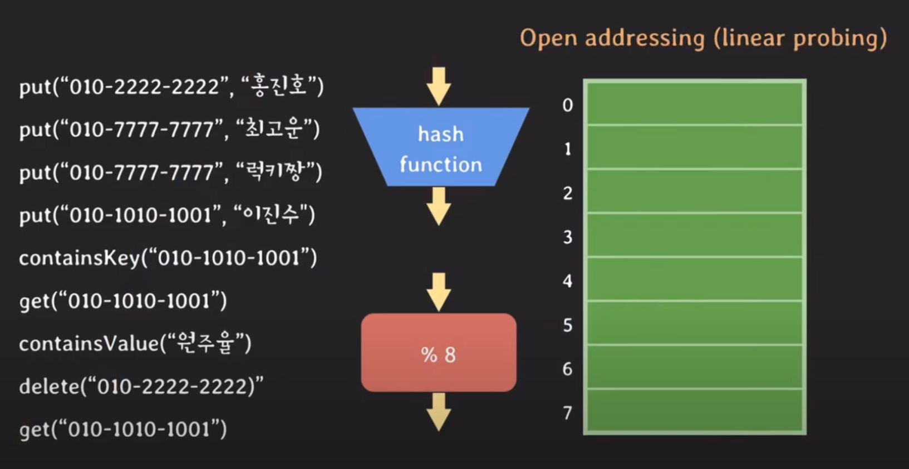

### **1. put(”010-2222-2222”, “홍진호”)**

“010-2222-2222” → **hash function** → 834 → **202 % 8** → 2

2번 인덱스에 추가

### **2. put(”010-7777-7777”, “최고운”)**

“010-7777-7777” → **hash function** → 37 → **37 % 8** → 5

5번 인덱스에 추가

### **3. put(”010-7777-7777”, “럭키짱”)**

“010-7777-7777” → **hash function** → 37 → **37 % 8** → 5

5번 인덱스를 보니 key도 동일(equal)

value만 “최고운” → “럭키짱”으로 변경

### **4. put(”010-1010-1001”, “이진수”)**

“010-1010-1001” → **hash function** → 834 → **834 % 8** → 2

2번 인덱스 key 비교(not equal) 즉, hash collision 발생

**Open addressing(linear probing) → 다음 인덱스에 빈 공간 찾음(오른쪽으로 1칸씩 이동)**

3번 인덱스에 추가

### **5. containsKey(”010-1010-1001”)**

“010-1010-1001” → **hash function** → 834 → **834 % 8** → 2

2번 인덱스: (”010-2222-2222”, “홍진호”) not equal

3번 인덱스: (”010-1010-1001”, “이진수”) equal

return true

**Open addressing(linear probing) 조회→ 해당 인덱스에 데이터가 없더라도 다음 인덱스에서 찾음**

### **6. get(”010-1010-1001”)**

“010-1010-1001” → **hash function** → 834 → **834 % 8** → 2

2번 인덱스: (”010-2222-2222”, “홍진호”) not equal

3번 인덱스: (”010-1010-1001”, “이진수”) equal

return “이진수:

### 7. containsValue(”원주율")

배열의 모든 인덱스 조회

return fasle

### 8. delete(”010-2222-2222")

“010-2222-2222” → **hash function** → 834 → **202 % 8** → 2

2번 인덱스에서 데이터(”010-2222-2222”, “홍진호”) 삭제 & deleted 표시 추가

**Open addressing(linear probing) 삭제→ 해당 인덱스에 삭제 표시 추가**

**삭제 표시를 추가해야지 추후에 조회 시 해시 충돌로 인해 옮겨진 데이터를 찾을 수 있다.**

### **9. get(”010-1010-1001”)**

“010-1010-1001” → **hash function** → 834 → **834 % 8** → 2

인덱스 2: deleted

인덱스 3: (”010-1010-1001”, “이진수”)

return “이진수”

# Hash Table Resizing

데이터가 많이 차게 되면 크기를 늘려줘야 한다.

Java의 경우 3/4 이상의 용량을 차지하면 크기 조정을 한다.

**그림을 보면 key, value 뿐만 아니라 해시값도 가지고 있는데 크기 조정에서 데이터 복사 시 다시 해시 값을 계산하지 않도록 갖고 있다.(성능 vs 메모리 트레이드오프)**

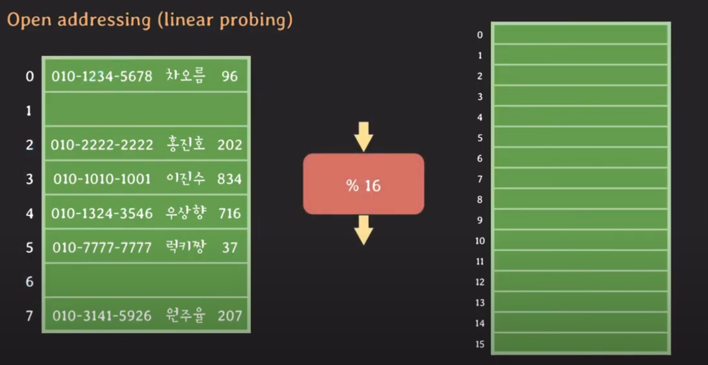

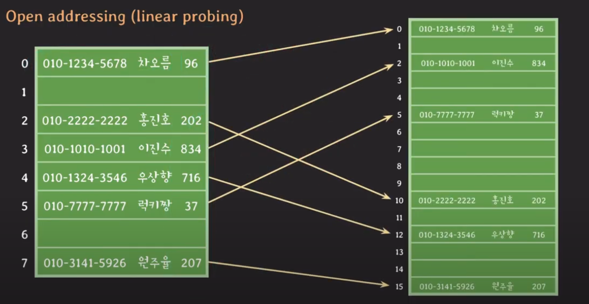

# CPython(dictionary) vs Java(HashMap)

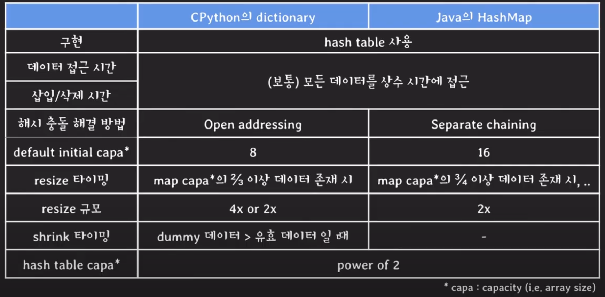

hash table 용량은 항상 2의 제곱으로 존재

shrink 타이밍이랑 map 크기를 줄이는 경우를 의미

Java 8+: Linked List + Red-Black Tree 하이브리드 방식으로 Separate chaining 구현

# 참고 자료

Hash Collision 해결 방식 영상으로 자세하게 설명

[https://www.youtube.com/watch?v=ZBu_slSH5Sk&list=PLcXyemr8ZeoR82N8uZuG9xVrFIfdnLd72&index=5](https://www.youtube.com/watch?v=ZBu_slSH5Sk&list=PLcXyemr8ZeoR82N8uZuG9xVrFIfdnLd72&index=5)

# ETC

### OpenAddressing(Quadratic Probing)

충돌 발생 시 오른쪽으로 이차 함수를 사용하여 새로운 위치를 찾는다. ex) 1,3,5,… 칸씩 이동

Linear Probing 방식에 비해 클러스터링 발생할 가능성이 적지만, 조사(탐색)에 추가 계산(오버헤드)가 발생한다.

### OpenAddressing(Double Hashing)

충동 발생 시 이동할 칸의 수를 새로운 해시 함수로 계산하는 방식

충돌을 해결하기 위한 다양한 조합의 위치를 시도할 수 있기 때문에, 클러스터링이 발생할 가능성이 더 낮아진다.

[[Hash] 해시 ](https://app.notion.com/p/26b7d6692ca880df9f19c6fba24b7fca)

# Set

데이터를 저장하는 추상자료형(ADT)

순서를 보장하지 않음

데이터 중복을 허용하지 않음

데이터 조회(search)가 List 보다 빠르다

# Set 구현체

hash set, linked hash set, tree set

# Hash Set

**해시 테이블(hash table)**을 사용하여 구현

### Hash Table

일반적으로 테이블의 크기에 상관없이 key를 통해 상수 시간에 빠르게 데이터에 접근 가능

즉, Hash Set은 Hash Table을 사용하여 구현하기 때문에 크기 상관없이 데이터 조회가 빠르다

# Java에서 Hash set 구현체

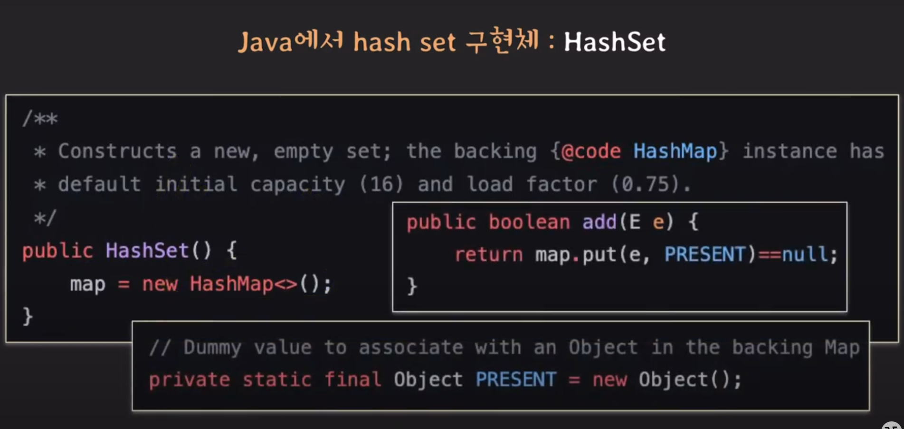

HashSet == HashMap

value에 dummy 데이터를 넣는다

즉, HashSet에서 데이터 존재 여부 확인은 HashMap에서 key 존재 확인과 동일하다

HashSet에서 해시 충돌 시 데이터<key, hash, value>가 같은 버킷(해시 테이블 인덱스)에서 key만 다른 상태로 LinkedList 혹은 Red Black Tree에 저장된다.

# CPython Set VS Java HashSet

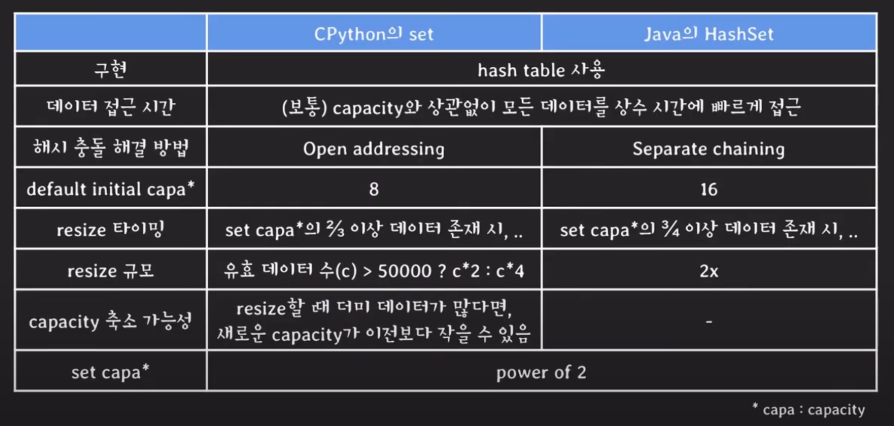

# 참고 자료

[https://www.youtube.com/watch?v=IkImFugfFQk&list=PLcXyemr8ZeoR82N8uZuG9xVrFIfdnLd72&index=6](https://www.youtube.com/watch?v=IkImFugfFQk&list=PLcXyemr8ZeoR82N8uZuG9xVrFIfdnLd72&index=6)

# 트리(tree)

노드(node)들의 집합

각 노드는 값(value)과 다른 노드들을 가리키는 래퍼런스들로 구성

# 트리 관련 주요 용어

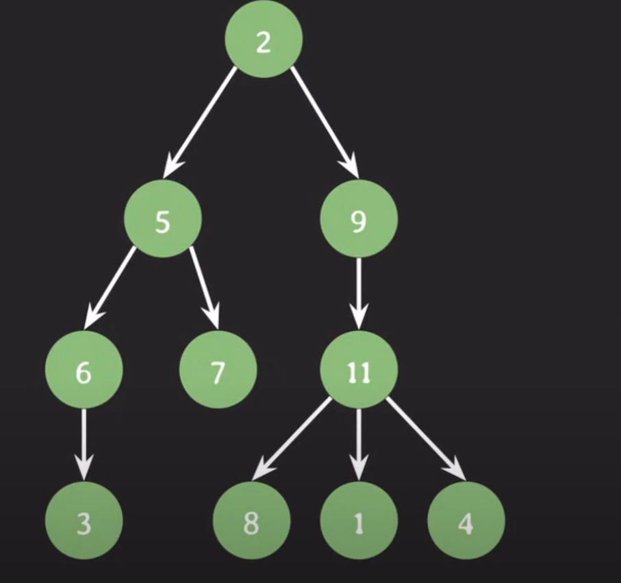

### 간선(edge)

노드와 노드를 연결하는 선

구현 관점에서는 래퍼런스를 의미

보통 간선(edge), 링크(link), 브랜치(branch)라고 부른다.

### 루트(root) 노드

트리의 최상단에 있는 노드

트리의 시작점

해당 노드: 2

### 자녀(child) 노드

모든 노드는 0개 이상의 자녀 노드를 가진다

### 부모(parent) 노드

자녀 노드를 가지는 노드

해당 노드: 2, 5, 9, 6, 11

### 형제(sibling) 노드

같은 부모를 가지는 노드

{8, 1, 4}, {6, 7}, {5, 9}

### 조상(ancestor) 노드

부모 노드를 따라 루트 노드까지 올라가면 만나는 모든 노드

8의 조상 노드: 11, 9, 2

### 자손(descendant) 노드

자녀 노드를 따라 내려가며 만날 수 있는 모든 노드

9의 자손 노드: 11, 8, 1, 4

### 내부(internal) 노드

자녀 노드를 가지는 노드

보통 branch node, inner node 라고 부른다.

해당 노드: 2, 5, 9, 6, 11 

### 외부(external) 노드

자녀 노드가 없는 노드

보통 leaf node, outer node, terminal node 라고 부른다.

해당 노드: 3, 7, 8, 1, 4

### 경로(path)

한 노드에서 다른 노드 사이의 노드들의 시퀀스

2에서 7로의 경로: 2 - 5 - 7 

### 트리의 높이(height)

루트 노드의 높이

루트 노드를 포함하면: 4

루트 노드를 포함하지 않으면: 3

### 노드의 깊이(depth)

루트 노드에서 해당 노드까지

경로의 간선(edge) 수

루트 노드의 깊이: 0

11의 깊이: 2

### 노드의 차수(degree)

노드의 자녀 노드 수

11 노드의 차수: 3

3 노드의 차수: 0

### 트리의 차수(degree)

트리에 있는 노드들의 차수 중 가장 큰 차수

현재 트리 차수: 3 

# 이진 트리(binary tree)

각 노드의 자녀 노드 수가 최대 두 개인 트리

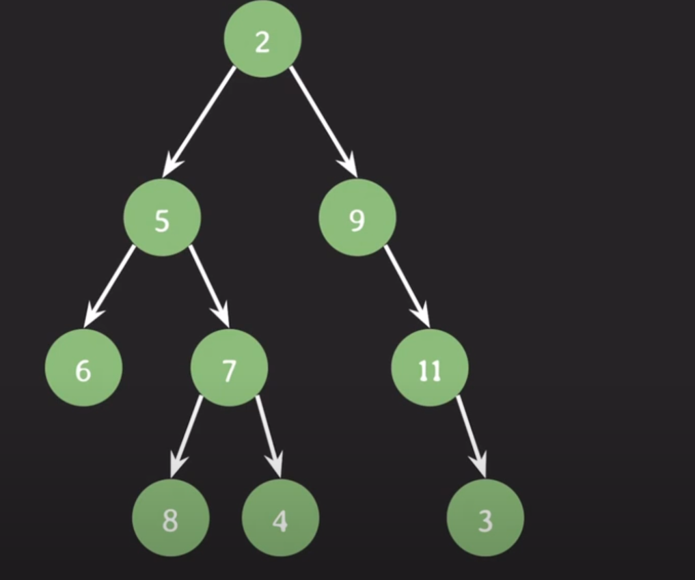

# 완전 이진 트리(complete binary tree)

마지막 레벨을 제외한 모든 레벨에서 노드가 빠짐없이 채워져 있고 

마지막 레벨은 왼쪽부터 빠짐없이 노드가 채워져있는 트리

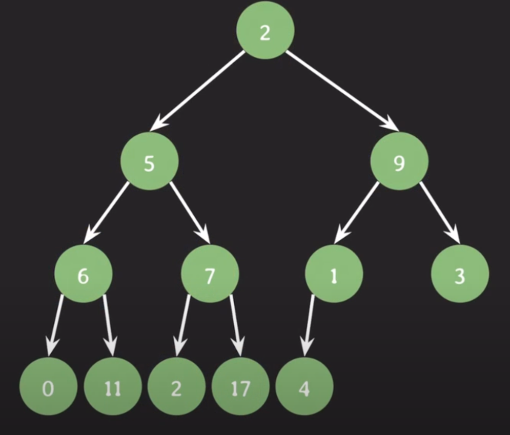

# 균형 이진 트리(balanced binary tree)

모든 노드에서 왼쪽 서브 트리와 오른쪽 서브 트리의 높이 차이가 최대1인 트리

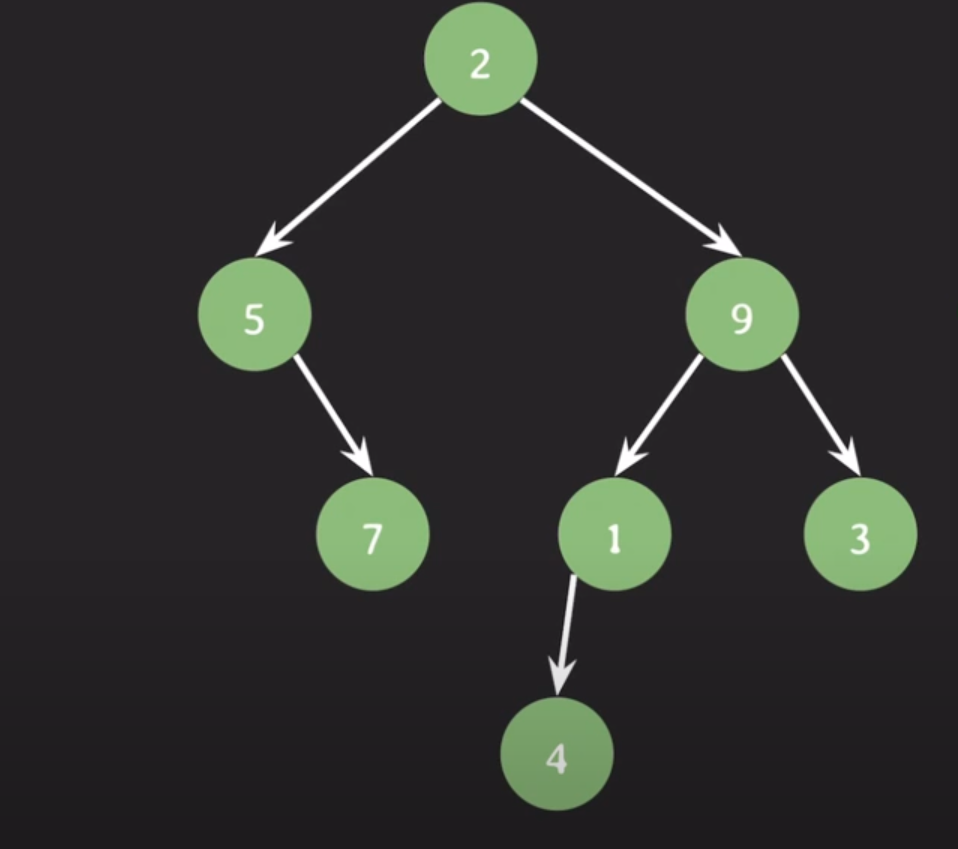

# 이진 탐색 트리(binary search tree)

모든 노드의 **왼쪽 서브 트리는 해당 노드의 값보다 작은 값들**만 가지고

모든 노드의 **오른쪽 서브 트리는 해당 노드의 값보다 큰 값들**만 가진다

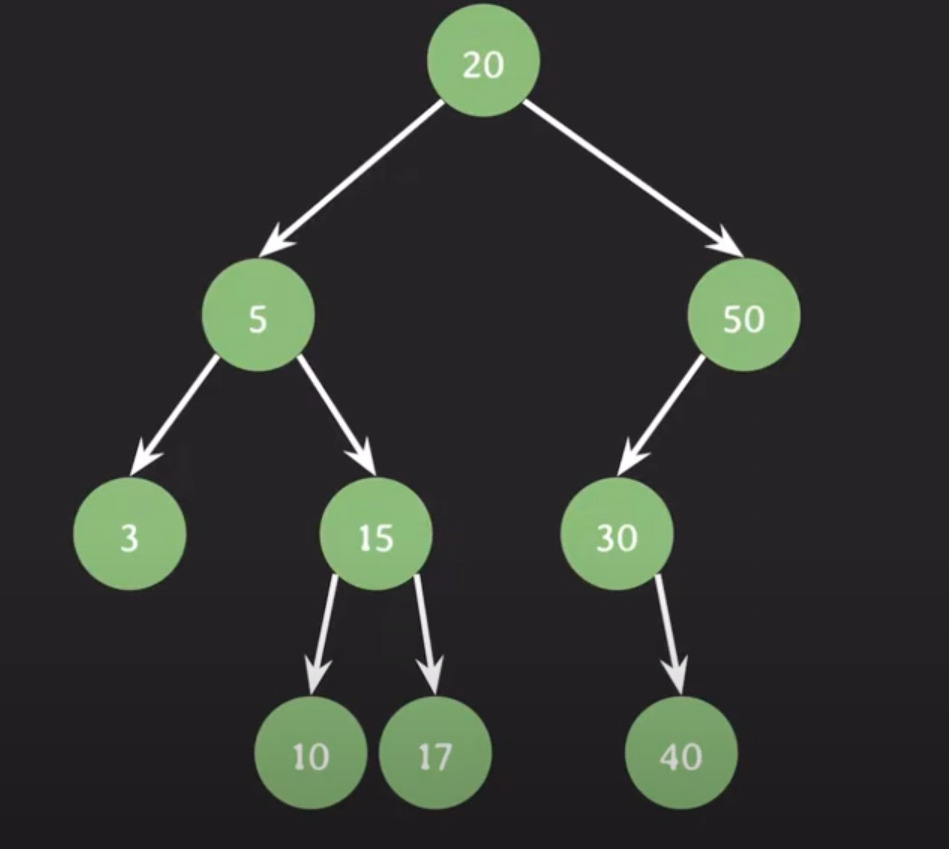

### 이진 탐색 트리의 최소값

트리의 가장 왼쪽에 존재: 3

### 이진 탐색 트리의 최대값

트리의 가장 오른쪽에 존재: 50

### 중위 순회(inorder traversal)

  1. 재귀적으로 왼쪽 서브 트리 순회
  1. 현재 노드 방문(값 출력)
  1. 재귀적으로 오른쪽 서브 트리 순회

출력 순서: 3 → 5 → 10 → 15 → 17 → 20 → 30 → 40 → 50 

### 전위 순회(preorder traversal)

  1. 현재 노드 방문(값 출력)
  1. 재귀적으로 왼쪽 서브 트리 순회
  1. 재귀적으로 오른쪽 서브 트리 순회

출력 순서: 20 → 5 → 3 → 15 → 10 → 17 → 50 → 30 → 40

### 후위 순회(postorder traversal)

  1. 재귀적으로 왼쪽 서브 트리 순회
  1. 재귀적으로 오른쪽 서브 트리 순회
  1. 현재 노드 방문(값 출력)

출력 순서: 3 → 10 → 17 → 15 → 5 → 40 → 30 → 50 → 20

### 이진 탐색 트리 시간 복잡도

|  | best | avg | worst |
| --- | --- | --- | --- |
| insert | O(1) | O(logN) | O(N) |
| delete | O(1) | O(logN) | O(N) |
| search | O(1) | O(logN) | O(N) |

**best:** 연산 대상이 루트 노드인 경우

**avg:** 트리 상태가 균형을 이루는 경우 → balanced binary tree

**worst:** 한쪽으로 편향된 트리 → skewed binary tree

### skewed binary tree 문제를 해결하기 위해 등장한 자료 구조

스스로 구현을 잡는 이진 탐색 트리

AVL 트리, Red-Black 트리

# 참고 자료

[https://www.youtube.com/watch?v=ohrwGtqeW-I&list=PLcXyemr8ZeoR82N8uZuG9xVrFIfdnLd72&index=7](https://www.youtube.com/watch?v=ohrwGtqeW-I&list=PLcXyemr8ZeoR82N8uZuG9xVrFIfdnLd72&index=7)

[https://www.youtube.com/watch?v=i57ZGhOVPcI&list=PLcXyemr8ZeoR82N8uZuG9xVrFIfdnLd72&index=8](https://www.youtube.com/watch?v=i57ZGhOVPcI&list=PLcXyemr8ZeoR82N8uZuG9xVrFIfdnLd72&index=8)

# AVL 트리

이진 탐색 트리(BST)의 한 종류

스스로 균형(balancing)을 잡는 트리

balance factor를 통해 균형 유지

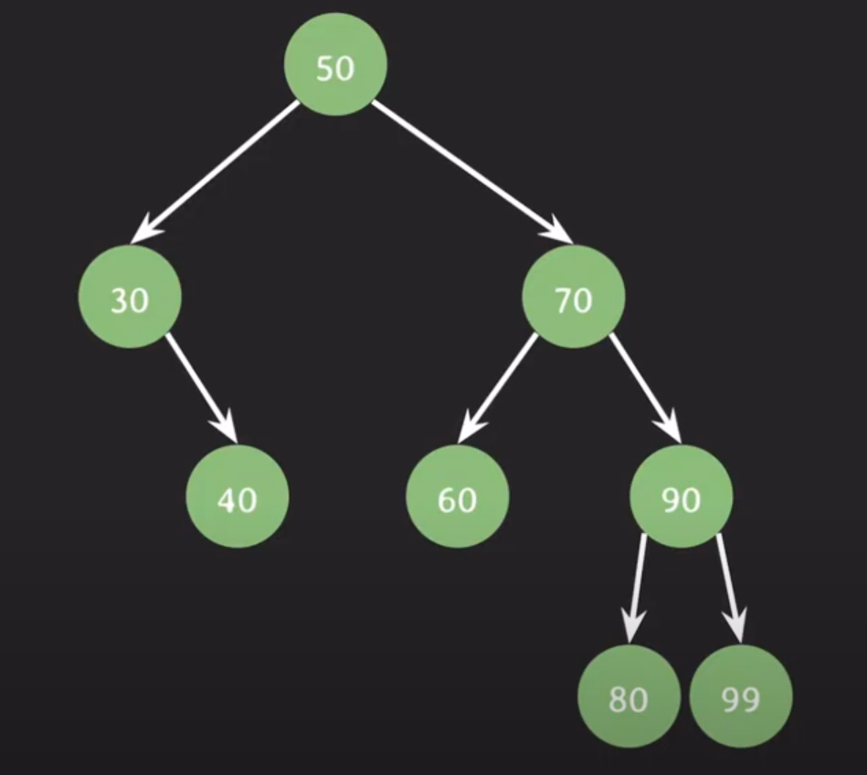

### 노드의 balance factor

임의의 노드(x)에 대해서

BF(x) = 왼쪽 서브트리 높이 - 오른쪽 서브트리 높이

### AVL 트리의 특징

트리의 모든 노드들은 다음과 같은 특징을 가진다

**BF(x) = {-1, 0, 1}**

### AVL 트리의 균형 잡기

**트리에 삽입 혹은 삭제 이후 BF(x) ≠ {-1, 0, 1} 노드가 생기면 균형을 맞추는 작업을 수행**

# AVL 트리의 장단점

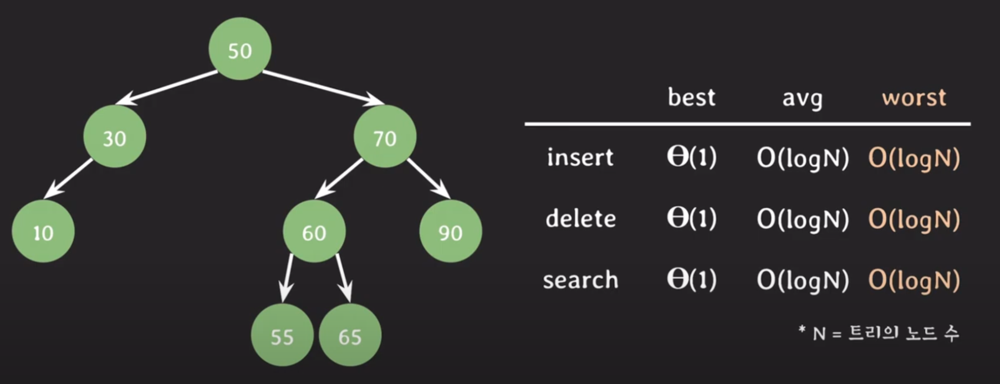

```
일반 BST에 비해서 worst 케이스가 O(N) → O(logN)으로 개선
즉, 최악의 경우에도 삽입/삭제/검색의 시간 복잡도가 O(logN)이다.

**AVL 트리 한계**
하지만 엄격하게 균형을 유지하기 때문에 삽입/삭제 시 트리 균형을 확인하고 만약 균형이 깨졌다면
트리 구조를 재조정하기 때문에 이때 시간이 꽤 소요된다

이를 해결하기 위해서 Red-Black Tree 등장
```

# 참고 자료

AVL 트리 자세한 동작 방식

[https://www.youtube.com/watch?v=syGPNOhsnI4&list=PLcXyemr8ZeoR82N8uZuG9xVrFIfdnLd72&index=9](https://www.youtube.com/watch?v=syGPNOhsnI4&list=PLcXyemr8ZeoR82N8uZuG9xVrFIfdnLd72&index=9)

# Red-Black 트리

이진 탐색 트리(BST)의 한 종류

스스로 균형(balancing) 잡는 트리

BST worst case O(N) 단점을 개선

모든 노드는 red 혹은 black

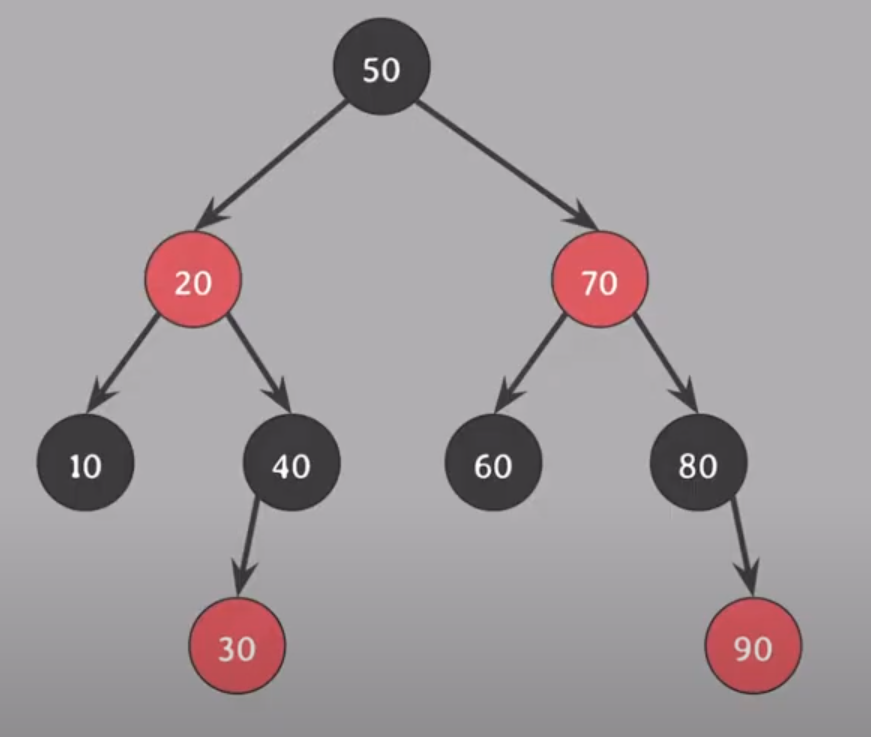

### Red-Black 트리 속성1

**모든 노드는** **red** **혹은 black**

**루트 노드는 black**

### Red-Black 트리 nil 노드

존재하지 않음을 의미하는 노드

**자녀가 없을 때 자녀를 nil 노드로 표기**

값이 있는 노드와 동등하게 취급

**RB 트리에서 leaf 노드는 nil 노드**

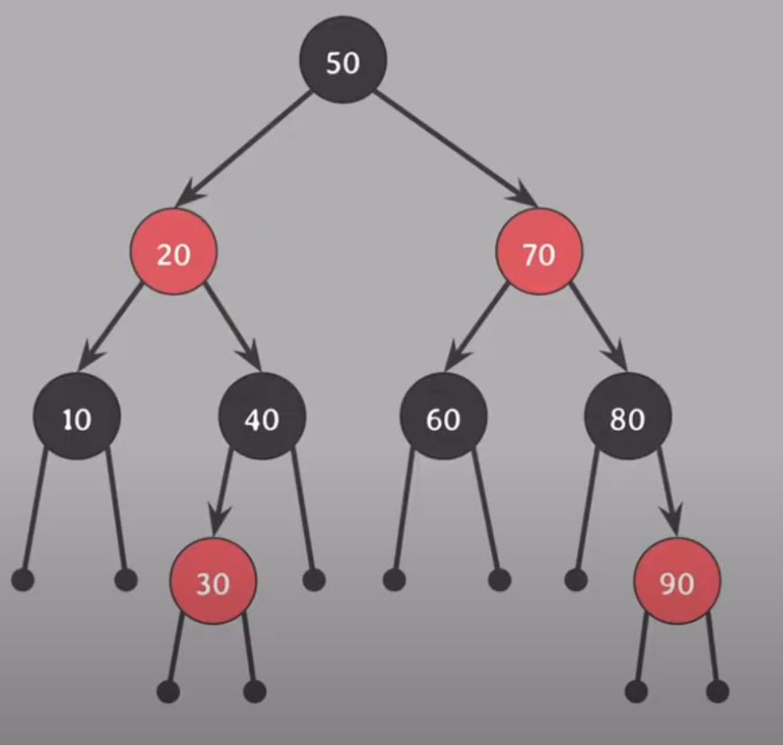

### Red-Black 트리 속성2

**모든 nil(leaf)노드는 black**

**red 자녀들은 black → red가 연속적으로 존재할 수 없다**

### Red-Black 트리 속성3

**임의의 노드에서 자손 nil 노드들까지 가는 경로들의 black 수는 같다(자기 자신은 카운트에서 제외)**

### Red-Black 트리 속성 정리

```
1. 모든 노드는 red 또는 black
2. 루트 노드는 black
3. 모든 리프 노드는 nil, black
4. red 자녀들은 black
5. 임의의 노드에서 leaf 노드들까지 가는 경로들의 black 수는 동일하다(자기 자신은 카운트 제외)
```

### 삽입 방식

***“삽입하는 노드는 항상***  ***red******” → #5 속성을 만족하기 위해***

  1. 삽입 전 RB 트리 속성 만족한 상태
  1. 삽입 방식은 일반적인 BST 방식과 동일
  1. 삽입 후 RB 트리 위반 여부 확인
  1. RB 트리 속성을 위반했다면 재조정

# 참고 자료

[https://www.youtube.com/watch?v=6drLl777k-E&list=PLcXyemr8ZeoR82N8uZuG9xVrFIfdnLd72&index=11](https://www.youtube.com/watch?v=6drLl777k-E&list=PLcXyemr8ZeoR82N8uZuG9xVrFIfdnLd72&index=11)

[https://20240228.tistory.com/416](https://20240228.tistory.com/416)

# Java

[https://mangkyu.tistory.com/105](https://mangkyu.tistory.com/105)

[https://mangkyu.tistory.com/106](https://mangkyu.tistory.com/106)

[https://mangkyu.tistory.com/107](https://mangkyu.tistory.com/107)

# 라이브 코딩테스트 대비

**[module] java-algorithm /[package] interview** 

- 자료 구조 구현: 스택(Stack)
- 정렬: 선택(Selection), 버블(Bubble), 병합(Merge), 퀵(Quick)
- 트리 순회: 선위 순회(PreOrder), 중위 순회(InOrder), 후위 순회(PostOrder)

