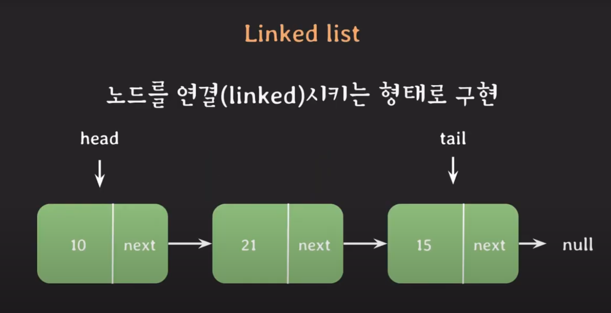
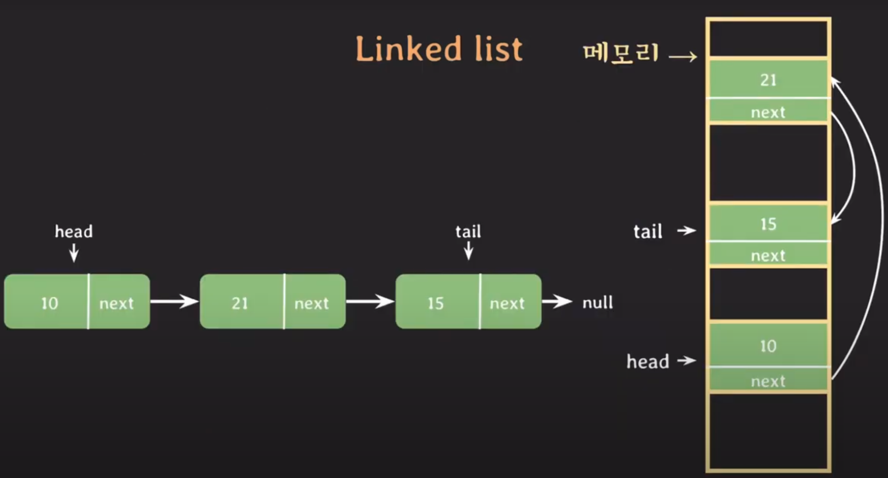
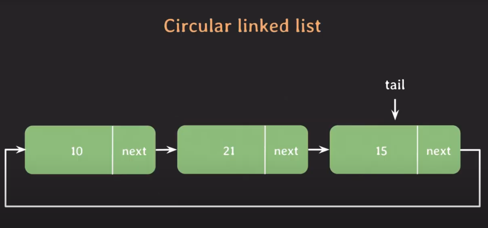
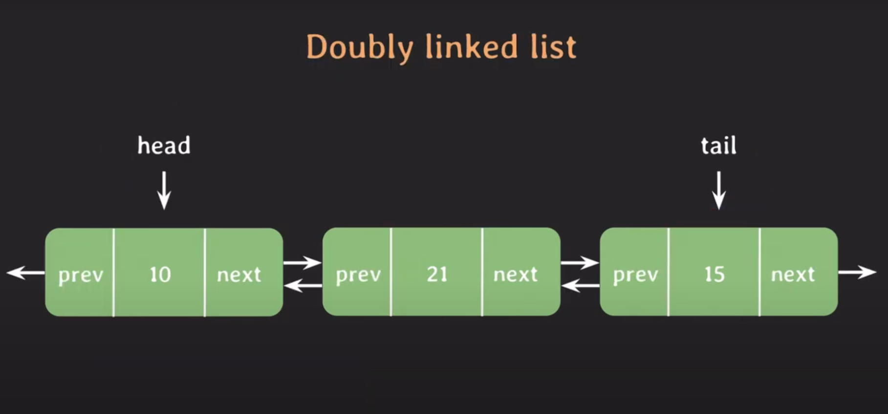
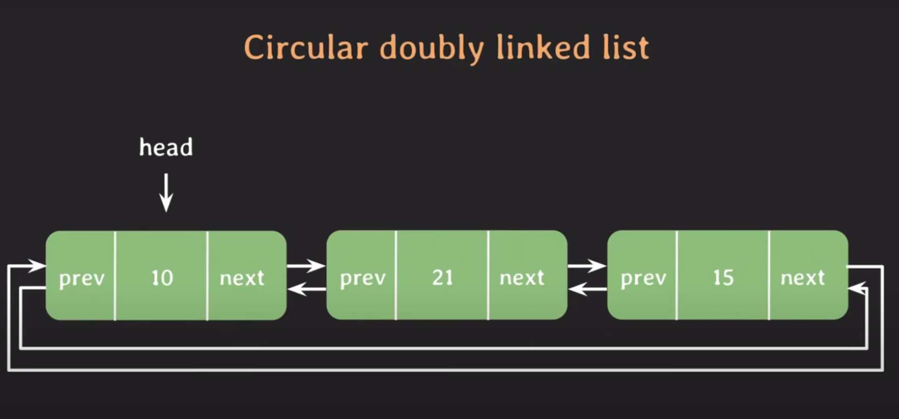
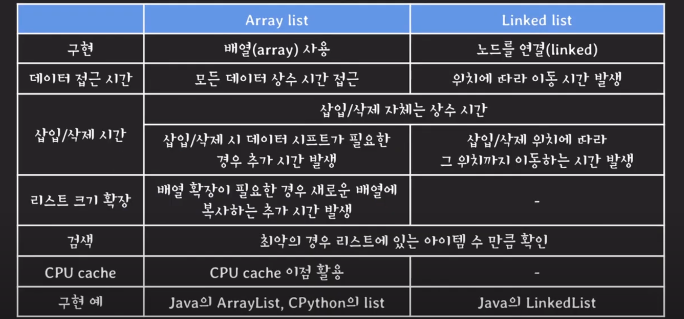

# ADT 관점에서의 List

값(value)들을 저장하는 추상자료형

순서가 있음, 중복을 허용

# ArrayList 

**배열(array)을 사용하여 list 구현**

### **데이터 삽입:add(E e)**

- O(1)
- 삽입 시 사이즈가 부족하면 데이터 복사로 인한 오버헤드 발생 주의 O(N)

### **데이터 조회: get(int index)**

- O(1)

### **데이터 존재 여부 확인: contains(Object o)**

- 최악의 경우 O(N) 전체 배열 순회

### **특정 데이터 삭제: remove(Object o)**

- 최악의 경우 O(N) 
- 데이터 위치 index:0의 경우 N-1개의 데이터 왼쪽으로 이동(shift)
- 데이터 위치 index:size - 1의 경우: 탐색에 O(N) 데이터 이동(shift)은 X

### **특정 위치의 데이터 삭제: remove(int index)**

- 최악의 경우 O(N)
- 데이터 위치 index:0의 경우 N-1개의 데이터 왼쪽으로 이동(shift) 즉, O(n-index)

### **특정 위치의 데이터 추가:add(int index, E element)**

- 최악의 경우 O(N)
- 데이터 위치 index:0의 경우 N개의 데이터 오른쪽으로 이동(shift) 즉, O(N-index)
- 마찬가지로 사이즈가 부족하면 먼저 데이터 복사가 발생

# LinkedList 





### **데이터 삽입: add(E e)**

- O(1)
- 새 노드 생성 후, 이전 노드의 포인터를 새 노드 주소로 변경, tail 포인터를 새 노드 주소로 변경
- **ArrayList와 달리 재할당/복사 없음**

### **데이터 조회: get(int index)**

- 최악의 경우 O(N)
- index까지 순차 탐색 필요
- index가 0인 경우: O(1) - head 직접 접근
- index가 size-1인 경우: O(N) - tail까지 순회
- 중간 위치: O(N/2) ≈ O(N)

### **데이터 존재 여부 확인: contains(Object o)**

- 최악의 경우 O(N)
- head부터 tail까지 순차 탐색
- 찾는 데이터가 맨 앞: O(1)
- 찾는 데이터가 맨 뒤 또는 없음: O(N)

### **특정 데이터 삭제: remove(Object o)**

- 최악의 경우 O(N)
- 데이터 탐색: O(N) - 순차 탐색 필요
- 노드 연결 변경: O(1) - 포인터만 변경
- **ArrayList와 달리 데이터 shift 불필요**

### **특정 위치의 데이터 삭제: remove(int index)**

- 최악의 경우 O(N)
- index까지 탐색: O(index)
- index가 0인 경우: O(1) - head 변경만
- index가 size-1인 경우: O(N) - tail까지 순회
- 노드 제거 자체는 O(1) - 포인터 변경만

### **특정 위치의 데이터 추가: add(int index, E element)**

- 최악의 경우 O(N)
- index까지 탐색: O(index)
- index가 0인 경우: O(1) - addFirst()와 동일
- index가 size인 경우: O(1) - addLast()와 동일
- 중간 삽입: O(N) - index까지 순회 필요
- 노드 삽입 자체는 O(1) - 포인터 변경만

## **LinkedList 특화 연산**

### **맨 앞 추가: addFirst(E e)**

- O(1)
- head 포인터만 변경

### **맨 앞 삭제: removeFirst()**

- O(1)
- head 포인터만 변경

### **맨 뒤 추가: addLast(E e)**

- O(1)
- tail 포인터만 변경 (Doubly Linked List, Singly Linked List)

### **맨 뒤 삭제: removeLast()**

- O(1) - Doubly Linked List
- O(N) - Singly Linked List (tail 이전 노드 찾기 필요)

# Circular Linked List



# Doubly Linked List



# Circular Doubly Linked List



# ArrayList VS Linked List



데이터 접근 시간

- singly linked list: O(N): 항상 head 시작
- doubly linked list: O(N/2) tail 시작 가능

# ETC(Joshua Bloch)

**LinkedList 만든 사람도 LinkedList 사용 X ㅋㅋ**

FIFO 자료구조로 사용한다면 ArrayDeque를 활용 추천

# ETC(B-tree)

B-tree vs B+tree 핵심 차이

```plain text
**B-tree**
    [15]        <- 실제 데이터도 저장
   /    \
 [7]     [23]   <- 실제 데이터도 저장
/  \    /  \

**B+tree**
    [15]        <- 인덱스만 (데이터 X)
   /    \
 [7]     [23]   <- 인덱스만 (데이터 X)
/  \    /  \
[리프][리프][리프][리프]  <- 모든 데이터는 여기에만!
  ↔     ↔     ↔         <- 링크드 리스트로 연결
```

**B+tree의 리프 노드는 링크드 리스트로 연결**

**페이지 레벨(물리적 저장)**

```plain text
Page ←→ Page ←→ Page ←→ Page
     Doubly Linked List
     (양방향 순회 가능)
```

**노드 레벨(논리적 구조)**

```plain text
Node → Node → Node → Node
    Singly Linked List
```

**DESC 조회가 느린 이유**

```plain text
Node -> Node 이동이 Singly Linked List
정순 조회(index asc, order by asc)는 Linked List 노드 방향 그대로 읽기
역순 조회(index asc, order by desc)는 Linked List 모든 노드를 스택에 저장하고
역순으로 pop하기 때문에 정순 조회에 비해 상대적으로 느리다
```

# 참고자료

ArrayList, LinkedList 자세한 동작 방식 설명

[https://www.youtube.com/watch?v=xvi-n11kym0&list=PLcXyemr8ZeoR82N8uZuG9xVrFIfdnLd72&index=4](https://www.youtube.com/watch?v=xvi-n11kym0&list=PLcXyemr8ZeoR82N8uZuG9xVrFIfdnLd72&index=4)

