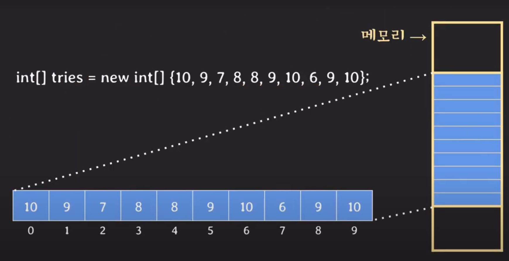
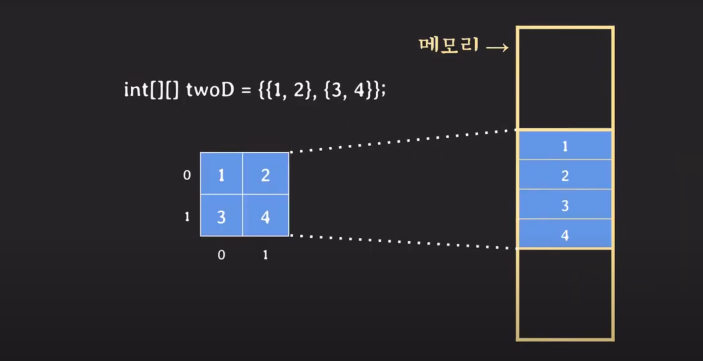
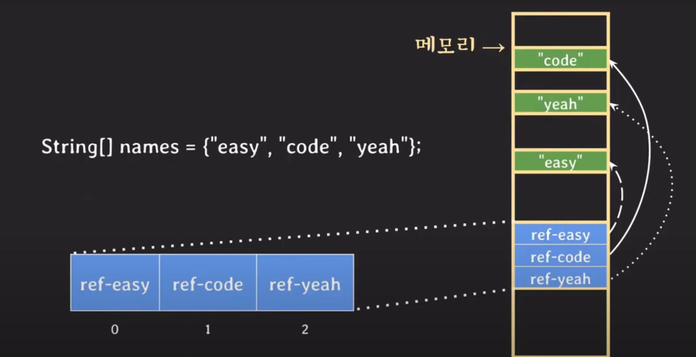
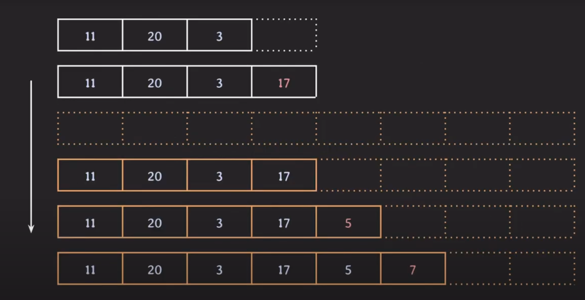

# Array 특징1

같은 타입의 데이터들을 저장하는 자료 구조

연속된 메모리 공간에 데이터들을 저장

데이터들 각각은 이름이 없지만 인덱스로 접근 가능

### 1차원 배열



### 2차원 배열



### 객체를 담는 배열



객체를 배열에 저장하면 객체의 메모리가 연속적으로 저장 실제 객체는 메모리에 랜덤하게

# Array 특징2

연속된 메모리 공간에 데이터를 저장하기 때문에 cpu cache(**캐시 지역성**)를 통해 같은 배열에 있는 다른 데이터에 접근하는 시간을 단축할 수 있다(**공간 지역성**, **시간 지역성**)

# Dynamic array(동적 배열)

크기가 변할 수 있는 배열

데이터를 더하거나 빼는 것이 가능한 자료 구조

보통 resizable array, array list 등등으로 불린다



```
**Dynamic array 동작 방식**
초기 배열 크기: 4
초기 데이터: 3개 

1. 17 추가 -> 배열의 크기 변화 없이 데이터 추가
2. 5 추가 
- "**기존 배열의 크기로는 부족하여 현재 사이즈의 2배에 해당하는 빈 배열을 생성"**
- 기존 데이터를 빈 배열에 복사하고 새로운 데이터인 5도 추가
3. 7 추가 -> 배열의 크기 변화 없이 데이터 추가

**ArrayList 설계의 핵심**
실제 데이터보다 더 많은 공간 예약 -> 메모리 오버헤드
데이터 추가 시 발생하는 재할당으로 인한 성능 오버헤드 방지를 위한 설계
즉, 메모리 오버헤드와 성능 오버헤드의 트레이드 오프

**ArrayList 동작 방식**
빈 ArrayList 생성 시 -> initial capacity: 0
이후 첫 요소 추가 -> 10
이후 1.5배 크기로 증가

**만약 데이터를 10000개 추가할 예정이라면?(초기 용량 설정을 고려하자)**
new ArrayList<>(10000); initial capacity -> 10000
```

# Associative array(연관 배열)

key-value pair들을 저장하는 ADT

같은 key를 가지는 pair는 최대 1개만 존재

보통 map, dictionary라고 부른다

# 참고자료

[https://www.youtube.com/watch?v=Hpg6zS0Nq28&list=PLcXyemr8ZeoR82N8uZuG9xVrFIfdnLd72&index=3](https://www.youtube.com/watch?v=Hpg6zS0Nq28&list=PLcXyemr8ZeoR82N8uZuG9xVrFIfdnLd72&index=3)

