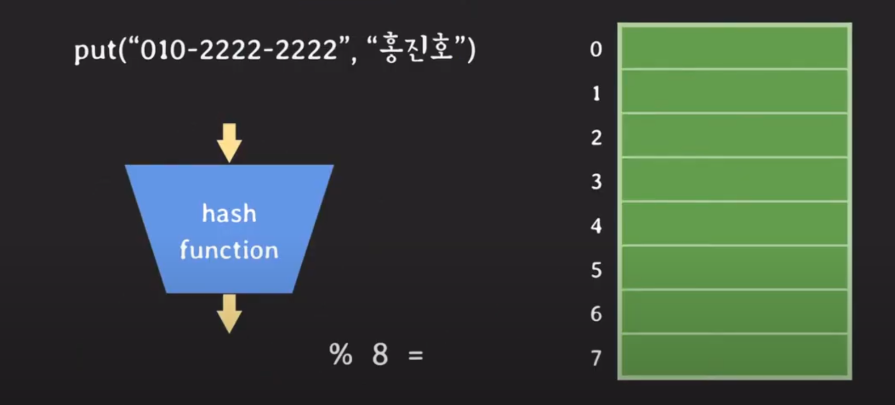
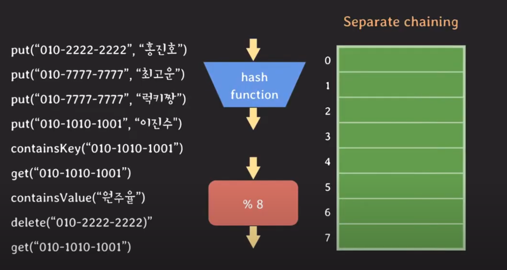
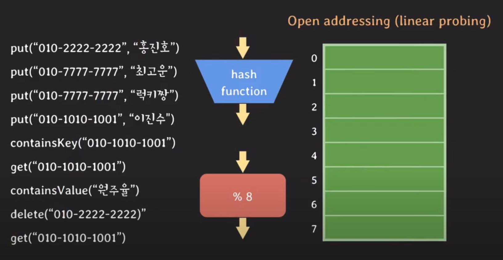
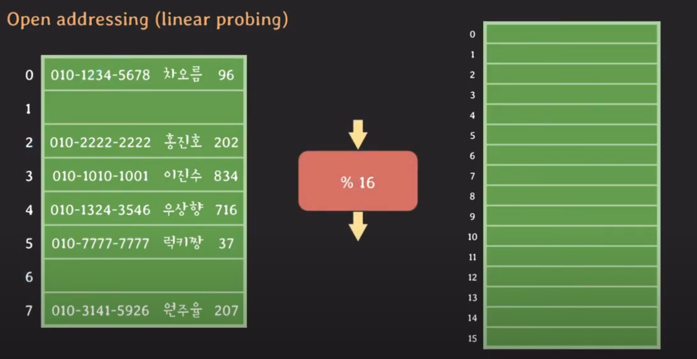
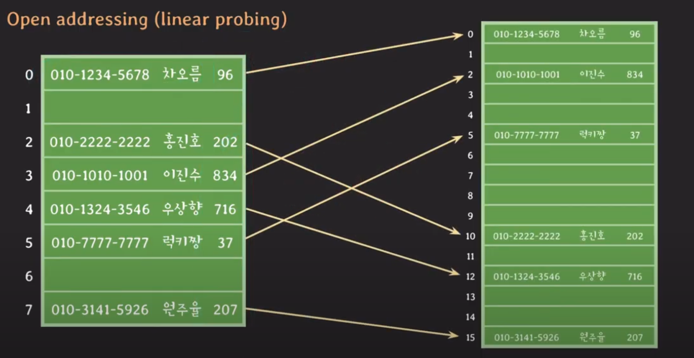
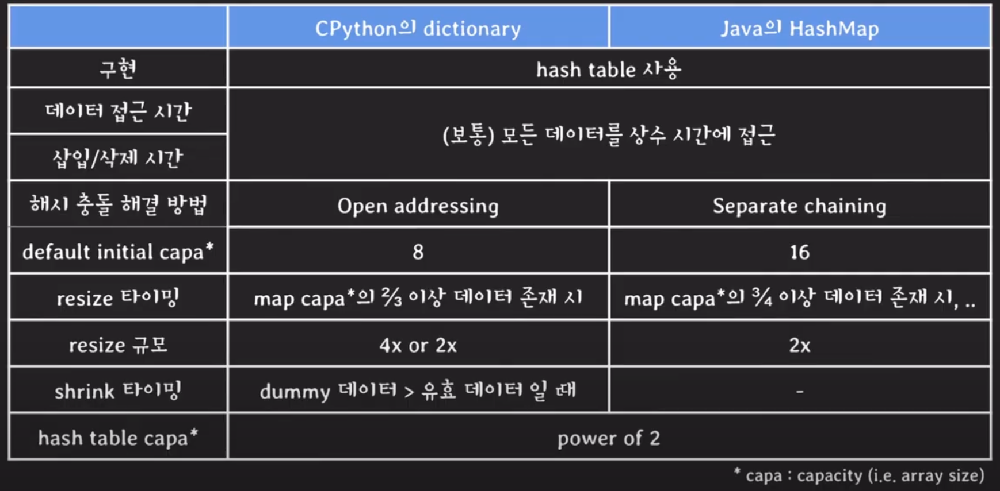

# Map

key-value pair들을 저장하는 ADT(Abstract Data Type)

**같은 key를 가지는 pair는 최대 1개만 존재**

보통 associative array, dictionary 라고 부른다

# Hash table(hash map)

배열과 해시 함수(hash function)를 사용하여 map을 구현한 자료 구조

(일반적으로) **상수 시간으로 데이터에 접근**하기 때문에 빠르다

# Hash function

임의의 크기를 가지는 type의 데이터를 고정된 크기를 가지는 type의 데이터로 변환하는 함수

(hash table에서) 임의의 데이터를 정수로 변환하는 함수

**동작 방식:** data → hash function → hash(Integer)

# Hash Table 동작 방식

### 1. put(”010-2222-2222”, “홍진호”)

- key(“010-2222-2222”) → hash function → hash(202)
- hash(202) % capacity(8) = 2
- 2번 인덱스에 value(”홍진호”) 추가

### 2. get(”010-1010-1001”)

- key(”010-1010-1001”) → hash function → hash(834)
- hash(834) % capacity(8) = 2
- 2번 인덱스에서 조회 → “홍진호” ??? wrong key

“010-2222-2222”, “010-1010-1001” 두 해시값에 대한 모듈러 연산값이 동일하기 때문에 잘못된 값을 가져온다, 이런 경우를 방지하기 위해 **key, value를 배열에 같이 저장한다.**

즉, get(”010-1010-1001”)은 해시값에 대한 모듈러 연산값으로 2번 인덱스에 접근하지만 해당 인덱스에 저장된 key가 다르기 때문에 배열의 다른 공간(인덱스)를 조회하고 최종적으로 없다고 반환(null)한다.

# Hash Collision(해시 충돌)

key는 다른데 **hash**가 같은 경우

key도 hash도 다른데 **hash % map_capacity** 결과가 같은 경우

# Hash Collision 해결 방법1 - Separate Chaining

LinkedList로 해결

### **1. put(”010-2222-2222”, “홍진호”)**

“010-2222-2222” → **hash function** → 834 → **202 % 8** → 2

2번 인덱스에 추가

### **2. put(”010-7777-7777”, “최고운”)**

“010-7777-7777” → **hash function** → 37 → **37 % 8** → 5

5번 인덱스에 추가

### **3. put(”010-7777-7777”, “럭키짱”)**

“010-7777-7777” → **hash function** → 37 → **37 % 8** → 5

5번 인덱스를 보니 key도 동일(equal)

value만 “최고운” → “럭키짱”으로 변경

### **4. put(”010-1010-1001”, “이진수”)**

“010-1010-1001” → **hash function** → 834 → **834 % 8** → 2

2번 인덱스 key 비교(not equal) 즉, hash collision 발생

**Separate Chaining → 해당 인덱스에 해당하는 값들(key-value)을 LinkedList로 관리**

인덱스 2: [010-2222-2222, 홍진호] → [010-1010-1001, 이진수]

### **5. containsKey(”010-1010-1001”)**

“010-1010-1001” → **hash function** → 834 → **834 % 8** → 2

인덱스 2: [010-2222-2222, 홍진호] → **[010-1010-1001, 이진수]**

return: true

### **6. get(”010-1010-1001”)**

“010-1010-1001” → **hash function** → 834 → **834 % 8** → 2

인덱스 2: [010-2222-2222, 홍진호] → **[010-1010-1001, 이진수]**

return: ”이진수”

### 7. containsValue(”원주율")

배열의 모든 인덱스, 해당 인덱스의 링크드 리스트 조회

return fasle

### 8. delete(”010-2222-2222")

“010-2222-2222” → **hash function** → 834 → **202 % 8** → 2

인덱스 2: **[010-2222-2222, 홍진호](삭제)** → [010-1010-1001, 이진수]

인덱스 2: [010-1010-1001, 이진수]

### **9. get(”010-1010-1001”)**

“010-1010-1001” → **hash function** → 834 → **834 % 8** → 2

인덱스 2: **[010-1010-1001, 이진수]**

return “이진수”

# Hash Collision 해결 방법2 - Open Addressing

### **1. put(”010-2222-2222”, “홍진호”)**

“010-2222-2222” → **hash function** → 834 → **202 % 8** → 2

2번 인덱스에 추가

### **2. put(”010-7777-7777”, “최고운”)**

“010-7777-7777” → **hash function** → 37 → **37 % 8** → 5

5번 인덱스에 추가

### **3. put(”010-7777-7777”, “럭키짱”)**

“010-7777-7777” → **hash function** → 37 → **37 % 8** → 5

5번 인덱스를 보니 key도 동일(equal)

value만 “최고운” → “럭키짱”으로 변경

### **4. put(”010-1010-1001”, “이진수”)**

“010-1010-1001” → **hash function** → 834 → **834 % 8** → 2

2번 인덱스 key 비교(not equal) 즉, hash collision 발생

**Open addressing(linear probing) → 다음 인덱스에 빈 공간 찾음(오른쪽으로 1칸씩 이동)**

3번 인덱스에 추가

### **5. containsKey(”010-1010-1001”)**

“010-1010-1001” → **hash function** → 834 → **834 % 8** → 2

2번 인덱스: (”010-2222-2222”, “홍진호”) not equal

3번 인덱스: (”010-1010-1001”, “이진수”) equal

return true

**Open addressing(linear probing) 조회→ 해당 인덱스에 데이터가 없더라도 다음 인덱스에서 찾음**

### **6. get(”010-1010-1001”)**

“010-1010-1001” → **hash function** → 834 → **834 % 8** → 2

2번 인덱스: (”010-2222-2222”, “홍진호”) not equal

3번 인덱스: (”010-1010-1001”, “이진수”) equal

return “이진수:

### 7. containsValue(”원주율")

배열의 모든 인덱스 조회

return fasle

### 8. delete(”010-2222-2222")

“010-2222-2222” → **hash function** → 834 → **202 % 8** → 2

2번 인덱스에서 데이터(”010-2222-2222”, “홍진호”) 삭제 & deleted 표시 추가

**Open addressing(linear probing) 삭제→ 해당 인덱스에 삭제 표시 추가**

**삭제 표시를 추가해야지 추후에 조회 시 해시 충돌로 인해 옮겨진 데이터를 찾을 수 있다.**

### **9. get(”010-1010-1001”)**

“010-1010-1001” → **hash function** → 834 → **834 % 8** → 2

인덱스 2: deleted

인덱스 3: (”010-1010-1001”, “이진수”)

return “이진수”

# Hash Table Resizing

데이터가 많이 차게 되면 크기를 늘려줘야 한다.

Java의 경우 3/4 이상의 용량을 차지하면 크기 조정을 한다.

**그림을 보면 key, value 뿐만 아니라 해시값도 가지고 있는데 크기 조정에서 데이터 복사 시 다시 해시 값을 계산하지 않도록 갖고 있다.(성능 vs 메모리 트레이드오프)**

# CPython(dictionary) vs Java(HashMap)

hash table 용량은 항상 2의 제곱으로 존재

shrink 타이밍이랑 map 크기를 줄이는 경우를 의미

Java 8+: Linked List + Red-Black Tree 하이브리드 방식으로 Separate chaining 구현

# 참고 자료

Hash Collision 해결 방식 영상으로 자세하게 설명

[https://www.youtube.com/watch?v=ZBu_slSH5Sk&list=PLcXyemr8ZeoR82N8uZuG9xVrFIfdnLd72&index=5](https://www.youtube.com/watch?v=ZBu_slSH5Sk&list=PLcXyemr8ZeoR82N8uZuG9xVrFIfdnLd72&index=5)

# ETC

### OpenAddressing(Quadratic Probing)

충돌 발생 시 오른쪽으로 이차 함수를 사용하여 새로운 위치를 찾는다. ex) 1,3,5,… 칸씩 이동

Linear Probing 방식에 비해 클러스터링 발생할 가능성이 적지만, 조사(탐색)에 추가 계산(오버헤드)가 발생한다.

### OpenAddressing(Double Hashing)

충동 발생 시 이동할 칸의 수를 새로운 해시 함수로 계산하는 방식

충돌을 해결하기 위한 다양한 조합의 위치를 시도할 수 있기 때문에, 클러스터링이 발생할 가능성이 더 낮아진다.

[[Hash] 해시 ](https://app.notion.com/p/26b7d6692ca880df9f19c6fba24b7fca)

