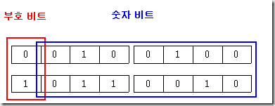



부호 비트: 0 → 양수를 의미

부호 비트: 1 → 음수를 의미

**8비트(1바이트)****:** **1비트(부호비트)** **/** **7비트(숫자 비트)**

**2(이진법)** 

| 부호비트 | 숫자비트 | 숫자비트 | 숫자비트 | 숫자비트 | 숫자비트 | 숫자비트 | 숫자비트 |
| --- | --- | --- | --- | --- | --- | --- | --- |
| 0 | 0 | 0 | 0 | 0 | 0 | 1 | 0 |

**2 → 1의 보수(0, 1 바꾸기)**

| 부호비트 | 숫자비트 | 숫자비트 | 숫자비트 | 숫자비트 | 숫자비트 | 숫자비트 | 숫자비트 |
| --- | --- | --- | --- | --- | --- | --- | --- |
| 1 | 1 | 1 | 1 | 1 | 1 | 0 | 1 |

**2 → 2의 보수(1의 보수 + 1): -2**

| 부호비트 | 숫자비트 | 숫자비트 | 숫자비트 | 숫자비트 | 숫자비트 | 숫자비트 | 숫자비트 |
| --- | --- | --- | --- | --- | --- | --- | --- |
| 1 | 1 | 1 | 1 | 1 | 1 | 1 | 0 |

**2 + (-2) = 0**

| 부호비트 | 숫자비트 | 숫자비트 | 숫자비트 | 숫자비트 | 숫자비트 | 숫자비트 | 숫자비트 | 10진법 |
| --- | --- | --- | --- | --- | --- | --- | --- | --- |
| 1 | 1 | 1 | 1 | 1 | 1 | 1 | 0 | -2 |
| 0 | 0 | 0 | 0 | 0 | 0 | 1 | 0 | 2 |
| 0 | 0 | 0 | 0 | 0 | 0 | 0 | 0 | 0 |

***즉, 음수를 표현하려면 양수의 2의 보수를 취한다***

### 참고 자료

[https://www.youtube.com/watch?v=oMX8305gTmQ&list=PLcXyemr8ZeoT_csxnRmQCXvW_ddVfYi2v&index=2](https://www.youtube.com/watch?v=oMX8305gTmQ&list=PLcXyemr8ZeoT_csxnRmQCXvW_ddVfYi2v&index=2)

### Q: 1000 0000(2) 10진수로 바꾸면?

1. 1000 0000 
1. 0111 1111 (1의 보수)
1. 1000 0000 (1의 보수 + 1) 

***이런 경우 마지막 비트를 부호 비트로 보는 게 아닌 숫자 비트로 보기 때문에 정답: -128***

