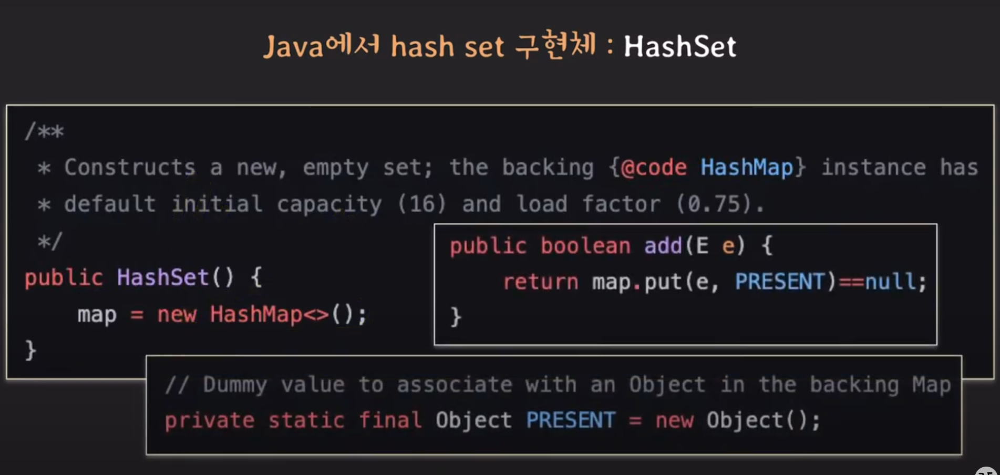
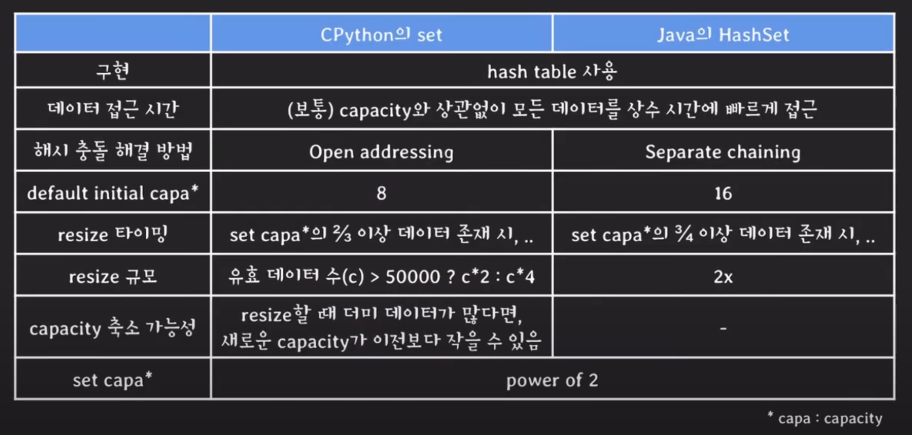

# Set

데이터를 저장하는 추상자료형(ADT)

순서를 보장하지 않음

데이터 중복을 허용하지 않음

데이터 조회(search)가 List 보다 빠르다

# Set 구현체

hash set, linked hash set, tree set

# Hash Set

**해시 테이블(hash table)**을 사용하여 구현

### Hash Table

일반적으로 테이블의 크기에 상관없이 key를 통해 상수 시간에 빠르게 데이터에 접근 가능

즉, Hash Set은 Hash Table을 사용하여 구현하기 때문에 크기 상관없이 데이터 조회가 빠르다

# Java에서 Hash set 구현체

HashSet == HashMap

value에 dummy 데이터를 넣는다

즉, HashSet에서 데이터 존재 여부 확인은 HashMap에서 key 존재 확인과 동일하다

HashSet에서 해시 충돌 시 데이터<key, hash, value>가 같은 버킷(해시 테이블 인덱스)에서 key만 다른 상태로 LinkedList 혹은 Red Black Tree에 저장된다.

# CPython Set VS Java HashSet

# 참고 자료

[https://www.youtube.com/watch?v=IkImFugfFQk&list=PLcXyemr8ZeoR82N8uZuG9xVrFIfdnLd72&index=6](https://www.youtube.com/watch?v=IkImFugfFQk&list=PLcXyemr8ZeoR82N8uZuG9xVrFIfdnLd72&index=6)

