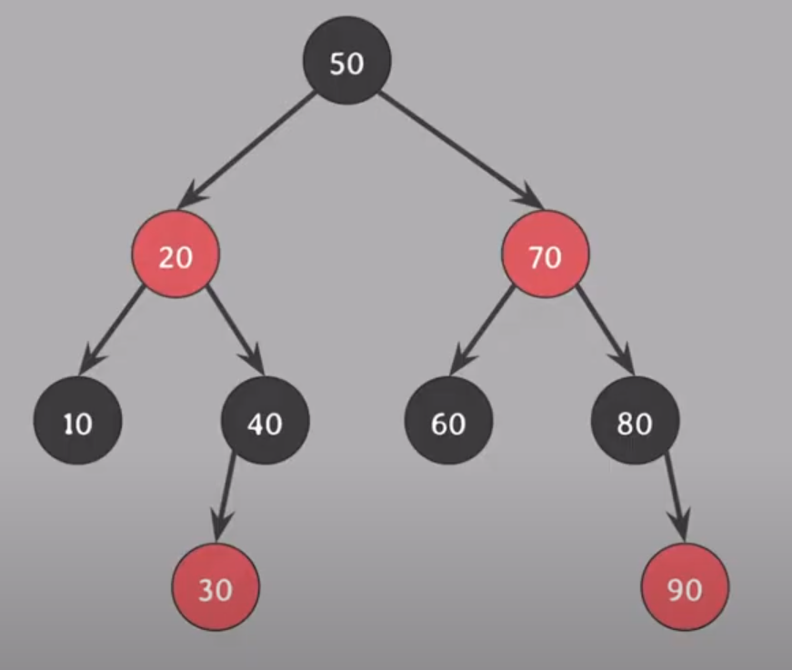
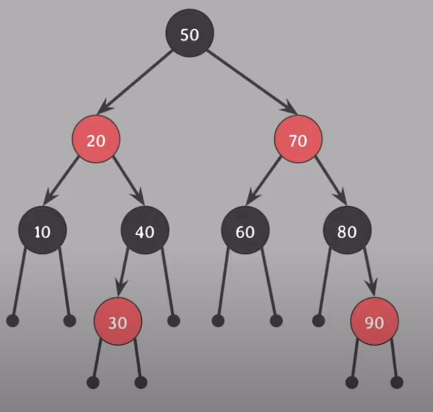

# Red-Black 트리

이진 탐색 트리(BST)의 한 종류

스스로 균형(balancing) 잡는 트리

BST worst case O(N) 단점을 개선

모든 노드는 red 혹은 black



### Red-Black 트리 속성1

**모든 노드는** **red** **혹은 black**

**루트 노드는 black**

### Red-Black 트리 nil 노드

존재하지 않음을 의미하는 노드

**자녀가 없을 때 자녀를 nil 노드로 표기**

값이 있는 노드와 동등하게 취급

**RB 트리에서 leaf 노드는 nil 노드**



### Red-Black 트리 속성2

**모든 nil(leaf)노드는 black**

**red 자녀들은 black → red가 연속적으로 존재할 수 없다**

### Red-Black 트리 속성3

**임의의 노드에서 자손 nil 노드들까지 가는 경로들의 black 수는 같다(자기 자신은 카운트에서 제외)**

### Red-Black 트리 속성 정리

```plain text
1. 모든 노드는 red 또는 black
2. 루트 노드는 black
3. 모든 리프 노드는 nil, black
4. red 자녀들은 black
5. 임의의 노드에서 leaf 노드들까지 가는 경로들의 black 수는 동일하다(자기 자신은 카운트 제외)
```

### 삽입 방식

***“삽입하는 노드는 항상***  ***red******” → #5 속성을 만족하기 위해***

1. 삽입 전 RB 트리 속성 만족한 상태
1. 삽입 방식은 일반적인 BST 방식과 동일
1. 삽입 후 RB 트리 위반 여부 확인
1. RB 트리 속성을 위반했다면 재조정

# 참고 자료

[https://www.youtube.com/watch?v=6drLl777k-E&list=PLcXyemr8ZeoR82N8uZuG9xVrFIfdnLd72&index=11](https://www.youtube.com/watch?v=6drLl777k-E&list=PLcXyemr8ZeoR82N8uZuG9xVrFIfdnLd72&index=11)

