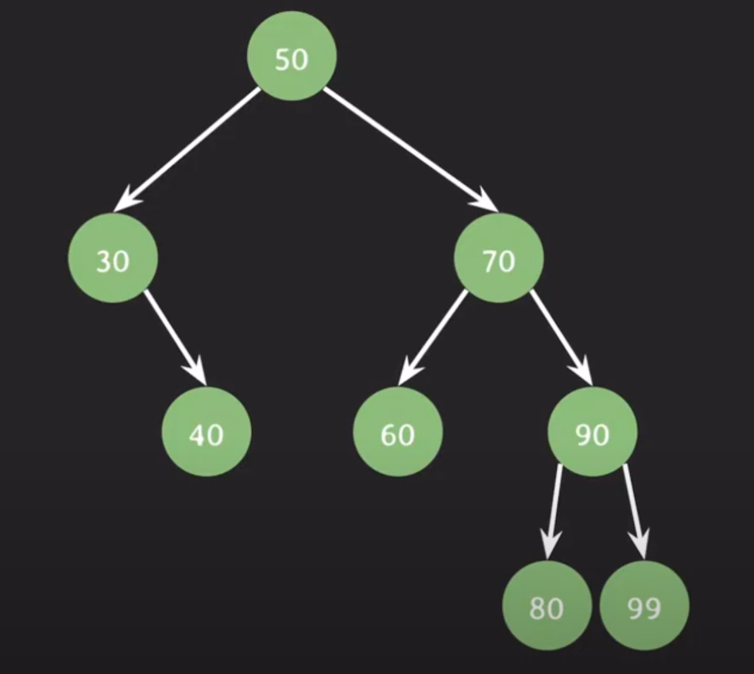
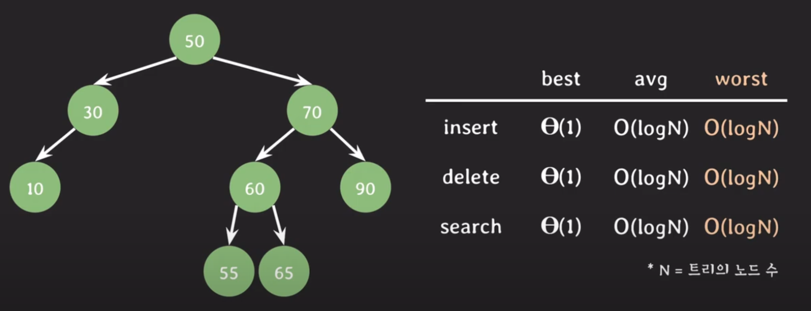

# AVL 트리

이진 탐색 트리(BST)의 한 종류

스스로 균형(balancing)을 잡는 트리

balance factor를 통해 균형 유지



### 노드의 balance factor

임의의 노드(x)에 대해서

BF(x) = 왼쪽 서브트리 높이 - 오른쪽 서브트리 높이

### AVL 트리의 특징

트리의 모든 노드들은 다음과 같은 특징을 가진다

**BF(x) = {-1, 0, 1}**

### AVL 트리의 균형 잡기

**트리에 삽입 혹은 삭제 이후 BF(x) ≠ {-1, 0, 1} 노드가 생기면 균형을 맞추는 작업을 수행**

# AVL 트리의 장단점



```plain text
일반 BST에 비해서 worst 케이스가 O(N) → O(logN)으로 개선
즉, 최악의 경우에도 삽입/삭제/검색의 시간 복잡도가 O(logN)이다.

**AVL 트리 한계**
하지만 엄격하게 균형을 유지하기 때문에 삽입/삭제 시 트리 균형을 확인하고 만약 균형이 깨졌다면
트리 구조를 재조정하기 때문에 이때 시간이 꽤 소요된다

이를 해결하기 위해서 Red-Black Tree 등장
```

# 참고 자료

AVL 트리 자세한 동작 방식

[https://www.youtube.com/watch?v=syGPNOhsnI4&list=PLcXyemr8ZeoR82N8uZuG9xVrFIfdnLd72&index=9](https://www.youtube.com/watch?v=syGPNOhsnI4&list=PLcXyemr8ZeoR82N8uZuG9xVrFIfdnLd72&index=9)

