## 교육링크

[https://learn.outsystems.com/ko-kr/training/journeys/web-developer-662/outsystems-overview/o11/2155](https://learn.outsystems.com/ko-kr/training/journeys/web-developer-662/outsystems-overview/o11/2155)

### OutSystems 직접 정리

```html
아웃시스템즈에서의 엔터티는 복합키 설정이 불가능하다.
하지만 데이터 타입의 제약은 없다.
```

### OutSystems Sample Exam 

1. ***OutSystems 개요***
    1. ***서비스 스튜디오 개요***
    1. ***OutSystems 개발 소개***
    1. ***데이터 모델링***
    1. ***데이터 관계 모델링***
    1. ***데이터 모델 무결성*** 
    1. ***UI 개발 101***
    1. ***어셈블리 101***
    1. ***데이터를 사용하는 화면 만들기***
    1. ***웹 양식 구축***
    1. ***논리***
    1. ***폼 유효성 검사***
    1. ***고급 애그리게이트***
    1. ***역할 기반 보안***
    1. ***OutSystems에서 디버깅***
    1. ***페이지네이션 및 정렬***
    1. ***블록과 이벤트***
    1. ***반응형 프로그래밍 모델***
    1. ***클라이언트 변수***
    1. ***사이트 속성***
    1. ***SQL 쿼리***

# OutSystems 개요

---

**OutSystems는 엔터프라이즈 웹 및 모바일 애플리케이션의 개발, 배포를 지원한다**

    - *로우코드 개발 환경*
    - *엔터프라이즈 수준의 풀 스택 시스템*
    - *다른 시스템과의 통합 지원*
    - *애플리케이션 및 사용자에 대한 관리 및 분석을 제공 → 의도대로 동작하는지 확인 가능*
    - *애플리케이션은 HTML, CSS, JavaScript, .NET 같은 표준 및 최적화된 코드를 사용하여 컴파일된다.*
    - *CI/CD를 지원하며, 클라우드 또는 온프레미스 환경 모두 수행 가능하다*

# 컴포넌트 및 도구

---

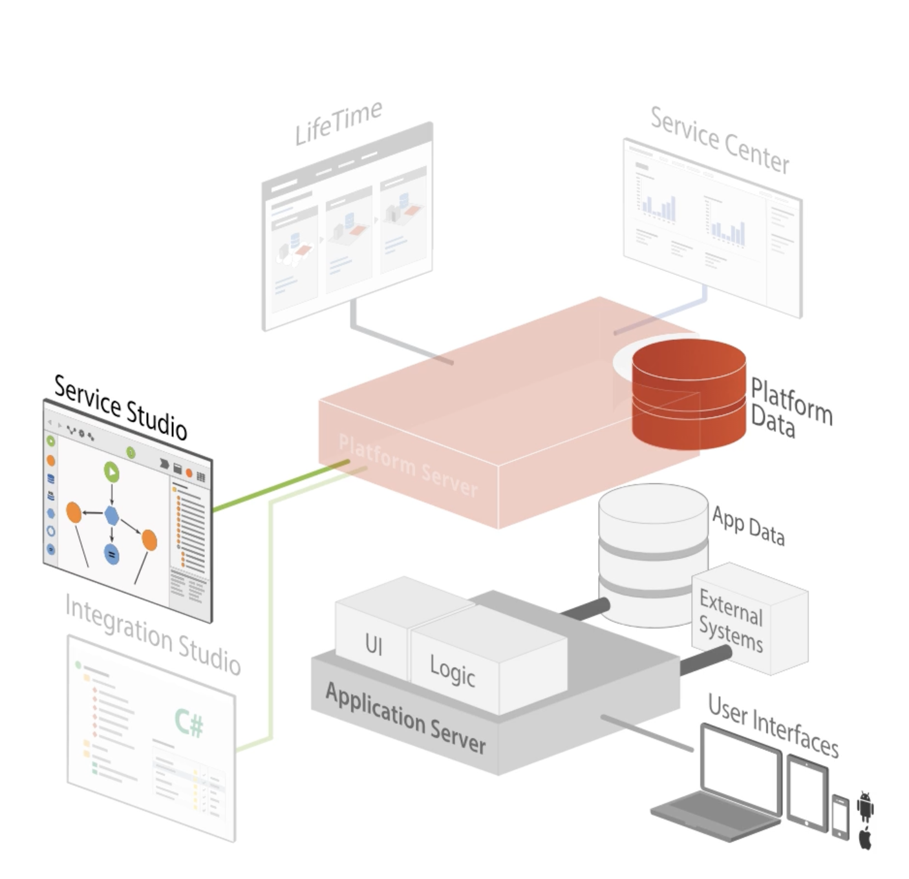

### **OutSystems 서버(플랫폼 서버)**

    - *애플리케이션을 인프라 내부에 컴파일, 배포, 관리, 실행 및 모니터링하는 서버들의 집합*
    - *Platform Data(플랫폼 데이터 데이터베이스)*

### **Application Server**

    - *생성한 애플리케이션을 실행*
    - *기존 데이터베이스 및 외부 시스템(oracle, mysql, … ) 사용*

### **Service Studio(개발 환경)**

    - *플랫폼 서버와 연결* 
    - *Web 및 모바일 앱의 OutSystems 시각적 개발 환경*
    - *플랫폼 서버와 연결되면 애플리케이션 생성 및 게시가 가능하다*
    - *해당 애플리케이션의 각 버전은 플랫폼 데이터 데이터베이스에 저장된다*
    - *플랫폼 서버는 애플리케이션을 위한 최적화 코드를 컴파일하고 생성한 다음 표준 애플리케이션 서버에 배포한다*

### **Integration Studio(통합 스튜디오, 개발 환경)**

    - *C# 코드, 데이터베이스와 같은 외부 시스템(리소스)과의 통합*
- *통합을 위한 가속기를 제공한다*
    - *플랫폼 자체에 대한 확장을 허용*
    - *확장에 성공하면 즉, 서버 게시에 성공하면 Service Studio에서 정상적인 OutSystems 리소스처럼 사용할 수 있다*

### Service Center(서비스 센터)

    - *플랫폼 서버 관리 및 관리 콘솔*
    - *웹 브라우저를 통해 엑세스 가능*
    - *관리 및 운영 관점에서 플랫폼 서버를 살펴보고 구성할 수 있다*
    - **서비스 센터 - 공장**
- *서비스 센터 내에서 공장을 살펴보고 어떤 애플리케이션이 사용 가능한지 확인 가능*
    - **서비스 센터 - 모니터링**
- *환경을 모니터링*
      - *플랫폼 및 실행 중인 애플리케이션에서 생성된 로그 검사가 가능*
    - **서비스 센터 - 관리**
- *서버 관리 및, 환경 설정 구성이 가능*
    - **서비스 센터 - 분석**
- *다양한 유형의 분석을 수집이 가능*

### LifeTime(라이프 타임)

    - *서비스 센터는 개별 서버 또는 환경을 관리, 라이프타임은 여러 환경에 걸쳐 전체 애플리케이션의 라이프사이클을 관리할 수 있게 지원*
    - *라이프 타임은 서비스센터의 기능을 확장하는 웹 애플리케이션*
    - *개발 환경에서의 품질 환경, 인프라 각 환경에 배포된 애플리케이션의 버전 같이 애플리케이션 라이플프사이클을 다양한 스테이징 환경에서 볼 수 있다.*
    - **라이프 타임 - 사용자 관리**
- *각 환경 또는 애플리케이션에 대해 각 사용자 또는 팀이 갖는 권한 수준을 관리할 수 있다.*
    - **라이프 타임 - 인프라**
- *인프라의 모든 환경에 대한 가시성을 확보하고, 해당 환경이 라이프사이클에 어떻게 배치되는지 관리할 수 있다.*
    - **라이프타임 - 분석**
- *애플리케이션 성능에 대한 분석을 수집, 성능 병목 현상을 쉽게 파악하고 해결할 수 있다*

### OutSystems Forge 및 커뮤니티(Forge & Forums)

    - *OutSystems 작업에 대한 지원을 받을 수 있다*
    - *https:://www.outsystems.com/forge*
    - **OutSystems Forge**
- *애플리케이션 개발 및 배포 속도를 높이는 다운로드 가능한 컴포넌스 소스*
    - **OutSystems Community Forums**
- OutSystems 개발자들에게 Q&A 가능

# Capabilities(능력)

---

*서로 다른 환경에서 엔터프라이즈 개발이 가능*

*OutSystems 솔루션에 이미 존재하는 애플리케이션들의 통합이 간단 (외부 시스템의 데이터도 마찬가지)*

### OutSystems 를 통한 개발 프로세스 정리

    1. **Integration with everything**
1. *기존에 개발된 애플리케이션 및 데이터베이스 통합*
    1. **Visual Design and Development(Service Studio)**
1. *low-code를 통한 시각적 디자인 및 개발*
      1. *Processes And Logic → 비즈니스 로직 생성*
      1. *User Interface 생성*
      1. *개발이 끝나면 클릭 한번으로 배포가 가능*
    1. **Standard and Optimized**
1. *HTML, CSS, JS, .NET (컴파일)*
    1. **Continuous Integration and Continuous Delivery**
1. *Deploy → Integrity → Governance → Monitoring*
    1. **Flexible Infrastructure**
1. *Cloud*
      1. *On-Premise*

# 퀴즈

---

    1. 다음 중 개발 환경이 아닌 것은 무엇입니까?
1. Service Studio
      1. Integration Studio
      1. Service Center
    1. 다음 중 애플리케이션의 라이프사이클을 인프라 전반에 걸쳐 관리할 수 있는 도구는 무엇입니까?
1. 서비스 센터
      1. 라이프타임
      1. 서비스 스튜디오
      1. 통합 스튜디오
    1. Click 게시판 중 앱 데이터 모델, 코드 및 인터페이스가 컴파일되어 .NET 코드, HTML, CSS, JavaScript를 생성한다.
1. 참
      1. 거짓

*1번 정답 c: 서비스 센터는 하나의 환경(개발, 프로덕션)에 대한 관리 및 관리 콘솔*

*2번 정답 b: 또한 라이프 타임은 IT 사용자 및 팀을 관리할 수도 있다*

*3번 정답 a: 그리고 생성된 코드는 최적화된다*

# Service Studio Overview

---

### Service Studio 시작하기

*Service Studio는 OutSystems의* ***로우코드 및 비주얼 개발 환경***

*Service Studio를 사용하면 개발자는 서버 상에서 애플리케이션과 모듈(Module)을 생성할 수 있다.*

*모듈 내부에서는 애플리케이션에서 사용할* ***데이터 모델****을 정의할 수 있다.*

***웹(Web)과 모바일(Mobile) 애플리케이션*** *모두를 위한 사용자 인터페이스를* ***시각적으로 생성하고 정의****할 수 있습니다.*

*여기에는 해당 인터페이스에 필요한* ***HTML과 CSS****도 포함,* ***비즈니스 로직****과 애플리케이션을 지원하는* ***더 큰 비즈니스 프로세스****까지 정의할 수 있다*

*즉, 애플리케이션을 생성한 뒤* ***수정, 업데이트, 배포, 조회, 디버깅****까지 서버에서 모두 수행이 가능하다*

---

### Service Studio 설치 및 서버 연결

*다운로드 →* [*https://www.outsystems.com/downloads*](https://www.outsystems.com/downloads/)

*다운로드 + 실행 후에는 환경(Environment) 또는 서버(Server)에 연결해야 한다.*

*이 서버는* ***클라우드 환경****일 수도 있고, 자체 데이터 센터의* ***온프레미스 서버****일 수도 있다.*

*필요한 정보는* ***서버 주소, 사용자 이름, 비밀번호***

*Service Studio는 단순한 개발 도구가 아니라* ***애플리케이션을 정의하고 플랫폼 서버로 배포할 수 있는 클라이언트****이다.*

*실제로* ***코드를 생성·컴파일하고****, IIS 같은 실제 애플리케이션 서버에* ***배포****하는 작업은 OutSystems 서버에서 수행*

*Service Studio는 서버의* ***클라이언트 역할****을 하며,애플리케이션을* ***로컬에서 실행하지는 않는다.***

*대신, 생성한 애플리케이션을 서버로 전송(push)하고 브라우저나 모바일 디바이스를 통해* ***조회, 디버깅, 상호작용****할 수 있게 된다.*

| 구분 | Mendix | OutSystems |
| --- | --- | --- |
| 로컬 런타임 | ✅ 있음 | ❌ 없음 |
| 서버 없이 개발 | ✅ 가능 | ❌ 불가능 |
| 오프라인 개발 | ✅ 가능 | ❌ 불가능 |
| 중앙 통제 | 약함 | 매우 강함 |
| 엔터프라이즈 | ○ | ◎ |
| 개발 자유도 | 높음 | 낮음 |

---

### 애플리케이션과 모듈 구조

*Service Studio에서 서버에 연결하면 해당 서버에 존재하는* ***애플리케이션 목록****이 표시된다.*

*이 애플리케이션들은 사용자가 접근 권한을 가진 것들이며, 공용 환경에서는 다른 개발자가 만든 것일 수도 있다.*

*기존 애플리케이션을 열 수 있을 뿐만 아니라 새로운 애플리케이션을 생성하거나* ***OutSystems Forge****에서 기존 애플리케이션이나 컴포넌트를 설치할 수도 있다.*

*일반적으로는 애플리케이션 하나를 열어 그 안에서 개발을 시작하게 된다.*

*애플리케이션을 열면 해당 애플리케이션의* ***세부 정보****가 표시된다.*

***Develop 탭****에서는 이 애플리케이션에 포함된* ***모듈 목록****을 확인할 수 있다.*

*또한 이 애플리케이션이* ***의존하고 있는 다른 애플리케이션****도 확인할 수 있다.*

*모바일 애플리케이션을 위한* ***Distribute 탭****도 있는데, 이 탭에서는* ***네이티브 모바일 앱을 생성****하거나*

*PWA(Progressive Web App)를 활성화할 수 있다.*

***PWA(Progressive Wev App):*** *웹 기술로 만들었지만 모바일 앱처럼 동작하는 웹 애플리케이션*

---

### 모듈 개발 환경

*개발을 시작하려면 모듈을 하나 열어 로우코드로 표현된 구조를 확인해야 한다.*

*모듈을 열면* ***워크스페이스 탭(Workspace Tab)****이 새로 열린다.*

*워크스페이스 탭에서는 모듈의 다양한* ***레이어****와 사용 가능한* ***도구들****을 확인할 수 있다.*

*또한 사용할 수 있는 요소(Element)들과 새로운 요소를 생성하는 기능도 볼 수 있다.*

*중앙의* ***메인 캔버스 에디터****에서는 UI를 정의하거나 로직 흐름을 설계하는* ***비주얼 로우코드 편집기****를 사용할 수 있다.*

*Service Studio에는 모듈이 항상 유효한 상태인지 확인하는* ***실시간 변경 검증(True Change) 기능****이 있다.*

*이 기능은* ***유효한 모듈만 서버에 배포****되도록 보장한다. 즉, 실시간 변경 검증은 배포 안정성을 보장하는 요소이다.*

---

### 환경 전환과 Forge

*모듈 메뉴에서는* ***환경(Environment)을 전환****하여 다른 서버로 이동할 수 있다.*

*새 환경의 URL과 사용자 이름, 비밀번호만 입력하면 된다.*

*환경 탭, 애플리케이션 및 모듈 탭 외에도* ***OutSystems Forge 탭****이 있다.*

*Forge에는 서버에 다운로드하여 설치할 수 있는 다양한* ***컴포넌트****가 제공된다.*

*Forge를 통해 새로운 리소스를 빠르게 가져와 개발 속도를 크게 향상시킬 수 있다.*

# Service Studio Walkthrough

---

***Service Studio****의 작업 공간에서는 다양한 구성 요소에 접근할 수 있다.*

*비즈니스 프로세스나 타이머부터 사용자 인터페이스(UI) 요소, 비즈니스 로직 흐름, 그리고 데이터 관련 요소까지 모두 포함된다.*

***Service Studio*** *오른쪽 상단에는 네 개의 탭이 있다. 각 탭은 각각의 계층(Layer)에 대응한다.*

***Processes(프로세스)****,* ***Interface(인터페이스)****,* ***Logic(로직)****, 그리고* ***Data(데이터)***

*각 탭으로 전환하면 해당 레이어에 속한 요소들이 표시된다.*

*트리에서 요소를 선택하거나 열면 아래쪽에 해당 요소의 속성이 나타난다.*

*이 속성들은 각 요소의 동작을 세부적으로 조정하고 사용자 정의할 수 있게 해준다.*

*여러 요소를 동시에 선택해서 공통 속성을 한 번에 수정할 수도 있다.*

***TrueChange****는 Service Studio의 유용한 기능으로, 애플리케이션 모듈을 자동으로 검사해준다.*

*만약* ***오류가 있으면, 상단에 빨간색 X(크로스) 아이콘이 표시되고 하단에 오류 목록이 나타난다.***

***오류가 없을 때는 초록색 1-Click Publish 버튼이 표시****된다.*

*이 버****튼을 눌러 모듈을 서버에 게시하면, 버튼 색상이 파란색으로 바뀌며 Open In Browser(브라우저에서 열기)로 변경****된다.*

*이제 UI 요소(예: Screen)를 열었을 때 Canvas(작업 영역)가 어떻게 달라지는지 살펴보자*

*Canvas 중앙에는 화면(Screens)의 실시간 미리보기가 표시된다*

*왼쪽에는 Toolbox(도구 상자)가 있다. 현재 UI 요소를 편집 중이므로, 도구 상자에는 Widget(위젯)들이 표시된*다. 

***위젯은 화면을 구성하는 기본 단위****이다. 이 화면은 여러 위젯들로 구성되어 있으며,*

*텍스트, 이미지, 차트, 지도, 버튼 등 다양한 위젯을 포함한다. 위젯은 드래그앤드롭으로 화면(Canvas)에 배치할 수 있다.*

*또한* ***미리보기 모드****를 변경해 화면이 다양한 기기나 방향에서 어떻게 보일지 확인할 수도 있습니다.*

*UI나 다른 요소를 작업할 때, 스타일을 적용할 수 있는 요소에는 빠르게 스타일을 변경할 수 있는* ***툴바****가 표시된다.*

*직접 작성한 CSS를 추가로 적용하고, 각 위젯에 특정 클래스 이름을 지정할 수도 있다.*

*또한,* ***Element Breadcrumb(요소 경로 표시줄)****을 이용하면 요소 계층 구조를 편리하게 탐색할 수 있다.*

*UI 화면 작업 시 유용한* ***Widget Tree(위젯 트리 토글 버튼)****도 있다.*

*화면이 복잡해질수록 많은 위젯들이 포함되기 때문에, 위젯 트리를 토글하면 화면 내 모든 위젯의 계층 구조를*

*한눈에 볼 수 있다. 이는 요소 트리 상단에 표시된다.*

*하단의* ***Widget Breadcrumb(위젯 경로 표시줄)*** *또한 현재 작업 중인 위젯의 계층을 빠르게 탐색할 때 유용하다.*

***Processes(프로세스)****와* ***Logic(로직) 편집기***

*UI와 마찬가지로, 가운데에는 로직의 시각적 표현을 위한* ***Canvas 영역****이 있다.*

*프로세스나 비즈니스 로직을 설계할 때 이 캔버스는 로직 흐름을 시각적으로 표시한다.*

*툴박스도 동일한 방식으로 작동하지만, 이 경우에는 위젯 대신 로직 플로우에 사용할 수 있는 요소들이 나타난다.*

*예를 들어* ***할당(assignment)****,* ***for-each 반복문****,* ***데이터베이스 쿼리*** *등이 있다.*

***Data Layer(데이터 계층****)**를 살펴보자.*

*여기에서는* ***Entity(엔터티) 다이어그램****을 열어 데이터 모델과 생성된 엔터티(즉, 데이터베이스 테이블)의*

*시각적 구성을 볼 수 있다.*

*데이터 관련 요소들은 모두 오른쪽의* ***요소 트리****에서 손쉽게 관리할 수 있다.*

# Application Layers

---

*애플리케이션을 구성하는 서로 다른* ***계층****과, 각 계층 안에 포함된* ***요소들****을 살펴보자*

***Processes(프로세스) 계층은*** *두 가지 주요 그룹이 있다 →* ***Processes(프로세스) & Timers(타이머)***

*프로세스에는 비즈니스 프로세스, 사람이 수행하는 작업(human tasks), 자동화된 작업(automated tasks),*

*의사결정(Decisions), 이벤트(Events), 그리고 대기(Waits) 등이 포함*

*타이머(Timer)는 특정 시간에 실행되도록 예약된 작업 이 타이머는 매일, 매주 또는 다른 주기로 다시 예약할 수도 있다.*

*여러 이벤트가 동시에 실행되어야 할 때, 일부* ***타이머에 우선순위(priority)를 설정****하여 더 중요한 작업이 먼저 수행되도록 할 수 있다.*

*또한* ***타임아웃(timeout)*** *설정도 가능하여 지속적으로 실행되지 않도록 제어할 수도 있다.*

*즉,* ***Processes 계층****은 가장 높은 수준의 로직과 업무 흐름을 다룬다고 볼 수 있다.*

***User Interface(사용자 인터페이스) 계층***

*이 계층은 애플리케이션의 사용자 인터페이스를 구성하는 다양한 컴포넌트에 초점을 맞춘다.*

*화면(Screen)과 블록(Block)으로 구성된 그룹을 User Interface Flow(사용자 인터페이스 플로우)라고 부릅니*다.

*UI 플로우 외에도, 이 계층에는 그래픽이나 아이콘 같은* ***이미지 리소스****가 포함된다.*

*OutSystems가 애플리케이션의 디자인(look & feel)을 정의하는 방식은 Themes(테마)라고 한다.*

*그 아래에는 Scripts(스크립트)가 있다. 이들은 자바스크립트 리소스로서, 다른 UI 요소들이 동작하는 데 필요할 수 있다.*

***Logic(로직) 계층***

*이곳에서는 애플리케이션의* ***동작 로직****을 정의한다.*

*Client Actions(클라이언트 액션)과 Server Actions(서버 액션)이 있다.*

*클라이언트 액션은 모바일 기기나 웹 브라우저처럼 클라이언트 측에서 실행된다.*

*반면에 서버 액션은 실제로* ***서버에서 실행된다****.*

*또한 외부 시스템과 통합할 수 있는* ***통합 로직 요소****도 있습니다.*

*예를 들어,* ***SOAP 웹 서비스****나* ***RESTful 서비스*** *같은 것들이 이에 해당한다.*

*이 모든 로직 구성요소에 접근하거나 변경할 수 있는 사용자를 제한하기 위해* ***보안 권한(roles)을 정의****한다.*

*이를 사용자에게 할당하면, 누가 어떤 리소스에 접근 가능한지 명확히 관리할 수 있다.*

*또한 이 계층에는* ***Exceptions(예외)****도 존재하며,* ***예외를 던지거나(catch)*** *처리할 수 있다.*

***Data(데이터) 계층***

*이 계층에서는* ***Entity(엔터티)****를 정의할 수 있다.*

*엔터티는 데이터베이스 테이블에 해당하며, 기기 로컬 저장소(Local Storage)에 저장될 수도 있다.*

*이 엔터티들을 시각적으로 표현하려면* ***Entity Diagram(엔터티 다이어그램)****을 만들 수 있다.*

*데이터의 메모리 내 표현은* ***Structure(구조체)****라고 부른다.*

***Client Variables(클라이언트 변수)****는 사용자별 데이터를 클라이언트 측(브라우저 또는 모바일 기기)에 저장한다.*

*반면* ***Site Properties(사이트 속성)****은 서버 측에서 여러 애플리케이션 간에 공유되는 데이터를 저장할 수 있다.* 

*마지막으로, 위 범주들에 속하지 않는 기타 데이터를* ***Generic Resources(일반 리소스)****라고 부른다.*

*이 네 가지 계층은 작업 공간(workspace)에 존재하는 다양한 요소들을 효율적으로* ***조직화****할 수 있게 도와준다.*

*이를 통해 필요한 요소를 빠르고 쉽게 찾아 작업할 수 있다.*

# 1-Click Publish

---

*Service Studio 메뉴 바에는* ***1-Click Publish 버튼****이 있다.*

*이 버튼을 클릭하면, 우리가 개발한* ***애플리케이션 모듈의 정의****가 OutSystems 플랫폼 서버에 업로드되고* ***Service Center****로 전송된다.*

*OutSystems 서버는 이 모듈을* ***새 버전****으로 저장하며, 이를 플랫폼 데이터베이스에 기록한다.*

*그 후, 서버는 코드를 생성(generate)하고, 컴파일(compile)하며, 애플리케이션 서버에 배포(deploy)한다.*

*이 과정에서 데이터베이스의 구조도 필요한 경우* ***자동으로 업데이트****되어 비즈니스 로직과 데이터 모델이 일관성을 유지하도록 한다.*

*배포가 진행되는 동안, Service Studio는* ***Publish 로그 창****을 표시해 현재 진행 상황을 보여준다.*

*배포가 완료되면, 애플리케이션이 서버에서 사용할 준비가 되었다는 메시지가 표시된다.*

*이 시점에서 초록색* ***1-Click Publish 버튼****은 파란색* ***Open in Browser(브라우저에서 열기)*** *버튼으로 바뀐다.*

이 버튼을 클릭하면, 웹 애플리케이션의 경우 브라우저에서 애플리케이션이 열린다.

*모바일 앱이라면 실제 휴대폰 대신* ***모바일 에뮬레이터****가 실행되어 앱을 미리볼 수 있다.*

*한 번 서버에 배포된 버전은 버전 관리가 이루어진다. 필요하다면* ***이전 버전으로 되돌아갈 수도 있다.***

*이전 버전을 열려면, 모듈 메뉴에서 Open Other Version(다른 버전 열기)를 선택한다.*

*그러면 모든 버전이* ***날짜, 시간, 게시한 사용자****와 함께 표시된다.*

*원하는 버전을 선택하여 언제든 이전 상태로 복원할 수 있다.*

*경우에 따라서는 두 명 이상이 동시에 하나의 모듈을 수정할 수도 있다.*

*이때 서로 다른 변경사항이 충돌하면, Service Studio는 이를 감지하고* ***사용자에게 선택을 요청한다.***

*가능한 선택지는 다음과 같다.*

    - *모든 버전을 병합(merge)하여 게시하기*
    - *자신의 버전으로 기존 버전을* ***덮어쓰기(overwrite)***
    - *두 버전을 비교(compare)하여 수동으로 확인하기*

*일반적으로는 비교 도구를 한 번 확인해 다른 사람의 중요한 변경사항을 덮어쓰지 않도록 하는 것이 좋다.*

***Compare 버튼****을 클릭하면 diff tool(비교 도구)이 열린다.*

*이 도구에서는 내 버전과 현재 게시된 버전을 나란히(side-by-side) 보여준다.*

***변경된 부분이 하이라이트되어 표시되므로, 각 항목을 검토하고 필요한 경우 체크박스로 선택****할 수 있다.*

# OutSystems 앱 소개(반응형 웹 VS 모바일)

---

### 앱 유형

    - *전통적인 웹: 대부분의 애플리케이션 로직이 서버에서 실행*
    - *모바일(스마트폰 및 태블릿)*
    - *반응형 웹*

### 최신 아키텍처

*최신 표준 및 모범 사례를 따르며, 끈임없이 변화하는 환경에서 빠르게 움직일 수 있도록 보호한다*

*백그라운드에서 OutSystems는 React JS를 기반으로 하는 단일 페이지 애플리케이션을 컴파일하고 생성한다*

*또한 low-code 기반으로 앱을 생성하고 HTML, CSS, JavaScript 또한 모두 생성한다*

*run time에 JavaScript는 HTML 요소를 생성하고 클라이언트 측 로직을 실행하며, 필요한 경우 비동기적으로 데이터를 가져온다*

*멋지고 풍부한 UI/UX를 만들기 위해 OutSystems는 반응형 웹 앱과 모바일 앱을 모두 제공한다*

### 코드 재사용성

*반응형 웹과 모바일 앱 모두 코드 재사용성 측면에서 매우 유사하다*

*반응형 웹은 모든 장치 및 화면 크기에 대한 공통 로직이 있고, 모바일은 지원되는 네이티브 모바일 플랫폼 및 PWAs를 위한 지원되는 브라우저에 대한 공통 로직이 존재한다*

*결국 동일한 로직이 어느 쪽이든 공통으로 사용된다*

*반응형 웹은 웹 브라우저만 존재하면 별도 설치는 필요없다, 하지만 네이티브 모바일 앱은 Android 및 iOS에서 실행된다 PWAs는 지원되는 브라우저로 실행되거나 네이티브로 실행된다*

### 사용자 경험

*반응형 웹 앱은 모든 화면 크기 및 유형에 대한 반응형 레이아웃 → 장치의 화면 크기에 따라 동적으로 적응*

*모바일은 전용 모바일 UI 패턴 및 경험이 필요 → 작은 장치에서 손가락이 상호 작용 도구로 사용되는 것을 고려*

### 성능

*백그라운드(서버?)에서는 반응형 웹 앱과 모바일 앱 모두 동일한 기술 스택을 공유한다*

*모두 클라이언트 측에 최적화된 성능으로, 데이터 전송을 최적화하는 스마트 메커니즘을 제공한다*

*모바일의 경우 장치의 내부 저장소에 엑세스할 수 있다는 차이가 있다*

### 장치 하드웨어 엑세스

*반응형 웹 앱의 경우 장치 하드웨어에 대한 엑세스가 제한적이다, HTML5를 통해 사용할 수 있는 기능이 적기 때문 반면에 모바일 앱의 경우 터치 ID와 같은 더 많은 네이티브 기능에 엑세스할 수 있다.*

### 오프라인 기능

*반응형 웹 → 오프라인 기능 존재 x* 

*모바일 앱 → 오프라인 데이터를 저장하려면 네이티브 모바일 앱은 로컬 스토리지, PWA는 브라우저 스토리지를 사용*

### 배포 및 업데이트

*반응형 웹 → 사용자가 브라우저 페이지를 새로 고침할 때 자동으로 적용*

*모바일 앱 → 네이티브 모바일 앱은 자동으로 업데이트, PWA는 새 버전이 감지될 때 자동으로 업데이트*

*반응형 웹은 사용자에게 링크를 공유, 모바일은 내부 배포 또는 앱 스토어를 통해 배포한다 사용자는 웹사이트에서 PWA를 직접 실행하고 장치 홈 화면에 앱 아이콘을 추가할 수 있다*

### 서비스 스튜디오 워크플로우

*Service Studio는 개발자로서 앱의 사용자 인터페이스, 비즈니스 로직 및 데이터 모델을 구축하는 데 사용되는 곳*

*Service Studio에서 배포 하면 OutSystems Platform 서버는 React JS 기반으로 HTML, JS, CSS를 생성한다 이러한 배포 과정은 모두 플랫폼 서버에서 백그라운드를 통해 관리한다*

# 모듈화 프로그래밍

---

### 캡슐화

*모든 것을 캡슐화하여 단일 모듈에서 기능의 하나의 측면만 실행하도록 한다*

*각 모듈은 특정 기능의 하나의 측면을 실행하는데 모든 것을 캡슐화해야 한다*

*이렇게 기능을 모듈로 분리하면 독립적이고 교체 가능하게 된다*

### 모듈

*사용자 인터페이스 및 비즈니스 로직 코드가 모듈 내에서 개발된다*

*모듈에는 여러 유형이 존재*

    - *앱 유형(반응형 웹 앱, 전화 앱)*
    - *empty: 새롭게 시작*
    - *서비스*
    - *라이브러리: 재사용성이 높은 구성 요소를 구축할 때 사용*
    - *확장 모듈: 외부 데이터베이스, 사용자 지정 C# 코드 사용*

*모듈은 애플리케이션 내에서 생성되고 실행되며, 애플리케이션이 관련된 모듈 집합을 그룹화한다*

### 생산자 및 소비자

*모듈은 다른 모듈과 요소를 공유할 수 있다*

*특징을 공유하는 모듈은 생산자, 다른 모듈의 기능을 사용하는 모듈을 소비자라고 한다*

*생산자와 소비자는 서로 다른 애플리케이션에 있을 수 있다*

*모듈화된 프로그래밍 접근 방식을 사용하면 개념을 서로 다른 모듈로 분리하여 요소의 재사용성을 높일 수 있다*

# 데모: 반응형 웹 앱 만들기 방법

---

간단한 화면 만들기(add screen) & one click publish

# Create Employee Directory App

---

### Employee Directory 앱

*Employee Directory 앱은 조직 구성원의 이름, 직책, 연락처 정보 등 구성원에 대한 포괄적인 정보를 저장하기 위한 전용 리소스 역할을 한다. 이 앱을 통해 조직 구성원들은 동료들의 정보를 손쉽게 검색하고 조회할 수 있다.*

*이 과정을 진행하는 동안, 매 강의마다 Employee Directory 앱을 조금씩 만들어 나가게 된다. 과정이 끝날 때쯤이면 Employee Directory 앱을 완성하게 될 것이다.*

*각 강의가 끝날 때마다, 이후 강의의 실습 시작점으로 사용되기 때문에 앱을 저장(게시, publish)하는 것이 필요하다는 점에 유의해야 한다.*

### 개요(Outline)

*이 첫 번째 실습에서는 OutSystems에서 엔티티를 생성하는 데 집중하게 된다. 이를 위해 다음 작업을 수행한다.*

    - *Reactive Web App 생성*

*실습을 마치면 아직 기능은 없는 뼈대 수준의 앱이 만들어진다. 이후 실습에서 여기에 기능을 추가해 나가게 된다.*

### 리소스(Resources)

*이 실습을 완료하려면 다음 이미지 파일이 필요하다.*

    - [**Directory Icon.png**](https://learn.outsystems.com/TK_Resource/d7fc428a-6ae9-554a-8f3f-44ca7cddf1dc)

*이 파일은 해당 강의 자료의 Resources 폴더에서 찾을 수 있다. 이 이미지 파일은 앱의 아이콘으로 사용된다.*

### 시나리오(Scenario)

*이 실습에서는 Employee Directory라는 웹 앱을 만들 것이다.*

*빈 캔버스 상태에서 시작하므로, 첫 번째 단계는 새로운 Web App을 만든 다음 Reactive Web App 모듈을 추가하는 것이다.*

# 데이터 모델링

---

*엔티티가 데이터베이스에 매핑되는 방법을 설명*

## 앱을 위한 데이터 모델링

*애플리케이션은 비즈니스에 가치가 있는 정보를 포함한다(저장, 검색)*

*OutSystems에서는 그 개념이 모델링되고 엔티티로 참조된다*

*데이터베이스 엔티티는 데이터베이스에 저장하고 검색할 수 있는 데이터를 보유한다*

## 엔티티 - 데이터베이스 매핑

| OutSystems Entity | Database Table |
| --- | --- |
| Attribute(Data Types software) | Columns Data Types (database) |
| Id(Identifier attributes) | Primary Key |
| Reference Attribute | Foreign Key |
| Index | Index |
| Record or Instance | Row or Tuple |

# 데이터베이스 엔티티

---

## 엔티티

*엔티티는 OutSystems 애플리케이션에서 필요한 정보를 저장하고 엑세스할 수 있게 해주는 요소*

*각 비즈니스 개념이 엔티티로 표현, 엔티티 데이터는 데이터베이스 테이블에 저장된다*

*새로운 엔티티 레코드는 해당 테이블의 행으로 삽입된다*

엔티티

    - *데이터 세트 저장*
    - *속성을 가진다*
    - *엔티티 액션을 가진다*

## ID 속성

*자동으로 생성된다*

*엔티티 레코드를 고유하게 식별한다*

*필요한 경우 수정이 가능하다*

*DB의 기본 키*

*관계형 데이터베이스 작업 지원*

***속성은 기본적으로 기본 데이터 유형을 가지며, 엔티티 및 테이블은 하나 이상의 속성을 가져야한다***

## 기본 데이터 유형

*Text, Phone Number, Email*

*Integer, Long Integer, Decimal, Currency*

*Date Time, Date, Time*

*Boolean, Binary Data, Referential*

*이러한 각 데이터 유형에 대해 OutSystems는 기본값을 제공한다*

*즉, 엔티티 속성 또는 변수가 항상 값을 가지고 그렇지 않으면 기본값이 적용됨을 의미한다*

***새로운 속성(또는 변수)을 지정할 때 OutSystems는 해당 유형을 추론하려고 시도한다***

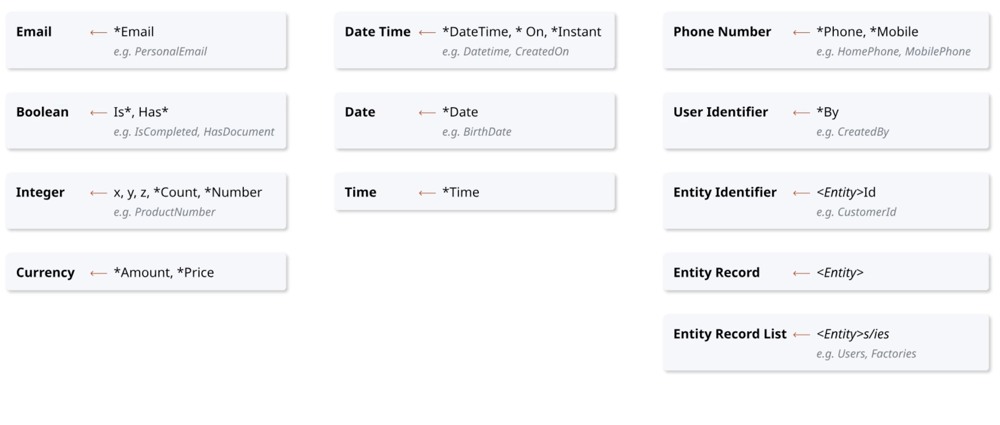

*가정: 만약 속성 이름이 Personal Email* 

*타입 추론: Email* 

## 엔티티 액션

***자동으로 생성된다***

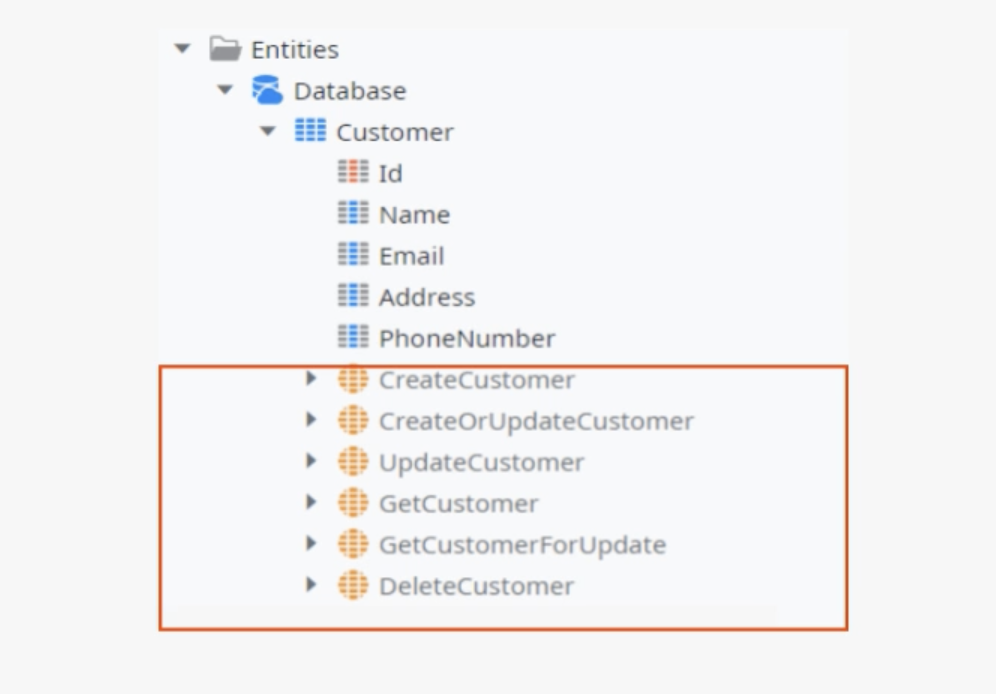

*CRUD 데이터 작업*

    - *Create(생성)*
    - *Retrieve(검색)*
    - *Update(업데이트)*
    - *Delete(삭제)*

*엔티티 액션은 애플리케이션의 비즈니스 로직에서 직접 사용할 수 있다*

*엔티티 액션은 OutSystems에서 자동으로 생성되며 수정할 수 없다*

## 데모: 데이터베이스 엔티티 만들기 방법

*간단한 엔티티 생성 및 속성 추가, Email & Phone Number 데이터 타입 추론으로 자동 지정 확인*

*one click publish를 통해 데이터베이스에 테이블 생성*

## 데모: Excel에서 엔터티 데이터를 시작하기

*엑셀 데이터는 데이터 유형과, 이름 기반으로 엔티티 속성에 매핑되고 매핑되지 않으면 해당 속성(값)은 추가되지 않는다*

**작접 진행 순서**

*엔티티 우클릭 → Advanced → Create Action to Bootstrap Data from Excel →* 

*Excel 파일 선택 → Proceed → one click publish →*

*Processes 탭 Timers 밑에 보면 BootStrapCustomer(엔티티 이름)이 존재*

**OutSystems Timers?**

*타이머는 미리 정의된 스케줄에 따라 실행되는 백그라운드 작업이다.*

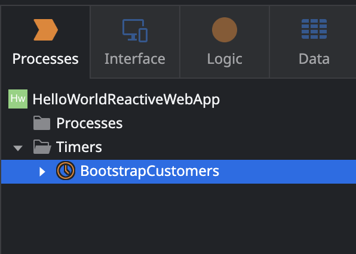

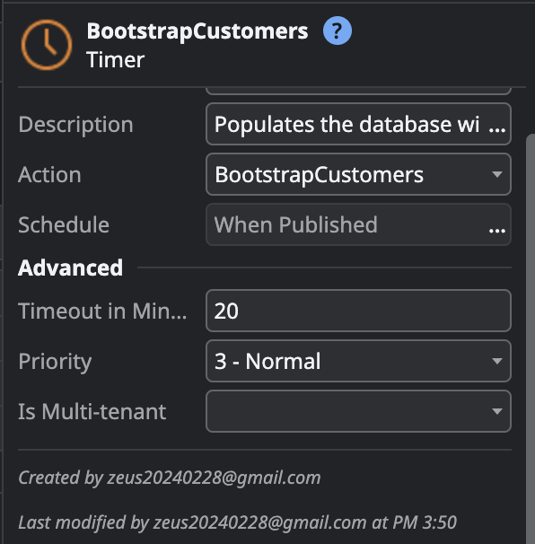

*타이머 속성에서 Schedule을 보면 모듈이 게시될 때마다 실행된다*

*타이머를 더블클릭하면 관련된 로직을 확인할 수 있다*

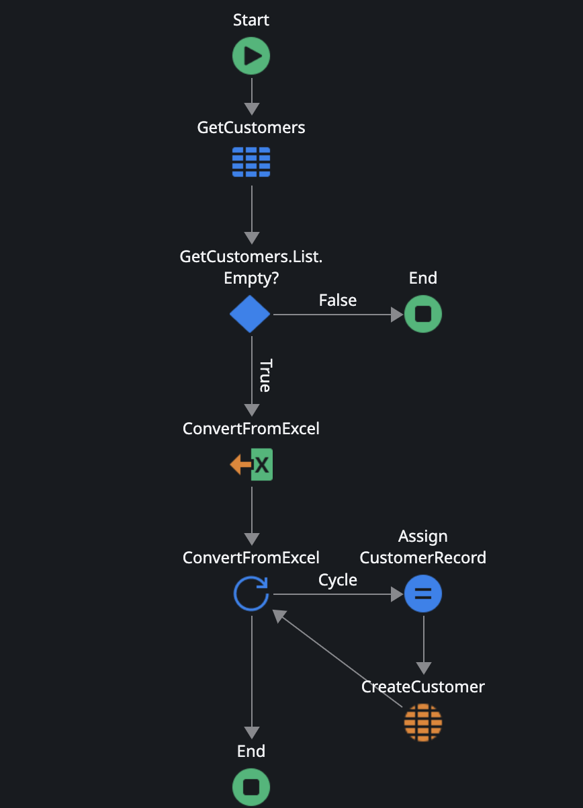

*데이터 텝으로 돌아가서 데이터를 확인하면 엑셀 데이터가 추가된것을 볼 수 있다*

## Excel에서 엔티티 및 데이터를 시작하는 방법

*Data 텝 → Entity 우클릭 → Import New Entities From Excel 버튼 클릭*

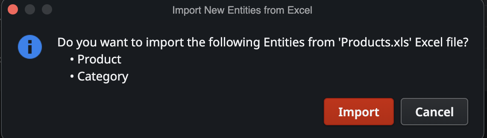

*Service Studio는 Excel 파일을 분석하여, 두 개의 시트를 감지했다(Product, Category)*

*Category, Product 엔티티의 속성을 보면 자동으로 Id 속성(식별자)이 추가된것을 볼 수 있다.*

*one click publish를 통해 데이터베이스에 엔티티(테이블)이 생성되고 모듈을 성공적으로 배포한 후 데이터가 해당 엔티티로 부트스트랩된다*

## Bootstrap Entity and data from an Excel File

### OAP 파일 설치

    1. *OutSystems Service Studio를 열고 로그인한다.*
    1. *로그인 후 상단에서 Environment를 클릭한다.*
    1. *Environment 메뉴에서 Open Files를 선택한다.*
    1. *다운로드한 Lesson Materials 폴더로 이동하여 OAP 파일을 찾는다.*
    1. *해당 파일을 선택하고 Open을 클릭한다.*
    1. *앱이 Service Studio에 설치될 때까지 기다린 뒤, 안내가 뜨면 Proceed를 클릭한다.*
    1. *Employee Directory 앱 설치가 끝나면 그 앱을 클릭해 연결된 모듈을 연다. 그러면 앱이 Service Studio에서 열린다.*

### 엔티티 추가

*이전 과정과 똑같이 Import New Entities From Excel을 통해 Employees 엔티티 생성 및 데이터 추가*

*데이터가 보이지 않으면 CTRL + R****(맥북: command + R)****을 통해 미리보기를 새로고침한다*

### 속성 수정

*표에 나타난 속성 이름과 데이터를 수정할 수도 있다*

*‘PhoneNo_’ 속성을 수정하자*

    1. *Data 탭에서 Employee Entity를 펼친다.*
    1. *Entity 목록에서* ***`PhoneNo_`*** *속성을 선택하고, 속성 창에서 Name을* ***`PhoneNumber`****로 변경한다.*
    1. *Data Type을 Long Integer로 바꾸고, 해당 속성을 mandatory(필수)로 설정한다.*

*또한 다음 속성들도 모두 mandatory로 설정해야 한다.*

    - FirstName
    - LastName
    - Email
    - HiringDate
    - IsManager

*변경 사항을 서버에 저장하기 위해 다시 모듈을 Publish 한다.*

*속성 설정을 업데이트하면 해당 값이 0으로 보이게 된다.*

### 데이터 넣기

*PhoneNumber 속성에 실제 값을 넣으려면, 수정이 필요한 행에서 Edit 아이콘을 클릭한다.*

*다음과 같이 전화번호를 입력한다.*

    - *Caddric Saiz: 9148033049*
    - *Irvine Hasser: 9148033048*
    - *Fidelia Garahan: 9148033045*
    - *Zacharias Pre: 9148033044*
    - *Cletus Harget: 9148033043*
    - *Anatol Lago: 9148033042*
    - *Anny Ledington: 9148033041*
    - *Elka Scopes: 9148033047*
    - *Deloria McInility: 9148033046*

*입력을 마친 후 Apply를 클릭해 Entity에 변경 사항을 반영한다.*

## Create an Entity Exercise

*Project와 Department라는 두 개의 엔티티를 추가로 생성*

*첫 번째 엔티티(Project)는 아래 속성들로 수동으로 만든다.*

    - *Id (기본)*
    - *Name (필수)*
    - *Description (필수, 데이터 타입 Text, 길이 500자)*
    - *DueDate (필수, 데이터 타입 Date)*

*두 번째 엔티티(Department)도 아래 속성들로 수동으로 만든다.*

    - *Id (기본)*
    - *Name (필수)*
    - *Description (필수, 데이터 타입 Text, 길이 500자)*

*엔티티들을 생성한 후, Project.xlsx와 Department.xlsx 파일에 있는 데이터를 사용해 Bootstrap Data from Excel 액션으로 각각의 엔티티에 데이터를 부트스트랩한다.*

### 엔티티 다이어그램 만들기

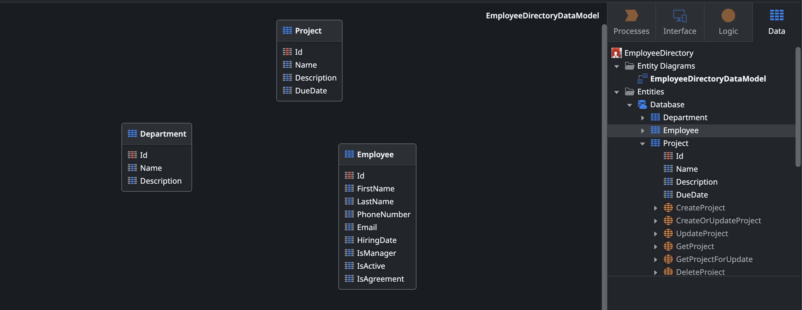

    1. *Data 탭에서 Entity Diagrams 아래의 EmployeeDirectoryDataModel을 더블 클릭해 연다.*
    1. *미리보기 영역으로 Department 엔티티를 드래그한다.*
    1. *같은 방식으로 Employee 엔티티와 Project 엔티티도 미리보기 영역으로 드래그한다.*
    1. *변경 사항을 저장하기 위해 모듈을 Publish 한다.*

*이로써 다음 작업들을 성공적으로 수행한 것이다.*

    - *두 개의 엔티티와 그 속성들을 생성했다.*
    - *새로 만든 엔티티들에 데이터를 부트스트랩했다.*
    - *Employee Directory 데이터 모델에 대한 엔티티 다이어그램을 만들었다.*

## 퀴즈 오답노트

*엔티티는 최소한 하나의 속성을 가져야 하지만 식별자는 필수 사항은 아니다.*

    - *엔티티는 식별자가 필수 사항이다? 뭐가 정답인건지 ;*

*엔티티는 영구적이며 실제로 데이터베이스에 테이블로 생성된다.*

*Q: HouseNumber라는 이름의 엔티티 속성을 생성할 경우, 해당 속성의 데이터 형식은 어떻게 설정해야 합니까?*

*A:* ***OutSystems의 데이터 유형 추론 메커니즘이 이를 자동으로 Integer(정수형)으로 처리한다***

*부가 설명: suffix가 Number인 경우 → 타입 추론을 통해 Integer로 처리한다.*

**자동 생성되는 엔티티 액션 종류**

    - *create*
    - *createOrUpdate*
    - *Update*
    - *get*
    - *getForUpdate*
    - *delete*

# 정적 엔티티

---

## 정적 엔터티

*정적 엔터티는 애플리케이션에서 사용할 수 있는* ***사전에 정의된 값 목록****을 만드는 특별한 유형의 엔터티이다.*

*마치 Java Enum(열거형)같은 기능*

*정적 엔터티는 속성과 레코드를 가지고 있다*

    - *설계 및 개발 중에 정의된다*
    - *실시간(run time)으로 변경이 불가능하다*

*단 하나의 엔터티 액션이 있다(Get) → 데이터는 read only*

### 정적 엔티티 기본 4가지 속성

    - ID
    - 레이블(Label)
    - 순서(Order)
    - Is Active

### 정적 엔티티 속성 특징

    - *기본 속성 변경이 가능*
    - *다른 속성 추가가 가능*

### 정적 엔티티 레코드

    - *정적 엔터티는 레코드 집합을 가진다*

## 데모: 정적 엔터티 만들기 방법

*data tab → database 우클릭 → add static entity*

*새로 생성된 정적 엔터티를 보면 기본 4가지 속성(Id, Label, Order, Is Active), Get 엔터티 액션,* 

*빈 Records 폴더가 표시된다*

*Records 우클릭 → Add Record*

## Create Static Entity

*아웃시스템즈 Employee Directory 앱에서 정적 엔터티를 생성하고 레코드를 추가하는 실습 가이드*

### 실습 목표

*Employee Directory 앱 내에서 Job Title이라는 정적 엔터티를 생성하여, 애플리케이션 실행 중 변경되지 않는 직책 목록 레코드를 저장합니다.*

## 퀴즈 오답노트

**1. 다음 중 정적 엔터티의 특징은 무엇입니까?** 

    - *초기 게시 후에는 변경할 수 없습니다. → 변경이 가능하다. 애플리케이션 런타임에만 변경이 불가능*
    - *레코드 집합을 포함합니다. → 정답*
    - *두 개의 엔터티 액션을 가지고 있습니다. → 1개의 Get 엔티티 액션만을 가진다.*
    - *새로운 속성으로 확장할 수 없습니다. → 새로운 속성을 확장할 수 있다.*

**2. 정적 엔터티의 기록에 대해, 다음 중 어떤 것이 거짓입니까?** 

    - *모든 4개의 기본 속성 값은 정의되어야 합니다. → 정적 엔터티의 속성 값은 필수가 아니다.*
    - *레코드는 개발 중에만 추가 및 제거할 수 있습니다. → 레코드는 런타임에 변경이 불가능하다*
    - *레코드 식별자는 정적 엔터티의 식별자입니다. → 레코드 식별자는 정적 엔터티의 식별자이다*
    - *정적 엔터티의 모든 엔터티에는 식별자 속성이 필요합니다. → 정적 엔터티의 모든 엔터티에는 식별자 속성이 필요*

**3. 정적 엔터티는 어떤 다른 프로그래밍 개념과 가장 유사합니까?** 

    - *연결 리스트*
    - *열거형 → 정적 엔터티는 Enum 즉, 열거형과 가장 유사한 개념이다.*
    - *해시 맵*
    - *정적 변수*

## 정적 엔터티 구조 정리

```html
JobTitle (정적 엔터티)
├── 속성들
│   ├── Id (Integer, 자동생성, PK)
│   ├── Label (Text, 필수)
│   ├── Order (Integer, 선택)
│   └── Is_Active (Boolean, 선택)
│
└── Records (레코드 집합)
    ├── Record A
    │   ├── Id = 1 (자동생성)
    │   ├── Label = "Software Engineer"
    │   ├── Order = 1 (수동입력)
    │   └── Is_Active = True
    ├── Record B  
    │   ├── Id = 2 (자동생성)
    │   └── Label = "Senior Software Engineer"
    └── Record C...
```

```html
// 변수 타입: JobTitle Identifier
MyJobTitle = JobTitle.SoftwareEngineer  // Id=1을 가리킴

// 조건 비교
If(MyJobTitle == JobTitle.SoftwareEngineer, ...)
```

***즉, 레코드 식별자는 정적 엔터티의 식별자와 동일하다***

# 데이터 관계 모델링

---

### 엔터티 식별자

*엔터티는 관계를 허용하기 위해 식별자를 필수로 갖는다*

*Id 속성은 Long Integer 이며, 기본적으로 Auto Increment가 적용된다*

**가능한 유형/타입**

    - *Text*
    - *Integer / Long Integer*
    - *다른 엔터티 식별자*

***식별자 속성을 삭제할 수도 있지만, 이 경우 엔터티와 관계를 생성할 수 없다.***

***OutSystems는 단순 기본 키만 지원하며 복합 키를 지원하지 않는다 →*** *즉, 식별자는 하나의 속성만을 가진다.*

### 엔터티 참조

*엔터티는 식별자를 사용하여 참조될 수 있다*

*엔터티 식별자 유형의 속성을 만든다*

*필수 또는 선택 사항일 수 있다*

***정적 엔터티는 다른 정적 엔터티만 참조할 수 있다***

*데이터베이스 외래 키를 나타낸다*

*참조 속성의 기본값은 NullIdentifier()이다.*

    - 정수 식별자의 경우 값은 0
    - 텍스트 식별자의 경우 값은 빈 텍스트가 된다.

### 관계의 종류

*OutSystems는 1:N, 1:1, N:N 세 가지 유형의 데이터 관계를 지원한다.*

*1:N 관계는 엔터티 중 하나에 참조 속성을 추가하여 생성된다*

*1:1 관계는 엔터티 중 하나에서 식별자 유형을 Other Entity Identifier로 설정하여 생성된다*

*n:n 관계는 관계에 있는 엔티티 자체 식별자와 2개의 참조 식별자를 추가하여 생성된다*

# 1-to-Many Relationship

---

# 1-to-Many Relationship Exercise

---

# 1-to-1 Relationship

---

# 1-to-1 Relationship Exercise

---

# Many-to-Many Relationship

---

# Many-to-Many Relationship Exercise

---

# 퀴즈

---

# 시험 - 11월 15일(토)

  - *현재 2026년 11월 15일: D-84*
  - ***원서접수: 2026년 10월 12일 ~ 10월 16일  / 시험날짜: 2026년 11월 15일 (일)***
  - *총점 75점 이상, 각 과목 40%이상 득점*

- 1과목, 2과목 강의 및 정리
    - 친절한 SQL 튜닝 2회독
    - 오라클 성능 고도화 원리 해법1, 2 2회독
    - SQL 전문가 가이드 1회독
    - SQLP 자격검정 핵심노트1,2 1회독
    - SQL 자격검정 실전문제 1회독
    - SQLP 자격검정 핵심노트1,2 1회독
    - SQL 자격검정 실전문제 1회독
    - 실기 문제 준비 1회독

[https://velog.io/@sua_ahn/SQLP-3%EA%B0%9C%EC%9B%94-%EB%8F%85%ED%95%99-%ED%95%A9%EA%B2%A9-%ED%9B%84%EA%B8%B0-51%ED%9A%8C](https://velog.io/@sua_ahn/SQLP-3%EA%B0%9C%EC%9B%94-%EB%8F%85%ED%95%99-%ED%95%A9%EA%B2%A9-%ED%9B%84%EA%B8%B0-51%ED%9A%8C)

### 참고 자료

[https://www.hdatalab.co.kr/shop_view/?idx=13](https://www.hdatalab.co.kr/shop_view/?idx=13)

# SQLD(1,2 과목 정리)

# 1과목

# 2과목

# SUBSTR - 문자열 추출

```javascript
SUBSTR(문자열, 시작위치, 길이)
```

***문자열 위치는 1부터 시작한다.***

```javascript
SUBSTR('ABCDEFG', 2, 3)

결과: BCD
```

***세 번째 인자인 길이를 생략하면 끝까지 가져온다.*** 

```javascript
SUBSTR('ABCDEFG', 4)

결과: DEFG
```

***음수 위치***

```javascript
 A B C D E F G
 1 2 3 4 5 6 7

-7-6-5-4-3-2-1
```

```javascript
SUBSTR('ABCDEFG', -3, 2)

결과: EF
```

---

# LENGTH - 문자열 길이

```javascript
LENGTH(문자열)
```

```javascript
LENGTH('ABCDE')

결과: 5
```

Oracle LENGTHB 함수 같은 경우 문자 수가 아니라 바이트 수를 구한다.

---

# INSTR - 문자열 위치 찾기

```javascript
INSTR(문자열, 찾을문자열 [, 시작위치 [, 몇번째]])
```

```javascript
INSTR('ABCDEFG', 'D')

결과: 4
```

```javascript
INSTR('ABABAB', 'A', 1, 2)

결과: 3
```

---

# LPAD - 왼쪽 채우기 / RPAD - 오른쪽 채우기

```javascript
LPAD(문자열, 전체길이, 채울문자)
```

```javascript
LPAD('ABC', 7, 'XY')

결과: XYXYABC
```

***지정 길이가 원래 문자열보다 작으면?***

```javascript
LPAD('ABCDEFG', 3, '0')

결과: ABC
```

→ LPAD 두 번째 인자는 추가할 문자의 개수가 아니라 최종 길이이다.

---

# LTRIM / RTRIM - 문자 제거

```javascript
LTRIM('000123', '0')
→ 123
```

***인자를 생략하면 기본적으로 공백을 제거한다.***

```javascript
LTRIM('   ABC')
→ ABC

RTRIM('ABC   ')
→ ABC
```

### 주의할 점

***두 번째 인자를 하나의 문자열 덩어리로 생각하면 안된다.***

```javascript
LTRIM('ABBAZACD', 'AB')
-> ZACD
```

AB 라는 문자열을 찾는 게 아니라 A 또는 B에 해당하는 문자를 왼쪽에서 계속 제거한다.

# TRIM - 양쪽 제거

```javascript
TRIM('   ABC   ')
→ ABC

TRIM('X' FROM 'XXXABCXXX')
→ ABC

TRIM('   A B C   ')
→ 'A B C'
```

---

# REPLACE - 문자열 치환

```javascript
REPLACE(문자열, 찾을문자열, 변경문자열)
```

```javascript
REPLACE('ABCABC', 'A', 'X')
→ XBCXBC

REPLACE('ABCABC', 'AB', 'XY')
→ XYCXYC
```

***세번째 인자를 생략한다면?***

```javascript
REPLACE('ABCABC', 'A')
→ BCBC
```

---

# LOWER / UPPER / INITCAP - 대소문자 변환

```javascript
LOWER('ABC')
→ abc

UPPER('abc')
→ ABC

INITCAP('hello world')
→ Hello World
```

INITCAP 같은 경우 각 단어의 첫 글자를 대문자로 만든다.

---

# CONCAT / || — 문자열 연결

```javascript
CONCAT('ABC', 'DEF')
→ ABCDEF


'ABC' || 'DEF'
→ ABCDEF


'이름: ' || '철수'
→ 이름: 철수
```

# ROUND 함수(반올림)

```javascript
ROUND(숫자, 자릿수)
```

| 함수 | 결과 | 설명 |
| --- | --- | --- |
| ROUND(3.14159, 2) | 3.14 | 소수점 2자리로 반올림 |
| ROUND(3.5) | 4 | 자릿수 생략 시 정수로 반올림 |
| ROUND(1234.5, -1) | 1230 | 음수는 자릿수 앞쪽 반올림 |
| ROUND(1234.5, -2) | 1200 | 백의 자리로 반올림 |

      - **양수**: 소수점 이하 자릿수 지정
      - **음수**: 정수 부분의 자릿수 지정 (10의 자리, 100의 자리 등)
      - **0**: 정수로 반올림

ROUND(123.41, 0 ) = 123

ROUND(123.51, 0 ) = 124

---

# SIGN 함수(부호 판정)

| 결과 | 의미 |
| --- | --- |
| **1** | 양수 |
| **-1** | 음수 |
| **0** | 0 |

```javascript
SIGN(5)      → 1
SIGN(-5)     → -1
SIGN(0)      → 0
SIGN(3.14)   → 1
SIGN(-0.5)   → -1
```

# 1. **NVL 함수** (Oracle)

```sql
-- Oracle 문법
NVL(expr1, expr2)
-- expr1이 NULL이면 expr2를 반환, 아니면 expr1을 반환
```

SQL-Server 같은 경우 ISNULL 함수를 사용

```javascript
NVL(NULL, 500)                    → 500
NVL(300, 500)                     → 300
NVL(0, 500)                       → 0
NVL(NULL, NULL)                   → NULL
```

---

# 2. **NULLIF 함수** (Oracle/SQL Server 공통)

두 값이 같으면 NULL 반환 다르면, 첫 번째 값 반환

```sql
-- 두 값이 같으면 NULL, 다르면 expr1을 반환
NULLIF(expr1, expr2)
```

```javascript
NULLIF(500, 500)                  → NULL      (같음 → NULL)
NULLIF(500, 300)                  → 500       (다름 → 값1 반환)
NULLIF(NULL, 500)                 → NULL      (NULL은 NULL)
NULLIF(0, 0)                      → NULL      (같음 → NULL)
```

---

# 3. **COALESCE 함수** (Oracle/SQL Server 공통)

```sql
-- 여러 값 중 첫 번째 NULL이 아닌 값을 반환
COALESCE(expr1, expr2, expr3, ...)
```

```javascript
COALESCE(NULL, 500, 300)          → 500
COALESCE(200, 500, 300)           → 200
COALESCE(NULL, NULL, 300)         → 300
COALESCE(NULL, NULL, NULL)        → NULL
```

---

# 4. **ISNULL 함수** (SQL Server 전용)

```sql
-- SQL Server의 기본 NULL 처리 함수
ISNULL(expr1, expr2)
-- expr1이 NULL이면 expr2 반환, 아니면 expr1 반환
```

IS NULL 연산자(조건) → TRUE/FALSE 반환 함수와 다르다.

---

# **SQLD/SQLP 시험 핵심 정리**

| 함수 | Oracle | SQL Server | 용도 |
| --- | --- | --- | --- |
| **NVL** | ✓ | ✗ | NULL을 지정값으로 변환 |
| **ISNULL** | ✗ | ✓ | NULL을 지정값으로 변환 |
| **COALESCE** | ✓ | ✓ | 여러 값 중 첫 NULL이 아닌 값 |
| **NULLIF** | ✓ | ✓ | 같으면 NULL 반환 |
| **CASE WHEN** | ✓ | ✓ | 조건부 NULL 처리 (범용) |

# DECODE 함수

```javascript
DECODE(expr, search1, result1, [search2, result2, ...], [default])
```

동작 방식

```javascript
1️⃣  expr == search1 ? → result1 반환 (끝)
2️⃣  expr == search2 ? → result2 반환 (끝)
3️⃣  expr == search3 ? → result3 반환 (끝)
...
4️⃣  모두 아니면 → default 반환
```

```sql
-- 샘플 테이블
CREATE TABLE emp (
    emp_id VARCHAR2(3),   -- 문자형 (숫자처럼 보이지만 문자)
    emp_name VARCHAR2(20),
    salary NUMBER
);

INSERT INTO emp VALUES ('001', 'Kim', 3000);
INSERT INTO emp VALUES ('002', 'Lee', 4000);
INSERT INTO emp VALUES ('003', 'Park', 5000);
INSERT INTO emp VALUES ('ABC', 'Choi', 2000);
```

---

### ✅ 케이스 1: WHERE 조건에서 문자 = 숫자 (성공)

Oracle & SQL Server 모두 동일하게 작동

```sql
-- 케이스 1-1: 성공 (묵시적 형변환 일어남)
SELECT * FROM emp WHERE emp_id = 1;
-- 결과: emp_id = '001' 행 반환
-- emp_id가 '1' 또는 '001'로 변환되어 비교

-- 케이스 1-2: 성공 (명시적 형변환 권장)
SELECT * FROM emp WHERE emp_id = '1';
-- 결과: emp_id = '001' 행 반환 (Oracle은 자동 형변환)

-- 케이스 1-3: 실패 가능성 높음
SELECT * FROM emp WHERE emp_id = 1;
-- ABC는 숫자로 변환할 수 없어 무시됨
```

---

### ❌ 케이스 2: CASE WHEN에서 문자 WHEN 숫자 (에러)

Oracle - 에러 발생

```sql
-- ❌ 에러 발생!
SELECT emp_id,
       CASE emp_id
           WHEN 1 THEN '직급1'
           WHEN 2 THEN '직급2'
           WHEN 3 THEN '직급3'
           ELSE '기타'
       END AS grade
FROM emp;

-- 에러: ORA-00932: inconsistent datatypes: expected CHAR got NUMBER
```

SQL Server - 에러 발생

```sql
-- ❌ 에러 발생!
SELECT emp_id,
       CASE emp_id
           WHEN 1 THEN '직급1'
           WHEN 2 THEN '직급2'
           WHEN 3 THEN '직급3'
           ELSE '기타'
       END AS grade
FROM emp;

-- 에러: Conversion failed when converting the varchar value to data type int
```

---

### ✅ 케이스 3: 올바른 CASE 문 작성법

Oracle - 문자형으로 통일

```sql
-- ✅ 올바른 방법 1: WHEN을 문자로 지정
SELECT emp_id,
       CASE emp_id
           WHEN '1' THEN '직급1'
           WHEN '2' THEN '직급2'
           WHEN '3' THEN '직급3'
           ELSE '기타'
       END AS grade
FROM emp;

-- 결과:
-- emp_id | grade
-- -------|------
-- 001    | 직급1
-- 002    | 직급2
-- 003    | 직급3
-- ABC    | 기타

-- ✅ 올바른 방법 2: CAST로 형변환
SELECT emp_id,
       CASE CAST(emp_id AS NUMBER)
           WHEN 1 THEN '직급1'
           WHEN 2 THEN '직급2'
           WHEN 3 THEN '직급3'
           ELSE '기타'
       END AS grade
FROM emp;

-- 결과:
-- emp_id | grade
-- -------|------
-- 001    | 직급1
-- 002    | 직급2
-- 003    | 직급3
-- ABC    | 기타  (변환 실패하여 ELSE로 처리)
```

SQL Server - 문자형으로 통일

```sql
-- ✅ 올바른 방법 1: WHEN을 문자로 지정
SELECT emp_id,
       CASE emp_id
           WHEN '1' THEN '직급1'
           WHEN '2' THEN '직급2'
           WHEN '3' THEN '직급3'
           ELSE '기타'
       END AS grade
FROM emp;

-- ✅ 올바른 방법 2: CONVERT로 형변환
SELECT emp_id,
       CASE CONVERT(INT, emp_id)
           WHEN 1 THEN '직급1'
           WHEN 2 THEN '직급2'
           WHEN 3 THEN '직급3'
           ELSE '기타'
       END AS grade
FROM emp;
```

---

### 🔍 케이스 4: 혼합된 데이터 상황

```sql
-- 혼합된 emp 테이블
-- emp_id: '001', '002', '003', 'ABC', '999'

-- ❌ CASE 문자 WHEN 숫자 → 에러
SELECT CASE emp_id
           WHEN 1 THEN 'Match'
           ELSE 'No Match'
       END
FROM emp;

-- ✅ CASE 문자 WHEN 문자 → 성공
SELECT CASE emp_id
           WHEN '1' THEN 'Match'
           WHEN '001' THEN 'Match'
           ELSE 'No Match'
       END
FROM emp;

-- 결과:
-- 001 → Match (WHEN '001' 과 비교)
-- 002 → No Match (WHEN과 일치하는 항목 없음)
-- 003 → No Match
-- ABC → No Match
-- 999 → No Match
```

---

### 📌 중요한 비교: WHERE vs CASE

| 구분 | WHERE 조건 | CASE 문 |
| --- | --- | --- |
| `emp_id = 1` | ✅ 성공 (묵시적 형변환) | ❌ 에러 |
| `emp_id = '1'` | ✅ 성공 | ✅ 성공 |
| 형변환 방식 | 자동 형변환 발생 | 형변환 없음 |
| 권장 | 명시적 형변환 권장 | **반드시 문자형으로 통일** |

# SYSDATE / SYSTIMESTAMP

      - *현재 날짜와 시간을 반환하는 함수*
      - *SYSDATE는 DATE 타입으로 반환됨(초 단위까지만)*
      - *SYSTIMESTAMP 는 TIMESTAMP 타입으로 (초단위 + 소수점 이하 초(밀리초)까지 표현 가능)*

# EXTRACT

      - *날짜 또는 타임스탬프 값에서 연, 월, 일 등 특정 요소를 출력하는 함수*
      - *출력 결과는 숫자 타입으로 변환됨*

```javascript
EXTRACT(추출 대상 FROM 날짜)
```

      - *추출 대상: YEAR, MONTH, DAY, HOUR, MINUTE, SECOND*
      - *SYSDATE 같은 DATE 타입에서는 YEAR, MONTH, DAY만 추출 가능*
      - *TIMESTAMP 타입에서는 전부 추출 가능*

example

```javascript
EXTRACT(DAY FROM SYSDATE) -> 17 
```

# ROUND

      - 날짜를 지정한 기준 단위로 반올림하는 함수

```javascript
ROUND(날짜 [, 자리수])
```

      - 자리수에 YEAR, MONTH, DD, HH, MI 등을 지정할 수 있다
      - 지정한 자리에서 직접 반올림하는 것이 아니라, 해당 자리수보다 더 작은 단위에서 반올림을 수행
      - 자리수는 생략 가능하며 DD 즉, 일이다.

# TRUNC

      - 날짜를 지정한 기준 단위로 버리는 함수

```javascript
TRUNC(날짜, [, 자리수])
```

      - 지정한 자리수에서 직접 버리는 갓이 아니라 더 작은 단위에서 버림을 수행하여 지정한 자리수로 맞춘다.
      - 생략 시 기본값은 DD

# 변환함수

      - 숫자 형태의 문자와 숫자 데이터 간 연산 시, 묵시적 형 변환이 발생하여 정상적으로 수행된다

# TO_NUMBER

```javascript
TO_NUMBER(대상)
```

# TO_CHAR

      - 숫자 또는 날짜 데이터를 문자 타입으로 변환하는 함수

```javascript
TO_CHAR(대상, [, FROMAT]
```

### 숫자 포멧 (Number Format)

| 포멧 요소 | 설명 | 예시 |
| --- | --- | --- |
| `9` | 숫자 자리 (앞의 0 제거) | `TO_CHAR(123, '9999')` → ‘ 123’ |
| `0` | 숫자 자리 (앞의 0 표시) | `TO_CHAR(123, '0999')` → ‘0123’ |
| `.` | 소수점 | `TO_CHAR(123.4, '999.99')` → `123.40` |
| `,` | 천단위 구분 | `TO_CHAR(1234, '9,999')` → `1,234` |
| `$` | 달러 기호 | `TO_CHAR(100, '$999')` → `$100` |

### 날짜 포멧 (Date Format)

| 포멧 요소 | 설명 | 예시 |
| --- | --- | --- |
| `YYYY` | 4자리 연도 | `2024` |
| `YY` | 2자리 연도 | `24` |
| `MM` | 2자리 월 | `01`~`12` |
| `MON` | 3자리 월 약자 | `JAN`, `FEB` |
| `MONTH` | 월 전체명 | `JANUARY`, `FEBRUARY` |
| `DD` | 2자리 일 | `01`~`31` |
| `DAY` | 요일 전체명 | `MONDAY`, `TUESDAY` |
| `DY` | 요일 약자 | `MON`, `TUE` |
| `HH24` | 24시간 형식 시간 | `00`~`23` |
| `HH` 또는 `HH12` | 12시간 형식 시간 | `01`~`12` |
| `MI` | 분 | `00`~`59` |
| `SS` | 초 | `00`~`59` |
| `AM/PM` | 오전/오후 | `AM`, `PM`  |

### YY, RR 차이

YY 같은 경우 입력된 두 자리 연도를 현재 세기 기준으로 해석한다

→ 49 → 2049년, 50 → 2050년

RR 같은 경우 입력된 연도를 현재 연도를 기준으로 과거 또는 미래로 해석한다

→ 00~49년 → 20XX년, 50~99 → 19XX 년

***TO_DATE 함수에서 지정되지 않은 날짜 요소는 현재 날짜를 기준으로 설정된다.***

# 날짜 연산

      - 숫자 1은 하루를 의미
      - 숫자 1/24 한 시간을 의미
      - 10/24/60 = 10 * (1/10/24) = 10분

| 순위 | 연산자 | 설명 |
| --- | --- | --- |
| 1 | `()` | 괄호 (최우선) |
| 2 | `NOT` | 논리 부정 |
| 3 | `*`, `/`, `%` | 곱셈, 나눗셈, 나머지 |
| 4 | `+`, `-` | 덧셈, 뺄셈 |
| 5 | `=`, `<>`, `!=`, `<`, `>`, `<=`, `>=`, `LIKE`, `IN`, `BETWEEN` | 비교 연산자 |
| 6 | `AND` | 논리 AND |
| 7 | `OR` | 논리 OR |

(), NOT, (곱셈, 나눗셈, 나머지), (덧셈, 뺄셈), 비교 연산자, AND, OR

```plain text
SELECT *
FROM EMP
WHERE DEPTNO NOT IN (10, 20, NULL);
```

*`DEPTNO = 30`**이라고 해보면* *`NOT IN`**은 논리적으로 다음과 같다.*

```plain text
DEPTNO <> 10
AND DEPTNO <> 20
AND DEPTNO <> NULL
```

```plain text
30 <> 10    → TRUE
30 <> 20    → TRUE
30 <> NULL  → UNKNOWN

TRUE AND TRUE AND UNKNOWN
→ UNKNOWN
```

*`WHERE`* *절은* ***TRUE인 행만 반환****하기 때문에 이 행은 조회되지 않아.*

*그래서* *`NOT IN`* *목록이나 서브쿼리 결과에* *`NULL`**이 하나라도 포함되어 있으면 일반적으로* ***어떤 값도 TRUE가 될 수 없어서 결과가 공집합****이 돼.*

### SQLP 암기 포인트

***`NOT IN + NULL → 결과 없음`***

*다만 표현할 때는* ***"모든 비교가 FALSE가 된다"****보다는*

> ***NULL과의 비교 결과가 UNKNOWN이 되고, NOT IN 전체 조건이 TRUE가 될 수 없기 때문에 조회되지 않는다.***

# Oracle with Docker

### oracle db 설치

```plain text
docker run -d --name oracle-db \
  -p 1521:1521 \
  -e ORACLE_PASSWORD=[REDACTED] \
  gvenzl/oracle-free:latest
```

### oracle db 접속

```plain text
docker exec -it oracle-db bash
sqlplus system/password1234@FREEPDB1
```

### Oracle: 사용자 = 스키마

```plain text
-- 현재 사용자 확인
SELECT USER FROM DUAL;

-- 모든 사용자(스키마) 확인
SELECT username FROM dba_users;
```

### 테이블 조회 

```plain text
-- 현재 사용자의 테이블
SELECT table_name FROM user_tables;

-- 또는
SELECT * FROM tab;
```

# 책 내용 정리

옵티마이저가 SQL을 어떻게 처리하는지, 서버 프로세스는 데이터를 어떻게 읽고 저장하는지 살펴보자

# 1.1.1 구조적, 집합적, 선언적 질의 언어

SQL은 Structured Query Language 줄임말이다. 즉, 구조적 질의 언어다.

오라클 PL/SQL, SQL Server T-SQL 처럼 절차적 프로그래밍 기능을 구현할 수 있는 확장 언어도 제공하지만

SQL은 기본적으로 구조적, 집합적, 선언적 언어이다.

하지만 결과집합을 만드는 과정은 결국 절차적일 수밖에 없다.

즉, 프로시저가 필요한데, 그런 프로시저를 만들어 내는 DBMS 내부 엔진이 바로 SQL 옵티마이저다.

옵티마이저가 프로그래밍을 대신 해주는 셈이다.

DBMS 내부에서 프로시저를 작성하고 컴파일해서 실행 가능한 상태로 만드는 전 과정을 SQL 최적화라고 한다.

사용자 (SQL)→ 옵티마이저 (실행계획)→ 프로시저  

# 1.1.2 SQL 최적화

        1. SQL 파싱
        - 사용자로부터 SQL을 전달받으면 가장 먼저 SQL 파서가 파싱을 진행한다.
- 파싱 트리 생성: SQL 문을 이루는 개별 구성요소를 분석해서 파싱 트리 생성
          - Syntax 체크: 문법적 오류가 없는지 확인. 사용할 수 없는 키워드를 사용했거나 순서가 바르지 않거나 누락된 키워드가 있는 확인
          - Semantic 체크: 의미상 오류가 없는지 확인. 존재하지 않는 테이블 또는 컬럼을 사용했는지, 사용한 오브젝트에 대한 권한이 있는지 확인
        1. SQL 최적화
        - 옵티마이저가 역할을 맡는다.
        - 옵티마이저는 미리 수집한 시스템 및 오브젝트 통계정보를 바탕으로 다양한 실행경로를 생성해서 비교한 후 가장 효율적인 하나를 선택한다.
        - 데이터베이스 성능을 결정하는 가장 핵심적인 엔진이다.
        1. 로우 소스 생성
        - 옵티마이저가 선택한 실행경로를 실제 실행 가능한 코드 또는 프로시저 형태로 포맷팅하는 단계
        - 로우 소스 생성기가 그 역할을 맡는다.

# 1.1.3 SQL 옵티마이저

옵티마이저는 사용자가 원하는 작업을 가장 효율적으로 수행할 수 있는 최적의 데이터 엑세스 경로를 선택해 주는 DBMS의 핵심 엔진이다.

        1. 사용자로부터 전달받은 쿼리를 수행할 수 있는 실행계획들을 찾아낸다.
        1. 데이터 딕셔너리에 미리 수집해 둔 오브젝트 통계 및 시스템 통계성 정보를 이용해 각 실행계획의 예상비용을 산정한다.
        1. 최저 비용을 나타내는 실행계획을 선택한다.

SQL 옵티마이저는 백그라운드 프로세스가 아닌 서버 프로세스가 가진 기능일 뿐이다.

SQL 파서와 로우 소스 생성기도 마찬가지다.

# 1.1.4 실행계획과 비용

DBMS에는 SQL 실행경로 미리보기 기능이 있다. 실행계획이 바로 그것이다.

SQL 옵티마이저가 생성한 처리절차를 사용자가 확인할 수 있게 트리 구조로 표현한 것이 실행계획이다.

미리보기 기능을 통해 작성한 SQL이 테이블을 스캔하는지 인덱스를 스캔하는지, 인덱스를 스캔한다면 어떤 인덱스인지를 확인할 수 있고, 예상과 다른 방식으로 처리된다면 실행경로를 변경할 수 있다.

옵티마이저는 비용을 근거로 선택을 한다.

비용이란 쿼리를 수행하는 동안 발생할 것으로 예상하는 I/O 횟수 또는 예상 소요시간을 표현한 값이다.

SQL 실행계획에 표시되는 비용은 어디까지나 예상치다.

실행경로를 선택하기 위해 옵티마이저가 여러 통계 정보를 활용해서 계산해 낸 값이다.

실측치가 아니므로 실제 수행할 때 발생하는 I/O 또는 시간과 많은 차이가 난다.

# 1.1.5 옵티마이저 힌트

SQL 옵티마이저도 대부분 좋은 선택을 하지만, 완벽하지는 않는다.

SQL이 복잡할수록 실수할 가능성도 크다.

통계 정보에 담을 수 없는 데이터 또는 업무 특성을 활용해 개발자가 직접 더 효율적인 엑세스 경로를 찾아낼 수도 있다. 이럴 때 옵티마이저 힌트를 이용해 데이터 엑세스 경로를 바꿀 수 있다.

## 주의사항

힌트 안에 인자를 나열할 땐 콤마를 사용할 수 있지만, 힌트와 힌트 사이에 사용하면 안 된다.

```javascript
/*+ INDEX(A A_X01) INDEX(B, B_XO3) */  -> 모두 유효
/*+ INDEX(C), FULL(D) */ -> 첫 번째 힌트만 유효
```

테이블을 지정할 때 스키마명까지 명시하면 안 된다.

```javascript
SELECT /*+ FULL(SCOTT.EMP) */ -> 무효
```

FROM 절 테이블 옆에 ALIAS를 지정했다면, 힌트에도 반드시 ALIAS를 사용해야 한다.

FROM 절에 ALIAS를 지정했는데 힌트에는 테이블명을 사용하면, 그 힌트는 무시된다.

```javascript
SELECT /*+ FULL(EMP) */ -> 무효
FROM EMP E
```

소프트 파싱과 하드 파싱의 차이점 설명한다.

SQL의 내부 최적화 과정의 복잡성을 알고 나면, 동시성이 높은 온라인 트랜잭션 처리 시스템에서 바인드 변수가 왜 중요한지 이해하게 될 것이다.

# 1.2.1 소프트 파싱 VS 하드 파싱

SQL 파싱, 최적화, 로우 소스 생성 과정을 거쳐 생성한 내부 프로시저를 반복 재사용할 수 있게 캐싱해 두는 메모리 공간을 라이브러리 캐시라고 한다.

라이브러리 캐시는 SGA(System Global Area) 구성요소다. SGA는 서버 프로세스와 백그라운드 프로세스가 공통으로 엑세스하는 데이터와 제어 구조를 캐싱하는 메모리 공간이다.

사용자가 SQL 문을 전달하면 DBMS는 SQL을 파싱한 후 해당 SQL이 라이브러리 캐시에 존재하는지 먼저 확인한다. 캐시에서 찾으면 곧바로 실행 단계로 넘어가지만, 찾지 못하면 최적화 단계를 거친다.

SQL을 캐시에서 찾아 곧바로 실행단계로 넘어가는 것을 소프트 파싱이라 하고, 찾는 데 실패해 최적화 및 로우 소스 생성 단계까지 모두 거치는 것을 하드 파싱이라고 한다.

## SQL 최적화 과정은 왜 하드한가

옵티마이저가 SQL을 최적화할 때도 데이터베이스 사용자들이 보통 생각하는 것보다 훨씬 많은 일을 수행한다.

알고리즘과 하드웨어가 발전하면서 워낙 빠르게 처리하다 보니 잘 느끼지 못하겠지만, SQL 옵티마이저는 순식간에 엄청나게 많은 연산을 한다. 아래는 옵티마이저가 사용하는 정보이다.

        - 테이블, 컬럼, 인덱스 구조에 관한 기본 정보
        - 오브젝트 통계: 테이블 통계, 인덱스 통계, 컬럼 통계
        - 시스템 통계: CPU 속도, Single Block I/O 속도, Multi Block I/O 속도 등
        - 옵티마이저 관련 파라미터

딕셔너리와 통계정보를 읽어 각각에 대한 효율성을 판단하는 과정은 가벼울 수 없다.

데이터베이스에서 이루어지는 처리 과정은 대부분 I/O 작업에 집중되는 반면, 하드 파싱은 CPU를 많이 소비하는 몇 안 되는 작업 중 하나이다.

이렇게 어려운 작업을 거쳐 생성한 내부 프로시저를 한 번만 사용하고 버린다면 비효율적이다.

라이브러리 캐시가 필요한 이유가 바로 여기에 있다.

# 1.2.2 바인드 변수의 중요성

### 이름없는 SQL 문제

사용자 정의 함수/프로시저, 트리거, 패키지 등은 생성할 때부터 이름을 갖는다.

컴파일한 상태로 딕셔너리에 저장되며, 사용자가 삭제하지 않는 한 영구적으로 보관된다.

실행할 때 라이브러리 캐시에 적재함으로써 여러 사용자가 공유하면서 재사용한다.

하지만, SQL은 이름이 존재하지 않는다. 처음 실행할 때 최적화 과정을 거쳐 동적으로 생성한 내부 프로시저를 라이브러리 캐시에 적재함으로써 여러 사용자가 공유하며 재사용하고, 캐시 공간이 부족하면 버려졌다가 다음에 다시 실행할 때 똑같은 최적화 과정을 거쳐 캐시에 적재된다.

SQL은 자체가 이름이기 때문에 텍스트중 작은 부분이라도 수정되면 그 순간 다른 객체가 새로 탄생하는 구조다

DBMS에서 수행되는 SQL이 모두 완성된 SQL은 아니며, 특히 개발 과정에서 수시로 수정이 일어난다.

일회성 또는 무효화된 SQL까지 모두 저장하려면 많은 공간이 필요하고, 그만큼 SQL을 찾는 속도가 느려진다.

오라클 같은 DBMS가 SQL을 영구적으로 저장하지 않는 쪽을 선택하는 이유다.

### 공유 가능 SQL

SQL을 하드 파싱하면 해당 SQL을 사용할 때 DBMS 내부 프로시저를 하나씩 만들어서 라이브러리 캐시에 적재한다.

프로시저의 내부 처리 루틴이 모두 같다면 ex) SELECT * FROM CUSTOMER WHERE ID = ‘’

프로시저를 여러 개 생성할 것이 아니라 아래처럼 ID를 파라미터로 받는 프로시저를 하나 공유하면서 재사용하는것이 마땅하다.

```javascript
create procedure LOGIN (login_id in varchar2) { ... }
```

이처럼 파라미터 Driven 방식으로 SQL을 작성하는 방법이 제공되는데, 바인드 변수가 바로 그것이다.

데이터 저장 구조, 디스크 및 메모리에서 데이터를 읽는 메커니즘을 이해하자

# 1.3.1 SQL이 느린 이유

SQL이 느린 이유는 디스크 I/O 때문이다.

I/O = 잠(sleep)이다. OS 또는 I/O 서브시스템이 I/O를 처리하는 동안 프로세스는 잠을 자기 때문이다.

# 1.3.2 데이터베이스 저장 구조

데이터를 저장하려면 테이블스페이스를 생성해야 한다.

테이블스페이스는 세그먼터를 담는 콘테이너로서, 여러 개의 데이터파일로 구성된다.

```javascript
Database
   │
   ├── Tablespace
   │      │
   │      ├── Segment
   │      │     │
   │      │     ├── Extent
   │      │     │     │
   │      │     │     ├── Block
   │      │     │     ├── Block
   │      │     │     └── Block
   │      │     │
   │      │     └── Extent
   │      │           └── Block ...
   │      │
   │      └── Segment ...
   │
   └── Tablespace ...
```

**Tablespace > Segment > Extent > Block**

Block이란 데이터를 읽고 쓰는 기본 I/O 단위이다.

## Tablespace - 큰 저장 공간

테이블 스페이스는 여러 데이터베이스 객체를 정하기 위한 논리적인 큰 공간이다.

```javascript
USERS Tablespace
├── MEMBER 테이블
├── ORDERS 테이블
├── MEMBER_IDX 인덱스
└── ...
```

실제로 디스크에는 Data File이 존재하고,  Tablespace가 Data File들을 논리적으로 묶어서 관리한다.

```javascript
논리적                         물리적

TABLESPACE USERS
      │
      ├──────────────────────→ users01.dbf
      │
      └──────────────────────→ users02.dbf
```

Tablespace = 논리적 저장 공간, Data File = 실제 디스크 파일

## Segment - 객체가 사용하는 공간

Segment는 특정 DB 객체가 데이터를 저장하기 위해 사용하는 공간

```javascript
Segment
├── Table Segment
├── Index Segment
├── Undo Segment
└── LOB Segment
```

예를들어 테이블이 생성되면 실제 데이터를 저장하기 위한 공간이 필요한데

해당 공간이 Table Segment 이다.

즉, Segment는 테이블이나 인덱스가 차지하는 저장공간이다.

## Extent - Segment가 공간을 확장하는 단위

Segment가 처음 만들어졌다고 생각해보자.

```javascript
MEMBER Segment

┌───────────────┐
│   Extent 1    │
│ □ □ □ □ □ □   │
└───────────────┘
```

회원 데이터가 계속 들어와서 공간이 부족해지면? 새로운 공간을 추가로 확보한다.

```javascript
MEMBER Segment

┌───────────────┐
│   Extent 1    │
│ □ □ □ □ □ □   │
└───────────────┘

┌───────────────┐
│   Extent 2    │
│ □ □ □ □ □ □   │
└───────────────┘

┌───────────────┐
│   Extent 3    │
│ □ □ □ □ □ □   │
└───────────────┘
```

이렇게 Setment가 공간을 할당받는 단위가 Extent다.

Segment = Extent들의 집합, Extent = 연속된 Block들의 집합

## Block - 실제 데이터를 저장하는 최소 I/O 단위

Block은 Oracle에서 데이터를 읽고 쓰는 기본 단위이다.

```javascript
Extent
│
├── Block 1 (8KB)
├── Block 2 (8KB)
├── Block 3 (8KB)
├── Block 4 (8KB)
└── Block 5 (8KB)
```

```javascript
┌──────────── DB Block ────────────┐
│ Block Header                     │
├──────────────────────────────────┤
│ Row Directory                    │
├──────────────────────────────────┤
│                                  │
│       Free Space                 │
│                                  │
├──────────────────────────────────┤
│ Row 3                            │
│ Row 2                            │
│ Row 1                            │
└──────────────────────────────────┘
```

Row 하나만 딱 디스크에서 가져오는 게 아니라 Block 단위로 읽는다.

그래서 Block을 최소 I/O 단위라고 말한다.

참고로 DB2, SQL Server 같은 DBMS는 블록 대신 페이지(page)라는 용어를 사용한다.

## Partition

Member 테이블에 데이터가 엄청 많다고 해보자.

```javascript
DATABASE
│
└── USERS TABLESPACE
       │
       └── MEMBER SEGMENT
              │
              ├── EXTENT #1
              │      ├── BLOCK #1
              │      │      ├── Row
              │      │      ├── Row
              │      │      └── Row
              │      │
              │      ├── BLOCK #2
              │      │      ├── Row
              │      │      └── Row
              │      │
              │      └── BLOCK #3
              │
              ├── EXTENT #2
              │      ├── BLOCK #4
              │      ├── BLOCK #5
              │      └── BLOCK #6
              │
              └── EXTENT #3
                     ├── BLOCK #7
                     ├── BLOCK #8
                     └── BLOCK #9
```

따라서 데이터가 데이터가 증가하면 아래와 같은 흐름이 된다.

```javascript
Row 증가
   ↓
Block 사용
   ↓
현재 Extent의 Block 부족
   ↓
새 Extent 할당
   ↓
Segment 크기 증가
```

Partition 이란 큰 테이블이나 인덱스를 논리적으로 여러 조각으로 나누는 방법이다.

예를 들어 주문 테이블이 있고 데이터가 10억 건이라 너무 크다면 날짜별로 나눌 수 있다.

```javascript
ORDERS
│
├── 2024년 데이터
├── 2025년 데이터
└── 2026년 데이터
```

또한 각각을 Partition으로 만들 수 있다.

```javascript
ORDERS (Partitioned Table)

┌───────────────────────────────┐
│ P2024                         │
│ 2024년 주문                    │
└───────────────────────────────┘

┌───────────────────────────────┐
│ P2025                         │
│ 2025년 주문                    │
└───────────────────────────────┘

┌───────────────────────────────┐
│ P2026                         │
│ 2026년 주문                    │
└───────────────────────────────┘
```

```javascript
SELECT *
FROM orders
WHERE order_date >= DATE '2026-01-01'
AND order_date < DATE '2027-01-01';


P2017 ❌
P2018 ❌
P2019 ❌
...
P2025 ❌
P2026 ✅ 검색
P2027 ❌
```

이처럼 필요한 Partition만 읽을 수 있다. 이게 Partition Pruning이다.

여기서 중요한 점은 각 Partition이 별도의 Segment를 가질 수 있다.

```javascript
ORDERS
│
├── P2024
│      └── Segment
│           ├── Extent
│           │    ├── Block
│           │    └── Block
│           └── Extent
│
├── P2025
│      └── Segment
│           ├── Extent
│           └── Extent
│
└── P2026
       └── Segment
            ├── Extent
            └── Extent
```

즉, Partition은 테이블을 논리적으로 분할하는 개념이고, 각각의 파티션 데이터가 별도의 Segment에 저장되는 구조이다.

## LOB = Large Object

엄청 큰 데이터를 저장하기 위한 데이터 타입이다.

```javascript
CLOB  → 큰 문자열
BLOB  → 이미지, 파일 등 바이너리
NCLOB → 큰 유니코드 문자열
```

예를 들어 아래와 같이 BOARD 테이블이 있을 때

```javascript
CREATE TABLE BOARD (
    ID NUMBER,
    TITLE VARCHAR2(200),
    CONTENT CLOB
);
```

일반적으로 ID, TITLE 같은 값은 테이블의 데이터 Block에 저장하면 되는데

CONTENT가 수 MB짜리라면 일반 row안에 전부 넣기가 부담스럽다.

그래서 LOB 데이터는 별도의 저장 구조를 사용할 수 있다.

```javascript
BOARD Table

┌─────────────────────────────┐
│ ID │ TITLE │ CONTENT 정보   │
├─────────────────────────────┤
│ 1  │ SQLP  │ LOB Locator ───────┐
└─────────────────────────────┘   │
                                  │
                                  ▼
                          LOB Segment
                       ┌─────────────────┐
                       │ 아주 긴 CONTENT │
                       │ 아주 긴 CONTENT │
                       │ 아주 긴 CONTENT │
                       │ ...             │
                       └─────────────────┘
```

다만 작은 LOB 값은 설정/조건에 따라 row 내부에 저장될 수도 있으니

LOB은 무조건 외부 Segment에 저장된다라고 외우면 안 된다

## 데이터 저장 구조 정리

```javascript
                     DATABASE
                         │
              ┌──────────┴──────────┐
              ▼                     ▼
         TABLESPACE A          TABLESPACE B
              │
        ┌─────┴─────┐
        ▼           ▼
   TABLE SEGMENT  INDEX SEGMENT
        │
        ├── EXTENT #1
        │      │
        │      ├── BLOCK
        │      │     ├── Row
        │      │     ├── Row
        │      │     └── Row
        │      │
        │      └── BLOCK
        │            ├── Row
        │            └── Row
        │
        └── EXTENT #2
               │
               ├── BLOCK
               └── BLOCK


파티션 테이블이라면:

ORDERS
 │
 ├── P2024 ──→ SEGMENT ──→ EXTENT ──→ BLOCK ──→ ROW
 │
 ├── P2025 ──→ SEGMENT ──→ EXTENT ──→ BLOCK ──→ ROW
 │
 └── P2026 ──→ SEGMENT ──→ EXTENT ──→ BLOCK ──→ ROW


LOB이 있다면:

BOARD TABLE SEGMENT
      │
      └── Row
           │
           └── LOB Locator
                  │
                  ▼
              LOB SEGMENT
                  │
                EXTENT
                  │
                BLOCK
```

## Data Block의 연속성과 Extent의 연속성 차이

하나의 Extent를 구성하는 Data Block들은 물리적으로 연속된 공간에 할당된다.

하지만 한 Segment에 속한 Extent와 Extent가 서로 연속될 필요는 없다.

```javascript
[ Data File ]

Extent #1
┌────┬────┬────┬────┬────┐
│B10 │B11 │B12 │B13 │B14 │   ← 연속
└────┴────┴────┴────┴────┘

          다른 Segment의 공간
┌────┬────┬────┐
│ ...│ ...│ ...│
└────┴────┴────┘

Extent #2
┌────┬────┬────┬────┐
│B80 │B81 │B82 │B83 │        ← 연속
└────┴────┴────┴────┘

Extent #1 ↔ Extent #2
→ 서로 떨어져 있어도 됨
```

그렇다면 떨어져 있는 Block  위치를 어떻게 알고 찾아갈 수 있을까? → DBA

## DBA(Data Blcok Address)

DBA란 Data Block의 주소다.

어떤 Block을 찾으려면 최소한 어느 Data File의 몇 번째 Block인지를 알아야한다.

```javascript
DBA
 │
 ├── Data File 번호
 │
 └── Block 번호
 
 DBA = (File #4, Block #1250)
 
 Database
   │
   └── Data File #4
          │
          └── Block #1250
                 │
                 ├── Row
                 ├── Row
                 └── Row
```

즉, DBA는 Row의 주소가 아닌 Block의 주소이다.

## ROWID는 Row를 찾아야 한다.

```javascript
SELECT *
FROM MEMBER
WHERE MEMBER_ID = 100;
```

인덱스를 통해 MEMBER_ID = 100인 데이터를 찾는다고 가정

정확히 어느 ROW인지 찾아갈 수 있어야 한다.

그래서 일반적인 힙 테이블의 인덱스 Leaf Block에는 개념적으로 Key + ROWID가 들어간다.

```javascript
Index Leaf Block

100 → ROWID
101 → ROWID
102 → ROWID
103 → ROWID
```

## ROWID?

```javascript
ROWID
 │
 ├── Data Object Number (어떤 객체의)
 │
 ├── Relative File Number (어떤 파일의)
 │
 ├── Block Number (어떤 Block에 있는)
 │
 └── Row Number (Slot) (몇 번째 row인가)
```

즉, DBA가 File + Block 이라면

ROWID는 거기에 Row 위치 정보까지 포함해서 특정 행을 찾아갈 수 있게 해준다.

## DBA와 ROWID 차이

|  | DBA | ROWID |
| --- | --- | --- |
| 의미 | Data Block 주소 | Row 주소 |
| 찾아가는 대상 | Block | Row |
| 핵심 정보 | File + Block | Object + File + Block + Row Slot |
| 용도 | Block 식별 | 특정 Row 직접 접근 |

```javascript
ROWID
  │
  ├── Object
  │
  ├── DBA에 해당하는 정보
  │      ├── File
  │      └── Block
  │
  └── Row Slot
```

## 인덱스를 통해 데이터를 찾아가는 과정

```javascript
SELECT *
FROM MEMBER
WHERE MEMBER_ID = 100;
```

MEMBER_ID는 B-Tree Index 존재

```javascript
             SQL
              │
              ▼
     MEMBER_ID = 100
              │
              ▼
       INDEX ROOT BLOCK
              │
              ▼
      INDEX BRANCH BLOCK
              │
              ▼
       INDEX LEAF BLOCK
              │
        100 → ROWID
              │
              ▼
          ROWID 해석
              │
      ┌───────┴────────┐
      │                │
   File #4         Block #1250
                       │
                       ▼
                Data Block 접근
                       │
                    Slot #3
                       │
                       ▼
                 실제 MEMBER Row
```

Oracle은 디스크에서 Row 하나만 읽어오지 않는다.

즉 Row가 100Byte밖에 안 되더라도 그 Row가 들어있는 DB Block을 Buffer Cache로 가져온다.

```javascript
Disk
 │
 │  Block 단위 I/O
 ▼
Buffer Cache
┌─────────────────────────┐
│ Block #1250             │
│                         │
│ Row 1                   │
│ Row 2                   │
│ Row 3 ← 내가 원하는 Row  │
│ Row 4                   │
│ ...                     │
└─────────────────────────┘
```

Random Access가 비싼 이유

인덱스의 리프 블록은 앞뒤를 가리키는 주소값을 통해 논리적으로 서로 연결돼 있다.

이 주소값을 통해 순차적으로 스캔하는 방식이 시퀀셜 엑세스 즉, 인덱스 레인지 스캔이다.

## Full Table Scan의 구조

아래 쿼리는 모든 Row가 필요하다.

```javascript
SELECT *
FROM MEMBER;
```

매번 모든 행의 RowID를 찾고 접근하면 매우 비효율적이다.

그러므로 Full Table Scan은 Segment가 가지고 있는 Extent들을 따라가면서 Block을 스캔한다.

하나의 Segment에 속하는 Extent들은 떨어져 있을 수 있다.

```javascript
MEMBER Segment

Extent #1
Block 100 ~ 199

Extent #2
Block 800 ~ 899

Extent #3
Block 1500 ~ 1599
```

Oracle은 Segment의 Extent 정보를 알고 있다.

각 Segment에 할당된 익스텐트 목록을 세그먼트 헤더에 맵(map)으로 관리한다.

익스텐트 맵은 각 익스텐트의 첫 번째 블록 주소 값을 가지며 읽어야 할 익스텐트 목록을 익스텐트 맵에서 얻고, 각 익스텐트의 블록 뒤에 연속해서 저장된 블록을 순서대로 읽으면 Full Table Scan이다.

```javascript
MEMBER Segment
      │
      ▼
Extent #1
Block 100
Block 101
Block 102
...
Block 199
      │
      ▼
Extent #2
Block 800
Block 801
...
Block 899
      │
      ▼
Extent #3
Block 1500
...
```

그래서 위와 같이 스캔할 수 있으며 각 Extent가 어디 있는지를 관리하고 있기 때문에

붙어 있을 필요도 없다

## Full Table Scan에서는 SingleBlock I/O가 아닌 MultiBlock I/O를 사용한다.

예를 들어 Blcok이 연속되어 있다면 Block을 한 번에 읽을 수 있다.

즉, Full Table Scan은 Sequential Access + Multiblock I/O 성격을 가진다.

반대로 인덱스를 통한 Table Access는 원하는 Row들이 여기저기 흩어져 있을 수 있다.

그렇기 때문에 여러 Block을 왔다 갔다 해야 한다. 이를 Random Access라고 부른다.

## 클러스터링 팩터

클러스터링 팩터가 좋은 경우

```javascript
INDEX               TABLE

1 → ROWID ─────────→ Block 100
2 → ROWID ─────────→ Block 100
3 → ROWID ─────────→ Block 100
4 → ROWID ─────────→ Block 101
5 → ROWID ─────────→ Block 101
6 → ROWID ─────────→ Block 101
7 → ROWID ─────────→ Block 102
```

인덱스 순서와 Table의 물리적인 Row 배치가 비슷하다.

따라서 같은 Block을 반복해서 활용할 가능성이 높다.

클러스터링 팩터가 나쁜 경우

```javascript
INDEX               TABLE

1 → ROWID ─────────→ Block 900
2 → ROWID ─────────→ Block 120
3 → ROWID ─────────→ Block 751
4 → ROWID ─────────→ Block 310
5 → ROWID ─────────→ Block 999
6 → ROWID ─────────→ Block 201
7 → ROWID ─────────→ Block 671
```

인덱스 순서와 Table Row의 물리적 배치가 뒤죽박죽이다.

Table Block을 계속 왔다 갔다 해야 한다.

이것을 평가하는 통계 정보가 Clustering Factor이다.

## 전체 정리

```javascript
                     [ TABLESPACE ]
                           │
                           ▼
                    [ TABLE SEGMENT ]
                           │
            ┌──────────────┼──────────────┐
            ▼              ▼              ▼
        EXTENT #1      EXTENT #2      EXTENT #3
            │              │              │
        연속 Blocks     연속 Blocks     연속 Blocks
        100~199         800~899        1500~1599


================================================

                 INDEX를 이용한 접근

SQL
 │
 ▼
Index Root
 │
 ▼
Index Branch
 │
 ▼
Index Leaf
 │
 │
 │ Key + ROWID
 ▼
ROWID
 │
 ├── Object
 ├── File
 ├── Block ──────┐
 └── Row Slot    │
                 ▼
             Data Block
                 │
                 ▼
               Row


          → Random Access 성격
          → 소량 데이터 검색에 유리


================================================

                  FULL TABLE SCAN

TABLE SEGMENT
     │
     ├── Extent #1
     │     └── Blocks ─────────→ 쭉 읽기
     │
     ├── Extent #2
     │     └── Blocks ─────────→ 쭉 읽기
     │
     └── Extent #3
           └── Blocks ─────────→ 쭉 읽기

          → Sequential Access 성격
          → Multiblock I/O 가능
          → 대량 데이터 검색에 유리
```

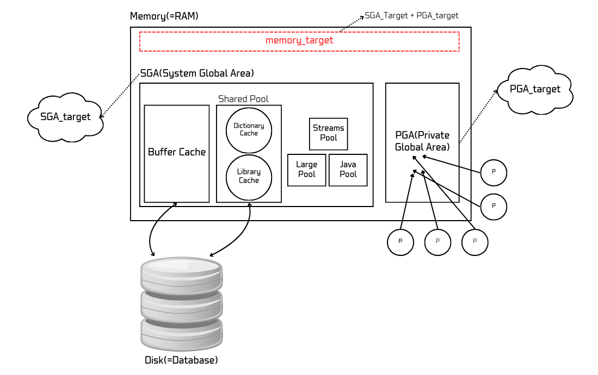

## DB 버퍼 캐시

자주 읽는 블록을 매번 디스크에서 읽는 것은 매우 비효율적이다.

그래서 데이터 캐싱 메커니즘이 DBMS에 필요한데 이를 DB 버퍼 캐시를 통해서 한다.

라이브러리 캐시가 SQL과 실행계획, DB 저장형 함수/프로시저를 캐싱하는 코드 캐시라고 한다면

DB 버퍼캐시는 데이터 캐시라고 할 수 있다.

DB 버퍼캐시는 서버 프로세스와 데이터파일 사이에 버퍼캐시가 있으므로 데이터 블록을 읽을 땐 항상 버퍼캐시부터 탐색한다.

버퍼캐시는 공유 메모리 영역이므로 같은 블록을 읽는 다른 프로세스도 득을 본다.

## 버퍼 캐시란 무엇인가?

```javascript
SQL 실행
   ↓
필요한 데이터 블록 탐색
   ↓
┌─────────────────────┐
│ DB Buffer Cache     │  ← 메모리
└─────────────────────┘
       ↓ 없으면
┌─────────────────────┐
│ Data File           │  ← 디스크
└─────────────────────┘
```

디스크는 메모리보다 훨씬 느리기 때문에 Oracle은 한 번 읽은 데이터 블록을 메모리의 버퍼 캐시에 보관한다

## 논리적 I/O (Logical I/O)

논리적 IO란 SQL을 처리하기 위해 읽는 과정에서 발생한 총 블록 I/O를 말한다.

예를 들어 SQL을 실행하면서 10,000개의 블록을 확인했다면

```javascript
Logical I/O = 10,000 블록
```

중요한건 그 블록이 원래 캐시에 있었는지 없었는지는 상관이없다.

만약 전부 캐시에서 읽었다면 메모리 I/O 전부가 논리적 I/O와 일치한다.

처리 도중 블록을 버퍼 캐시에서 찾지 못하여 디스크를 엑세스하므로 논리적 블록 I/O중 일부는 물리적 블록 I/O를 한다.

## 물리적 I/O (Physical I/O)

필요한 블록이 버퍼 캐시에 없어서 디스크에서 읽어와야 하는 경우다.

```javascript
SQL
 ↓
Buffer Cache 확인
 ↓
없음!
 ↓
Disk에서 읽음
 ↓
Buffer Cache에 적재
 ↓
SQL이 사용
```

## 버퍼 캐시 히트율

```javascript
Buffer Cache Hit Ratio
= (Logical I/O - Physical I/O) / Logical I/O × 100


Logical I/O  = 10,000
Physical I/O = 1,000

(10,000 - 1,000)
──────────────────── × 100
      10,000

= 90%
```

## 그러면 히트율을 높이면 튜닝이 끝나는 거 아닌가?

그렇지 않다.

먼저 두 SQL을 비교해보자.

```javascript
Logical I/O  = 1,000,000
Physical I/O = 10,000

Cache Hit Ratio = 99%

────────────────────────────────────────────────────────────────────────────────
Logical I/O  = 1,000
Physical I/O = 100

Cache Hit Ratio = 90%

────────────────────────────────────────────────────────────────────────────────
```

히트율만 보면 첫 번째가 좋아보이지만 실제로는 읽는 블록의 크기 때문에 두 번째 쿼리가 훨씬 효율적이다.

즉, 논리적 I/O 또한 공짜가 아니다. 메모리에서 데이터를 읽더라도 블록을 접근하고, 원하는 데이터를 찾고, 조건을 검사하고 여러 여러 내부 작업을 해야한다. 

```javascript
논리적 I/O 증가
     ↓
블록 접근 증가
     ↓
CPU 사용량 증가
     ↓
Latch / Mutex 등 경합 가능성 증가
     ↓
SQL 성능 저하
```

논리적 I/O 자체를 줄이면 물리적 I/O를 발생할 기회도 같이 줄어든다.

그래서 SQL 튜닝의 방향성을 단순히 디스크를 덜 읽게 하자가 아닌 애초에 불필한 블록을 읽지 않도록 만들자가 중요하다.

튜닝에 있어서 인덱스 튜닝이 대표적인 이유다.

## 정리

| 개념 | 의미 |
| --- | --- |
| Logical I/O | 블록을 읽은 전체 횟수 |
| Physical I/O | 필요한 블록이 캐시에 없어 디스크에서 읽은 횟수 |
| Buffer Cache | 디스크에서 읽은 블록을 메모리에 보관하는 영역 |
| Cache Hit Ratio | 필요한 블록을 캐시에서 찾은 비율 |
| SQL 튜닝 핵심 | **Logical I/O 자체를 줄이는 것** |

메모리 캐시가 클수록 좋지만, 대이터를 모두 캐시에 적재할 수는 없다.

캐시에서 찾지 못한 데이터 블록은 I/O Call을 통해 디스크에서 DB 버퍼 캐시로 적재하고서 읽는다.

한 번에 한블록씩 요청해서 메모리에 적재하는 방식을 Single Block I/O, 한 번에 여러 블록씩 요청해서 메모리에 적재하는 방식을 MultiBlock I/O라고 한다.

인덱스를 읽을 때는 기본적으로 인덱스와 테이블 블록 모두 Single Block I/O 방식을 사용한다.

    - 인덱스 루트 블록을 읽을 때
    - 인덱스 루트 블록에서 얻은 정보를 기반으로 브랜치 블록을 읽을 때
    - 인덱스 브랜치 블록에서 얻은 정보를 기반으로 리프 블록을 읽을 때
    - 인덱스 리프 블록에서 얻은 주소 정보로 테이블 블록을 읽을 때

많은 데이터 블록을 읽을 때는 MultiBlock I/O 방식이 효율적이다. 인덱스를 사용하지 않고 테이블 전체를 스캔할 때 이 방식을 사용하며 테이블이 클수록 MultiBlock I/O 단위도 크면 효율적이다.

적은 횟수의 I/O Call을 줄여 프로세스가 잠자는 횟수 즉, Ready Queue에서 대기하는 시간을 줄이기 위함이다.

DBMS 블록 사이즈와 상관없이 OS 단에서는 보통 1MB 단위로 I/O를 수행한다.

Oracle에서 한 번에 담는 양은 **db_file_multiblock_read_count** 파라미터로 정한다.

```sql
SHOW parameter db_file_multiblock_read_count 

alter session set db_file_multiblock_rad_count = 128; 
```

일반적으로 OS 레벨 I/O 단위가 1MB, 오라클 레벨 I/O 단위가 8KB 이므로 128로 설정하면 최대한 많이 담게 된다. (8KB * 128 = 1MB)

오라클 레벨에서 담는 양을 설정상으로는 더 늘릴 수는 있지만 OS 레벨 단위를 넘을 수는 없다.

인접한 블록이란 같은 익스텐트에 속한 블록들을 의미한다.

즉, MultiBlock I/O 방식으로 읽더라도 익스텐트 경계를 넘지 못한다.

예를 들어 익스텐트에 20개 블록이 들어있고 MultiBlock I/O 단위가 8이라면 세 번째 I/O Call에서는 네 개 블록만 얻게 된다. 단위 최대를 맞추기 위해서(더 읽기 위해서) 다음 익스텐트까지 읽지 않는다.

## 인덱스를 이용하는데 왜 성능이 더 느릴까?

Table Full Scan은 시퀀셜 엑세스와 Multiblock I/O 방식으로 디스크 블록을 읽는다.

한 블록에 속한 모든 레코드를 한 번에 읽어 들이고, 캐시를 못 찾으면 한 번의 수면(I/O Call)을 통해 인접한 수십~ 수백 개 블록을 한꺼번에 I/O하는 메커니즘이다.

시퀀셜 엑세스와 Multiblock I/O가 아무리 좋아도 수십~수밴 건의 소량의 데이터를 찾을 때 수백만 ~ 수천만 건 데이터를 스캔하는 건 비효율적이다.

큰 테이블에서 소량 데이터를 검색할 때는 반드시 인덱스를 이용해야 한다.

Index Range Scan을 통한 테이블 엑세스는 Random 엑세스와 Single Block I/O를 방식으로 디스크 블록을 읽는다.

또한 이 방식은 읽었던 블록을 반복해서 읽는 비효율이 있다. 한 블록에 평균 500개의 레코드가 있으면, 같은 블록을 최대 500번 읽는다. (인덱스를 통해 읽으려는 레코드 범위가 전부 같은 블록에 있는 경우)

만약 모든 블록을 엑세스 한다면 모든 블록을 평균 500번씩 읽는다. 각 블록을 한번씩 읽는 Table Full Scan에 비해서 훨씬 불리하다.

즉, 인덱스는 항상 옳은것이 아니며 Table Full Scan이 항상 나쁜것도 아니다.

*예상 카디널리티가 일정량을 넘어서는데도 인덱스로 테이블을 엑세스 한다면 이는 Table Full Scan 성능보다 떨어진다.*

Direct Path I/O를 제외한 모든 블록 I/O는 메모리 버퍼 캐시를 경유한다.

    - 인덱스 루트 블록을 읽을 때
    - 인덱스 루트 블록에서 얻은 주소 정보로 브랜치 블록을 읽을 때
    - 인덱스 브랜치 블록에서 얻은 주소 정보로 리프 블록을 읽을 때
    - 인덱스 리프 블록에서 얻은 주소 정보로 테이블 블록을 읽을 때
    - 테이블 블록을 Full Scan 할 때

## 버퍼캐시 = 해시 구조

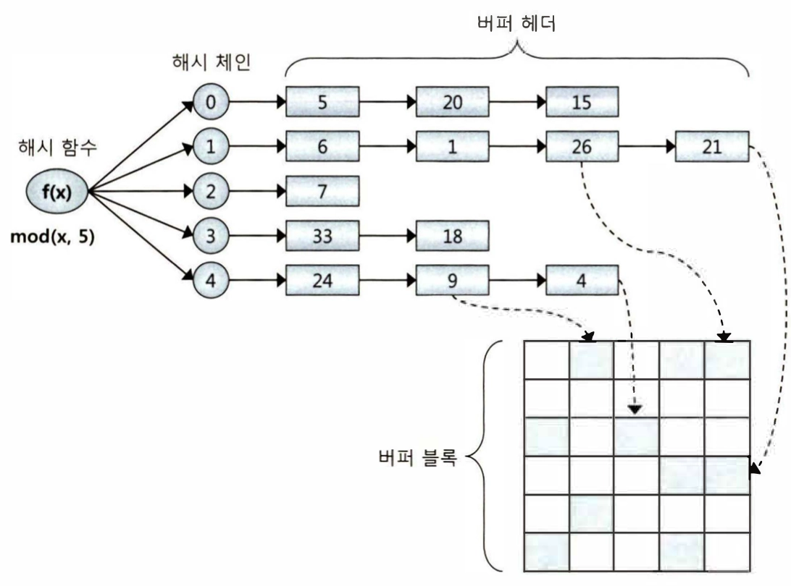

DBMS는 버퍼캐시를 해시 구조로 관리한다.

그림에서는 모듈러 함수로 해시 함수를 표현하지만 실제로는 훨씬 정교한 알고리즘을 사용한다. 

예를들어 27번 블록을 찾는다고하면 블록 번호를 5로 나눈다면 나머지는 2이다. 만약 이 블록이 캐싱돼 있다면 세 번째 해시 체인(해시 값 = 2)에 있을것이다. 세 번째 해시 체인을 쭉 탐색하고 없다면 다른 해시 체인을 탐색할 필요 없이 디스크에서 해당 블록을 읽고 캐시 체인에 연결한 다음 읽으면 된다.

즉, 해시 구조는 다음과 같은 특징을 가진다.

    - 같은 입력 값은 항상 동일한 해시 체인(=버킷)에 연결된다.
    - 다른 입력 값이 동일한 해시 체인에 연결될 수 있다.
    - 해시 체인 내에서는 정렬이 보장되지 않는다.

## 버퍼캐시 동시성 문제(메모리 공유자원에 대한 엑세스 직렬화)

버퍼 캐시는 SGA 구성요소이므로 버퍼캐시에 캐싱된 버퍼블록은 모두 공유자원이다.

하나의 버퍼블록을 두 개 이상의 프로세스가 동시에 접근하려고 할 때 블록 정합성에 문제가 발생할 수 있기 때문에 한 프로세스씩 순차적으로 접근하도록 직렬화 메커니즘(래치, Latch)이 필요하다.

## 캐시버퍼 체인 래치

블록을 탐색할 때 DBA(Data Block Address)를 해시 함수에 입력하고 거기서 반환된 값으로 스캔해야 할 해시 체인을 찾는다.

해시 체인을 스캔하는 동안 다른 프로세스가 체인 구조를 변경하는 것을 막기위해 해시 체인 래치가 존재하며

버퍼구조 그림에서 보이는 0~4까지 다섯 개 체인 앞쪽에 자물쇠가 있다고 생각하면 된다.

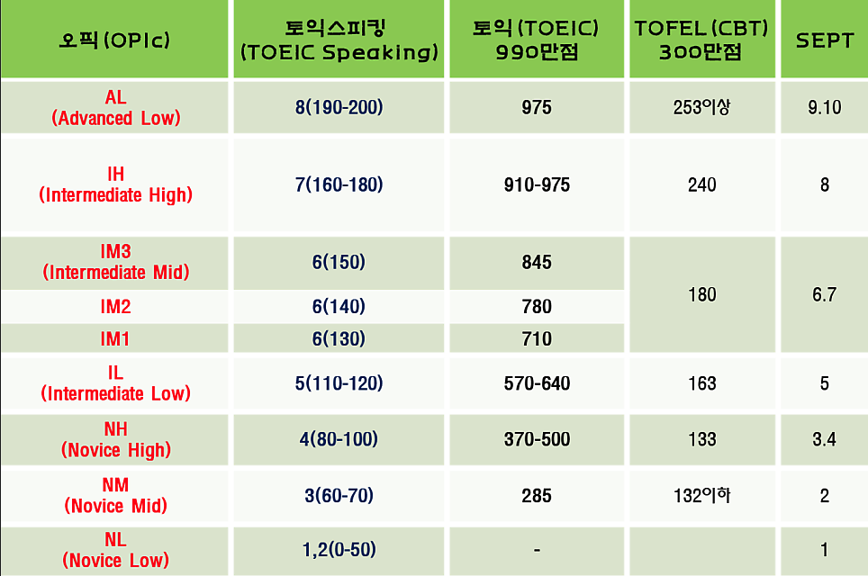

# 목표: IM3 ~ IH

# 오픽 전략

---

## 말하기 전략

❌ 한글(Lv 10) → 영어(Lv 3) → 결과(에러)

✅ 한글(Lv 3) → 영어(Lv 3) → 결과(에러)

***즉, 유치원생 처럼 말하라***

***문법은 중요하지 않다***

***Filler(추임새)를 넣어라(umm, and, you know)***

---

## 설문 전략

**오픽은 설문을 통해서 출제할 문제를 결정한다**

***변수 최소화***

### Part 1 of 4

**Q: 현재 귀하는 어느 분야에 종사하고 계십니까?**

→ 일 경험 없음

### Part 2 of 4

**Q: 현재 당신은 학생입니까?**

→ 아니오

**Q: 최근 어떤 강의를 수강했습니까?**

→ 수강 후 5년 이상 지남

### Part 3 of 4

**Q: 현재 귀하는 어디에 살고 계십니까?**

→ 개인주택이나 아파트에 홀로 거주

### Part 4 of 4 (12개 이상 항목 선택)

**Q: 귀하는 여가 활동으로 주로 무엇을 하십니까? (두개 이상 선택)**

→ 영화보기, 공원가기, 캠핑가기, 해변가기

***해변가 공원에서 캠핑을 하며 영화 보는 걸 좋아한다***

**Q: 귀하의 취미나 관심사는 무엇입니까? (한개 이상 선택)**

→ 음악 감상하기, 요리하기

***water, ramen, sauce, pot, boil, taste, ingredient***

**Q: 귀하는 주로 어떤 운동을 즐기십니까? (한개 이상 선택)**

→ 규칙이 단순한 운동

자전거, 조깅, 걷기, 요가, 운동을 전혀 하지 않음

**Q: 귀하는 어떤 휴가나 출장을 다녀온 경험이 있습니까?(한개 이상 선택)**

→ 집에서 보내는 휴가

### 단계 선택

4 ~ 5 단계 선택

---

## 시험 전략1

### *총 15문제: Q1 / Q2 ~ Q15* 

### Q1: 자기소개

  - 평기 미포함? 또는 중요하지 않다
  - 암기 X
  - 2~3문장으로 대답하기

### Q2 ~ Q13: 묶음 질문 

  - 1주제당 3문제로 묶음 질문으로 나온다

### Q14 ~ Q15: 묶음 질문

  - 1주제에 관해 2문제로 질문이 나온다.

***절대로 스크립트 전체를 암기 금지 → 동일한 문장을 반복적으로 사용하면 암기했다고 판단 → 가장 큰 감점 요인***

*단 주요 키워드는 암기, 키워드를 바탕으로 스크립트 말하기를 연습하자*

---

## 시험 전략2

### 1. 묘사/설명

나는 공원을 좋아해요. 공원에는 호수도 있고 벤치도 있고 나무도 있어요

→ l like park, **There is** a lake, bench and tree

내 아파트에는 방이 3개가 있고 주방이 하나, 화장실이 2개 있어요

→ In my apartment, **there are** 3 rooms, 1 kitchen, 2 batchrooms

콘서트장에는 무대와 오디오 설비, 많은 의자가 있어요

→ In concert hall, **there is** a main stage, audio devices, a lot of chair

***“There is~” 적극 활용***

### 2. 행동

주제:  요가

필수 단어: 근육(muscle), 스트레칭하다(strech), 스트레스를 줄이다(relive stress), 명상(meditation)

Q. 당신 취미인 요가를 설명해주세요

A. 전 요가를 좋아해요. 주로 공원에서 요가를 해요. 요가는 근육을 늘려주는 운동이에요. 스트레스를 줄이는데 도움을 줘요. 요가가 끝나면 명상을 해요.

→ I like yoga. I usually do yoga in park. Yoga is an exercise to strech a muscle.

It helps to relive stress. After I do yoga, I like to do meditation 

***움직임을 설명, (선택한) 설문 주제 별, 핵심 단어를 준비***

### 3. 경험

**만능 시나리오: 친구를 마주쳤다. 그녀를 오랫동안 못 만났었다. 반가웠다. 그 이후부터 자주 만나게 되었다.**

Q. 공원에서 가장 인상깊은 경험을 말해주세요

Q. 영화관에서 최근 경험한 일을 말해주세요

Q. 해변에서 겪은 일 중 하나를 말해주세요

A. 공원/영화관/해변에서 친구를 마주쳤다. 그녀를 오랫동안 못 만났었다. 반가웠다. 그 이후부터 자주 만나게 되었다.

***만능 시나리오를 하나 준비해서 ‘경험’ 질문에 맞게 적용한다***

### 4. 질문

Q. 친구가 MP3를 샀다. 그것에 대해 2~3가지를 질문해보라

A. 너 MP3 샀구나. 멋지다. 얼마에 샀어?

***질문: 2 ~ 3개만 질문하라고 해도 자신이 없으면 1개만 질문. 자신 있는 주제에서 길게 대답***

### 5. 비교

**만능 시나리오: 코로나가 전세계적으로 유행했어요. 사람들은 외부활동이 제한되었습니다. 이것을 우리나라에서는 ‘사회적 거리두기’라고 부릅니다.**

Q. 당신은 자전거를 즐겨 탄다고 했습니다. 예전과 지금을 비교해보면 자전거를 타는데 어떤 차이가 있나요?

Q. 당신은 요리하기가 관심 있다고 했습니다. 예전과 지금을 비교해보면 요리를 하는데 어떤 차이가 있을까요?

코로나가 전세계적으로 유행했었다. 사람들은 외부활동이 제한되었다. 이것을 우리나라에서는 사회적 거리두기라고 부릅니다. 그 당시에는 (자전거/요리)를 혼자 했다. 지금은 친구들과 함께 한다.

***비교: 만능 임팩트 시나리오 준비(코로나) 전문 단어 넣어 통문장을 암기(이 문장만 예외적으로 암기)***

### 6. 돌발주제

1가지 주제는 돌발 주제로 설문지에 넣지 않은 내용이 나온다. → 최대한 간단하게 넘어간다

***돌발 주제를 모르는 경우***

*미안해요 내가 대답하기에는 너무 어렵네요. 이 것을 대답하려면 전문적인 지식과 용어를 알아야 하네요. 다음 질문을 준비하는 것이 더 좋겠어요.*

*→ I’m sorry. It is too difficult to answer for me. In order to reply for this question, I have to konow technical terms and knowledge. I think it is better to prepare for next question.* 

***스크립트를 준비한다***

---

## 꿀팁 

### 1. 모의고사

유투브에 ‘오픽 모의고사’ 검색 → 꼭 녹음해서 들어보기

