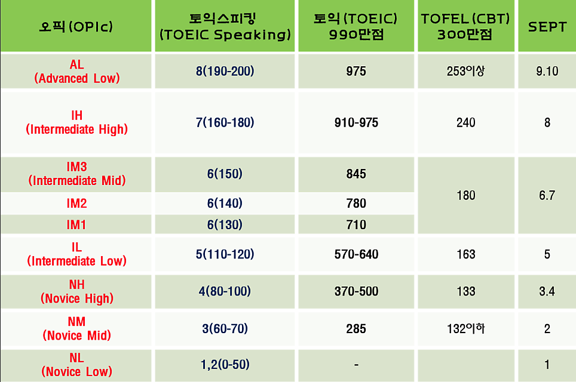



# 목표: IM3 ~ IH

# 오픽 전략

---

## 말하기 전략

❌ 한글(Lv 10) → 영어(Lv 3) → 결과(에러)

✅ 한글(Lv 3) → 영어(Lv 3) → 결과(에러)

***즉, 유치원생 처럼 말하라***

***문법은 중요하지 않다***

***Filler(추임새)를 넣어라(umm, and, you know)***

---

## 설문 전략

**오픽은 설문을 통해서 출제할 문제를 결정한다**

***변수 최소화***

### Part 1 of 4

**Q: 현재 귀하는 어느 분야에 종사하고 계십니까?**

→ 일 경험 없음

### Part 2 of 4

**Q: 현재 당신은 학생입니까?**

→ 아니오

**Q: 최근 어떤 강의를 수강했습니까?**

→ 수강 후 5년 이상 지남

### Part 3 of 4

**Q: 현재 귀하는 어디에 살고 계십니까?**

→ 개인주택이나 아파트에 홀로 거주

### Part 4 of 4 (12개 이상 항목 선택)

**Q: 귀하는 여가 활동으로 주로 무엇을 하십니까? (두개 이상 선택)**

→ 영화보기, 공원가기, 캠핑가기, 해변가기

***해변가 공원에서 캠핑을 하며 영화 보는 걸 좋아한다***

**Q: 귀하의 취미나 관심사는 무엇입니까? (한개 이상 선택)**

→ 음악 감상하기, 요리하기

***water, ramen, sauce, pot, boil, taste, ingredient***

**Q: 귀하는 주로 어떤 운동을 즐기십니까? (한개 이상 선택)**

→ 규칙이 단순한 운동

자전거, 조깅, 걷기, 요가, 운동을 전혀 하지 않음

**Q: 귀하는 어떤 휴가나 출장을 다녀온 경험이 있습니까?(한개 이상 선택)**

→ 집에서 보내는 휴가

### 단계 선택

4 ~ 5 단계 선택

---

## 시험 전략1

### *총 15문제: Q1 / Q2 ~ Q15* 

### Q1: 자기소개

- 평기 미포함? 또는 중요하지 않다
- 암기 X
- 2~3문장으로 대답하기

### Q2 ~ Q13: 묶음 질문 

- 1주제당 3문제로 묶음 질문으로 나온다

### Q14 ~ Q15: 묶음 질문

- 1주제에 관해 2문제로 질문이 나온다.

***절대로 스크립트 전체를 암기 금지 → 동일한 문장을 반복적으로 사용하면 암기했다고 판단 → 가장 큰 감점 요인***

*단 주요 키워드는 암기, 키워드를 바탕으로 스크립트 말하기를 연습하자*

---

## 시험 전략2

### 1. 묘사/설명

나는 공원을 좋아해요. 공원에는 호수도 있고 벤치도 있고 나무도 있어요

→ l like park, **There is** a lake, bench and tree

내 아파트에는 방이 3개가 있고 주방이 하나, 화장실이 2개 있어요

→ In my apartment, **there are** 3 rooms, 1 kitchen, 2 batchrooms

콘서트장에는 무대와 오디오 설비, 많은 의자가 있어요

→ In concert hall, **there is** a main stage, audio devices, a lot of chair

***“There is~” 적극 활용***

### 2. 행동

주제:  요가

필수 단어: 근육(muscle), 스트레칭하다(strech), 스트레스를 줄이다(relive stress), 명상(meditation)

Q. 당신 취미인 요가를 설명해주세요

A. 전 요가를 좋아해요. 주로 공원에서 요가를 해요. 요가는 근육을 늘려주는 운동이에요. 스트레스를 줄이는데 도움을 줘요. 요가가 끝나면 명상을 해요.

→ I like yoga. I usually do yoga in park. Yoga is an exercise to strech a muscle.

It helps to relive stress. After I do yoga, I like to do meditation 

***움직임을 설명, (선택한) 설문 주제 별, 핵심 단어를 준비***

### 3. 경험

**만능 시나리오: 친구를 마주쳤다. 그녀를 오랫동안 못 만났었다. 반가웠다. 그 이후부터 자주 만나게 되었다.**

Q. 공원에서 가장 인상깊은 경험을 말해주세요

Q. 영화관에서 최근 경험한 일을 말해주세요

Q. 해변에서 겪은 일 중 하나를 말해주세요

A. 공원/영화관/해변에서 친구를 마주쳤다. 그녀를 오랫동안 못 만났었다. 반가웠다. 그 이후부터 자주 만나게 되었다.

***만능 시나리오를 하나 준비해서 ‘경험’ 질문에 맞게 적용한다***

### 4. 질문

Q. 친구가 MP3를 샀다. 그것에 대해 2~3가지를 질문해보라

A. 너 MP3 샀구나. 멋지다. 얼마에 샀어?

***질문: 2 ~ 3개만 질문하라고 해도 자신이 없으면 1개만 질문. 자신 있는 주제에서 길게 대답***

### 5. 비교

**만능 시나리오: 코로나가 전세계적으로 유행했어요. 사람들은 외부활동이 제한되었습니다. 이것을 우리나라에서는 ‘사회적 거리두기’라고 부릅니다.**

Q. 당신은 자전거를 즐겨 탄다고 했습니다. 예전과 지금을 비교해보면 자전거를 타는데 어떤 차이가 있나요?

Q. 당신은 요리하기가 관심 있다고 했습니다. 예전과 지금을 비교해보면 요리를 하는데 어떤 차이가 있을까요?

코로나가 전세계적으로 유행했었다. 사람들은 외부활동이 제한되었다. 이것을 우리나라에서는 사회적 거리두기라고 부릅니다. 그 당시에는 (자전거/요리)를 혼자 했다. 지금은 친구들과 함께 한다.

***비교: 만능 임팩트 시나리오 준비(코로나) 전문 단어 넣어 통문장을 암기(이 문장만 예외적으로 암기)***

### 6. 돌발주제

1가지 주제는 돌발 주제로 설문지에 넣지 않은 내용이 나온다. → 최대한 간단하게 넘어간다

***돌발 주제를 모르는 경우***

*미안해요 내가 대답하기에는 너무 어렵네요. 이 것을 대답하려면 전문적인 지식과 용어를 알아야 하네요. 다음 질문을 준비하는 것이 더 좋겠어요.*

*→ I’m sorry. It is too difficult to answer for me. In order to reply for this question, I have to konow technical terms and knowledge. I think it is better to prepare for next question.* 

***스크립트를 준비한다***

---

## 꿀팁 

### 1. 모의고사

유투브에 ‘오픽 모의고사’ 검색 → 꼭 녹음해서 들어보기

