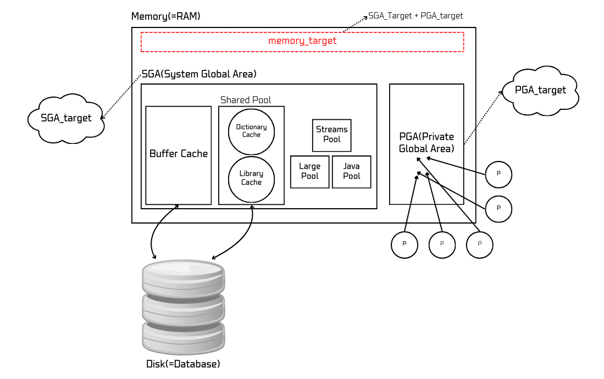
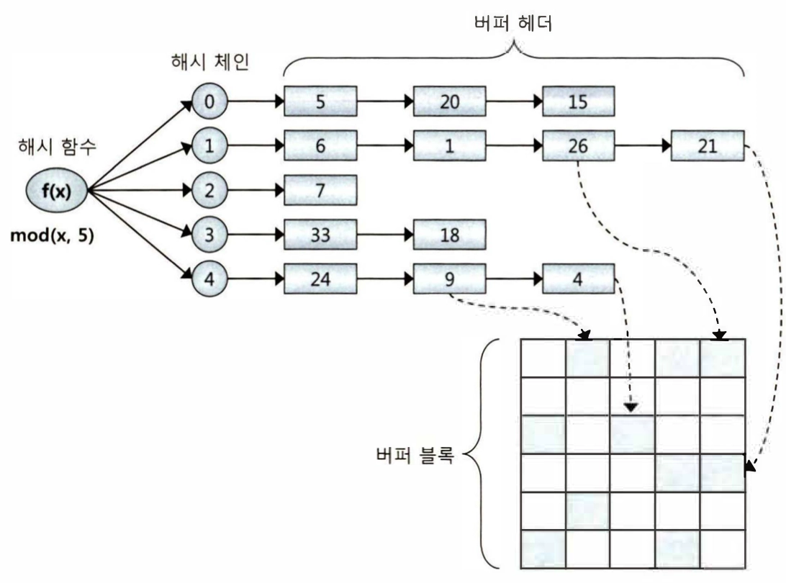

# 시험 - 11월 15일(토)

- *현재 2026년 11월 15일: D-84*
- ***원서접수: 2026년 10월 12일 ~ 10월 16일  / 시험날짜: 2026년 11월 15일 (일)***
- *총점 75점 이상, 각 과목 40%이상 득점*

- 1과목, 2과목 강의 및 정리
  - 친절한 SQL 튜닝 2회독
  - 오라클 성능 고도화 원리 해법1, 2 2회독
  - SQL 전문가 가이드 1회독
  - SQLP 자격검정 핵심노트1,2 1회독
  - SQL 자격검정 실전문제 1회독
  - SQLP 자격검정 핵심노트1,2 1회독
  - SQL 자격검정 실전문제 1회독
  - 실기 문제 준비 1회독

[https://velog.io/@sua_ahn/SQLP-3%EA%B0%9C%EC%9B%94-%EB%8F%85%ED%95%99-%ED%95%A9%EA%B2%A9-%ED%9B%84%EA%B8%B0-51%ED%9A%8C](https://velog.io/@sua_ahn/SQLP-3%EA%B0%9C%EC%9B%94-%EB%8F%85%ED%95%99-%ED%95%A9%EA%B2%A9-%ED%9B%84%EA%B8%B0-51%ED%9A%8C)

### 참고 자료

[https://www.hdatalab.co.kr/shop_view/?idx=13](https://www.hdatalab.co.kr/shop_view/?idx=13)

# SQLD(1,2 과목 정리)

# 1과목

# 2과목

# SUBSTR - 문자열 추출

```javascript
SUBSTR(문자열, 시작위치, 길이)
```

***문자열 위치는 1부터 시작한다.***

```javascript
SUBSTR('ABCDEFG', 2, 3)

결과: BCD
```

***세 번째 인자인 길이를 생략하면 끝까지 가져온다.*** 

```javascript
SUBSTR('ABCDEFG', 4)

결과: DEFG
```

***음수 위치***

```javascript
 A B C D E F G
 1 2 3 4 5 6 7

-7-6-5-4-3-2-1
```

```javascript
SUBSTR('ABCDEFG', -3, 2)

결과: EF
```

---

# LENGTH - 문자열 길이

```javascript
LENGTH(문자열)
```

```javascript
LENGTH('ABCDE')

결과: 5
```

Oracle LENGTHB 함수 같은 경우 문자 수가 아니라 바이트 수를 구한다.

---

# INSTR - 문자열 위치 찾기

```javascript
INSTR(문자열, 찾을문자열 [, 시작위치 [, 몇번째]])
```

```javascript
INSTR('ABCDEFG', 'D')

결과: 4
```

```javascript
INSTR('ABABAB', 'A', 1, 2)

결과: 3
```

---

# LPAD - 왼쪽 채우기 / RPAD - 오른쪽 채우기

```javascript
LPAD(문자열, 전체길이, 채울문자)
```

```javascript
LPAD('ABC', 7, 'XY')

결과: XYXYABC
```

***지정 길이가 원래 문자열보다 작으면?***

```javascript
LPAD('ABCDEFG', 3, '0')

결과: ABC
```

→ LPAD 두 번째 인자는 추가할 문자의 개수가 아니라 최종 길이이다.

---

# LTRIM / RTRIM - 문자 제거

```javascript
LTRIM('000123', '0')
→ 123
```

***인자를 생략하면 기본적으로 공백을 제거한다.***

```javascript
LTRIM('   ABC')
→ ABC

RTRIM('ABC   ')
→ ABC
```

### 주의할 점

***두 번째 인자를 하나의 문자열 덩어리로 생각하면 안된다.***

```javascript
LTRIM('ABBAZACD', 'AB')
-> ZACD
```

AB 라는 문자열을 찾는 게 아니라 A 또는 B에 해당하는 문자를 왼쪽에서 계속 제거한다.

# TRIM - 양쪽 제거

```javascript
TRIM('   ABC   ')
→ ABC

TRIM('X' FROM 'XXXABCXXX')
→ ABC

TRIM('   A B C   ')
→ 'A B C'
```

---

# REPLACE - 문자열 치환

```javascript
REPLACE(문자열, 찾을문자열, 변경문자열)
```

```javascript
REPLACE('ABCABC', 'A', 'X')
→ XBCXBC

REPLACE('ABCABC', 'AB', 'XY')
→ XYCXYC
```

***세번째 인자를 생략한다면?***

```javascript
REPLACE('ABCABC', 'A')
→ BCBC
```

---

# LOWER / UPPER / INITCAP - 대소문자 변환

```javascript
LOWER('ABC')
→ abc

UPPER('abc')
→ ABC

INITCAP('hello world')
→ Hello World
```

INITCAP 같은 경우 각 단어의 첫 글자를 대문자로 만든다.

---

# CONCAT / || — 문자열 연결

```javascript
CONCAT('ABC', 'DEF')
→ ABCDEF


'ABC' || 'DEF'
→ ABCDEF


'이름: ' || '철수'
→ 이름: 철수
```

# ROUND 함수(반올림)

```javascript
ROUND(숫자, 자릿수)
```

| 함수 | 결과 | 설명 |
| --- | --- | --- |
| ROUND(3.14159, 2) | 3.14 | 소수점 2자리로 반올림 |
| ROUND(3.5) | 4 | 자릿수 생략 시 정수로 반올림 |
| ROUND(1234.5, -1) | 1230 | 음수는 자릿수 앞쪽 반올림 |
| ROUND(1234.5, -2) | 1200 | 백의 자리로 반올림 |

    - **양수**: 소수점 이하 자릿수 지정
    - **음수**: 정수 부분의 자릿수 지정 (10의 자리, 100의 자리 등)
    - **0**: 정수로 반올림

ROUND(123.41, 0 ) = 123

ROUND(123.51, 0 ) = 124

---

# SIGN 함수(부호 판정)

| 결과 | 의미 |
| --- | --- |
| **1** | 양수 |
| **-1** | 음수 |
| **0** | 0 |

```javascript
SIGN(5)      → 1
SIGN(-5)     → -1
SIGN(0)      → 0
SIGN(3.14)   → 1
SIGN(-0.5)   → -1
```

# 1. **NVL 함수** (Oracle)

```sql
-- Oracle 문법
NVL(expr1, expr2)
-- expr1이 NULL이면 expr2를 반환, 아니면 expr1을 반환
```

SQL-Server 같은 경우 ISNULL 함수를 사용

```javascript
NVL(NULL, 500)                    → 500
NVL(300, 500)                     → 300
NVL(0, 500)                       → 0
NVL(NULL, NULL)                   → NULL
```

---

# 2. **NULLIF 함수** (Oracle/SQL Server 공통)

두 값이 같으면 NULL 반환 다르면, 첫 번째 값 반환

```sql
-- 두 값이 같으면 NULL, 다르면 expr1을 반환
NULLIF(expr1, expr2)
```

```javascript
NULLIF(500, 500)                  → NULL      (같음 → NULL)
NULLIF(500, 300)                  → 500       (다름 → 값1 반환)
NULLIF(NULL, 500)                 → NULL      (NULL은 NULL)
NULLIF(0, 0)                      → NULL      (같음 → NULL)
```

---

# 3. **COALESCE 함수** (Oracle/SQL Server 공통)

```sql
-- 여러 값 중 첫 번째 NULL이 아닌 값을 반환
COALESCE(expr1, expr2, expr3, ...)
```

```javascript
COALESCE(NULL, 500, 300)          → 500
COALESCE(200, 500, 300)           → 200
COALESCE(NULL, NULL, 300)         → 300
COALESCE(NULL, NULL, NULL)        → NULL
```

---

# 4. **ISNULL 함수** (SQL Server 전용)

```sql
-- SQL Server의 기본 NULL 처리 함수
ISNULL(expr1, expr2)
-- expr1이 NULL이면 expr2 반환, 아니면 expr1 반환
```

IS NULL 연산자(조건) → TRUE/FALSE 반환 함수와 다르다.

---

# **SQLD/SQLP 시험 핵심 정리**

| 함수 | Oracle | SQL Server | 용도 |
| --- | --- | --- | --- |
| **NVL** | ✓ | ✗ | NULL을 지정값으로 변환 |
| **ISNULL** | ✗ | ✓ | NULL을 지정값으로 변환 |
| **COALESCE** | ✓ | ✓ | 여러 값 중 첫 NULL이 아닌 값 |
| **NULLIF** | ✓ | ✓ | 같으면 NULL 반환 |
| **CASE WHEN** | ✓ | ✓ | 조건부 NULL 처리 (범용) |

# DECODE 함수

```javascript
DECODE(expr, search1, result1, [search2, result2, ...], [default])
```

동작 방식

```javascript
1️⃣  expr == search1 ? → result1 반환 (끝)
2️⃣  expr == search2 ? → result2 반환 (끝)
3️⃣  expr == search3 ? → result3 반환 (끝)
...
4️⃣  모두 아니면 → default 반환
```

```sql
-- 샘플 테이블
CREATE TABLE emp (
    emp_id VARCHAR2(3),   -- 문자형 (숫자처럼 보이지만 문자)
    emp_name VARCHAR2(20),
    salary NUMBER
);

INSERT INTO emp VALUES ('001', 'Kim', 3000);
INSERT INTO emp VALUES ('002', 'Lee', 4000);
INSERT INTO emp VALUES ('003', 'Park', 5000);
INSERT INTO emp VALUES ('ABC', 'Choi', 2000);
```

---

### ✅ 케이스 1: WHERE 조건에서 문자 = 숫자 (성공)

Oracle & SQL Server 모두 동일하게 작동

```sql
-- 케이스 1-1: 성공 (묵시적 형변환 일어남)
SELECT * FROM emp WHERE emp_id = 1;
-- 결과: emp_id = '001' 행 반환
-- emp_id가 '1' 또는 '001'로 변환되어 비교

-- 케이스 1-2: 성공 (명시적 형변환 권장)
SELECT * FROM emp WHERE emp_id = '1';
-- 결과: emp_id = '001' 행 반환 (Oracle은 자동 형변환)

-- 케이스 1-3: 실패 가능성 높음
SELECT * FROM emp WHERE emp_id = 1;
-- ABC는 숫자로 변환할 수 없어 무시됨
```

---

### ❌ 케이스 2: CASE WHEN에서 문자 WHEN 숫자 (에러)

Oracle - 에러 발생

```sql
-- ❌ 에러 발생!
SELECT emp_id,
       CASE emp_id
           WHEN 1 THEN '직급1'
           WHEN 2 THEN '직급2'
           WHEN 3 THEN '직급3'
           ELSE '기타'
       END AS grade
FROM emp;

-- 에러: ORA-00932: inconsistent datatypes: expected CHAR got NUMBER
```

SQL Server - 에러 발생

```sql
-- ❌ 에러 발생!
SELECT emp_id,
       CASE emp_id
           WHEN 1 THEN '직급1'
           WHEN 2 THEN '직급2'
           WHEN 3 THEN '직급3'
           ELSE '기타'
       END AS grade
FROM emp;

-- 에러: Conversion failed when converting the varchar value to data type int
```

---

### ✅ 케이스 3: 올바른 CASE 문 작성법

Oracle - 문자형으로 통일

```sql
-- ✅ 올바른 방법 1: WHEN을 문자로 지정
SELECT emp_id,
       CASE emp_id
           WHEN '1' THEN '직급1'
           WHEN '2' THEN '직급2'
           WHEN '3' THEN '직급3'
           ELSE '기타'
       END AS grade
FROM emp;

-- 결과:
-- emp_id | grade
-- -------|------
-- 001    | 직급1
-- 002    | 직급2
-- 003    | 직급3
-- ABC    | 기타

-- ✅ 올바른 방법 2: CAST로 형변환
SELECT emp_id,
       CASE CAST(emp_id AS NUMBER)
           WHEN 1 THEN '직급1'
           WHEN 2 THEN '직급2'
           WHEN 3 THEN '직급3'
           ELSE '기타'
       END AS grade
FROM emp;

-- 결과:
-- emp_id | grade
-- -------|------
-- 001    | 직급1
-- 002    | 직급2
-- 003    | 직급3
-- ABC    | 기타  (변환 실패하여 ELSE로 처리)
```

SQL Server - 문자형으로 통일

```sql
-- ✅ 올바른 방법 1: WHEN을 문자로 지정
SELECT emp_id,
       CASE emp_id
           WHEN '1' THEN '직급1'
           WHEN '2' THEN '직급2'
           WHEN '3' THEN '직급3'
           ELSE '기타'
       END AS grade
FROM emp;

-- ✅ 올바른 방법 2: CONVERT로 형변환
SELECT emp_id,
       CASE CONVERT(INT, emp_id)
           WHEN 1 THEN '직급1'
           WHEN 2 THEN '직급2'
           WHEN 3 THEN '직급3'
           ELSE '기타'
       END AS grade
FROM emp;
```

---

### 🔍 케이스 4: 혼합된 데이터 상황

```sql
-- 혼합된 emp 테이블
-- emp_id: '001', '002', '003', 'ABC', '999'

-- ❌ CASE 문자 WHEN 숫자 → 에러
SELECT CASE emp_id
           WHEN 1 THEN 'Match'
           ELSE 'No Match'
       END
FROM emp;

-- ✅ CASE 문자 WHEN 문자 → 성공
SELECT CASE emp_id
           WHEN '1' THEN 'Match'
           WHEN '001' THEN 'Match'
           ELSE 'No Match'
       END
FROM emp;

-- 결과:
-- 001 → Match (WHEN '001' 과 비교)
-- 002 → No Match (WHEN과 일치하는 항목 없음)
-- 003 → No Match
-- ABC → No Match
-- 999 → No Match
```

---

### 📌 중요한 비교: WHERE vs CASE

| 구분 | WHERE 조건 | CASE 문 |
| --- | --- | --- |
| `emp_id = 1` | ✅ 성공 (묵시적 형변환) | ❌ 에러 |
| `emp_id = '1'` | ✅ 성공 | ✅ 성공 |
| 형변환 방식 | 자동 형변환 발생 | 형변환 없음 |
| 권장 | 명시적 형변환 권장 | **반드시 문자형으로 통일** |

# SYSDATE / SYSTIMESTAMP

    - *현재 날짜와 시간을 반환하는 함수*
    - *SYSDATE는 DATE 타입으로 반환됨(초 단위까지만)*
    - *SYSTIMESTAMP 는 TIMESTAMP 타입으로 (초단위 + 소수점 이하 초(밀리초)까지 표현 가능)*

# EXTRACT

    - *날짜 또는 타임스탬프 값에서 연, 월, 일 등 특정 요소를 출력하는 함수*
    - *출력 결과는 숫자 타입으로 변환됨*

```javascript
EXTRACT(추출 대상 FROM 날짜)
```

    - *추출 대상: YEAR, MONTH, DAY, HOUR, MINUTE, SECOND*
    - *SYSDATE 같은 DATE 타입에서는 YEAR, MONTH, DAY만 추출 가능*
    - *TIMESTAMP 타입에서는 전부 추출 가능*

example

```javascript
EXTRACT(DAY FROM SYSDATE) -> 17 
```

# ROUND

    - 날짜를 지정한 기준 단위로 반올림하는 함수

```javascript
ROUND(날짜 [, 자리수])
```

    - 자리수에 YEAR, MONTH, DD, HH, MI 등을 지정할 수 있다
    - 지정한 자리에서 직접 반올림하는 것이 아니라, 해당 자리수보다 더 작은 단위에서 반올림을 수행
    - 자리수는 생략 가능하며 DD 즉, 일이다.

# TRUNC

    - 날짜를 지정한 기준 단위로 버리는 함수

```javascript
TRUNC(날짜, [, 자리수])
```

    - 지정한 자리수에서 직접 버리는 갓이 아니라 더 작은 단위에서 버림을 수행하여 지정한 자리수로 맞춘다.
    - 생략 시 기본값은 DD

# 변환함수

    - 숫자 형태의 문자와 숫자 데이터 간 연산 시, 묵시적 형 변환이 발생하여 정상적으로 수행된다

# TO_NUMBER

```javascript
TO_NUMBER(대상)
```

# TO_CHAR

    - 숫자 또는 날짜 데이터를 문자 타입으로 변환하는 함수

```javascript
TO_CHAR(대상, [, FROMAT]
```

### 숫자 포멧 (Number Format)

| 포멧 요소 | 설명 | 예시 |
| --- | --- | --- |
| `9` | 숫자 자리 (앞의 0 제거) | `TO_CHAR(123, '9999')` → ‘ 123’ |
| `0` | 숫자 자리 (앞의 0 표시) | `TO_CHAR(123, '0999')` → ‘0123’ |
| `.` | 소수점 | `TO_CHAR(123.4, '999.99')` → `123.40` |
| `,` | 천단위 구분 | `TO_CHAR(1234, '9,999')` → `1,234` |
| `$` | 달러 기호 | `TO_CHAR(100, '$999')` → `$100` |

### 날짜 포멧 (Date Format)

| 포멧 요소 | 설명 | 예시 |
| --- | --- | --- |
| `YYYY` | 4자리 연도 | `2024` |
| `YY` | 2자리 연도 | `24` |
| `MM` | 2자리 월 | `01`~`12` |
| `MON` | 3자리 월 약자 | `JAN`, `FEB` |
| `MONTH` | 월 전체명 | `JANUARY`, `FEBRUARY` |
| `DD` | 2자리 일 | `01`~`31` |
| `DAY` | 요일 전체명 | `MONDAY`, `TUESDAY` |
| `DY` | 요일 약자 | `MON`, `TUE` |
| `HH24` | 24시간 형식 시간 | `00`~`23` |
| `HH` 또는 `HH12` | 12시간 형식 시간 | `01`~`12` |
| `MI` | 분 | `00`~`59` |
| `SS` | 초 | `00`~`59` |
| `AM/PM` | 오전/오후 | `AM`, `PM`  |

### YY, RR 차이

YY 같은 경우 입력된 두 자리 연도를 현재 세기 기준으로 해석한다

→ 49 → 2049년, 50 → 2050년

RR 같은 경우 입력된 연도를 현재 연도를 기준으로 과거 또는 미래로 해석한다

→ 00~49년 → 20XX년, 50~99 → 19XX 년

***TO_DATE 함수에서 지정되지 않은 날짜 요소는 현재 날짜를 기준으로 설정된다.***

# 날짜 연산

    - 숫자 1은 하루를 의미
    - 숫자 1/24 한 시간을 의미
    - 10/24/60 = 10 * (1/10/24) = 10분

| 순위 | 연산자 | 설명 |
| --- | --- | --- |
| 1 | `()` | 괄호 (최우선) |
| 2 | `NOT` | 논리 부정 |
| 3 | `*`, `/`, `%` | 곱셈, 나눗셈, 나머지 |
| 4 | `+`, `-` | 덧셈, 뺄셈 |
| 5 | `=`, `<>`, `!=`, `<`, `>`, `<=`, `>=`, `LIKE`, `IN`, `BETWEEN` | 비교 연산자 |
| 6 | `AND` | 논리 AND |
| 7 | `OR` | 논리 OR |

(), NOT, (곱셈, 나눗셈, 나머지), (덧셈, 뺄셈), 비교 연산자, AND, OR

```plain text
SELECT *
FROM EMP
WHERE DEPTNO NOT IN (10, 20, NULL);
```

*`DEPTNO = 30`**이라고 해보면* *`NOT IN`**은 논리적으로 다음과 같다.*

```plain text
DEPTNO <> 10
AND DEPTNO <> 20
AND DEPTNO <> NULL
```

```plain text
30 <> 10    → TRUE
30 <> 20    → TRUE
30 <> NULL  → UNKNOWN

TRUE AND TRUE AND UNKNOWN
→ UNKNOWN
```

*`WHERE`* *절은* ***TRUE인 행만 반환****하기 때문에 이 행은 조회되지 않아.*

*그래서* *`NOT IN`* *목록이나 서브쿼리 결과에* *`NULL`**이 하나라도 포함되어 있으면 일반적으로* ***어떤 값도 TRUE가 될 수 없어서 결과가 공집합****이 돼.*

### SQLP 암기 포인트

***`NOT IN + NULL → 결과 없음`***

*다만 표현할 때는* ***"모든 비교가 FALSE가 된다"****보다는*

> ***NULL과의 비교 결과가 UNKNOWN이 되고, NOT IN 전체 조건이 TRUE가 될 수 없기 때문에 조회되지 않는다.***

# Oracle with Docker

### oracle db 설치

```plain text
docker run -d --name oracle-db \
  -p 1521:1521 \
  -e ORACLE_PASSWORD=[REDACTED] \
  gvenzl/oracle-free:latest
```

### oracle db 접속

```plain text
docker exec -it oracle-db bash
sqlplus system/password1234@FREEPDB1
```

### Oracle: 사용자 = 스키마

```plain text
-- 현재 사용자 확인
SELECT USER FROM DUAL;

-- 모든 사용자(스키마) 확인
SELECT username FROM dba_users;
```

### 테이블 조회 

```plain text
-- 현재 사용자의 테이블
SELECT table_name FROM user_tables;

-- 또는
SELECT * FROM tab;
```

# 책 내용 정리

옵티마이저가 SQL을 어떻게 처리하는지, 서버 프로세스는 데이터를 어떻게 읽고 저장하는지 살펴보자

# 1.1.1 구조적, 집합적, 선언적 질의 언어

SQL은 Structured Query Language 줄임말이다. 즉, 구조적 질의 언어다.

오라클 PL/SQL, SQL Server T-SQL 처럼 절차적 프로그래밍 기능을 구현할 수 있는 확장 언어도 제공하지만

SQL은 기본적으로 구조적, 집합적, 선언적 언어이다.

하지만 결과집합을 만드는 과정은 결국 절차적일 수밖에 없다.

즉, 프로시저가 필요한데, 그런 프로시저를 만들어 내는 DBMS 내부 엔진이 바로 SQL 옵티마이저다.

옵티마이저가 프로그래밍을 대신 해주는 셈이다.

DBMS 내부에서 프로시저를 작성하고 컴파일해서 실행 가능한 상태로 만드는 전 과정을 SQL 최적화라고 한다.

사용자 (SQL)→ 옵티마이저 (실행계획)→ 프로시저  

# 1.1.2 SQL 최적화

      1. SQL 파싱
      - 사용자로부터 SQL을 전달받으면 가장 먼저 SQL 파서가 파싱을 진행한다.
- 파싱 트리 생성: SQL 문을 이루는 개별 구성요소를 분석해서 파싱 트리 생성
        - Syntax 체크: 문법적 오류가 없는지 확인. 사용할 수 없는 키워드를 사용했거나 순서가 바르지 않거나 누락된 키워드가 있는 확인
        - Semantic 체크: 의미상 오류가 없는지 확인. 존재하지 않는 테이블 또는 컬럼을 사용했는지, 사용한 오브젝트에 대한 권한이 있는지 확인
      1. SQL 최적화
      - 옵티마이저가 역할을 맡는다.
      - 옵티마이저는 미리 수집한 시스템 및 오브젝트 통계정보를 바탕으로 다양한 실행경로를 생성해서 비교한 후 가장 효율적인 하나를 선택한다.
      - 데이터베이스 성능을 결정하는 가장 핵심적인 엔진이다.
      1. 로우 소스 생성
      - 옵티마이저가 선택한 실행경로를 실제 실행 가능한 코드 또는 프로시저 형태로 포맷팅하는 단계
      - 로우 소스 생성기가 그 역할을 맡는다.

# 1.1.3 SQL 옵티마이저

옵티마이저는 사용자가 원하는 작업을 가장 효율적으로 수행할 수 있는 최적의 데이터 엑세스 경로를 선택해 주는 DBMS의 핵심 엔진이다.

      1. 사용자로부터 전달받은 쿼리를 수행할 수 있는 실행계획들을 찾아낸다.
      1. 데이터 딕셔너리에 미리 수집해 둔 오브젝트 통계 및 시스템 통계성 정보를 이용해 각 실행계획의 예상비용을 산정한다.
      1. 최저 비용을 나타내는 실행계획을 선택한다.

SQL 옵티마이저는 백그라운드 프로세스가 아닌 서버 프로세스가 가진 기능일 뿐이다.

SQL 파서와 로우 소스 생성기도 마찬가지다.

# 1.1.4 실행계획과 비용

DBMS에는 SQL 실행경로 미리보기 기능이 있다. 실행계획이 바로 그것이다.

SQL 옵티마이저가 생성한 처리절차를 사용자가 확인할 수 있게 트리 구조로 표현한 것이 실행계획이다.

미리보기 기능을 통해 작성한 SQL이 테이블을 스캔하는지 인덱스를 스캔하는지, 인덱스를 스캔한다면 어떤 인덱스인지를 확인할 수 있고, 예상과 다른 방식으로 처리된다면 실행경로를 변경할 수 있다.

옵티마이저는 비용을 근거로 선택을 한다.

비용이란 쿼리를 수행하는 동안 발생할 것으로 예상하는 I/O 횟수 또는 예상 소요시간을 표현한 값이다.

SQL 실행계획에 표시되는 비용은 어디까지나 예상치다.

실행경로를 선택하기 위해 옵티마이저가 여러 통계 정보를 활용해서 계산해 낸 값이다.

실측치가 아니므로 실제 수행할 때 발생하는 I/O 또는 시간과 많은 차이가 난다.

# 1.1.5 옵티마이저 힌트

SQL 옵티마이저도 대부분 좋은 선택을 하지만, 완벽하지는 않는다.

SQL이 복잡할수록 실수할 가능성도 크다.

통계 정보에 담을 수 없는 데이터 또는 업무 특성을 활용해 개발자가 직접 더 효율적인 엑세스 경로를 찾아낼 수도 있다. 이럴 때 옵티마이저 힌트를 이용해 데이터 엑세스 경로를 바꿀 수 있다.

## 주의사항

힌트 안에 인자를 나열할 땐 콤마를 사용할 수 있지만, 힌트와 힌트 사이에 사용하면 안 된다.

```javascript
/*+ INDEX(A A_X01) INDEX(B, B_XO3) */  -> 모두 유효
/*+ INDEX(C), FULL(D) */ -> 첫 번째 힌트만 유효
```

테이블을 지정할 때 스키마명까지 명시하면 안 된다.

```javascript
SELECT /*+ FULL(SCOTT.EMP) */ -> 무효
```

FROM 절 테이블 옆에 ALIAS를 지정했다면, 힌트에도 반드시 ALIAS를 사용해야 한다.

FROM 절에 ALIAS를 지정했는데 힌트에는 테이블명을 사용하면, 그 힌트는 무시된다.

```javascript
SELECT /*+ FULL(EMP) */ -> 무효
FROM EMP E
```

소프트 파싱과 하드 파싱의 차이점 설명한다.

SQL의 내부 최적화 과정의 복잡성을 알고 나면, 동시성이 높은 온라인 트랜잭션 처리 시스템에서 바인드 변수가 왜 중요한지 이해하게 될 것이다.

# 1.2.1 소프트 파싱 VS 하드 파싱

SQL 파싱, 최적화, 로우 소스 생성 과정을 거쳐 생성한 내부 프로시저를 반복 재사용할 수 있게 캐싱해 두는 메모리 공간을 라이브러리 캐시라고 한다.

라이브러리 캐시는 SGA(System Global Area) 구성요소다. SGA는 서버 프로세스와 백그라운드 프로세스가 공통으로 엑세스하는 데이터와 제어 구조를 캐싱하는 메모리 공간이다.

사용자가 SQL 문을 전달하면 DBMS는 SQL을 파싱한 후 해당 SQL이 라이브러리 캐시에 존재하는지 먼저 확인한다. 캐시에서 찾으면 곧바로 실행 단계로 넘어가지만, 찾지 못하면 최적화 단계를 거친다.

SQL을 캐시에서 찾아 곧바로 실행단계로 넘어가는 것을 소프트 파싱이라 하고, 찾는 데 실패해 최적화 및 로우 소스 생성 단계까지 모두 거치는 것을 하드 파싱이라고 한다.

## SQL 최적화 과정은 왜 하드한가

옵티마이저가 SQL을 최적화할 때도 데이터베이스 사용자들이 보통 생각하는 것보다 훨씬 많은 일을 수행한다.

알고리즘과 하드웨어가 발전하면서 워낙 빠르게 처리하다 보니 잘 느끼지 못하겠지만, SQL 옵티마이저는 순식간에 엄청나게 많은 연산을 한다. 아래는 옵티마이저가 사용하는 정보이다.

      - 테이블, 컬럼, 인덱스 구조에 관한 기본 정보
      - 오브젝트 통계: 테이블 통계, 인덱스 통계, 컬럼 통계
      - 시스템 통계: CPU 속도, Single Block I/O 속도, Multi Block I/O 속도 등
      - 옵티마이저 관련 파라미터

딕셔너리와 통계정보를 읽어 각각에 대한 효율성을 판단하는 과정은 가벼울 수 없다.

데이터베이스에서 이루어지는 처리 과정은 대부분 I/O 작업에 집중되는 반면, 하드 파싱은 CPU를 많이 소비하는 몇 안 되는 작업 중 하나이다.

이렇게 어려운 작업을 거쳐 생성한 내부 프로시저를 한 번만 사용하고 버린다면 비효율적이다.

라이브러리 캐시가 필요한 이유가 바로 여기에 있다.

# 1.2.2 바인드 변수의 중요성

### 이름없는 SQL 문제

사용자 정의 함수/프로시저, 트리거, 패키지 등은 생성할 때부터 이름을 갖는다.

컴파일한 상태로 딕셔너리에 저장되며, 사용자가 삭제하지 않는 한 영구적으로 보관된다.

실행할 때 라이브러리 캐시에 적재함으로써 여러 사용자가 공유하면서 재사용한다.

하지만, SQL은 이름이 존재하지 않는다. 처음 실행할 때 최적화 과정을 거쳐 동적으로 생성한 내부 프로시저를 라이브러리 캐시에 적재함으로써 여러 사용자가 공유하며 재사용하고, 캐시 공간이 부족하면 버려졌다가 다음에 다시 실행할 때 똑같은 최적화 과정을 거쳐 캐시에 적재된다.

SQL은 자체가 이름이기 때문에 텍스트중 작은 부분이라도 수정되면 그 순간 다른 객체가 새로 탄생하는 구조다

DBMS에서 수행되는 SQL이 모두 완성된 SQL은 아니며, 특히 개발 과정에서 수시로 수정이 일어난다.

일회성 또는 무효화된 SQL까지 모두 저장하려면 많은 공간이 필요하고, 그만큼 SQL을 찾는 속도가 느려진다.

오라클 같은 DBMS가 SQL을 영구적으로 저장하지 않는 쪽을 선택하는 이유다.

### 공유 가능 SQL

SQL을 하드 파싱하면 해당 SQL을 사용할 때 DBMS 내부 프로시저를 하나씩 만들어서 라이브러리 캐시에 적재한다.

프로시저의 내부 처리 루틴이 모두 같다면 ex) SELECT * FROM CUSTOMER WHERE ID = ‘’

프로시저를 여러 개 생성할 것이 아니라 아래처럼 ID를 파라미터로 받는 프로시저를 하나 공유하면서 재사용하는것이 마땅하다.

```javascript
create procedure LOGIN (login_id in varchar2) { ... }
```

이처럼 파라미터 Driven 방식으로 SQL을 작성하는 방법이 제공되는데, 바인드 변수가 바로 그것이다.

데이터 저장 구조, 디스크 및 메모리에서 데이터를 읽는 메커니즘을 이해하자

# 1.3.1 SQL이 느린 이유

SQL이 느린 이유는 디스크 I/O 때문이다.

I/O = 잠(sleep)이다. OS 또는 I/O 서브시스템이 I/O를 처리하는 동안 프로세스는 잠을 자기 때문이다.

# 1.3.2 데이터베이스 저장 구조

데이터를 저장하려면 테이블스페이스를 생성해야 한다.

테이블스페이스는 세그먼터를 담는 콘테이너로서, 여러 개의 데이터파일로 구성된다.

```javascript
Database
   │
   ├── Tablespace
   │      │
   │      ├── Segment
   │      │     │
   │      │     ├── Extent
   │      │     │     │
   │      │     │     ├── Block
   │      │     │     ├── Block
   │      │     │     └── Block
   │      │     │
   │      │     └── Extent
   │      │           └── Block ...
   │      │
   │      └── Segment ...
   │
   └── Tablespace ...
```

**Tablespace > Segment > Extent > Block**

Block이란 데이터를 읽고 쓰는 기본 I/O 단위이다.

## Tablespace - 큰 저장 공간

테이블 스페이스는 여러 데이터베이스 객체를 정하기 위한 논리적인 큰 공간이다.

```javascript
USERS Tablespace
├── MEMBER 테이블
├── ORDERS 테이블
├── MEMBER_IDX 인덱스
└── ...
```

실제로 디스크에는 Data File이 존재하고,  Tablespace가 Data File들을 논리적으로 묶어서 관리한다.

```javascript
논리적                         물리적

TABLESPACE USERS
      │
      ├──────────────────────→ users01.dbf
      │
      └──────────────────────→ users02.dbf
```

Tablespace = 논리적 저장 공간, Data File = 실제 디스크 파일

## Segment - 객체가 사용하는 공간

Segment는 특정 DB 객체가 데이터를 저장하기 위해 사용하는 공간

```javascript
Segment
├── Table Segment
├── Index Segment
├── Undo Segment
└── LOB Segment
```

예를들어 테이블이 생성되면 실제 데이터를 저장하기 위한 공간이 필요한데

해당 공간이 Table Segment 이다.

즉, Segment는 테이블이나 인덱스가 차지하는 저장공간이다.

## Extent - Segment가 공간을 확장하는 단위

Segment가 처음 만들어졌다고 생각해보자.

```javascript
MEMBER Segment

┌───────────────┐
│   Extent 1    │
│ □ □ □ □ □ □   │
└───────────────┘
```

회원 데이터가 계속 들어와서 공간이 부족해지면? 새로운 공간을 추가로 확보한다.

```javascript
MEMBER Segment

┌───────────────┐
│   Extent 1    │
│ □ □ □ □ □ □   │
└───────────────┘

┌───────────────┐
│   Extent 2    │
│ □ □ □ □ □ □   │
└───────────────┘

┌───────────────┐
│   Extent 3    │
│ □ □ □ □ □ □   │
└───────────────┘
```

이렇게 Setment가 공간을 할당받는 단위가 Extent다.

Segment = Extent들의 집합, Extent = 연속된 Block들의 집합

## Block - 실제 데이터를 저장하는 최소 I/O 단위

Block은 Oracle에서 데이터를 읽고 쓰는 기본 단위이다.

```javascript
Extent
│
├── Block 1 (8KB)
├── Block 2 (8KB)
├── Block 3 (8KB)
├── Block 4 (8KB)
└── Block 5 (8KB)
```

```javascript
┌──────────── DB Block ────────────┐
│ Block Header                     │
├──────────────────────────────────┤
│ Row Directory                    │
├──────────────────────────────────┤
│                                  │
│       Free Space                 │
│                                  │
├──────────────────────────────────┤
│ Row 3                            │
│ Row 2                            │
│ Row 1                            │
└──────────────────────────────────┘
```

Row 하나만 딱 디스크에서 가져오는 게 아니라 Block 단위로 읽는다.

그래서 Block을 최소 I/O 단위라고 말한다.

참고로 DB2, SQL Server 같은 DBMS는 블록 대신 페이지(page)라는 용어를 사용한다.

## Partition

Member 테이블에 데이터가 엄청 많다고 해보자.

```javascript
DATABASE
│
└── USERS TABLESPACE
       │
       └── MEMBER SEGMENT
              │
              ├── EXTENT #1
              │      ├── BLOCK #1
              │      │      ├── Row
              │      │      ├── Row
              │      │      └── Row
              │      │
              │      ├── BLOCK #2
              │      │      ├── Row
              │      │      └── Row
              │      │
              │      └── BLOCK #3
              │
              ├── EXTENT #2
              │      ├── BLOCK #4
              │      ├── BLOCK #5
              │      └── BLOCK #6
              │
              └── EXTENT #3
                     ├── BLOCK #7
                     ├── BLOCK #8
                     └── BLOCK #9
```

따라서 데이터가 데이터가 증가하면 아래와 같은 흐름이 된다.

```javascript
Row 증가
   ↓
Block 사용
   ↓
현재 Extent의 Block 부족
   ↓
새 Extent 할당
   ↓
Segment 크기 증가
```

Partition 이란 큰 테이블이나 인덱스를 논리적으로 여러 조각으로 나누는 방법이다.

예를 들어 주문 테이블이 있고 데이터가 10억 건이라 너무 크다면 날짜별로 나눌 수 있다.

```javascript
ORDERS
│
├── 2024년 데이터
├── 2025년 데이터
└── 2026년 데이터
```

또한 각각을 Partition으로 만들 수 있다.

```javascript
ORDERS (Partitioned Table)

┌───────────────────────────────┐
│ P2024                         │
│ 2024년 주문                    │
└───────────────────────────────┘

┌───────────────────────────────┐
│ P2025                         │
│ 2025년 주문                    │
└───────────────────────────────┘

┌───────────────────────────────┐
│ P2026                         │
│ 2026년 주문                    │
└───────────────────────────────┘
```

```javascript
SELECT *
FROM orders
WHERE order_date >= DATE '2026-01-01'
AND order_date < DATE '2027-01-01';


P2017 ❌
P2018 ❌
P2019 ❌
...
P2025 ❌
P2026 ✅ 검색
P2027 ❌
```

이처럼 필요한 Partition만 읽을 수 있다. 이게 Partition Pruning이다.

여기서 중요한 점은 각 Partition이 별도의 Segment를 가질 수 있다.

```javascript
ORDERS
│
├── P2024
│      └── Segment
│           ├── Extent
│           │    ├── Block
│           │    └── Block
│           └── Extent
│
├── P2025
│      └── Segment
│           ├── Extent
│           └── Extent
│
└── P2026
       └── Segment
            ├── Extent
            └── Extent
```

즉, Partition은 테이블을 논리적으로 분할하는 개념이고, 각각의 파티션 데이터가 별도의 Segment에 저장되는 구조이다.

## LOB = Large Object

엄청 큰 데이터를 저장하기 위한 데이터 타입이다.

```javascript
CLOB  → 큰 문자열
BLOB  → 이미지, 파일 등 바이너리
NCLOB → 큰 유니코드 문자열
```

예를 들어 아래와 같이 BOARD 테이블이 있을 때

```javascript
CREATE TABLE BOARD (
    ID NUMBER,
    TITLE VARCHAR2(200),
    CONTENT CLOB
);
```

일반적으로 ID, TITLE 같은 값은 테이블의 데이터 Block에 저장하면 되는데

CONTENT가 수 MB짜리라면 일반 row안에 전부 넣기가 부담스럽다.

그래서 LOB 데이터는 별도의 저장 구조를 사용할 수 있다.

```javascript
BOARD Table

┌─────────────────────────────┐
│ ID │ TITLE │ CONTENT 정보   │
├─────────────────────────────┤
│ 1  │ SQLP  │ LOB Locator ───────┐
└─────────────────────────────┘   │
                                  │
                                  ▼
                          LOB Segment
                       ┌─────────────────┐
                       │ 아주 긴 CONTENT │
                       │ 아주 긴 CONTENT │
                       │ 아주 긴 CONTENT │
                       │ ...             │
                       └─────────────────┘
```

다만 작은 LOB 값은 설정/조건에 따라 row 내부에 저장될 수도 있으니

LOB은 무조건 외부 Segment에 저장된다라고 외우면 안 된다

## 데이터 저장 구조 정리

```javascript
                     DATABASE
                         │
              ┌──────────┴──────────┐
              ▼                     ▼
         TABLESPACE A          TABLESPACE B
              │
        ┌─────┴─────┐
        ▼           ▼
   TABLE SEGMENT  INDEX SEGMENT
        │
        ├── EXTENT #1
        │      │
        │      ├── BLOCK
        │      │     ├── Row
        │      │     ├── Row
        │      │     └── Row
        │      │
        │      └── BLOCK
        │            ├── Row
        │            └── Row
        │
        └── EXTENT #2
               │
               ├── BLOCK
               └── BLOCK


파티션 테이블이라면:

ORDERS
 │
 ├── P2024 ──→ SEGMENT ──→ EXTENT ──→ BLOCK ──→ ROW
 │
 ├── P2025 ──→ SEGMENT ──→ EXTENT ──→ BLOCK ──→ ROW
 │
 └── P2026 ──→ SEGMENT ──→ EXTENT ──→ BLOCK ──→ ROW


LOB이 있다면:

BOARD TABLE SEGMENT
      │
      └── Row
           │
           └── LOB Locator
                  │
                  ▼
              LOB SEGMENT
                  │
                EXTENT
                  │
                BLOCK
```

## Data Block의 연속성과 Extent의 연속성 차이

하나의 Extent를 구성하는 Data Block들은 물리적으로 연속된 공간에 할당된다.

하지만 한 Segment에 속한 Extent와 Extent가 서로 연속될 필요는 없다.

```javascript
[ Data File ]

Extent #1
┌────┬────┬────┬────┬────┐
│B10 │B11 │B12 │B13 │B14 │   ← 연속
└────┴────┴────┴────┴────┘

          다른 Segment의 공간
┌────┬────┬────┐
│ ...│ ...│ ...│
└────┴────┴────┘

Extent #2
┌────┬────┬────┬────┐
│B80 │B81 │B82 │B83 │        ← 연속
└────┴────┴────┴────┘

Extent #1 ↔ Extent #2
→ 서로 떨어져 있어도 됨
```

그렇다면 떨어져 있는 Block  위치를 어떻게 알고 찾아갈 수 있을까? → DBA

## DBA(Data Blcok Address)

DBA란 Data Block의 주소다.

어떤 Block을 찾으려면 최소한 어느 Data File의 몇 번째 Block인지를 알아야한다.

```javascript
DBA
 │
 ├── Data File 번호
 │
 └── Block 번호
 
 DBA = (File #4, Block #1250)
 
 Database
   │
   └── Data File #4
          │
          └── Block #1250
                 │
                 ├── Row
                 ├── Row
                 └── Row
```

즉, DBA는 Row의 주소가 아닌 Block의 주소이다.

## ROWID는 Row를 찾아야 한다.

```javascript
SELECT *
FROM MEMBER
WHERE MEMBER_ID = 100;
```

인덱스를 통해 MEMBER_ID = 100인 데이터를 찾는다고 가정

정확히 어느 ROW인지 찾아갈 수 있어야 한다.

그래서 일반적인 힙 테이블의 인덱스 Leaf Block에는 개념적으로 Key + ROWID가 들어간다.

```javascript
Index Leaf Block

100 → ROWID
101 → ROWID
102 → ROWID
103 → ROWID
```

## ROWID?

```javascript
ROWID
 │
 ├── Data Object Number (어떤 객체의)
 │
 ├── Relative File Number (어떤 파일의)
 │
 ├── Block Number (어떤 Block에 있는)
 │
 └── Row Number (Slot) (몇 번째 row인가)
```

즉, DBA가 File + Block 이라면

ROWID는 거기에 Row 위치 정보까지 포함해서 특정 행을 찾아갈 수 있게 해준다.

## DBA와 ROWID 차이

|  | DBA | ROWID |
| --- | --- | --- |
| 의미 | Data Block 주소 | Row 주소 |
| 찾아가는 대상 | Block | Row |
| 핵심 정보 | File + Block | Object + File + Block + Row Slot |
| 용도 | Block 식별 | 특정 Row 직접 접근 |

```javascript
ROWID
  │
  ├── Object
  │
  ├── DBA에 해당하는 정보
  │      ├── File
  │      └── Block
  │
  └── Row Slot
```

## 인덱스를 통해 데이터를 찾아가는 과정

```javascript
SELECT *
FROM MEMBER
WHERE MEMBER_ID = 100;
```

MEMBER_ID는 B-Tree Index 존재

```javascript
             SQL
              │
              ▼
     MEMBER_ID = 100
              │
              ▼
       INDEX ROOT BLOCK
              │
              ▼
      INDEX BRANCH BLOCK
              │
              ▼
       INDEX LEAF BLOCK
              │
        100 → ROWID
              │
              ▼
          ROWID 해석
              │
      ┌───────┴────────┐
      │                │
   File #4         Block #1250
                       │
                       ▼
                Data Block 접근
                       │
                    Slot #3
                       │
                       ▼
                 실제 MEMBER Row
```

Oracle은 디스크에서 Row 하나만 읽어오지 않는다.

즉 Row가 100Byte밖에 안 되더라도 그 Row가 들어있는 DB Block을 Buffer Cache로 가져온다.

```javascript
Disk
 │
 │  Block 단위 I/O
 ▼
Buffer Cache
┌─────────────────────────┐
│ Block #1250             │
│                         │
│ Row 1                   │
│ Row 2                   │
│ Row 3 ← 내가 원하는 Row  │
│ Row 4                   │
│ ...                     │
└─────────────────────────┘
```

Random Access가 비싼 이유

인덱스의 리프 블록은 앞뒤를 가리키는 주소값을 통해 논리적으로 서로 연결돼 있다.

이 주소값을 통해 순차적으로 스캔하는 방식이 시퀀셜 엑세스 즉, 인덱스 레인지 스캔이다.

## Full Table Scan의 구조

아래 쿼리는 모든 Row가 필요하다.

```javascript
SELECT *
FROM MEMBER;
```

매번 모든 행의 RowID를 찾고 접근하면 매우 비효율적이다.

그러므로 Full Table Scan은 Segment가 가지고 있는 Extent들을 따라가면서 Block을 스캔한다.

하나의 Segment에 속하는 Extent들은 떨어져 있을 수 있다.

```javascript
MEMBER Segment

Extent #1
Block 100 ~ 199

Extent #2
Block 800 ~ 899

Extent #3
Block 1500 ~ 1599
```

Oracle은 Segment의 Extent 정보를 알고 있다.

각 Segment에 할당된 익스텐트 목록을 세그먼트 헤더에 맵(map)으로 관리한다.

익스텐트 맵은 각 익스텐트의 첫 번째 블록 주소 값을 가지며 읽어야 할 익스텐트 목록을 익스텐트 맵에서 얻고, 각 익스텐트의 블록 뒤에 연속해서 저장된 블록을 순서대로 읽으면 Full Table Scan이다.

```javascript
MEMBER Segment
      │
      ▼
Extent #1
Block 100
Block 101
Block 102
...
Block 199
      │
      ▼
Extent #2
Block 800
Block 801
...
Block 899
      │
      ▼
Extent #3
Block 1500
...
```

그래서 위와 같이 스캔할 수 있으며 각 Extent가 어디 있는지를 관리하고 있기 때문에

붙어 있을 필요도 없다

## Full Table Scan에서는 SingleBlock I/O가 아닌 MultiBlock I/O를 사용한다.

예를 들어 Blcok이 연속되어 있다면 Block을 한 번에 읽을 수 있다.

즉, Full Table Scan은 Sequential Access + Multiblock I/O 성격을 가진다.

반대로 인덱스를 통한 Table Access는 원하는 Row들이 여기저기 흩어져 있을 수 있다.

그렇기 때문에 여러 Block을 왔다 갔다 해야 한다. 이를 Random Access라고 부른다.

## 클러스터링 팩터

클러스터링 팩터가 좋은 경우

```javascript
INDEX               TABLE

1 → ROWID ─────────→ Block 100
2 → ROWID ─────────→ Block 100
3 → ROWID ─────────→ Block 100
4 → ROWID ─────────→ Block 101
5 → ROWID ─────────→ Block 101
6 → ROWID ─────────→ Block 101
7 → ROWID ─────────→ Block 102
```

인덱스 순서와 Table의 물리적인 Row 배치가 비슷하다.

따라서 같은 Block을 반복해서 활용할 가능성이 높다.

클러스터링 팩터가 나쁜 경우

```javascript
INDEX               TABLE

1 → ROWID ─────────→ Block 900
2 → ROWID ─────────→ Block 120
3 → ROWID ─────────→ Block 751
4 → ROWID ─────────→ Block 310
5 → ROWID ─────────→ Block 999
6 → ROWID ─────────→ Block 201
7 → ROWID ─────────→ Block 671
```

인덱스 순서와 Table Row의 물리적 배치가 뒤죽박죽이다.

Table Block을 계속 왔다 갔다 해야 한다.

이것을 평가하는 통계 정보가 Clustering Factor이다.

## 전체 정리

```javascript
                     [ TABLESPACE ]
                           │
                           ▼
                    [ TABLE SEGMENT ]
                           │
            ┌──────────────┼──────────────┐
            ▼              ▼              ▼
        EXTENT #1      EXTENT #2      EXTENT #3
            │              │              │
        연속 Blocks     연속 Blocks     연속 Blocks
        100~199         800~899        1500~1599


================================================

                 INDEX를 이용한 접근

SQL
 │
 ▼
Index Root
 │
 ▼
Index Branch
 │
 ▼
Index Leaf
 │
 │
 │ Key + ROWID
 ▼
ROWID
 │
 ├── Object
 ├── File
 ├── Block ──────┐
 └── Row Slot    │
                 ▼
             Data Block
                 │
                 ▼
               Row


          → Random Access 성격
          → 소량 데이터 검색에 유리


================================================

                  FULL TABLE SCAN

TABLE SEGMENT
     │
     ├── Extent #1
     │     └── Blocks ─────────→ 쭉 읽기
     │
     ├── Extent #2
     │     └── Blocks ─────────→ 쭉 읽기
     │
     └── Extent #3
           └── Blocks ─────────→ 쭉 읽기

          → Sequential Access 성격
          → Multiblock I/O 가능
          → 대량 데이터 검색에 유리
```



## DB 버퍼 캐시

자주 읽는 블록을 매번 디스크에서 읽는 것은 매우 비효율적이다.

그래서 데이터 캐싱 메커니즘이 DBMS에 필요한데 이를 DB 버퍼 캐시를 통해서 한다.

라이브러리 캐시가 SQL과 실행계획, DB 저장형 함수/프로시저를 캐싱하는 코드 캐시라고 한다면

DB 버퍼캐시는 데이터 캐시라고 할 수 있다.

DB 버퍼캐시는 서버 프로세스와 데이터파일 사이에 버퍼캐시가 있으므로 데이터 블록을 읽을 땐 항상 버퍼캐시부터 탐색한다.

버퍼캐시는 공유 메모리 영역이므로 같은 블록을 읽는 다른 프로세스도 득을 본다.

## 버퍼 캐시란 무엇인가?

```javascript
SQL 실행
   ↓
필요한 데이터 블록 탐색
   ↓
┌─────────────────────┐
│ DB Buffer Cache     │  ← 메모리
└─────────────────────┘
       ↓ 없으면
┌─────────────────────┐
│ Data File           │  ← 디스크
└─────────────────────┘
```

디스크는 메모리보다 훨씬 느리기 때문에 Oracle은 한 번 읽은 데이터 블록을 메모리의 버퍼 캐시에 보관한다

## 논리적 I/O (Logical I/O)

논리적 IO란 SQL을 처리하기 위해 읽는 과정에서 발생한 총 블록 I/O를 말한다.

예를 들어 SQL을 실행하면서 10,000개의 블록을 확인했다면

```javascript
Logical I/O = 10,000 블록
```

중요한건 그 블록이 원래 캐시에 있었는지 없었는지는 상관이없다.

만약 전부 캐시에서 읽었다면 메모리 I/O 전부가 논리적 I/O와 일치한다.

처리 도중 블록을 버퍼 캐시에서 찾지 못하여 디스크를 엑세스하므로 논리적 블록 I/O중 일부는 물리적 블록 I/O를 한다.

## 물리적 I/O (Physical I/O)

필요한 블록이 버퍼 캐시에 없어서 디스크에서 읽어와야 하는 경우다.

```javascript
SQL
 ↓
Buffer Cache 확인
 ↓
없음!
 ↓
Disk에서 읽음
 ↓
Buffer Cache에 적재
 ↓
SQL이 사용
```

## 버퍼 캐시 히트율

```javascript
Buffer Cache Hit Ratio
= (Logical I/O - Physical I/O) / Logical I/O × 100


Logical I/O  = 10,000
Physical I/O = 1,000

(10,000 - 1,000)
──────────────────── × 100
      10,000

= 90%
```

## 그러면 히트율을 높이면 튜닝이 끝나는 거 아닌가?

그렇지 않다.

먼저 두 SQL을 비교해보자.

```javascript
Logical I/O  = 1,000,000
Physical I/O = 10,000

Cache Hit Ratio = 99%

────────────────────────────────────────────────────────────────────────────────
Logical I/O  = 1,000
Physical I/O = 100

Cache Hit Ratio = 90%

────────────────────────────────────────────────────────────────────────────────
```

히트율만 보면 첫 번째가 좋아보이지만 실제로는 읽는 블록의 크기 때문에 두 번째 쿼리가 훨씬 효율적이다.

즉, 논리적 I/O 또한 공짜가 아니다. 메모리에서 데이터를 읽더라도 블록을 접근하고, 원하는 데이터를 찾고, 조건을 검사하고 여러 여러 내부 작업을 해야한다. 

```javascript
논리적 I/O 증가
     ↓
블록 접근 증가
     ↓
CPU 사용량 증가
     ↓
Latch / Mutex 등 경합 가능성 증가
     ↓
SQL 성능 저하
```

논리적 I/O 자체를 줄이면 물리적 I/O를 발생할 기회도 같이 줄어든다.

그래서 SQL 튜닝의 방향성을 단순히 디스크를 덜 읽게 하자가 아닌 애초에 불필한 블록을 읽지 않도록 만들자가 중요하다.

튜닝에 있어서 인덱스 튜닝이 대표적인 이유다.

## 정리

| 개념 | 의미 |
| --- | --- |
| Logical I/O | 블록을 읽은 전체 횟수 |
| Physical I/O | 필요한 블록이 캐시에 없어 디스크에서 읽은 횟수 |
| Buffer Cache | 디스크에서 읽은 블록을 메모리에 보관하는 영역 |
| Cache Hit Ratio | 필요한 블록을 캐시에서 찾은 비율 |
| SQL 튜닝 핵심 | **Logical I/O 자체를 줄이는 것** |

메모리 캐시가 클수록 좋지만, 대이터를 모두 캐시에 적재할 수는 없다.

캐시에서 찾지 못한 데이터 블록은 I/O Call을 통해 디스크에서 DB 버퍼 캐시로 적재하고서 읽는다.

한 번에 한블록씩 요청해서 메모리에 적재하는 방식을 Single Block I/O, 한 번에 여러 블록씩 요청해서 메모리에 적재하는 방식을 MultiBlock I/O라고 한다.

인덱스를 읽을 때는 기본적으로 인덱스와 테이블 블록 모두 Single Block I/O 방식을 사용한다.

  - 인덱스 루트 블록을 읽을 때
  - 인덱스 루트 블록에서 얻은 정보를 기반으로 브랜치 블록을 읽을 때
  - 인덱스 브랜치 블록에서 얻은 정보를 기반으로 리프 블록을 읽을 때
  - 인덱스 리프 블록에서 얻은 주소 정보로 테이블 블록을 읽을 때

많은 데이터 블록을 읽을 때는 MultiBlock I/O 방식이 효율적이다. 인덱스를 사용하지 않고 테이블 전체를 스캔할 때 이 방식을 사용하며 테이블이 클수록 MultiBlock I/O 단위도 크면 효율적이다.

적은 횟수의 I/O Call을 줄여 프로세스가 잠자는 횟수 즉, Ready Queue에서 대기하는 시간을 줄이기 위함이다.

DBMS 블록 사이즈와 상관없이 OS 단에서는 보통 1MB 단위로 I/O를 수행한다.

Oracle에서 한 번에 담는 양은 **db_file_multiblock_read_count** 파라미터로 정한다.

```sql
SHOW parameter db_file_multiblock_read_count 

alter session set db_file_multiblock_rad_count = 128; 
```

일반적으로 OS 레벨 I/O 단위가 1MB, 오라클 레벨 I/O 단위가 8KB 이므로 128로 설정하면 최대한 많이 담게 된다. (8KB * 128 = 1MB)

오라클 레벨에서 담는 양을 설정상으로는 더 늘릴 수는 있지만 OS 레벨 단위를 넘을 수는 없다.

인접한 블록이란 같은 익스텐트에 속한 블록들을 의미한다.

즉, MultiBlock I/O 방식으로 읽더라도 익스텐트 경계를 넘지 못한다.

예를 들어 익스텐트에 20개 블록이 들어있고 MultiBlock I/O 단위가 8이라면 세 번째 I/O Call에서는 네 개 블록만 얻게 된다. 단위 최대를 맞추기 위해서(더 읽기 위해서) 다음 익스텐트까지 읽지 않는다.

## 인덱스를 이용하는데 왜 성능이 더 느릴까?

Table Full Scan은 시퀀셜 엑세스와 Multiblock I/O 방식으로 디스크 블록을 읽는다.

한 블록에 속한 모든 레코드를 한 번에 읽어 들이고, 캐시를 못 찾으면 한 번의 수면(I/O Call)을 통해 인접한 수십~ 수백 개 블록을 한꺼번에 I/O하는 메커니즘이다.

시퀀셜 엑세스와 Multiblock I/O가 아무리 좋아도 수십~수밴 건의 소량의 데이터를 찾을 때 수백만 ~ 수천만 건 데이터를 스캔하는 건 비효율적이다.

큰 테이블에서 소량 데이터를 검색할 때는 반드시 인덱스를 이용해야 한다.

Index Range Scan을 통한 테이블 엑세스는 Random 엑세스와 Single Block I/O를 방식으로 디스크 블록을 읽는다.

또한 이 방식은 읽었던 블록을 반복해서 읽는 비효율이 있다. 한 블록에 평균 500개의 레코드가 있으면, 같은 블록을 최대 500번 읽는다. (인덱스를 통해 읽으려는 레코드 범위가 전부 같은 블록에 있는 경우)

만약 모든 블록을 엑세스 한다면 모든 블록을 평균 500번씩 읽는다. 각 블록을 한번씩 읽는 Table Full Scan에 비해서 훨씬 불리하다.

즉, 인덱스는 항상 옳은것이 아니며 Table Full Scan이 항상 나쁜것도 아니다.

*예상 카디널리티가 일정량을 넘어서는데도 인덱스로 테이블을 엑세스 한다면 이는 Table Full Scan 성능보다 떨어진다.*

Direct Path I/O를 제외한 모든 블록 I/O는 메모리 버퍼 캐시를 경유한다.

  - 인덱스 루트 블록을 읽을 때
  - 인덱스 루트 블록에서 얻은 주소 정보로 브랜치 블록을 읽을 때
  - 인덱스 브랜치 블록에서 얻은 주소 정보로 리프 블록을 읽을 때
  - 인덱스 리프 블록에서 얻은 주소 정보로 테이블 블록을 읽을 때
  - 테이블 블록을 Full Scan 할 때

## 버퍼캐시 = 해시 구조



DBMS는 버퍼캐시를 해시 구조로 관리한다.

그림에서는 모듈러 함수로 해시 함수를 표현하지만 실제로는 훨씬 정교한 알고리즘을 사용한다. 

예를들어 27번 블록을 찾는다고하면 블록 번호를 5로 나눈다면 나머지는 2이다. 만약 이 블록이 캐싱돼 있다면 세 번째 해시 체인(해시 값 = 2)에 있을것이다. 세 번째 해시 체인을 쭉 탐색하고 없다면 다른 해시 체인을 탐색할 필요 없이 디스크에서 해당 블록을 읽고 캐시 체인에 연결한 다음 읽으면 된다.

즉, 해시 구조는 다음과 같은 특징을 가진다.

  - 같은 입력 값은 항상 동일한 해시 체인(=버킷)에 연결된다.
  - 다른 입력 값이 동일한 해시 체인에 연결될 수 있다.
  - 해시 체인 내에서는 정렬이 보장되지 않는다.

## 버퍼캐시 동시성 문제(메모리 공유자원에 대한 엑세스 직렬화)

버퍼 캐시는 SGA 구성요소이므로 버퍼캐시에 캐싱된 버퍼블록은 모두 공유자원이다.

하나의 버퍼블록을 두 개 이상의 프로세스가 동시에 접근하려고 할 때 블록 정합성에 문제가 발생할 수 있기 때문에 한 프로세스씩 순차적으로 접근하도록 직렬화 메커니즘(래치, Latch)이 필요하다.

## 캐시버퍼 체인 래치

블록을 탐색할 때 DBA(Data Block Address)를 해시 함수에 입력하고 거기서 반환된 값으로 스캔해야 할 해시 체인을 찾는다.

해시 체인을 스캔하는 동안 다른 프로세스가 체인 구조를 변경하는 것을 막기위해 해시 체인 래치가 존재하며

버퍼구조 그림에서 보이는 0~4까지 다섯 개 체인 앞쪽에 자물쇠가 있다고 생각하면 된다.

