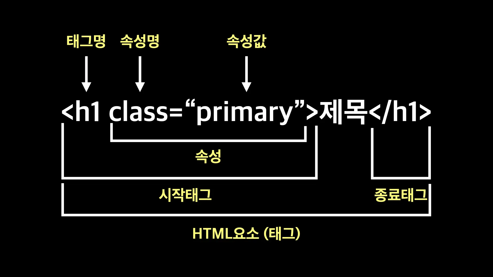
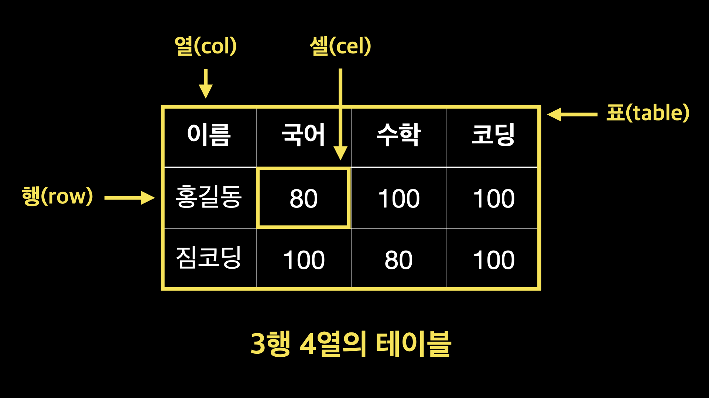
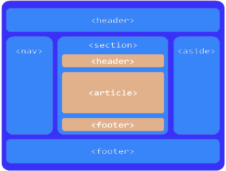

## 짐코드 교안

[Untitled](https://app.notion.com/p/acf439e5e4b04e079104439153a7f223) 

## HTML 태그 구조



  - *시작태그, 종료태그로 구성*
  - *시작태그 안에는 속성값이 들어가지는데 class 등 다양한 속성이 들어갈 수 있다.*
  - *컨텐츠란? 시작태그와 종료태그 사이에 존재하는 내용, 그림에서의 “제목”에 해당* 
  - *띄어쓰기에 사용되는 태그인 <br> 같은 경우 컨텐츠가 없고 종료태그 또한 존재하지 않는다.*

## HTML 주석

*window: 드래그 + ctrl + /*

*mac: 드래그 + command + /* 

```html
<!-- -->
```

## HTML 문서 기본 구조

```html
<!DOCTYPE html>
<html lang="ko">
	<head>
	  <meta charset="UTF-8">
	  <title>문서 제목</title>
	</head>
	<body>
	  <h1>짐코딩 HTML 강좌</h1>
		<p>이번 시간에 배울 내용은 HTML 입니다.</p>
	</body>
</html>
```

  1. **<!DOCTYPE html>**
*도큐먼트 타입으로 현재 문서가 어떤 버전으로 작성되었는지 미리 표시 <!DOCTYPE>은 태그는 아니며 웹 문서 제일 처음에 표시한다.*

*위 예시의 도큐먼트 타입* *`<!DOCTYPE html>`* *은 HTML5 버전 이라는 뜻이며, 이전 버전인 HTML 4.01 에서는 더 복잡하게 사용했다.*
  1. **<html lang="ko"> ~ </html>**
*웹 문서의 시작(**`<html>`**)과 끝(**`</html>`**)을 나타내는 태그*

*lang="ko" - lang 속성은 웹 문서가 어떠한 언어로 작성되었는지 표시하는* *`<html>태그의 속성`* *이다.*
*현재 ko(korean) 한국어로 작성되었다는 뜻이며, 이러한 속성은 웹 접근성 향상에 도움을 준다.*
  1. **<head>~</head>**
*`<html>`* *태그의 자식(Child)태그로, HTML* ***문서 정보****나 문서에서 사용할* ***외부 파일 링크****를 넣는 구간이며, 웹 브라우저에* ***표시되지는 않는다.***

**<meta charset="UTF-8">**

*HTML 파일의 인코딩을 알려주는 태그로서, 쉽게 말하면 브라우저에게 이 문서를 어떻게 그리는지 알려주는 용도 입니다. <meta charset="UTF-8"> 태그를 입력 해야지 한글, 특수문자 들이 깨지지 않고 잘 출력*
  1. **<body>~</body>**
*`<html>`* *태그의 자식(Child)태그로, HTML* ***문서 내용****을 넣는 구간 이며, 실제 웹 브라우저 안에* ***표시*** *`<body>`* *태그 안에 실제 문서내용을 입력하여 웹 사이트를 만든다.*

---

## 상세 정리

## Emmet?

Emmet은 HTML과 CSS의 자동완성 기능을 제공하여, 작성 시간을 아주 빠르게 단축 시켜주는 확장기능

---

## HTML 표준 구조 `!` 

! 입력 후 텝(tab) : 간단하고 빠르게 HTML 기본구조를 만들어 준다.

```html
<!DOCTYPE html>
<html lang="en">
<head>
  <meta charset="UTF-8">
  <meta http-equiv="X-UA-Compatible" content="IE=edge">
  <meta name="viewport" content="width=device-width, initial-scale=1.0">
  <title>Document</title>
</head>
<body>
  
</body>
</html>
```

---

## 자식노드 `>` 

div>ul>li> 입력 후 텝(tab): 자식 요소를 생성

```html
<div>
  <ul>
    <li></li>
  </ul>
</div>
```

---

## 형제노드 `+` 

div>ul+ol+div 입력 후 텝(tab) : `+` 를 사용하여 한 요소와 같은 단계에 위치한 요소를 생성

```html
<div>
  <ul></ul>
  <ol></ol>
  <div></div>
</div>
```

---

## 반복하기 `*`

div>ul>li*3 입력 후 텝(tab) : `*`를 사용하여 요소를 반복해서 생성할 수 있다.

```html
<div>
  <ul>
    <li></li>
    <li></li>
    <li></li>
  </ul>
</div>
```

---

## 클래스 부여 `.`

div.title 입력 후 텝(tab) : CSS 클래스를 갖을 요소를 생성할 수 있다. (기본이 div 이기 때문에 생략가능)

```html
<div class="title"></div>
<span class="title"></span>
```

---

## 아이디 `#` 

#item 입력 후 Tab키 : id를 갖는 요소를 생성할 수 있다. (기본이 div 이기 때문에 생략가능)

```html
<div id="item"></div>
<span id="item"></span>
```

---

## 텍스트 입력 `{}`

p.container{Hello World~!} 입력 후 Tab키 : `{}`를 사용하여 요소안에 내용을 갖는 요소를 생성

```html
<p class="container">Hello World~!</p>
```

---

## 자동 넘버링 부여 `$`

p.container{item$}*5 입력 후 Tab키 : `$`를 사용하여 넘버링을 부여

```html
<p class="container">item1</p>
<p class="container">item2</p>
<p class="container">item3</p>
<p class="container">item4</p>
<p class="container">item5</p>
```

`<h1>` ~ `<h6>` Heading

*웹 페이지의* ***제목 또는 부제목을 표현****할 때 사용하며,* ***숫자가 작을 수록 큰 제목****을 표시하는 데 사용*

`<p>` Paragraph

*하나의* ***문단****을 표시할 때 사용*

`<hr>` Horizontal Rule

*가로로 선을 긋는 태그 (종료태그 없음)*

`<br>` Break

*줄바꿈 태그로 HTML에서 개행 역할을 한다. (종료태그 없음)*

`<i>` Italic

*텍스트를 이텔릭체로 표시할 때 사용*

`<em>` Emphasis

*텍스트를 이텔릭체로 강조할 때 사용*

`<b>` Bold

*텍스트를* ***진하게 표시****할 때 사용*

`<strong>`

*텍스트를* ***진하게 강조****할 때 사용*

`<b> vs <strong>` 차이, `<i> vs <em>` 차이

*b 태그와 strong 태그 모두 진하게 표시할 때 사용하고, i 태그와 em 태그도 모두 이텔릭체로 표시할 때 사용*

*하지만 이 두 태그의* ***사용 용도는 크게 다르다.***

*b 태그와, i 태그는* ***단순히 텍스트를 진하게 그리고 이텔릭체로 표시****하는 역할만 한다.*

*strong 태그와 em태그는* ***실제로 페이지 내의 중요한 부분으로 강조****하고 싶을때 사용*

*strong, em 태그를 용도에 맞게 사용하면 웹 접근성에 큰 기여를 한다*

*브라우저에서 스크린리더(Screen Reader)를 사용하는 경우, 음성 합성(Speech Synthesizer) 도구가 페이지를 해석하고 읽어낼 때* ***strong 태그에 대해 거센 억양으로 음을 낼 수 있도록 하여 실제로 말할 때의 강조****를 하듯이 재구성할 수 있게 됩니다.*

*여기서 스크린리더란 시각장애인이 컴퓨터를 사용할 때 화면에 나타나는 정보들을 음성으로 출력해주는 화면낭독 프로그램*

`<ol>` Ordered List

***순서가 있는 목록****을 표현할 때 사용합니다. type 속성으로 글머리 기호를 변경할 수 있다.*

`<ul>` Unordered Lists

***순서가 없는 목록****을 표현할 때 사용한다.*

`<li>` Listed Item

*목록하위 항목으로 사용되며,* *`<ul>`**태그 또는* *`<ol>`**태그의 하위에 위치한다.*

`<dl>` Definition List

*Definition List(정의 목록)의 약자로,* ***사전처럼 용어를 설명하는*** ***목록****을 만듭니다.*

*예) A는 B이다. 와 같은 Key = Value로 사용할 때 유용하다.*

`<dt>` Definition Term

*Definition Term(정의 용어)의 약자로,* ***정의되는 용어의*** ***제목****을 넣을 때 사용한다.*

`<dd>` Definition Description

*Definition Description(정의 설명)의 약자로,* ***용어를*** ***설명****하는 데 사용합니다.*

### 주의사항

`<dl>`태그는 하나 이상의 `<dt>-<dd>` 쌍의 태그를 갖고 있어야 한다.

단, `<dt>-<dd>` 태그가 반드시 하나의 짝으로 지어져야 하는 것은 아니다.

예, 다음과 같은 짝으로도 올 수 있다.

```html
<dl>
	<dt>종류<dt>
	<dd>벤치프레스<dd>
	<dd>(가슴운동)<dd>
</dl>
<dl>
	<dt>벤치프레스<dt>
	<dt>(가슴운동)<dt>
	<dd>헬스의 3대 운동중 하나도 가슴 부위를 발달 시키는 운동이다.<dd>
</dl>
```

`<li>`, `<dt>-<dd>`태그는 밖에서 독립적으로 사용할 수 없다.

`<ul>` 태그 하위요소로는 `<li>`태그가 위치해야 한다.

## 표(Table) 태그

---

### Table 구조



    - `<table>` 태그 - 표
    - `<tr>` 태그 - 행
    - `<th>, <td>` 태그 - 열(제목, 일반)

### Table 기본 태그

    - `<table>`
표를 만드는 태그로써, 표 전체를 감싸는 데 사용한다.
    - `<caption>`
표의 제목이나 설명을 작성하는 태그
    - `<tr>`
표의 행을 의미하는 태그. 자식으로 `<th>`태그나 `<td>`태그가 반드시 있어야 한다.
    - `<th>`
표의 **제목 열**을 의미하는 태그. 부모 태그인 `<tr>` 태그 안에 있어야 한다.
    - `<td>`
표의 **일반 열**을 의미하는 태그. 부모인 `<tr>`태그안에 있어야 한다.

```javascript
<style>
  table {
    border: 1px solid black;
    border-collapse: collapse;
  }
  th,
  td {
    border: 1px solid black;
    padding: 12px;
  }
</style>
<table>
    <caption>프로필 테이블</caption> <!-- 테이블 제목, 설명 -->
    <tr> <!-- 행 -->
        <th>이름</th> <!--열-->
        <th>취미</th>
        <th>특기</th>
    </tr>
    <tr>
        <td>홍길동</td>
        <td>도술</td>
        <td>축지법</td>
    </tr>
    <tr>
        <td>짐코딩</td>
        <td>헬스</td>
        <td>코딩</td>
    </tr>
 </table>  
```

### Table 그룹 관련 태그

    - `<colgroup>`
열을 그룹으로 묶을 수 있도록 해주는 태그이다.
    - `<col>`
`<colgroup>`태그의 자식으로 열 단위를 나눌 수 있다. `span` 속성을 사용하여 열을 그룹으로 묶을지 설정한다. 예) <col span="3"> → 세 개의 열을 그룹으로 묶음
    - `<thead>`
표의 제목 열들을 묶는 그룹 태그
    - `<tbody>`
표의 일반적인 데이터들을 묶는 그룹태그.
기본적으로 행그룹태그를 사용하지 않으면 크롬브라우저가 자동으로 tbody 태그로 묶어준다.
    - `<tfoot>`
표의 하단 영역을 묶는 그룹태그

```javascript
 <table>
      <caption>
        학급 점수
      </caption>
      <colgroup>
        <col class="col1" />
        <col class="col2" />
        <col class="col3" />
        <col class="col4" />
        <col class="col5" />
        <col class="col6" />
      </colgroup>
      <thead>
        <tr>
          <th>반</th>
          <th>이름</th>
          <th>국어</th>
          <th>영어</th>
          <th>수학</th>
          <th>코딩</th>
        </tr>
      </thead>
      <tbody>
        <tr>
          <td>1반</td>
          <td>홍길동</td>
          <td>90</td>
          <td>100</td>
          <td>90</td>
          <td>81</td>
        </tr>
        <tr>
          <td>1반</td>
          <td>짐코딩</td>
          <td>85</td>
          <td>81</td>
          <td>95</td>
          <td>81</td>
        </tr>
      </tbody>
      <tfoot>
        <tr>
          <td>1반</td>
          <td>평균</td>
          <td>87.5</td>
          <td>90.5</td>
          <td>92.5</td>
          <td>90.5</td>
        </tr>
      </tfoot>
    </table>
```

### Table 태그 관련 속성

    - `<table>` 태그 속성
- border - 테이블이 갖고 있는 테이블과 셀 모두 선을 표시한다. `웹표준X`
      - width - 테이블의 가로너비를 설정한다. `웹표준X`
      - cellpadding - 셀의 안쪽 여백으로써, 셀과 콘텐츠와의 간격을 조절함. `웹표준X`
      - cellspacing - 셀의 바깥쪽 여백으로써, 셀과 셀간의 간격을 조절함. `웹표준X`

위 속성들은 XHTML 1.0에서는 웹 표준이지만 오늘날 **HTML5에서는 웹 표준이 아닙니다. → CSS로 대체해야 함.**
    - `<th>` 태그 속성
- scope - 웹접근성 관련 속성으로 스크린리더가 데이터를 인식하고 읽는 순서를 결정짓게 합니다.
- th가 열에 쓰일경우 값을 "col"로 설정합니다. 예) `<th scope="col">`
        - th가 행에 쓰일경우 값은 "row"로 설정합니다. 예) `<th scope="row">`
    -  `<th>`, `<td>`
- colspan - 열을 병합하는 속성. 예) <td colspan="2">
      - rowspan - 행을 병합하는 속성. 예) <td rowspan="2">

```javascript
<tbody>
  <tr>
    <td rowspan="2">1반</td>
    <td>홍길동</td>
    <td>90</td>
    <td>100</td>
    <td>90</td>
    <td>81</td>
  </tr>
  <tr>
    <!-- <td>1반</td> -->
    <td>짐코딩</td>
    <td>85</td>
    <td>81</td>
    <td>95</td>
    <td>81</td>
  </tr>
</tbody>
```

    - `<col>`
- width - 열의 가로너비를 지정하지만 `웹표준X` → CSS로 대체
      - span - 열을 그룹화 함. 예) <col span="3"> → 세 개의 열을 묶음.

## Sementic Tag

---

*시멘틱 태그(Sementic Tag)에서 Sementic의 사전적 의미는 "의미론적"이라는 뜻으로, HTML에서 시멘틱 태그란* ***"의미를 가지는 태그"****를 말한다.*

*가령 제목과 같이 큰 글씨를 나타낼 때* *`<h1>`* *태그를 사용하여 나타낼 수 있다.* *`<h1>`* *태그는 페이지 제목이라는 의미를 갖고 있다.*

*반면* *`<span>`* *태그에 style을 입혀* *`<h1>`* *태그와 동일한 스타일을 표시할 수 있다. 하지만 이것은* ***HTML 의미(Sementic)를 제대로 살리지 못한 것 이기 때문에 지양할 필요****가 있다.*

*페이지 Layout을 만들거나 HTML 마크업을 할 때 최대한 의미있는 Sementic Tag를 사용하길 권장한다.*

### HTML Sementic Elements

    - [`<header>`](https://developer.mozilla.org/ko/docs/Web/HTML/Element/header) : *페이지에 대한 정보를 담는 태그로, 페이지 상단에 위치*
    - [`<nav>`](https://developer.mozilla.org/ko/docs/Web/HTML/Element/nav) : *다른 페이지나 같은 페이지 안에 다른 부분으로 이어주는 내비게이션 링크로 구성된 섹션을 표현*
    - [`<aside>`](https://developer.mozilla.org/ko/docs/Web/HTML/Element/aside) : 페*이지 전체 내용과는 어느정도 관련성이 있지만, 주요 내용과는 직접적인 연관성은 없는 분리된 내용을 담고 있습니다.*
    - [`<main>`](https://developer.mozilla.org/ko/docs/Web/HTML/Element/main) *: 문서의 body 요소의 주 콘텐츠(main content)를 정의할 때 사용*
    - [`<section>`](https://developer.mozilla.org/ko/docs/Web/HTML/Element/section) : *문서나 응용프로그램의 일반적인 섹션을 표현*
    - [`<article>`](https://developer.mozilla.org/ko/docs/Web/HTML/Element/article) : *article은 여러가지 아이템들을 묶어 재사용 가능하게 그룹화*
    - [`<footer>`](https://developer.mozilla.org/ko/docs/Web/HTML/Element/footer) : *주로 저작권 정보나 서비스 제공자 정보등을 나타내며 사이트 하단에 위치*
    - [`<details>`](https://developer.mozilla.org/ko/docs/Web/HTML/Element/details) : *추가적인 정보를 나타내거나 사용자가 요청하는 정보를 나타낸다.*
    - [`<summary>`](https://developer.mozilla.org/ko/docs/Web/HTML/Element/summary) : *부모요소인 details요소의 내용에 대한 요약이나 캡션등을 나타낸다.*
    - [`<figcaption>`](https://developer.mozilla.org/ko/docs/Web/HTML/Element/figcaption) : *부모요소인 figure요소의 내용들에 대한 캡션, 혹은 제목을 나타냅니다.*
    - [`<figure>`](https://developer.mozilla.org/ko/docs/Web/HTML/Element/figure) *: 일러스트, 다이어그램, 사진, 코드등에 주석을 다는 용도로 사용됩니다.*
    - [`<mark>`](https://developer.mozilla.org/ko/docs/Web/HTML/Element/mark) : *하나의 문서 내에서 다른 문맥과의 관련성을 나타내기 위해서 참조 목적으로 마킹되거나 하이라이트된 텍스트를 표현*
    - [`<time>`](https://developer.mozilla.org/ko/docs/Web/HTML/Element/time) : *24시간에서의 시간 혹은 그레고리력에서의 정밀한 날짜를 나타냅니다.*

### MDN Semantics

[https://developer.mozilla.org/ko/docs/Glossary/Semantics](https://developer.mozilla.org/ko/docs/Glossary/Semantics)

## **HTML5 시맨틱 태그 기반 페이지 레이아웃**

---

*일반적인 HTML 페이지에는 페이지 머리글, 바닥글 및 중간 페이지 콘텐츠가 있습니다. 중간 페이지 콘텐츠 내에서 최상위 수준에는 탐색, 콘텐츠 및 3열이 있을 수 있습니다. 확실히 콘텐츠 내에서 각 페이지의 특정 콘텐츠에 따라 더 많은 섹션을 포함할 수 있습니다.*



*위 그림은 이 최상위 페이지 레이아웃을 시각적으로 보여줍니다.*

*일반적으로* *`<header>`* *그룹은 소개 또는 탐색 보조 도구입니다. 일반적으로 헤더 요소는 섹션의 제목을 포함하기 위한 것이며 섹션의 목차, 검색 양식, 로고 등을 래핑할 수 있습니다.* 

*맨 아래에 있는* *`<footer>`**는 일반적으로 누가 작성했는지, 관련 문서에 대한 링크, 저작권 데이터 등과 같은 섹션에 대한 정보를 포함합니다.* 

*페이지 중간에 있는* *`<nav>`* *요소는 다른 페이지 또는 페이지 내의 부분으로 연결되는 페이지의 섹션을 나타냅니다. 일반적으로 탐색 링크가 있는 섹션입니다.* 

*`<aside>`**콘텐츠가 옆 요소 주변의 콘텐츠와 접선적으로 관련되어 있는 경우 해당 콘텐츠와 분리된 것으로 간주할 수 있습니다(예: 인용문 또는 사이드바, 광고 등).* 

*페이지 레이아웃의 바로 중앙에 있는* *`<section>`* *은 논리적 또는 물리적으로 그룹화된 일반 콘텐츠를 포함합니다. 문서 또는 응용 프로그램, 예를 들어 웹 사이트의 홈 페이지는 소개, 뉴스 항목, 연락처 정보에 대한 섹션으로 분할될 수 있습니다.* 

*그리고* *`<article>`* *태그는 문서, 페이지, 응용 프로그램 또는 사이트에 독립적으로 배포될 수 있는 자체 포함된 구성입니다. 
예:* *`<article>`* *에는 포럼 게시물, 잡지 또는 신문 기사, 웹 로그 항목, 사용자가 제출한 댓글, 대화형 위젯 또는 가젯 또는 기타 독립적인 콘텐츠 항목이 포함될 수 있습니다.*

## Inline VS Block Element

---

*모든 HTML 태그들은 각 태그의 용도에 따른 default display value(기본 표시 값)를 가진다. 이때 default display value는* ***블록 레벨 요소(Block-level Elements)****와* ***인라인 레벨 요소(Inline-level Elements)*** *두 가지 범주로 나뉜다.*

예를들면 `<div>`태그는 블록 레벨 요소이고, `<span>`태그는 인라인 레벨 요소이다.

    - *`<div>`* *Division*
*`<div>`* *태그는 Division 즉! 분할, 분배, 분류를 뜻합니다. HTML 안에 존재하는 여러 개의 태그들을* *`<div>`* *라는 큰 단위로 묶어주는 컨테이너 같은 역할을 합니다.*
    - *`<span>`*
*`<span>`* *태그도* *`<div>`* *태그와 같이 여러 개의 태그들을 묶어주는 주머니 역할을 합니다.*

## Block Element

---

*블록 레벨 요소는 부모 요소의* ***전체 공간****을 차지하여 "블록"을 만듭니다.* *`<h1>~<h6>`* *`<ol>`* *`<ul>`* *`<li>`* *`<p>`* *태그 등이 블록 요소에 속한다.*

    - *화면 구성이나 레이아웃을 짤 때는 블록 레벨 요소를 사용합니다.*
    - *블록 레벨 요소는 한칸을 모두 차지하기 때문에 세로로 나열 됩니다.*
    - *width(가로), height(세로), margin 속성이 적용됨.*

*블록 레벨 요소 목록*

- [**`<address>`**](https://developer.mozilla.org/ko/docs/Web/HTML/Element/address) **-** 연락처 정보.
      - [**`<article>`**](https://developer.mozilla.org/ko/docs/Web/HTML/Element/article) **-** 단락 콘텐츠.
      - [**`<aside>`**](https://developer.mozilla.org/ko/docs/Web/HTML/Element/aside) **-** 부가 콘텐츠.
      - [**`<blockquote>`**](https://developer.mozilla.org/ko/docs/Web/HTML/Element/blockquote) **-** 긴("블록")  인용구.
      - [**`<details>`**](https://developer.mozilla.org/ko/docs/Web/HTML/Element/details) **-** 상세 정보 위젯.
      - [**`<dialog>`**](https://developer.mozilla.org/ko/docs/Web/HTML/Element/dialog) **-** 대화상자.
      - [**`<dd>`**](https://developer.mozilla.org/ko/docs/Web/HTML/Element/dd) **-** 설명 목록의 정의 설명.
      - [**`<div>`**](https://developer.mozilla.org/ko/docs/Web/HTML/Element/div) **-** 문서의 분할.
      - [**`<dl>`**](https://developer.mozilla.org/ko/docs/Web/HTML/Element/dl) **-** 설명 목록.
      - [**`<dt>`**](https://developer.mozilla.org/ko/docs/Web/HTML/Element/dt) **-** 설명 목록의 정의.
      - [**`<fieldset>`**](https://developer.mozilla.org/ko/docs/Web/HTML/Element/fieldset) **-** 필드 집합의 라벨.
      - [**`<figcaption>`**](https://developer.mozilla.org/ko/docs/Web/HTML/Element/figcaption) **-** 그림 설명.
      - [**`<figure>`**](https://developer.mozilla.org/ko/docs/Web/HTML/Element/figure) **-** 미디어 콘텐츠 그룹과 설명. ([`<figcaption>`](https://developer.mozilla.org/ko/docs/Web/HTML/Element/figcaption)을 참고하세요)
      - [**`<footer>`**](https://developer.mozilla.org/ko/docs/Web/HTML/Element/footer) **-** 페이지나 구역의 푸터.
      - [**`<form>`**](https://developer.mozilla.org/ko/docs/Web/HTML/Element/form) **-** 입력 폼.
      - [**`<h1>`**](https://developer.mozilla.org/ko/docs/Web/HTML/Element/Heading_Elements)**,** [**`<h2>`**](https://developer.mozilla.org/ko/docs/Web/HTML/Element/Heading_Elements)**,** [**`<h3>`**](https://developer.mozilla.org/ko/docs/Web/HTML/Element/Heading_Elements)**,** [**`<h4>`**](https://developer.mozilla.org/ko/docs/Web/HTML/Element/Heading_Elements)**,** [**`<h5>`**](https://developer.mozilla.org/ko/docs/Web/HTML/Element/Heading_Elements)**,** [**`<h6>`**](https://developer.mozilla.org/ko/docs/Web/HTML/Element/Heading_Elements) **-** 1~6단계 제목.
      - [**`<header>`**](https://developer.mozilla.org/ko/docs/Web/HTML/Element/header) **-** 페이지나 구역의 헤더.
      - [**`<hgroup>`**](https://developer.mozilla.org/ko/docs/Web/HTML/Element/hgroup) **-** 헤더 정보 그룹.
      - [**`<hr>`**](https://developer.mozilla.org/ko/docs/Web/HTML/Element/hr) **-** 수평선(구분선).
      - [**`<li>`**](https://developer.mozilla.org/ko/docs/Web/HTML/Element/li) **-** 목록의 항목.
      - [**`<main>`**](https://developer.mozilla.org/ko/docs/Web/HTML/Element/main) **-** 문서에서 하나 뿐인 중심 콘텐츠.
      - [**`<nav>`**](https://developer.mozilla.org/ko/docs/Web/HTML/Element/nav) **-** 탐색 링크를 포함.
      - [**`<ol>`**](https://developer.mozilla.org/ko/docs/Web/HTML/Element/ol) **-** 정렬된 목록.
      - [**`<p>`**](https://developer.mozilla.org/ko/docs/Web/HTML/Element/p) **-** 문단.
      - [**`<pre>`**](https://developer.mozilla.org/ko/docs/Web/HTML/Element/pre) **-** 미리 서식 적용한 글.
      - [**`<section>`**](https://developer.mozilla.org/ko/docs/Web/HTML/Element/section) **-** 웹 페이지의 구역.
      - [**`<table>`**](https://developer.mozilla.org/ko/docs/Web/HTML/Element/table) **-** 표.
      - [**`<ul>`**](https://developer.mozilla.org/ko/docs/Web/HTML/Element/ul) **-** 정렬되지 않은 목록.

## Inline Element

---

*인라인 레벨 요소는 콘텐츠의 흐름을 끊지 않고(줄바꿈X), 요소를 구성하는* ***태그에 할당된 공간만 차지****합니다.* *`<a>`* *`<em>`* *``* *`<span>`* *태그 등이 인라인 요소에 속한다.*

    - *인라인 레벨 요소는 콘텐츠 영역 만큼 차지하기 때문에 가로로 나열됩니다.*
    - *margin-top, margin-bottom 적용되지 않습니다. 대신에 line-height 이용*
    - *width, height 속성이 적용되지 않습니다.*
    - *태그가 콘텐츠의 할당 된 공간만 갖고 있기 때문에 text-align과 같은 속성은 사용할 수 없습니다.*

*인라인 요소들*

- [**`<a>`**](https://developer.mozilla.org/ko/docs/Web/HTML/Element/a)
      - [**`<abbr>`**](https://developer.mozilla.org/ko/docs/Web/HTML/Element/abbr)
      - [**<acronym> (en-US)**](https://developer.mozilla.org/en-US/docs/Web/HTML/Element/acronym)
      - [**`<audio>`**](https://developer.mozilla.org/ko/docs/Web/HTML/Element/audio) **(컨트롤이 보이면)**
      - [**`<b>`**](https://developer.mozilla.org/ko/docs/Web/HTML/Element/b)
      - [**<bdi> (en-US)**](https://developer.mozilla.org/en-US/docs/Web/HTML/Element/bdi)
      - [**`<bdo>`**](https://developer.mozilla.org/ko/docs/Web/HTML/Element/bdo)
      - [**<big> (en-US)**](https://developer.mozilla.org/en-US/docs/Web/HTML/Element/big)
      - [**`<br>`**](https://developer.mozilla.org/ko/docs/Web/HTML/Element/br)
      - [**`<button>`**](https://developer.mozilla.org/ko/docs/Web/HTML/Element/button)
      - [**`<canvas>`**](https://developer.mozilla.org/ko/docs/Web/HTML/Element/canvas)
      - [**`<cite>`**](https://developer.mozilla.org/ko/docs/Web/HTML/Element/cite)
      - [**`<code>`**](https://developer.mozilla.org/ko/docs/Web/HTML/Element/code)
      - [**`<data>`**](https://developer.mozilla.org/ko/docs/Web/HTML/Element/data)
      - [**`<datalist>`**](https://developer.mozilla.org/ko/docs/Web/HTML/Element/datalist)
      - [**`<del>`**](https://developer.mozilla.org/ko/docs/Web/HTML/Element/del)
      - [**`<dfn>`**](https://developer.mozilla.org/ko/docs/Web/HTML/Element/dfn)
      - [**`<em>`**](https://developer.mozilla.org/ko/docs/Web/HTML/Element/em)
      - [**`<embed>`**](https://developer.mozilla.org/ko/docs/Web/HTML/Element/embed)
      - [**`<i>`**](https://developer.mozilla.org/ko/docs/Web/HTML/Element/i)
      - [**`<iframe>`**](https://developer.mozilla.org/ko/docs/Web/HTML/Element/iframe)
      - [**``**](https://developer.mozilla.org/ko/docs/Web/HTML/Element/img)
      - [**`<input>`**](https://developer.mozilla.org/ko/docs/Web/HTML/Element/Input)
      - [**`<ins>`**](https://developer.mozilla.org/ko/docs/Web/HTML/Element/ins)
      - [**`<kbd>`**](https://developer.mozilla.org/ko/docs/Web/HTML/Element/kbd)
      - [**`<label>`**](https://developer.mozilla.org/ko/docs/Web/HTML/Element/label)
      - [**`<map>`**](https://developer.mozilla.org/ko/docs/Web/HTML/Element/map)
      - [**`<mark>`**](https://developer.mozilla.org/ko/docs/Web/HTML/Element/mark)
      - [**`<meter>`**](https://developer.mozilla.org/ko/docs/Web/HTML/Element/meter)
      - [**`<noscript>`**](https://developer.mozilla.org/ko/docs/Web/HTML/Element/noscript)
      - [**`<object>`**](https://developer.mozilla.org/ko/docs/Web/HTML/Element/object)
      - [**`<output>`**](https://developer.mozilla.org/ko/docs/Web/HTML/Element/output)
      - [**<picture> (en-US)**](https://developer.mozilla.org/en-US/docs/Web/HTML/Element/picture)
      - [**`<progress>`**](https://developer.mozilla.org/ko/docs/Web/HTML/Element/progress)
      - [**`<q>`**](https://developer.mozilla.org/ko/docs/Web/HTML/Element/q)
      - [**`<ruby>`**](https://developer.mozilla.org/ko/docs/Web/HTML/Element/ruby)
      - [**`<s>`**](https://developer.mozilla.org/ko/docs/Web/HTML/Element/s)
      - [**`<samp>`**](https://developer.mozilla.org/ko/docs/Web/HTML/Element/samp)
      - [**`<script>`**](https://developer.mozilla.org/ko/docs/Web/HTML/Element/script)
      - [**`<select>`**](https://developer.mozilla.org/ko/docs/Web/HTML/Element/select)
      - [**`<slot>`**](https://developer.mozilla.org/ko/docs/Web/HTML/Element/slot)
      - [**`<small>`**](https://developer.mozilla.org/ko/docs/Web/HTML/Element/small)
      - [**`<span>`**](https://developer.mozilla.org/ko/docs/Web/HTML/Element/span)
      - [**`<strong>`**](https://developer.mozilla.org/ko/docs/Web/HTML/Element/strong)
      - [**`<sub>`**](https://developer.mozilla.org/ko/docs/Web/HTML/Element/sub)
      - [**`<sup>`**](https://developer.mozilla.org/ko/docs/Web/HTML/Element/sup)
      - [**`<svg>`**](https://developer.mozilla.org/ko/docs/Web/HTML/Element/svg)
      - [**`<template>`**](https://developer.mozilla.org/ko/docs/Web/HTML/Element/template)
      - [**`<textarea>`**](https://developer.mozilla.org/ko/docs/Web/HTML/Element/textarea)
      - [**`<time>`**](https://developer.mozilla.org/ko/docs/Web/HTML/Element/time)
      - [**`<u>`**](https://developer.mozilla.org/ko/docs/Web/HTML/Element/u)
      - [**<tt> (en-US)**](https://developer.mozilla.org/en-US/docs/Web/HTML/Element/tt)
      - [**`<var>`**](https://developer.mozilla.org/ko/docs/Web/HTML/Element/var)
      - [**`<video>`**](https://developer.mozilla.org/ko/docs/Web/HTML/Element/Video)
      - [**`<wbr>`**](https://developer.mozilla.org/ko/docs/Web/HTML/Element/wbr)

## 이미지 태그

---

*``* *태그는 HTML 문서에 이미지를 넣습니다.*

```css

```

*위의 예제를 통해* *``* *요소의 사용법을 알 수 있습니다.*

### 속성

    - `src`
***필수****이며, 이미지로의 경로를 지정합니다.*
    - `alt`
*이미지의 텍스트 설명이며 필수는 아니지만, 스크린 리더가* *`alt`**의 값을 읽어 사용자에게 이미지를 설명하므로, 웹 접근성 차원에서* ***매우 유용****합니다. 또한 네트워크 오류, 콘텐츠 차단, 죽은 링크 등 이미지를 표시할 수 없는 경우에도 이 속성의 값을 대신 보여줍니다.*
    - `height`
*이미지 높이를 지정하는 속성이며, 값으로 픽셀(px)과 퍼센트(%) 단위로 지정할 수 있으며 픽셀로 설정시에는 숫자만 입력하면 됩니다.*
    - `width`
*이미지 너비를 지정하는 속성이며, 값으로 픽셀(px)과 퍼센트(%) 단위로 지정할 수 있으며 픽셀로 설정시에는 숫자만 입력하면 됩니다.*
    - [img 요소 MDN](https://developer.mozilla.org/ko/docs/Web/HTML/Element/img#attr-height)

## 절대경로 VS 상대경로

### **절대경로**

*리소스(이미지)의 절대경로는 말 그대로 절대적인 고유한 경로를 지정하는 것입니다.*

    - *웹 이미지 절대경로 예) - http://www.naver.com/apple.png
http 프로토콜로 시작해서 전체 경로를 입력함*
    - *웹 이미지 절대경로 예) - /apple.png
루트('/') 디렉토리 부터 시작하는 경우 현재 도메인이 자동으로 앞에 붙음*
    - *PC 컴퓨터 절대경로 예) - C:\user\gymcoding\apple.png*

*그러나 절대경로를 이용하면 웹 에서 이미지가 사라지거나 내 컴퓨터에서 만든 파일을 다른 곳으로 옮길 때 해당 절대경로를 다시 수정해야 하는 불편함이 있습니다.*

*그래서 작업중인 폴더에 이미지를 옮기고 상대적인 위치를 가리킴으로써 이러한 불편함을 해소할 수 있습니다.*

### **상대경로**

*상대경로는 현재 문서를 기준으로 경로를 인식하는 방법입니다.*

    - *`index.html`* *에서 동일한 위치에 있는 apple.png를 가져오는 방법 →* *`src="apple.png"`* *또는* *`src="./apple.png"`*
    - *`index.html`* *의 상위 폴더에 이미지가 있는 경우 →* *`src="../apple.png"`*
    - *`index.html`* *의 하위 폴더에 이미지가 있는 경우 →* *`src="하위폴더/apple.png"`*

## 오디오 태그

---

*`<audio>`* *태그는 HTML 문서에 소리 콘텐츠를 넣을 때 사용합니다.* 

*`src`* *속성 또는* *`<source>`* *Element를 사용하여 한 개 이상의 오디오 소스를 지정할 수 있으며, 다수를 지정한 경우 가장 적절한 소스를 브라우저가 선택합니다.*

```html
<!-- src 속성을 사용 -->
<audio controls src="/media/cc0-audio/t-rex-roar.mp3">

<!-- source 요소를 사용 -->
<audio controls>
  <source src="myAudio.mp3" type="audio/mpeg">
  <source src="myAudio.ogg" type="audio/ogg">
</audio>
```

## 비디오 태그

---

*`<video>`* *태그는 영상 콘텐츠를 HTML 문서에 삽입할 때 사용합니다.*

*`src`* *속성 또는* *`<source>`* *Element를 사용하여 한 개 이상의 오디오 소스를 지정할 수 있으며, 다수를 지정한 경우 가장 적절한 소스를 브라우저가 선택합니다.*

```html
<!-- src 속성을 사용 -->
<video controls src="/media/cc0-videos/flower.mp4" type="video/mp4">

<!-- source 요소를 사용 -->
<video controls width="250">
    <source src="/media/cc0-videos/flower.webm" type="video/webm">
    <source src="/media/cc0-videos/flower.mp4" type="video/mp4">
</video>
```

## 오디오&비디오 태그 속성

---

    - *`controls`* *- 플레이어 화면에 컨트롤 바(재생막대)를 표시합니다.*
    - *`autoplay`* *- 오디오나 비디오를 자동으로 실행합니다.*
*단, 크롬, 파이어폭스 브라우저는 자동 재생을 지원하지 않습니다. 만약 자동 재생을 하고 싶다면* *`muted`* *속성을 사용하여 소리를 제거해야 합니다.*
    - *`loop`* *- 오디오나 비디오를 반복 재생합니다.*
    - *`muted`* *- 오디오나 비디오의 소리를 제거합니다.*
    - *`preload`* *- 페이지를 불러올 때 오디오나 비디오 파일을 어떻게 로딩할 것인지 지정합니다. 사용할 수 있는 값은* *`auto`* *`metadata`* *`none`* *입니다.*
*기본적으로* *`preload="auto"`* *가 사용됩니다.*
    - *`width`* *`height`* *- 비디오 플레이어의 너비와 높이를 지정합니다.* *`width`* *나* *`height`* *의 값 중에서 하나만 지정하면 나머지는 자동으로 계산해서 표시합니다.*
    - *`poster="파일 이름"`* *-* *`<video>`* *태그에서 사용하는 속성으로, 비디오가 재생되기 전까지 화면에 표시될 포스터 이미지를 지정합니다.*

## 하이퍼링크 태그

---

*`<a>`* *태그는* *`href`* *속성을 사용하여* ***다른 페이지****나 같은 페이지의* ***특정위치****, 파일, 이메일 주소와 그 외 다른 URL로 연결할 수 있는 하이퍼링크를 만듭니다.* 

*`target="_blank"`* *속성을 사용하여 새탭에서 화면을 열 수 있다.*

    - *같은 폴더안에 있는 다른 페이지로 이동*
```html
<a href="inner.html">다른 페이지 이동</a>
<a href="inner.html" target="_blank">새탭으로 페이지 열기</a>
```
    - 이미지에 하이퍼 링크 걸기
```html
<a href="inner.html"></a>
```
    - ID 속성이 apple인 특정위치로 이동하는 하이퍼링크
```html
<!-- id가 apple인 요소로 이동하는 하이퍼링크 -->
<a href="#apple">이동</a>

<!-- 해당 요소 위치로 스크롤이 이동함 -->
<div id="apple">사과</div>
```
    - 이메일 보내기 하이퍼링크
```html
<a href="mailto:bruce.lean17@gmail.com">이메일 보내기</a>
```

```html
 <h2>이미지 태그</h2>
    

    <h2>오디오 태그</h2>
    <audio src="../assets/short_sound.wav" controls></audio>

    <h2>비디오 태그</h2>

    <video
      width="400"
      src="../assets/short_video.mp4"
      controls
      poster="../practice.jpg"
      type="video/mp4"
    ></video>

    <h2>하이퍼링크 태그</h2>
    <a href="http://www.naver.com" target="_blank">네이버</a>와
    <a href="http://www.google.com">구글</a>은 포털사이트 입니다.

    <hr />

    <a href="#target">타겟으로 이동</a>
    <a href="mailto:baejeu@naver.com">이메일 보내기</a>

    <div>1</div>
    <div>2</div>
    <div>3</div>
    <div>4</div>
    <div>5</div>
    <div>6</div>
    <div>7</div>
    <div>8</div>
    <div>9</div>
    <div>10</div>
    <div>11</div>
    <div>12</div>
    <div>13</div>
    <div>14</div>
    <div>15</div>
    <div>16</div>
    <div>17</div>
    <div>18</div>
    <div id="target">19</div>
    <div>20</div>
```

### 속성

    - `href`
*하이퍼링크가 가리키는 URL. 링크는 HTTP 기반 URL일 필요는 없고, 브라우저가 지원하는 모든 URL 스킴을 사용할 수 있습니다.*

      - *페이지 구획을 가리키는 프래그먼트 URL*
      - *미디어 파일 일부를 가리키는 미디어 프래그먼트*
      - *`tel:`* *URL을 사용하는 전화번호*
      - *`mailto:`* *URL을 사용하는 이메일 주소*
      - *웹 브라우저는 다른 URL 스킴을 지원하지 않지만, 웹사이트는* [*`Navigator.registerProtocolHandler()`*](https://developer.mozilla.org/ko/docs/Web/API/Navigator/registerProtocolHandler)*를 통해 지원할 수 있습니다.*
    - `target`
- *`_self`**: URL을 현재 브라우징 맥락에 표시합니다. 기본값.*
      - *`_blank`**: URL을 새로운 브라우징 맥락에 표시합니다. 보통 새 탭이지만, 사용자가 브라우저 설정을 통해 새 창으로 바꿀 수 있습니다.*
      - *`_parent`**: URL을 현재 브라우징 맥락의 부모에 표시합니다. 부모가 존재하지 않으면* *`_self`**와 동일하게 행동합니다.*
      - *`_top`**: URL을 최상단 브라우징 맥락(현재 맥락의 부모면서 자신의 부모가 존재하지 않는, 제일 높은 맥락)에 표시합니다. 부모가 존재하지 않으면* *`_self`**와 동일하게 행동합니다.*

## MDN

---

    - [비디오 요소](https://developer.mozilla.org/ko/docs/Web/HTML/Element/Video)
    - [`<a>`](https://developer.mozilla.org/ko/docs/Web/HTML/Element/a)[ 태그](https://developer.mozilla.org/ko/docs/Web/HTML/Element/a)
    - [하이퍼링크 만들기](https://developer.mozilla.org/ko/docs/Learn/HTML/Introduction_to_HTML/Creating_hyperlinks)

# 폼 태그 

---

*`<form>`* *요소는 정보를 제출하기 위하여 어디서부터 어디까지가 양식인지 지정하는 역할을 한다.*

```html
<form action="/signup" method="post">
  <div class="form-example">
    <label for="name">이름: </label>
    <input type="text" name="name" id="name" required>
  </div>
  <div class="form-example">
    <label for="email">이메일: </label>
    <input type="email" name="email" id="email" required>
  </div>
  <div class="form-example">
    <input type="submit" value="제출하기">
  </div>
</form>
```

### 속성

    - *`action`* *- 양식 데이터를 처리할 서버 프로그램의 URI*
    - *`method`* *- 양식을 제출할 때 사용할 HTTP 메서드*
- *`post`* *- 양식 데이터를* ***요청 본문****으로 전송*
      - *`get`* *- 양식 데이터를* ***URL의 쿼리스트링으로*** *붙여서 전송*

# Input 태그

---

*`<input>`* *요소로 데이터를 입력 받을 수 있다.* 

*`type`* *속성을 통하여 다양한 방법으로 데이터를 받을 수 있다.*

### text

*`<input>`* *태그의 기본값으로 한줄의 텍스트를 입력 받는다.*

```html
<input type="text" id="name">
```

*HTML5 에서는 text 필드가 데이터 용도에 맞게 사용할 수 있도록 다양한 타입이 추가되었다.*

    - *`text`* *- 일반적인 텍스트를 받기위해 사용*
    - *`password`* *- 비밀번호를 받기위해 사용*
    - *`email`* *- email 데이터를 받기위해 사용 (이메일 유효성 검증)*
    - *`tel`* *- 전화번호를 받기위해 사용 (모바일 접근시 키패드가 다름)*
    - *더 많은* *`type`**은* [*MDN 사이트*](https://developer.mozilla.org/ko/docs/Web/HTML/Element/Input)*에서 참고*

### label

*`<label>`* *레이블 태그는 입력받는 필드를 설명할 때 사용* *`웹접근성 준수`*

*사용 방법은* *`<label>`* *태그 하위에* *`<input>`* *태그를 위치시킬 수 있고* *`id`* *와* *`for`* *속성을 사용하여* *`<input>`* *태그와 연결지을 수 있다.*

```html
<!-- label 태그 하위에 놓는 법 -->
<label>
	이름 : 
	<input type="text" id="name">
</label>

<!-- for와 id속성을 사용하여 label 태그와 연결지음 -->
<label for="name">이름 : </label>
<input type="text" id="name">
```

