## 짐코드 교안

[Untitled](https://app.notion.com/p/acf439e5e4b04e079104439153a7f223) 

## HTML 태그 구조

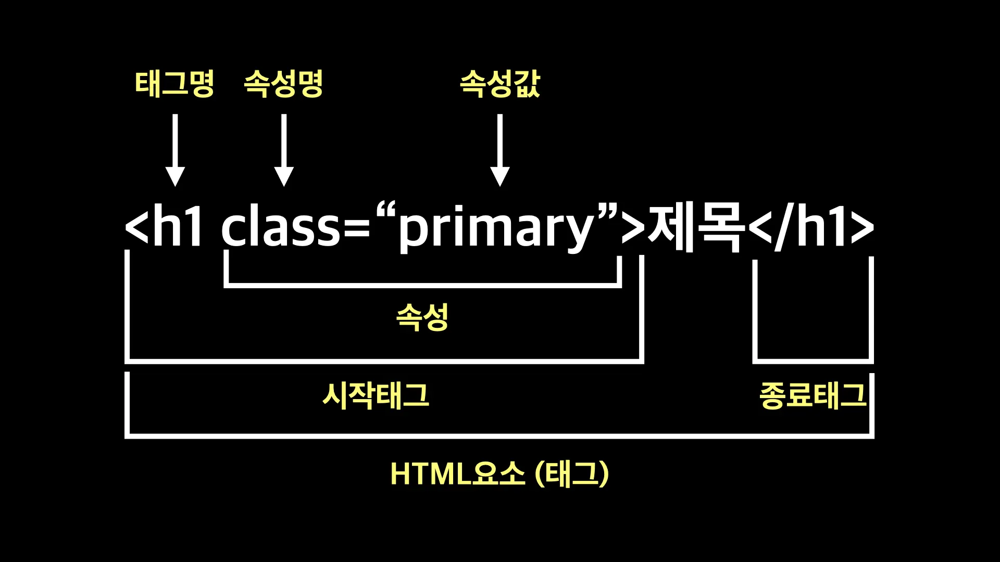

    - *시작태그, 종료태그로 구성*
    - *시작태그 안에는 속성값이 들어가지는데 class 등 다양한 속성이 들어갈 수 있다.*
    - *컨텐츠란? 시작태그와 종료태그 사이에 존재하는 내용, 그림에서의 “제목”에 해당* 
    - *띄어쓰기에 사용되는 태그인 <br> 같은 경우 컨텐츠가 없고 종료태그 또한 존재하지 않는다.*

## HTML 주석

*window: 드래그 + ctrl + /*

*mac: 드래그 + command + /* 

```html
<!-- -->
```

## HTML 문서 기본 구조

```html
<!DOCTYPE html>
<html lang="ko">
	<head>
	  <meta charset="UTF-8">
	  <title>문서 제목</title>
	</head>
	<body>
	  <h1>짐코딩 HTML 강좌</h1>
		<p>이번 시간에 배울 내용은 HTML 입니다.</p>
	</body>
</html>
```

    1. **<!DOCTYPE html>**
*도큐먼트 타입으로 현재 문서가 어떤 버전으로 작성되었는지 미리 표시 <!DOCTYPE>은 태그는 아니며 웹 문서 제일 처음에 표시한다.*

*위 예시의 도큐먼트 타입* *`<!DOCTYPE html>`* *은 HTML5 버전 이라는 뜻이며, 이전 버전인 HTML 4.01 에서는 더 복잡하게 사용했다.*
    1. **<html lang="ko"> ~ </html>**
*웹 문서의 시작(**`<html>`**)과 끝(**`</html>`**)을 나타내는 태그*

*lang="ko" - lang 속성은 웹 문서가 어떠한 언어로 작성되었는지 표시하는* *`<html>태그의 속성`* *이다.*
*현재 ko(korean) 한국어로 작성되었다는 뜻이며, 이러한 속성은 웹 접근성 향상에 도움을 준다.*
    1. **<head>~</head>**
*`<html>`* *태그의 자식(Child)태그로, HTML* ***문서 정보****나 문서에서 사용할* ***외부 파일 링크****를 넣는 구간이며, 웹 브라우저에* ***표시되지는 않는다.***

**<meta charset="UTF-8">**

*HTML 파일의 인코딩을 알려주는 태그로서, 쉽게 말하면 브라우저에게 이 문서를 어떻게 그리는지 알려주는 용도 입니다. <meta charset="UTF-8"> 태그를 입력 해야지 한글, 특수문자 들이 깨지지 않고 잘 출력*
    1. **<body>~</body>**
*`<html>`* *태그의 자식(Child)태그로, HTML* ***문서 내용****을 넣는 구간 이며, 실제 웹 브라우저 안에* ***표시*** *`<body>`* *태그 안에 실제 문서내용을 입력하여 웹 사이트를 만든다.*

---

## 상세 정리

## Emmet?

Emmet은 HTML과 CSS의 자동완성 기능을 제공하여, 작성 시간을 아주 빠르게 단축 시켜주는 확장기능

---

## HTML 표준 구조 `!` 

! 입력 후 텝(tab) : 간단하고 빠르게 HTML 기본구조를 만들어 준다.

```html
<!DOCTYPE html>
<html lang="en">
<head>
  <meta charset="UTF-8">
  <meta http-equiv="X-UA-Compatible" content="IE=edge">
  <meta name="viewport" content="width=device-width, initial-scale=1.0">
  <title>Document</title>
</head>
<body>
  
</body>
</html>
```

---

## 자식노드 `>` 

div>ul>li> 입력 후 텝(tab): 자식 요소를 생성

```html
<div>
  <ul>
    <li></li>
  </ul>
</div>
```

---

## 형제노드 `+` 

div>ul+ol+div 입력 후 텝(tab) : `+` 를 사용하여 한 요소와 같은 단계에 위치한 요소를 생성

```html
<div>
  <ul></ul>
  <ol></ol>
  <div></div>
</div>
```

---

## 반복하기 `*`

div>ul>li*3 입력 후 텝(tab) : `*`를 사용하여 요소를 반복해서 생성할 수 있다.

```html
<div>
  <ul>
    <li></li>
    <li></li>
    <li></li>
  </ul>
</div>
```

---

## 클래스 부여 `.`

div.title 입력 후 텝(tab) : CSS 클래스를 갖을 요소를 생성할 수 있다. (기본이 div 이기 때문에 생략가능)

```html
<div class="title"></div>
<span class="title"></span>
```

---

## 아이디 `#` 

#item 입력 후 Tab키 : id를 갖는 요소를 생성할 수 있다. (기본이 div 이기 때문에 생략가능)

```html
<div id="item"></div>
<span id="item"></span>
```

---

## 텍스트 입력 `{}`

p.container{Hello World~!} 입력 후 Tab키 : `{}`를 사용하여 요소안에 내용을 갖는 요소를 생성

```html
<p class="container">Hello World~!</p>
```

---

## 자동 넘버링 부여 `$`

p.container{item$}*5 입력 후 Tab키 : `$`를 사용하여 넘버링을 부여

```html
<p class="container">item1</p>
<p class="container">item2</p>
<p class="container">item3</p>
<p class="container">item4</p>
<p class="container">item5</p>
```

`<h1>` ~ `<h6>` Heading

*웹 페이지의* ***제목 또는 부제목을 표현****할 때 사용하며,* ***숫자가 작을 수록 큰 제목****을 표시하는 데 사용*

`<p>` Paragraph

*하나의* ***문단****을 표시할 때 사용*

`<hr>` Horizontal Rule

*가로로 선을 긋는 태그 (종료태그 없음)*

`<br>` Break

*줄바꿈 태그로 HTML에서 개행 역할을 한다. (종료태그 없음)*

`<i>` Italic

*텍스트를 이텔릭체로 표시할 때 사용*

`<em>` Emphasis

*텍스트를 이텔릭체로 강조할 때 사용*

`<b>` Bold

*텍스트를* ***진하게 표시****할 때 사용*

`<strong>`

*텍스트를* ***진하게 강조****할 때 사용*

`<b> vs <strong>` 차이, `<i> vs <em>` 차이

*b 태그와 strong 태그 모두 진하게 표시할 때 사용하고, i 태그와 em 태그도 모두 이텔릭체로 표시할 때 사용*

*하지만 이 두 태그의* ***사용 용도는 크게 다르다.***

*b 태그와, i 태그는* ***단순히 텍스트를 진하게 그리고 이텔릭체로 표시****하는 역할만 한다.*

*strong 태그와 em태그는* ***실제로 페이지 내의 중요한 부분으로 강조****하고 싶을때 사용*

*strong, em 태그를 용도에 맞게 사용하면 웹 접근성에 큰 기여를 한다*

*브라우저에서 스크린리더(Screen Reader)를 사용하는 경우, 음성 합성(Speech Synthesizer) 도구가 페이지를 해석하고 읽어낼 때* ***strong 태그에 대해 거센 억양으로 음을 낼 수 있도록 하여 실제로 말할 때의 강조****를 하듯이 재구성할 수 있게 됩니다.*

*여기서 스크린리더란 시각장애인이 컴퓨터를 사용할 때 화면에 나타나는 정보들을 음성으로 출력해주는 화면낭독 프로그램*

`<ol>` Ordered List

***순서가 있는 목록****을 표현할 때 사용합니다. type 속성으로 글머리 기호를 변경할 수 있다.*

`<ul>` Unordered Lists

***순서가 없는 목록****을 표현할 때 사용한다.*

`<li>` Listed Item

*목록하위 항목으로 사용되며,* *`<ul>`**태그 또는* *`<ol>`**태그의 하위에 위치한다.*

`<dl>` Definition List

*Definition List(정의 목록)의 약자로,* ***사전처럼 용어를 설명하는*** ***목록****을 만듭니다.*

*예) A는 B이다. 와 같은 Key = Value로 사용할 때 유용하다.*

`<dt>` Definition Term

*Definition Term(정의 용어)의 약자로,* ***정의되는 용어의*** ***제목****을 넣을 때 사용한다.*

`<dd>` Definition Description

*Definition Description(정의 설명)의 약자로,* ***용어를*** ***설명****하는 데 사용합니다.*

### 주의사항

`<dl>`태그는 하나 이상의 `<dt>-<dd>` 쌍의 태그를 갖고 있어야 한다.

단, `<dt>-<dd>` 태그가 반드시 하나의 짝으로 지어져야 하는 것은 아니다.

예, 다음과 같은 짝으로도 올 수 있다.

```html
<dl>
	<dt>종류<dt>
	<dd>벤치프레스<dd>
	<dd>(가슴운동)<dd>
</dl>
<dl>
	<dt>벤치프레스<dt>
	<dt>(가슴운동)<dt>
	<dd>헬스의 3대 운동중 하나도 가슴 부위를 발달 시키는 운동이다.<dd>
</dl>
```

`<li>`, `<dt>-<dd>`태그는 밖에서 독립적으로 사용할 수 없다.

`<ul>` 태그 하위요소로는 `<li>`태그가 위치해야 한다.

## 표(Table) 태그

---

### Table 구조

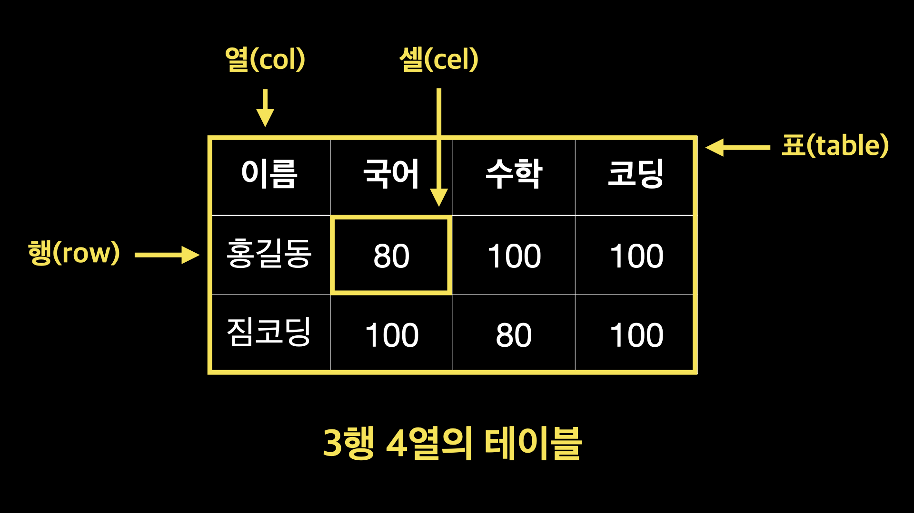

      - `<table>` 태그 - 표
      - `<tr>` 태그 - 행
      - `<th>, <td>` 태그 - 열(제목, 일반)

### Table 기본 태그

      - `<table>`
표를 만드는 태그로써, 표 전체를 감싸는 데 사용한다.
      - `<caption>`
표의 제목이나 설명을 작성하는 태그
      - `<tr>`
표의 행을 의미하는 태그. 자식으로 `<th>`태그나 `<td>`태그가 반드시 있어야 한다.
      - `<th>`
표의 **제목 열**을 의미하는 태그. 부모 태그인 `<tr>` 태그 안에 있어야 한다.
      - `<td>`
표의 **일반 열**을 의미하는 태그. 부모인 `<tr>`태그안에 있어야 한다.

```javascript
<style>
  table {
    border: 1px solid black;
    border-collapse: collapse;
  }
  th,
  td {
    border: 1px solid black;
    padding: 12px;
  }
</style>
<table>
    <caption>프로필 테이블</caption> <!-- 테이블 제목, 설명 -->
    <tr> <!-- 행 -->
        <th>이름</th> <!--열-->
        <th>취미</th>
        <th>특기</th>
    </tr>
    <tr>
        <td>홍길동</td>
        <td>도술</td>
        <td>축지법</td>
    </tr>
    <tr>
        <td>짐코딩</td>
        <td>헬스</td>
        <td>코딩</td>
    </tr>
 </table>  
```

### Table 그룹 관련 태그

      - `<colgroup>`
열을 그룹으로 묶을 수 있도록 해주는 태그이다.
      - `<col>`
`<colgroup>`태그의 자식으로 열 단위를 나눌 수 있다. `span` 속성을 사용하여 열을 그룹으로 묶을지 설정한다. 예) <col span="3"> → 세 개의 열을 그룹으로 묶음
      - `<thead>`
표의 제목 열들을 묶는 그룹 태그
      - `<tbody>`
표의 일반적인 데이터들을 묶는 그룹태그.
기본적으로 행그룹태그를 사용하지 않으면 크롬브라우저가 자동으로 tbody 태그로 묶어준다.
      - `<tfoot>`
표의 하단 영역을 묶는 그룹태그

```javascript
 <table>
      <caption>
        학급 점수
      </caption>
      <colgroup>
        <col class="col1" />
        <col class="col2" />
        <col class="col3" />
        <col class="col4" />
        <col class="col5" />
        <col class="col6" />
      </colgroup>
      <thead>
        <tr>
          <th>반</th>
          <th>이름</th>
          <th>국어</th>
          <th>영어</th>
          <th>수학</th>
          <th>코딩</th>
        </tr>
      </thead>
      <tbody>
        <tr>
          <td>1반</td>
          <td>홍길동</td>
          <td>90</td>
          <td>100</td>
          <td>90</td>
          <td>81</td>
        </tr>
        <tr>
          <td>1반</td>
          <td>짐코딩</td>
          <td>85</td>
          <td>81</td>
          <td>95</td>
          <td>81</td>
        </tr>
      </tbody>
      <tfoot>
        <tr>
          <td>1반</td>
          <td>평균</td>
          <td>87.5</td>
          <td>90.5</td>
          <td>92.5</td>
          <td>90.5</td>
        </tr>
      </tfoot>
    </table>
```

### Table 태그 관련 속성

      - `<table>` 태그 속성
- border - 테이블이 갖고 있는 테이블과 셀 모두 선을 표시한다. `웹표준X`
        - width - 테이블의 가로너비를 설정한다. `웹표준X`
        - cellpadding - 셀의 안쪽 여백으로써, 셀과 콘텐츠와의 간격을 조절함. `웹표준X`
        - cellspacing - 셀의 바깥쪽 여백으로써, 셀과 셀간의 간격을 조절함. `웹표준X`

위 속성들은 XHTML 1.0에서는 웹 표준이지만 오늘날 **HTML5에서는 웹 표준이 아닙니다. → CSS로 대체해야 함.**
      - `<th>` 태그 속성
- scope - 웹접근성 관련 속성으로 스크린리더가 데이터를 인식하고 읽는 순서를 결정짓게 합니다.
- th가 열에 쓰일경우 값을 "col"로 설정합니다. 예) `<th scope="col">`
          - th가 행에 쓰일경우 값은 "row"로 설정합니다. 예) `<th scope="row">`
      -  `<th>`, `<td>`
- colspan - 열을 병합하는 속성. 예) <td colspan="2">
        - rowspan - 행을 병합하는 속성. 예) <td rowspan="2">

```javascript
<tbody>
  <tr>
    <td rowspan="2">1반</td>
    <td>홍길동</td>
    <td>90</td>
    <td>100</td>
    <td>90</td>
    <td>81</td>
  </tr>
  <tr>
    <!-- <td>1반</td> -->
    <td>짐코딩</td>
    <td>85</td>
    <td>81</td>
    <td>95</td>
    <td>81</td>
  </tr>
</tbody>
```

      - `<col>`
- width - 열의 가로너비를 지정하지만 `웹표준X` → CSS로 대체
        - span - 열을 그룹화 함. 예) <col span="3"> → 세 개의 열을 묶음.

## Sementic Tag

---

*시멘틱 태그(Sementic Tag)에서 Sementic의 사전적 의미는 "의미론적"이라는 뜻으로, HTML에서 시멘틱 태그란* ***"의미를 가지는 태그"****를 말한다.*

*가령 제목과 같이 큰 글씨를 나타낼 때* *`<h1>`* *태그를 사용하여 나타낼 수 있다.* *`<h1>`* *태그는 페이지 제목이라는 의미를 갖고 있다.*

*반면* *`<span>`* *태그에 style을 입혀* *`<h1>`* *태그와 동일한 스타일을 표시할 수 있다. 하지만 이것은* ***HTML 의미(Sementic)를 제대로 살리지 못한 것 이기 때문에 지양할 필요****가 있다.*

*페이지 Layout을 만들거나 HTML 마크업을 할 때 최대한 의미있는 Sementic Tag를 사용하길 권장한다.*

### HTML Sementic Elements

      - [`<header>`](https://developer.mozilla.org/ko/docs/Web/HTML/Element/header) : *페이지에 대한 정보를 담는 태그로, 페이지 상단에 위치*
      - [`<nav>`](https://developer.mozilla.org/ko/docs/Web/HTML/Element/nav) : *다른 페이지나 같은 페이지 안에 다른 부분으로 이어주는 내비게이션 링크로 구성된 섹션을 표현*
      - [`<aside>`](https://developer.mozilla.org/ko/docs/Web/HTML/Element/aside) : 페*이지 전체 내용과는 어느정도 관련성이 있지만, 주요 내용과는 직접적인 연관성은 없는 분리된 내용을 담고 있습니다.*
      - [`<main>`](https://developer.mozilla.org/ko/docs/Web/HTML/Element/main) *: 문서의 body 요소의 주 콘텐츠(main content)를 정의할 때 사용*
      - [`<section>`](https://developer.mozilla.org/ko/docs/Web/HTML/Element/section) : *문서나 응용프로그램의 일반적인 섹션을 표현*
      - [`<article>`](https://developer.mozilla.org/ko/docs/Web/HTML/Element/article) : *article은 여러가지 아이템들을 묶어 재사용 가능하게 그룹화*
      - [`<footer>`](https://developer.mozilla.org/ko/docs/Web/HTML/Element/footer) : *주로 저작권 정보나 서비스 제공자 정보등을 나타내며 사이트 하단에 위치*
      - [`<details>`](https://developer.mozilla.org/ko/docs/Web/HTML/Element/details) : *추가적인 정보를 나타내거나 사용자가 요청하는 정보를 나타낸다.*
      - [`<summary>`](https://developer.mozilla.org/ko/docs/Web/HTML/Element/summary) : *부모요소인 details요소의 내용에 대한 요약이나 캡션등을 나타낸다.*
      - [`<figcaption>`](https://developer.mozilla.org/ko/docs/Web/HTML/Element/figcaption) : *부모요소인 figure요소의 내용들에 대한 캡션, 혹은 제목을 나타냅니다.*
      - [`<figure>`](https://developer.mozilla.org/ko/docs/Web/HTML/Element/figure) *: 일러스트, 다이어그램, 사진, 코드등에 주석을 다는 용도로 사용됩니다.*
      - [`<mark>`](https://developer.mozilla.org/ko/docs/Web/HTML/Element/mark) : *하나의 문서 내에서 다른 문맥과의 관련성을 나타내기 위해서 참조 목적으로 마킹되거나 하이라이트된 텍스트를 표현*
      - [`<time>`](https://developer.mozilla.org/ko/docs/Web/HTML/Element/time) : *24시간에서의 시간 혹은 그레고리력에서의 정밀한 날짜를 나타냅니다.*

### MDN Semantics

[https://developer.mozilla.org/ko/docs/Glossary/Semantics](https://developer.mozilla.org/ko/docs/Glossary/Semantics)

## **HTML5 시맨틱 태그 기반 페이지 레이아웃**

---

*일반적인 HTML 페이지에는 페이지 머리글, 바닥글 및 중간 페이지 콘텐츠가 있습니다. 중간 페이지 콘텐츠 내에서 최상위 수준에는 탐색, 콘텐츠 및 3열이 있을 수 있습니다. 확실히 콘텐츠 내에서 각 페이지의 특정 콘텐츠에 따라 더 많은 섹션을 포함할 수 있습니다.*

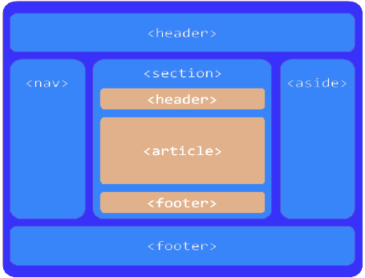

*위 그림은 이 최상위 페이지 레이아웃을 시각적으로 보여줍니다.*

*일반적으로* *`<header>`* *그룹은 소개 또는 탐색 보조 도구입니다. 일반적으로 헤더 요소는 섹션의 제목을 포함하기 위한 것이며 섹션의 목차, 검색 양식, 로고 등을 래핑할 수 있습니다.* 

*맨 아래에 있는* *`<footer>`**는 일반적으로 누가 작성했는지, 관련 문서에 대한 링크, 저작권 데이터 등과 같은 섹션에 대한 정보를 포함합니다.* 

*페이지 중간에 있는* *`<nav>`* *요소는 다른 페이지 또는 페이지 내의 부분으로 연결되는 페이지의 섹션을 나타냅니다. 일반적으로 탐색 링크가 있는 섹션입니다.* 

*`<aside>`**콘텐츠가 옆 요소 주변의 콘텐츠와 접선적으로 관련되어 있는 경우 해당 콘텐츠와 분리된 것으로 간주할 수 있습니다(예: 인용문 또는 사이드바, 광고 등).* 

*페이지 레이아웃의 바로 중앙에 있는* *`<section>`* *은 논리적 또는 물리적으로 그룹화된 일반 콘텐츠를 포함합니다. 문서 또는 응용 프로그램, 예를 들어 웹 사이트의 홈 페이지는 소개, 뉴스 항목, 연락처 정보에 대한 섹션으로 분할될 수 있습니다.* 

*그리고* *`<article>`* *태그는 문서, 페이지, 응용 프로그램 또는 사이트에 독립적으로 배포될 수 있는 자체 포함된 구성입니다. 
예:* *`<article>`* *에는 포럼 게시물, 잡지 또는 신문 기사, 웹 로그 항목, 사용자가 제출한 댓글, 대화형 위젯 또는 가젯 또는 기타 독립적인 콘텐츠 항목이 포함될 수 있습니다.*

## Inline VS Block Element

---

*모든 HTML 태그들은 각 태그의 용도에 따른 default display value(기본 표시 값)를 가진다. 이때 default display value는* ***블록 레벨 요소(Block-level Elements)****와* ***인라인 레벨 요소(Inline-level Elements)*** *두 가지 범주로 나뉜다.*

예를들면 `<div>`태그는 블록 레벨 요소이고, `<span>`태그는 인라인 레벨 요소이다.

      - *`<div>`* *Division*
*`<div>`* *태그는 Division 즉! 분할, 분배, 분류를 뜻합니다. HTML 안에 존재하는 여러 개의 태그들을* *`<div>`* *라는 큰 단위로 묶어주는 컨테이너 같은 역할을 합니다.*
      - *`<span>`*
*`<span>`* *태그도* *`<div>`* *태그와 같이 여러 개의 태그들을 묶어주는 주머니 역할을 합니다.*

## Block Element

---

*블록 레벨 요소는 부모 요소의* ***전체 공간****을 차지하여 "블록"을 만듭니다.* *`<h1>~<h6>`* *`<ol>`* *`<ul>`* *`<li>`* *`<p>`* *태그 등이 블록 요소에 속한다.*

      - *화면 구성이나 레이아웃을 짤 때는 블록 레벨 요소를 사용합니다.*
      - *블록 레벨 요소는 한칸을 모두 차지하기 때문에 세로로 나열 됩니다.*
      - *width(가로), height(세로), margin 속성이 적용됨.*

*블록 레벨 요소 목록*

- [**`<address>`**](https://developer.mozilla.org/ko/docs/Web/HTML/Element/address) **-** 연락처 정보.
        - [**`<article>`**](https://developer.mozilla.org/ko/docs/Web/HTML/Element/article) **-** 단락 콘텐츠.
        - [**`<aside>`**](https://developer.mozilla.org/ko/docs/Web/HTML/Element/aside) **-** 부가 콘텐츠.
        - [**`<blockquote>`**](https://developer.mozilla.org/ko/docs/Web/HTML/Element/blockquote) **-** 긴("블록")  인용구.
        - [**`<details>`**](https://developer.mozilla.org/ko/docs/Web/HTML/Element/details) **-** 상세 정보 위젯.
        - [**`<dialog>`**](https://developer.mozilla.org/ko/docs/Web/HTML/Element/dialog) **-** 대화상자.
        - [**`<dd>`**](https://developer.mozilla.org/ko/docs/Web/HTML/Element/dd) **-** 설명 목록의 정의 설명.
        - [**`<div>`**](https://developer.mozilla.org/ko/docs/Web/HTML/Element/div) **-** 문서의 분할.
        - [**`<dl>`**](https://developer.mozilla.org/ko/docs/Web/HTML/Element/dl) **-** 설명 목록.
        - [**`<dt>`**](https://developer.mozilla.org/ko/docs/Web/HTML/Element/dt) **-** 설명 목록의 정의.
        - [**`<fieldset>`**](https://developer.mozilla.org/ko/docs/Web/HTML/Element/fieldset) **-** 필드 집합의 라벨.
        - [**`<figcaption>`**](https://developer.mozilla.org/ko/docs/Web/HTML/Element/figcaption) **-** 그림 설명.
        - [**`<figure>`**](https://developer.mozilla.org/ko/docs/Web/HTML/Element/figure) **-** 미디어 콘텐츠 그룹과 설명. ([`<figcaption>`](https://developer.mozilla.org/ko/docs/Web/HTML/Element/figcaption)을 참고하세요)
        - [**`<footer>`**](https://developer.mozilla.org/ko/docs/Web/HTML/Element/footer) **-** 페이지나 구역의 푸터.
        - [**`<form>`**](https://developer.mozilla.org/ko/docs/Web/HTML/Element/form) **-** 입력 폼.
        - [**`<h1>`**](https://developer.mozilla.org/ko/docs/Web/HTML/Element/Heading_Elements)**,** [**`<h2>`**](https://developer.mozilla.org/ko/docs/Web/HTML/Element/Heading_Elements)**,** [**`<h3>`**](https://developer.mozilla.org/ko/docs/Web/HTML/Element/Heading_Elements)**,** [**`<h4>`**](https://developer.mozilla.org/ko/docs/Web/HTML/Element/Heading_Elements)**,** [**`<h5>`**](https://developer.mozilla.org/ko/docs/Web/HTML/Element/Heading_Elements)**,** [**`<h6>`**](https://developer.mozilla.org/ko/docs/Web/HTML/Element/Heading_Elements) **-** 1~6단계 제목.
        - [**`<header>`**](https://developer.mozilla.org/ko/docs/Web/HTML/Element/header) **-** 페이지나 구역의 헤더.
        - [**`<hgroup>`**](https://developer.mozilla.org/ko/docs/Web/HTML/Element/hgroup) **-** 헤더 정보 그룹.
        - [**`<hr>`**](https://developer.mozilla.org/ko/docs/Web/HTML/Element/hr) **-** 수평선(구분선).
        - [**`<li>`**](https://developer.mozilla.org/ko/docs/Web/HTML/Element/li) **-** 목록의 항목.
        - [**`<main>`**](https://developer.mozilla.org/ko/docs/Web/HTML/Element/main) **-** 문서에서 하나 뿐인 중심 콘텐츠.
        - [**`<nav>`**](https://developer.mozilla.org/ko/docs/Web/HTML/Element/nav) **-** 탐색 링크를 포함.
        - [**`<ol>`**](https://developer.mozilla.org/ko/docs/Web/HTML/Element/ol) **-** 정렬된 목록.
        - [**`<p>`**](https://developer.mozilla.org/ko/docs/Web/HTML/Element/p) **-** 문단.
        - [**`<pre>`**](https://developer.mozilla.org/ko/docs/Web/HTML/Element/pre) **-** 미리 서식 적용한 글.
        - [**`<section>`**](https://developer.mozilla.org/ko/docs/Web/HTML/Element/section) **-** 웹 페이지의 구역.
        - [**`<table>`**](https://developer.mozilla.org/ko/docs/Web/HTML/Element/table) **-** 표.
        - [**`<ul>`**](https://developer.mozilla.org/ko/docs/Web/HTML/Element/ul) **-** 정렬되지 않은 목록.

## Inline Element

---

*인라인 레벨 요소는 콘텐츠의 흐름을 끊지 않고(줄바꿈X), 요소를 구성하는* ***태그에 할당된 공간만 차지****합니다.* *`<a>`* *`<em>`* *``* *`<span>`* *태그 등이 인라인 요소에 속한다.*

      - *인라인 레벨 요소는 콘텐츠 영역 만큼 차지하기 때문에 가로로 나열됩니다.*
      - *margin-top, margin-bottom 적용되지 않습니다. 대신에 line-height 이용*
      - *width, height 속성이 적용되지 않습니다.*
      - *태그가 콘텐츠의 할당 된 공간만 갖고 있기 때문에 text-align과 같은 속성은 사용할 수 없습니다.*

*인라인 요소들*

- [**`<a>`**](https://developer.mozilla.org/ko/docs/Web/HTML/Element/a)
        - [**`<abbr>`**](https://developer.mozilla.org/ko/docs/Web/HTML/Element/abbr)
        - [**<acronym> (en-US)**](https://developer.mozilla.org/en-US/docs/Web/HTML/Element/acronym)
        - [**`<audio>`**](https://developer.mozilla.org/ko/docs/Web/HTML/Element/audio) **(컨트롤이 보이면)**
        - [**`<b>`**](https://developer.mozilla.org/ko/docs/Web/HTML/Element/b)
        - [**<bdi> (en-US)**](https://developer.mozilla.org/en-US/docs/Web/HTML/Element/bdi)
        - [**`<bdo>`**](https://developer.mozilla.org/ko/docs/Web/HTML/Element/bdo)
        - [**<big> (en-US)**](https://developer.mozilla.org/en-US/docs/Web/HTML/Element/big)
        - [**`<br>`**](https://developer.mozilla.org/ko/docs/Web/HTML/Element/br)
        - [**`<button>`**](https://developer.mozilla.org/ko/docs/Web/HTML/Element/button)
        - [**`<canvas>`**](https://developer.mozilla.org/ko/docs/Web/HTML/Element/canvas)
        - [**`<cite>`**](https://developer.mozilla.org/ko/docs/Web/HTML/Element/cite)
        - [**`<code>`**](https://developer.mozilla.org/ko/docs/Web/HTML/Element/code)
        - [**`<data>`**](https://developer.mozilla.org/ko/docs/Web/HTML/Element/data)
        - [**`<datalist>`**](https://developer.mozilla.org/ko/docs/Web/HTML/Element/datalist)
        - [**`<del>`**](https://developer.mozilla.org/ko/docs/Web/HTML/Element/del)
        - [**`<dfn>`**](https://developer.mozilla.org/ko/docs/Web/HTML/Element/dfn)
        - [**`<em>`**](https://developer.mozilla.org/ko/docs/Web/HTML/Element/em)
        - [**`<embed>`**](https://developer.mozilla.org/ko/docs/Web/HTML/Element/embed)
        - [**`<i>`**](https://developer.mozilla.org/ko/docs/Web/HTML/Element/i)
        - [**`<iframe>`**](https://developer.mozilla.org/ko/docs/Web/HTML/Element/iframe)
        - [**``**](https://developer.mozilla.org/ko/docs/Web/HTML/Element/img)
        - [**`<input>`**](https://developer.mozilla.org/ko/docs/Web/HTML/Element/Input)
        - [**`<ins>`**](https://developer.mozilla.org/ko/docs/Web/HTML/Element/ins)
        - [**`<kbd>`**](https://developer.mozilla.org/ko/docs/Web/HTML/Element/kbd)
        - [**`<label>`**](https://developer.mozilla.org/ko/docs/Web/HTML/Element/label)
        - [**`<map>`**](https://developer.mozilla.org/ko/docs/Web/HTML/Element/map)
        - [**`<mark>`**](https://developer.mozilla.org/ko/docs/Web/HTML/Element/mark)
        - [**`<meter>`**](https://developer.mozilla.org/ko/docs/Web/HTML/Element/meter)
        - [**`<noscript>`**](https://developer.mozilla.org/ko/docs/Web/HTML/Element/noscript)
        - [**`<object>`**](https://developer.mozilla.org/ko/docs/Web/HTML/Element/object)
        - [**`<output>`**](https://developer.mozilla.org/ko/docs/Web/HTML/Element/output)
        - [**<picture> (en-US)**](https://developer.mozilla.org/en-US/docs/Web/HTML/Element/picture)
        - [**`<progress>`**](https://developer.mozilla.org/ko/docs/Web/HTML/Element/progress)
        - [**`<q>`**](https://developer.mozilla.org/ko/docs/Web/HTML/Element/q)
        - [**`<ruby>`**](https://developer.mozilla.org/ko/docs/Web/HTML/Element/ruby)
        - [**`<s>`**](https://developer.mozilla.org/ko/docs/Web/HTML/Element/s)
        - [**`<samp>`**](https://developer.mozilla.org/ko/docs/Web/HTML/Element/samp)
        - [**`<script>`**](https://developer.mozilla.org/ko/docs/Web/HTML/Element/script)
        - [**`<select>`**](https://developer.mozilla.org/ko/docs/Web/HTML/Element/select)
        - [**`<slot>`**](https://developer.mozilla.org/ko/docs/Web/HTML/Element/slot)
        - [**`<small>`**](https://developer.mozilla.org/ko/docs/Web/HTML/Element/small)
        - [**`<span>`**](https://developer.mozilla.org/ko/docs/Web/HTML/Element/span)
        - [**`<strong>`**](https://developer.mozilla.org/ko/docs/Web/HTML/Element/strong)
        - [**`<sub>`**](https://developer.mozilla.org/ko/docs/Web/HTML/Element/sub)
        - [**`<sup>`**](https://developer.mozilla.org/ko/docs/Web/HTML/Element/sup)
        - [**`<svg>`**](https://developer.mozilla.org/ko/docs/Web/HTML/Element/svg)
        - [**`<template>`**](https://developer.mozilla.org/ko/docs/Web/HTML/Element/template)
        - [**`<textarea>`**](https://developer.mozilla.org/ko/docs/Web/HTML/Element/textarea)
        - [**`<time>`**](https://developer.mozilla.org/ko/docs/Web/HTML/Element/time)
        - [**`<u>`**](https://developer.mozilla.org/ko/docs/Web/HTML/Element/u)
        - [**<tt> (en-US)**](https://developer.mozilla.org/en-US/docs/Web/HTML/Element/tt)
        - [**`<var>`**](https://developer.mozilla.org/ko/docs/Web/HTML/Element/var)
        - [**`<video>`**](https://developer.mozilla.org/ko/docs/Web/HTML/Element/Video)
        - [**`<wbr>`**](https://developer.mozilla.org/ko/docs/Web/HTML/Element/wbr)

## 이미지 태그

---

*``* *태그는 HTML 문서에 이미지를 넣습니다.*

```css

```

*위의 예제를 통해* *``* *요소의 사용법을 알 수 있습니다.*

### 속성

      - `src`
***필수****이며, 이미지로의 경로를 지정합니다.*
      - `alt`
*이미지의 텍스트 설명이며 필수는 아니지만, 스크린 리더가* *`alt`**의 값을 읽어 사용자에게 이미지를 설명하므로, 웹 접근성 차원에서* ***매우 유용****합니다. 또한 네트워크 오류, 콘텐츠 차단, 죽은 링크 등 이미지를 표시할 수 없는 경우에도 이 속성의 값을 대신 보여줍니다.*
      - `height`
*이미지 높이를 지정하는 속성이며, 값으로 픽셀(px)과 퍼센트(%) 단위로 지정할 수 있으며 픽셀로 설정시에는 숫자만 입력하면 됩니다.*
      - `width`
*이미지 너비를 지정하는 속성이며, 값으로 픽셀(px)과 퍼센트(%) 단위로 지정할 수 있으며 픽셀로 설정시에는 숫자만 입력하면 됩니다.*
      - [img 요소 MDN](https://developer.mozilla.org/ko/docs/Web/HTML/Element/img#attr-height)

## 절대경로 VS 상대경로

### **절대경로**

*리소스(이미지)의 절대경로는 말 그대로 절대적인 고유한 경로를 지정하는 것입니다.*

      - *웹 이미지 절대경로 예) - http://www.naver.com/apple.png
http 프로토콜로 시작해서 전체 경로를 입력함*
      - *웹 이미지 절대경로 예) - /apple.png
루트('/') 디렉토리 부터 시작하는 경우 현재 도메인이 자동으로 앞에 붙음*
      - *PC 컴퓨터 절대경로 예) - C:\user\gymcoding\apple.png*

*그러나 절대경로를 이용하면 웹 에서 이미지가 사라지거나 내 컴퓨터에서 만든 파일을 다른 곳으로 옮길 때 해당 절대경로를 다시 수정해야 하는 불편함이 있습니다.*

*그래서 작업중인 폴더에 이미지를 옮기고 상대적인 위치를 가리킴으로써 이러한 불편함을 해소할 수 있습니다.*

### **상대경로**

*상대경로는 현재 문서를 기준으로 경로를 인식하는 방법입니다.*

      - *`index.html`* *에서 동일한 위치에 있는 apple.png를 가져오는 방법 →* *`src="apple.png"`* *또는* *`src="./apple.png"`*
      - *`index.html`* *의 상위 폴더에 이미지가 있는 경우 →* *`src="../apple.png"`*
      - *`index.html`* *의 하위 폴더에 이미지가 있는 경우 →* *`src="하위폴더/apple.png"`*

## 오디오 태그

---

*`<audio>`* *태그는 HTML 문서에 소리 콘텐츠를 넣을 때 사용합니다.* 

*`src`* *속성 또는* *`<source>`* *Element를 사용하여 한 개 이상의 오디오 소스를 지정할 수 있으며, 다수를 지정한 경우 가장 적절한 소스를 브라우저가 선택합니다.*

```html
<!-- src 속성을 사용 -->
<audio controls src="/media/cc0-audio/t-rex-roar.mp3">

<!-- source 요소를 사용 -->
<audio controls>
  <source src="myAudio.mp3" type="audio/mpeg">
  <source src="myAudio.ogg" type="audio/ogg">
</audio>
```

## 비디오 태그

---

*`<video>`* *태그는 영상 콘텐츠를 HTML 문서에 삽입할 때 사용합니다.*

*`src`* *속성 또는* *`<source>`* *Element를 사용하여 한 개 이상의 오디오 소스를 지정할 수 있으며, 다수를 지정한 경우 가장 적절한 소스를 브라우저가 선택합니다.*

```html
<!-- src 속성을 사용 -->
<video controls src="/media/cc0-videos/flower.mp4" type="video/mp4">

<!-- source 요소를 사용 -->
<video controls width="250">
    <source src="/media/cc0-videos/flower.webm" type="video/webm">
    <source src="/media/cc0-videos/flower.mp4" type="video/mp4">
</video>
```

## 오디오&비디오 태그 속성

---

      - *`controls`* *- 플레이어 화면에 컨트롤 바(재생막대)를 표시합니다.*
      - *`autoplay`* *- 오디오나 비디오를 자동으로 실행합니다.*
*단, 크롬, 파이어폭스 브라우저는 자동 재생을 지원하지 않습니다. 만약 자동 재생을 하고 싶다면* *`muted`* *속성을 사용하여 소리를 제거해야 합니다.*
      - *`loop`* *- 오디오나 비디오를 반복 재생합니다.*
      - *`muted`* *- 오디오나 비디오의 소리를 제거합니다.*
      - *`preload`* *- 페이지를 불러올 때 오디오나 비디오 파일을 어떻게 로딩할 것인지 지정합니다. 사용할 수 있는 값은* *`auto`* *`metadata`* *`none`* *입니다.*
*기본적으로* *`preload="auto"`* *가 사용됩니다.*
      - *`width`* *`height`* *- 비디오 플레이어의 너비와 높이를 지정합니다.* *`width`* *나* *`height`* *의 값 중에서 하나만 지정하면 나머지는 자동으로 계산해서 표시합니다.*
      - *`poster="파일 이름"`* *-* *`<video>`* *태그에서 사용하는 속성으로, 비디오가 재생되기 전까지 화면에 표시될 포스터 이미지를 지정합니다.*

## 하이퍼링크 태그

---

*`<a>`* *태그는* *`href`* *속성을 사용하여* ***다른 페이지****나 같은 페이지의* ***특정위치****, 파일, 이메일 주소와 그 외 다른 URL로 연결할 수 있는 하이퍼링크를 만듭니다.* 

*`target="_blank"`* *속성을 사용하여 새탭에서 화면을 열 수 있다.*

      - *같은 폴더안에 있는 다른 페이지로 이동*
```html
<a href="inner.html">다른 페이지 이동</a>
<a href="inner.html" target="_blank">새탭으로 페이지 열기</a>
```
      - 이미지에 하이퍼 링크 걸기
```html
<a href="inner.html"></a>
```
      - ID 속성이 apple인 특정위치로 이동하는 하이퍼링크
```html
<!-- id가 apple인 요소로 이동하는 하이퍼링크 -->
<a href="#apple">이동</a>

<!-- 해당 요소 위치로 스크롤이 이동함 -->
<div id="apple">사과</div>
```
      - 이메일 보내기 하이퍼링크
```html
<a href="mailto:bruce.lean17@gmail.com">이메일 보내기</a>
```

```html
 <h2>이미지 태그</h2>
    

    <h2>오디오 태그</h2>
    <audio src="../assets/short_sound.wav" controls></audio>

    <h2>비디오 태그</h2>

    <video
      width="400"
      src="../assets/short_video.mp4"
      controls
      poster="../practice.jpg"
      type="video/mp4"
    ></video>

    <h2>하이퍼링크 태그</h2>
    <a href="http://www.naver.com" target="_blank">네이버</a>와
    <a href="http://www.google.com">구글</a>은 포털사이트 입니다.

    <hr />

    <a href="#target">타겟으로 이동</a>
    <a href="mailto:baejeu@naver.com">이메일 보내기</a>

    <div>1</div>
    <div>2</div>
    <div>3</div>
    <div>4</div>
    <div>5</div>
    <div>6</div>
    <div>7</div>
    <div>8</div>
    <div>9</div>
    <div>10</div>
    <div>11</div>
    <div>12</div>
    <div>13</div>
    <div>14</div>
    <div>15</div>
    <div>16</div>
    <div>17</div>
    <div>18</div>
    <div id="target">19</div>
    <div>20</div>
```

### 속성

      - `href`
*하이퍼링크가 가리키는 URL. 링크는 HTTP 기반 URL일 필요는 없고, 브라우저가 지원하는 모든 URL 스킴을 사용할 수 있습니다.*

        - *페이지 구획을 가리키는 프래그먼트 URL*
        - *미디어 파일 일부를 가리키는 미디어 프래그먼트*
        - *`tel:`* *URL을 사용하는 전화번호*
        - *`mailto:`* *URL을 사용하는 이메일 주소*
        - *웹 브라우저는 다른 URL 스킴을 지원하지 않지만, 웹사이트는* [*`Navigator.registerProtocolHandler()`*](https://developer.mozilla.org/ko/docs/Web/API/Navigator/registerProtocolHandler)*를 통해 지원할 수 있습니다.*
      - `target`
- *`_self`**: URL을 현재 브라우징 맥락에 표시합니다. 기본값.*
        - *`_blank`**: URL을 새로운 브라우징 맥락에 표시합니다. 보통 새 탭이지만, 사용자가 브라우저 설정을 통해 새 창으로 바꿀 수 있습니다.*
        - *`_parent`**: URL을 현재 브라우징 맥락의 부모에 표시합니다. 부모가 존재하지 않으면* *`_self`**와 동일하게 행동합니다.*
        - *`_top`**: URL을 최상단 브라우징 맥락(현재 맥락의 부모면서 자신의 부모가 존재하지 않는, 제일 높은 맥락)에 표시합니다. 부모가 존재하지 않으면* *`_self`**와 동일하게 행동합니다.*

## MDN

---

      - [비디오 요소](https://developer.mozilla.org/ko/docs/Web/HTML/Element/Video)
      - [`<a>`](https://developer.mozilla.org/ko/docs/Web/HTML/Element/a)[ 태그](https://developer.mozilla.org/ko/docs/Web/HTML/Element/a)
      - [하이퍼링크 만들기](https://developer.mozilla.org/ko/docs/Learn/HTML/Introduction_to_HTML/Creating_hyperlinks)

# 폼 태그 

---

*`<form>`* *요소는 정보를 제출하기 위하여 어디서부터 어디까지가 양식인지 지정하는 역할을 한다.*

```html
<form action="/signup" method="post">
  <div class="form-example">
    <label for="name">이름: </label>
    <input type="text" name="name" id="name" required>
  </div>
  <div class="form-example">
    <label for="email">이메일: </label>
    <input type="email" name="email" id="email" required>
  </div>
  <div class="form-example">
    <input type="submit" value="제출하기">
  </div>
</form>
```

### 속성

      - *`action`* *- 양식 데이터를 처리할 서버 프로그램의 URI*
      - *`method`* *- 양식을 제출할 때 사용할 HTTP 메서드*
- *`post`* *- 양식 데이터를* ***요청 본문****으로 전송*
        - *`get`* *- 양식 데이터를* ***URL의 쿼리스트링으로*** *붙여서 전송*

# Input 태그

---

*`<input>`* *요소로 데이터를 입력 받을 수 있다.* 

*`type`* *속성을 통하여 다양한 방법으로 데이터를 받을 수 있다.*

### text

*`<input>`* *태그의 기본값으로 한줄의 텍스트를 입력 받는다.*

```html
<input type="text" id="name">
```

*HTML5 에서는 text 필드가 데이터 용도에 맞게 사용할 수 있도록 다양한 타입이 추가되었다.*

      - *`text`* *- 일반적인 텍스트를 받기위해 사용*
      - *`password`* *- 비밀번호를 받기위해 사용*
      - *`email`* *- email 데이터를 받기위해 사용 (이메일 유효성 검증)*
      - *`tel`* *- 전화번호를 받기위해 사용 (모바일 접근시 키패드가 다름)*
      - *더 많은* *`type`**은* [*MDN 사이트*](https://developer.mozilla.org/ko/docs/Web/HTML/Element/Input)*에서 참고*

### label

*`<label>`* *레이블 태그는 입력받는 필드를 설명할 때 사용* *`웹접근성 준수`*

*사용 방법은* *`<label>`* *태그 하위에* *`<input>`* *태그를 위치시킬 수 있고* *`id`* *와* *`for`* *속성을 사용하여* *`<input>`* *태그와 연결지을 수 있다.*

```html
<!-- label 태그 하위에 놓는 법 -->
<label>
	이름 : 
	<input type="text" id="name">
</label>

<!-- for와 id속성을 사용하여 label 태그와 연결지음 -->
<label for="name">이름 : </label>
<input type="text" id="name">
```

[https://developer.mozilla.org/ko/docs/Web/JavaScript](https://developer.mozilla.org/ko/docs/Web/JavaScript)

*내장 객체 확인용 JavaScript 공식 사이트*

```html
<script src="js/change-color.js"></script>
```

# alert: 서버 알림(판업창)

---

```html
<script>
  var toDay = new Date();
  alert(toDay);
</script>
```

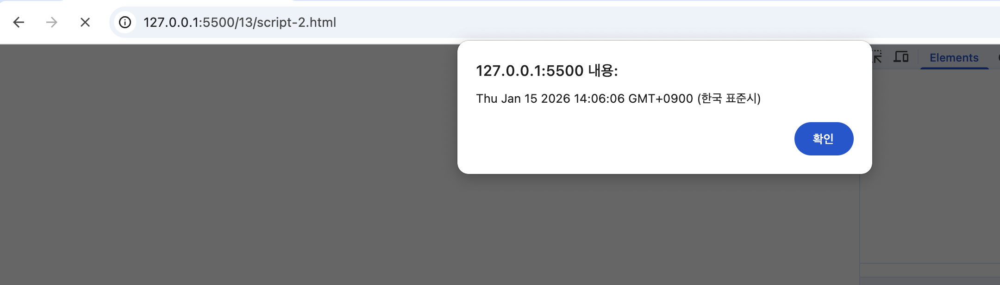

# confirm: 확인/취소 버튼

---

***return true false***

```html
<script>
  confirm('배경 이미지를 바꾸시겠습니까?');
</script>
```

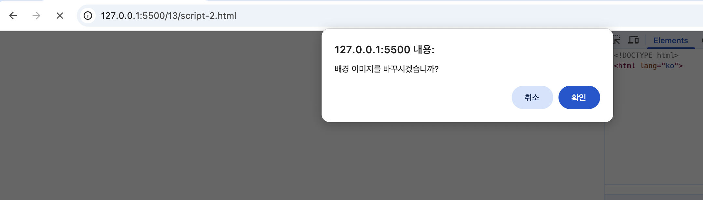

# prompt: 사용자 텍스트 입력 

---

*입력 필드가 있는 알림창으로 사용자 입력 반환*

```html
<script>
  prompt('당신의 이름을 알려주세요.');
</script>
```

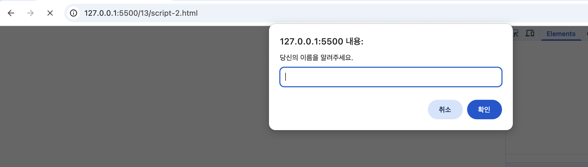

# document.write: 페이지 출력

---

```html
<script>
	document.write('안녕 못해요');
</script>
```

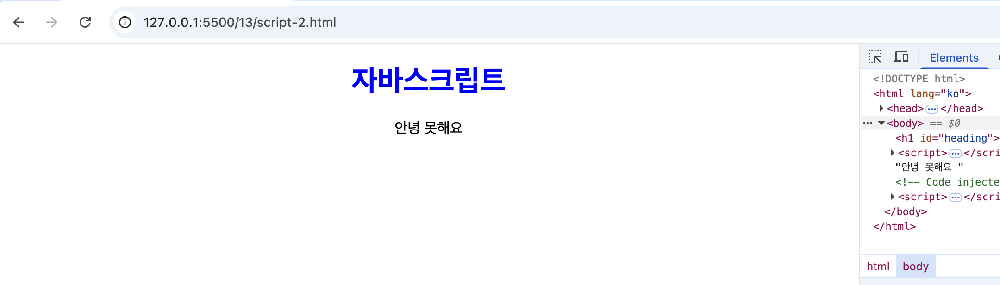

# console.log: 디버깅을 위한 출력

---

```html
<script>
  console.log('안녕하세요');
</script>
```

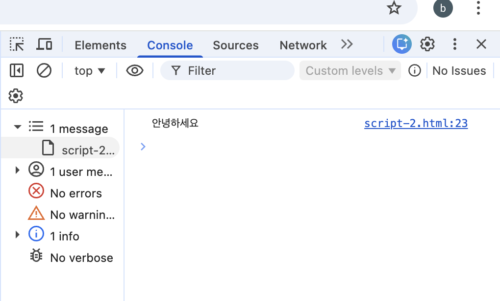

# 변수란

---

***변수(variable):*** *값이 달라질 수 있는 데이터*

***상수(constant):*** *값을 한번 지정하면 바뀌지 않는 데이터*

# 변수 선언하기

---

```javascript
var currentYear;
var birhYear;
var age;
// 여러 개의 변수를 한꺼번에 선언할 수 있다.
var currentYear, birhYear, age;
```

# 실습(나이 계산하기 프로그램)

---

```html
<script>
	var currentYear = 2026;
	var birthYear;
	var age;
	
	birthYear = prompt('태어난 연도를 입력하세요. (YYYY)', '');
	age = currentYear - birthYear + 1;
	document.write(currentYear + '년 현재<br>');
	document.write(
	  birthYear + '년에 태어난 사람의 나이는 ' + age + '세입니다.'
	);
</script>
```

# 자료형

---

*숫자형: 2000*

*문자열: “Hello”, ‘Hello’*

*논리형: true, false*

*배열: [’봄’, ‘가을’, ‘겨울’]*

*객체: var date = new Date();*

*undefined: 자료형이 지정되지 않았을 때의 상태, 선언만 하고 값을 할당하지 않은 상태*

*null: 값이 유효하지 않을 때의 상태*

***“typeof” 문법을 통해 자료형을 확인할 수 있다.***

```javascript
typeof(1 > 10)
"boolean"
```

# == VS === (비교 연산자)

---

*JavaScript에서 “==”와 “===”는 값 비교 연산자지만 타입 변환 처리 방식이 다르다.*

*“==”는 느슨한 비교로 타입을 자동 변환한 후 값만 비교하며, “===”는 엄격한 비교로 타입과 값이 모두 동일해야 true를 반환한다.*

# let VS var VS 변수 선언하지 않는 경우

---

      1. **let 변수**
- *`let`* *키워드로 선언된 변수는 블록 스코프(block scope)를 가집니다. 즉, 해당 변수가 선언된 중괄호({}) 내에서만 접근할 수 있습니다.*
        - *함수 내부에서 선언된* *`let`* *변수는 해당 함수 내에서만 접근 가능합니다.*
        - *중복된 이름의 변수 선언이 허용되지 않습니다. 같은 스코프 내에서 같은 이름의 변수를 다시 선언하면 SyntaxError가 발생합니다.*
        - *변수 호이스팅(hoisting)이 발생하지 않습니다.*
      1. ***var 변수***
- *`var`* *키워드로 선언된 변수는 함수 스코프(function scope)를 가집니다. 함수 내에서 선언된 변수는 함수 내에서만 유효하며, 블록 스코프를 갖지 않습니다.*
        - *중복된 이름의 변수 선언이 가능합니다. 동일한 스코프 내에서 같은 이름의 변수를 여러 번 선언해도 오류가 발생하지 않습니다.*
        - *변수 호이스팅이 발생합니다. 즉, 변수 선언이 스코프의 맨 위로 끌어올려지기 때문에 선언 이전에도 변수에 접근할 수 있습니다.*
      1. ***변수 선언하지 않은 경우***
- *변수를 선언하지 않고 값을 할당하면 해당 변수는 암묵적으로 글로벌 변수(global variable)로 선언됩니다. 글로벌 변수는 어디서든 접근 가능하며, 전역 스코프를 가집니다. 이는 코드의 복잡성을 증가시키고 예상치 못한 부작용을 초래할 수 있으므로 되도록 사용을 지양해야 합니다.*

# onclick 이벤트

---

```html
<ul>
  <li><a href="#" onclick="changeBg('green')">Green</a></li>
  <li><a href="#" onclick="changeBg('orange')">Orange</a></li>
  <li><a href="#" onclick="changeBg('purple')">Purple</a></li>
</ul>
<div id="result"></div>
<script>
  function changeBg(color) {
    var result = document.querySelector('#result');
    result.style.backgroundColor = color;
  }
</script>
```

      - ***`document.querySelector`***
-  ***`#result`****: id 선택자. 문서에서* ***`id="result"`****인 첫 번째 요소 반환*
        - *일치하는 요소 없으면* ***`null`*** *반환 (에러 방지 필요)*
        - ***`querySelectorAll()`****과 달리 첫 번째 요소만 반환*
      - ***`style.backgroundColor`****로 배경색을* ***`color`*** *매개변수로 설정*

# Date 내장 객체

---

```javascript
new Date(); // 현재 날짜로 객체 만들기
new Date("2026-01-15"); // 특정 날짜를 기준으로 만들기 YYYY-MM-DD
```

      - *YYYY-MM—DDTHH* 
      - *MM/DD/YYYY*
      - *이름 형식*

### Date 객체 3가지 메서드

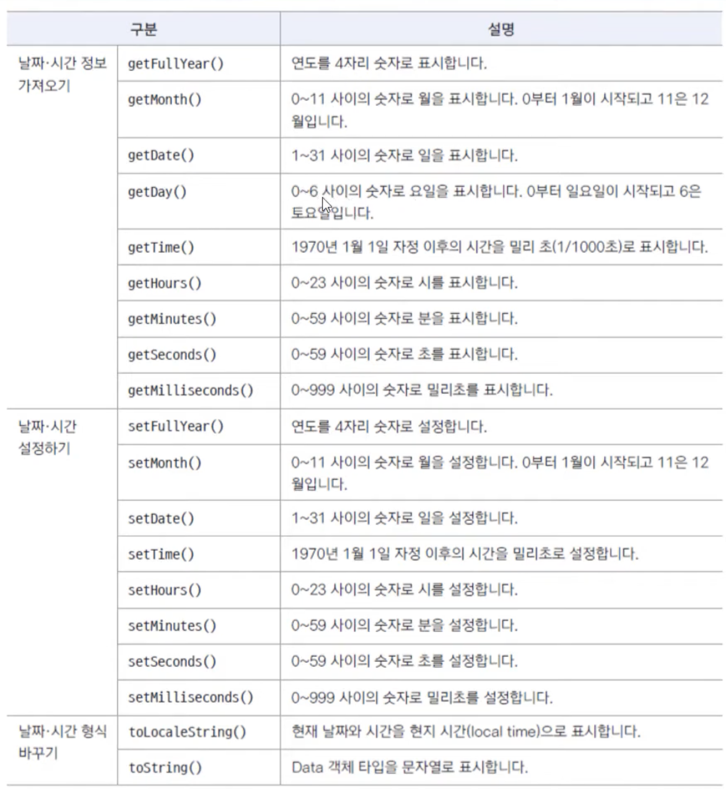

      - *날씨/시간 정보를 가져오는 메서드*
      - *날씨/시간 정보를 설정하는 메서드*
      - *날짜/시간 형식을 바꿔주는 메서드*

```javascript
var now = new Date();
var firstDay = new Date('2026-01-01');

var passedTime = now.getTime() - firstDay.getTime();
passedTime = Math.round(passedTime / (1000 * 60 * 60 * 24));

document.querySelector('#result').innerText = passedTime;
```

# 브라우저 객체

---

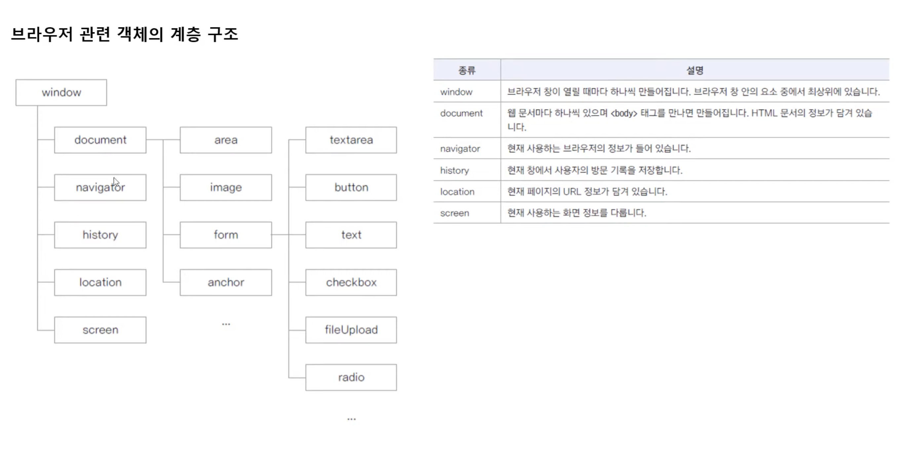

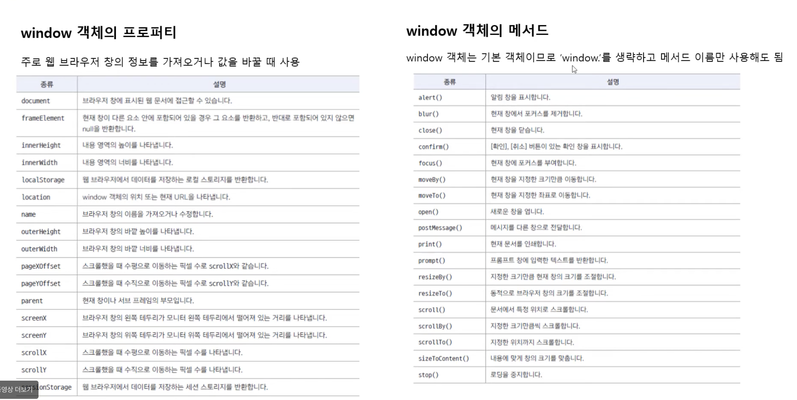

# DOM 객체

---

### DOM  요소에 접근하기(메서드)

      - *document.****getElementById(”idName”)***
      - *document.****getElementsByClassName(”className”)***
- *반환값이 2개 이상일 수 있다. → HTML Collection 객체에 저장된다.*
      - *document.****getElementsByTagName(”tagName”)***
- *반환값이 2개 이상일 수 있다. → HTML Collection 객체에 저장된다.*
      - *document.****queySelector(선택자 또는 태그)***
      - *document.****queySelectorAll(선택자 또는 태그)***
- *반환값이 2개 이상일 수 있다. → 노드 리스트(Node List)로 반환된다.*

*querySelector, querySelectorAll 같은 경우 id 앞에는 “#”, class 이름 앞에는 “.”, 태그 이름 앞에는
아무것도 붙이지 않는다.*

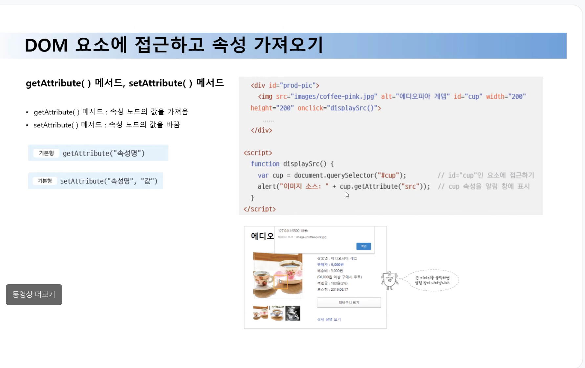

*getAttribute() 메서드: 속성 노드의 값을 가져온다*

*setAttribute() 메서드: 속성 노드의 값을 바꿈*

      - *setAttribute(”속성명”, “값”)*

# DOM에서 이벤트 처리하기

---

### addEventListener() 메서드 사용하기

*이벤트 객체를 사용해 이벤트 처리기 연결*

```
document.addEventListener(이벤트, 함수, 캡처 여부);
```

      - ***이벤트***
- *이벤트 유형을 지정한다. 단, click과 keypress 처럼 on을 붙이지 않고 쓴다.*
      - ***함수***
- *이벤트가 발생하면 실행할 명령이나 함수를 지정한다. 함수를 정의할 때는 event 객체를 인수로 받는다.*
      - ***캡처 여부***
- *이벤트를 캡처하는지 여부를 지정하며 기본값은 false 이다. true는 캡처링, false는 버블링을 의미한다.
이벤트 캡처링은 DOM의 부모  노드에서 자식 노드로 전달되는 것이고, 이벤트 버블링은 DOM의 자식 노드에서 부모 노드로 전달되는 것이다.*

```html
<body>
	<div id = "container">
		
	</div>

	<script>
		var cover = document.getElementById("cover");
		cover.addEventListener("mouseover", changePic, false);
		cover.addEventListener("mouseout", function() {
			cover.src = "images/1.jpg";
		}, false);
		
		function changePic() {
			cover.src = "images/2.jpg";
		}
	</script>
</body>	
```

### addEventListener 활용 CSS 수정하기

```html
<head>
	/* 코드 생략 */
	<style>
		#rect {
			width:100px;
			height:100px;
			border:1px solid #222;
			margin:30px auto;
			transition:1s; /* *스타일이 변경될 때, 변경된 값까지 1초 동안 서서히 변화 */*
		}
	</style>
</head>
<body>
	<div id="container">
		<p>도형 위로 마우스 포인터를 올려놓으세요.</p>
		<div id ="rect"><div>
	</div>
	<script>
		var rect = document.querySelector("#rect");

		rect.addEventListener("mouseover", function() {
			rect.style.backgroundclolor = "green";
			rect.style.borderRadius = "50%";
		}, false);
		
		rect.addEventListener("mouseout", function() {
			rect.style.backgroundclolor = "";
			rect.style.borderRadius = "";
		}, false);
		
	</script>
</body>
</html>	
```

      - ***transition 1s:*** *#rect의 스타일이 변경될 때, 변경된 값까지 1초 동안 서서히 변화*

# DOM에서 노드 추가, 삭제하기

---

### 요소 노드 만들기 - createElement(노드명)

```html
var newP = document.createElement("p");
```

      - *p 요소 만들기*

### 텍스트 노드 만들기 - createTextNode() 

```html
vat txtNode = document.createTextNode("DOM은 document object model 줄임말");
```

### 자식 노드 연결하기 - appendChild()

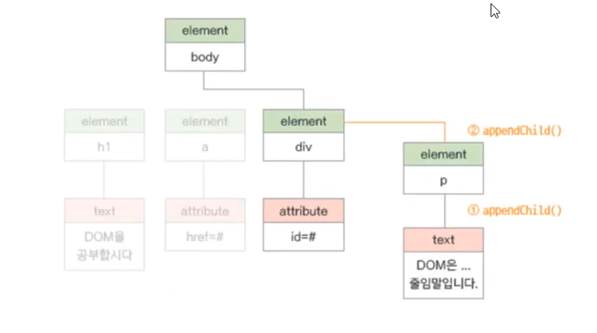

```html
newP.appendChild(txtNode); // 새로 만들었던 p 노드에 text 노드 자식으로 연결
document.getElementByUd("info").appendChild(newP); // 기존에 있던 노드에 p 노드 자식으로 연결 
```

### 속성 값이 있는 새로운 요소 추가하기

      1. **요소 만들기 - createElement()**
```html
var newImg = document.createElement("img");
```
      1. **속성 노드 만들기 - createAttribute()**
```html
var srcNode = document.createAttribute("src");
var altNode = document.createAttribute("alt");

srcNode.value = "images/dom.jpg"    // src 속성값 지정
altNode.value = "돔 트리 예제 이미지";  // alt 속성값 지정
```
      1. **속성 노드 연결하기 - setAttributeNode()**
```html
newImg.setAttributeNode(srcNode);
newImg.setAttributeNode(altNode);
```
      1. **자식 노드 연결하기 - appendChild()**
```html
document.getElementById("info").appendChild(newImg)
```

### 노드 삭제하기

*노드를 삭제할 때는 부모 노드에서 자식 노드를 삭제해야 한다*

*→ 노드를 삭제하려면 부모 노드부터 찾아야함*

**현재 노드의 부모 노드에 접근해서 부모 노드의 요소 노드를 반환**

```html
노드.parentNode
```

removeChild() 메서드: 자식 노드 삭제

```html
부모 노드.removeChild(자식노드)
```

# 마무리

***event listener 활용 코드***

```html
<!DOCTYPE html>
<html lang="ko">
  <head>
    <meta charset="UTF-8" />
    <meta name="viewport" content="width=device-width, initial-scale=1.0" />
    <title>Web Programming</title>
    <link rel="stylesheet" href="css/nodelist.css" />
  </head>
  <body>
    <div id="container">
      <h1>Web Programming</h1>
      <p>공부할 주제를 기록해 보세요</p>
      <form>
        <input type="text" id="subject" autofocus />
        <button type="button" id="addButton">추가</button>
        <!-- 변경1: onclick 제거, id 추가 -->
      </form>
      <hr />
      <ul id="itemList"></ul>
    </div>

    <script>
      // 변경2: 페이지 로드 후 이벤트 리스너 등록
      document.addEventListener('DOMContentLoaded', function () {
        var button = document.querySelector('#addButton');
        var subject = document.querySelector('#subject');

        // 변경3: addEventListener로 onclick 대체
        button.addEventListener('click', function (e) {
          e.preventDefault(); // form submit 방지
          newRegister();
        });

        subject.addEventListener('keypress', function (e) {
          if (e.key === 'Enter') {
            e.preventDefault();
            newRegister();
          }
        });
      });

      function newRegister() {
        var subject = document.querySelector('#subject');
        console.log('입력값:', subject.value);

        if (subject.value.trim() === '') {
          alert('빈 텍스트는 추가가 불가능 합니다!');
          subject.focus();
          return;
        }

        var newItem = document.createElement('li');
        var newText = document.createTextNode(subject.value);
        newItem.appendChild(newText);

        newItem.addEventListener('click', function () {
          if (this.parentNode) {
            this.parentNode.removeChild(this);
          }
        });

        document.querySelector('#itemList').appendChild(newItem);
        subject.value = '';
        subject.focus();
      }
    </script>
  </body>
</html>

```

[https://www.youtube.com/playlist?list=PLg-yFEMmilBBc23fH9McDtG3za4o5TbP_](https://www.youtube.com/playlist?list=PLg-yFEMmilBBc23fH9McDtG3za4o5TbP_)

```powershell
vue create movie-info // 뷰 프로젝트 생성
npm run serve // 개발 서버 시작
```

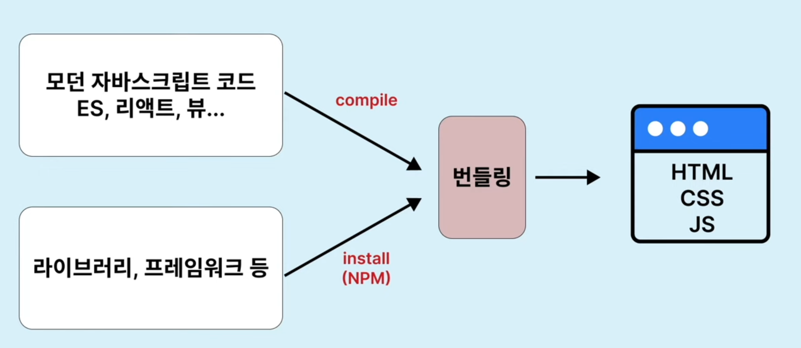

*npm run server 이후 command + s를 통해 저장하면 자동으로 화면 동안 갱신된다(VS 코드 live server 비슷)*

# SPA(Single Page Application)

---

***하나의 HTML 페이지로 동작하는 웹 애플리케이션***

***"URL은 바뀌지만, 페이지는 새로 고치지 않는다”***

### 전통적인 웹 (MPA)

```
/        → index.html
/login   → login.html
/user    → user.html
```

    - *페이지 이동 시*
- *서버에 요청*
      - ***HTML 전체 새로 로드***
      - *화면 깜빡임 발생*

### SPA 방식

```
index.html  (딱 1개)
```

    - *최초 1번만 HTML 로드*
    - *이후*
- ***JS가 화면을 바꿔 끼움***
      - *서버는* ***데이터만(JSON)*** *반환*

***페이지 이동 = 화면 교체***

***HTML 재요청 없음***

# SPA에서 Router란?

---

### Router의 역할

***Router:*** *URL과 화면(View)을 연결해주는 관리자*

| 역할 | 설명 |
| --- | --- |
| URL 감지 | /login, /user/1 |
| 컴포넌트 매칭 | 어떤 화면을 보여줄지 |
| 화면 전환 | 새로고침 없이 변경 |
| 히스토리 관리 | 뒤로가기 / 앞으로가기 |

### Vue Router의 핵심 개념

```html
{
  path: '/login',
  component: LoginView
}
```

***URL(path)*** *↔* ***화면(component)***

### <router-view />는 무엇인가?

```
<template>
  <router-view />
</template>
```

**화면이 바뀌는 자리**

    - *현재 URL에 맞는 컴포넌트가 이 위치에* ***동적으로 끼워짐***

# Vue 프로젝트 구조

---

    - ***node_modules***
- *설치한 라이브러리들이 있다*
      - *package.json 기반으로 자동 생성(직접 수정 X)*
    - ***package.json***
- *프로젝트 설정의 핵심*
      - *의존성, 스크립트, 버전 관리*
    - ***index.html***
- *SPA의 단 하나의 HTML*
      - *Vue 앱이 마운트되는 진입점*
    - ***src/main.js***
- *앱의 시작점(Entry Point)*
      - *Vue 인스턴스 생성*
    - ***src/App.vue***
- *최상위 컴포넌트*
      - *공통 레이아웃, 헤더, 푸터 위치*
    - ***assets/***
- *정적 리소스*
      - *이미지, 폰트, 전역 CSS*
    - ***components/***
- *재사용 가능한 컴포넌트*
      - *버튼, 카드*
    - ***views/*** 
- *페이지 단위 컴포넌트*
      - *router와* ***1:1 매칭,*** *URL 단위 화면*
    - ***router/***
- 라우팅 설정
      - *SPA의 url 관리, 화면 전환 담당*

# main.js

---

*Vue 애플리케이션의 시작지점*

```html
브라우저
 ↓
index.html
 ↓
main.js
 ↓
Vue App 생성
 ↓
Router / Store 연결
 ↓
App.vue 렌더링
```

# **App.vue**

---

```html
<template>
  <h1>영화 정보</h1>
  <div>
    <h3>{{ title }}</h3>
    <p>개봉: {{ year }}</p>
    <p>장르: {{ category }}</p>
  </div>
</template>

<script>
export default {
  name: 'App',
  data() {
    return {
      title: '노량',
      year: 2023,
      category: '액션, 드라마',
    };
  },
};
</script>

<style>
.bg-yellow {
  background-color: yellow;
}
</style>
```

    - *<template> HTML 작성*
    - *<script> JS  작성*
    - *<style> CSS를 작성*

# Vue 코드 맛보기

---

### export default {} 과 data() 함수

```html
<script>
export default {
  name: 'App',
  data() {
    return {
      foods: ['김밥', '순대', '만두'],
      title: '노량',
      year: 2023,
      category: '액션, 드라마',
      textRed: 'color: red',
    };
  },
};
</script>
```

    - *name: 컴포넌트 이름*
    - *date() 함수*
- *반응형 데이터*
      - *값이 바뀌면 화면 자동 갱신*
      - ***예약어:*** *이름 변경 시 기본 함수 취급*

```html
data: { count: 1 }
```

      - *이렇게 사용하면 모든 컴포넌트가 공유해서 사용하기 때문에* *`data() { return { } }`* *형식으로 사용해야 한다.*

### 보간법과 동적 스타일 바인딩(v-bind)

```html
<h3 class="bg-yellow" :style="textRed">{{ title }}</h3>
```

    - `{{ title }}`
- ***보간법(Interpolation)***
      - *data()의 title 값을 화면에 출력한다.*
    - `:style="textRed"`
- *동적 스타일 바인딩*
      - *`: = v-bind`*
      - *textRed 값 → color: red*

### v-for 반복 랜더링

```html
<ul>
  <li>{{ foods[0] }}</li>
  <li>{{ foods[1] }}</li>
  <li>{{ foods[2] }}</li>
</ul>
<hr />
<p v-for="(item, i) in foods" :key="i">{{ item }}</p>
```

    - *ul 태그쪽 출력하는 데이터는 JS 배열을 인덱스를 통해 직접 접근한다.*
    - *`v-for`* *을 활용하면 코드 수정없이 간편하게 반복 랜더링이 가능하다*
- item: 값 
      - i: 인덱스
    - *`:key="i"`* 
- *Vue가 DOM을 효율적으로 관리하기 위한* ***식별자***
      - *리스트 렌더링 시* ***필수***

### 이벤트 v-on

```javascript
<button @:click="like++">좋아요</button> <span> {{ like }}</span>
<!--<button v-on:click="like++">좋아요</button> <span> {{ like }}</span>-->
```

    - *`v-on`* *또는* *`@`* *를 통해 이벤트를 만들 수 있다.*
    - *현재는 간단하게 버튼을 누르면 like가 1 올라간다.*

### 함수 methods

```html
// 생략 ...
<button @:click="increaseLike">좋아요</button> <span>{{ like }}</span>
</template>

<script>
export default {
  name: 'App',
  data() {
    return {
      // 생략 ...
    };
  },
  methods: {
    increaseLike() {
      // like += 1;
      this.like += 1;
    }
  },
};
</script>
```

    - *함수는 methods: {} 안에 정의한다.*
    - *data() 안에 있는 변수들은 상태 변수로서 <template>안에서 this 키워드 없이 사용이 가능하지만 함수 안에서는 this 키워드가 필요하다.*
    - *즉, 이를 통해 template 안에서는 vue 프레임워크가 자동으로 this 인스턴스 상태 변수에 this 키워드를 자동으로 바인딩 해주는 것을  알 수 있다. 꼭 함수 안에서는 this 키워드를 붙이자*

```html
<button @:click="increaseLike(item)">좋아요</button>
<span>{{ item.like }}</span>

<script>
// 생략 ..
methods: {
    increaseLike(item) {
      item.like++;
    },
  },
</script>  
```

## Vue Application init flow 

---

```html
브라우저
  ↓
main.js (앱 시작점)
  ↓
App.vue (최상위 컴포넌트)
  ↓
하위 컴포넌트들 (Local / Global)
```

## 왜 import 문에 @가 들어갈까?

---

```html
import LocalComponent from '@/components/LocalChild.vue';
```

***@는 src/ 디렉토리의 별칭(alias)***

## what is main.js ?

---

*main.js는 Vue 앱의 시작지점 즉, 엔트리 포인트이다.*

```javascript
import { createApp } from 'vue';
import App from './App.vue';

const app = createApp(App);
app.mount('#app');
```

      1. *Vue 엔진 가져오기*
      1. *App.Vue를 최상위 컴포넌트로 지정*
      1. *Vue 앱 인스턴스 생성*
      1. *DOM에 붙이기*

```javascript
app.component('GlobalChild', GlobalChild);
```

*앱 전체에 영향을 주는 즉, 전역 컴포넌트 등록 같은 설정은 그래서 엔트리 포인트인 main.js에서 한다.*

[https://github.com/kingchobo2022](https://github.com/kingchobo2022)

[https://www.youtube.com/watch?v=7l9PzzU111w&list=PLTb3qGCzYjS1lkhdZL1z4uZJ72F7b5gIr&index=2](https://www.youtube.com/watch?v=7l9PzzU111w&list=PLTb3qGCzYjS1lkhdZL1z4uZJ72F7b5gIr&index=2)

## data

---

```html
<script>
export default {
  data() {
    return {
      channel: '<b>왕초보 홈페이지만들기<b>',
      subscribe: 2677,
    };
  },
};
</script>
```

## Text Interpolation

---

```html
<h1>채널명: {{ channel }}</h1>
```

      - *문자 보간법이라고도 부른다, 가장 기본적인 데이터 바인딩 방식*
      - *HTML 태그는 이스케이프 처리하여 일반 텍스트로 처리된다.*

## Basic Directive(지시자)

---

```html
// channel: '<b>왕초보 홈페이지만들기<b>',

<h2 v-text="subscribe"></h2>
<p v-html="channel"></p>
<h2 v-pre>구독자수: {{ subscribe }}</h2>
```

      - ***v-text:*** *text interpolation과 기능적으로 유사하지만, 태그 전체 내용을 덮어쓰는 점이 다르다.*
      - ***v-html:*** *데이터를 HTML로 해석하여 랜더링한다. 즉, <b> 같은 태그가 실제 스타일링으로 적용된다.*
      - ***v-pre:*** *Vue 템플릿 문법 {{ }}, 지시자 등을 처리하지 않고 그대로 랜더링한다.*

## v-if, v-show Directive

---

```html
<h1 v-if="score >= 90">평점: A</h1>
<h1 v-else-if="score >= 80">평점: B</h1>
<h1 v-else>평점: C</h1>

<h1 v-show="score != 60">이 영역은 v-show에서 처리하고 있습니다.</h1>
```

      - *else-if, else는 if와 다르게 단독으로 사용이 불가능하다.*
      - *v-if, v-show 모두 비슷하게 동작하지만 v-show 같은 경우 결과가 false인 경우 style = display none으로 처리되지만 v-if 같은 경우 태그 자체가 사라진다.*
      - *즉, 추후에 display 값 변경을 통해 데이터 표시가 필요한 경우 v-show를 선택하자*

## v-for 

---

```html
// sports: ['Baseball', 'Football', 'Volleyball', 'Swimming']
<template>
  <ul>
    <li v-for="(sport, index) in sports" :key="sport">
	    {{ index }} {{ sport }}
    </li>
  </ul>
</template>
```

      - *(값, 인덱스), (값, 키, 인덱스) 형태로 사용할 수 있다.*
      - ***:key 필수***
      - *현재 데이터 속성을 보면 이름만 있어서 키를 스포츠 이름으로 하고 있는데 나중에 데이터베이스 ID 같은 데이터를 받으면 key로 사용하는게 좋다.*

```html
<li v-for="(item, index) in items" :key="item.id">
  {{ index }} - {{ item.name }}
</li>
```

      - *(item, index) in items* 
- *item: Array 요소*
        - *items: Array*
        - *index: 인덱스(0부터 시작 )*

## v-on 이벤트 핸들링

---

```html
<template>
  <p>{{ 'count : ' + count }}</p>
  <button v-on:click="count++">숫자 증가</button>
  <button v-on:click="count--">숫자 감소</button>
  <button v-on:mouseover="count = 0">0으로 초기화</button>
</template>
```

## v-on 문법

---

```html
<button @click="count--">숫자 감소</button>
<button @mouseover="count = 0">0으로 초기화</button>
```

      - *기본 문법: v-on:click* 
      - *축약형 문법: @click*

## methods 옵션, 사용자 함수/ 메서드 만들기

---

```html
<script>
export default {
  methods: {
    greeting() {
      return 'Hi, there' + `My name is ${this.userName}`;
    },
  },
  data() {
    return {
      userName: '왕초보',
    };
  },
};
</script>

<template>
  <h1>{{ greeting() }}</h1>
</template>
```

      - *v-on 같은 directive에서는 argument가 없는 경우 greeting 이런식으로 괄호를 생략할 수 있다.*

## modifier 수정자

---

### 목표

*클릭 버튼을 한번만 누를수 있도록 만들어라, 클릭 버튼을 누르면 판업창으로 경고문이 나온다.*

### modifier 적용 BEFORE

```html
<script>
export default {
  data() {
    return {
      can_click: true,
    };
  },
  methods: {
    do_alrt() {
      if (this.can_click) {
        alert('경고문 출력');
        this.can_click = false;
      }
    },
  },
};
</script>
<template>
  <button v-on:click="do_alrt">클릭</button>
</template>
```

      - *can_click을 통해서 접근을 한번만 하도록 제어한다.*

### modifier 적용 After

```html
<script>
export default {
  methods: {
    do_alrt() {
      alert('경고문');
    },
  },
};
</script>
<template>
  <button v-on:click.once="do_alrt">버튼</button>
</template>
```

      - *v-on:click → v-on:click.once를 통해 한번만 접근하도록 만들었다.*
      - *별도의 상태변수 없이 더욱 간단하다.*

### 수많은 modifier 

```html
<input type="text" v-on:keydown.alt.s="getKey"?>
```

      - *v-on: vue 이벤트 핸들링 문법*
      - *keydown: 키보드 입력 이벤트*
      - *alt, s: modifier 즉, alt + s 를 동시에 누르는 경우 getKey() function이 실행된다.*

```
Vue는 다양한 키 modifier를 제공하며 체이닝으로 조합 가능합니다.

일반 키: .enter, .tab, .delete (Delete/Backspace), .esc, 
.space, .up, .down, .left, .right

시스템 키: .ctrl, .alt, .shift, .meta (Windows/Command 키)

마우스 버튼: .left, .right, .middle

기타: .exact (정확한 키 조합만), .once (한 번만 실행)
```

## 마우스 좌표 출력하기

---

```html
<script>
export default {
  data() {
    return {
      x: 0,
      y: 0,
      msg: '',
    };
  },
  methods: {
    mousePos(e) {
      console.log(e);
      this.x = e.offsetX;
      this.y = e.offsetY;
    },
    mouseClick(e) {
      this.msg += this.x + ',' + this.y + '\n';
    },
  },
};
</script>
<template>
  <div id="display" v-on:mousemove="mousePos" v-on:click.right="mouseClick">
    x: {{ x }} <br />
    y: {{ y }}
  </div>
  <textarea>{{ msg }}</textarea>
</template>

```

      - *v-on:mousemove → 마우스 이동시 발생하는 이벤트 핸들링*
      - *v-on:click.right → 마우스 우클릭하면 발생하는 이벤트 핸들링*
      - *mousePos 메서드에서보면  이벤트 객체를 직접 argument로 넘겨주지 않아도 자동으로 넘어가는것을 확인할 수 있었다.*

## v-model 기본

---

```html
<script>
export default {
  data() {
    return {
      inputName: '홍길동',
    };
  },
};
</script>
<template>
  <input type="text" v-model="inputName" />
  <p>{{ inputName }}</p>
</template>
<style></style>
```

      - *입력값이 inputName에 실시간으로 반영, 또한 입력창에도 업데이트된다.*
- *이게 양방향 바인딩*

## v-model checkbox 활용

---

```html
<script>
export default {
  data() {
    return {
      agree: false,
    };
  },
};
</script>
<template>
  <p>이 약관에 동의하십니까?</p>
  <input type="checkbox" v-model="agree" />
  <button v-show="agree">회원가입</button>
</template>
```

      - *<input type=”checkbox” v-model=”agree”>: 실시간으로 양방향 바인딩 된다.*
- *agree = false → before check*
        - *agree = true → after check*
      - *<button v-show=”agree”>: agree 값에 따라서 실시간으로 버튼 display on/off* 

## v-model <select>, <form> 활용

---

```html
<script>
export default {
  data() {
    return {
      item: null,
      itemCnt: 1,
      itemList: [{ name: '감귤', cnt: 2 }],
    };
  },
  methods: {
    addItem() {
      let item = {
        name: this.item,
        cnt: this.itemCnt,
      };
      this.itemList.push(item);
    },
  },
};
</script>
<template>
  <form v-on:submit="addItem">
    <p>
      품목 : <input type="text" required placeholder="사과" v-model="item" />
    </p>
    <p>
      수량 :
      <select v-model="itemCnt">
        <option value="1">1개</option>
        <option value="2">2개</option>
        <option value="3">3개</option>
        <option value="4">4개</option>
        <option value="5">5개</option>
      </select>
    </p>
    <button>상품추가</button>
    <hr />
    <p>{{ itemList }}</p>
  </form>
</template>
<style></style>

```

      - *<form v-on:submit="addItem">: 제출하는 순간 페이지 리로딩이 일어난다.*
- *action 속성에 해당하는 경로로 동작하는데 현재는 action 속성이 없기 때문에 현재 페이지에 새로고침*
        - *<form v-on:submit.prevent="addItem"> prevent modifier를 통해 제출을 안하고 addItem 메서드만 동작하게 할 수 있다.*
      - *this.itemList.push(item): Array에 element 추가*
      - *v-model을 활용하여 데이터 양방향 바인딩을 하고있다.*

## v-bind가 필요한 이유

---

*Vue.js에서 v-bind가 필요한 이유는 정적 HTML 속성으로는 동적 데이터 반영이 불가능하기 때문이다.*

*일반 HTML 속성(src="image.jpg")은 하드코딩되어 데이터 변경 시 자동 업데이트되지 않는다.*

*v-bind(또는 :)를 사용하면 Vue의 반응형 데이터가 DOM 속성에 실시간으로 바인딩되어 변경사항이 즉시 반영*

```html
xml<!-- 정적: 데이터 변경해도 이미지 안 바뀜 -->


<!-- v-bind: 데이터 변경 시 새 이미지로 업데이트 -->
  <!-- imageUrl = 'new.jpg'로 바뀌면 즉시 반영 -->
```

## v-bind 문법

---

```html
<script>
export default {
  data: function () {
    return {
      site_name: 'Daum',
      url: 'https://daum.net',
    };
  },
};
</script>

<template>
  <a v-bind:href="url">{{ site_name }}으로 이동하기</a>
</template>
```

      - *<a v-bind:href="url">: 가장 기본형태* 
      - *<a :href=”url”>: v-bind 생략 가능*

## vue class 바인딩 기초

---

```html
<script>
export default {
  data() {
    return {
      isActive: true,
      hasError: true,
    };
  },
};
</script>

<template>
  <div class="border" :class="{ bg: isActive, 'text-danger': hasError }">
    Warning
  </div>
</template>

<style>
.border {
  border: 2px solid red;
}
.bg {
  background-color: gray;
}
.text-danger {
  color: red;
}
</style>

```

      - *border 속성: 테두리*
      - *class=”border”: 기본적인 CSS 적용 문법*
      - *:class="{ bg: isActive, 'text-danger': hasError }"*
- ***Vue에서 상태값(Boolean)에 따라 클래스를 조건부로 적용하는 문법***
        - *‘text-danger’의 경우 클래스명 중간에* *`-`* *이 들어가기 때문에* *`'`* *사용하여 문자열로 작성\*

## classObject 를 사용해 여러 클래스를 한 번에 관리

---

```html
<script>
export default {
  data() {
    return {
      classObject: {
        bg: true,
        'text-danger': true
      },
    };
  },
};
</script>

<template>
  <div class="border" :class="classObject">Warning</div>
</template>
```

## class 바인딩 배열 문법

---

```html
<div class="border" :class="['bg', 'text-danger']">Warning</div>
```

      - *2개의 class를 조건없이 바인딩한다.*

```html
<template>
  <div class="border" :class="[isActive ? bgClass : '', erClass]">Warning</div>
</template>
```

      - *이렇게 3항 연산자 사용도 가능하다*

## Style 바인딩

---

```html
<script>
export default {
  data() {
    return {
      width: 200,
      initWidth: 200,
    };
  },
  methods: {
    increase() {
      this.width += 100;
    },
    init() {
      this.width = this.initWidth;
    },
  },
};
</script>

<template>
  <div class="basic" @mouseover="init" :style="{ width: width + 'px' }"></div>
  <button @click="increase">증가</button>
</template>

<style>
.basic {
  width: 200px;
  height: 200px;
  background-color: blueviolet;
  border: 2px solid black;
}
</style>

```

      - *:style="{ width: width + 'px' }"* 
- *해당 문법을 통해 스타일을 동적으로 변경할 수 있다.*
        - *클래스가 아닌 CSS 속성 자체를 직접 제어할 때 사용*
      - *:class vs :style*
- *:class: 미리 정의된 스타일 묶음을 토글할 때*
        - *:style: 수치, 색상 등 값을 직접 변경해야 할 때*

## computed 주요특징 

---

      1. *Caching*
      1. *Reactive*
      1. *기본적으로 읽기 전용이지만 getter / setter 를 이용하여 읽기/쓰기도 가능하다* 

## computed 문법 

---

```html
<script>
export default {
  data() {
    return {
      chk: false,
    };
  },
  computed: {
    yesNo() {
      if (this.chk) {
        return '예';
      }
      return '아니오';
    },
  },
};
</script>

<template><input type="checkbox" v-model="chk" /> {{ yesNo }}</template>

<style></style>

```

      - *computed는 상태를 기반으로 계산된 값이다*
      - *여기서는 chk라는 반응형 데이터를 기반으로 화면에 사용할 새로운값을 만든다.*
      - *computed는 의존하는 값이 바뀔 때만 다시 계산되기 때문에 화면이 다시 랜더링 되어도 chk 값이 바뀌지 않으면 이전 계산 결과를 재사용한다*

## watch: 

---

*반응형 속성이 변경될 때마다 함수를 트리거 할 수 있다.*

## basic watch: 

---

```html
<script>
export default {
  data() {
    return {
      count: 0,
      y: '짝수',
    };
  },
  watch: {
    // function name is equal to data variable
    count(newVal, oldVal) {
      console.log(`count changed from ${oldVal} to ${newVal}`);
      if (newVal % 2 === 0) {
        this.y = '짝수';
        return;
      }
      this.y = '홀수';
    },
  },
};
</script>

<template>
  <div>{{ count }}</div>
  <button @:click="count++">increment</button>
  <p>{{ y }}</p>
</template>

<style></style>

```

      - *count 값이 변경될 때마다 watch의 count(newVal, oldVal) 함수가 호출된다.*
      - *기본 watch 규칙: watch 함수 이름 = 감시할 상태 변수이름*

## once watch: 

```html
watch: {
  count: {
    handler(newVal, oldVal) {
      console.log(`Count changed from ${oldVal} to ${newVal}`);
      if (newVal % 2 === 0) {
        this.y = '짝수';
        return;
      }
      this.y = '홀수';
    },
    once: true, // 한번만 handler 트리거 실행
  },
},
```

      - *once 속성을 통해서 한번만 handler가 실행되게 할 수 있다.*

***once 뿐만 아니라 다양한 watcher가 존재한다.***

## component?

---

*Vue 컴포넌트는 UI를 구성하는 독립적인 재사용 가능 블록이다.*

*재사용, 유지보수, 단순화*

*컴포넌트는 지역 등록 또는 전역 등록이 가능하고,* 

*HTML 태그 형태로 사용할 곳에 삽입한다.*

*component 같은 경우 src 폴더 하위에 별도의 cmponents 폴더를 만들어서 해당 폴더 아래에 생성한다.*

## Local component

---

**LocalChild.vue**

```html
<template>
  <h1>지역 컴포넌트</h1>
  <p>지역 컴포넌트입니다.</p>
</template>
```

**App.vue**

```html
<script>
import LocalComponent from '@/components/LocalChild.vue';

export default {
  components: {
    LocalComponent,
  },
};
</script>

<template>
  <h1>App.Vue</h1>
  <LocalComponent> </LocalComponent>
</template>

<style></style>

```

      - *지역 컴포넌트의 경우 import를 통해서 추가하고 export default에 components 등록을 한다.*
      - *<LocalComponent>와 같이 태그 형식으로 사용한다.*

## Global component

---

**GlobalChild.vue**

```html
<template>
  <h1>전역 컴포넌트</h1>
  <p>전역 컴포넌트 입니다.</p>
</template>
```

**main.js**

```javascript
import { createApp } from 'vue';
import App from './App.vue';
import GlobalChild from '@/components/GlobalChild.vue';

const app = createApp(App);
app.component('GlobalChild', GlobalChild);
app.mount('#app');
```

      - *전역 컴포넌트의 경우 먼저 main.js에 등록한다.*
      - *지역 컴포넌트와 마찬가지로 import문이 필요하고, mount 이전에 컴포넌트를 등록하는 작업이 필요하다.*

**App.vue**

```html
<script>
import LocalComponent from '@/components/LocalChild.vue';

export default {
  components: {
    LocalComponent,
  },
};
</script>

<template>
  <h1>App.Vue</h1>
  <LocalComponent> </LocalComponent>
  <GlobalChild></GlobalChild>
</template>

<style></style>

```

      - *지역 컴포넌트와 다르게 import, export default components에 추가 없이 바로 태그 형식으로 사용이 가능하다.*

## components with CSS

---

```html
<template>
  <h1>전역 컴포넌트</h1>
  <p>전역 컴포넌트 입니다.</p>
</template>


<style>
h1 {
  color: red;
}
p {
  color: blue;
}
</style>
```

      - *이렇게 전역 컴포넌트에 style을 적용하면 모든 컴포넌트와 App.vue 스타일도 바뀌는 것을 알 수 있다.*
      - *만약 해당 컴포넌트(지역 또는 전역)에만 적용하고 싶다면 <style scoped>를 통해 제한할 수 있다.*

## hook?

---

*생명주기마다 사용할 수 있는 method가 존재하는데 그걸 hook 이라고 말한다.*

## Component Life Cycle

---

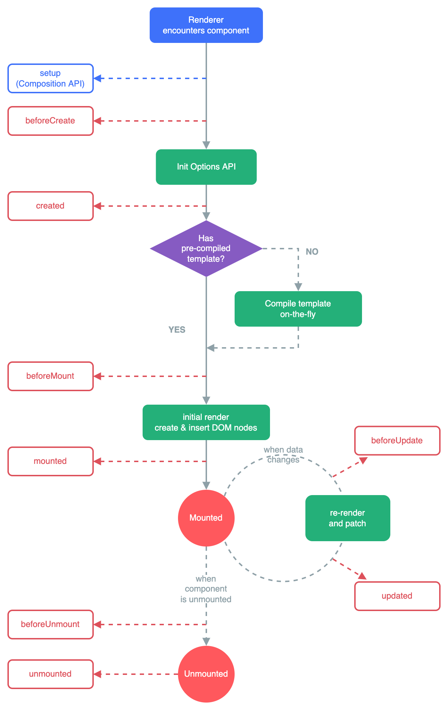

*사용 가능한 훅 종류*

      - *beforeCreated, created* 
      - *beforeMount, mounted*
      - *beforeUpdate, updated*
      - *beforeUnmount, unmounted*

## Component Life Cycle & hook example

---

**GlobalChild.vue**

```javascript
<script>
export default {
  beforeCreate() {
    console.log('global: beforeCreate');
  },
  created() {
    console.log('global: created');
  },
  beforeMount() {
    console.log('global: beforeMount');
  },
  mounted() {
    console.log('global: mounted');
  },
  beforeUpdate() {
    console.log('global: beforeUpdate');
  },
  updated() {
    console.log('global: updated');
  },
  beforeUnmount() {
    console.log('global: beforeUnmount');
  },
  unmounted() {
    console.log('global: unmounted');
  },
};
</script>
<template>
  <h1>전역 컴포넌트</h1>
  <p>전역 컴포넌트 입니다.</p>
</template>

<style scoped>
h1 {
  color: red;
}
p {
  color: blue;
}
</style>

```

      - *전역 컴포넌트로 등록*

**App.vue**

```javascript
<script>
import GlobalChild from './components/GlobalChild.vue';

export default {
  data() {
    return {
      cnt: 1,
    };
  },
  methods: {
    counter() {
      this.cnt++;
    },
  },
  beforeCreate() {
    console.log('beforeCreate');
  },
  created() {
    console.log('created');
  },
  beforeMount() {
    console.log('beforeMount');
  },
  mounted() {
    console.log('mounted');
  },
  beforeUpdate() {
    console.log('beforeUpdate');
  },
  updated() {
    console.log('updated');
  },
  beforeUnmount() {
    console.log('beforeUnmount');
  },
  unmounted() {
    console.log('unmounted');
  },
};
</script>

<template>
  <h1>App.Vue</h1>
  <h1>Count : {{ cnt }}</h1>
  <GlobalChild v-if="cnt >= 3 && cnt <= 5"></GlobalChild>
  <button @:click="counter">click</button>
</template>

<style></style>

```

      - *cnt 3 ~ 5 사이면 전역 컴포넌트가 마운트* 
      - *cnt는 1에서 시작하여 클릭을 통해 3이되면 전역 컴포넌트가 등록되서 cnt가 6에 도착하면 전역 컴포넌트는 언마운트된다.*

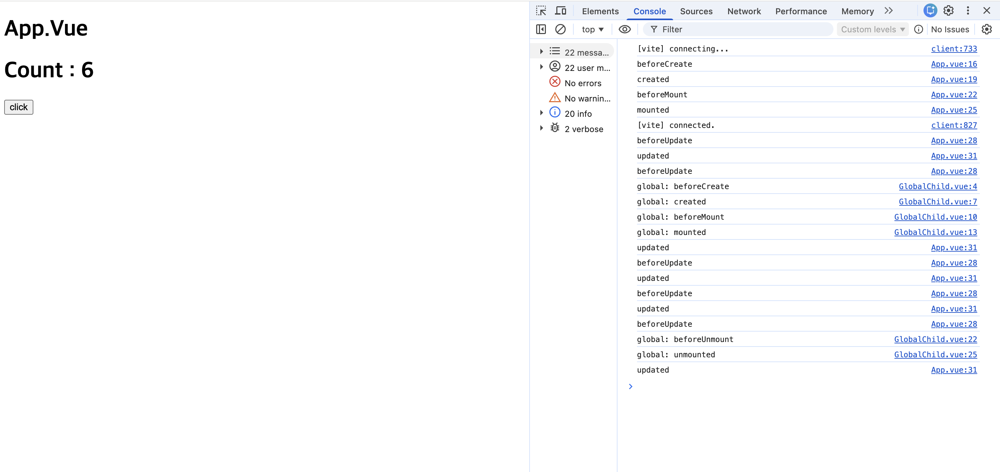

## ref?

---

*DOM 요소에 고유한 참조자를 제공하는 특별한 속성*

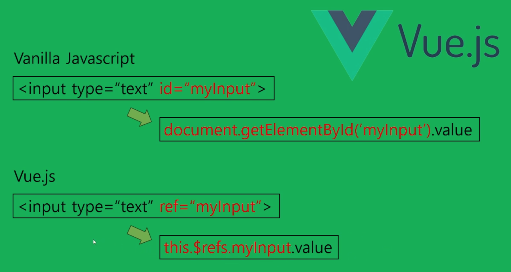

      - *ref*
      - *this.$refs*

## ref 예제 

---

```javascript
<script>
export default {
  methods: {
    logInput() {
      console.log(this.$refs.myInput.value);
    },
  },
};
</script>

<template>
  <div>
    <input type="text" ref="myInput" />
    <button v-on:click="logInput">Log</button>
  </div>
</template>

```

## props?

---

*부모 컴포넌트에서 자식 컴포넌트로의 데이터 전달 수단*

*단방향 데이터 흐름*

*부모 컴포넌트에서의 데이터 수정은 자식 컴포넌트로 영향이 가지만 반대로 자식 컴포넌트의 데이터 수정은 부모 컴포넌트에 영향이 가지 않는다.*

## props example

---

### **App.vue(부모 컴포넌트)**

```javascript
<script>
import childComponent from '@/components/childComponent.vue';
export default {
  components: {
    childComponent,
  },
};
</script>

<template>
  <h1>나는 부모</h1>
  <childComponent name="홍길동" age="29"></childComponent>
</template>
```

      - *현재 App.vue를 보면 부모 컴포넌트이고 import, export dafault + components를 통해 childComponent를 마운트하고 있다.*
      - *<childComponent name="홍길동" age="29"></childComponent>*
- *name, age 데이터를 단방향으로 보낸다.*

### childComponent.vue(자식 컴포넌트)

```javascript
<script>
export default {
  props: ['name', 'age'],
  created() {
    console.log(this.name);
  },
};
</script>
<template>
  <h1>child component</h1>
  <p>Name: {{ name }}</p>
  <p>Age: {{ age }}</p>
  <button @click="age++">클릭</button>
</template>
```

      - *export default + props를 통해 name, age 데이터를 받는다.*
      - *현재 자식 컴포넌트의 버튼을 보면 클릭하면 age를 증가하도록 한다.*
- *이 버튼은 누르면 아래 사진과 같이 vue에서 경고를 한다.*
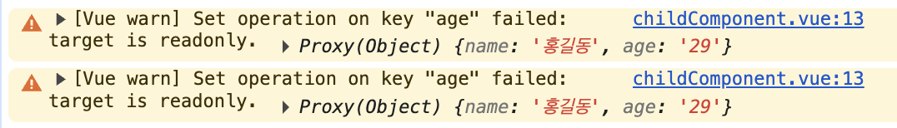
        - ***부모 컴포넌트로부터 props로 받은 데이터는 데이터 조작이 불가능하기 때문이다.***

### 부모 컴포넌트 데이터 조작하기

```javascript
<script>
import childComponent from '@/components/childComponent.vue';
export default {
  components: {
    childComponent,
  },
  data() {
    return {
      name: '홍길동',
      age: 29,
    };
  },
};
</script>

<template>
  <h1>나는 부모</h1>
  <childComponent v-bind:name="name" :age></childComponent>
  <button @click="age++">버튼</button>
</template>

```

      - *v-bind:name=”name” 축약형 → :name*
      - *부모 컴포넌트에서의 age 조작 버튼은 데이터 조작이 가능하다.*
      - ***왜 v-model이 아닌 v-bind를 사용?***
```javascript
v-model은 양방향 데이터 바인딩을 수행한다.
v-model=에 정의된 변수와 Vue 인스턴스의 데이터 속성 변수를 연결하고, 
둘 중 하나가 바뀌면 다른 하나도 바뀐다.

v-bind는 data 인스턴스 변수 값이 변경되면 v-bind:value 값도 따라 변경 된다.
Vue 인스턴스 데이터 -> html 속성 단반향 전용
```

        - *이러한 속성 때문에 현재 부모 컴포넌트의 변화만 자식 컴포넌트의 age에 변화를 주려면 v-bind 단방향 성질을 이용하는게 맞다.*
        - *이러한 특징 때문에 v-model은 props 에서 사용하지 않는다.*

## emit

---

*자식 컴포넌트에서 부모 컴포넌트로 데이터를 전달하거나 Trigger 할 수 있는 방법을 제공한다.*

### emit trigger 동작 순서

      1. *자식 컴포넌트에서 $emit(부모 컴포넌트에 정의된 이벤트) 실행*
      1. *부모 컴포넌트에서 이벤트 수신*
      1. *연결된 메서드 실행*

## emit example1

---

### App.vue(parent component)

```javascript
<script>
import childComponent from '@/components/childComponent.vue';
export default {
  components: {
    childComponent,
  },
  methods: {
    callFunction() {
      alert('자식 컴포넌트에서 보낸 이벤트 수신');
    },
  },
};
</script>

<template>
  <h1>나는 부모</h1>
  <childComponent @create-post="callFunction"></childComponent>
</template>
```

      - *부모 컴포넌트에서 이벤트를 수신하는 경우 @ + 케밥 케이스로 이벤트를 수신하고 연결된 메서드명을 써준다.*
- *@create-post=”callFunction”*

### chiledComponent.vue(child component)

```javascript
<template>
  <h1>child component</h1>
  <button @click="$emit('createPost')">부모 이벤트 호출</button>
</template>
```

      - *자식 컴포넌트에서 $emit을 통해 부모 컴포넌트의 이벤트를 호출하는 경우 카멜케이스로 부모 함수(메서드)를 호출한다.*
- *@click=$emit(’createPost’)*

## emit example2

---

```javascript
<script>
import childComponent from '@/components/childComponent.vue';
export default {
  components: {
    childComponent,
  },
  methods: {
    callFunction(value) {
      alert(`자식 컴포넌트에서 보낸 이벤트 수신 ${value}`);
    },
  },
};
</script>

<template>
  <h1>나는 부모</h1>
  <childComponent @create-post="callFunction"></childComponent>
</template>
```

      - *부모 컴포넌트에서는 자식 컴포넌트가 보낸 argument를 받는다.*

```javascript
<template>
  <h1>child component</h1>
  <input type="text" ref="myInput" />
  <button @click="$emit('createPost', $refs.myInput.value)">
    부모 이벤트 호출
  </button>
</template>
```

      - *ref 통한 데이터 전달 → 입력한 데이터를 부모컴포넌트의 createPost 이벤트로 전달한다.*

## props의 단점

---

*ex: 부모컴포넌트, 자식컴포넌트, 손자컴포넌트*

*이렇게 3개의 계층 컴포넌트가 존재할 때 필요없는 중간 단계의 컴포넌트에서도 props를 이용해 계속 자식에게 전달해줘야 하는 번거로움이 발생한다.*

*즉, 특정 상위 컴포넌트로부터 전달해야하는 하위 컴포넌트 사이에 100개가 있다면 props를 100번 반복해야 하는 문제가 발생한다.*

## provide, inject를 통해 해결

---

*처음 값을 전달하는 부모 컴포넌트에서 provide에 정의를 해주고,* 

*최종적으로 그 변수나, 함수를 사용하는 자손 컴포넌트에서 inject로 받아서 사용하면 된다.*

## provide, inject 문법

---

### 상위 컴포넌트: provide

```javascript
<scirpt>
	export default {
		provide() {
			return {
				gift: this.gift,
			}
		}
	}
</script>
```

### 하위 컴포넌트: inject

```javascript
<scirpt>
	export default {
		injext: ["gift"]
	}
</script>
```

## slot ?

---

### 왜 사용할까?

      1. *컴포넌트의 재사용성 증가*
      1. *유연한 레이아웃 구성*
      1. *명확한 컴포넌트 구조*

## slot 적용 BEFORE (props 사용)

---

### FancyButton.vue (하위 컴포넌트)

```javascript
<script>
export default {
  props: ['buttonname'],
};
</script>
<template>
  <button class="fancy-btn">{{ buttonname }}</button>
</template>

```

      - *props: ['buttonname']*

### App.vue(상위 컴포넌트)

```javascript
<script>
import FancyButton from '@/components/FancyButton.vue';
export default {
  components: {
    FancyButton,
  },
};
</script>

<template>
  <h1>I am App.vue</h1>
  <FancyButton buttonname="클릭2"> </FancyButton>
</template>

```

      - *props를 활용하여 buttonname 전달*
      - 만약 buttonname을 강조하고 싶어서 <strong>클릭2<strong> 이렇게 보낸다고 하면?
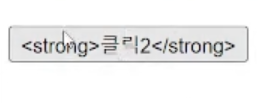
      - *이렇게 코드가 그대로 들어가게 된다.*

```
태그 뿐만 아니라, props를 활용해서 자식 또는 자손 컴포넌트로의 데이터전달은
많은 데이터 전달의 효율성이 떨어진다.(가독성이 떨어진다.)
=> 슬롯을 활용한다.
```

## slot 적용 AFTER

---

### App.vue

```html
<script>
import FancyButton from '@/components/FancyButton.vue';
export default {
  components: {
    FancyButton,
  },
};
</script>

<template>
  <h1>I am App.vue</h1>
  <FancyButton>
    <strong>클릭3</strong>
  </FancyButton>
</template>
```

      - ***before*** *props 전달: <FancyButton buttoname=”버튼2”>*
      - ***after*** *<slot> 활용: <FancyButton> 태그 사이에 전달하고자 하는 데이터 포함*

### FancyButton.vue

```html
<script>
export default {
  methods: {
    alert() {
      alert('버튼 클릭');
    },
  },
};
</script>
<template>
  <button class="fancy-btn" @click="alert">
    <slot></slot>
  </button>
</template>
```

      - *export default 쪽 props를 없애고 button 사이에 <slot>을 추가*
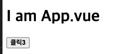

        - *결과를 보면 클릭 버튼에 <strong> 강조 태그가 성공적으로 들어가졌다.*

## slot 활용

---

### MainLayout.vue(하위 컴포넌트)

```html
<template>
  <slot name="header"></slot>
  <slot name="contents"></slot>
  <slot name="footer"></slot>
</template>
```

      - *현재 컴포넌트를 보면 총 3개의 슬롯이 존재한다.* 
      - *같은 컴포넌트에 서로 다른 슬롯이 3개 존재하기 때문에 name을 통해 식별한다.*

### App.vue

```html
<script>
import FancyButton from '@/components/FancyButton.vue';
import MainLayout from '@/components/MainLayout.vue';
export default {
  components: {
    FancyButton,
    MainLayout,
  },
};
</script>

<template>
  <h1>I am App.vue</h1>
  <MainLayout>
    <template v-slot:header>
      <h1>Header</h1>
    </template>
    <template #contents>
      <h1>Contents</h1>
    </template>
    <template #footer>
      <h1>Footer</h1>
    </template>
  </MainLayout>

  <FancyButton>
    <strong>클릭3</strong>
  </FancyButton>
</template>
```

      - *<MainLayout> 태그(컴포넌트)에 총 3개의 Template을 만든다.*
      - ***v-slot:name*** *또는* ***#name*** *문법을 통해서 하위 컴포넌트 슬롯 name에 맞게 데이터를 전달한다.*

## default name slot

---

```html
<template>
  <slot name="header"></slot>
  <slot></slot>
  <slot name="footer"></slot>
</template>
```

      - *header 슬롯과 footer 슬롯 가운데에 있는 슬롯은 현재 지정된 name이 없다. 이를 default 슬롯으로 부른다.*
      - *default 슬롯의 경우 부모 컴포넌트에서 #name 또는 v-slot:name을 지정할 필요없다.*

## default data slot

---

```html
<FancyButton>
   
</FancyButton>
```

      - *현재 코드를 보면 FancyButton 하위 컴포넌트에 데이터 전달을 하지 않고 있다.*
      - *이런 경우 하위 컴포넌트에서 default 값을 사용하도록 할 수 있다.*

```html
<slot>default data</slot>
```

      - *이렇게 슬롯 태그 사이에 default 데이터를 넣으면 된다.*

### TodoInput.vue

```html
<script>
export default {
  data() {
    return {
      msg: '',
    };
  },
  methods: {
    todoInput() {
      this.$emit('todoInput', this.msg);
      this.msg = '';
    },
  },
};
</script>
<template>
  <form id="todo-form">
    <input
      type="text"
      id="todo-input"
      placeholder="Enter a new task"
      v-model="msg"
    />
    <button type="button" @click="todoInput">Add</button>
  </form>
</template>
```

      - *<input>에서는 v-model을 통해 상태 변수인 msg와 양방향 바인딩*
      - *사용자가 클릭버튼을 누르면 todoInput() 메서드가 실행된다.*
      - *todoInput() 메서드에서는 $emit을 통해 부모 컴포넌트인 App.vue의 이벤트인 @todo-input을 트리거한다. 이때 argument로 사용자가 작성한 todo(할일)도 함께 보낸다.*

### App.vue

```html
<script>
import TodoInput from '@/components/TodoInput.vue';
import TodoList from './components/TodoList.vue';
import { v4 as uuidv4 } from 'uuid';
export default {
  components: {
    TodoInput,
    TodoList,
  },
  data() {
    return {
      todoList: [],
    };
  },
  methods: {
    todoInput(msg) {
      const item = {
        id: uuidv4(),
        msg: msg,
        completed: false,
      };
      this.todoList.push(item);
      console.log(JSON.stringify(this.todoList));
    },
    todoUpdate(id) {
      console.log('도착' + id);
      console.log(this.todoList);
      this.todoList = this.todoList.map((v) =>
        v.id === id ? { ...v, completed: !v.completed } : v,
      );
      console.log(this.todoList);
      console.log('끝');
    },
  },
};
</script>

<template>
  <div class="todo-container">
    <h1>TODO List</h1>
    <TodoInput @todo-input="todoInput"></TodoInput>
    <TodoList v-bind:todo-list="todoList" @todo-update="todoUpdate"></TodoList>
  </div>
</template>
```

      - *<TodoInput @todo-input="todoInput"></TodoInput>*
- *TodoInput 컴포넌트가 마운트된다.*
        - *하위 컴포넌트에서 이벤트 트리거 시 todoInput 메서드가 호출된다.*
        - *해당 메서드에서는 item 객체로 만들고 id를 uuidv4()를 통해 생성하고 할당한다.*
- *uuid 같은 경우 npm uuid install을 통해 다운받고 import { v4 as uuidv4 } from 'uuid'; 가 필요하다.*
        - *item 객체를 todoList에 push*
      - *<TodoList v-bind:todo-list="todoList" @todo-update="todoUpdate"></TodoList>*
- *하위 컴포넌트에 v-bind:todo-list=”todoList” 단방향 바인딩 props를 통해 현재 todoList 객체를 전달한다.*
        - *@todo-update 같은 경우 마찬가지로 TodoList 하위 컴포넌트에서 $emit으로 트리거하는 이벤트를 받고 todoUpdate 메서드를 실행한다.*

### TodoList.vue

```html
<script>
export default {
  props: ['todoList'],
  methods: {
    todoUpdate(id) {
      this.$emit('todoUpdate', id);
    },
  },
};
</script>
<template>
  <ul id="todo-list">
    <li
      v-for="todo in todoList"
      :key="todo.id"
      :class="{ completed: todo.completed }"
    >
      {{ todo.msg }}
      <button type="button" @click="todoUpdate(todo.id)">Delete</button>
    </li>
  </ul>
</template>

```

      - *props: [’todoList’]*
- *상위 컴포넌트에서 넘겨주는 todoList를 v-for 반복문 문법을 통해 랜더링한다.*
      - *v-for & :class="{ completed: todo.completed }" class 바인딩 문법을 사용*

### ***아래부터는 Composition API*** 

## Composition API?

---

*Vue3에서 새롭게 등장한 함수 기반의 API로 컴포넌트 로직을 유연하게 구성하도록 지원하여 코드의 재사용성과*

*가독성을 높여준다.*

## Composition API VS Options API

---

### Options API

*지금까지 배운 것, 컴포넌트 로직을 data, methods, computed, watch 등의 옵션에 담아서 구분*

### Composition API

*Vue3에서 새로 도입된 방식, 함수형 프로그래밍 스타일과 유사 관련 로직을 setup hook에 정의하여 사용*

*코드 재사용성이 높아져서 큰 프로젝트에 적합하다*

### **Options API 방식**

```html
<script>
export default {
  data: function () {
    return {
      cnt: 0,
    };
  },
  computed: {
    oddEven() {
      return this.cnt % 2 ? '홀수' : '짝수';
    },
  },
  methods: {
    counter() {
      this.cnt++;
    },
  },
};
</script>

<template>
  <p>{{ cnt }}</p>
  <p>홀짝 판별 : {{ oddEven }}</p>
  <button @click="counter">클릭</button>
</template>
```

### Composition API 방식1

```html
<script>
import { ref, computed } from 'vue';
export default {
  setup() {
    const cnt = ref(0);
    const oddEven = computed(() => (cnt.value % 2 ? '홀수' : '짝수'));
    const counter = () => cnt.value++;

    return {
      cnt,
      oddEven,
      counter,
    };
  },
};
</script>

<template>
  <p>{{ cnt }}</p>
  <p>홀짝 판별 : {{ oddEven }}</p>
  <button @click="counter">클릭</button>
</template>
```

### Composition API 방식2

```html
<script setup>
import { ref, computed } from 'vue';

const cnt = ref(0);
const oddEven = computed(() => (cnt.value % 2 ? '홀수' : '짝수'));
const counter = () => cnt.value++;

</script>

<template>
  <p>{{ cnt }}</p>
  <p>홀짝 판별 : {{ oddEven }}</p>
  <button @click="counter">클릭</button>
</template>
```

## ref, reactive 기본 개념

***ref와 reactive는 Vue가 “값이 바뀌었음을 감지하고 화면을 다시 그리기 위해” 쓰는 반응형 API다.***

### ref

      - *하나의 값을 반응형으로 감싸는 래퍼(wrapper)*
      - *래퍼이기 때문에 스크립트(<script>) 내부에서 사용 시 값은 value로 접근해야 한다.*
      - *템플릿(<template>) 내부에서는 vue가 자동으로 언래핑 해주기 때문에 value로 접근할 필요없다.*
      - *원시타입에 주로 사용*
      - *String, Number, Boolean 등* 
      - *모든 타입에 사용 가능*

### reactive

      - *참조 타입에만 사용할 수 있다*
      - *Object, Array, Map, Set 같은 경우 사용 가능*

## ref, reactive 예제1

---

```html
<script setup>
import { reactive, ref } from 'vue';

const count = ref(0);
const obj1 = reactive({
  name: 'kim',
  age: 33,
});

const good = () => {
  count.value++;
  obj1.name = 'lee';
};
</script>

<template>
  <p>count: {{ count }}</p>
  <p>obj1: {{ obj1.name }} / {{ obj1.age }}</p>
  <button @click="good">클릭</button>
</template>

```

      - *count의 경우 ref 타입이기 때문에 value로 값 접근*
      - *reactive는 바로 접근한다.*

## ref, reactive 예제2

---

```html
<script setup>
import { ref } from 'vue';

const a = ref(null);
const good = () => {
  alert(a.value);
};
</script>

<template>
  <h1 ref="a">배제우 홈페이지</h1>
  <button @click="good">클릭</button>
</template>
```

      - *const a = ref(null)을 통해 초기화*
      - *랜더링 이후 a.value = <h1>배제우 홈페이지</h1>*
      - *그래서 현재 클릭버튼을 누르면 나오는 판업창은 [object HTMLHeadingElement]으로 나온다.*

```html
// BEFORE
const good = () => {
  alert(a.value);
};

// AFTER
const good = () => {
  alert(a.value.innerText);
};
```

      - *a.value.innerText: 배제우 홈페이지*

```html
<script setup>
import { ref } from 'vue';

const titleClass = ref('');

const good = () => {
  if (titleClass.value === 'title1') {
    titleClass.value = 'title2';
    return;
  }
  titleClass.value = 'title1';
};
</script>

<template>
  <h1 :class="titleClass">나를 바꿔보세요.</h1>
  <button @click="good">클릭</button>
</template>

<style>
.title1 {
  color: red;
}
.title2 {
  color: black;
}
</style>
```

      - *v-bind:class의 축약형이 :class* 
      - *초기 랜더링은 <h1 class=’’>나를 바꿔보세요.</h1>*
      - *클릭 버튼을 통해서 good 메서드(function)를 호출하면 상태에 따라 동적으로 class가 변경되어 css가 적용된다.*

```html
<script setup>
import { computed, ref } from 'vue';

const cnt = ref(10);
const counter = () => {
  cnt.value++;
};
// 
const oddEven = computed(() => {
  return cnt.value % 2 ? '홀수' : '짝수';
});
</script>

<template>
  <p>cnt: {{ cnt }}</p>
  <p>홀짝 판별: {{ oddEven }}</p>
  <button @click="counter">클릭</button>
</template>
```

      - *oddEven 같은 경우 computed를 사용했기 때문에 cnt가 바뀌지 않는다면 아래 계산은 다시하지 않는다.(캐싱)*

```html
<script setup>
import { ref, reactive, watch } from 'vue';
const cnt = ref(1);
const obj = reactive({ oldV: null, newV: null });

function counter() {
  cnt.value++;
}

watch(cnt, (newValue, oldValue) => {
  obj.oldV = oldValue;
  obj.newV = newValue;
});
</script>

<template>
  <p>cnt: {{ cnt }}</p>
  <p>old: {{ obj.oldV }} / new: {{ obj.newV }}</p>
  <button @click="counter">클릭</button>
</template>

```

      - *import { ref, reactive, watch } from 'vue';* 
- *watch 사용 시 import 필요*
      - *클릭 버튼을 통해 cnt값이 변경되면 watch가 동작한다.*

## immediate?

---

*immediate는 처음 값을 읽어 들이는 시점에 호출할 지 여부를 정한다.*

*생략하면 기본값은 false.*

*deep는 watch 대상의 데이터가 하위 속성을 가지고 있는 객체인 경우, 그 하위 속성을 감지할 지 여부를 정한다.*

*생략하면 기본값은 false*

*`watch`* *콜백 안에서는 이미* *`.value`**가 한 번 벗겨진 값이 들어온다.*

*그래서 .value로 접근할 필요가 없다.* 

## immediate option 예제 

---

```html
<script setup>
import { ref, watch } from 'vue';

const count = ref(0);
const counter = () => count.value++;

watch(
  count,
  (newV, oldV) => {
    console.log(`${oldV} => ${newV}`);
  },
  { immediate: false },
);
</script>

<template>
  <p>현재 값: {{ count }}</p>
  <button @click="counter">click</button>
</template>
```

      - *현재 watch의 immediate 옵션은 false 그래서 버튼을 눌러 count 값이 변경되기 전까지 console에는 아무것도 나오지 않는다.*
      - *만약 immediate 옵션이 true인 경우 처음 값을 읽어들어가는 시점에 동작한다.*
      - *즉, 클릭하지 않더라도 watch가 동작한다.* ***console: undefined ⇒ 0*** 

## deep 예제 

---

```html
<script setup>
import { ref, watch } from 'vue';

const obj = ref({ name: '홍길동', age: 30 });
const updateName = () => (obj.value.name = '배제우');
watch(
  obj,
  (newObj, oldObj) => {
    console.log(
      `이름 변경을 감지했습니다. 이전 이름: ${oldObj.name} 변경된 이름: ${newObj.name}`,
    );
  },
  { deep: false },
);
</script>

<template>
  <p>name: {{ obj.name }}</p>
  <p>age: {{ obj.age }}</p>
  <button @click="updateName">이름 변경</button>
</template>

```

      - *현재 watch deep을 보면 false이다.*
      - *현재 이름 변경 버튼을 눌러서 updateNamed을 눌러도 watch는 동작하지 않는다.*
      - *deep이 false이기 때문에 하위 속성에 대한 변경은 감지하지 않기 때문이다.*
      - *그래서 deep을 true로 바꾸고 다시 실행하면 동작한다.*
      - *console.log 결과 → 이름 변경을 감지했습니다. 이전 이름: 배제우 변경된 이름: 배제우*
- *이전 이름도 배제우, 변경된 이름도 배제우로 나오는데 같은 객체에 대한 참조이기 때문이다.*
        - *그래서 deep watch의 경우 newValue로만 사용하거나 또는 속성 단위로 watch를 건다.*

## watchEffect

---

```html
<script setup>
import { ref, watchEffect } from 'vue';
const count = ref(1);
const name = ref('홍길동');

const counter = () => count.value++;
const updateName = () =>
  (name.value = name.value == '홍길동' ? '전우치' : '홍길동');
  
watchEffect(() => {
  console.log(`count는 ${count.value} 입니다. 이름은 ${name.value} 입니다.`);
});
</script>

<template>
  <h1>watchEffect</h1>
  <p>count: {{ count }}</p>
  <p>name: {{ name }}</p>
  <button @click="counter">클릭</button>
  <button @click="updateName">이름 변경</button>
</template>
```

      - *watch와 다르게 watchEffect는 감시할 대상을 적지 않는다.*
      - *대신 call back 함수에 명시된 값이 변경 시 watchEffect가 동작한다.*
      - *watchEffect는 별도의 immediate 옵션이 존재하지 않는다. immediate true 같이 바로 1회 동작한다.*
      - *deep 옵션이 존재하지 않는다. 정확하게 명시된 값이 변경 시 watchEffect가 동작한다.*

```html
// App.cue
<script setup>
import ButtonCounter from '@/components/ButtonCounter.vue';

const post = {
  id: 1,
  title: '이것은 제목입니다.',
  mainContent: '이것은 본문입니다.',
};
</script>

<template>
  <h1>아래 있는 컴포넌트는 자식 컴포넌트입니다.</h1>
  <ButtonCounter
    v-bind:title="posㅊㅊㅊㅊㅊㅊㅊㅊㅊㅊㅊㅊㅊㅊㅊㅊㅊt.title"
    :mainContent="post.mainContent"
  ></ButtonCounter>
</template>

// ButtonCounter
<script setup>
import { onMounted, ref } from 'vue';

const props = defineProps ']);

const title = ref('');
const mainContent = ref('');

onMounted(() => {
  title.value = props.title;
  mainContent.value = props.mainContent;
});
</script>
<template>
  <p>title: {{ title }}</p>
  <p>content: {{ mainContent }}</p>
</template>

```

      - *v-bind:title=”post.title” 축약형 → :title=”post.title”*

```html
// 부모 컴포넌트
const data = { // 생략 ...}

// 자식 컴포넌트 
props = [data]
```

      - *vue에서 props 전달 시 부모 변수명과 자식 props가 이름이 같다면 <ButtonCounter :data> 같은 형태로 축약이 가능하다*
      - *const props = defineProps(['title', 'mainContent']);*
- *props: ['title', 'mainContent']와 동일하다 ㅎ*

```html
const props = defineProps({
  title: {
    type: String,
    required: true,
  },
  mainContent: {
    type: String,
    required: false
  }
})
```
      - *이렇게 defineProps에 type을 주어서 타입 안정성을 확보할 수 있다. =*

### child component.vue

```html
<script setup>
import { defineEmits } from 'vue';

const emit = defineEmits(['customEvent']);

const handleClick = () => {
  emit('customEvent', 'kk');
};
</script>

<template>
  <button @click="handleClick">click me</button>
</template>
```

      - *defineEmits을 통해 정의*
      - *emit 호출 emit(이름, 메시지 … )*

### App.vue

```html
<script setup>
import childComponent from '@/components/childComponent.vue';

const handleCustomEvent = (message) => {
  console.log(`Received event: ${message}`);
};
</script>

<template>
  <h1>아래 있는 컴포넌트는 자식 컴포넌트입니다.</h1>
  <childComponent @custom-event="handleCustomEvent"></childComponent>
</template>
```

      - *handleCustomEvent 함수를 통해 처리*

```shell
# 서버 설치
npm install - g json-server 

# 서버 실행
npx json-server db.json
```

## axios

---

*HTTP 클라이어언트 라이브러리*

*Node.js의 Http 모듈을 사용*

*브라우저에서 XMLHttpRequest 사용*

**axios 설치**

```shell
npm install axios
```

## axios를 활용한 데이터 전송

---

```html
<script setup>
import axios from 'axios';

const inputData = () => {
  axios
    .post('http://localhost:3000/member', {
      name: 'kang',
      email: 'kang@gmail.com',
    })
    .then((res) => {
      console.log(res);
    });
};
</script>

<template>
  <button @click="inputData">데이터 입력</button>
</template>
```

      - ***axios는 비동기적으로 동작한다***

```html
<script setup>
import axios from 'axios';
import { ref } from 'vue';

const members = ref([]);

const inputData = () => {
  axios
    .post('http://localhost:3000/member', {
      name: 'kang',
      email: 'kang@gmail.com',
    })
    .then((res) => {
      console.log(res);
    });
};

const getData = () => {
  axios.get('http://localhost:3000/member').then((res) => {
    members.value = res.data;
  });
};
</script>

<template>
  <button @click="inputData">데이터 입력</button>
  <button @click="getData">데이터 가져오기</button>
  <table v-if="members.length >= 1">
    <tr>
      <th>id</th>
      <th>name</th>
      <th>Email</th>
    </tr>
    <tr v-for="member in members">
      <td>{{ member.id }}</td>
      <td>{{ member.name }}</td>
      <td>{{ member.email }}</td>
    </tr>
  </table>
</template>

<style>
table {
  border-collapse: collapse;
}
table, th, td {
  border: 1px solid black;
  padding: 8px;
  margin: 10px;
}
</style>

```

## 부트스트랩 설치

---

```shell
npm install vue bootstrap bootstrap-vue-3

npm audit fix
npm audit fix --force
```

## main.js 적용

---

```shell
import { createApp } from 'vue';
import App from './App.vue';
import { BootstrapVue3 } from 'bootstrap-vue-3';
import 'bootstrap/dist/css/bootstrap.css';
import 'bootstrap-vue-3/dist/bootstrap-vue-3.css';

const app = createApp(App);
app.use(BootstrapVue3);
app.mount('#app');
```

*자바스크립트에서 비동기 처리를 쉽게 할 수 있게 해주는 구문*

*async 같은 경우 함수 앞에 붙여 사용하는데, 해당 함수가 비동기 함수임을 나타낸다.*

*await는 함수에서만 사용할 수 있고, 비동기 작업이 완료될 때까지 기다렸다가 그 결과 값을 받는다.*

*비동기 처리의 복잡성을 줄이고, 동기방식 코드처럼 가독성을 높여준다.*

```shell
const inputData = async () => {
  try {
    const res = await axios.post('http://localhost:3000/member', {
      name: 'bae',
      email: 'bae@gmail.com',
    });
  } catch (err) {
    console.log('서버에 이상이 있습니다.');
  }
};
```

```html
<script setup>
import axios from 'axios';
import { ref } from 'vue';

const members = ref([]);
const name = ref('');
const email = ref('');
const isInputMode = ref(false);

const inputData = async () => {
  try {
    const res = await axios.post('http://localhost:3000/member', {
      name: name.value,
      email: email.value,
    });
    name.value = '';
    email.value = '';
    isInputMode.value = false;
    alert('입력 완료');
    getData();
  } catch (err) {
    console.log('서버에 이상이 있습니다.');
  }
};

const getData = () => {
  axios.get('http://localhost:3000/member').then((res) => {
    members.value = res.data;
  });
};
</script>

<template>
  <div class="container">
    <button @click="isInputMode = true" class="btn btn-primary ms-3 mt-3">
      데이터 입력
    </button>
    <button @click="getData" class="btn btn-success ms-3 mt-3">
      데이터 가져오기
    </button>
    <div v-show="isInputMode">
      <form autocomplete="off">
        <label class="form-level">name</label>
        <input type="text" class="form-control" v-model="name" />
        <label class="form-level">email</label>
        <input type="email" class="form-control" v-model="email" />
        <button type="button" class="btn btn-success" @click="inputData">
          입력 확인
        </button>
        <button
          type="button"
          @click="isInputMode = false"
          class="btn btn-secondary"
        >
          취소
        </button>
      </form>
    </div>
  </div>
  <table v-if="members.length >= 1">
    <tr>
      <th>id</th>
      <th>name</th>
      <th>Email</th>
    </tr>
    <tr v-for="member in members">
      <td>{{ member.id }}</td>
      <td>{{ member.name }}</td>
      <td>{{ member.email }}</td>
    </tr>
  </table>
</template>

<style>
table {
  border-collapse: collapse;
}
table,
th,
td {
  border: 1px solid black;
  padding: 8px;
  margin: 10px;
}
</style>
```

### json-server API 

*GET /posts?_page=10&_per_page=25*

      - *per_page (default = 10)*

## Vue Router?

---

*Vue.js를 이용하여 Single Page Application를 구현할 때 사용하는 Vue.js의 공식라우터* 

*URI에 따라서 어떤 컴포넌트를 보여줄 지 매핑해주는 라이브러리*

*예를들어 브라우저에 /hello의 경로로 접속을 하면 Hello.vue 컴포넌트를 화면에 띄우게 하는 역할을 수행한다*

```shell
npm create vue@latest

npm install

npm run dev

npm install vue-router
```

## Vue Router 예제

---

### src/components/…  3개

```html
<template>
  <p>Home View</p>
</template>
```

*HomeView, HelloView, AboutView*

### src/layouts/…  

**TheHeader.vue**

```javascript
<template>
  <p>Header</p>
</template>

```

**TheBody.vue**

```html
<template>
  <RouterView></RouterView>
</template>
```

      - ***<RouterView>를 통해서 경로에 따라 다른 view를 보여준다.***

### src/router/index.js

```javascript
import { createRouter, createWebHistory } from 'vue-router';
import HomeView from '@/components/HomeView.vue';
import AboutView from '@/components/AboutView.vue';
import HelloView from '@/components/HelloView.vue';

const routes = [
  {
    path: '/',
    component: HomeView,
  },
  {
    path: '/about',
    component: AboutView,
  },
  {
    path: '/hello',
    component: HelloView,
  },
];

 
```

      - *routes를 통해 경로와 component를 연결한다.*

### src/App.vue

```html
<script setup>
import TheHeader from '@/layouts/TheHeader.vue';
import TheBody from '@/layouts/TheBody.vue';
</script>

<template>
  <TheHeader></TheHeader>
  <TheBody></TheBody>
</template>
```

      - *Header와 Body 컴포넌트를 사용*
- *Body 컴포넌트는 <RouterView>를 통해서 SPA 기능 동작*
        - *즉, Header는 고정이고 경로에 따라 TheBody 부분이 바뀐다.*

### src/main.js

```javascript
import { createApp } from 'vue';
import App from './App.vue';
import router from '@/router';

createApp(App).use(router).mount('#app');
```

## RouterLink VS a 태그

```javascript
<template>
  <p>Header</p>
  <p>
    <a href="/">Home</a>
    <a href="/about">About</a>
    <a href="/Hello">Hello</a>
  </p>
  <p>
    <RouterLink to="/">Home</RouterLink>
    <RouterLink to="/about">About</RouterLink>
    <RouterLink to="/hello">Hello</RouterLink>
  </p>
</template>
```

      - *a태그를 활용하는 링크는 클릭 시 페이지가 새롭게 로딩된다. → SPA X*
      - *RouterLink 같은 경우 페이지 리로딩이 아닌 Header 컴포넌트에 해당하는 부분만 데이터가 동적으로 바뀐다. → SPA*

## Route & Router?

---

*router = 이동시키는애* 

*route = 지금 어디 있는지 정보*

### router 

```javascript
import { useRouter } from 'vue-router';

const router = useRouter();

router.push('/about');      // 이동
router.replace('/login');   // 히스토리 안 남기고 이동
router.back();              // 뒤로가기
```

      - *라우터를 조작시키는 객체*
      - *즉, 어디로 갈지 결정하는 컨트롤러*

### route

```javascript
import { useRoute } from 'vue-router';

const route = useRoute();

route.path      // '/hello'
route.params    // { id: '1' }
route.query     // { page: '2' }
route.name
route.fullPath  // '/hello?page=2'
```

      - *현재 라우트 상태 정보*

## Route & Router 예제

---

### Route

```html
<template>
  <p>About View</p>
  <!-- 현재 경로를 출력 -->
  <p>{{ $route.path }}</p>
  <p>{{ $route }}</p>
  <button @click="$router.push('/hello')">Hello 페이지로 이동</button>
</template>

<script setup>
import { useRoute } from 'vue-router';

const route = useRoute();

console.log('route.path :' + route.path);
</script>
```

      - ***import {useRoute} from ‘vue-router’*** *→ route 객체 사용을 의미*
- *<template> 안에서는 $route를 통해 접근*
        - *$route.path를 통해 현재 경로를 알 수 있다.*
      - *<script> 안에서는 useRoute()를 통해 route 객체를 생성할 수 있다* 

### Router

```javascript
<template>
  <p>Hello view</p>
  <button @click="moveAboutView">About Page로 이동</button>
</template>

<script setup>
import { useRouter } from 'vue-router';
const router = useRouter();
const moveAboutView = () => {
  router.push('/about');
};
</script>
```

      - ***import { useRouter } from ‘vue-router’*** *→ router 객체 사용을 의미*
- *<template> 안에서는 $router를 통해 접근*
        - *$router.push를 통해 페이지 이동이 가능하다*

## 추가 설명

---

```
template에서는 $route, $router로 접근 가능하지만
script setup에서는 useRoute(), useRouter()를 사용하는 것이 권장된다.

router는 라우팅을 “조작”하는 객체이고,
route는 현재 라우트의 “상태 정보”를 담은 반응형 객체다.
```

## 적용 BEFORE 

```html
<template>
  <p>Header</p>
  <p>
    <a href="/">Home</a>
    <a href="/about">About</a>
    <a href="/Hello">Hello</a>
  </p>
  <p>
    <RouterLink to="/">Home</RouterLink>
    <RouterLink to="/about">About</RouterLink>
    <RouterLink to="/hello">Hello</RouterLink>
  </p>
</template>
```

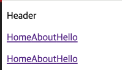

*현재는 내가 어떤 경로에 있는지 알 수 없다* 

## **router-link-active 속성**

*→ 현재 활성화된 RouterLink에 Vue Router가 자동으로 붙여주는 클래스*

*→ 기본 동작, 현재 경로와 매칭되면 자동 적용*

```css
.router-link-active {
  font-weight: bold;
  color: red;
}
```

```html
<script setup>
import TheHeader from '@/layouts/TheHeader.vue';
import TheBody from '@/layouts/TheBody.vue';
import '@/asset/css/style.css';
</script>

<template>
  <TheHeader></TheHeader>
  <TheBody></TheBody>
</template>

```

      - src/css/style.css CS 적용

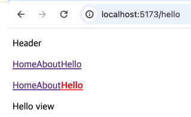

      - 적용 이후

### router/index.js 

```javascript
const routes = [
  {
    path: '/product/:id',
    name: 'ProductPage',
    component: ProductView,
  },
];
```

### ProductView.vue 

```javascript
<template>
  <div>Product {{ $route.params.id }}</div>
</template>

<script setup>
import { useRoute } from 'vue-router';
const route = useRoute();
console.log(route.params);
console.log(route.query);
</script>
```

***존재하지 않은 경로/리소스에 접근 시 처리 방법***

**components/NotFoundView.vue**

```html
<template>
  <h1>정의하지 않은 접근페이지 입니다.</h1>
</template>
```

**router/index.js**

```javascript
import { createRouter, createWebHistory } from 'vue-router';
import NotFoundView from '@/components/NotFoundView.vue';

const routes = [
  {
    path: '/:pathMatch(.*)*',
    name: 'NotFoundPage',
    component: NotFoundView,
  },
];

const router = createRouter({
  history: createWebHistory('/'),
  routes,
});

export default router;
```

      - ***path: ‘/:pathMatch(.*)*을 통해 적용***

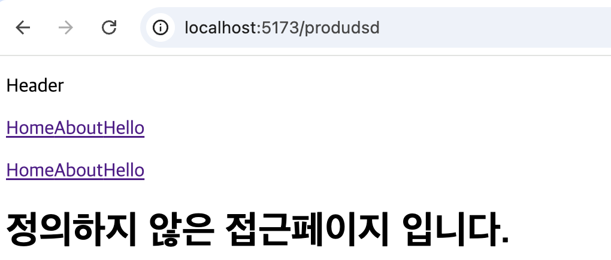

### TheHeader.vue

```javascript
<template>
  <p>Header</p>
  <p>
    <RouterLink to="/hello" active-class="on">Hello</RouterLink>
    <RouterLink :to="{ name: 'HomePage' }" active-class="on">Home</RouterLink>
    <RouterLink :to="{ name: 'AboutPage' }" active-class="on">About</RouterLink>
    <RouterLink
      :to="{ name: 'ProductPage', params: { id: '1' }, query: { lang: 'ko' } }"
      active-class="on"
      >Product</RouterLink
    >
  </p>
</template>
```

      - *<RouterLink to=”/hello>Hello</RouterLink>*
- ***이 경우 index.js의 HelloPage 컴포넌트의 경로가 바뀔 경우 해당 경로도 수정해야 한다.***
      - *<RouterLink :to="{ name: 'HomePage' }">Home</RouterLink>*
- *route 객체의 name 속성을 활용하기 때문에 index.js의 HomePage 컴포넌트가 경로가 수정되어도 name으로 매핑되기 때문에 수정할 필요가 없다.*
        - *즉, index.js 의 변경이 해더에 영향이 없다.*
      - *<RouterLink :to="{ name: 'ProductPage', params: { id: '1' }, query: { lang: 'ko' } }">* 
- *이렇게 name 뿐만 아니라 params(path variable), query(query string) 또한 활용할 수 있다.*

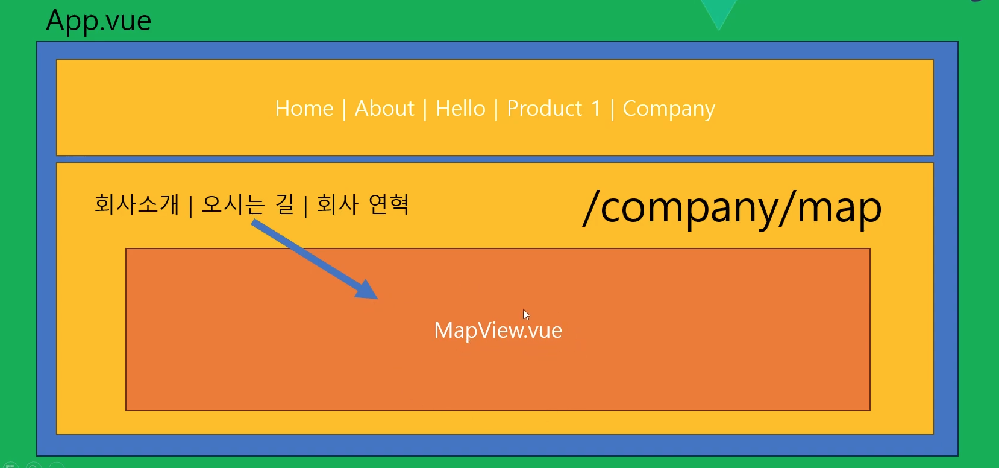

### router/index.js

```javascript
import { createRouter, createWebHistory } from 'vue-router';
import NotFoundView from '@/components/NotFoundView.vue';

const routes = [
  {
    path: '/company',
    name: 'CompanyPage',
    component: () => import('@/components/company/CompanyView.vue'),
    children: [
      {
        path: '/company/intro',
        name: 'company-intro',
        component: () => import('@/components/company/IntroView.vue'),
      },
      {
        path: 'map',
        name: 'company-map',
        component: () => import('@/components/company/MapView.vue'),
      },
      {
        path: 'history',
        name: 'company-history',
        component: () => import('@/components/company/HistoryView.vue'),
      },
    ],
  },
  {
    path: '/:pathMatch(.*)*',
    name: 'NotFoundPage',
    component: NotFoundView,
  },
];

const router = createRouter({
  history: createWebHistory('/'),
  routes,
});

export default router;
```

      - *router의 component들을 모두 import 할 수 있지만 아래와 같이도 가능하다.*
- *component: () => import('@/components/company/CompanyView.vue'),*
      - *children을 통해 중첩구조를 적용시킬 수 있다.*

### components/company/CompanyView.vue

```html
<template>
  <h1>Company</h1>
  <p>
    <RouterLink :to="{ name: 'company-intro' }" active-class="on"
      >회사소개</RouterLink
    >
    <RouterLink :to="{ name: 'company-map' }" active-class="on"
      >오시는 길</RouterLink
    >
    <RouterLink :to="{ name: 'company-history' }" active-class="on"
      >회사연혁</RouterLink
    >
  </p>
  <RouterView></RouterView>
</template>
```

      - *<RouterLink>를 통해 3가지 Component를 보여준다.*
      - *<RouterView>를 통해 동적으로 중첩 구조를 보여준다.*

### CompanyView.vue

```html
<template>
  <h1>Company</h1>
  <p>
    <RouterLink :to="{ name: 'company-intro' }" active-class="on"
      >회사소개</RouterLink
    >
    <RouterLink :to="{ name: 'company-map' }" active-class="on"
      >오시는 길</RouterLink
    >
    <RouterLink :to="{ name: 'company-history' }" active-class="on"
      >회사연혁</RouterLink
    >
  </p>
  <RouterView name="header"></RouterView>
  <RouterView name="body"></RouterView>
  <RouterView name="footer"></RouterView>
</template>
```

      - *현재 <RouterView>를 보면 총3개가 있다.*
      - *이런 경우 각 RouterView에 대한 구분이 필요해서 name 속성을 사용한다*

### index.js

```javascript
import { createRouter, createWebHistory } from 'vue-router';
// 생략 ...
import NotFoundView from '@/components/NotFoundView.vue';

const routes = [
   // 생략 ...
  {
    path: '/company',
    name: 'CompanyPage',
    component: () => import('@/components/company/CompanyView.vue'),
    children: [
      {
        path: 'intro',
        name: 'company-intro',
        components: {
          header: () =>
            import('@/components/company/layouts/CompanyHeaderView.vue'),
          body: () => import('@/components/company/IntroView.vue'),
          footer: () =>
            import('@/components/company/layouts/CompanyFooterView.vue'),
        },
      },
      {
        path: 'map',
        name: 'company-map',
        components: {
          header: () =>
            import('@/components/company/layouts/CompanyHeaderView.vue'),
          body: () => import('@/components/company/MapView.vue'),
          footer: () =>
            import('@/components/company/layouts/CompanyFooterView.vue'),
        },
      },
      {
        path: 'history',
        name: 'company-history',
        components: {
          header: () =>
            import('@/components/company/layouts/CompanyHeaderView.vue'),
          body: () => import('@/components/company/HistoryView.vue'),
          footer: () =>
            import('@/components/company/layouts/CompanyFooterView.vue'),
        },
      },
    ],
  },
  {
    path: '/:pathMatch(.*)*',
    name: 'NotFoundPage',
    component: NotFoundView,
  },
];

const router = createRouter({
  history: createWebHistory('/'),
  routes,
});

export default router;
```

      - *여러 컴포넌트 등록을 위해 components 문법을 사용하고 각 RouterView name 속성에 맞게 import 해준다.*

## redirect 

---

*사이트 개편 같은 작업을 통해 이전에 사용하던 경로가 바뀐 경우*

*개편된 경로로 연결시켜주기 위해 주로 사용된다*

```html
{
  path: '/abouts',
  redirect: '/about',
},
{
  path: '/about',
  name: 'AboutPage',
  component: AboutView,
},
```

      - */abouts → /about으로 리다이렉트 → AboutView 접근*
      - *경로가 바뀐다*

## alias

---

*같은 페이지를 다른 경로로 접근하도록 해준다*

```html
{
  path: '/about',
  name: 'AboutPage',
  alias: '/aboutMe'
  component: AboutView,
},
```

      - */about → AboutView 접근*
      - */aboutMe → AboutView 접근*
      - *경로는 그대로*

*리다렉션하거나 취소하여 네비게이션을 보호하는 용도로 사용*

      1. *전역적으로 적용하는 가드*
1. *로그인 여부 체크*
        1. *권한(관리자 / 사용자) 체크*
      1. *컴포넌트에 적용하는 가드*
      1. *라우터에 적용하는 가드*

***전역 가드는 전체 통제, 라우트 가드는 페이지 단위 통제, 컴포넌트 가드는 화면 단위 통제다.***

## 전역 가드

---

***router/index.js*** 

```javascript
const router = createRouter({
  history: createWebHistory('/'),
  routes,
});

// 전역 가드
router.beforeEach((to, from, next) => {
  console.log(to);
  console.log(from);
  if(to.fullPath !== '/company') {
    next();
  }
});
```

      - *사용 방법 next()를 조건부로 호출하여 접근을 막는다.*
      - */company를 제외하고는 모두 접근이 가능하다.*

## 컴포넌트 가드

---

```javascript
<script setup>
import { useRouter, onBeforeRouteLeave } from 'vue-router';

onBeforeRouteLeave((to, from, next) => {
  console.log('onBeforeRouteLeave');
  if (to.fullPath !== '/company') {
    next();
  }
});
</script>
```

      - *onBeforeRouteLeave를 import 받는다.*
      - *사용법은 전역 가드와 동일 해당 가드는 현재 컴포넌트에서 다른 컴포넌트로 넘어갈 때 호출된다.*

## 라우터 가드

---

```javascript
{
  path: '/about',
  name: 'AboutPage',
  alias: '/aboutMe',
  component: AboutView,
  beforeEnter: (to, from, next) => {
    console.log('라우터별 가드 : beforeEnter');
    next()
  }
},
```

      - 특정 라우트만 보호
      - 관리자 페이지
      - 로그인 페이지 접근 제한

*애플리케이션 상태를 관리하기 위한 Vue 공식 라이브러리,* 

*Vuex의 후속 버전*

[https://www.youtube.com/watch?v=povDCmh3BfM&list=PLfpRlCqycThkmL-HIcAf542NefEZtQFrV](https://www.youtube.com/watch?v=povDCmh3BfM&list=PLfpRlCqycThkmL-HIcAf542NefEZtQFrV)

[https://www.youtube.com/watch?v=eiCZ5YEDvmI](https://www.youtube.com/watch?v=eiCZ5YEDvmI)

